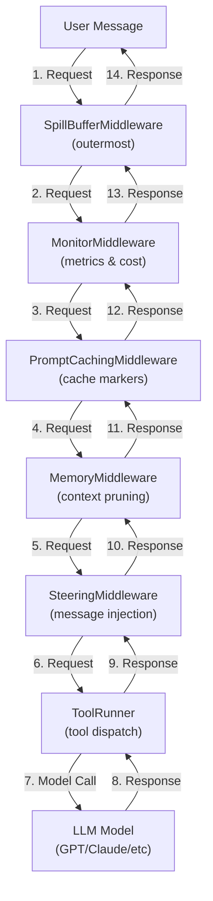
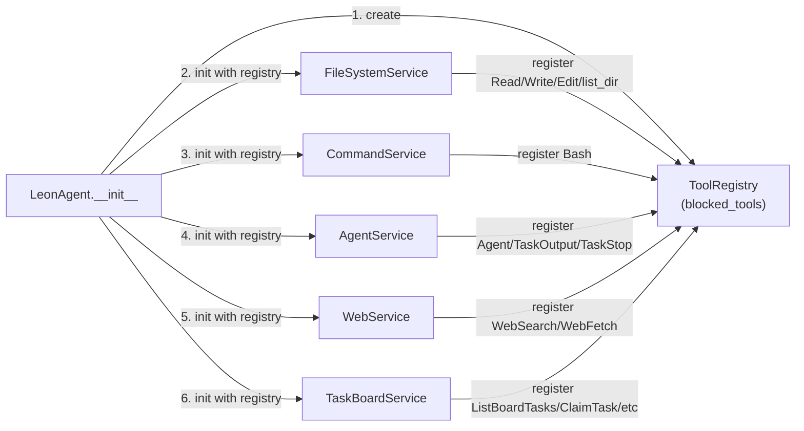
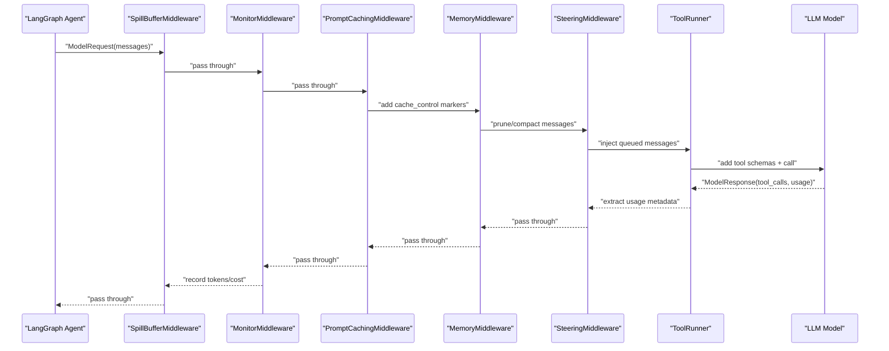
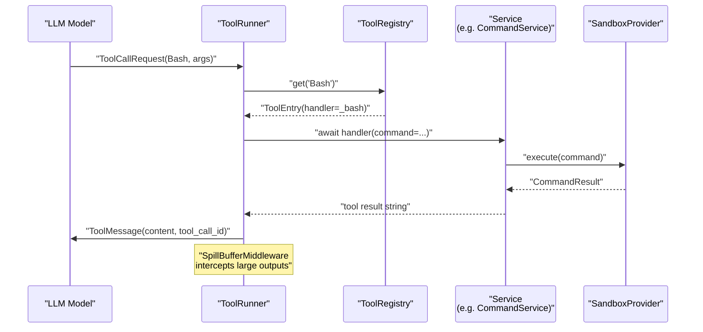
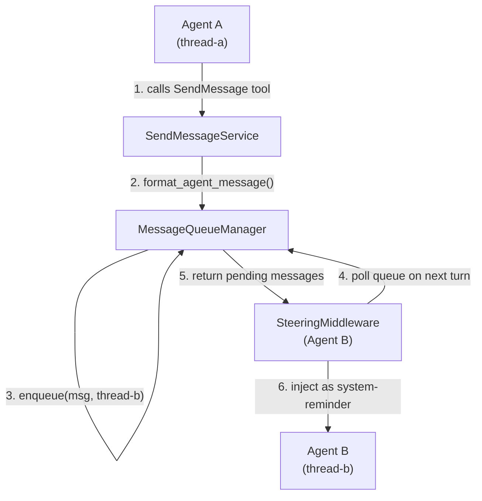

<!-- source: DeepWiki mcp.deepwiki.com · repo OpenDCAI/Mycel · page 5.3 Middleware Stack · fetched 2026-11-02 -->

# Middleware Stack

<details>
<summary>Relevant source files</summary>

The following files were used as context for generating this wiki page:

- [backend/taskboard/middleware.py](backend/taskboard/middleware.py)
- [backend/taskboard/service.py](backend/taskboard/service.py)
- [backend/web/services/member_service.py](backend/web/services/member_service.py)
- [config/defaults/tool_catalog.py](config/defaults/tool_catalog.py)
- [core/agents/communication/service.py](core/agents/communication/service.py)
- [core/agents/service.py](core/agents/service.py)
- [core/runtime/agent.py](core/runtime/agent.py)
- [core/runtime/registry.py](core/runtime/registry.py)
- [core/tools/command/service.py](core/tools/command/service.py)
- [sandbox/capability.py](sandbox/capability.py)

</details>


This document explains the middleware architecture in Mycel's agent runtime. The middleware stack wraps every LLM model call bidirectionally, processing requests before they reach the model and responses after they return. Each middleware layer handles a specific cross-cutting concern such as cost monitoring, memory management, or tool execution.

For information about the agent initialization process and model setup, see [Agent Architecture and Initialization](#5.1). For details on how tools are defined and validated, see [Tool Registry and Execution](#5.2). For sub-agent spawning and communication, see [Sub-agents and Inter-agent Communication](#5.4).

## Architecture Overview

The middleware stack is constructed during `LeonAgent` initialization and wraps the LangGraph agent. Middlewares are ordered from outer to inner, with each layer processing requests in sequence before passing them to the next layer, and processing responses in reverse order on the way back.

### Middleware Stack Diagram



**Sources:** [core/runtime/agent.py:768-824]()

### Stack Construction Order

The middleware stack is built in `_build_middleware_stack()` and follows this specific order:

| Index | Middleware | Purpose | When Applied |
|-------|------------|---------|--------------|
| 0 | `SpillBufferMiddleware` | Catches oversized tool outputs | Always (if enabled in config) |
| 1 | `MonitorMiddleware` | Tracks tokens, cost, context usage | Always |
| 2 | `PromptCachingMiddleware` | Adds cache_control markers | Always |
| 3 | `MemoryMiddleware` | Prunes/compacts conversation history | If memory.pruning or memory.compaction enabled |
| 4 | `SteeringMiddleware` | Injects queued messages | Always |
| 5 | `ToolRunner` | Dispatches tool calls to handlers | Always (innermost) |

**Sources:** [core/runtime/agent.py:768-824]()

## Middleware Components

### SpillBufferMiddleware

The outermost middleware that intercepts tool responses and writes large outputs to files instead of passing them directly to the model. This prevents context overflow when tools return massive outputs (e.g., large log files, directory listings).

**Key Responsibilities:**
- Intercepts `ToolMessage` responses
- Checks output size against per-tool thresholds
- Writes oversized outputs to `~/.spillbuffer/` directory
- Replaces original content with file reference

**Configuration:** Controlled by `config.tools.spill_buffer.enabled` and per-tool thresholds in `config.tools.spill_buffer.thresholds`.

**Sources:** [core/runtime/agent.py:809-822]()

### MonitorMiddleware

The second layer from the outside that observes all model calls and responses to track metrics, calculate costs, and enforce context limits.

**Key Responsibilities:**
- Captures token counts from model responses
- Calculates API costs using provider pricing data
- Tracks context window usage
- Provides runtime telemetry via `MonitorMiddleware.runtime`
- Enforces context limits

**Important:** Must come before `PromptCachingMiddleware`, `MemoryMiddleware`, and `SteeringMiddleware` so token counts are captured before any request transformations.

**Configuration:** Uses `context_limit` from `config.runtime.context_limit` and model name for cost calculation.

**Sources:** [core/runtime/agent.py:780-789]()

### PromptCachingMiddleware

Adds `cache_control` markers to model requests to enable prompt caching on supported providers (Anthropic, OpenAI with specific models).

**Key Responsibilities:**
- Analyzes message history
- Adds cache breakpoints to system messages and long conversation segments
- Reduces token costs for repeated context

**Configuration:** Initialized with `ttl="5m"` and `min_messages_to_cache=0`, meaning caching is attempted on all requests.

**Sources:** [core/runtime/agent.py:792]()

### MemoryMiddleware

Manages conversation history to prevent context overflow. Conditionally enabled based on configuration.

**Key Responsibilities:**
- **Pruning:** Removes old messages based on recency and importance
- **Compaction:** Summarizes conversation segments using a small model
- **Checkpoint Integration:** Works with LangGraph checkpointer to maintain state
- **Storage:** Persists summaries to SQLite or injected storage container

**Configuration:** Controlled by `config.memory.pruning.enabled` and `config.memory.compaction.enabled`. If both are false, this middleware is not added to the stack.

**Dependencies:**
- Requires `checkpointer` for state management
- Uses `summary_repo` from `storage_container` if available
- Falls back to SQLite at `db_path` for summary persistence

**Sources:** [core/runtime/agent.py:794-797](), [core/runtime/agent.py:826-845]()

### SteeringMiddleware

Injects queued messages into the conversation before the model call. This enables background task notifications, inter-agent messages, and other asynchronous communication.

**Key Responsibilities:**
- Checks `MessageQueueManager` for pending messages
- Injects messages as system-reminder format into the conversation
- Supports multiple notification types: agent, command, user

**Integration:** Uses the shared `queue_manager` instance passed during `LeonAgent` initialization.

**Sources:** [core/runtime/agent.py:800]()

### ToolRunner

The innermost middleware that dispatches tool calls to their registered handlers. This is the bridge between the LLM's tool call requests and the actual tool execution.

**Key Responsibilities:**
- Intercepts tool call requests from model responses
- Validates tool schemas using `ToolValidator`
- Dispatches to registered handlers in `ToolRegistry`
- Returns `ToolMessage` responses
- Handles both sync and async tool handlers

**Tool Modes:**
- **INLINE:** Tools are injected into every model call via schemas
- **DEFERRED:** Tools are only discoverable via `tool_search` tool

**Sources:** [core/runtime/agent.py:803-807]()

## Tool Registry Integration

The `ToolRegistry` serves as the central catalog of all available tools. Services register their tools during agent initialization, and `ToolRunner` uses the registry to dispatch tool calls.

### Service Registration Pattern



Each service follows this pattern:

1. Accept `ToolRegistry` in constructor
2. Create `ToolEntry` objects with name, mode, schema, and handler
3. Call `registry.register(entry)` for each tool

**Example from CommandService:**

```python
registry.register(ToolEntry(
    name="Bash",
    mode=ToolMode.INLINE,
    schema={...},
    handler=self._bash,
    source="CommandService",
))
```

**Sources:** [core/runtime/agent.py:847-940](), [core/tools/command/service.py:62-96](), [core/agents/service.py:178-198](), [backend/taskboard/service.py:49-205]()

### Tool Blocking and Filtering

Tools can be disabled per-agent via member configuration. The `ToolRegistry` receives a `blocked_tools` set during initialization, which causes `register()` to silently skip disabled tools.

**Blocking Logic:**
- Member's `runtime.json` contains `tools:ToolName` entries with `enabled: false`
- Tool catalog defines default-off tools (e.g., TaskBoard tools)
- `_get_member_blocked_tools()` computes the final blocked set
- Registry skips registration for blocked tools

**Sources:** [core/runtime/agent.py:337-369](), [core/runtime/registry.py:48-53]()

### Tool Modes: INLINE vs DEFERRED

| Mode | Schema Injection | Discovery | Use Case |
|------|------------------|-----------|----------|
| `INLINE` | Injected into every model call | Always visible | Core tools (Read, Write, Bash) |
| `DEFERRED` | Not injected | Via `tool_search` only | Rarely-used tools (TaskCreate) |

**INLINE tools** are added to the model's `tools` parameter on every call. **DEFERRED tools** are not injected but can be discovered when the agent uses the `tool_search` tool with a query.

**Sources:** [core/runtime/registry.py:11-14](), [core/runtime/registry.py:58-61]()

## Request/Response Flow

### Model Call Flow



**Sources:** [core/runtime/agent.py:768-824]()

### Tool Call Flow



**Sources:** [core/runtime/runner.py]() (not shown but referenced), [core/tools/command/service.py:110-139]()

## Configuration and Initialization

### Middleware Stack Construction

The stack is built in `LeonAgent.__init__` via `_build_middleware_stack()`:

```python
# 1. Create middleware stack
middleware = self._build_middleware_stack()

# 2. Create LangGraph agent with middleware
self.agent = create_agent(
    model=self.model,
    tools=mcp_tools,
    system_prompt=SystemMessage(...),
    middleware=middleware,  # Stack wraps the agent
    checkpointer=self.checkpointer,
)
```

**Order is critical:** The list order determines wrapping order, where index 0 is the outermost layer.

**Sources:** [core/runtime/agent.py:228-248]()

### Middleware Dependencies

Some middlewares require specific agent state:

| Middleware | Dependencies | Set During |
|------------|--------------|------------|
| `MonitorMiddleware` | Model name, context limit | Construction |
| `MemoryMiddleware` | Checkpointer, summary_repo, runtime, model | Construction + post-init |
| `SteeringMiddleware` | MessageQueueManager | Construction |
| `ToolRunner` | ToolRegistry, ToolValidator | Construction |
| `SpillBufferMiddleware` | FileSystemBackend, workspace_root | Construction |

**Post-initialization injection** is required for `MemoryMiddleware` because it needs the `runtime` object, which is created by `MonitorMiddleware`:

```python
# After agent creation:
self.runtime = self._monitor_middleware.runtime

# Inject runtime/model into MemoryMiddleware
if hasattr(self, "_memory_middleware"):
    self._memory_middleware.set_runtime(self.runtime)
    self._memory_middleware.set_model(self.model)
```

**Sources:** [core/runtime/agent.py:250-256](), [core/runtime/agent.py:826-845]()

### Configuration Hot-Reloading

The middleware stack is **not rebuilt** during `update_config()`. Only specific middleware properties are updated:

- `MonitorMiddleware.update_model()` - updates cost calculator and context limit
- `MemoryMiddleware.set_context_limit()` - updates pruning threshold

This lightweight approach allows model switching without rebuilding the entire LangGraph graph.

**Sources:** [core/runtime/agent.py:606-662]()

## Integration with Services

### Background Task Lifecycle

Several services spawn background tasks and use the middleware stack indirectly:

**AgentService** spawns sub-agents as asyncio tasks:
```python
task = asyncio.create_task(self._run_agent(...))
```

**CommandService** spawns async bash commands:
```python
async_cmd = await self._executor.execute_async(...)
```

Both services emit lifecycle events (`task_start`, `task_done`) that `SteeringMiddleware` can inject as notifications.

**Sources:** [core/agents/service.py:229-232](), [core/tools/command/service.py:141-156]()

### Inter-Agent Communication Flow



**Message Format:** Messages are formatted as XML:
```xml
<system-reminder>
<agent-message>
  {"message_type": "message", "content": "...", "sender_thread": "thread-a"}
</agent-message>
</system-reminder>
```

**Sources:** [core/agents/communication/service.py:67-96](), [core/runtime/middleware/queue/manager.py]() (not shown)

## Summary

The middleware stack provides a clean separation of concerns for cross-cutting functionality in Mycel's agent runtime. Each layer processes requests and responses in a bidirectional pipeline, with the outermost `SpillBufferMiddleware` handling tool output overflow and the innermost `ToolRunner` dispatching actual tool execution. Services register their tools via `ToolRegistry`, enabling uniform schema injection, validation, and dispatch. The stack integrates with LangGraph's agent system and supports hot-reloading for model changes without graph reconstruction.

**Sources:** [core/runtime/agent.py:1-1225](), [core/runtime/registry.py:1-80](), [core/agents/service.py:1-434](), [core/tools/command/service.py:1-238]()

---

