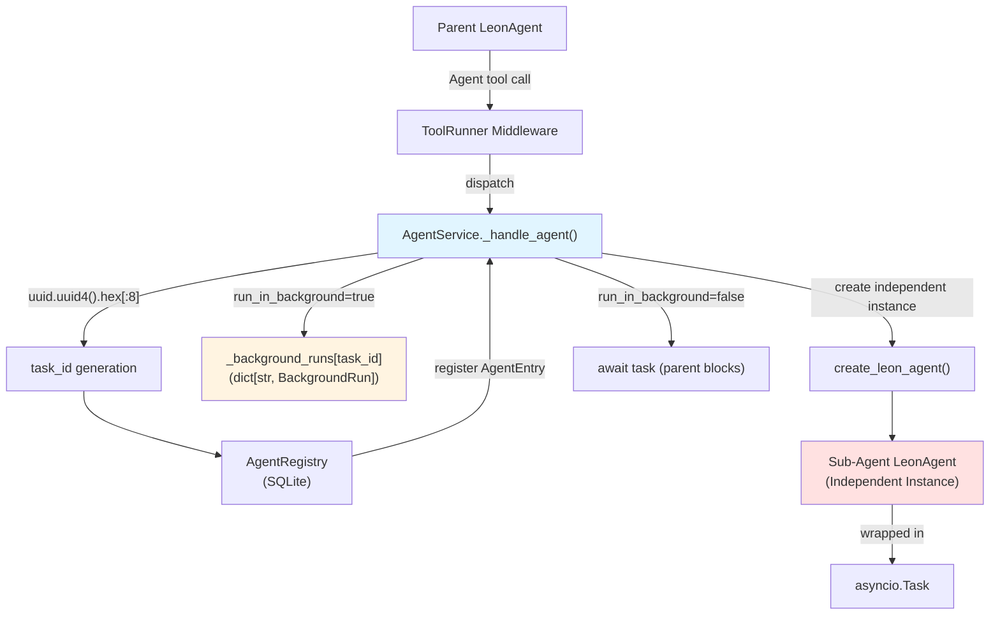
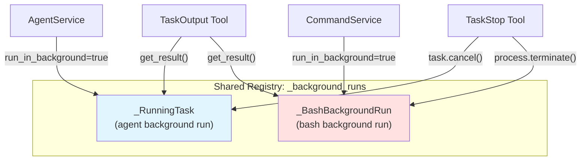
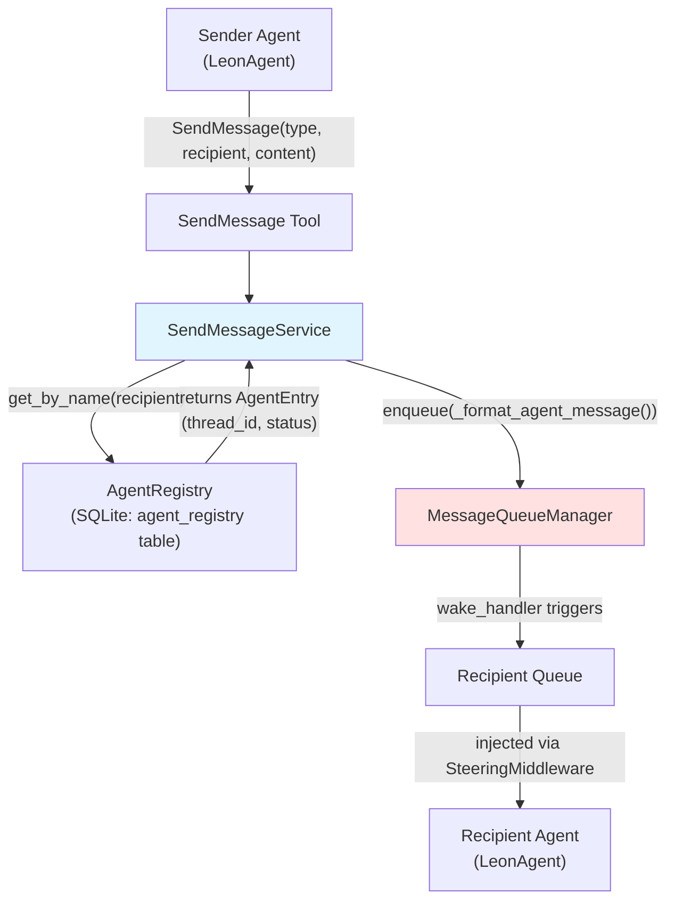
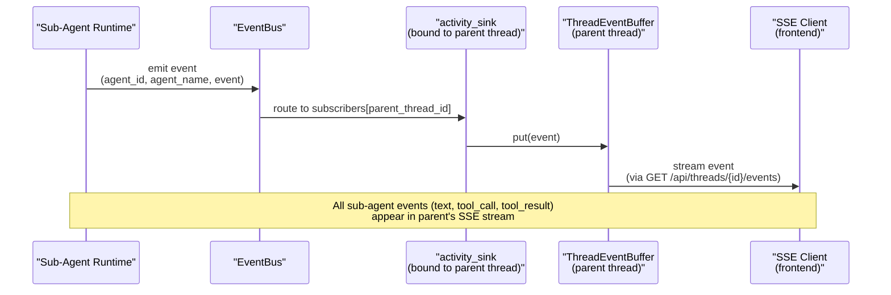

<!-- source: DeepWiki mcp.deepwiki.com · repo OpenDCAI/Mycel · page 5.4 Sub-agents and Inter-agent Communication · fetched 2026-11-02 -->

# Sub-agents and Inter-agent Communication

<details>
<summary>Relevant source files</summary>

The following files were used as context for generating this wiki page:

- [backend/taskboard/middleware.py](backend/taskboard/middleware.py)
- [backend/taskboard/service.py](backend/taskboard/service.py)
- [backend/web/core/lifespan.py](backend/web/core/lifespan.py)
- [backend/web/models/thread_config.py](backend/web/models/thread_config.py)
- [backend/web/routers/threads.py](backend/web/routers/threads.py)
- [backend/web/services/agent_pool.py](backend/web/services/agent_pool.py)
- [backend/web/services/member_service.py](backend/web/services/member_service.py)
- [backend/web/services/streaming_service.py](backend/web/services/streaming_service.py)
- [backend/web/utils/helpers.py](backend/web/utils/helpers.py)
- [config/defaults/tool_catalog.py](config/defaults/tool_catalog.py)
- [core/agents/communication/service.py](core/agents/communication/service.py)
- [core/agents/service.py](core/agents/service.py)
- [core/runtime/agent.py](core/runtime/agent.py)
- [core/runtime/registry.py](core/runtime/registry.py)
- [core/tools/command/service.py](core/tools/command/service.py)
- [sandbox/capability.py](sandbox/capability.py)

</details>


This document explains the sub-agent spawning system and inter-agent communication mechanisms in Mycel. It covers how the `Agent` tool creates independent sub-agents, how background task management works for both agent and bash tasks, and how agents communicate via the `SendMessage` tool.

For information about the main agent initialization and architecture, see [Agent Architecture and Initialization](#5.1). For details about the tool registry system, see [Tool Registry and Execution](#5.2).

---

## Overview

Mycel supports hierarchical multi-agent systems where a parent agent can spawn independent sub-agents to handle complex tasks concurrently. Sub-agents are fully isolated `LeonAgent` instances with their own:

- Thread ID and LangGraph state
- Tool execution context
- Event streaming to the parent's SSE connection
- Background task tracking

Sub-agents can run in two modes:
- **Blocking** (default): Parent waits for completion, receives result as tool return value
- **Background** (`run_in_background=true`): Fire-and-forget, returns `task_id` for polling

The system also provides inter-agent communication via `SendMessage` tool, which routes messages through `MessageQueueManager` using `AgentRegistry` for name resolution.

**Sources:** [core/agents/service.py:1-434](), [core/agents/communication/service.py:1-225]()

---

## Agent Spawning Architecture

### AgentService Registration

`AgentService` registers three tools into `ToolRegistry`:

| Tool | Mode | Description |
|------|------|-------------|
| `Agent` | Inline | Spawn a sub-agent with a prompt and optional configuration |
| `TaskOutput` | Inline | Retrieve output from a background agent task |
| `TaskStop` | Inline | Cancel a running background agent task |

**Agent Tool Schema:**

```yaml
name: Agent
parameters:
  subagent_type: string (optional)  # Agent specialization (e.g. 'Explore', 'Coder')
  prompt: string (required)         # Task for the agent
  name: string (optional)           # Name for SendMessage routing
  description: string               # Required for background tasks (shown in UI)
  run_in_background: boolean        # Fire-and-forget mode (default: false)
  max_turns: integer                # Maximum LLM turns (optional)
```

**Sources:** [core/agents/service.py:25-63]()

### Sub-Agent Creation Flow



**Sources:** [core/agents/service.py:200-253]()

### Blocking vs Background Execution

**Blocking Mode (default):**
```python
# Parent agent blocks until sub-agent completes
result = agent.astream({"messages": [...]})
# Returns text output directly as tool result
```

**Background Mode (`run_in_background=true`):**
```python
# Returns immediately with task_id
{
  "task_id": "a1b2c3d4",
  "agent_name": "agent-a1b2c3d4",
  "thread_id": "subagent-a1b2c3d4",
  "status": "running",
  "message": "Agent started in background. Use TaskOutput to get result."
}

# Parent can poll via TaskOutput tool
TaskOutput(task_id="a1b2c3d4")
```

**Sources:** [core/agents/service.py:200-252]()

---

## Background Task Management

### Unified Task Registry

Both agent and bash background tasks share a single registry (`_background_runs`) to provide unified tracking via `TaskOutput`/`TaskStop` tools. This enables consistent task management regardless of whether the background work is an agent or a shell command.



**Sources:** [core/agents/service.py:96-148](), [core/tools/command/service.py:118-156]()

### Task Classes

**`_RunningTask`** (agent background runs):
```python
class _RunningTask:
    task: asyncio.Task        # The agent execution task
    agent_id: str            # Unique agent identifier
    thread_id: str           # Sub-agent thread ID
    description: str         # Human-readable description
    
    @property
    def is_done(self) -> bool:
        return self.task.done()
    
    def get_result(self) -> str | None:
        if not self.task.done():
            return None
        exc = self.task.exception()
        if exc:
            return f"<tool_use_error>{exc}</tool_use_error>"
        return self.task.result()
```

**`_BashBackgroundRun`** (bash background runs):
```python
class _BashBackgroundRun:
    _cmd: AsyncCommand       # The async command handle
    command: str             # Command line
    description: str         # Description for UI
    
    @property
    def is_done(self) -> bool:
        return bool(self._cmd.done)
    
    def get_result(self) -> str | None:
        # Returns stdout + stderr + exit code
```

**Sources:** [core/agents/service.py:96-148]()

### TaskOutput and TaskStop Implementation

**TaskOutput** retrieves results:
```python
async def _handle_task_output(self, task_id: str) -> str:
    running = self._tasks.get(task_id)
    if not running:
        return f"Error: task '{task_id}' not found"
    
    if not running.is_done:
        return json.dumps({
            "task_id": task_id,
            "status": "running",
            "message": "Agent is still running."
        })
    
    result = running.get_result()
    # Returns result or error
```

**TaskStop** cancels tasks:
```python
async def _handle_task_stop(self, task_id: str) -> str:
    running = self._tasks.get(task_id)
    if not running:
        return f"Error: task '{task_id}' not found"
    
    if running.is_done:
        return f"Task {task_id} already completed"
    
    running.task.cancel()  # For agent tasks
    # or process.terminate() for bash tasks
```

**Sources:** [core/agents/service.py:401-433]()

---

## Inter-Agent Communication

### SendMessageService Architecture

`SendMessageService` enables agents to communicate via structured messages routed through `MessageQueueManager`. Messages are resolved using `AgentRegistry` for name-based addressing.



**Sources:** [core/agents/communication/service.py:1-225]()

### Message Types

| Type | Description | Required Parameters |
|------|-------------|---------------------|
| `message` | Direct message to specific agent | `recipient`, `content`, `summary` (optional) |
| `broadcast` | Send to all running agents | `content`, `summary` (optional) |
| `shutdown_request` | Request agent shutdown | `recipient`, `content` |
| `shutdown_response` | Respond to shutdown request | `recipient`, `content`, `approve`, `request_id` |
| `plan_approval_response` | Approve/reject a plan | `recipient`, `content`, `approve`, `request_id` |

**Sources:** [core/agents/communication/service.py:19-64]()

### Message Format

Messages are formatted as system-reminder XML and injected into the recipient's next LLM turn:

```xml
<system-reminder>
<agent-message>
  {"message_type": "message",
   "content": "Task completed successfully",
   "sender_thread": "subagent-a1b2c3d4",
   "summary": "Task done"}
</agent-message>
</system-reminder>
```

**Implementation:**
```python
def _format_agent_message(
    msg_type: str,
    content: str,
    sender_thread: str,
    summary: str | None = None,
    approve: bool | None = None,
    request_id: str | None = None,
) -> str:
    payload = {
        "message_type": msg_type,
        "content": content,
        "sender_thread": sender_thread,
    }
    # ... add optional fields
    escaped = escape(json.dumps(payload, ensure_ascii=False))
    return (
        "<system-reminder>\n"
        "<agent-message>\n"
        f"  {escaped}\n"
        "</agent-message>\n"
        "</system-reminder>"
    )
```

**Sources:** [core/agents/communication/service.py:67-95]()

### AgentRegistry Name Resolution

The `AgentRegistry` tracks all running agents by name and thread ID, enabling name-based message routing:

```python
# Register agent on spawn
entry = AgentEntry(
    agent_id=task_id,
    name=agent_name,
    thread_id=thread_id,
    status="running",
    parent_agent_id=parent_thread_id,
    subagent_type=subagent_type,
)
await self._agent_registry.register(entry)

# Resolve recipient by name
entry = await self._agent_registry.get_by_name(recipient)
if not entry:
    return f"Error: agent '{recipient}' not found"

# Enqueue message to recipient's thread
self._queue_manager.enqueue(msg, entry.thread_id, "agent")
```

**Sources:** [core/agents/service.py:217-226](), [core/agents/communication/service.py:141-155]()

---

## Event Flow and SSE Integration

### EventBus Architecture

Sub-agent events are routed to the parent thread's SSE stream via `EventBus` subscription. This enables real-time visibility of sub-agent activity in the UI.



**Sources:** [backend/web/services/streaming_service.py:330-336]()

### Sub-Agent Event Binding

When a sub-agent is spawned, its runtime is bound to emit events through the parent's `activity_sink`:

```python
# In AgentService._run_agent()
try:
    from backend.web.event_bus import get_event_bus
    event_bus = get_event_bus()
    emit_fn = event_bus.make_emitter(
        thread_id=parent_thread_id,
        agent_id=task_id,
        agent_name=agent_name,
    )
except ImportError:
    pass  # backend not available in standalone core usage

# Wire child agent events to parent's SSE stream
if emit_fn is not None:
    if hasattr(agent, "runtime") and hasattr(agent.runtime, "bind_thread"):
        agent.runtime.bind_thread(activity_sink=emit_fn)
```

**Sources:** [core/agents/service.py:283-310]()

### Task Lifecycle Events

Background tasks emit SSE events at key lifecycle points:

**task_start** (emitted immediately on spawn):
```json
{
  "event": "task_start",
  "data": {
    "task_id": "a1b2c3d4",
    "thread_id": "subagent-a1b2c3d4",
    "background": true,
    "task_type": "agent",  // or "bash"
    "description": "Analyze codebase"
  }
}
```

**task_done** (emitted on completion):
```json
{
  "event": "task_done",
  "data": {
    "task_id": "a1b2c3d4",
    "background": true
  }
}
```

**task_error** (emitted on exception):
```json
{
  "event": "task_error",
  "data": {
    "task_id": "a1b2c3d4",
    "background": true
  }
}
```

**Sources:** [core/agents/service.py:314-322](), [core/agents/service.py:353-357](), [core/agents/service.py:376-382]()

### Queue-Based Notifications

When a background task completes, a notification is enqueued to the parent thread so the parent agent knows the task finished:

```python
# For agent background runs
if run_in_background and self._queue_manager and parent_thread_id:
    label = description or agent_name
    notification = format_background_notification(
        task_id=task_id,
        status="completed",
        summary=label,
        description=label,
    )
    self._queue_manager.enqueue(notification, parent_thread_id, notification_type="agent")
```

**Sources:** [core/agents/service.py:361-369]()

---

## API Endpoints for Background Tasks

The backend provides REST endpoints for querying and managing background tasks (both agent and bash):

### GET /api/threads/{thread_id}/tasks

List all background tasks for a thread:

```json
[
  {
    "task_id": "a1b2c3d4",
    "task_type": "agent",  // or "bash"
    "status": "running",   // or "completed"
    "command_line": null,  // for bash tasks
    "description": "Analyze codebase",
    "exit_code": null,     // for bash tasks
    "error": null
  }
]
```

**Implementation:**
```python
@router.get("/{thread_id}/tasks")
async def list_tasks(thread_id: str, request: Request) -> list[dict]:
    runs = _get_background_runs(request.app, thread_id)
    result = []
    for task_id, run in runs.items():
        run_type = "bash" if run.__class__.__name__ == "_BashBackgroundRun" else "agent"
        result.append({
            "task_id": task_id,
            "task_type": run_type,
            "status": "completed" if run.is_done else "running",
            # ... other fields
        })
    return result
```

**Sources:** [backend/web/routers/threads.py:535-554]()

### GET /api/threads/{thread_id}/tasks/{task_id}

Get detailed status and output for a specific task:

```json
{
  "task_id": "a1b2c3d4",
  "task_type": "agent",
  "status": "completed",
  "command_line": null,
  "result": "Analysis complete. Found 42 issues.",
  "text": "Analysis complete. Found 42 issues."
}
```

**Sources:** [backend/web/routers/threads.py:557-578]()

### POST /api/threads/{thread_id}/tasks/{task_id}/cancel

Cancel a running background task. For agent tasks, calls `task.cancel()`; for bash tasks, calls `process.terminate()`.

After cancellation, emits a `task_done` SSE event and enqueues a cancellation notification to the parent agent.

**Sources:** [backend/web/routers/threads.py:581-654]()

---

## Implementation Details

### LangChain Callback Isolation

Sub-agents inherit the parent's LangChain callback context via `asyncio.create_task()`, which would cause sub-agent LLM tokens to stream directly into the parent's message stream. To prevent this, the context is explicitly cleared:

```python
# In AgentService._run_agent()
from langchain_core.runnables.config import var_child_runnable_config
var_child_runnable_config.set(None)
```

This ensures each sub-agent starts with a fresh, independent callback context.

**Sources:** [core/agents/service.py:266-274]()

### Thread ID Management

Sub-agents use a dedicated thread ID format to avoid collisions:

```python
task_id = uuid.uuid4().hex[:8]
agent_name = name or f"agent-{task_id}"
thread_id = f"subagent-{task_id}"  # Prefix prevents collision
parent_thread_id = get_current_thread_id()
```

The `parent_agent_id` field in `AgentRegistry` maintains the parent-child relationship.

**Sources:** [core/agents/service.py:212-215]()

### Shared Background Runs Dictionary

`CommandService` and `AgentService` share the same `_background_runs` dictionary to provide unified task management:

```python
# In LeonAgent._init_services()
self._background_runs: dict[str, BackgroundRun] = {}

# Passed to both services
CommandService(
    registry=self._tool_registry,
    background_runs=self._background_runs,  # Shared registry
    ...
)

AgentService(
    tool_registry=self._tool_registry,
    shared_runs=self._background_runs,  # Same registry
    ...
)
```

This enables `TaskOutput` and `TaskStop` tools to work uniformly across both agent and bash background tasks.

**Sources:** [core/agents/service.py:169-176](), [core/tools/command/service.py:44-50]()

---

## Summary

Mycel's sub-agent system provides:

1. **Hierarchical agent spawning** via `Agent` tool with blocking and background modes
2. **Unified background task tracking** for both agent and bash tasks via `_background_runs`
3. **Inter-agent messaging** via `SendMessage` tool with name-based routing
4. **Real-time event streaming** from sub-agents to parent SSE connections via `EventBus`
5. **REST API** for querying and managing background tasks

This architecture enables complex multi-agent workflows where agents can spawn specialized sub-agents, communicate via structured messages, and track long-running background tasks through a consistent interface.

---

