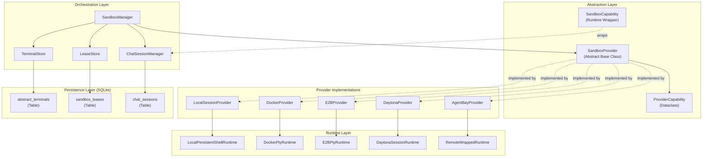
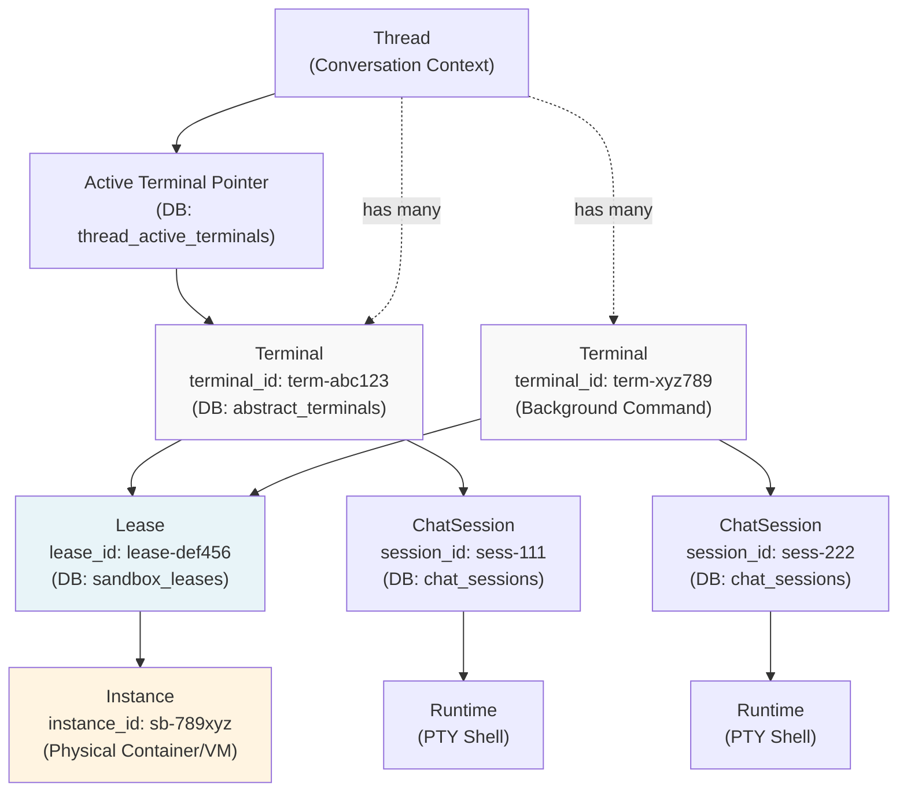
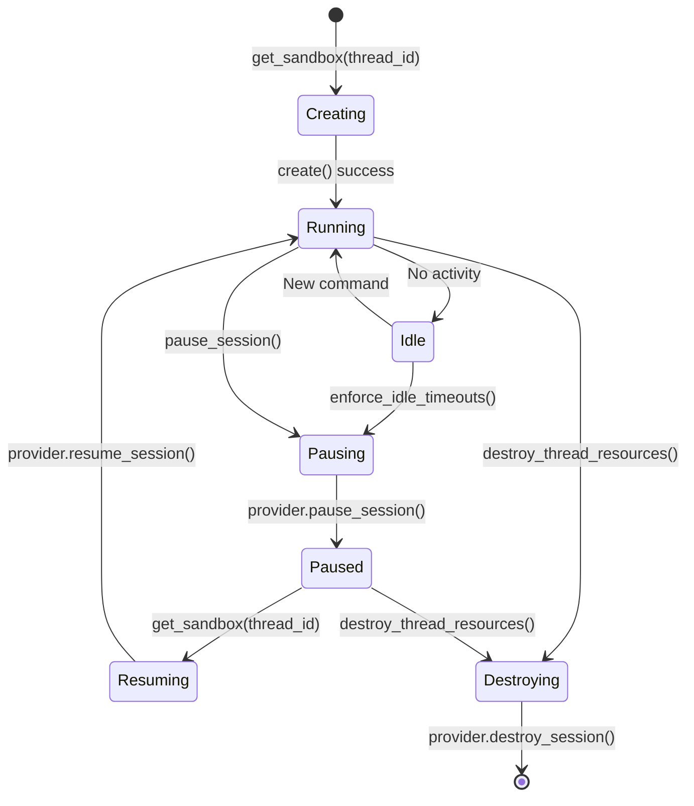

<!-- source: DeepWiki mcp.deepwiki.com · repo OpenDCAI/Mycel · page 6 Sandbox System · fetched 2026-11-02 -->

# Sandbox System

<details>
<summary>Relevant source files</summary>

The following files were used as context for generating this wiki page:

- [sandbox/manager.py](sandbox/manager.py)
- [sandbox/provider.py](sandbox/provider.py)
- [sandbox/providers/__init__.py](sandbox/providers/__init__.py)
- [sandbox/providers/agentbay.py](sandbox/providers/agentbay.py)
- [sandbox/providers/daytona.py](sandbox/providers/daytona.py)
- [sandbox/providers/docker.py](sandbox/providers/docker.py)
- [sandbox/providers/e2b.py](sandbox/providers/e2b.py)
- [sandbox/providers/local.py](sandbox/providers/local.py)

</details>


The Sandbox System provides isolated execution environments for agent tool calls and command execution. It abstracts multiple backend providers (local, Docker, cloud services) behind a unified interface, manages session lifecycle, and orchestrates the mapping from conversation threads to physical compute instances.

For details about specific provider implementations and their capabilities, see [Provider Implementations](#6.2). For runtime and PTY handling specifics, see [Terminal Runtimes and PTY Handling](#6.4). For session orchestration details, see [Session Management and Orchestration](#6.3).

---

## Architecture Overview

The sandbox system is organized into five layers that enable agents to execute commands in isolated environments while maintaining persistent state across multiple interactions.

**Multi-Layer Sandbox Architecture**



**Sources:** [sandbox/provider.py:104-209](), [sandbox/manager.py:46-65](), [sandbox/providers/local.py:30-54](), [sandbox/providers/docker.py:42-75](), [sandbox/providers/e2b.py:35-61](), [sandbox/providers/daytona.py:32-58](), [sandbox/providers/agentbay.py:27-60]()

---

## Core Components

### SandboxProvider Interface

The `SandboxProvider` abstract class [sandbox/provider.py:104-209]() defines the contract all providers must implement:

| Method | Purpose |
|--------|---------|
| `get_capability()` | Returns `ProviderCapability` declaring what the provider supports |
| `create_session()` | Provisions a new sandbox instance |
| `destroy_session()` | Tears down a sandbox instance |
| `pause_session()` | Pauses a running instance (if supported) |
| `resume_session()` | Resumes a paused instance (if supported) |
| `get_session_status()` | Queries current instance state |
| `execute()` | Runs a one-off command |
| `read_file()` / `write_file()` / `list_dir()` | Filesystem operations |
| `get_metrics()` | Retrieves resource usage statistics |
| `create_runtime()` | Instantiates a `PhysicalTerminalRuntime` for persistent shell sessions |

**Sources:** [sandbox/provider.py:104-164]()

### ProviderCapability

The `ProviderCapability` dataclass [sandbox/provider.py:60-76]() declares lifecycle and resource capabilities:

```python
@dataclass(frozen=True)
class ProviderCapability:
    can_pause: bool
    can_resume: bool
    can_destroy: bool
    supports_webhook: bool = False
    supports_status_probe: bool = True
    eager_instance_binding: bool = False
    inspect_visible: bool = True
    runtime_kind: str = "remote"
    resource_capabilities: dict[str, bool] = field(default_factory=dict)
```

Resource capabilities include: `filesystem`, `terminal`, `metrics`, `screenshot`, `web`, `process`, `hooks`, `snapshot` [sandbox/provider.py:14-23]().

**Sources:** [sandbox/provider.py:60-76](), [sandbox/provider.py:14-57]()

### SandboxManager

The `SandboxManager` class [sandbox/manager.py:46-593]() orchestrates session lifecycle across the hierarchy:

- Maps threads to terminals, terminals to leases, leases to instances
- Enforces the invariant that all terminals within a thread share a single lease [sandbox/manager.py:114-122]()
- Implements idle timeout enforcement for cloud providers [sandbox/manager.py:284-368]()
- Provides pause/resume/destroy operations that coordinate across multiple layers
- Handles session-ready callbacks for UI notifications [sandbox/manager.py:74-76]()

**Sources:** [sandbox/manager.py:46-133]()

---

## Orchestration Hierarchy

The sandbox system maintains a strict hierarchy from conversation threads down to physical compute instances:

**Thread → ChatSession → Runtime → Terminal → Lease → Instance Hierarchy**



**Key Invariants:**

1. **Single Lease Per Thread** [sandbox/manager.py:114-122](): All terminals created for a thread must share exactly one lease. This ensures resource isolation per thread.

2. **Active Terminal Pointer Consistency** [sandbox/manager.py:95-98](): If terminals exist for a thread but no active pointer is set, the database is in an inconsistent state and operations must fail.

3. **State Inheritance** [sandbox/manager.py:203-210](): Background command terminals inherit `cwd` and `env_delta` from the default terminal at fork time.

**Sources:** [sandbox/manager.py:90-122](), [sandbox/manager.py:183-217]()

---

## Provider Types

Mycel supports five provider implementations with different isolation levels and capabilities:

**Provider Capability Matrix**

| Provider | Type | Pause/Resume | Metrics | Screenshot | Use Case |
|----------|------|--------------|---------|------------|----------|
| `LocalSessionProvider` | Host | Yes (no-op) | Yes | No | Development, testing |
| `DockerProvider` | Container | Yes | Yes | No | Local isolation |
| `E2BProvider` | Cloud | Yes | Yes | No | Scalable cloud sandboxes |
| `DaytonaProvider` | Cloud | Yes | Yes | No | Managed cloud IDE |
| `AgentBayProvider` | Cloud | Yes* | Yes | Yes | Feature-rich cloud platform |

\* AgentBay pause/resume support depends on account tier [sandbox/providers/agentbay.py:79-82]()

**Sources:** [sandbox/providers/local.py:35-54](), [sandbox/providers/docker.py:54-71](), [sandbox/providers/e2b.py:41-57](), [sandbox/providers/daytona.py:38-54](), [sandbox/providers/agentbay.py:41-56]()

### LocalSessionProvider

Direct host access with in-memory state tracking. No actual isolation, but useful for development. Supports pause/resume as state transitions only [sandbox/providers/local.py:76-106]().

**Sources:** [sandbox/providers/local.py:30-211]()

### DockerProvider

Runs commands inside local Docker containers. Each session gets a dedicated container. Supports named volumes for context persistence [sandbox/providers/docker.py:92-120]().

**Sources:** [sandbox/providers/docker.py:42-460]()

### E2BProvider

Cloud sandbox provider using E2B's beta auto-pause API. Sandboxes pause on idle instead of terminating [sandbox/providers/e2b.py:81-96](). Supports workspace snapshots [sandbox/providers/e2b.py:222-252]().

**Sources:** [sandbox/providers/e2b.py:35-274]()

### DaytonaProvider

Managed cloud IDE sandboxes. Uses Daytona's Python SDK for lifecycle and PTY operations [sandbox/providers/daytona.py:59-79](). Includes advanced metrics via cgroup probing [sandbox/providers/daytona.py:210-274]().

**Sources:** [sandbox/providers/daytona.py:32-290]()

### AgentBayProvider

Alibaba Cloud's AgentBay platform. Richest feature set including screenshot capture, process enumeration, and web UI access [sandbox/providers/agentbay.py:222-239](). Requires context sync for data persistence [sandbox/providers/agentbay.py:84-96]().

**Sources:** [sandbox/providers/agentbay.py:27-253]()

---

## Session Lifecycle

The lifecycle of a sandbox session flows through multiple states managed by `SandboxManager`:

**Session State Transitions**



**Sources:** [sandbox/manager.py:134-182](), [sandbox/manager.py:284-368](), [sandbox/manager.py:374-424](), [sandbox/manager.py:458-482]()

### Idle Timeout Enforcement

The `enforce_idle_timeouts()` method [sandbox/manager.py:284-368]() runs periodically to pause expired sessions:

1. **Skip local provider** [sandbox/manager.py:293-295](): Local sandboxes have no cost to keep running
2. **Check expiration** [sandbox/manager.py:315-318](): Compare `idle_ttl_sec` and `max_duration_sec` against timestamps
3. **Skip busy terminals** [sandbox/manager.py:326-327](): Don't pause if commands are running
4. **Shared lease protection** [sandbox/manager.py:330-348](): Don't pause if other sessions on the same lease are active
5. **Pause and close** [sandbox/manager.py:349-365](): Pause the physical instance, then close the chat session

**Sources:** [sandbox/manager.py:284-368]()

### Resume on Demand

When a paused session receives activity, the manager automatically resumes it [sandbox/manager.py:139-146]():

```python
if session.status == "paused":
    if not self.resume_session(thread_id):
        raise RuntimeError(f"Failed to resume paused session for thread {thread_id}")
    session = self.session_manager.get(thread_id, session.terminal.terminal_id)
```

**Sources:** [sandbox/manager.py:134-148]()

---

## Database Schema

The sandbox system uses three SQLite tables to persist state:

**abstract_terminals Table**

Stores terminal metadata and state snapshots [sandbox/terminal.py]():

| Column | Type | Purpose |
|--------|------|---------|
| `terminal_id` | TEXT | Primary key |
| `thread_id` | TEXT | Associated conversation thread |
| `lease_id` | TEXT | Associated lease (foreign key) |
| `cwd` | TEXT | Current working directory |
| `env_delta` | TEXT | JSON-encoded environment variables |
| `state_version` | INTEGER | Snapshot version for optimistic locking |
| `created_at` | TEXT | Creation timestamp |
| `updated_at` | TEXT | Last state update timestamp |

**sandbox_leases Table**

Tracks lease → instance bindings [sandbox/lease.py]():

| Column | Type | Purpose |
|--------|------|---------|
| `lease_id` | TEXT | Primary key |
| `provider_name` | TEXT | Provider identifier |
| `instance_id` | TEXT | Physical instance ID (nullable) |
| `observed_state` | TEXT | Last known state: running/paused/detached |
| `created_at` | TEXT | Lease creation timestamp |
| `updated_at` | TEXT | Last refresh timestamp |

**chat_sessions Table**

Stores chat session runtime state [sandbox/chat_session.py]():

| Column | Type | Purpose |
|--------|------|---------|
| `session_id` | TEXT | Primary key |
| `thread_id` | TEXT | Associated thread |
| `terminal_id` | TEXT | Associated terminal |
| `lease_id` | TEXT | Associated lease |
| `status` | TEXT | active/idle/paused/closed |
| `started_at` | TEXT | Session start time |
| `last_active_at` | TEXT | Last activity timestamp |
| `idle_ttl_sec` | INTEGER | Idle timeout duration |
| `max_duration_sec` | INTEGER | Maximum session lifetime |

**Sources:** [sandbox/manager.py:23-43](), [sandbox/terminal.py](), [sandbox/lease.py]()

---

## Key Patterns

### Provider Selection

Threads are bound to a provider at creation time. The binding persists in the `sandbox_leases` table via `provider_name` [sandbox/manager.py:82-88]():

```python
def _assert_lease_provider(self, lease, thread_id: str) -> None:
    if lease.provider_name != self.provider.name:
        raise RuntimeError(
            f"Thread {thread_id} is bound to provider {lease.provider_name}, "
            f"but current manager provider is {self.provider.name}. "
            "Use the matching sandbox type for this thread or recreate the thread."
        )
```

**Sources:** [sandbox/manager.py:82-88]()

### Eager vs Lazy Instance Binding

Providers declare `eager_instance_binding` in their capability [sandbox/provider.py:69]():

- **Eager** (e.g., `LocalSessionProvider`): Instance is created immediately when the lease is created
- **Lazy** (default): Instance is created on first command execution

**Sources:** [sandbox/provider.py:60-73](), [sandbox/manager.py:78-80]()

### Background Command Isolation

The `create_background_command_session()` method [sandbox/manager.py:183-217]() creates a new terminal that shares the lease with the main terminal but runs in parallel. This enables non-blocking command execution while maintaining resource isolation.

**Sources:** [sandbox/manager.py:183-217]()

---

## Integration Points

### Tool Execution

Tools interact with sandboxes via the `SandboxCapability` wrapper returned by `SandboxManager.get_sandbox()` [sandbox/manager.py:134-181]():

```python
sandbox = manager.get_sandbox(thread_id)
result = await sandbox.execute(command="ls -la", timeout=30.0)
content = await sandbox.read_file("/path/to/file")
```

See [Tool Registry and Execution](#5.2) for details on how tools consume the sandbox interface.

**Sources:** [sandbox/manager.py:134-181]()

### Session Monitoring

The `list_sessions()` method [sandbox/manager.py:484-592]() aggregates state from multiple sources:

1. Query `sandbox_leases` table for lease metadata
2. Refresh instance status from provider APIs
3. Join with `abstract_terminals` to map leases → threads
4. Join with `chat_sessions` for runtime state
5. Detect orphaned instances via `list_provider_sessions()` [sandbox/manager.py:564-590]()

This powers the Resources page in the web UI for monitoring sandbox utilization.

**Sources:** [sandbox/manager.py:484-592]()

### Multi-Process Coordination

For local provider in multi-worker deployments, session state is in-memory only. The implementation handles cross-process pause/resume by treating missing state as "running" for lease-bound sessions [sandbox/providers/local.py:78-113]().

**Sources:** [sandbox/providers/local.py:76-113]()

---

## Next Steps

- For implementing a new provider, see [Sandbox Provider Interface](#6.1)
- For provider-specific configuration and quirks, see [Provider Implementations](#6.2)
- For session lifecycle details and the orchestration hierarchy, see [Session Management and Orchestration](#6.3)
- For PTY runtime internals and state snapshot mechanisms, see [Terminal Runtimes and PTY Handling](#6.4)
- For interactive session management via TUI, see [Sandbox Manager TUI](#6.5)

---

