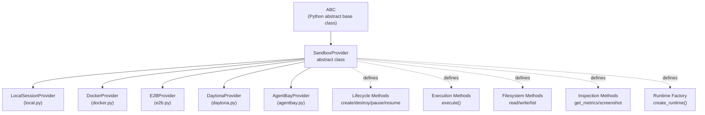
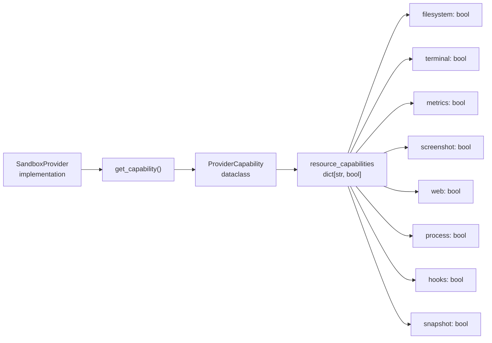
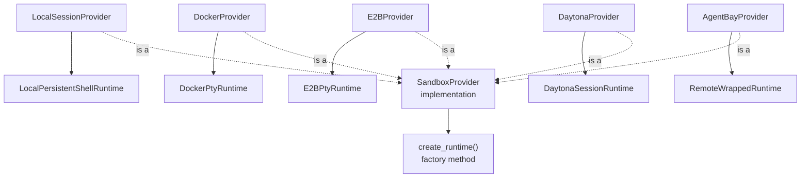

<!-- source: DeepWiki mcp.deepwiki.com · repo OpenDCAI/Mycel · page 6.1 Sandbox Provider Interface · fetched 2026-11-02 -->

# Sandbox Provider Interface

<details>
<summary>Relevant source files</summary>

The following files were used as context for generating this wiki page:

- [sandbox/provider.py](sandbox/provider.py)
- [sandbox/providers/__init__.py](sandbox/providers/__init__.py)
- [sandbox/providers/agentbay.py](sandbox/providers/agentbay.py)
- [sandbox/providers/daytona.py](sandbox/providers/daytona.py)
- [sandbox/providers/docker.py](sandbox/providers/docker.py)
- [sandbox/providers/e2b.py](sandbox/providers/e2b.py)
- [sandbox/providers/local.py](sandbox/providers/local.py)

</details>


This document explains the abstract `SandboxProvider` interface, its capability system, and the contract that all provider implementations must fulfill. The provider interface abstracts away differences between local execution, containerized environments, and cloud sandbox services, allowing the sandbox system to work uniformly across different execution backends.

For information about specific provider implementations and their configurations, see [Provider Implementations](#6.2). For session orchestration and lifecycle management performed by the `SandboxManager`, see [Session Management and Orchestration](#6.3). For the runtime layer that handles PTY and terminal semantics, see [Terminal Runtimes and PTY Handling](#6.4).

---

## Abstract Interface Contract

The `SandboxProvider` abstract base class defines the interface that all sandbox providers must implement. It is located in [sandbox/provider.py:104-209]() and specifies methods for session lifecycle, command execution, filesystem operations, and inspection.



**Sources:** [sandbox/provider.py:104-209](), [sandbox/providers/local.py:30-211](), [sandbox/providers/docker.py:42-460](), [sandbox/providers/e2b.py:35-274](), [sandbox/providers/daytona.py:32-290](), [sandbox/providers/agentbay.py:27-253]()

---

## Provider Capability System

Each provider declares its capabilities through a `ProviderCapability` dataclass returned by the `get_capability()` method. This allows the sandbox system to query what features are available before attempting to use them.

### ProviderCapability Structure

The `ProviderCapability` dataclass is defined in [sandbox/provider.py:60-76]():

| Field | Type | Description |
|-------|------|-------------|
| `can_pause` | `bool` | Provider supports pausing sessions to save costs |
| `can_resume` | `bool` | Provider supports resuming paused sessions |
| `can_destroy` | `bool` | Provider supports destroying sessions |
| `supports_webhook` | `bool` | Provider can receive webhook notifications |
| `supports_status_probe` | `bool` | Provider can query session status without side effects |
| `eager_instance_binding` | `bool` | Sessions bind to instances immediately on create |
| `inspect_visible` | `bool` | Session state visible in monitoring UIs |
| `runtime_kind` | `str` | Runtime implementation type (`local`, `docker_pty`, `e2b_pty`, `daytona_pty`, `remote`) |
| `resource_capabilities` | `dict[str, bool]` | Fine-grained feature flags (see below) |

**Sources:** [sandbox/provider.py:60-76]()

### Resource Capabilities

Resource capabilities are a nested dictionary declaring support for specific features. The system enforces a fixed schema of eight capability keys defined in [sandbox/provider.py:14-23]():

| Capability | Description |
|------------|-------------|
| `filesystem` | Read/write file operations |
| `terminal` | Interactive terminal/shell execution |
| `metrics` | CPU, memory, disk usage telemetry |
| `screenshot` | Desktop screenshot capture (for GUI sandboxes) |
| `web` | Web UI URL access |
| `process` | Process listing and inspection |
| `hooks` | Webhook event notifications |
| `snapshot` | Workspace snapshot and restore |

The system validates that all providers declare exactly these eight keys using `normalize_resource_capabilities()` at [sandbox/provider.py:26-32](). Helper function `build_resource_capabilities()` at [sandbox/provider.py:35-57]() provides a type-safe way to construct valid capability dictionaries.



**Sources:** [sandbox/provider.py:14-76]()

### Example Capability Declarations

Each provider declares a class-level `CAPABILITY` constant. Here are examples from the implementations:

**Docker Provider** [sandbox/providers/docker.py:55-71]():
```python
CAPABILITY = ProviderCapability(
    can_pause=True,
    can_resume=True,
    can_destroy=True,
    supports_webhook=False,
    runtime_kind="docker_pty",
    resource_capabilities=build_resource_capabilities(
        filesystem=True,
        terminal=True,
        metrics=True,
        screenshot=False,
        web=False,
        process=False,
        hooks=False,
        snapshot=False,
    ),
)
```

**E2B Provider** [sandbox/providers/e2b.py:41-57]():
```python
CAPABILITY = ProviderCapability(
    can_pause=True,
    can_resume=True,
    can_destroy=True,
    supports_webhook=False,
    runtime_kind="e2b_pty",
    resource_capabilities=build_resource_capabilities(
        filesystem=True,
        terminal=True,
        metrics=True,
        screenshot=False,
        web=False,
        process=False,
        hooks=False,
        snapshot=True,  # E2B supports workspace snapshots
    ),
)
```

**AgentBay Provider** [sandbox/providers/agentbay.py:41-56]():
```python
CAPABILITY = ProviderCapability(
    can_pause=True,
    can_resume=True,
    can_destroy=True,
    supports_webhook=False,
    resource_capabilities=build_resource_capabilities(
        filesystem=True,
        terminal=True,
        metrics=True,
        screenshot=True,  # AgentBay supports desktop screenshots
        web=True,         # AgentBay exposes web UI URLs
        process=True,     # AgentBay can list running processes
        hooks=False,
        snapshot=False,
    ),
)
```

Note that AgentBay allows runtime capability overrides via constructor parameters [sandbox/providers/agentbay.py:68-82]() to handle account tier limitations.

**Sources:** [sandbox/providers/docker.py:55-71](), [sandbox/providers/e2b.py:41-57](), [sandbox/providers/agentbay.py:41-82]()

---

## Session Lifecycle Methods

Providers must implement four core lifecycle methods for managing sandbox sessions.

### Method: create_session()

```python
@abstractmethod
def create_session(self, context_id: str | None = None) -> SessionInfo:
    pass
```

Creates a new sandbox session. The optional `context_id` parameter enables persistent storage across session lifecycles:
- **Docker**: Creates a named Docker volume mounted at the workspace path [sandbox/providers/docker.py:92-120]()
- **AgentBay**: Links to an AgentBay context storage bucket [sandbox/providers/agentbay.py:84-109]()
- **E2B**: Ignored (E2B has no persistent storage; pause is the only way to preserve state) [sandbox/providers/e2b.py:81-96]()
- **Local**: Used as the session identifier directly [sandbox/providers/local.py:62-66]()

Returns a `SessionInfo` dataclass containing:
- `session_id`: Unique identifier for this session
- `provider`: Provider name string
- `status`: Initial status (typically `"running"`)
- `metadata`: Optional additional data

**Sources:** [sandbox/provider.py:115-116](), [sandbox/providers/docker.py:92-120](), [sandbox/providers/agentbay.py:84-109](), [sandbox/providers/e2b.py:81-96](), [sandbox/providers/local.py:62-66]()

### Method: destroy_session()

```python
@abstractmethod
def destroy_session(self, session_id: str, sync: bool = True) -> bool:
    pass
```

Destroys a sandbox session, releasing all associated resources. The `sync` parameter controls whether to synchronize context storage before destruction (relevant for providers with persistent storage like AgentBay).

Returns `True` if destruction succeeded, `False` otherwise.

**Sources:** [sandbox/provider.py:119-120](), [sandbox/providers/docker.py:122-128](), [sandbox/providers/e2b.py:98-110](), [sandbox/providers/agentbay.py:111-116]()

### Method: pause_session()

```python
@abstractmethod
def pause_session(self, session_id: str) -> bool:
    pass
```

Pauses a running session to save costs. The exact semantics depend on the provider:
- **Docker**: Uses `docker pause` to freeze container processes [sandbox/providers/docker.py:130-133]()
- **E2B**: Calls `beta_pause()` SDK method [sandbox/providers/e2b.py:112-120]()
- **Daytona**: Calls `stop()` on the sandbox object [sandbox/providers/daytona.py:101-108]()
- **Local**: Updates in-memory state tracking [sandbox/providers/local.py:76-92]()

Returns `True` if pause succeeded, `False` otherwise. Some providers (like AgentBay) may raise an exception on failure rather than returning `False` [sandbox/providers/agentbay.py:118-125]().

**Sources:** [sandbox/provider.py:122-123](), [sandbox/providers/docker.py:130-133](), [sandbox/providers/e2b.py:112-120](), [sandbox/providers/daytona.py:101-108](), [sandbox/providers/local.py:76-92](), [sandbox/providers/agentbay.py:118-125]()

### Method: resume_session()

```python
@abstractmethod
def resume_session(self, session_id: str) -> bool:
    pass
```

Resumes a paused session. For cloud providers, this may involve reconnecting to a paused sandbox:
- **E2B**: Uses `Sandbox.connect()` to reconnect to paused session [sandbox/providers/e2b.py:122-135]()
- **Daytona**: Calls `start()` on the sandbox object [sandbox/providers/daytona.py:110-117]()
- **Docker**: Uses `docker unpause` [sandbox/providers/docker.py:135-138]()

Returns `True` if resume succeeded, `False` otherwise (or raises exception).

**Sources:** [sandbox/provider.py:125-126](), [sandbox/providers/docker.py:135-138](), [sandbox/providers/e2b.py:122-135](), [sandbox/providers/daytona.py:110-117]()

### Method: get_session_status()

```python
@abstractmethod
def get_session_status(self, session_id: str) -> str:
    pass
```

Queries the current status of a session. Common return values include:
- `"running"`: Session is active
- `"paused"`: Session is paused
- `"deleted"`: Session no longer exists
- `"unknown"`: Status cannot be determined

Implementations typically query the underlying platform API and map provider-specific status codes to these standardized values. For example, Daytona maps `"started"` → `"running"` and `"stopped"` → `"paused"` [sandbox/providers/daytona.py:119-132]().

**Sources:** [sandbox/provider.py:131-132](), [sandbox/providers/docker.py:140-155](), [sandbox/providers/e2b.py:137-150](), [sandbox/providers/daytona.py:119-132](), [sandbox/providers/agentbay.py:138-152]()

---

## Execution Methods

### Method: execute()

```python
@abstractmethod
def execute(
    self,
    session_id: str,
    command: str,
    timeout_ms: int = 30000,
    cwd: str | None = None,
) -> ProviderExecResult:
    pass
```

Executes a one-shot command in the sandbox session. This is distinct from the persistent PTY-based execution used by runtimes (see [Terminal Runtimes and PTY Handling](#6.4)). The `execute()` method is typically used for:
- Quick filesystem checks during bootstrap
- Metric collection
- Diagnostic commands

Parameters:
- `command`: Shell command string to execute
- `timeout_ms`: Timeout in milliseconds (default 30 seconds)
- `cwd`: Working directory (provider-specific default if `None`)

Returns a `ProviderExecResult` dataclass with:
- `output`: Combined stdout/stderr
- `exit_code`: Process exit code (0 for success)
- `error`: Optional error message string

Implementation approaches vary:
- **Docker**: Uses `docker exec` with shell wrapper [sandbox/providers/docker.py:157-176]()
- **E2B**: Uses SDK `commands.run()` [sandbox/providers/e2b.py:168-191]()
- **Daytona**: Uses SDK `process.exec()` [sandbox/providers/daytona.py:136-148]()
- **Local**: Uses `subprocess.run()` with bash [sandbox/providers/local.py:115-134]()

**Sources:** [sandbox/provider.py:135-142](), [sandbox/providers/docker.py:157-176](), [sandbox/providers/e2b.py:168-191](), [sandbox/providers/daytona.py:136-148](), [sandbox/providers/local.py:115-134]()

---

## Filesystem Methods

Providers must implement three filesystem operations for synchronous file access outside the PTY session.

### Method: read_file()

```python
@abstractmethod
def read_file(self, session_id: str, path: str) -> str:
    pass
```

Reads a file from the sandbox filesystem and returns its contents as a string. Raises `OSError` or other exception on failure.

**Sources:** [sandbox/provider.py:145-146](), [sandbox/providers/docker.py:178-187](), [sandbox/providers/e2b.py:193-195](), [sandbox/providers/daytona.py:152-158](), [sandbox/providers/agentbay.py:175-180](), [sandbox/providers/local.py:136-137]()

### Method: write_file()

```python
@abstractmethod
def write_file(self, session_id: str, path: str, content: str) -> str:
    pass
```

Writes content to a file in the sandbox. Returns a success message (conventionally `"Written: {path}"`). Raises `OSError` on failure.

Docker implementation uses `docker exec -i` with stdin piping [sandbox/providers/docker.py:189-195](), while E2B uses SDK `files.write()` [sandbox/providers/e2b.py:197-200]().

**Sources:** [sandbox/provider.py:148-149](), [sandbox/providers/docker.py:189-195](), [sandbox/providers/e2b.py:197-200](), [sandbox/providers/daytona.py:160-163](), [sandbox/providers/agentbay.py:182-187](), [sandbox/providers/local.py:139-143]()

### Method: list_dir()

```python
@abstractmethod
def list_dir(self, session_id: str, path: str) -> list[dict]:
    pass
```

Lists directory contents. Returns a list of dictionaries with keys:
- `name`: Entry name (string)
- `type`: `"file"` or `"directory"`
- `size`: File size in bytes (integer)

Returns empty list on error.

Docker implementation uses a shell script with `ls` and `stat` [sandbox/providers/docker.py:197-225](), while cloud providers use SDK list methods.

**Sources:** [sandbox/provider.py:151-154](), [sandbox/providers/docker.py:197-225](), [sandbox/providers/e2b.py:202-216](), [sandbox/providers/daytona.py:165-170](), [sandbox/providers/agentbay.py:189-203](), [sandbox/providers/local.py:145-154]()

---

## Inspection Methods

Inspection methods provide telemetry and debugging capabilities. All inspection methods are optional (have default implementations) but providers should implement what they can support.

### Method: get_metrics()

```python
@abstractmethod
def get_metrics(self, session_id: str) -> Metrics | None:
    pass
```

Retrieves resource usage metrics. Returns a `Metrics` dataclass with optional fields:

| Field | Type | Unit | Description |
|-------|------|------|-------------|
| `cpu_percent` | `float \| None` | % | CPU utilization percentage |
| `memory_used_mb` | `float \| None` | MB | RAM in use |
| `memory_total_mb` | `float \| None` | MB | Total RAM available |
| `disk_used_gb` | `float \| None` | GB | Disk space used |
| `disk_total_gb` | `float \| None` | GB | Total disk capacity |
| `network_rx_kbps` | `float \| None` | KB/s | Network receive rate |
| `network_tx_kbps` | `float \| None` | KB/s | Network transmit rate |

Returns `None` if metrics unavailable.

The base class provides a helper method `get_metrics_via_commands()` [sandbox/provider.py:165-199]() that collects metrics by running standard Linux commands (`top`, `free`, `df`). This is used by E2B [sandbox/providers/e2b.py:218-220]() and serves as a fallback for providers without native metrics APIs.

Docker uses `docker stats` for CPU/memory and `df` inside container for disk [sandbox/providers/docker.py:249-315](). Daytona uses cgroup v2 files for efficient metrics collection [sandbox/providers/daytona.py:190-274]().

**Sources:** [sandbox/provider.py:156-199](), [sandbox/providers/docker.py:249-315](), [sandbox/providers/e2b.py:218-220](), [sandbox/providers/daytona.py:190-274](), [sandbox/providers/agentbay.py:205-220](), [sandbox/providers/local.py:156-206]()

### Method: screenshot()

```python
def screenshot(self, session_id: str) -> bytes | str | None:
    return None
```

Captures a screenshot of the sandbox desktop (for GUI environments). Returns image bytes or base64 string, or `None` if unsupported.

Default implementation returns `None` [sandbox/provider.py:201-202](). AgentBay implements this using `session.computer.screenshot()` [sandbox/providers/agentbay.py:222-227]().

**Sources:** [sandbox/provider.py:201-202](), [sandbox/providers/agentbay.py:222-227]()

### Method: list_processes()

```python
def list_processes(self, session_id: str) -> list[dict]:
    return []
```

Lists running processes in the sandbox. Returns list of dictionaries with keys like `pid`, `name`, `cmd`.

Default implementation returns empty list [sandbox/provider.py:204-205](). AgentBay implements this using `session.computer.list_visible_apps()` [sandbox/providers/agentbay.py:229-234]().

**Sources:** [sandbox/provider.py:204-205](), [sandbox/providers/agentbay.py:229-234]()

### Method: get_web_url()

```python
def get_web_url(self, session_id: str) -> str | None:
    return None
```

Returns a web UI URL for accessing the sandbox in a browser (if provider supports it).

Default implementation returns `None` [sandbox/provider.py:207-208](). AgentBay returns `session.resource_url` [sandbox/providers/agentbay.py:236-239]().

**Sources:** [sandbox/provider.py:207-208](), [sandbox/providers/agentbay.py:236-239]()

---

## Runtime Factory Method

### Method: create_runtime()

```python
@abstractmethod
def create_runtime(
    self, 
    terminal: AbstractTerminal, 
    lease: SandboxLease
) -> PhysicalTerminalRuntime:
    pass
```

Factory method that creates the appropriate `PhysicalTerminalRuntime` implementation for this provider. The runtime handles persistent PTY-backed shell execution, state management, and command streaming.

Each provider returns its provider-specific runtime class:



Implementation examples:
- **Local**: Returns `LocalPersistentShellRuntime` [sandbox/providers/local.py:208-210]()
- **Docker**: Returns `DockerPtyRuntime` [sandbox/providers/docker.py:344-345]()
- **E2B**: Returns `E2BPtyRuntime` [sandbox/providers/e2b.py:271-273]()
- **Daytona**: Returns `DaytonaSessionRuntime` [sandbox/providers/daytona.py:287-289]()
- **AgentBay**: Returns `RemoteWrappedRuntime` (generic remote runtime) [sandbox/providers/agentbay.py:250-252]()

The runtime implementations are detailed in [Terminal Runtimes and PTY Handling](#6.4).

**Sources:** [sandbox/provider.py:161-163](), [sandbox/providers/local.py:208-210](), [sandbox/providers/docker.py:344-345](), [sandbox/providers/e2b.py:271-273](), [sandbox/providers/daytona.py:287-289](), [sandbox/providers/agentbay.py:250-252]()

---

## Provider Catalog Entry

Each provider should define a class-level `CATALOG_ENTRY` dictionary for UI display and provider discovery. This is a convention, not enforced by the abstract class:

```python
CATALOG_ENTRY = {
    "vendor": str | None,        # Vendor name (None for open-source/local)
    "description": str,           # Human-readable description
    "provider_type": str,         # "local", "container", or "cloud"
}
```

Examples:
- **Docker**: `{"vendor": None, "description": "Isolated container sandbox", "provider_type": "container"}` [sandbox/providers/docker.py:52]()
- **E2B**: `{"vendor": "E2B", "description": "Cloud sandbox with runtime metrics", "provider_type": "cloud"}` [sandbox/providers/e2b.py:38]()
- **Daytona**: `{"vendor": "Daytona", "description": "Managed cloud or self-host Daytona sandboxes", "provider_type": "cloud"}` [sandbox/providers/daytona.py:35]()

**Sources:** [sandbox/providers/docker.py:52](), [sandbox/providers/e2b.py:38](), [sandbox/providers/daytona.py:35](), [sandbox/providers/agentbay.py:38](), [sandbox/providers/local.py:33]()

---

## Implementation Checklist

When implementing a new `SandboxProvider`, follow this checklist:

### Required Methods

| Method | Required | Description |
|--------|----------|-------------|
| `get_capability()` | ✅ | Return `ProviderCapability` with accurate flags |
| `create_session()` | ✅ | Create new sandbox session |
| `destroy_session()` | ✅ | Destroy session and free resources |
| `pause_session()` | ✅ | Pause session (or no-op if unsupported) |
| `resume_session()` | ✅ | Resume session (or no-op if unsupported) |
| `get_session_status()` | ✅ | Query session status |
| `execute()` | ✅ | Run one-shot commands |
| `read_file()` | ✅ | Read file contents |
| `write_file()` | ✅ | Write file contents |
| `list_dir()` | ✅ | List directory entries |
| `get_metrics()` | ✅ | Return resource metrics (or `None`) |
| `create_runtime()` | ✅ | Factory for `PhysicalTerminalRuntime` |

### Optional Methods (with defaults)

| Method | Default | Override When |
|--------|---------|---------------|
| `screenshot()` | Returns `None` | Provider supports desktop screenshots |
| `list_processes()` | Returns `[]` | Provider can list running processes |
| `get_web_url()` | Returns `None` | Provider exposes web UI |

### Implementation Steps

1. **Define capability constant**: Create class-level `CAPABILITY` with accurate flags
2. **Implement lifecycle methods**: Handle create/destroy/pause/resume for your platform
3. **Implement execution**: Support `execute()` for one-shot commands
4. **Implement filesystem**: Support read/write/list operations
5. **Implement metrics**: Either use `get_metrics_via_commands()` or platform-specific APIs
6. **Create runtime class**: Implement `PhysicalTerminalRuntime` subclass for PTY semantics
7. **Add factory method**: Return runtime instance from `create_runtime()`
8. **Add catalog entry**: Define `CATALOG_ENTRY` for UI display
9. **Handle errors gracefully**: Return `False` or raise descriptive exceptions on failures
10. **Test pause/resume cycle**: Ensure sessions can pause and resume without data loss

### Common Patterns

**Context ID Handling**: If your provider supports persistent storage, map `context_id` to provider-specific storage:
- Docker: Create named volume [sandbox/providers/docker.py:105-110]()
- AgentBay: Call `context.get(create=True)` [sandbox/providers/agentbay.py:92-96]()

**Session Caching**: Cache SDK session objects in `_sessions` dict to avoid repeated API calls [sandbox/providers/e2b.py:79](), [sandbox/providers/daytona.py:79]()

**Status Mapping**: Map provider-specific status strings to standard values (`"running"`, `"paused"`, `"deleted"`, `"unknown"`) [sandbox/providers/daytona.py:119-132]()

**Metrics Collection**: For Linux-based sandboxes without native metrics APIs, use `get_metrics_via_commands()` helper [sandbox/providers/e2b.py:218-220]()

**Sources:** All implementation files referenced throughout this section.

---

