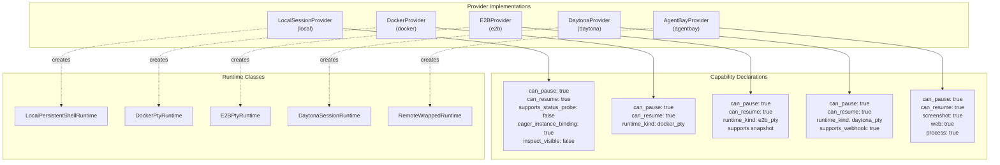
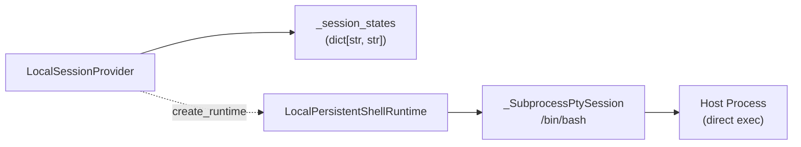
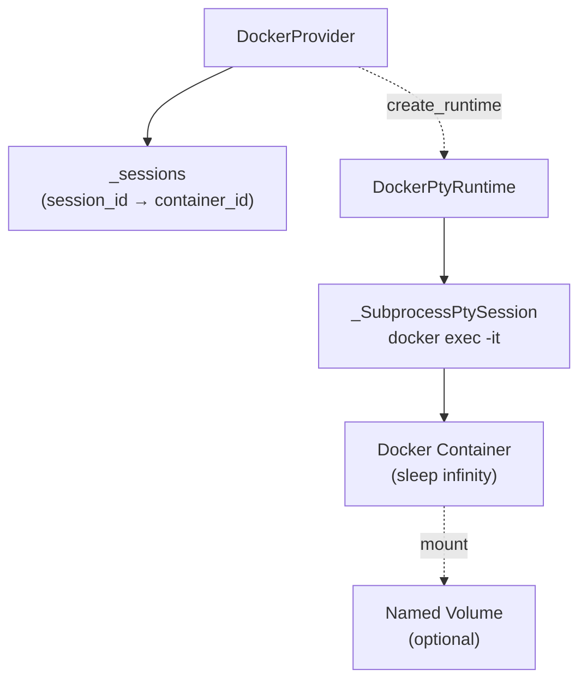
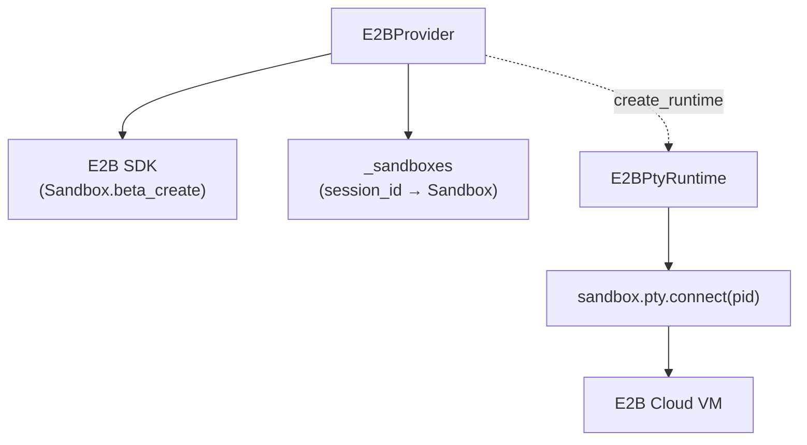
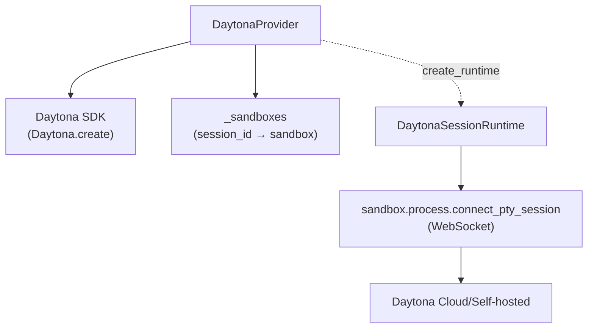
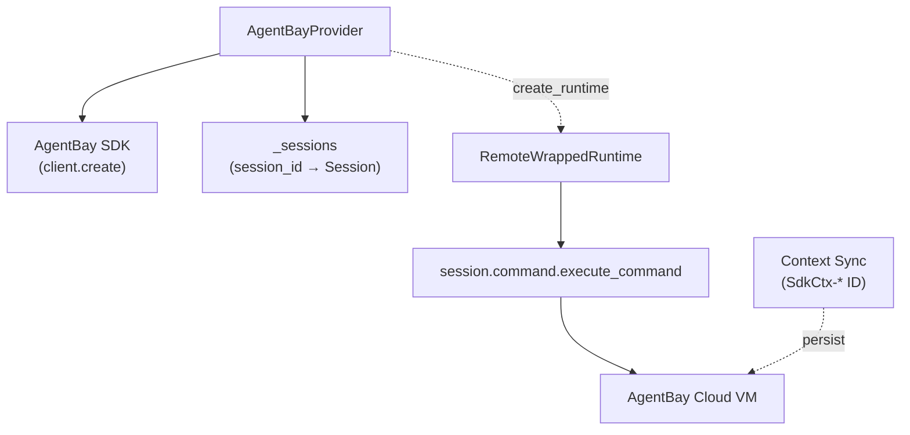
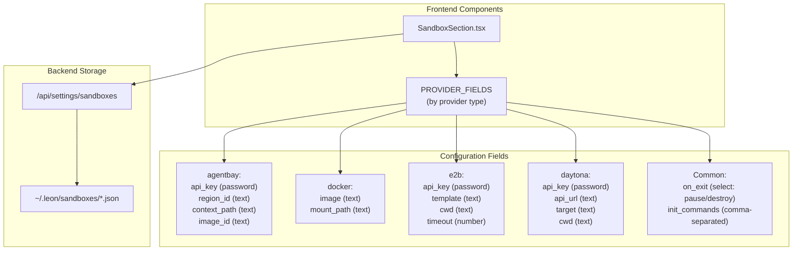
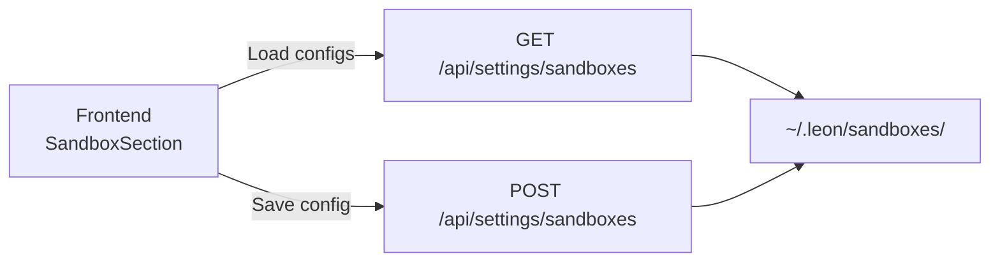

<!-- source: DeepWiki mcp.deepwiki.com · repo OpenDCAI/Mycel · page 6.2 Provider Implementations · fetched 2026-11-02 -->

# Provider Implementations

<details>
<summary>Relevant source files</summary>

The following files were used as context for generating this wiki page:

- [backend/web/routers/settings.py](backend/web/routers/settings.py)
- [config/models_schema.py](config/models_schema.py)
- [core/runtime/middleware/monitor/cost.py](core/runtime/middleware/monitor/cost.py)
- [core/runtime/middleware/monitor/models.json](core/runtime/middleware/monitor/models.json)
- [frontend/app/index.html](frontend/app/index.html)
- [frontend/app/public/favicon.svg](frontend/app/public/favicon.svg)
- [frontend/app/src/components/ModelMappingSection.tsx](frontend/app/src/components/ModelMappingSection.tsx)
- [frontend/app/src/components/ModelPoolSection.tsx](frontend/app/src/components/ModelPoolSection.tsx)
- [frontend/app/src/components/ObservationSection.tsx](frontend/app/src/components/ObservationSection.tsx)
- [frontend/app/src/components/ProvidersSection.tsx](frontend/app/src/components/ProvidersSection.tsx)
- [frontend/app/src/components/SandboxSection.tsx](frontend/app/src/components/SandboxSection.tsx)
- [frontend/app/src/pages/SettingsPage.tsx](frontend/app/src/pages/SettingsPage.tsx)
- [sandbox/provider.py](sandbox/provider.py)
- [sandbox/providers/__init__.py](sandbox/providers/__init__.py)
- [sandbox/providers/agentbay.py](sandbox/providers/agentbay.py)
- [sandbox/providers/daytona.py](sandbox/providers/daytona.py)
- [sandbox/providers/docker.py](sandbox/providers/docker.py)
- [sandbox/providers/e2b.py](sandbox/providers/e2b.py)
- [sandbox/providers/local.py](sandbox/providers/local.py)
- [tests/test_model_config_enrichment.py](tests/test_model_config_enrichment.py)

</details>


This page documents the five concrete implementations of the `SandboxProvider` interface in Mycel: Local, Docker, E2B, Daytona, and AgentBay. Each provider offers a different execution environment with specific capabilities, lifecycle management features, and resource characteristics.

For the abstract provider interface and capability contracts, see [Sandbox Provider Interface](#6.1). For session orchestration and lifecycle management, see [Session Management and Orchestration](#6.3). For runtime-specific PTY handling, see [Terminal Runtimes and PTY Handling](#6.4).

## Provider Comparison

All providers implement the `SandboxProvider` abstract class defined in [sandbox/provider.py:104-209](). Each provider declares its capabilities through `ProviderCapability` and implements session lifecycle methods (`create_session`, `destroy_session`, `pause_session`, `resume_session`), execution methods (`execute`), filesystem operations (`read_file`, `write_file`, `list_dir`), and inspection methods (`get_metrics`).

### Capability Matrix

| Provider | Type | Pause/Resume | Context Persistence | Metrics | Runtime Kind | Screenshot | Web URL |
|----------|------|--------------|---------------------|---------|--------------|------------|---------|
| Local | local | ✓ (in-memory) | No | ✓ (host) | `local` | ✗ | ✗ |
| Docker | container | ✓ | Volume-based | ✓ (container) | `docker_pty` | ✗ | ✗ |
| E2B | cloud | ✓ (beta API) | No | ✓ (SDK) | `e2b_pty` | ✗ | ✗ |
| Daytona | cloud | ✓ | No | ✓ (cgroup) | `daytona_pty` | ✗ | ✗ |
| AgentBay | cloud | ✓ | Context sync | ✓ (native) | `remote` | ✓ | ✓ |

### Provider Capability Diagram



**Sources:** [sandbox/provider.py:104-209](), [sandbox/providers/local.py:30-58](), [sandbox/providers/docker.py:42-74](), [sandbox/providers/e2b.py:35-62](), [sandbox/providers/daytona.py:32-57](), [sandbox/providers/agentbay.py:27-60]()

## LocalSessionProvider

`LocalSessionProvider` provides direct access to the host system with no isolation. It is the simplest provider, using in-memory state management and a single persistent PTY shell per terminal.

### Architecture



### Key Characteristics

**Session Management:** Sessions are identified by `session_id` (either `context_id` or generated `local-{uuid}`). State transitions (`running`, `paused`, `detached`) are tracked in the in-memory `_session_states` dictionary [sandbox/providers/local.py:56-74](). 

**Multi-Process Semantics:** In multi-worker web backends, pause/resume requests may land on different processes. For lease-bound sessions (IDs starting with `leon-` or `local-`), missing in-memory state is treated as `running` to maintain idempotent pause/resume semantics across process boundaries [sandbox/providers/local.py:78-106]().

**No Isolation:** The provider executes commands directly on the host via `/bin/bash -lc` [sandbox/providers/local.py:122-134](). All filesystem operations use the host filesystem directly through Python's `Path` API [sandbox/providers/local.py:136-154]().

**Metrics Collection:** 
- **macOS:** Uses native tools (`sysctl`, `vm_stat`, `df`) for fast metrics without sampling delay [sandbox/providers/local.py:156-206]()
- **Linux:** Falls back to `get_metrics_via_commands` using `top`, `free`, `df` [sandbox/providers/local.py:157-158]()

**Runtime:** `LocalPersistentShellRuntime` maintains a single `_SubprocessPtySession` spawning `/bin/bash` with persistent state (cwd, env_delta) [sandbox/providers/local.py:228-326](). Commands execute synchronously in the PTY, with state snapshots captured via `pwd` and `env` after each command [sandbox/providers/local.py:276-286]().

### Configuration Example

```json
{
  "provider": "local",
  "cwd": "/path/to/workspace"
}
```

**Sources:** [sandbox/providers/local.py:1-326](), [sandbox/runtime.py]()

## DockerProvider

`DockerProvider` creates isolated Linux containers using the Docker CLI. It supports persistent storage via named volumes and container pause/unpause for resource management.

### Architecture



### Key Characteristics

**Session Creation:** Each session creates a dedicated container with label `leon.session_id={session_id}` [sandbox/providers/docker.py:92-120](). If `context_id` is provided, a named Docker volume is created and mounted at `mount_path`, with additional label `leon.context_id={context_id}` for lease probing [sandbox/providers/docker.py:106-111]().

**Container Lifecycle:**
- **Pause:** `docker pause` [sandbox/providers/docker.py:130-133]()
- **Resume:** `docker unpause` [sandbox/providers/docker.py:135-138]()
- **Destroy:** `docker rm -f` [sandbox/providers/docker.py:122-128]()
- **Status:** `docker inspect -f '{{.State.Status}}'` [sandbox/providers/docker.py:140-155]()

**Execution Model:** Short-lived commands use `docker exec {container_id} /bin/sh -lc {command}` [sandbox/providers/docker.py:157-176](). For interactive sessions, `DockerPtyRuntime` spawns a persistent PTY via `docker exec -it {container_id} /bin/sh` [sandbox/providers/docker.py:491-492]().

**Metrics Collection:**
- **Running containers:** `docker stats --no-stream` for CPU/memory, `docker exec df -BG` for disk [sandbox/providers/docker.py:276-315]()
- **Paused/stopped containers:** `docker ps --size` for writable layer disk usage only [sandbox/providers/docker.py:263-274](), [sandbox/providers/docker.py:317-342]()

**Limitations:**
- Memory total is host RAM (not container limit) unless `--memory` flag set [sandbox/providers/docker.py:277-278]()
- Disk total is host disk unless `--storage-opt` specified [sandbox/providers/docker.py:314]()
- `BlockIO` from stats is cumulative read/write, not filesystem capacity [sandbox/providers/docker.py:291-292]()

**Proxy Isolation:** The provider strips all proxy environment variables (`http_proxy`, `https_proxy`, etc.) before invoking `docker` CLI to prevent connection hangs [sandbox/providers/docker.py:373-376]().

**Runtime Recovery:** `DockerPtyRuntime` implements timeout recovery via `_SubprocessPtySession.interrupt_and_recover` (Ctrl-C + drain) [sandbox/providers/docker.py:552-559](). On infra errors, it closes the shell and retries once [sandbox/providers/docker.py:543-550]().

### Configuration Example

```json
{
  "provider": "docker",
  "docker": {
    "image": "python:3.12-slim",
    "mount_path": "/workspace"
  },
  "cwd": "/workspace"
}
```

**Sources:** [sandbox/providers/docker.py:1-566](), [sandbox/runtime.py]()

## E2BProvider

`E2BProvider` uses E2B's cloud sandbox SDK for fully managed Linux containers with beta pause/resume support and workspace snapshotting.

### Architecture



### Key Characteristics

**Session Creation:** Uses `Sandbox.beta_create()` with `auto_pause=True` so sandboxes pause on idle timeout instead of terminating [sandbox/providers/e2b.py:81-96](). The API key must be set in `os.environ["E2B_API_KEY"]` for SDK methods like `beta_pause()` to work [sandbox/providers/e2b.py:74-76]().

**Pause/Resume:**
- **Pause:** `sandbox.beta_pause()` then pops from cache [sandbox/providers/e2b.py:112-120]()
- **Resume:** `Sandbox.connect(session_id)` to reconnect, then cache [sandbox/providers/e2b.py:122-135]()
- **Status:** `Sandbox.list()` returns a paginator; must call `.next_items()` [sandbox/providers/e2b.py:138-150]()

**Batch Status Checking:** `get_all_session_statuses()` calls `Sandbox.list().next_items()` once to fetch all sessions, returning `{}` on API failure (fail-open semantics) [sandbox/providers/e2b.py:152-166]().

**Filesystem:** SDK methods `sandbox.files.read(path)`, `sandbox.files.write(path, content)`, `sandbox.files.list(path)` [sandbox/providers/e2b.py:193-216]().

**Metrics:** E2B sandboxes run Ubuntu with `free`/`top`/`df` available, so metrics delegate to `get_metrics_via_commands` [sandbox/providers/e2b.py:218-220]().

**Workspace Snapshotting:** `snapshot_workspace()` recursively walks `/home/user/workspace`, reading all files into memory as `{"file_path": rel, "content": bytes}` [sandbox/providers/e2b.py:222-245](). `restore_workspace()` uploads files back [sandbox/providers/e2b.py:247-252]().

**Runtime:** `E2BPtyRuntime` creates a PTY process via `sandbox.pty.create()` returning a `pid` [sandbox/providers/e2b.py:352-360](). Commands send input via `sandbox.pty.send_stdin(pid, payload)` and read output via `sandbox.pty.connect(pid)` handle streaming [sandbox/providers/e2b.py:316-332](). The runtime checks if the PTY process is still alive by listing processes and verifying `proc.pid == self._pty_pid` [sandbox/providers/e2b.py:343-350]().

**State Management:** After each command, the runtime captures a snapshot via `pwd` and `env`, computes env delta relative to baseline, and updates terminal state [sandbox/providers/e2b.py:377-390]().

### Configuration Example

```json
{
  "provider": "e2b",
  "e2b": {
    "api_key": "sk-...",
    "template": "base",
    "timeout": 300
  },
  "cwd": "/home/user"
}
```

**Sources:** [sandbox/providers/e2b.py:1-421](), [sandbox/runtime.py]()

## DaytonaProvider

`DaytonaProvider` integrates with Daytona's Python SDK for managed cloud sandboxes or self-hosted instances. It features native PTY support with background state snapshotting for non-blocking command execution.

### Architecture



### Key Characteristics

**Session Creation:** `Daytona.create(CreateSandboxFromSnapshotParams)` with `target` and `auto_stop_interval=0` [sandbox/providers/daytona.py:83-89](). API credentials are set via environment variables `DAYTONA_API_KEY` and `DAYTONA_API_URL` [sandbox/providers/daytona.py:76-78]().

**Pause/Resume:**
- **Pause:** `sandbox.stop()` [sandbox/providers/daytona.py:101-108]()
- **Resume:** `sandbox.start()` [sandbox/providers/daytona.py:110-117]()
- **Status:** Always refetch via `self.client.find_one(session_id)` to avoid stale cached status [sandbox/providers/daytona.py:119-132]()

**Metrics Collection:** Uses a composite cgroup v2 command to collect CPU, memory, and disk in one execution (~237ms). The command structure is:
1. Read `cpu.stat` (first sample)
2. Sleep 0.2s
3. Read `memory.current`
4. Read `cpu.stat` (second sample)
5. Run `du -sm /home/daytona`

Markers (`---MEM---`, `---CPU2---`, `---DISK---`) split the output for parsing [sandbox/providers/daytona.py:211-266]().

**Metrics Limitations:**
- Daytona containers don't have `free`/`top` installed [sandbox/providers/daytona.py:192]()
- `df /` shows host disk (useless per-container) [sandbox/providers/daytona.py:212]()
- `memory.max='max'` (no cgroup limit) means memory_total comes from SDK quota only [sandbox/providers/daytona.py:194]()

**Runtime:** `DaytonaSessionRuntime` manages a persistent PTY via Daytona's native WebSocket-based PTY API [sandbox/providers/daytona.py:318-633]().

### Runtime Deep Dive

**PTY Session Management:**
- Sessions are named `leon-pty-{terminal_id[-12:]}` [sandbox/providers/daytona.py:324]()
- On first access, try `connect_pty_session(id)` to reattach; if that fails, call `create_pty_session(id, cwd, envs)` [sandbox/providers/daytona.py:446-482]()

**PTY Fork/Exec Error Handling:** If `create_pty_session` fails with "fork/exec /path: no such file", the runtime diagnoses whether it's a missing shell or missing cwd by running `test -d {cwd}` [sandbox/providers/daytona.py:463-481]().

**Command Execution:**
1. Send command with marker suffix: `{command}\nprintf '\n{marker} %s\n' $?`
2. Read chunks via WebSocket (`handle._ws.recv(timeout)`)
3. Parse control messages (JSON with `type: "control"`, `status: "error"`)
4. Accumulate output until marker appears [sandbox/providers/daytona.py:399-434]()

**State Snapshotting:** After each command, the runtime schedules a background snapshot task (asyncio) to capture cwd/env without blocking the caller [sandbox/providers/daytona.py:528-553](). Snapshots run with a minimum 10s timeout (user timeout may be too aggressive for `env` reads) [sandbox/providers/daytona.py:609]().

**Infra Recovery:** On snapshot or command errors matching infra patterns (WebSocket, connection), the runtime calls `_recover_infra()` to refetch lease truth, then closes and recreates the PTY [sandbox/providers/daytona.py:536-546](), [sandbox/providers/daytona.py:589-603]().

**PTY Cleanup:** On `close()`, cancel any running snapshot task only if it belongs to the current event loop (cross-loop safety check) [sandbox/providers/daytona.py:616-631]().

**State Sanitization:** Before creating a PTY, the runtime sanitizes persisted terminal state by validating cwd is absolute and env keys match `ENV_NAME_RE`. If invalid (legacy prompt noise corruption), it normalizes once and updates DB so future terminals inherit clean state [sandbox/providers/daytona.py:333-351]().

### Configuration Example

```json
{
  "provider": "daytona",
  "daytona": {
    "api_key": "dt-...",
    "api_url": "https://app.daytona.io/api",
    "target": "local"
  },
  "cwd": "/home/daytona"
}
```

**Sources:** [sandbox/providers/daytona.py:1-633](), [sandbox/runtime.py]()

## AgentBayProvider

`AgentBayProvider` integrates with Alibaba Cloud's AgentBay SDK, offering rich inspection APIs including screenshots, process lists, and web UI access. It supports context sync for data persistence across sessions.

### Architecture



### Key Characteristics

**Session Creation:** `client.create(CreateSessionParams)` with optional `context_syncs` for persistent storage [sandbox/providers/agentbay.py:84-109](). If `context_id` is provided, the provider must call `client.context.get(context_id, create=True)` to resolve the human-readable name to a real `SdkCtx-*` ID before creating the session [sandbox/providers/agentbay.py:91-96]().

**Context Persistence:** `ContextSync.new(context_id, default_context_path)` mounts a persistent context at the specified path (default `/home/wuying`) [sandbox/providers/agentbay.py:96]().

**Pause/Resume with Benefit Level Checking:**
- **Pause:** `client.pause(session)` may fail with `BenefitLevel.NotSupport` for some account tiers; the provider keeps fail-loud (raises) and does not fallback [sandbox/providers/agentbay.py:118-125]()
- **Resume:** `client.resume(session)` then refetch via `client.get(session_id)` to update cache [sandbox/providers/agentbay.py:127-136]()

**Capability Override:** Constructor accepts `supports_pause` and `supports_resume` parameters to override provider-type defaults at runtime, allowing instance-level capability declaration based on account tier [sandbox/providers/agentbay.py:68-82]().

**Execution:** `session.command.execute_command(command, timeout_ms, cwd)` with timeout clamped to 50s max [sandbox/providers/agentbay.py:154-173]().

**Metrics:** Native SDK method `session.get_metrics()` returns structured metrics with all fields populated (CPU, memory, disk, network) [sandbox/providers/agentbay.py:205-220]().

**Inspection APIs:**
- **Screenshot:** `session.computer.screenshot()` returns image bytes [sandbox/providers/agentbay.py:222-227]()
- **Processes:** `session.computer.list_visible_apps()` returns `{pid, name, cmd}` [sandbox/providers/agentbay.py:229-234]()
- **Web URL:** `session.resource_url` provides direct browser access to the sandbox [sandbox/providers/agentbay.py:236-239]()

**Runtime:** `RemoteWrappedRuntime` wraps provider's `execute()` method directly without PTY semantics [sandbox/providers/agentbay.py:250-252](). Each command runs in a new shell session (no persistent state).

### Configuration Example

```json
{
  "provider": "agentbay",
  "agentbay": {
    "api_key": "ab-...",
    "region_id": "ap-southeast-1",
    "context_path": "/home/wuying",
    "image_id": "custom-image-id"
  },
  "cwd": "/home/wuying"
}
```

**Sources:** [sandbox/providers/agentbay.py:1-253](), [sandbox/runtime.py]()

## Configuration and Selection

### Configuration Schema

Provider configurations are stored in `~/.leon/sandboxes/{name}.json`. The frontend reads these via `/api/settings/sandboxes` and allows editing through `SandboxSection` component [frontend/app/src/components/SandboxSection.tsx:1-208]().

### Field Definitions by Provider Type



**Field Lookup:** The frontend maintains a `PROVIDER_FIELDS` lookup table indexed by provider type, enabling multiple named configs to reuse the same schema [frontend/app/src/components/SandboxSection.tsx:20-48]().

**Nested Field Handling:** Provider-specific fields are nested under a key matching the provider type (e.g., `config.agentbay.api_key`). The component uses `getNestedValue()` and `setNestedValue()` helpers to read/write nested paths [frontend/app/src/components/SandboxSection.tsx:50-74]().

**Secret Masking:** Password fields show masked placeholders when not focused. Masked secrets are non-editable to prevent persisting asterisks as real credentials [frontend/app/src/components/SandboxSection.tsx:111-151]().

### API Endpoints



**List Endpoint:** `GET /api/settings/sandboxes` returns `{"sandboxes": {name: config}}` by globbing `~/.leon/sandboxes/*.json` [backend/web/routers/settings.py:677-688]().

**Save Endpoint:** `POST /api/settings/sandboxes` validates the config with `SandboxConfig` Pydantic model, then saves to `~/.leon/sandboxes/{name}.json` via `SandboxConfig.save()` [backend/web/routers/settings.py:691-701]().

**Sources:** [frontend/app/src/components/SandboxSection.tsx:1-208](), [backend/web/routers/settings.py:677-701](), [sandbox/config.py]()

---

