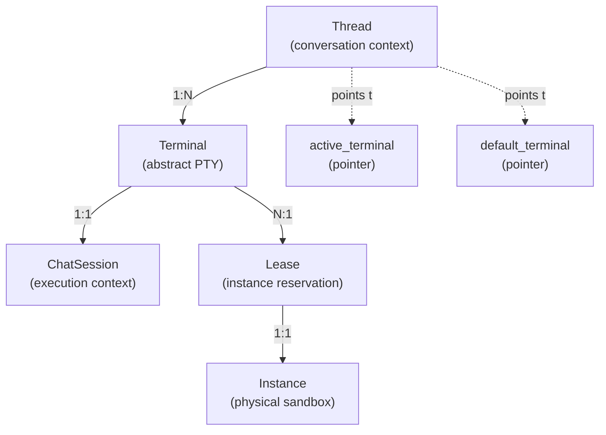
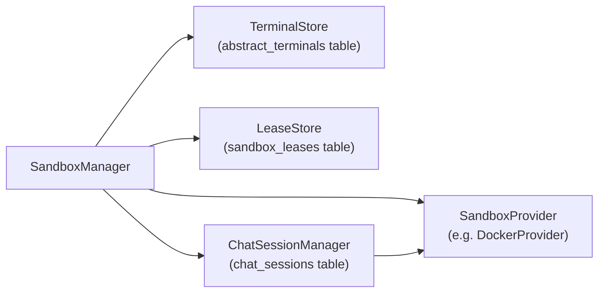
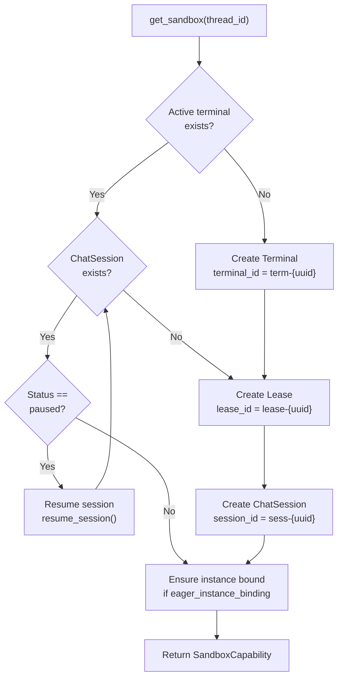
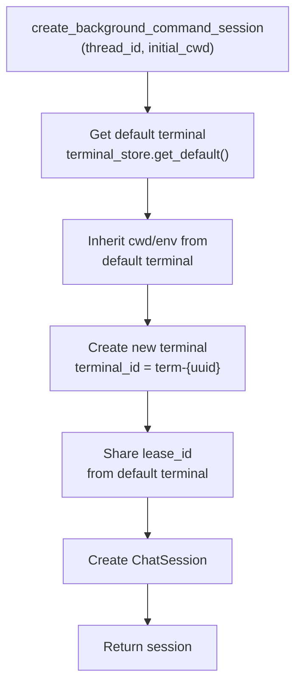
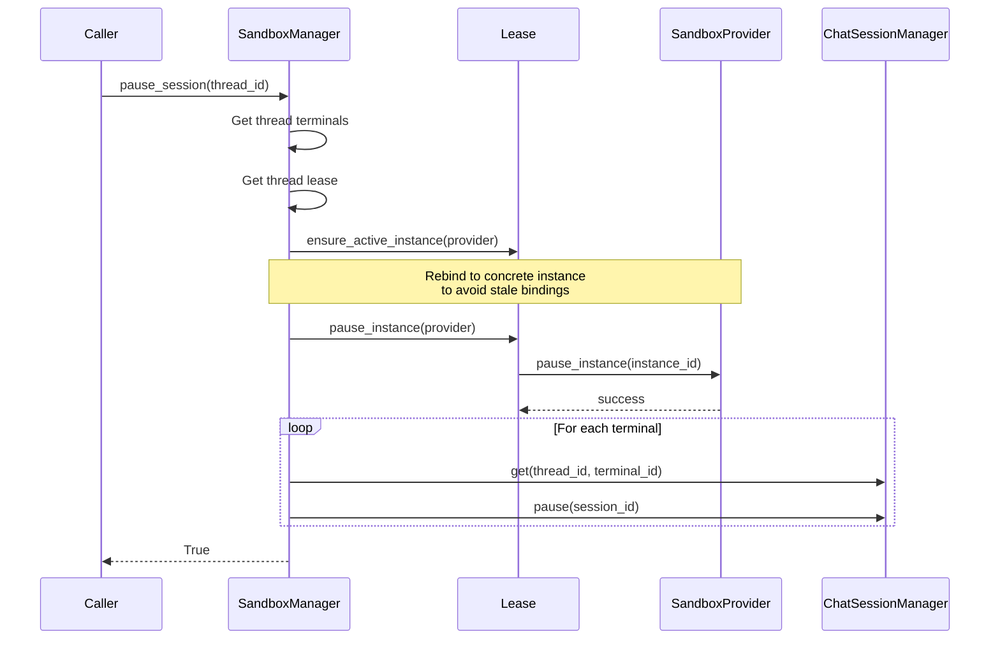
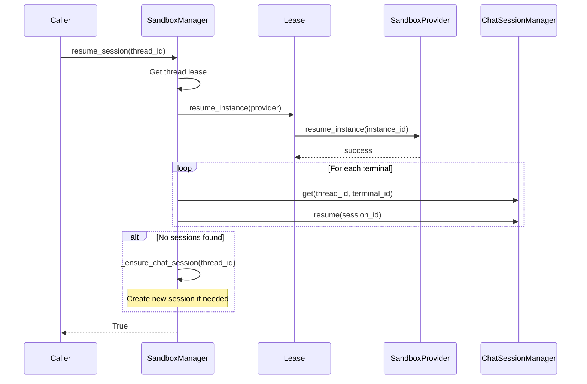
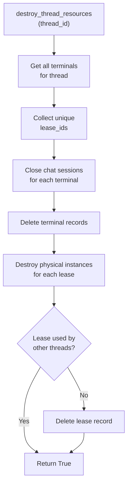
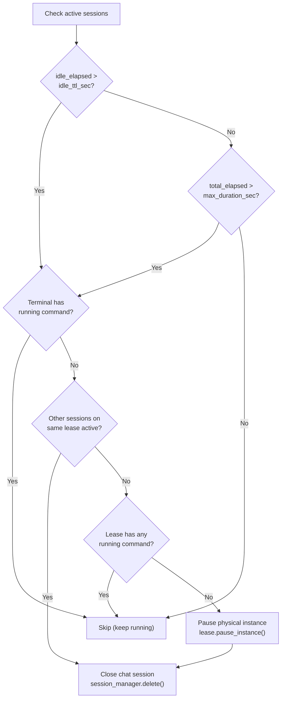
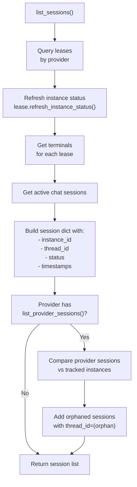

<!-- source: DeepWiki mcp.deepwiki.com · repo OpenDCAI/Mycel · page 6.3 Session Management and Orchestration · fetched 2026-11-02 -->

# Session Management and Orchestration

<details>
<summary>Relevant source files</summary>

The following files were used as context for generating this wiki page:

- [sandbox/manager.py](sandbox/manager.py)

</details>


This document explains how the `SandboxManager` orchestrates sandbox session lifecycle management in Mycel. The manager maintains the hierarchy Thread → ChatSession → Runtime → Terminal → Lease → Instance, ensuring consistent resource allocation, idle timeout enforcement, and session state transitions.

For details about individual sandbox providers (local, Docker, E2B, etc.), see [Provider Implementations](#6.2). For information about PTY runtime implementations, see [Terminal Runtimes and PTY Handling](#6.4). For the TUI application that visualizes sandbox sessions, see [Sandbox Manager TUI](#6.5).

## Overview

The `SandboxManager` class [sandbox/manager.py:46-592]() serves as the central orchestrator for sandbox sessions in Mycel. It manages the complete lifecycle of execution environments, from initial session creation through idle timeout enforcement to final resource cleanup. The manager maintains critical invariants about resource sharing and ensures that threads can resume paused sessions on-demand.

**Key Responsibilities:**
- Map threads to chat sessions and physical sandbox instances
- Enforce the single-lease-per-thread invariant
- Manage session lifecycle (create, pause, resume, destroy)
- Enforce idle timeouts and automatic session pausing
- Handle background command terminals with shared lease semantics
- Maintain consistency between database state and provider state

Sources: [sandbox/manager.py:1-65]()

## Orchestration Hierarchy

The `SandboxManager` orchestrates a multi-level hierarchy of abstractions, each with distinct lifecycle and ownership semantics:



**Hierarchy Details:**

| Level | Entity | Lifecycle | Database Table | Key Properties |
|-------|--------|-----------|---------------|----------------|
| 1 | **Thread** | Persistent (user conversation) | N/A | `thread_id` |
| 2 | **Terminal** | Persistent until thread deleted | `abstract_terminals` | `terminal_id`, `thread_id`, `lease_id`, `cwd`, `env_delta` |
| 3 | **ChatSession** | Ephemeral (paused/closed on idle) | `chat_sessions` | `session_id`, `thread_id`, `terminal_id`, `status` |
| 4 | **Lease** | Persistent until explicitly destroyed | `sandbox_leases` | `lease_id`, `provider_name`, `instance_id` |
| 5 | **Instance** | Physical (container/VM/process) | Provider-managed | `instance_id`, provider-specific metadata |

Sources: [sandbox/manager.py:1-4](), [sandbox/manager.py:90-123]()

## SandboxManager Initialization

The `SandboxManager` is initialized with a `SandboxProvider` and database path. It creates sub-managers for terminals, leases, and chat sessions:



**Initialization Parameters:**
- `provider`: `SandboxProvider` - The provider implementation (local, Docker, E2B, etc.)
- `db_path`: `Path | None` - SQLite database path (defaults to `DEFAULT_DB_PATH`)
- `on_session_ready`: `Callable[[str, str], None] | None` - Callback fired when session becomes ready

The manager stores the provider's capability declaration via `provider.get_capability()` [sandbox/manager.py:54](), which determines behavior like eager instance binding and pause/resume support.

Sources: [sandbox/manager.py:46-65]()

## Session Creation Flow

### On-Demand Session Creation

The primary entry point for session management is `get_sandbox(thread_id)` [sandbox/manager.py:134-181](), which implements lazy session creation with resume-on-demand semantics:



**Key Implementation Details:**

1. **Terminal Pointer Consistency** [sandbox/manager.py:90-98](): If terminals exist but no active pointer, raises `RuntimeError` to prevent inconsistent database state
2. **Activity Resume** [sandbox/manager.py:139-146](): Paused sessions are automatically resumed before returning the sandbox capability
3. **Eager Instance Binding** [sandbox/manager.py:79-80](), [sandbox/manager.py:147](): Providers with `eager_instance_binding=True` allocate physical instances immediately
4. **Provider Assertion** [sandbox/manager.py:82-88](), [sandbox/manager.py:138](), [sandbox/manager.py:146](): Validates thread's lease matches current provider

Sources: [sandbox/manager.py:134-181](), [sandbox/manager.py:90-98](), [sandbox/manager.py:139-146]()

### Background Command Sessions

Background command sessions enable non-blocking command execution with inherited environment state:



**Key Invariants:**
- Background terminals share the same `lease_id` as the default terminal [sandbox/manager.py:200]()
- Environment state (`cwd`, `env_delta`) is forked from default terminal snapshot [sandbox/manager.py:203-210]()
- The shared lease ensures background commands execute on the same physical instance

Sources: [sandbox/manager.py:183-217]()

## Session Lifecycle Management

### Pause Operation

The `pause_session(thread_id)` method [sandbox/manager.py:374-395]() pauses all terminals in a thread and the underlying physical instance:



**Implementation Notes:**
- Pausing rebinds instance to avoid operating on stale detached instances [sandbox/manager.py:385-388]()
- All terminals in the thread are paused together
- Provider's `pause_instance()` implementation determines physical pause behavior

Sources: [sandbox/manager.py:374-395]()

### Resume Operation

The `resume_session(thread_id)` method [sandbox/manager.py:403-424]() resumes paused instances and chat sessions:



**Fallback Behavior:**
- If no sessions exist after resume, creates a new chat session [sandbox/manager.py:422-423]()
- This ensures the thread is ready for immediate use after resume

Sources: [sandbox/manager.py:403-424]()

### Destroy Operation

The `destroy_thread_resources(thread_id)` method [sandbox/manager.py:458-482]() performs complete resource cleanup:



**Cleanup Order:**
1. Close all chat sessions [sandbox/manager.py:466-469]()
2. Delete terminal records [sandbox/manager.py:471-472]()
3. Destroy physical instances via `lease.destroy_instance(provider)` [sandbox/manager.py:478]()
4. Delete lease records if not shared [sandbox/manager.py:479-481]()

Sources: [sandbox/manager.py:458-482]()

## Idle Timeout Enforcement

The `enforce_idle_timeouts()` method [sandbox/manager.py:284-368]() implements automatic session pausing based on idle time and maximum duration:

### Timeout Rules



### Implementation Details

**Timeout Calculation** [sandbox/manager.py:271-282]():
```
idle_elapsed = (now - last_active_at).total_seconds()
total_elapsed = (now - started_at).total_seconds()
is_expired = idle_elapsed > idle_ttl_sec OR total_elapsed > max_duration_sec
```

**Local Sandbox Exemption** [sandbox/manager.py:293-295]():
- Local provider is exempt from idle timeout (no cost to keep running)
- Early return if `provider.name == "local"`

**Terminal Busy Check** [sandbox/manager.py:228-246]():
- Queries `terminal_commands` table for `status='running'`
- Prevents pausing terminals with active command execution

**Shared Lease Handling** [sandbox/manager.py:329-348]():
- Multiple terminals can share one lease (background commands)
- Only pauses lease if ALL sessions on it are expired
- Prevents disrupting active sessions sharing the same instance

**Lease Busy Check** [sandbox/manager.py:248-269]():
- Checks if ANY terminal under lease has running command
- Prevents pausing lease with busy terminals

Sources: [sandbox/manager.py:284-368](), [sandbox/manager.py:271-282](), [sandbox/manager.py:228-269]()

## Critical Invariants

### Thread Single-Lease Invariant

All terminals created for a thread (via non-blocking operations) must share a single lease [sandbox/manager.py:114-116]():

```
# @@@thread-single-lease-invariant - Terminals created via non-block must share one lease per thread.
if len(lease_ids) != 1:
    raise RuntimeError(f"Thread {thread_id} has inconsistent lease_ids: {sorted(lease_ids)}")
```

**Rationale:**
- Background commands execute on the same physical instance as foreground commands
- Simplifies resource management and billing
- Ensures consistent filesystem state across all terminals in a thread

### Thread Pointer Consistency

If terminals exist for a thread, an active terminal pointer MUST exist [sandbox/manager.py:95-97]():

```
# @@@thread-pointer-consistency - If terminals exist but no active pointer, DB is inconsistent and must fail loudly.
if thread_terminals:
    raise RuntimeError(f"Thread {thread_id} has terminals but no active terminal pointer")
```

**Enforcement Points:**
- `_get_active_terminal()` [sandbox/manager.py:90-98]()
- Prevents silent failures from inconsistent database state

### Provider Consistency

A thread's lease must match the current manager's provider [sandbox/manager.py:82-88]():

```
if lease.provider_name != self.provider.name:
    raise RuntimeError(
        f"Thread {thread_id} is bound to provider {lease.provider_name}, "
        f"but current manager provider is {self.provider.name}. "
        "Use the matching sandbox type for this thread or recreate the thread."
    )
```

**Checked At:**
- Session retrieval [sandbox/manager.py:138](), [sandbox/manager.py:146]()
- Background command creation [sandbox/manager.py:193]()
- Terminal operations [sandbox/manager.py:121]()

Sources: [sandbox/manager.py:82-88](), [sandbox/manager.py:90-98](), [sandbox/manager.py:114-122]()

## Session Listing and Discovery

The `list_sessions()` method [sandbox/manager.py:484-592]() provides a comprehensive view of all active and orphaned sessions:

### Listing Strategy



### Session Record Structure

Each session record contains:

| Field | Description | Source |
|-------|-------------|--------|
| `session_id` | Physical instance ID | `instance.instance_id` |
| `thread_id` | Thread ID or `"(untracked)"` / `"(orphan)"` | `terminal.thread_id` |
| `provider` | Provider name | `lease.provider_name` |
| `status` | Instance status | `lease.refresh_instance_status()` |
| `created_at` | Lease creation time | `lease_row["created_at"]` |
| `last_active` | Last activity timestamp | `chat_session["last_active_at"]` or `lease["updated_at"]` |
| `lease_id` | Internal lease ID | `lease.lease_id` |
| `instance_id` | Physical instance ID | `instance.instance_id` |
| `chat_session_id` | Chat session ID if active | `chat_session["session_id"]` |
| `source` | `"lease"` or `"provider_orphan"` | Discovery method |
| `inspect_visible` | Whether provider supports inspection | `provider_capability.inspect_visible` |

### Orphan Detection

Orphaned sessions are discovered by comparing provider-reported sessions against tracked leases [sandbox/manager.py:564-590]():

```
provider_sessions = self.provider.list_provider_sessions()
for ps in provider_sessions:
    if ps.instance_id not in seen_instance_ids:
        # This is an orphan - instance exists but not tracked in our database
```

**Orphan Characteristics:**
- `thread_id = "(orphan)"`
- `source = "provider_orphan"`
- `lease_id = None`
- `chat_session_id = None`

Sources: [sandbox/manager.py:484-592]()

## Helper Methods and Utilities

### Default CWD Detection

The `_default_terminal_cwd()` method [sandbox/manager.py:66-72]() determines initial working directory by checking provider attributes in order:

```python
for attr in ("default_cwd", "default_context_path", "mount_path"):
    if hasattr(self.provider, attr):
        value = getattr(self.provider, attr)
        if isinstance(value, str) and value:
            return value
return "/home/user"
```

### Session Ready Callback

The `_fire_session_ready(session_id, reason)` callback [sandbox/manager.py:74-76]() notifies external systems when sessions become ready:

```python
if self._on_session_ready:
    self._on_session_ready(session_id, reason)
```

Called during session creation [sandbox/manager.py:178-179]() with reason `"create"`.

### Thread Provider Lookup

The module-level `lookup_sandbox_for_thread(thread_id)` function [sandbox/manager.py:23-43]() queries which provider owns a thread:

```sql
SELECT sl.provider_name
FROM abstract_terminals at
JOIN sandbox_leases sl ON at.lease_id = sl.lease_id
WHERE at.thread_id = ?
```

Returns `None` if thread has no terminals or database doesn't exist.

Sources: [sandbox/manager.py:23-43](), [sandbox/manager.py:66-76]()

## Database Schema

The `SandboxManager` coordinates three SQLite tables:

### abstract_terminals

Stores terminal abstractions with environment state:

| Column | Type | Description |
|--------|------|-------------|
| `terminal_id` | TEXT PRIMARY KEY | Unique terminal identifier |
| `thread_id` | TEXT | Owning thread |
| `lease_id` | TEXT | Lease reservation |
| `cwd` | TEXT | Current working directory |
| `env_delta` | JSON | Environment variable changes |
| `state_version` | INTEGER | State version counter |
| `created_at` | TIMESTAMP | Creation time |
| `updated_at` | TIMESTAMP | Last update time |

### sandbox_leases

Stores instance reservations:

| Column | Type | Description |
|--------|------|-------------|
| `lease_id` | TEXT PRIMARY KEY | Unique lease identifier |
| `provider_name` | TEXT | Provider type (local/docker/e2b/etc) |
| `instance_id` | TEXT | Physical instance ID |
| `observed_state` | TEXT | Cached instance state |
| `created_at` | TIMESTAMP | Creation time |
| `updated_at` | TIMESTAMP | Last update time |

### chat_sessions

Stores ephemeral execution sessions:

| Column | Type | Description |
|--------|------|-------------|
| `session_id` | TEXT PRIMARY KEY | Unique session identifier |
| `thread_id` | TEXT | Owning thread |
| `terminal_id` | TEXT | Active terminal |
| `lease_id` | TEXT | Associated lease |
| `status` | TEXT | active/idle/paused/closed |
| `idle_ttl_sec` | INTEGER | Idle timeout duration |
| `max_duration_sec` | INTEGER | Maximum session duration |
| `started_at` | TIMESTAMP | Session start time |
| `last_active_at` | TIMESTAMP | Last activity time |
| `closed_at` | TIMESTAMP | Session close time |

Sources: [sandbox/manager.py:6](), [sandbox/manager.py:58-64]()

## Usage Examples

### Creating or Retrieving Sandbox

```python
manager = SandboxManager(provider=docker_provider, db_path=Path("mycel.db"))
sandbox = manager.get_sandbox("thread-abc123")
# Returns SandboxCapability with session, automatically resuming if paused
```

### Pausing Inactive Thread

```python
success = manager.pause_session("thread-abc123")
# Pauses physical instance and marks chat sessions as paused
```

### Enforcing Timeouts

```python
paused_count = manager.enforce_idle_timeouts()
# Scans all active sessions, pauses expired ones
print(f"Paused {paused_count} expired sessions")
```

### Listing All Sessions

```python
sessions = manager.list_sessions()
for session in sessions:
    print(f"{session['thread_id']}: {session['status']} on {session['provider']}")
```

### Destroying Thread Resources

```python
manager.destroy_thread_resources("thread-abc123")
# Closes sessions, deletes terminals, destroys instances, cleans up leases
```

Sources: [sandbox/manager.py:134-181](), [sandbox/manager.py:374-395](), [sandbox/manager.py:284-368](), [sandbox/manager.py:484-592](), [sandbox/manager.py:458-482]()

---

