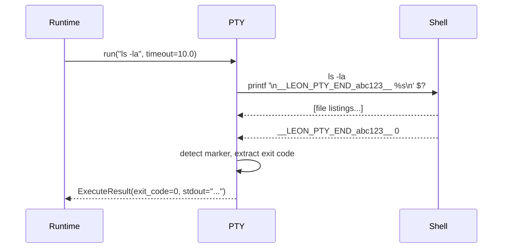
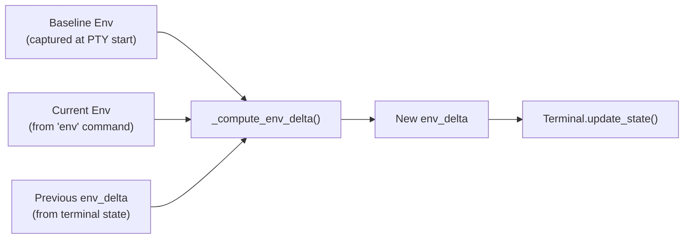
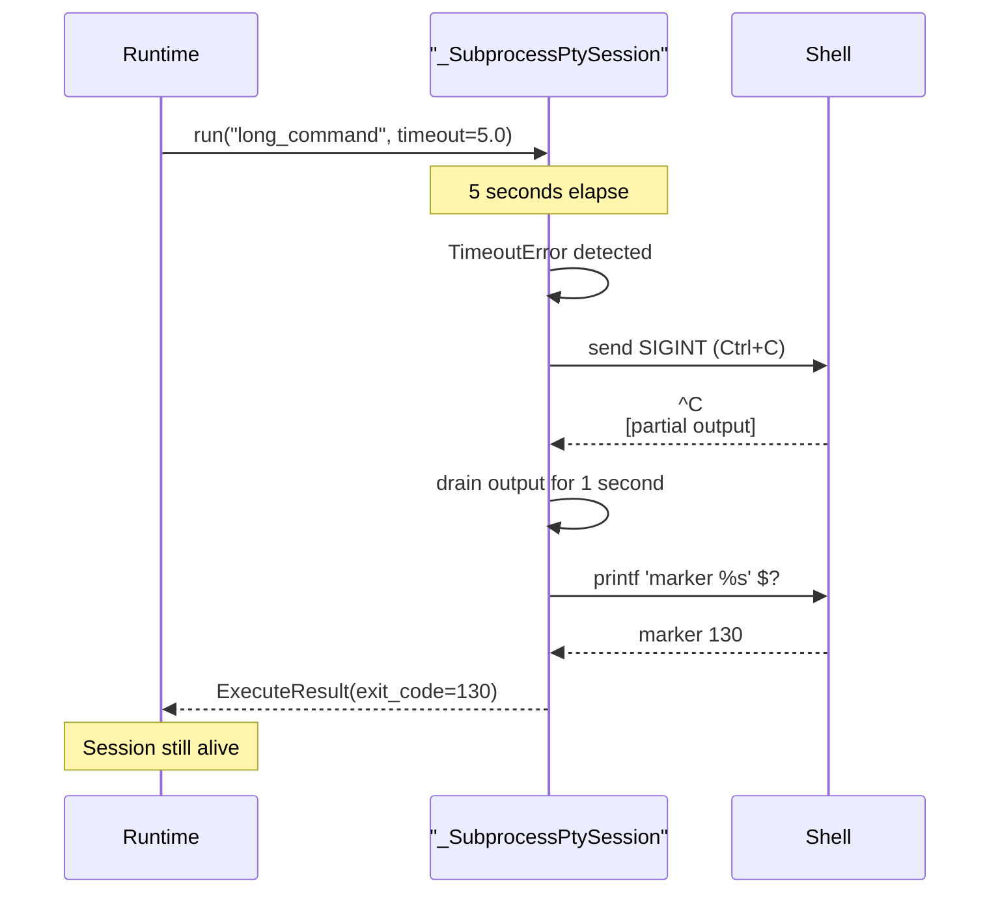
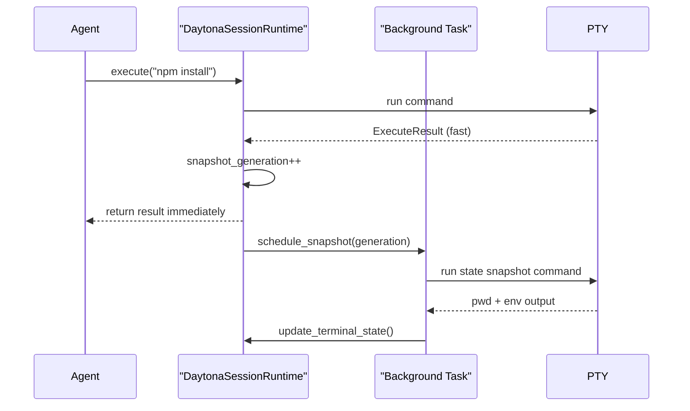
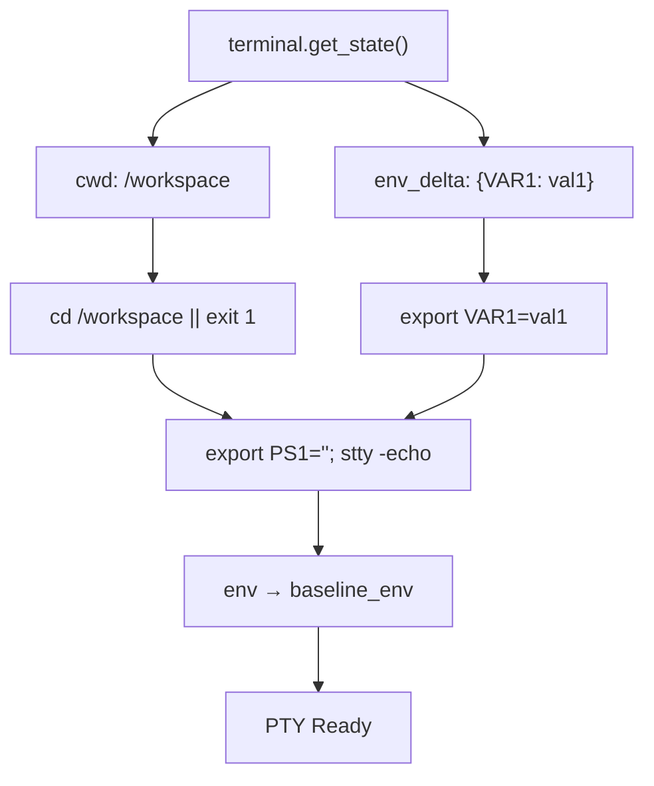

<!-- source: DeepWiki mcp.deepwiki.com · repo OpenDCAI/Mycel · page 6.4 Terminal Runtimes and PTY Handling · fetched 2026-11-02 -->

# Terminal Runtimes and PTY Handling

<details>
<summary>Relevant source files</summary>

The following files were used as context for generating this wiki page:

- [sandbox/provider.py](sandbox/provider.py)
- [sandbox/providers/__init__.py](sandbox/providers/__init__.py)
- [sandbox/providers/agentbay.py](sandbox/providers/agentbay.py)
- [sandbox/providers/daytona.py](sandbox/providers/daytona.py)
- [sandbox/providers/docker.py](sandbox/providers/docker.py)
- [sandbox/providers/e2b.py](sandbox/providers/e2b.py)
- [sandbox/providers/local.py](sandbox/providers/local.py)

</details>


This page documents the runtime layer of the sandbox system, which manages persistent shell sessions using pseudo-terminals (PTY). Runtimes bridge the gap between high-level command execution requests from tools and the physical execution environments managed by sandbox providers. For provider lifecycle management, see [Session Management and Orchestration](#6.3). For the provider abstraction itself, see [Sandbox Provider Interface](#6.1).

## Purpose and Scope

Terminal runtimes provide **persistent shell semantics** for sandbox command execution. Each runtime maintains a long-lived PTY-backed shell session that preserves:

- **Working directory** (cwd) across commands
- **Environment variables** (env_delta) across commands
- **Shell state** (history, session variables)

Runtimes handle provider-specific PTY APIs, implement state synchronization after each command, and recover from infrastructure failures (network errors, container restarts, sandbox pauses). Every provider implementation must supply a runtime via the `create_runtime` method.

Sources: [sandbox/runtime.py](), [sandbox/provider.py:161-163]()

## Runtime Class Hierarchy

```mermaid
graph TB
    AbstractTerminal["AbstractTerminal<br/>(terminal.py)"]
    SandboxLease["SandboxLease<br/>(lease.py)"]
    
    PhysicalTerminalRuntime["PhysicalTerminalRuntime<br/>Abstract Base"]
    
    LocalRuntime["LocalPersistentShellRuntime"]
    DockerRuntime["DockerPtyRuntime"]
    E2BRuntime["E2BPtyRuntime"]
    DaytonaRuntime["DaytonaSessionRuntime"]
    RemoteWrapped["RemoteWrappedRuntime"]
    
    RemoteBase["_RemoteRuntimeBase<br/>Common Remote Logic"]
    
    SubprocessPty["_SubprocessPtySession<br/>PTY Wrapper"]
    
    PhysicalTerminalRuntime --|"takes"| AbstractTerminal
    PhysicalTerminalRuntime --|"takes"| SandboxLease
    
    PhysicalTerminalRuntime <|-- LocalRuntime
    PhysicalTerminalRuntime <|-- RemoteBase
    
    RemoteBase <|-- DockerRuntime
    RemoteBase <|-- E2BRuntime
    RemoteBase <|-- DaytonaRuntime
    RemoteBase <|-- RemoteWrapped
    
    LocalRuntime --|"uses"| SubprocessPty
    DockerRuntime --|"uses"| SubprocessPty
    
    E2BRuntime --|"uses SDK"| E2BAPI["E2B SDK PTY API"]
    DaytonaRuntime --|"uses SDK"| DaytonaAPI["Daytona SDK PTY API"]
```

**Sources:** [sandbox/runtime.py](), [sandbox/providers/local.py:228-336](), [sandbox/providers/docker.py:465-566](), [sandbox/providers/e2b.py:297-421](), [sandbox/providers/daytona.py:318-633]()

## Runtime Interface

All runtimes implement `PhysicalTerminalRuntime` and must provide:

| Method | Purpose |
|--------|---------|
| `execute(command, timeout)` | Execute command in persistent shell, return `ExecuteResult` |
| `close()` | Clean up PTY session resources |
| `update_terminal_state(state)` | Persist cwd/env changes to database |

The `execute` method is the core operation. Runtimes must:

1. Ensure PTY session exists (create if needed, reconnect after pause)
2. Execute command in the persistent shell
3. Capture output incrementally (streaming support)
4. Snapshot updated cwd/env after command completes
5. Handle timeouts, errors, and infrastructure failures
6. Update terminal state in the database

Sources: [sandbox/runtime.py]()

## PTY Session Management

### Subprocess-Based PTY (`_SubprocessPtySession`)

Local and Docker runtimes use `_SubprocessPtySession`, a subprocess-based PTY wrapper that:

- Spawns a shell process with `pty.openpty()` for stdin/stdout/stderr
- Uses marker-based output parsing to detect command completion
- Supports incremental output streaming via callbacks
- Implements timeout recovery with SIGINT + drain

**Initialization:**

```mermaid
sequenceDiagram
    participant Runtime
    participant Session as "_SubprocessPtySession"
    participant Shell as "Shell Process"
    
    Runtime->>Session: __init__(["docker", "exec", "-it", container_id, "/bin/sh"])
    Runtime->>Session: start()
    Session->>Shell: spawn with pty.openpty()
    Session->>Shell: export PS1=''; stty -echo
    Note over Session,Shell: Disable prompt and echo
    Session->>Shell: cd /workspace
    Session->>Shell: export VAR1=value1; export VAR2=value2
    Session->>Shell: env
    Shell-->>Session: baseline environment
    Session-->>Runtime: ready
```

**Sources:** [sandbox/runtime.py:_SubprocessPtySession](), [sandbox/providers/local.py:246-260](), [sandbox/providers/docker.py:480-501]()

### Command Execution with Markers

Runtimes inject a unique marker after each command to detect when output is complete:



The marker format is `__LEON_PTY_END_{random_hex}__ {exit_code}`, parsed via regex `marker\s+-?\d+`.

**Sources:** [sandbox/runtime.py:_SubprocessPtySession.run](), [sandbox/providers/daytona.py:399-435](), [sandbox/providers/e2b.py:313-332]()

### SDK-Based PTY (E2B, Daytona)

E2B and Daytona use vendor SDKs with native PTY APIs:

**E2B PTY:**
- `sandbox.pty.create(size, cwd, timeout)` → persistent PTY process with `pid`
- `sandbox.pty.connect(pid, timeout)` → websocket stream handle
- `sandbox.pty.send_stdin(pid, data)` → send input
- Iterator yields `(timestamp, type, data)` tuples

**Daytona PTY:**
- `sandbox.process.create_pty_session(id, cwd, envs, pty_size)` → session handle
- `sandbox.process.connect_pty_session(id)` → reconnect to existing session
- `handle.send_input(payload)` → send input
- `handle._ws.recv(timeout)` → read websocket message

Both use the same marker-based completion detection but handle PTY I/O differently.

**Sources:** [sandbox/providers/e2b.py:300-370](), [sandbox/providers/daytona.py:318-498]()

## State Synchronization

Runtimes snapshot shell state after every command to enable session persistence and recovery. The state includes:

| Field | Purpose |
|-------|---------|
| `cwd` | Current working directory |
| `env_delta` | Environment variables changed from baseline |

### State Snapshot Command

All runtimes use a common snapshot script:

```bash
printf '__STATE_START_marker__\n'
pwd
printf '__ENV_START__\n'
env
printf '__STATE_END_marker__\n'
```

Parsing extracts `cwd` from the first section and `env_delta` by diffing against the baseline environment.

**Sources:** [sandbox/runtime.py:_build_state_snapshot_cmd](), [sandbox/runtime.py:_extract_state_from_output]()

### Environment Delta Computation

Environment variables are tracked as deltas from a **baseline** captured when the PTY session is first created:



The delta computation:

1. Finds all variables in current that differ from baseline
2. Excludes variables that match baseline exactly
3. Preserves variables from previous delta that are no longer in current (user explicitly unset)

This ensures that only **user-modified** environment variables are persisted, not system defaults.

**Sources:** [sandbox/runtime.py:_compute_env_delta](), [sandbox/providers/local.py:281-286](), [sandbox/providers/docker.py:522-525]()

### State Sanitization (Daytona)

Daytona persists PTY sessions across pause/resume, but legacy prompt noise can corrupt the persisted cwd. The runtime sanitizes state before PTY creation:

```python
# @@@daytona-state-sanitize - Legacy prompt noise can corrupt persisted cwd/env_delta
cleaned_env = {k: v for k, v in state.env_delta.items() if ENV_NAME_RE.match(k)}
if not os.path.isabs(state.cwd):
    pwd_hint = cleaned_env.get("PWD")
    if isinstance(pwd_hint, str) and os.path.isabs(pwd_hint):
        cleaned_cwd = pwd_hint
    else:
        raise RuntimeError("Invalid terminal cwd snapshot")
```

**Sources:** [sandbox/providers/daytona.py:333-351]()

## Implementation Comparison

| Feature | Local | Docker | E2B | Daytona |
|---------|-------|--------|-----|---------|
| PTY Technology | subprocess + pty.openpty() | subprocess + docker exec -it | E2B SDK websocket | Daytona SDK websocket |
| Session Binding | lease-local (no infra) | container_id | E2B sandbox pid | Daytona session_id |
| State Snapshot | after every command | after every command | after every command | async background task |
| Timeout Recovery | SIGINT + drain | SIGINT + drain | kill PTY + recreate | not implemented |
| Infra Recovery | N/A (local) | refresh + reconnect | refresh + reconnect | refresh + reconnect + retry |
| Session Reuse | across pause/resume | across pause/resume | PTY killed on pause | persists across pause/resume |

**Sources:** [sandbox/providers/local.py:228-336](), [sandbox/providers/docker.py:465-566](), [sandbox/providers/e2b.py:297-421](), [sandbox/providers/daytona.py:318-633]()

## Error Recovery and Resilience

### Infrastructure Error Detection

Remote runtimes inherit `_looks_like_infra_error()` from `_RemoteRuntimeBase`, which detects transient provider failures:

```python
def _looks_like_infra_error(self, message: str) -> bool:
    keywords = ["connection", "timeout", "unavailable", "not found", "network"]
    return any(kw in message.lower() for kw in keywords)
```

When an infra error is detected, runtimes:

1. Call `lease.refresh_instance_state()` to re-probe provider status
2. Close the PTY session
3. Retry the command once

**Sources:** [sandbox/runtime.py:_RemoteRuntimeBase._looks_like_infra_error]()

### Timeout Recovery

Subprocess-based runtimes implement timeout recovery to salvage the PTY session:



If drain fails, the PTY session is closed and recreated on next command.

**Sources:** [sandbox/runtime.py:_SubprocessPtySession.interrupt_and_recover](), [sandbox/providers/local.py:319-326](), [sandbox/providers/docker.py:552-559]()

### Async State Snapshot (Daytona)

Daytona snapshots run in a background task to avoid blocking command results:



If a snapshot fails with an infra error, the runtime retries once with PTY refresh. Subsequent commands check `_snapshot_error` and attempt recovery before blocking the user.

**Sources:** [sandbox/providers/daytona.py:528-611]()

## Helper Utilities

The `sandbox/runtime.py` module provides shared utilities used by all runtimes:

| Function | Purpose |
|----------|---------|
| `_build_export_block(env_delta)` | Generate `export VAR=value` commands from env_delta dict |
| `_parse_env_output(output)` | Parse `env` command output into `{name: value}` dict |
| `_compute_env_delta(current, baseline, prev)` | Compute minimal env delta from current state |
| `_build_state_snapshot_cmd()` | Generate marker-wrapped pwd + env snapshot command |
| `_extract_state_from_output(output, start, end)` | Parse snapshot output into cwd + env_map |
| `_extract_marker_exit(output, marker, command)` | Extract stdout + exit code from marker-wrapped output |
| `_sanitize_shell_output(raw)` | Strip echo artifacts, ANSI codes, control characters |
| `_normalize_pty_result(stdout, stderr, exit_code)` | Convert SDK PTY output to standard ExecuteResult |

These utilities ensure consistent behavior across all runtime implementations.

**Sources:** [sandbox/runtime.py]()

## PTY Bootstrap and Hydration

When a runtime creates a new PTY session, it must hydrate the shell with terminal state:



All runtimes follow this pattern:

1. Disable prompt (`PS1=''`) and echo (`stty -echo`) for clean output
2. Change to persisted `cwd`
3. Export persisted `env_delta` variables
4. Capture baseline environment for future delta computation

**Sources:** [sandbox/providers/local.py:246-260](), [sandbox/providers/docker.py:480-501](), [sandbox/providers/e2b.py:353-370](), [sandbox/providers/daytona.py:483-497]()

## Provider-Specific PTY Nuances

### Local: Shell Choice

LocalPersistentShellRuntime uses `/bin/bash` by default but can be configured via `shell_command` parameter.

**Sources:** [sandbox/providers/local.py:238-239]()

### Docker: TTY Allocation

DockerPtyRuntime spawns PTY via `docker exec -it container_id /bin/sh`. The `-it` flags allocate a pseudo-TTY in the container.

**Sources:** [sandbox/providers/docker.py:491]()

### E2B: Process Lifecycle

E2B PTY sessions are processes with a `pid`. The runtime must track the `pid` and kill it on close.

**Sources:** [sandbox/providers/e2b.py:304-305](), [sandbox/providers/e2b.py:410-420]()

### Daytona: Session Persistence

Daytona PTY sessions persist across pause/resume via named session IDs:

```python
self._pty_session_id = f"leon-pty-{terminal.terminal_id[-12:]}"
```

On reconnect, the runtime calls `connect_pty_session(id)` instead of `create_pty_session(id)`, preserving shell state across infrastructure lifecycle.

**Sources:** [sandbox/providers/daytona.py:324](), [sandbox/providers/daytona.py:448-451]()

### Daytona: Fork/Exec Error Diagnosis

Daytona PTY creation can fail with "fork/exec /path: no such file" if either the shell binary or the working directory is missing. The runtime diagnoses by testing if `cwd` exists:

```python
# @@@pty-fork-exec-error - "fork/exec /path: no such file" can mean shell OR cwd missing
result = sandbox.process.exec_sync(f"test -d {effective_cwd} && echo y || echo n", timeout=5)
if "n" in result.stdout:
    raise RuntimeError(f"PTY bootstrap failed: working directory '{effective_cwd}' does not exist.")
```

**Sources:** [sandbox/providers/daytona.py:461-475]()

## Streaming Support

Runtimes support incremental output streaming via the `on_stdout_chunk` callback parameter:

```python
async def execute(
    self,
    command: str,
    timeout: float | None = None,
    on_stdout_chunk: Callable[[str], None] | None = None,
) -> ExecuteResult:
    # Pass callback to PTY session for real-time output
    ...
```

The callback receives sanitized stdout chunks as they arrive, enabling real-time UI updates before the command completes.

**Sources:** [sandbox/providers/local.py:262-267](), [sandbox/providers/docker.py:503-512](), [sandbox/providers/daytona.py:399-434]()

---

