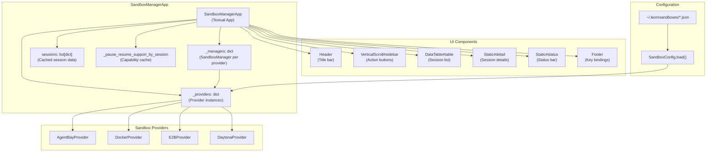
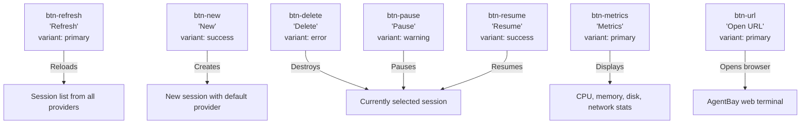
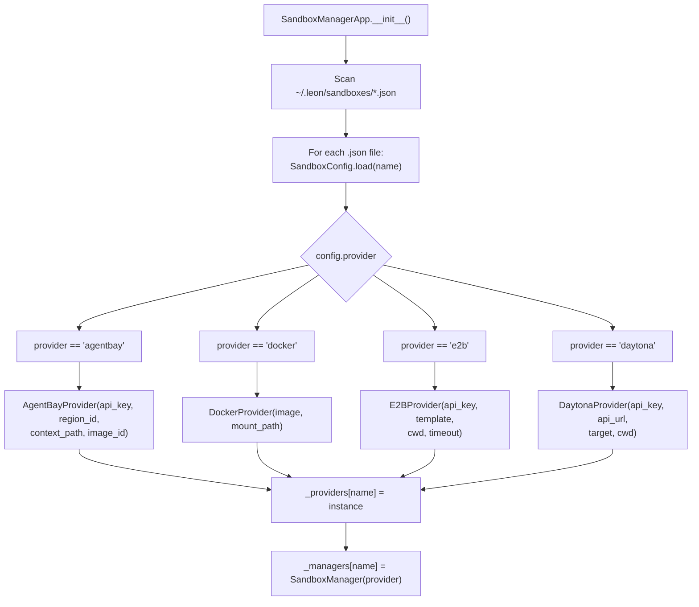
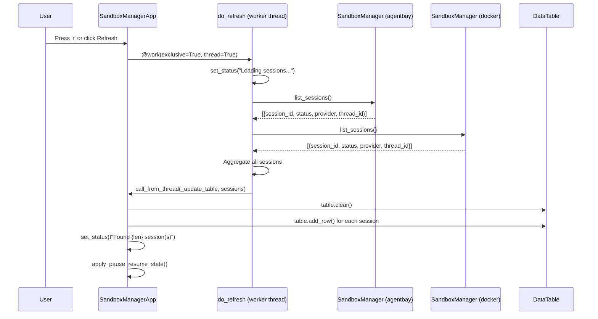
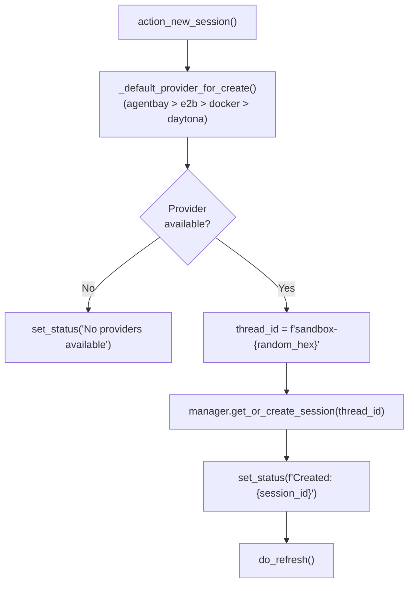
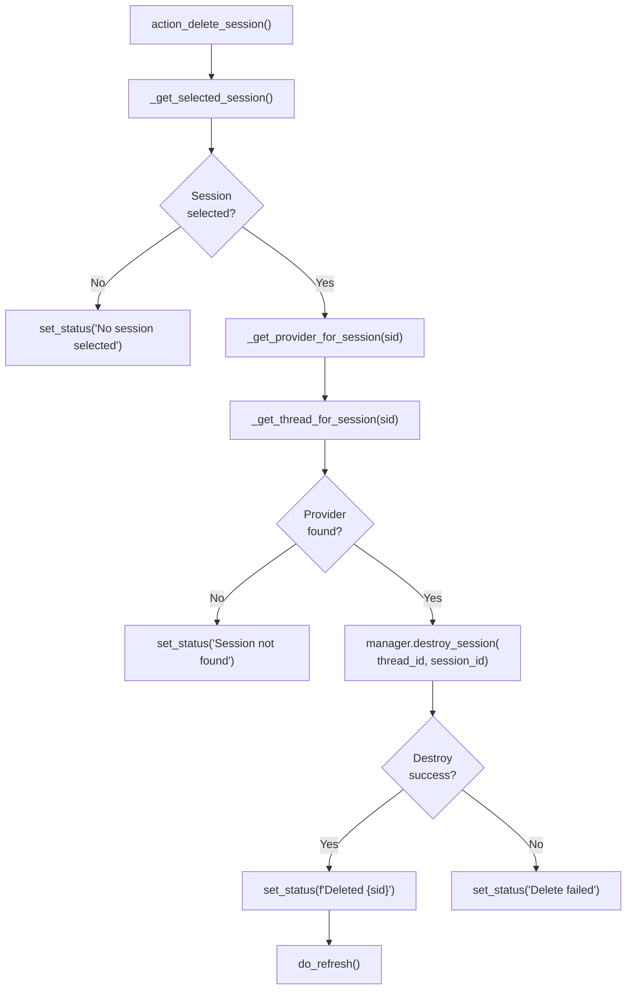
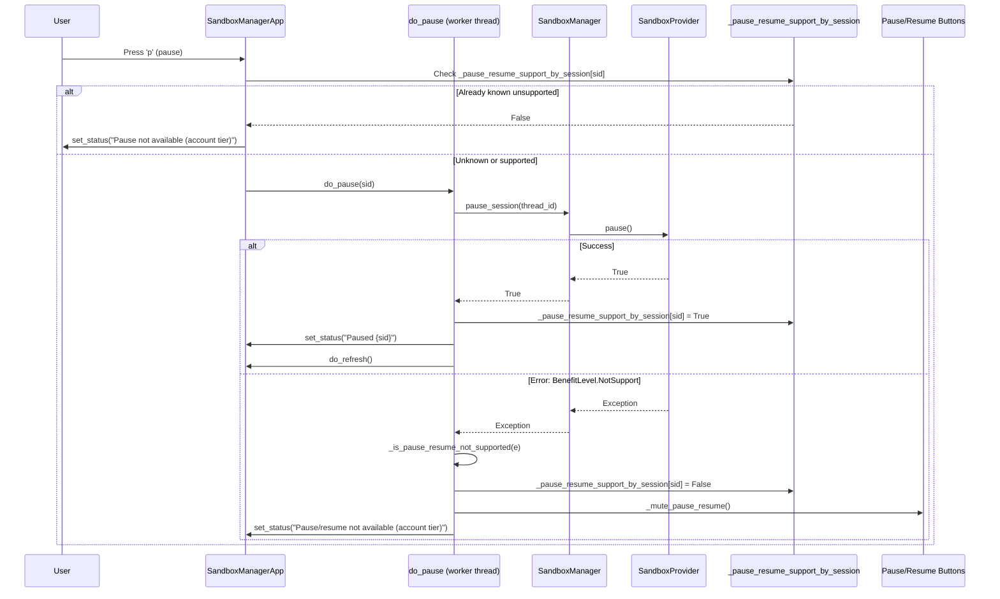
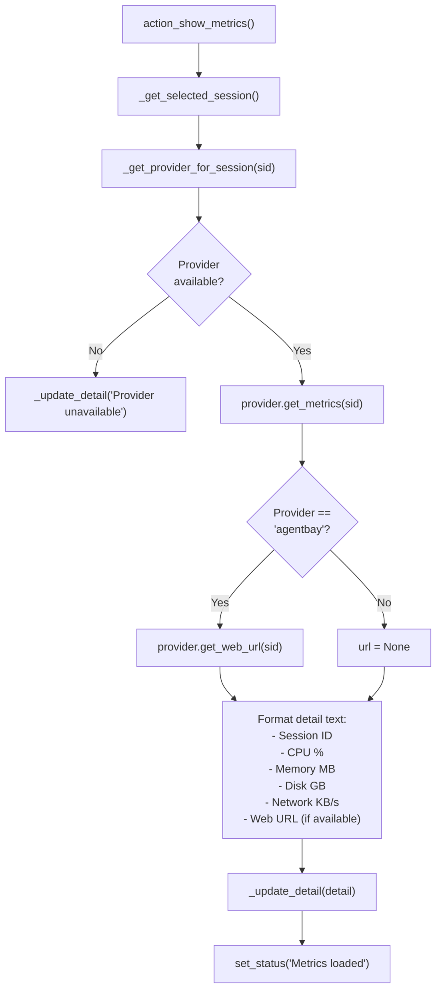
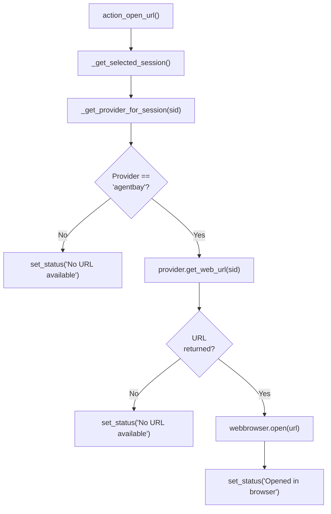

<!-- source: DeepWiki mcp.deepwiki.com · repo OpenDCAI/Mycel · page 6.5 Sandbox Manager TUI · fetched 2026-11-02 -->

# Sandbox Manager TUI

<details>
<summary>Relevant source files</summary>

The following files were used as context for generating this wiki page:

- [tui/widgets/sandbox_manager.py](tui/widgets/sandbox_manager.py)

</details>


The Sandbox Manager TUI is a terminal-based user interface for managing sandbox sessions across all configured providers. It provides interactive controls for listing, creating, deleting, pausing, resuming, and monitoring sandbox sessions. This tool is useful for inspecting active sandboxes, cleaning up unused sessions, and monitoring resource usage.

For information about the underlying sandbox system architecture, see [Sandbox System](#6). For details about sandbox providers and their capabilities, see [Provider Implementations](#6.2). For session lifecycle and orchestration, see [Session Management and Orchestration](#6.3).

## Overview

The Sandbox Manager TUI is implemented in the `SandboxManagerApp` class and launched via the `leonai sandbox` command. It displays all active sandbox sessions in a table view with sidebar actions for management operations. The interface loads all configured sandbox providers from `~/.leon/sandboxes/*.json` and allows unified management regardless of provider type.

**Sources:** [tui/widgets/sandbox_manager.py:1-23]()

## Application Architecture



**Sources:** [tui/widgets/sandbox_manager.py:21-52](), [tui/widgets/sandbox_manager.py:79-133]()

## UI Layout

The interface follows a three-column layout with header, footer, and status bar:

| Region | Component ID | Description |
|--------|--------------|-------------|
| Top | `Header` | Application title bar |
| Left (20 chars) | `#sidebar` | Vertical button panel for actions |
| Center | `#content` | Data table displaying sessions |
| Bottom (10 rows) | `#detail` | Detail panel showing selected session info |
| Bottom (3 rows) | `#status` | Status message bar |
| Bottom | `Footer` | Keyboard binding hints |

**Sources:** [tui/widgets/sandbox_manager.py:24-33](), [tui/widgets/sandbox_manager.py:53-68]()

### Sidebar Actions

The sidebar contains seven action buttons:



**Sources:** [tui/widgets/sandbox_manager.py:56-63](), [tui/widgets/sandbox_manager.py:397-409]()

### DataTable Columns

The main table displays four columns:

| Column | Width | Description |
|--------|-------|-------------|
| Session ID | Auto | Full session identifier (UUID or provider-specific ID) |
| Status | Auto | Session status (running, paused, stopped) |
| Provider | Auto | Provider name (agentbay, docker, e2b, daytona) |
| Thread | Auto | Associated thread ID |

The table uses row cursor navigation, and the selected row determines which session receives operations.

**Sources:** [tui/widgets/sandbox_manager.py:70-74](), [tui/widgets/sandbox_manager.py:144-156]()

## Keyboard Bindings

The application supports keyboard shortcuts for all operations:

| Key | Action | Description |
|-----|--------|-------------|
| `r` | `action_refresh` | Refresh session list from all providers |
| `n` | `action_new_session` | Create new session with default provider |
| `d` | `action_delete_session` | Delete selected session |
| `p` | `action_pause_session` | Pause selected session (if supported) |
| `u` | `action_resume_session` | Resume selected session (if supported) |
| `m` | `action_show_metrics` | Display metrics for selected session |
| `o` | `action_open_url` | Open web URL in browser (AgentBay only) |
| `q` | `quit` | Exit application |

**Sources:** [tui/widgets/sandbox_manager.py:35-44]()

## Provider Initialization

During startup, the application scans `~/.leon/sandboxes/` for provider configuration files and initializes providers:



**Sources:** [tui/widgets/sandbox_manager.py:46-49](), [tui/widgets/sandbox_manager.py:79-133]()

### API Key Resolution

API keys are resolved from multiple sources in priority order:

1. Provider-specific config field (e.g., `config.agentbay.api_key`)
2. Constructor parameter (`api_key` argument)
3. Environment variable (`AGENTBAY_API_KEY`, `E2B_API_KEY`, `DAYTONA_API_KEY`)

If no key is found, the provider is skipped during initialization.

**Sources:** [tui/widgets/sandbox_manager.py:93-129]()

## Session Listing and Refresh

The refresh operation queries all configured `SandboxManager` instances and aggregates results:



**Sources:** [tui/widgets/sandbox_manager.py:135-173]()

The `@work(exclusive=True, thread=True)` decorator ensures:
- Operations run in a background thread (non-blocking UI)
- Only one refresh can execute at a time
- Thread-safe UI updates via `call_from_thread()`

**Sources:** [tui/widgets/sandbox_manager.py:138-142]()

## Session Operations

### Create New Session

Creating a session uses the default provider (priority: agentbay, e2b, docker, daytona):



The operation generates a synthetic thread ID with format `sandbox-{8 hex chars}` since TUI-created sessions don't correspond to actual conversation threads.

**Sources:** [tui/widgets/sandbox_manager.py:209-230](), [tui/widgets/sandbox_manager.py:433-437]()

### Delete Session

Deleting requires looking up the provider and thread ID from cached session data:



**Sources:** [tui/widgets/sandbox_manager.py:186-208](), [tui/widgets/sandbox_manager.py:421-431]()

### Pause and Resume Sessions

Pause/resume operations include capability detection and UI state management:



The capability cache (`_pause_resume_support_by_session`) persists across refreshes and mutes buttons for sessions that don't support pause/resume (e.g., AgentBay free tier).

**Sources:** [tui/widgets/sandbox_manager.py:231-278](), [tui/widgets/sandbox_manager.py:348-395]()

### Button State Management

The UI dynamically enables/disables pause/resume buttons based on provider capabilities:

| State | Condition | UI Effect |
|-------|-----------|-----------|
| Normal | Capability unknown or supported | Labels: "Pause" / "Resume", no opacity |
| Muted | Provider returned `BenefitLevel.NotSupport` | Labels: "Pause (N/A)" / "Resume (N/A)", opacity: 0.5 |

The state updates when:
1. User selects a different session (`on_data_table_row_highlighted`, `on_data_table_row_selected`)
2. Pause/resume operation fails with `BenefitLevel.NotSupport` error
3. Refresh completes and restores cached state

**Sources:** [tui/widgets/sandbox_manager.py:359-379](), [tui/widgets/sandbox_manager.py:411-419]()

## Metrics Display

The metrics operation fetches resource usage from the provider and displays in the detail panel:



**Sources:** [tui/widgets/sandbox_manager.py:279-315]()

### Metrics Format

The detail panel displays metrics in this format:

```
Session: <full_session_id>
CPU: <cpu_percent>%
Memory: <used_mb>MB / <total_mb>MB
Disk: <used_gb>GB / <total_gb>GB
Network: RX <rx_kbps> KB/s | TX <tx_kbps> KB/s

Web URL: <url_truncated_to_60_chars>...
```

**Sources:** [tui/widgets/sandbox_manager.py:299-307]()

## Web URL Opening

For AgentBay sessions, the "Open URL" action retrieves the web terminal URL and opens it in the default browser:



This feature is AgentBay-specific because it's the only provider that exposes a web-based terminal interface.

**Sources:** [tui/widgets/sandbox_manager.py:317-343]()

## Error Handling

### Capability Detection Error Pattern

The pause/resume operations use error code inspection to detect unsupported operations:

```python
def _is_pause_resume_not_supported(result_or_error: object) -> bool:
    # Check error_code or code attribute
    code = getattr(result_or_error, "code", "") or getattr(result_or_error, "error_code", "")
    if code == "BenefitLevel.NotSupport":
        return True
    
    # Check error_message or message attribute
    message = (
        getattr(result_or_error, "error_message", "")
        or getattr(result_or_error, "message", "")
        or str(result_or_error)
    )
    return "BenefitLevel.NotSupport" in message
```

This pattern handles both structured error objects and plain exception messages.

**Sources:** [tui/widgets/sandbox_manager.py:348-357]()

### Thread-safe Error Reporting

All worker operations use `call_from_thread()` to safely update UI from background threads:

```python
@work(exclusive=True, thread=True)
def do_delete(self, sid: str) -> None:
    try:
        # ... operation logic ...
        self.call_from_thread(self.set_status, f"Deleted {sid[:16]}")
    except Exception as e:
        self.call_from_thread(self.set_status, f"Delete failed: {e}")
```

This ensures all status updates appear in the UI without race conditions.

**Sources:** [tui/widgets/sandbox_manager.py:191-207]()

## Session Data Model

The application maintains a simplified session data structure:

| Field | Type | Description |
|-------|------|-------------|
| `id` | `str` | Provider-specific session identifier |
| `status` | `str` | Current session state (running/paused/stopped) |
| `provider` | `str` | Provider name (agentbay/docker/e2b/daytona) |
| `thread` | `str` | Associated thread ID or synthetic ID |

This structure is populated from `SandboxManager.list_sessions()` and cached in `self.sessions` for fast lookups during operations.

**Sources:** [tui/widgets/sandbox_manager.py:161-173]()

## Lifecycle and State Management

The application manages three types of state:

### 1. Provider State (`_providers`, `_managers`)
- Initialized once during `__init__()` from config files
- Immutable during application lifetime
- Maps provider names to provider instances and managers

### 2. Session State (`sessions`)
- Updated by `do_refresh()` worker
- Contains current snapshot of all sessions across providers
- Used for session → provider/thread lookups

### 3. Capability State (`_pause_resume_support_by_session`)
- Lazily populated during pause/resume operations
- Persists across refreshes (filtered to active sessions)
- Controls button muting for unsupported operations

**Sources:** [tui/widgets/sandbox_manager.py:46-51](), [tui/widgets/sandbox_manager.py:144-159]()

## Usage Example

```bash
# Launch the sandbox manager TUI
leonai sandbox

# Or with explicit API key for cloud providers
leonai sandbox --api-key <agentbay_key>
```

Once launched:
1. Press `r` to load all sessions
2. Use arrow keys to navigate table
3. Press `m` to view metrics for selected session
4. Press `p` to pause (if supported)
5. Press `d` to delete unwanted sessions
6. Press `n` to create a test session
7. Press `q` to quit

**Sources:** [tui/widgets/sandbox_manager.py:1-6]()

---

