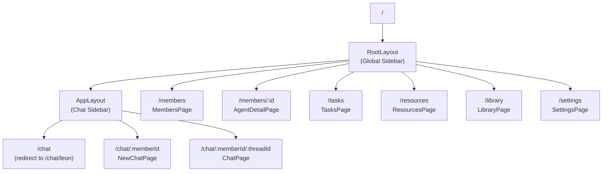
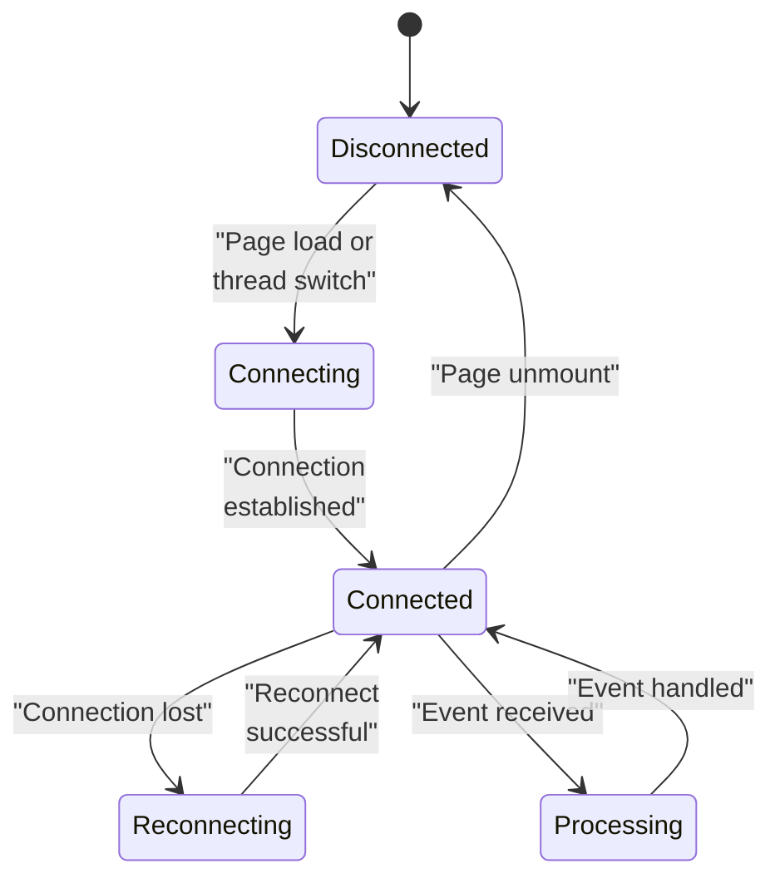
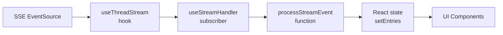
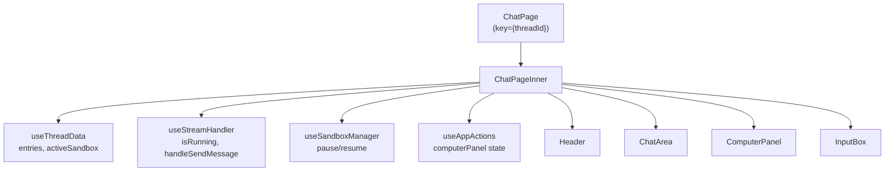
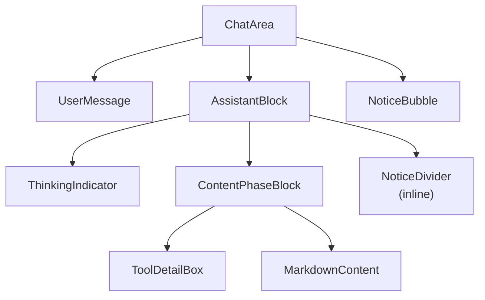
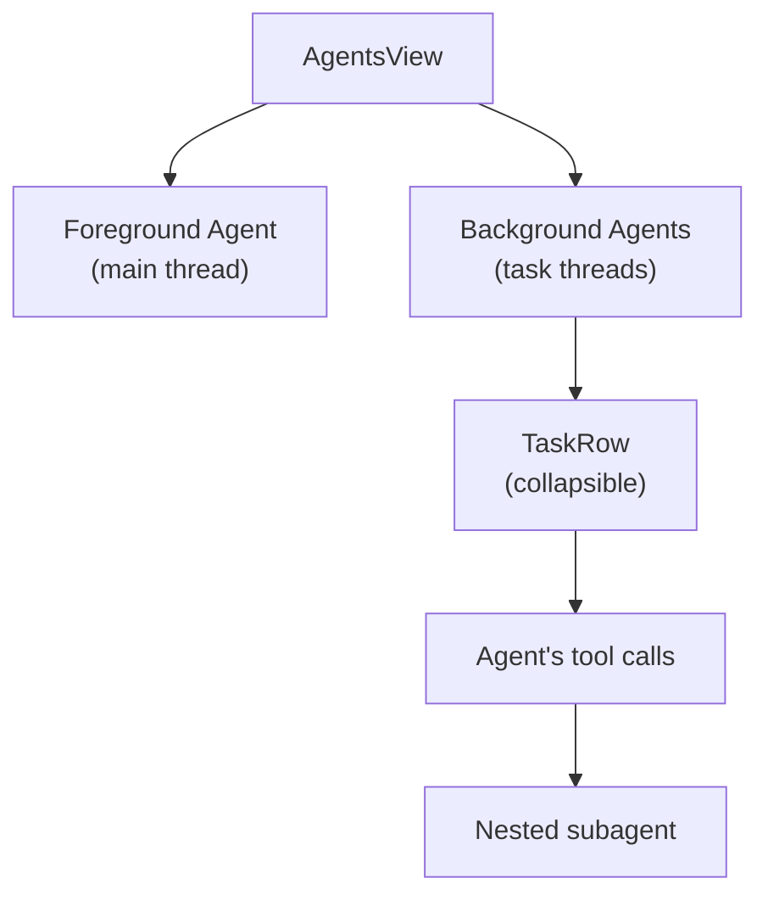
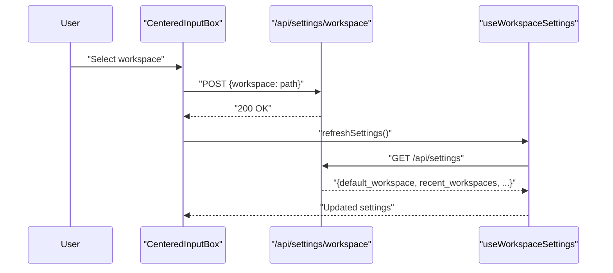

<!-- source: DeepWiki mcp.deepwiki.com · repo OpenDCAI/Mycel · page 7 Frontend Architecture · fetched 2026-11-02 -->

# Frontend Architecture

<details>
<summary>Relevant source files</summary>

The following files were used as context for generating this wiki page:

- [frontend/app/src/api/message-mapper.ts](frontend/app/src/api/message-mapper.ts)
- [frontend/app/src/api/types.ts](frontend/app/src/api/types.ts)
- [frontend/app/src/components/CenteredInputBox.tsx](frontend/app/src/components/CenteredInputBox.tsx)
- [frontend/app/src/components/DragHandle.tsx](frontend/app/src/components/DragHandle.tsx)
- [frontend/app/src/components/ModelSelector.tsx](frontend/app/src/components/ModelSelector.tsx)
- [frontend/app/src/components/NewChatDialog.tsx](frontend/app/src/components/NewChatDialog.tsx)
- [frontend/app/src/components/Sidebar.tsx](frontend/app/src/components/Sidebar.tsx)
- [frontend/app/src/components/chat-area/AssistantBlock.tsx](frontend/app/src/components/chat-area/AssistantBlock.tsx)
- [frontend/app/src/components/chat-area/NoticeBubble.tsx](frontend/app/src/components/chat-area/NoticeBubble.tsx)
- [frontend/app/src/hooks/stream-event-handlers.ts](frontend/app/src/hooks/stream-event-handlers.ts)
- [frontend/app/src/hooks/use-stream-handler.ts](frontend/app/src/hooks/use-stream-handler.ts)
- [frontend/app/src/hooks/use-thread-manager.ts](frontend/app/src/hooks/use-thread-manager.ts)
- [frontend/app/src/hooks/use-workspace-settings.ts](frontend/app/src/hooks/use-workspace-settings.ts)
- [frontend/app/src/main.tsx](frontend/app/src/main.tsx)
- [frontend/app/src/pages/AppLayout.tsx](frontend/app/src/pages/AppLayout.tsx)
- [frontend/app/src/pages/ChatPage.tsx](frontend/app/src/pages/ChatPage.tsx)
- [frontend/app/src/pages/NewChatPage.tsx](frontend/app/src/pages/NewChatPage.tsx)
- [frontend/app/src/pages/RootLayout.tsx](frontend/app/src/pages/RootLayout.tsx)
- [frontend/app/src/router.tsx](frontend/app/src/router.tsx)

</details>


The frontend is a React-based single-page application that provides the web interface for interacting with Mycel's agent runtime. This page covers the application structure, routing, state management, real-time streaming, and component organization. For backend API details, see [Backend Architecture](#8). For real-time event streaming implementation, see [Streaming Service and SSE](#8.2).

---

## Technology Stack and Build Configuration

The frontend uses the following core technologies:

| Technology | Purpose |
|------------|---------|
| React 18 | UI framework with concurrent features |
| TypeScript | Type-safe development |
| React Router 6 | Client-side routing |
| Zustand | Global state management |
| Tailwind CSS | Utility-first styling |
| Vite | Build tool and dev server |

The application follows modern React patterns including functional components, hooks, and Suspense boundaries. All state updates during streaming use `flushSync` when synchronization is critical to prevent batching issues with rapid SSE events.

**Sources:** [frontend/app/src/main.tsx:1-54](), [frontend/app/package.json]()

---

## Application Structure and Routing

### Route Hierarchy

The application uses nested routes with two layout components that provide different navigation patterns:

**Route Structure Diagram**



**Sources:** [frontend/app/src/router.tsx:13-66]()

### RootLayout Component

`RootLayout` provides the global navigation sidebar visible across all pages except during chat interactions. It features:

- **Collapsible sidebar**: Auto-collapses when entering `/chat` routes, expands when leaving
- **Drag-to-resize**: Users can drag the sidebar edge to resize between 60px (collapsed) and 200px (expanded)
- **Quick create menu**: Floating action button for creating members, chats, or tasks
- **Keyboard shortcuts**: `Cmd/Ctrl+B` toggles sidebar, `Escape` closes menus

The sidebar width is persisted to `localStorage` and the collapse behavior is context-aware based on the current route.

**Sources:** [frontend/app/src/pages/RootLayout.tsx:24-271]()

### AppLayout Component

`AppLayout` is a nested layout specifically for chat routes. It renders:

- **Thread list sidebar** (`Sidebar` component): Shows conversation history grouped by member
- **Resizable divider**: Sidebar width adjusts between 200px and 420px
- **Search modal**: Quick search across all threads
- **Mobile adaptive layout**: On mobile, shows either thread list or active chat, never both simultaneously

The layout uses `useThreadManager` hook to manage thread state and passes it down via `Outlet` context to child routes.

**Sources:** [frontend/app/src/pages/AppLayout.tsx:15-101]()

---

## State Management Architecture

The frontend uses a hybrid state management approach:

| State Type | Management Strategy |
|------------|-------------------|
| Global app state | Zustand store (`useAppStore`) |
| Thread-specific state | Local component state + custom hooks |
| URL state | React Router params and location state |
| Streaming state | SSE events → local state via `useStreamHandler` |

### Zustand Store (AppStore)

The global store manages:

- **User profile**: Name, email, initials
- **Member list**: All configured agents
- **Task list**: Background task tracking
- **UI preferences**: Sidebar state, theme settings

**Key Store Actions**

```typescript
// Store interface (conceptual)
interface AppStore {
  // State
  userProfile: { name: string; email: string; initials: string }
  memberList: Member[]
  
  // Actions
  loadAll: () => Promise<void>
  fetchMembers: () => Promise<void>
  addTask: () => Promise<void>
}
```

**Sources:** [frontend/app/src/store/app-store.ts]()

### Custom Hooks Pattern

The frontend extensively uses custom hooks to encapsulate specific concerns:

| Hook | Purpose |
|------|---------|
| `useThreadManager` | Thread CRUD operations, sandbox type listing |
| `useStreamHandler` | SSE event subscription and processing |
| `useThreadData` | Initial thread history loading |
| `useAppActions` | Computer panel state, agent focusing |
| `useSandboxManager` | Sandbox pause/resume operations |
| `useWorkspaceSettings` | Workspace configuration |

This separation allows components to compose multiple concerns without prop drilling.

**Sources:** [frontend/app/src/hooks/use-thread-manager.ts:26-74](), [frontend/app/src/hooks/use-stream-handler.ts:72-268]()

---

## Real-time Streaming Architecture

### SSE Connection Management

The frontend maintains a persistent SSE connection per thread for receiving real-time updates. The connection lifecycle is managed by the `useThreadStream` hook:

**SSE Connection Lifecycle**



**Connection Initialization**

The hook connects to `/api/threads/{threadId}/events` with the following sequence:

1. Wait for initial history load (`loading === false`)
2. Determine starting sequence number:
   - `seq=0` if `runStarted === true` (fresh run from NewChatPage)
   - `seq=last_seq` otherwise (reconnecting to existing thread)
3. Establish SSE connection with `EventSource`
4. Register event listeners for all `STREAM_EVENT_TYPES`

**Sources:** [frontend/app/src/hooks/use-thread-stream.ts]()

### Event Processing Pipeline

Stream events flow through a multi-stage pipeline:

**Event Flow Diagram**



**Event Types and Handlers**

The system processes these event types through dedicated handlers:

| Event Type | Handler | Purpose |
|------------|---------|---------|
| `text` | `handleText` | Append text chunk to current turn |
| `tool_call` | `handleToolCall` | Create or update tool step |
| `tool_result` | `handleToolResult` | Mark tool complete with result |
| `error` | `handleError` | Display error message |
| `cancelled` | `handleCancelled` | Mark cancelled tools |
| `retry` | `handleRetry` | Show retry attempt indicator |
| `task_start` | `handleTaskStart` | Initialize subagent stream metadata |
| `task_done` | `handleTaskDone` | Mark subagent task complete |
| `notice` | (special) | Insert standalone notice entry |
| `run_start` | (control) | Initialize turn if reconnecting |
| `run_done` | (control) | Finalize turn, mark `streaming: false` |
| `status` | (control) | Update runtime status (tokens, cost, flags) |

**Sources:** [frontend/app/src/hooks/stream-event-handlers.ts:33-267](), [frontend/app/src/api/types.ts:1-12]()

### Turn Management and Message ID Binding

The streaming architecture uses a critical synchronization pattern to avoid lost events:

**Turn ID Binding Flow**

1. **User sends message**: `handleSendMessage` creates temporary turn with `id = "turn-{random}"`
2. **Set turnIdRef synchronously**: `turnIdRef.current = tempTurnId` using `flushSync`
3. **Post to backend**: `POST /api/threads/{id}/messages` (fire-and-forget)
4. **Backend emits events**: `run_start` → `text` → `tool_call` → ... (with `message_id`)
5. **Bind server ID**: First event with `message_id` triggers ID replacement: `tempTurnId` → `message_id`

The use of `flushSync` at [frontend/app/src/hooks/use-stream-handler.ts:225-228]() is critical: SSE may deliver multiple buffered events in a single `reader.read()` batch. Without `flushSync`, React would batch the state update, leaving `turnIdRef` unset when the next event is processed, causing text chunks to be lost.

**Sources:** [frontend/app/src/hooks/use-stream-handler.ts:204-268]()

### Reconnection and Resume Logic

The system handles reconnections gracefully:

**Reconnection Scenarios**

| Scenario | Detection | Behavior |
|----------|-----------|----------|
| User navigates away and back | `useEffect` cleanup → reconnect | Load history, connect at `seq=last_seq` |
| Connection drops mid-stream | `EventSource` error event | Automatic browser reconnect, backend replays from last ack |
| Page refresh during run | Browser reload, `location.state` lost | Load history, connect at `seq=last_seq`, create reconnect turn on first event |
| Wake from notification | `runStarted` undefined, run active | Load history, backend sends `notice` + `run_start`, create turn lazily |

When reconnecting mid-run, the hook uses `ensureReconnectTurn()` to either reuse the last assistant turn (if still streaming) or create a new one:

```typescript
// Conceptual logic from use-stream-handler.ts
function ensureReconnectTurn() {
  const fallbackId = makeId("reconnect-turn");
  flushSync(() => {
    onUpdateRef.current((prev) => {
      const { entries, turnId } = applyReconnectTurn(prev, fallbackId);
      turnIdRef.current = turnId;  // Set BEFORE next event!
      return entries;
    });
  });
}
```

**Sources:** [frontend/app/src/hooks/use-stream-handler.ts:44-70](), [frontend/app/src/hooks/use-stream-handler.ts:119-128]()

---

## Page Components

### ChatPage

`ChatPage` is the main conversation interface. It orchestrates multiple concerns through custom hooks:

**ChatPage Component Structure**



**Key Responsibilities**

- **Remount on thread change**: Wrapper uses `key={threadId}` to force full remount, resetting all hook state naturally
- **Optimistic UI**: Pre-populates user message + empty assistant turn when navigating from NewChatPage with `runStarted: true`
- **Model selection**: Loads current model from thread runtime config or falls back to default
- **Task management**: Tracks background tasks, allows cancellation
- **Sandbox controls**: Pause/resume buttons, status display

**Sources:** [frontend/app/src/pages/ChatPage.tsx:28-220]()

### NewChatPage

`NewChatPage` provides the initial chat creation interface with a centered input box:

**Features**

- **Sandbox selector**: Dropdown for choosing execution environment
- **Model selector**: Popover with virtual models (Mini/Medium/Large/Max) and custom models
- **Workspace picker**: Three-tab interface (Browse, Recent, Manual) for setting working directory
- **Fire-and-forget run**: Calls `postRun()` without awaiting, then navigates immediately with `runStarted: true` in location state

The fire-and-forget pattern allows instant navigation while the backend starts agent initialization (which can take 3-5 seconds on first call). ChatPage mounts with a loading indicator while the SSE connection (starting at `seq=0`) waits for the `run_start` event.

**Sources:** [frontend/app/src/pages/NewChatPage.tsx:16-105]()

---

## Chat Interface Components

### ChatArea

`ChatArea` renders the scrollable message history with auto-scroll behavior:

**Component Hierarchy**



**Sticky Scroll Logic**

ChatArea maintains scroll position using a `MutationObserver` that watches for DOM changes. When new content is added:

- If user was scrolled to bottom (within 50px threshold): auto-scroll to new bottom
- If user scrolled up: preserve scroll position (don't jump)

This provides a natural chat experience where new messages auto-scroll only when the user is following along.

**Sources:** [frontend/app/src/components/ChatArea.tsx]()

### AssistantBlock

`AssistantBlock` renders a single assistant turn with support for multi-phase content:

**Phase-based Rendering**

Assistant turns can contain multiple phases separated by notice dividers (e.g., when a background task completes mid-turn):

```
Phase 1: [Tool: Agent] → [Text: "Starting task..."]
Notice: "Task T123 completed"
Phase 2: [Tool: ReadFile] → [Text: "Here are the results..."]
```

The component uses `splitPhases()` to group segments between notices, then renders each phase independently. This allows inline notifications without breaking the turn structure.

**Subagent Stream Metadata**

For `Agent` tool calls (sub-agent spawning), the step includes `subagent_stream` metadata:

```typescript
interface ToolStep {
  id: string
  name: string
  subagent_stream?: {
    task_id: string
    thread_id: string
    description?: string
    text: string
    tool_calls: Array<{...}>
    status: "running" | "completed" | "error"
  }
}
```

This metadata is populated by `task_start` events and drives the AgentsView panel in ComputerPanel.

**Sources:** [frontend/app/src/components/chat-area/AssistantBlock.tsx:1-170](), [frontend/app/src/api/types.ts:93-109]()

### InputBox and Message Sending

`InputBox` provides the message input interface with:

- **Textarea with auto-resize**: Grows vertically as user types
- **Keyboard shortcuts**: `Enter` sends, `Shift+Enter` adds newline
- **Queue message mode**: Button to inject steering messages while agent is running
- **Stop button**: Cancel in-flight runs

**Send Message Flow**

1. User types message and presses Enter
2. `handleSendMessage` in `useStreamHandler`:
   - Creates temporary user entry and assistant turn
   - Sets `turnIdRef` and uses `flushSync` to update state synchronously
   - Calls `postRun(threadId, message)` API
3. UI immediately shows message + thinking indicator
4. SSE connection receives `run_start` event, confirming run started
5. Subsequent events populate the assistant turn

**Sources:** [frontend/app/src/components/InputBox.tsx](), [frontend/app/src/hooks/use-stream-handler.ts:204-254]()

---

## Computer Panel and Activity Visualization

The `ComputerPanel` provides a side panel for monitoring agent activity in real-time:

**Panel Tabs**

| Tab | Component | Purpose |
|-----|-----------|---------|
| Agents | `AgentsView` | Tree view of foreground + background agents |
| Steps | `StepsView` | Chronological tool execution log |
| Flow | `FlowList` | Simplified activity feed (legacy) |

**AgentsView Structure**



**Agent Tracking Logic**

The view reconstructs the agent hierarchy from `chatEntries`:

1. Extract all `ToolSegment` items from assistant turns
2. For foreground agent: show all tool steps from main thread
3. For background agents: group by `task_id` from `subagent_stream` metadata
4. Build nested tree: Task → Tool Calls → Nested Subagents

When a user clicks on a background task notice, the `onTaskNoticeClick` handler calls `handleFocusAgent(stepId)`, which:
- Switches to "Agents" tab
- Expands the matching task row
- Scrolls to the tool step

**Sources:** [frontend/app/src/components/ComputerPanel.tsx](), [frontend/app/src/components/computer-panel/AgentsView.tsx]()

---

## Message Mapping and History Reconstruction

When loading thread history, the frontend must convert backend message format to the frontend's turn-based structure.

**Backend Message Schema**

```typescript
interface BackendMessage {
  id?: string
  type: "HumanMessage" | "AIMessage" | "ToolMessage"
  content: string | Array<{type: "text", text: string}>
  tool_calls?: Array<{id: string, name: string, args: unknown}>
  tool_call_id?: string
  metadata?: { run_id?: string, source?: "system", notification_type?: string, ... }
}
```

**Mapping Logic**

The `mapBackendEntries()` function implements stateful conversion:

**Turn Grouping Rules**

1. **HumanMessage with `metadata.source === "system"`** → Standalone `NoticeMessage` or folded into current turn as `NoticeSegment` (if `run_id` matches)
2. **HumanMessage (normal)** → `UserMessage`, breaks current turn
3. **AIMessage** → Create new `AssistantTurn` or append to current turn if `run_id` matches
4. **ToolMessage** → Find corresponding tool step in current turn, mark as `done`, attach result

**Run ID-based Grouping**

The mapper tracks `currentRunId` to group consecutive AI messages from the same run into a single turn. This ensures multi-step reasoning (where the agent calls multiple tools across several LLM invocations) renders as one cohesive turn rather than fragmented blocks.

**Subagent Metadata Restoration**

For `Agent` tool results, the mapper checks both `metadata` and JSON-parsed content for `task_id` and `thread_id`, restoring the `subagent_stream` structure that drives the AgentsView UI.

**Sources:** [frontend/app/src/api/message-mapper.ts:1-181]()

---

## Mobile Responsiveness

The frontend adapts to mobile screens using the `useIsMobile` hook (based on Tailwind's `md:` breakpoint):

**Desktop vs Mobile Layouts**

| Screen | RootLayout | AppLayout | ChatPage |
|--------|-----------|-----------|----------|
| Desktop | Collapsible sidebar + drag resize | Thread sidebar + chat area | Sidebar, chat, computer panel (resizable) |
| Mobile | Bottom tab bar | Thread list OR chat (mutually exclusive) | Full-screen chat, no sidebar |

On mobile:
- **No resizable panels**: All panels are full-width
- **Navigation via bottom tabs**: Fixed tab bar with 5 primary sections
- **Back navigation**: Uses browser back button to return from thread to list
- **Simplified layouts**: No drag handles, fewer nested panels

**Sources:** [frontend/app/src/pages/RootLayout.tsx:156-188](), [frontend/app/src/pages/AppLayout.tsx:34-55]()

---

## State Synchronization Patterns

### Thread List Updates

The thread list in the sidebar must stay synchronized with backend state:

**Update Triggers**

| Action | Update Method |
|--------|---------------|
| Send message | Optimistic update: `setThreads(prev => ...)` in `handleSendMessage` |
| Complete run | `tm.refreshThreads()` called from `useStreamHandler` on `run_done` |
| Create thread | `setThreads(prev => [newThread, ...prev])` in `handleCreateThread` |
| Delete thread | `setThreads(prev => prev.filter(...))` in `handleDeleteThread` |
| Background task done | `refreshThreads()` triggered by backend notification |

The pattern separates immediate UI feedback (optimistic updates) from eventual consistency (full refresh).

**Sources:** [frontend/app/src/hooks/use-thread-manager.ts:32-67](), [frontend/app/src/hooks/use-stream-handler.ts:75-94]()

### Workspace Settings Persistence

Workspace selection is persisted via backend API and reflected in the Zustand store:

**Settings Flow**



The hook maintains local state that is refreshed after mutations, avoiding stale reads.

**Sources:** [frontend/app/src/hooks/use-workspace-settings.ts:10-68]()

---

## Error Handling and Loading States

The frontend employs several error handling strategies:

**Error Display Patterns**

| Context | Strategy | Example |
|---------|----------|---------|
| Network errors | Show error message in UI, allow retry | Model selector: `setError()` state, display below dropdown |
| Stream errors | Insert error segment into assistant turn | `handleError()` appends `{type: "text", content: "Error: ..."}` |
| API failures | Toast notification (Sonner) | Task creation failure shows toast |
| Sandbox action errors | Banner at top of chat | `sandboxActionError` state displays red banner |

**Loading Skeletons**

Loading states use the `Skeleton` component from shadcn/ui:

- **Thread list loading**: `ThreadSkeleton` with 5 animated placeholder rows
- **Settings loading**: Full-page skeleton for forms
- **Initial page load**: Suspense boundaries (planned)

**Sources:** [frontend/app/src/components/Sidebar.tsx:51-62](), [frontend/app/src/hooks/use-stream-handler.ts:233-251]()

---

## Key Frontend Conventions

### File Naming and Organization

```
frontend/app/src/
├── api/                    # API client functions and types
│   ├── types.ts           # Shared TypeScript interfaces
│   └── message-mapper.ts  # History conversion logic
├── components/            # Reusable UI components
│   ├── ui/               # shadcn/ui primitives
│   ├── chat-area/        # Chat-specific components
│   └── computer-panel/   # Agent monitoring components
├── hooks/                 # Custom React hooks
│   ├── use-stream-handler.ts
│   ├── use-thread-manager.ts
│   └── stream-event-handlers.ts
├── pages/                 # Route page components
│   ├── RootLayout.tsx
│   ├── AppLayout.tsx
│   └── ChatPage.tsx
├── store/                 # Zustand stores
│   └── app-store.ts
└── router.tsx            # Route definitions
```

**Sources:** [frontend/app/src/]()

### TypeScript Patterns

- **Strict null checks**: All optional fields use `?:` or `| null | undefined`
- **Discriminated unions**: `ChatEntry` type uses `role` discriminator
- **Type guards**: Functions like `(s): s is ToolSegment` for narrowing
- **Readonly arrays**: Event types defined as `as const` tuple for literal type inference

**Sources:** [frontend/app/src/api/types.ts:1-234]()

### Component Composition

Components follow a consistent pattern:

1. **Props interface** defining inputs
2. **Local state** for UI concerns
3. **Custom hooks** for data/logic
4. **Effect hooks** for side effects
5. **JSX** with Tailwind classes

Larger components (like ChatPage) delegate to multiple specialized hooks, keeping the component itself focused on composition rather than logic.

**Sources:** [frontend/app/src/pages/ChatPage.tsx:34-220]()

---

