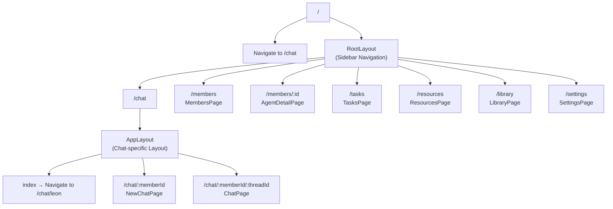
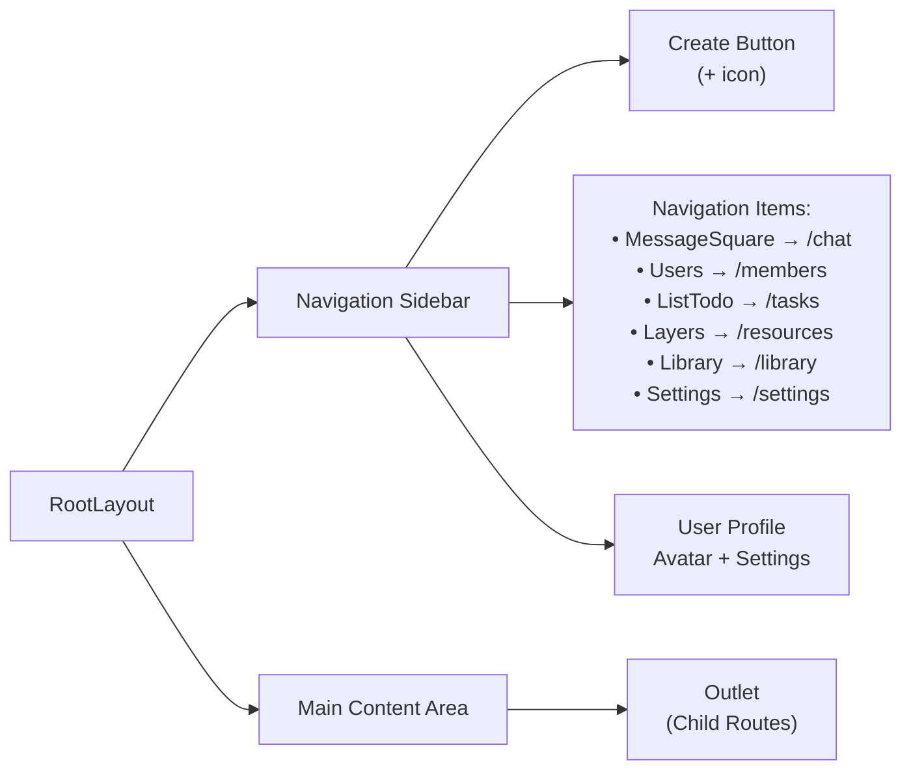
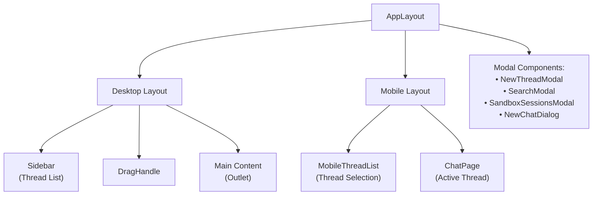
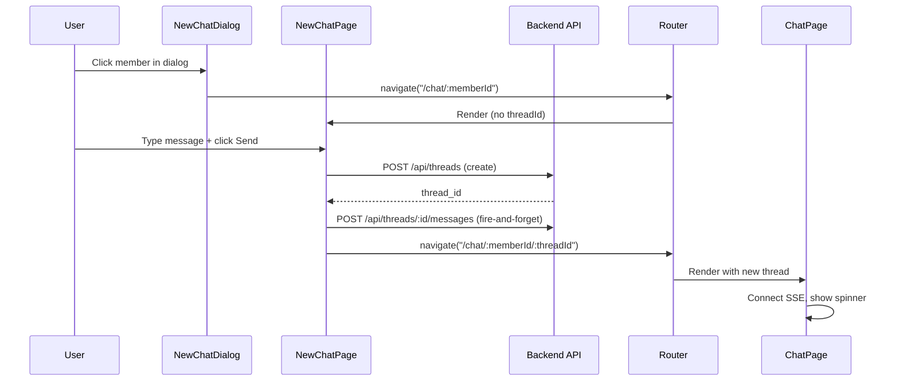
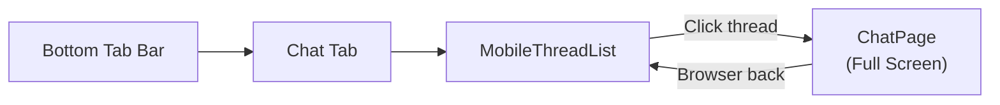

<!-- source: DeepWiki mcp.deepwiki.com · repo OpenDCAI/Mycel · page 7.1 Application Structure and Routing · fetched 2026-11-02 -->

# Application Structure and Routing

<details>
<summary>Relevant source files</summary>

The following files were used as context for generating this wiki page:

- [frontend/app/src/components/CenteredInputBox.tsx](frontend/app/src/components/CenteredInputBox.tsx)
- [frontend/app/src/components/DragHandle.tsx](frontend/app/src/components/DragHandle.tsx)
- [frontend/app/src/components/ModelSelector.tsx](frontend/app/src/components/ModelSelector.tsx)
- [frontend/app/src/components/NewChatDialog.tsx](frontend/app/src/components/NewChatDialog.tsx)
- [frontend/app/src/components/Sidebar.tsx](frontend/app/src/components/Sidebar.tsx)
- [frontend/app/src/hooks/use-thread-manager.ts](frontend/app/src/hooks/use-thread-manager.ts)
- [frontend/app/src/hooks/use-workspace-settings.ts](frontend/app/src/hooks/use-workspace-settings.ts)
- [frontend/app/src/main.tsx](frontend/app/src/main.tsx)
- [frontend/app/src/pages/AppLayout.tsx](frontend/app/src/pages/AppLayout.tsx)
- [frontend/app/src/pages/NewChatPage.tsx](frontend/app/src/pages/NewChatPage.tsx)
- [frontend/app/src/pages/RootLayout.tsx](frontend/app/src/pages/RootLayout.tsx)
- [frontend/app/src/router.tsx](frontend/app/src/router.tsx)

</details>


This document explains the React application structure, routing configuration, layout hierarchy, and navigation patterns in the Mycel web frontend. For details about individual page components (ChatPage, TasksPage, etc.), see [7.2](#7.2). For state management patterns that coordinate with routing, see [7.5](#7.5).

## Overview

The Mycel frontend is a single-page application (SPA) built with React 18 and React Router v6. The application uses a hierarchical layout system where route components are nested within layout components that provide shared UI elements like navigation sidebars and headers. The routing system supports both desktop and mobile layouts, with different navigation patterns for each.

**Sources:** [frontend/app/src/router.tsx:1-67](), [frontend/app/src/main.tsx:1-55]()

## Route Hierarchy and Structure

### Route Configuration

The application's routing structure is defined in `router.tsx` using `createBrowserRouter`. All routes are nested under a root path with two primary layout levels:

**Route Hierarchy Diagram:**



**Sources:** [frontend/app/src/router.tsx:13-66]()

### Route Definitions

The routing configuration follows a nested structure:

| Route Path | Component | Purpose | Layout |
|------------|-----------|---------|--------|
| `/` | `Navigate` | Redirects to `/chat` | None |
| `/chat` | `AppLayout` | Chat container with thread sidebar | `RootLayout` |
| `/chat/:memberId` | `NewChatPage` | New conversation for specific member | `AppLayout` |
| `/chat/:memberId/:threadId` | `ChatPage` | Active conversation thread | `AppLayout` |
| `/members` | `MembersPage` | Agent/member management | `RootLayout` |
| `/members/:id` | `AgentDetailPage` | Single agent details | `RootLayout` |
| `/tasks` | `TasksPage` | Task board | `RootLayout` |
| `/resources` | `ResourcesPage` | Provider monitoring | `RootLayout` |
| `/library` | `LibraryPage` | Capability library | `RootLayout` |
| `/settings` | `SettingsPage` | Configuration | `RootLayout` |

**Sources:** [frontend/app/src/router.tsx:13-66]()

### URL Parameter Structure

The chat routes use a two-level parameter system:

- **`:memberId`** - The agent/member name (e.g., `"leon"`, `"Test Researcher"`)
  - Special handling: `"leon"` represents the default agent
  - Used to select which agent configuration to use for the thread
- **`:threadId`** - The unique thread identifier (UUID format)
  - Used to load and display a specific conversation

**Example URLs:**
- `/chat/leon` - New chat with default Leon agent
- `/chat/leon/abc123-def456` - Existing thread with default agent
- `/chat/Test%20Researcher` - New chat with "Test Researcher" member
- `/chat/Test%20Researcher/xyz789` - Existing thread with custom member

**Sources:** [frontend/app/src/pages/NewChatPage.tsx:18-26](), [frontend/app/src/router.tsx:26-37]()

## Layout Components

### RootLayout: Global Navigation Shell

`RootLayout` provides the primary navigation structure and wraps all top-level routes. It renders a collapsible sidebar with navigation items and user profile, plus a main content area where child routes render via `<Outlet />`.

**Component Structure Diagram:**



**Key Features:**

1. **Collapsible Sidebar** - Width toggles between 200px (expanded) and 60px (collapsed)
   - Controlled by `expanded` state stored in localStorage
   - Keyboard shortcut: `Cmd/Ctrl + B` to toggle
   - Drag-to-resize functionality via handle on right edge
   - Auto-collapses when entering chat routes

2. **Navigation State** - Active route highlighting with primary color accent bar
   - NavLink components detect current pathname via `useLocation()`
   - Shows tooltip on hover when collapsed

3. **Create Action Dropdown** - Floating button that opens action menu
   - Actions: Create member, Start chat, Create task
   - Opens CreateMemberDialog, NewChatDialog, or navigates to tasks page

4. **Mobile vs Desktop Layout**
   - Desktop: Vertical sidebar with drag-to-resize
   - Mobile: Bottom tab bar with icons only

**Sources:** [frontend/app/src/pages/RootLayout.tsx:1-316]()

### AppLayout: Chat Context Shell

`AppLayout` is the nested layout for chat routes (`/chat/*`). It manages the thread list sidebar (distinct from the RootLayout navigation sidebar) and provides context for chat pages.

**AppLayout Component Structure:**



**State Management:**

The layout uses `useThreadManager` hook to provide shared state to child routes:

```typescript
interface OutletContext {
  tm: ThreadManagerState & ThreadManagerActions;
  sidebarCollapsed: boolean;
  setSidebarCollapsed: (value: boolean) => void;
  setSessionsOpen: (value: boolean) => void;
}
```

This context is accessed in child pages via `useOutletContext<OutletContext>()`.

**Desktop Features:**

- **Thread Sidebar** (`Sidebar` component) - Shows grouped thread list
  - Resizable width (200-420px, default 272px)
  - Groups threads by member/agent
  - Shows running status, preview text, timestamps
  - Bulk delete mode with checkbox selection
  
- **DragHandle** - Vertical resize handle between sidebar and main content

**Mobile Routing:**

On mobile devices, AppLayout conditionally renders based on `threadId` presence:
- No `threadId`: Renders `MobileThreadList` (thread selection view)
- Has `threadId`: Renders `ChatPage` directly (full-screen conversation)

**Sources:** [frontend/app/src/pages/AppLayout.tsx:1-159](), [frontend/app/src/components/Sidebar.tsx:1-449]()

## Navigation Patterns

### Navigation Implementation

The application uses `react-router-dom` for declarative routing:

**Primary Navigation Methods:**

1. **NavLink Components** - For sidebar navigation items
   ```typescript
   <NavLink to="/chat">
     {/* Automatically adds active class */}
   </NavLink>
   ```
   Active state is determined by pathname matching, adding `bg-sidebar-accent` class.

2. **Link Components** - For internal navigation without active state
   ```typescript
   <Link to={`/chat/${memberId}/${threadId}`}>
     {/* Thread navigation */}
   </Link>
   ```

3. **Programmatic Navigation** - Using `useNavigate()` hook
   ```typescript
   const navigate = useNavigate();
   navigate(`/chat/${memberId}/${threadId}`, {
     state: { selectedModel: model, runStarted: true }
   });
   ```

**Sources:** [frontend/app/src/pages/RootLayout.tsx:131-153](), [frontend/app/src/components/Sidebar.tsx:114-135]()

### Navigation Flow: Starting a New Chat

**New Chat Flow Diagram:**



**Key Implementation Details:**

1. **NewChatDialog** - Modal for selecting a member
   - Fetches `memberList` from app store
   - Filters members by search query
   - Navigates to `/chat/{member.name}` on selection

2. **NewChatPage** - Landing page for new conversations
   - Shows welcome message and member capabilities
   - `CenteredInputBox` component for message input
   - Sandbox and model selection
   - Calls `handleCreateThread()` to create thread via API
   - Fires `postRun()` without awaiting (fire-and-forget)
   - Immediately navigates to ChatPage with `runStarted: true` state

3. **ChatPage** - Active conversation view
   - Detects `runStarted` navigation state
   - Shows optimistic loading spinner
   - Connects SSE to receive actual run events

**Sources:** [frontend/app/src/components/NewChatDialog.tsx:1-95](), [frontend/app/src/pages/NewChatPage.tsx:16-106]()

### Thread Selection Navigation

The `Sidebar` component implements thread selection with member grouping:

**Sidebar Navigation Structure:**

- **Member Groups** - Collapsible sections per agent
  - Click chevron icon: Toggle expansion
  - Click member name/avatar: Navigate to `/chat/{memberId}` (new chat)
  
- **Thread Items** - Individual conversations within groups
  - Click thread: Navigate to `/chat/{memberId}/{threadId}`
  - Active thread: Highlighted with accent background and left border indicator
  - Running threads: Show spinning loader icon

**URL Construction:**
```typescript
const urlId = group.memberId === "Leon" ? "leon" : group.memberId;
<Link to={`/chat/${urlId}/${thread.thread_id}`}>
```

The URL format ensures the `memberId` parameter matches the original member name, preserving agent configuration across navigation.

**Sources:** [frontend/app/src/components/Sidebar.tsx:218-415]()

## Mobile Navigation Considerations

### Responsive Layout Switching

The application detects mobile devices using the `useIsMobile()` hook, which triggers different rendering paths:

**Mobile-Specific Routing:**

1. **RootLayout Mobile** - Bottom tab bar navigation
   - Fixed bottom position with `safe-area-inset-bottom` padding
   - Tab items for all major routes (chat, members, tasks, resources, library, settings)
   - Active tab highlighted with primary color
   - No collapsible sidebar

2. **AppLayout Mobile** - Conditional rendering based on route
   - `/chat` (no threadId): Shows `MobileThreadList`
     - Full-screen thread selection list
     - Top header with "New Chat" button
     - Thread items with avatar, preview, delete button
   - `/chat/:memberId/:threadId`: Shows `ChatPage` directly
     - Full-screen conversation view
     - Back navigation handled by browser

**Mobile Navigation Flow:**



**Sources:** [frontend/app/src/pages/RootLayout.tsx:156-188](), [frontend/app/src/pages/AppLayout.tsx:34-54](), [frontend/app/src/pages/AppLayout.tsx:103-158]()

## State Synchronization with Routing

### URL as Source of Truth

The application treats URL parameters as the primary source of truth for current context:

**Route Parameter Extraction:**
```typescript
const { memberId, threadId } = useParams<{ memberId?: string; threadId?: string }>();
```

Pages derive their state from these parameters:
- **NewChatPage**: Uses `memberId` to determine which agent configuration to use
- **ChatPage**: Uses both `memberId` and `threadId` to load conversation
- **AgentDetailPage**: Uses `id` parameter to load agent details

### Navigation State

React Router's navigation state mechanism passes ephemeral data between routes:

**Example in NewChatPage:**
```typescript
navigate(`/chat/${memberId}/${threadId}`, {
  state: { selectedModel: model, runStarted: true, message }
});
```

The receiving page accesses this via:
```typescript
const location = useLocation();
const { selectedModel, runStarted, message } = location.state || {};
```

This pattern is used to:
- Pass selected model from NewChatPage to ChatPage
- Signal that a run has been initiated
- Pass the initial message text for optimistic rendering

**Sources:** [frontend/app/src/pages/NewChatPage.tsx:43-45]()

### Thread Manager Integration

The `useThreadManager` hook provides thread data that synchronizes with routing:

**ThreadManager State:**
```typescript
interface ThreadManagerState {
  threads: ThreadSummary[];        // List of all threads
  sandboxTypes: SandboxType[];     // Available sandbox providers
  selectedSandbox: string;         // Current sandbox type
  loading: boolean;                // Bootstrap loading state
}
```

**Actions:**
```typescript
interface ThreadManagerActions {
  refreshThreads: () => Promise<void>;
  handleCreateThread: (sandbox?, cwd?, agent?) => Promise<string>;
  handleDeleteThread: (threadId: string) => Promise<void>;
}
```

The AppLayout provides this context to all chat routes via Outlet context:

```typescript
<Outlet context={{ tm, sidebarCollapsed, setSidebarCollapsed, setSessionsOpen }} />
```

Child routes access it:
```typescript
const { tm } = useOutletContext<OutletContext>();
```

**Sources:** [frontend/app/src/hooks/use-thread-manager.ts:1-75](), [frontend/app/src/pages/AppLayout.tsx:16-20]()

## Application Entry Point

### Initialization Flow

The application bootstraps through `main.tsx`:

```typescript
createRoot(document.getElementById('root')!).render(
  <StrictMode>
    <RouterProvider router={router} />
    <Toaster position="bottom-right" richColors />
  </StrictMode>
)
```

**Bootstrap Sequence:**

1. **Router Initialization** - `createBrowserRouter` creates router instance
2. **Route Matching** - Router determines initial route from browser URL
3. **Layout Rendering** - RootLayout renders with active route
4. **State Hydration** - `useAppStore().loadAll()` fetches initial data
5. **Page Rendering** - Matched page component renders within layouts

**Console Log Interception:**

The application intercepts `console.log` calls to forward them to the backend:

```typescript
console.log = (...args: unknown[]) => {
  originalLog(...args);
  fetch('/api/debug/log', {
    method: 'POST',
    body: JSON.stringify({ message, timestamp }),
  });
};
```

This enables backend aggregation of frontend logs for debugging.

**Sources:** [frontend/app/src/main.tsx:1-55]()

## Sidebar Auto-Collapse Behavior

The RootLayout implements automatic sidebar collapse/expand based on route context:

**Auto-Collapse Logic:**

```typescript
const isChat = location.pathname.startsWith("/chat");

useEffect(() => {
  if (isChat && !prevIsChatRef.current) {
    setExpanded(false);  // Collapse when entering chat
  } else if (!isChat && prevIsChatRef.current) {
    setExpanded(true);   // Expand when leaving chat
  }
  prevIsChatRef.current = isChat;
}, [isChat]);
```

**Rationale:**
- Chat routes have their own thread sidebar (AppLayout's Sidebar)
- Non-chat routes benefit from full navigation visibility
- Provides consistent UX without manual toggling

**Manual Override:**
- Users can still manually toggle via drag-to-resize
- Double-clicking resize handle toggles state
- `Cmd/Ctrl + B` keyboard shortcut
- State persists to localStorage: `"sidebar-expanded"`

**Sources:** [frontend/app/src/pages/RootLayout.tsx:119-128](), [frontend/app/src/pages/RootLayout.tsx:38-43]()

## Route Animation

All page transitions use a fade-in animation defined via CSS class:

```typescript
<div key={location.pathname} className="h-full animate-page-in">
  <Outlet />
</div>
```

The `key={location.pathname}` prop ensures React re-mounts the component on route change, triggering the animation. The `animate-page-in` class applies a fade-in effect defined in the application's CSS.

**Sources:** [frontend/app/src/pages/RootLayout.tsx:161](), [frontend/app/src/pages/RootLayout.tsx:265]()

---

