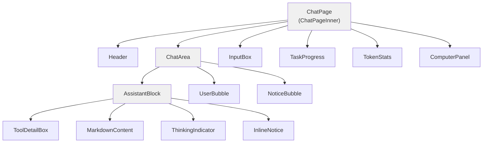
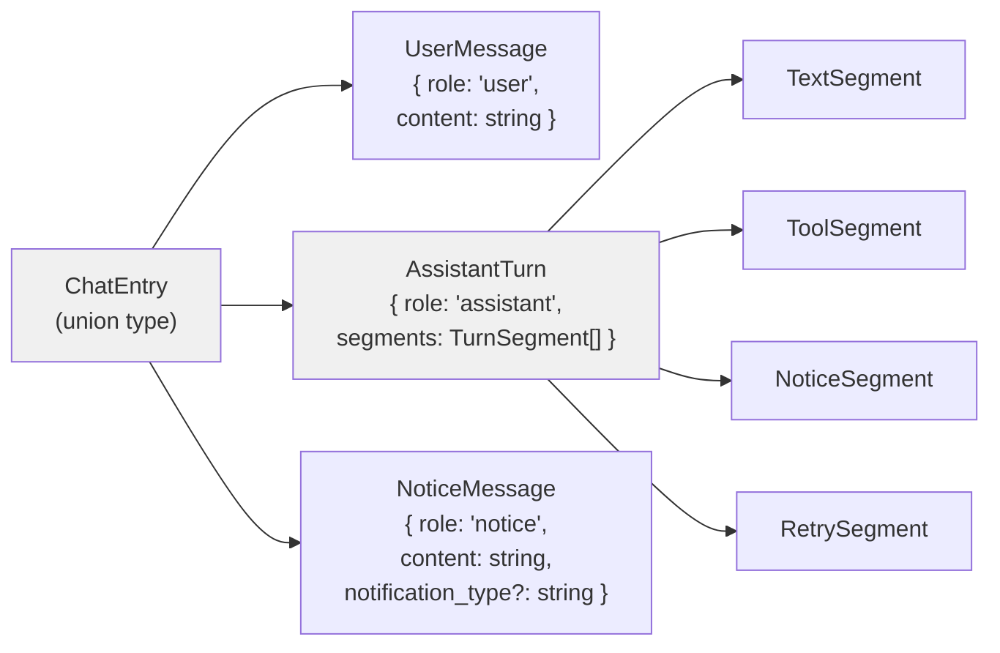
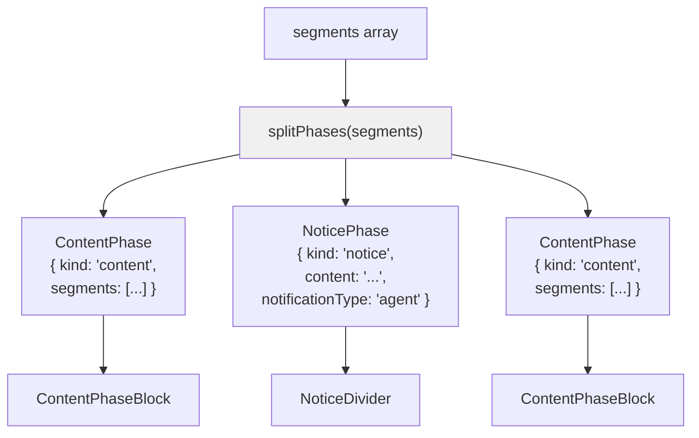
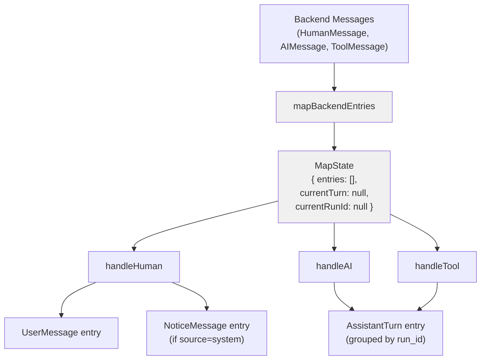
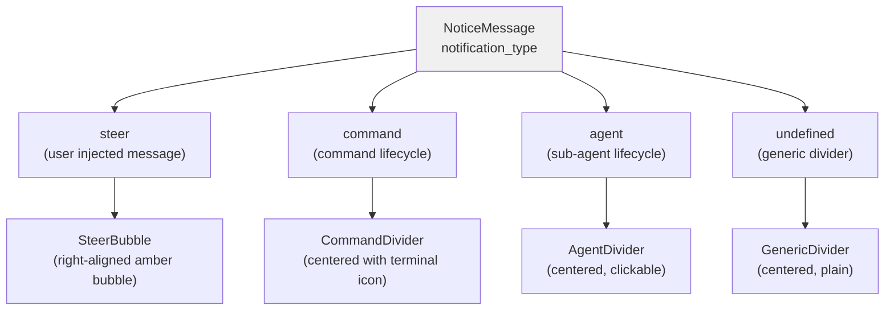
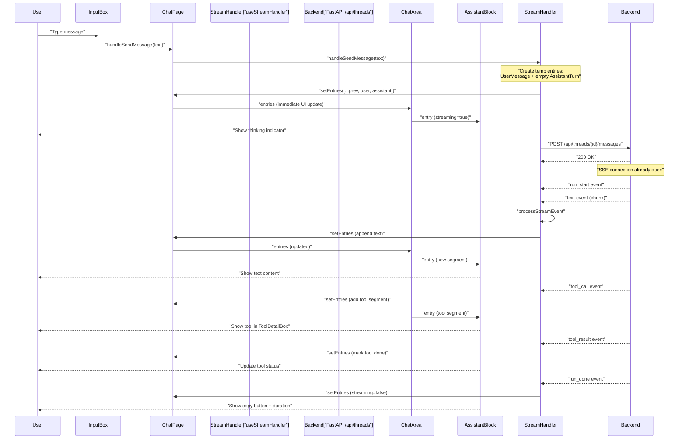
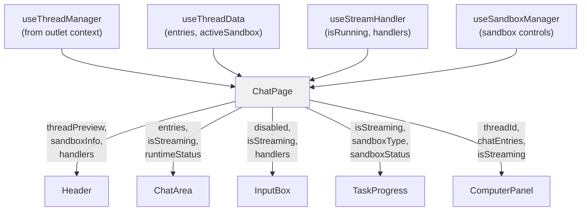

<!-- source: DeepWiki mcp.deepwiki.com · repo OpenDCAI/Mycel · page 7.2 Chat Interface Components · fetched 2026-11-02 -->

# Chat Interface Components

<details>
<summary>Relevant source files</summary>

The following files were used as context for generating this wiki page:

- [frontend/app/src/api/message-mapper.ts](frontend/app/src/api/message-mapper.ts)
- [frontend/app/src/api/types.ts](frontend/app/src/api/types.ts)
- [frontend/app/src/components/ChatArea.tsx](frontend/app/src/components/ChatArea.tsx)
- [frontend/app/src/components/ComputerPanel.tsx](frontend/app/src/components/ComputerPanel.tsx)
- [frontend/app/src/components/Header.tsx](frontend/app/src/components/Header.tsx)
- [frontend/app/src/components/InputBox.tsx](frontend/app/src/components/InputBox.tsx)
- [frontend/app/src/components/NewThreadModal.tsx](frontend/app/src/components/NewThreadModal.tsx)
- [frontend/app/src/components/SandboxSessionsModal.tsx](frontend/app/src/components/SandboxSessionsModal.tsx)
- [frontend/app/src/components/TaskProgress.tsx](frontend/app/src/components/TaskProgress.tsx)
- [frontend/app/src/components/chat-area/AssistantBlock.tsx](frontend/app/src/components/chat-area/AssistantBlock.tsx)
- [frontend/app/src/components/chat-area/NoticeBubble.tsx](frontend/app/src/components/chat-area/NoticeBubble.tsx)
- [frontend/app/src/hooks/stream-event-handlers.ts](frontend/app/src/hooks/stream-event-handlers.ts)
- [frontend/app/src/hooks/use-stream-handler.ts](frontend/app/src/hooks/use-stream-handler.ts)
- [frontend/app/src/pages/ChatPage.tsx](frontend/app/src/pages/ChatPage.tsx)
- [frontend/app/vite.config.ts](frontend/app/vite.config.ts)

</details>


This page documents the React components that comprise the main chat interface in the Mycel web application. It covers the component hierarchy, rendering logic for different message types, turn segmentation, and the UI patterns used to display conversations between users and the AI agent.

For information about real-time streaming and event handling, see [Real-time Streaming and Event Handling](#7.3). For the Computer Panel visualization system, see [Computer Panel and Activity Visualization](#7.4). For state management patterns, see [State Management](#7.5).

---

## Component Hierarchy

The chat interface is composed of a hierarchy of presentational and container components. The root `ChatPage` component orchestrates data fetching, streaming, and state management, while delegating rendering to specialized sub-components.



**Component Responsibilities:**
- **ChatPage**: Container that manages state, fetches data, handles streaming events
- **Header**: Navigation controls, model selector, sandbox status display
- **ChatArea**: Scrollable container that renders the conversation history
- **AssistantBlock**: Renders a single assistant turn with tools, text, and notices
- **UserBubble**: Renders user messages
- **NoticeBubble**: Renders system notifications
- **InputBox**: Text input with send/queue/stop controls
- **TaskProgress**: Status bar showing sandbox and streaming state
- **TokenStats**: Token usage and cost display

Sources: [frontend/app/src/pages/ChatPage.tsx:1-220](), [frontend/app/src/components/ChatArea.tsx:1-50]()

---

## ChatPage - Main Container

`ChatPage` is the root component for the chat interface. It uses a key-based remount strategy to ensure clean state on thread changes.

### Key-Based Remount Pattern

[frontend/app/src/pages/ChatPage.tsx:27-32]()

The `ChatPage` wrapper component uses the `threadId` as a React key, forcing `ChatPageInner` to fully remount when navigating between threads. This ensures all hooks reset their state naturally, avoiding stale data issues.

### State Management

`ChatPageInner` manages multiple pieces of state:

| State Variable | Purpose | Source |
|---|---|---|
| `entries` | Chat history (user messages, assistant turns, notices) | `useThreadData` |
| `activeSandbox` | Current sandbox session info | `useThreadData` |
| `isRunning` | Whether agent is currently streaming | `useStreamHandler` |
| `runtimeStatus` | Token counts, context usage, current tool | `useStreamHandler` |
| `tasks` | Background task list | `useBackgroundTasks` |
| `currentModel` | Selected model name | Local state + API |

[frontend/app/src/pages/ChatPage.tsx:34-106]()

### Initial Entries Optimization

When navigating from `NewChatPage` after creating a new thread and starting a run, `ChatPageInner` pre-populates the chat history with the user message and an empty assistant turn. This prevents the skeleton loader from flashing and immediately shows the thinking indicator.

[frontend/app/src/pages/ChatPage.tsx:46-56]()

The `initialEntries` array is only created if `runStarted` is true (set by navigation state). The empty assistant turn has `streaming: true` and empty `segments`, which triggers `ThinkingIndicator` rendering.

Sources: [frontend/app/src/pages/ChatPage.tsx:27-106]()

---

## ChatArea - Message Display

`ChatArea` is a presentational component that renders the conversation history. It receives an array of `ChatEntry` objects and delegates to specialized components based on entry type.

### Entry Type Routing

[frontend/app/src/components/ChatArea.tsx:26-44]()

Each entry's `role` field determines which component renders it:
- `"user"` → `UserBubble`
- `"assistant"` → `AssistantBlock`
- `"notice"` → `NoticeBubble`

### Sticky Scroll Behavior

`ChatArea` uses the `useStickyScroll` hook to maintain scroll position at the bottom during streaming. The hook observes DOM mutations via `MutationObserver` to detect when new content is added and automatically scrolls if the user was already at the bottom.

[frontend/app/src/components/ChatArea.tsx:18]()

Sources: [frontend/app/src/components/ChatArea.tsx:1-50]()

---

## Message Entry Types

The chat interface renders three distinct entry types, each with its own TypeScript interface and rendering logic.



### Type Definitions

[frontend/app/src/api/types.ts:148-163]()

### UserMessage

Simple messages from the user. Contains:
- `id`: Unique identifier
- `role`: Always `"user"`
- `content`: Message text
- `timestamp`: Creation time

### AssistantTurn

Complex turns from the AI agent. Contains:
- `id`: Turn identifier
- `messageIds`: Array of backend message IDs (for turn grouping)
- `role`: Always `"assistant"`
- `segments`: Array of `TurnSegment` (text, tools, notices, retries)
- `timestamp`: Start time
- `endTimestamp`: Completion time (optional)
- `streaming`: Whether turn is currently active

### NoticeMessage

System notifications that appear between turns. Contains:
- `id`: Unique identifier
- `role`: Always `"notice"`
- `content`: Notification text (may contain XML tags)
- `notification_type`: Type of notice (`"steer"`, `"command"`, `"agent"`)
- `timestamp`: Creation time

Sources: [frontend/app/src/api/types.ts:111-163]()

---

## Turn Segments

Assistant turns are composed of segments that represent different types of content emitted during agent execution.

### Segment Types

| Segment Type | Purpose | Fields |
|---|---|---|
| `TextSegment` | LLM-generated text | `content: string` |
| `ToolSegment` | Tool call and result | `step: ToolStep` |
| `NoticeSegment` | Inline system notice | `content: string`, `notification_type?: string` |
| `RetrySegment` | Retry indicator | `attempt: number`, `maxAttempts: number`, `waitSeconds: number` |

[frontend/app/src/api/types.ts:111-136]()

### ToolStep Structure

`ToolSegment` contains a `ToolStep` object with detailed execution information:

```typescript
interface ToolStep {
  id: string;                // Tool call ID
  name: string;              // Tool name (e.g., "read_file", "Agent")
  args: unknown;             // Tool arguments
  result?: string;           // Execution result
  status: "calling" | "done" | "error" | "cancelled";
  timestamp: number;
  subagent_stream?: {        // For Agent tool calls
    task_id: string;
    thread_id: string;
    description?: string;
    text: string;
    tool_calls: Array<...>;
    status: "running" | "completed" | "error";
    error?: string;
  };
}
```

[frontend/app/src/api/types.ts:93-109]()

The `subagent_stream` field is populated for `Agent` tool calls to track background sub-agent execution.

Sources: [frontend/app/src/api/types.ts:93-136]()

---

## AssistantBlock - Rendering Assistant Turns

`AssistantBlock` is the most complex rendering component. It handles phase-based rendering, tool visualization, streaming states, and inline notices.

### Phase-Based Rendering

When a turn contains `NoticeSegment` entries, the turn is split into phases separated by notice dividers. This allows system notifications to appear inline within assistant responses.



[frontend/app/src/components/chat-area/AssistantBlock.tsx:11-31]()

The `splitPhases` function scans segments and accumulates consecutive content segments into `ContentPhase` objects, inserting `NoticePhase` objects at notice boundaries.

### ContentPhaseBlock Rendering

Each content phase renders:
1. **Tool segments**: Displayed in `ToolDetailBox` (expandable list)
2. **Text segments**: Only the last text segment is displayed (streaming accumulation)
3. **Retry segment**: Shows retry attempt progress

[frontend/app/src/components/chat-area/AssistantBlock.tsx:41-76]()

### Streaming States

`AssistantBlock` displays different UI based on streaming state:

| State | Condition | UI Element |
|---|---|---|
| Booting | `isStreaming && !hasVisible && !runtimeStatus` | Avatar with pulse animation |
| Thinking | `isStreaming && !hasVisible && runtimeStatus` | `ThinkingIndicator` (3 dots) |
| Streaming | `isStreaming && hasVisible` | Content + no copy button |
| Complete | `!isStreaming` | Content + copy button + duration |

[frontend/app/src/components/chat-area/AssistantBlock.tsx:115-167]()

### Duration Display

Completed turns show elapsed time if duration ≥ 1 second. Duration is calculated from `timestamp` to `endTimestamp` and formatted as "Xs" or "Xm Ys".

[frontend/app/src/components/chat-area/AssistantBlock.tsx:87-104]()

Sources: [frontend/app/src/components/chat-area/AssistantBlock.tsx:1-171]()

---

## Turn Grouping and Message Mapping

The frontend groups backend messages into turns based on `run_id` metadata. This allows multiple AI messages from the same agent run to be displayed as a single coherent turn.

### Mapping Logic

The `mapBackendEntries` function transforms the backend message array into `ChatEntry[]`:



### Turn Grouping Rules

[frontend/app/src/api/message-mapper.ts:99-121]()

Consecutive `AIMessage` entries are grouped into the same `AssistantTurn` if:
1. Both have the same non-null `metadata.run_id`, OR
2. Both have no `run_id` (legacy backward compatibility)

When a new `run_id` is encountered or a user message appears, the current turn is finalized and a new turn begins.

### Notice Segment Folding

System notifications (`HumanMessage` with `metadata.source === "system"`) can be folded into the current assistant turn as `NoticeSegment` if:
1. The notice has the same `run_id` as the current turn, OR
2. The notice has no `run_id` and a turn is active

Otherwise, the notice creates a standalone `NoticeMessage` entry (turn boundary).

[frontend/app/src/api/message-mapper.ts:59-85]()

### System Reminder Stripping

AI messages may contain `<system-reminder>` blocks that are internal to the agent. These are stripped from text content before rendering.

[frontend/app/src/api/message-mapper.ts:19-22]()

Sources: [frontend/app/src/api/message-mapper.ts:1-181]()

---

## InputBox - Message Input

`InputBox` is a controlled textarea component with auto-resizing, keyboard shortcuts, and context-aware behavior.

### Input States

The input box operates in three modes:

| Mode | Condition | Behavior | Placeholder |
|---|---|---|---|
| Normal | `!disabled && !isStreaming` | Sends new message | "告诉 Leon 你需要什么帮助..." |
| Queue | `isStreaming && onSendQueueMessage` | Sends steer message | "输入消息，将立即插入对话..." |
| Disabled | `disabled && !canSendQueue` | Input disabled | Default placeholder |

[frontend/app/src/components/InputBox.tsx:38-41]()

### Queue Messages (Steer)

During streaming, if `onSendQueueMessage` is provided, the input remains enabled to allow queue messages. These are sent via the queue API and appear as steer notices in the conversation.

[frontend/app/src/components/InputBox.tsx:46-48]()

### Stop Button

When streaming and the input is empty, the send button transforms into a red stop button. Clicking it calls `onStop` to cancel the current run.

[frontend/app/src/components/InputBox.tsx:41-42](), [frontend/app/src/components/InputBox.tsx:100-115]()

### Auto-Resize

The textarea automatically resizes as the user types, capped at 160px height. This provides a better UX for multi-line input without taking excessive vertical space.

[frontend/app/src/components/InputBox.tsx:26-35]()

### Keyboard Shortcuts

- **Enter**: Send message (normal mode) or queue message (queue mode)
- **Shift+Enter**: Insert newline

[frontend/app/src/components/InputBox.tsx:84-89]()

Sources: [frontend/app/src/components/InputBox.tsx:1-123]()

---

## Header - Navigation and Controls

The `Header` component provides navigation, thread title display, sandbox status, and model selection.

### Component Layout

```
┌────────────────────────────────────────────────────────┐
│ [≡] Thread Title [sandbox]    [Model ▾] [Pause/Resume] │
└────────────────────────────────────────────────────────┘
```

### Sandbox Badge

For remote sandboxes (non-local), a small badge displays the sandbox type and status with a colored dot indicator.

[frontend/app/src/components/Header.tsx:75-84]()

**Status Colors:**
- Running: Green (`#22c55e`)
- Paused: Yellow (`#eab308`)
- Other: Gray (`#a3a3a3`)

### Pause/Resume Buttons

When a remote sandbox is active, pause/resume buttons appear in the header. These call the sandbox control handlers passed from `ChatPage`.

[frontend/app/src/components/Header.tsx:94-111]()

### Model Selector

The `ModelSelector` component allows users to change the model mid-conversation. Changes are persisted per-thread via the `/api/settings/config` endpoint.

[frontend/app/src/components/Header.tsx:88-92]()

Sources: [frontend/app/src/components/Header.tsx:1-116]()

---

## TaskProgress - Status Indicator

`TaskProgress` is a compact status bar that displays sandbox state and streaming status. It includes a toggle button to show/hide the Computer Panel.

### Status Bar Layout

```
┌──────────────────────────────────────────────────┐
│ [🖥] ● Local 运行中 · Leon 正在工作    [⤢] │
└──────────────────────────────────────────────────┘
```

[frontend/app/src/components/TaskProgress.tsx:113-148]()

### Retro Computer Icon

The component uses a custom SVG icon depicting a retro CRT monitor with stand, adding visual identity to the sandbox status display.

[frontend/app/src/components/TaskProgress.tsx:33-48]()

### Expand/Collapse Toggle

The toggle button uses corner-mark icons (expand: `┐└`, collapse: `┘┌`) to indicate direction of motion. On hover, a tooltip appears with label text.

[frontend/app/src/components/TaskProgress.tsx:50-111]()

Sources: [frontend/app/src/components/TaskProgress.tsx:1-149]()

---

## NoticeBubble - System Notifications

`NoticeBubble` renders system notifications that appear between turns or inline within assistant turns. The component supports three notification types with distinct visual styles.

### Notification Types



### Steer Bubbles

Steer notices represent user messages sent while the agent was working (queue messages). They render as right-aligned amber bubbles similar to user messages but with a "Steer" label.

[frontend/app/src/components/chat-area/NoticeBubble.tsx:23-38]()

### Command Dividers

Command notices show command execution lifecycle events. They render as centered dividers with a terminal icon and status indicator.

[frontend/app/src/components/chat-area/NoticeBubble.tsx:42-56]()

### Agent Dividers

Agent notices show sub-agent task lifecycle events. They render as centered dividers with status icons and are clickable to focus the agent in the Computer Panel.

[frontend/app/src/components/chat-area/NoticeBubble.tsx:60-85]()

### Notice Parsing

Each notification type has a custom parser that extracts structured information from XML-tagged content:

**Steer:** Extracts user message from template
**Command:** Extracts `<Status>`, `<CommandLine>`, `<Description>`
**Agent:** Extracts `<run-id>`, `<status>`, `<description>`

[frontend/app/src/components/chat-area/NoticeBubble.tsx:159-205]()

Status values are normalized to `"completed"`, `"error"`, or `"pending"` for consistent icon display.

### Inline vs Standalone

The `NoticeBubble` component renders standalone notices between turns. The `InlineNotice` component renders the same styles but is used within `AssistantBlock` for inline notices.

[frontend/app/src/components/chat-area/NoticeBubble.tsx:104-129]()

Sources: [frontend/app/src/components/chat-area/NoticeBubble.tsx:1-206]()

---

## Data Flow - Message Lifecycle

The following diagram illustrates how user messages flow through the system and how streaming events update the UI.



### Key Data Structures

**ChatEntry Array:** Main state variable in `ChatPage` that holds the complete conversation history. Updated via `setEntries` with functional updates.

**Turn ID Reference:** `useStreamHandler` maintains `turnIdRef` to track which assistant turn is currently being streamed. This reference is critical for routing streaming events to the correct entry.

**Functional Updates:** All entry updates use functional state setters (`setEntries(prev => ...)`) to ensure updates are based on the latest state, avoiding race conditions during rapid event emission.

Sources: [frontend/app/src/pages/ChatPage.tsx:82-106](), [frontend/app/src/hooks/use-stream-handler.ts:1-269](), [frontend/app/src/hooks/stream-event-handlers.ts:1-268]()

---

## Component Interaction Patterns

### Props Flow



### Event Handlers

| Handler | Source | Target | Purpose |
|---|---|---|---|
| `handleSendMessage` | `useStreamHandler` | `InputBox` | Send new message, start run |
| `handleStopStreaming` | `useStreamHandler` | `InputBox` | Cancel active run |
| `handleSendQueueMessage` | `useAppActions` | `InputBox` | Send steer message during streaming |
| `handlePauseSandbox` | `useSandboxManager` | `Header` | Pause remote sandbox |
| `handleResumeSandbox` | `useSandboxManager` | `Header` | Resume paused sandbox |
| `handleFocusAgent` | `useAppActions` | `ChatArea`, `AssistantBlock` | Focus sub-agent in Computer Panel |
| `onTaskNoticeClick` | `ChatPage` | `NoticeBubble` | Focus agent when clicking task notice |

Sources: [frontend/app/src/pages/ChatPage.tsx:84-196]()

---

## Rendering Optimization

### Memoization

`AssistantBlock` uses `memo` to prevent re-renders when parent state changes but props remain unchanged. This is critical because `ChatArea` re-renders on every state update, but most entries don't change.

[frontend/app/src/components/chat-area/AssistantBlock.tsx:92]()

### Key Strategy

Each entry uses its `id` as the React key. Turn IDs are stable (assigned by backend or generated with `makeId` for temp entries), ensuring entries don't remount unnecessarily.

[frontend/app/src/components/ChatArea.tsx:26-44]()

### Lazy State Initialization

`initialEntries` in `ChatPage` uses lazy state initialization to avoid recreating the array on every render. This optimization matters when navigating from `NewChatPage`.

[frontend/app/src/pages/ChatPage.tsx:49-56]()

Sources: [frontend/app/src/pages/ChatPage.tsx:49-56](), [frontend/app/src/components/ChatArea.tsx:26-44](), [frontend/app/src/components/chat-area/AssistantBlock.tsx:92]()

---

## Summary

The chat interface components form a layered architecture:

1. **Container Layer** (`ChatPage`): Orchestrates state, streaming, and sandbox management
2. **Layout Layer** (`Header`, `ChatArea`, `InputBox`, `TaskProgress`): Provides structure and controls
3. **Content Layer** (`AssistantBlock`, `UserBubble`, `NoticeBubble`): Renders messages
4. **Primitive Layer** (`ToolDetailBox`, `MarkdownContent`, `ThinkingIndicator`): Specialized rendering

Key design patterns:
- **Key-based remounting** for clean state resets
- **Functional state updates** for concurrency safety
- **Phase-based rendering** for inline notices
- **Turn grouping** by `run_id` for coherent display
- **Context-aware input** for queue messages during streaming

This architecture enables real-time streaming updates with minimal re-renders while maintaining clear separation of concerns between data management and presentation.

Sources: [frontend/app/src/pages/ChatPage.tsx:1-220](), [frontend/app/src/components/ChatArea.tsx:1-50](), [frontend/app/src/components/chat-area/AssistantBlock.tsx:1-171](), [frontend/app/src/api/message-mapper.ts:1-181]()

---

