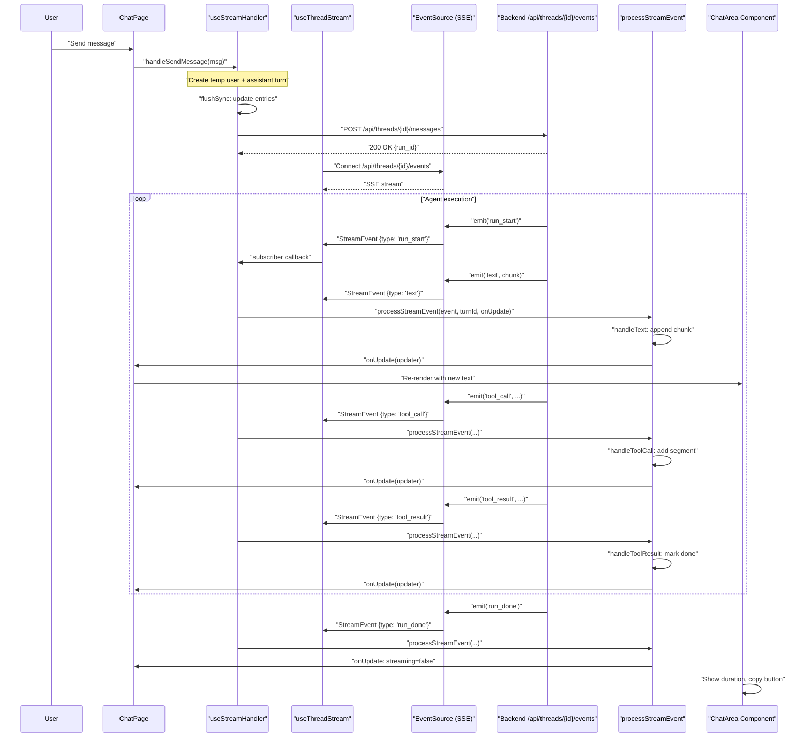
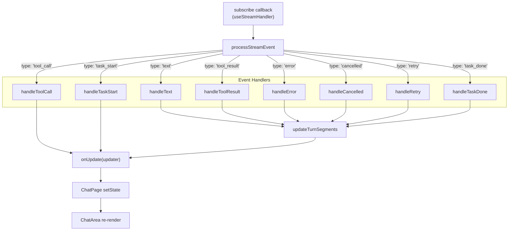
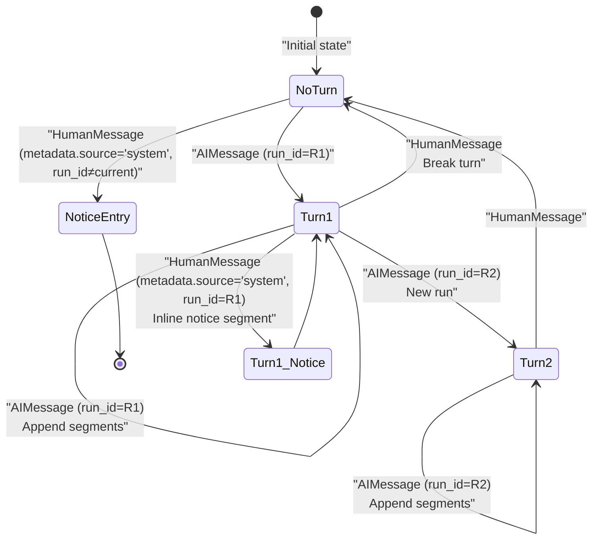
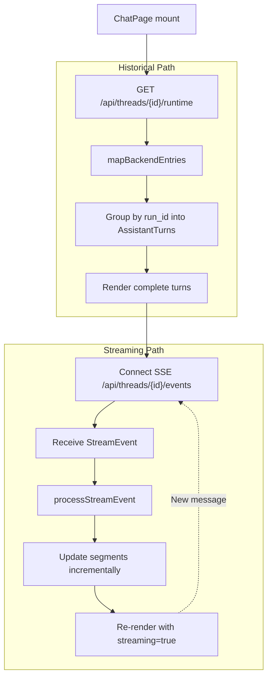

<!-- source: DeepWiki mcp.deepwiki.com · repo OpenDCAI/Mycel · page 7.3 Real-time Streaming and Event Handling · fetched 2026-11-02 -->

# Real-time Streaming and Event Handling

<details>
<summary>Relevant source files</summary>

The following files were used as context for generating this wiki page:

- [frontend/app/src/api/message-mapper.ts](frontend/app/src/api/message-mapper.ts)
- [frontend/app/src/api/types.ts](frontend/app/src/api/types.ts)
- [frontend/app/src/components/chat-area/AssistantBlock.tsx](frontend/app/src/components/chat-area/AssistantBlock.tsx)
- [frontend/app/src/components/chat-area/NoticeBubble.tsx](frontend/app/src/components/chat-area/NoticeBubble.tsx)
- [frontend/app/src/hooks/stream-event-handlers.ts](frontend/app/src/hooks/stream-event-handlers.ts)
- [frontend/app/src/hooks/use-stream-handler.ts](frontend/app/src/hooks/use-stream-handler.ts)
- [frontend/app/src/pages/ChatPage.tsx](frontend/app/src/pages/ChatPage.tsx)

</details>


This page documents the frontend's real-time event streaming system, which receives Server-Sent Events (SSE) from the backend and updates the chat UI incrementally as the agent executes. It covers event types, connection management, turn grouping logic, and synchronization mechanisms that prevent race conditions during concurrent updates.

For backend streaming implementation, see [Streaming Service and SSE](#8.2). For chat UI components that render streaming content, see [Chat Interface Components](#7.2).

---

## Event Type Taxonomy

The system defines 12 distinct event types, categorized by purpose:

| Category | Event Type | Purpose |
|----------|-----------|---------|
| **Content** | `text` | Incremental text chunks from LLM |
| | `tool_call` | Tool invocation (name + args) |
| | `tool_result` | Tool execution result |
| | `error` | Error message |
| | `cancelled` | User-cancelled tool calls |
| **Background Task** | `task_start` | Sub-agent task started |
| | `task_done` | Sub-agent task completed |
| | `task_error` | Sub-agent task failed |
| **Control** | `status` | Runtime status update (tokens, cost, state) |
| | `run_start` | Agent run started |
| | `run_done` | Agent run completed |
| **Notification** | `retry` | Retry attempt in progress |
| | `notice` | System notification (steer, command, agent) |

**Event Structure:**
```typescript
interface StreamEvent {
  type: StreamEventType;
  data?: unknown;
}

interface ContentEventData {
  parent_tool_call_id?: string;
  background?: boolean;
  seq: number;              // Event sequence number
  run_id: string;           // Run identifier for turn grouping
  message_id?: string;      // Backend message ID
}
```

Sources: [frontend/app/src/api/types.ts:1-34]()

---

## Streaming Architecture Overview



**Title: SSE Event Flow from Backend to UI**

Sources: [frontend/app/src/hooks/use-stream-handler.ts:1-268](), [frontend/app/src/pages/ChatPage.tsx:84-93]()

---

## useStreamHandler Hook

The `useStreamHandler` hook is the primary interface for managing streaming state in `ChatPage`. It orchestrates SSE connection via `useThreadStream`, processes events via `processStreamEvent`, and manages assistant turn lifecycle.

### Hook Interface

```typescript
interface StreamHandlerDeps {
  threadId: string;
  refreshThreads: () => Promise<void>;  // Sidebar refresh
  onUpdate: (updater: (prev: ChatEntry[]) => ChatEntry[]) => void;
  loading: boolean;       // True while history loads
  runStarted?: boolean;   // True if navigating from NewChatPage
}

interface StreamHandlerState {
  runtimeStatus: StreamStatus | null;  // Tokens, cost, context
  isRunning: boolean;                   // Agent active
}

interface StreamHandlerActions {
  handleSendMessage: (message: string) => Promise<void>;
  handleStopStreaming: () => Promise<void>;
}
```

Sources: [frontend/app/src/hooks/use-stream-handler.ts:16-38]()

### Turn ID Management and Synchronization

**Critical invariant**: `turnIdRef.current` must always point to the active assistant turn before processing any content event. This is maintained through **synchronous updates** using `flushSync`:

```typescript
// CRITICAL: must be set SYNCHRONOUSLY, never inside a deferred React state
// updater. When SSE replays buffered events, run_start + text arrive in the
// same reader.read() batch. React batches the updater, so turnIdRef would
// still be "" when the next event is processed → text lost, streaming stuck.
const turnIdRef = useRef<string>("");
const hasBoundRef = useRef(false);  // True once server message_id bound
```

**Why `flushSync`?** Without it, React batches state updates. When SSE reconnects and replays buffered events (`run_start` + `text` in one batch), the second event would process before the first updater executes, leaving `turnIdRef.current` empty → text chunks lost.

Sources: [frontend/app/src/hooks/use-stream-handler.ts:96-111]()

### Turn Creation Paths

There are **three distinct paths** for creating assistant turns:

**Path 1: User sends message (handleSendMessage)**
```typescript
const handleSendMessage = async (message: string) => {
  const tempTurnId = makeId("turn");
  const assistantTurn: AssistantTurn = {
    id: tempTurnId,
    role: "assistant",
    segments: [],
    timestamp: Date.now(),
    streaming: true,
  };
  
  // Set turn context BEFORE connect so subscriber knows which turn to update
  turnIdRef.current = tempTurnId;
  hasBoundRef.current = false;
  
  flushSync(() => {
    onUpdateRef.current((prev) => [...prev, userEntry, assistantTurn]);
    setSendPending(true);
  });
  
  await postRun(threadId, message);
  // Connection is persistent — no need to reconnect
};
```

**Path 2: Auto-reconnect mid-run (ensureReconnectTurn)**

When SSE reconnects while a run is active, reuse the existing streaming turn:
```typescript
function ensureReconnectTurn() {
  const fallbackId = makeId("reconnect-turn");
  flushSync(() => {
    onUpdateRef.current((prev) => {
      const { entries, turnId } = applyReconnectTurn(prev, fallbackId);
      turnIdRef.current = turnId;
      return entries;
    });
  });
}

function applyReconnectTurn(prev: ChatEntry[], fallbackId: string) {
  const last = prev[prev.length - 1];
  // Only reuse if the last turn is currently streaming (true reconnect mid-run)
  if (last?.role === "assistant" && (last as AssistantTurn).streaming) {
    return { entries: prev, turnId: last.id };  // Reuse
  }
  // Create new turn
  const newTurn: AssistantTurn = { id: fallbackId, role: "assistant", segments: [], timestamp: Date.now(), streaming: true };
  return { entries: [...prev, newTurn], turnId: fallbackId };
}
```

**Path 3: Notice-triggered run (lazy creation)**

When a `notice` event triggers a new run (e.g., background task completion notification), the first **content** event creates a turn:
```typescript
const TURN_CONTENT_EVENTS = new Set([
  "text", "tool_call", "tool_result", "error", "cancelled", "retry"
]);

// Only create a turn for content events that actually render into turns.
// task_start/task_done/task_error are background task lifecycle events —
// they must NOT trigger turn creation
if (!turnIdRef.current && TURN_CONTENT_EVENTS.has(event.type)) {
  ensureReconnectTurn();
}
```

Sources: [frontend/app/src/hooks/use-stream-handler.ts:44-70](), [frontend/app/src/hooks/use-stream-handler.ts:119-178](), [frontend/app/src/hooks/use-stream-handler.ts:204-254]()

### Message ID Binding

When the backend emits the first event, it includes `message_id` (server-assigned). The hook binds this to the temporary turn:

```typescript
const { messageId } = processStreamEvent(event, turnIdRef.current, onUpdateRef.current, () => {});

// Bind temporary turn ID to the server-assigned message ID (first time only)
if (messageId && turnIdRef.current && messageId !== turnIdRef.current && !hasBoundRef.current) {
  hasBoundRef.current = true;
  const tempId = turnIdRef.current;
  turnIdRef.current = messageId;  // Update ref synchronously
  onUpdateRef.current((prev) =>
    prev.map((e) =>
      e.id === tempId && e.role === "assistant"
        ? { ...e, id: messageId, messageIds: [messageId] } as AssistantTurn
        : e,
    ),
  );
}
```

This allows the frontend to track turns by their server IDs while maintaining optimistic UI updates.

Sources: [frontend/app/src/hooks/use-stream-handler.ts:180-201]()

---

## Event Processing Pipeline



**Title: Event Processing Dispatch Pipeline**

Sources: [frontend/app/src/hooks/stream-event-handlers.ts:218-231]()

### Handler Implementations

**Text Chunks (handleText)**

Appends text to the last text segment or creates new segment:

```typescript
function handleText(event: StreamEvent, turnId: string, onUpdate: UpdateEntries) {
  const payload = event.data as { content?: string } | string | undefined;
  const chunk = typeof payload === "string" ? payload : payload?.content ?? "";
  
  updateTurnSegments(onUpdate, turnId, (turn) => {
    const segs = [...turn.segments];
    const last = segs[segs.length - 1];
    if (last?.type === "text") {
      segs[segs.length - 1] = { type: "text", content: last.content + chunk };
    } else {
      segs.push({ type: "text", content: chunk });
    }
    return { ...turn, segments: segs };
  });
}
```

Sources: [frontend/app/src/hooks/stream-event-handlers.ts:35-49]()

**Tool Calls (handleToolCall)**

Creates or updates tool segment. Handles early emissions with empty args:

```typescript
function handleToolCall(event: StreamEvent, turnId: string, onUpdate: UpdateEntries) {
  const payload = (event.data ?? {}) as { id?: string; name?: string; args?: unknown };
  const toolCallId = payload.id ?? makeId("tc");
  const newArgs = payload.args;
  const hasRealArgs = newArgs != null && !(typeof newArgs === "object" && Object.keys(newArgs as object).length === 0);

  onUpdate((prev) => {
    const existing = findTurnToolSeg(prev, turnId, toolCallId);
    if (existing) {
      // Early emission sent args:{} — update with real args when they arrive
      if (!hasRealArgs) return prev;
      return prev.map((e) => {
        if (e.id !== turnId || e.role !== "assistant") return e;
        const t = e as AssistantTurn;
        return {
          ...t,
          segments: t.segments.map((s) =>
            s.type === "tool" && s.step.id === toolCallId
              ? { ...s, step: { ...s.step, args: newArgs } }
              : s
          ),
        };
      });
    }
    // Create new tool segment
    return prev.map((e) => {
      if (e.id !== turnId || e.role !== "assistant") return e;
      const t = e as AssistantTurn;
      const seg: ToolSegment = {
        type: "tool",
        step: { id: toolCallId, name: payload.name ?? "tool", args: payload.args ?? {}, status: "calling", timestamp: Date.now() },
      };
      return { ...t, segments: [...t.segments, seg] };
    });
  });
}
```

Sources: [frontend/app/src/hooks/stream-event-handlers.ts:51-85]()

**Tool Results (handleToolResult)**

Marks tool as `done` and enriches with subagent metadata for background tasks:

```typescript
function markToolDone(turn: AssistantTurn, tcId: string | undefined, result: string, metadata?: Record<string, unknown>): AssistantTurn {
  return { ...turn, segments: turn.segments.map((s) => {
    if (s.type !== "tool" || s.step.id !== tcId) return s;
    const step = { ...s.step, result, status: "done" as const };
    // For background Task calls: create subagent_stream from metadata so AgentsView can track
    const taskId = metadata?.task_id as string | undefined;
    const threadId = (metadata?.subagent_thread_id as string | undefined) || (taskId ? `subagent-${taskId}` : undefined);
    if (threadId && !step.subagent_stream) {
      step.subagent_stream = {
        task_id: taskId || "",
        thread_id: threadId,
        description: (metadata?.description as string) || undefined,
        text: "",
        tool_calls: [],
        status: "running",
      };
    }
    return { ...s, step };
  }) };
}
```

**Minimum display time**: Tools shown for at least 200ms to prevent flicker:
```typescript
if (seg && Date.now() - seg.step.timestamp < 200) {
  setTimeout(() => updateTurnSegments(onUpdate, turnId, (t) => markToolDone(t, tcId, result, metadata)), 200 - (Date.now() - seg.step.timestamp));
  return prev;
}
```

Sources: [frontend/app/src/hooks/stream-event-handlers.ts:87-123]()

**Task Lifecycle (handleTaskStart, handleTaskDone)**

Background task events enrich the most recent `Agent` tool call with streaming state:

```typescript
function handleTaskStart(event: StreamEvent, turnId: string, onUpdate: UpdateEntries) {
  const data = event.data as { task_id?: string; thread_id?: string; description?: string } | undefined;
  if (!data?.task_id) return;
  const subagentThreadId = data.thread_id || `subagent-${data.task_id}`;

  onUpdate((prev) =>
    prev.map((e) => {
      if (e.id !== turnId || e.role !== "assistant") return e;
      const t = e as AssistantTurn;
      // Find the most recent calling Agent step without subagent_stream
      const idx = t.segments.findLastIndex(
        (s) => s.type === "tool" && s.step.name === "Agent" && s.step.status === "calling" && !s.step.subagent_stream,
      );
      if (idx === -1) return t;
      const segments = t.segments.map((s, i) =>
        i === idx
          ? {
              ...s,
              step: {
                ...s.step,
                subagent_stream: {
                  task_id: data.task_id!,
                  thread_id: subagentThreadId,
                  description: data.description,
                  text: "",
                  tool_calls: [],
                  status: "running" as const,
                },
              },
            }
          : s,
      );
      return { ...t, segments };
    }),
  );
}
```

Sources: [frontend/app/src/hooks/stream-event-handlers.ts:153-201]()

---

## Turn Grouping and Run IDs

The system groups consecutive `AIMessage` responses into a single `AssistantTurn` based on `run_id` metadata. This enables multi-step agent execution to display as one cohesive response.



**Title: Turn Grouping State Machine**

### Grouping Logic (mapBackendEntries)

Historical messages are mapped during initial page load:

```typescript
function handleAI(msg: BackendMessage, i: number, state: MapState): void {
  const textContent = stripSystemReminders(extractTextContent(msg.content));
  const toolCalls = Array.isArray(msg.tool_calls) ? msg.tool_calls : [];
  const msgId = msg.id ?? `hist-turn-${i}`;
  const msgRunId = (msg.metadata?.run_id as string) || null;

  const segments: TurnSegment[] = [];
  if (textContent) segments.push({ type: "text", content: textContent });
  if (toolCalls.length > 0) segments.push(...buildToolSegments(toolCalls, i, state.now));

  // Group by run_id: same run_id = same Turn
  if (state.currentTurn && msgRunId && msgRunId === state.currentRunId) {
    appendToTurn(state.currentTurn, msgId, segments);
  } else if (state.currentTurn && !msgRunId && !state.currentRunId) {
    // Legacy: no run_id on either → merge consecutive (backward compat)
    appendToTurn(state.currentTurn, msgId, segments);
  } else {
    // New run_id or first message → new Turn
    state.currentTurn = createTurn(msgId, segments, state.now);
    state.currentRunId = msgRunId;
    state.entries.push(state.currentTurn);
  }
}
```

**Notice Folding**: System messages (`metadata.source='system'`) with matching `run_id` are folded into the current turn as `notice` segments:

```typescript
function handleHuman(msg: BackendMessage, i: number, state: MapState): void {
  if (msg.metadata?.source === "system") {
    const content = extractTextContent(msg.content);
    const msgRunId = (msg.metadata?.run_id as string) || null;
    const ntype = msg.metadata?.notification_type as NotificationType | undefined;

    if (state.currentTurn && msgRunId && msgRunId === state.currentRunId) {
      // Same run_id → fold into current assistant turn as a notice segment
      state.currentTurn.segments.push({ type: "notice", content, notification_type: ntype });
      return;
    }
    // Different run_id or no current turn → standalone notice entry (Turn boundary)
    state.currentTurn = null;
    state.currentRunId = null;
    const notice: NoticeMessage = { id: msg.id ?? `hist-notice-${i}`, role: "notice", content, notification_type: ntype, timestamp: state.now };
    state.entries.push(notice);
    return;
  }
  // Normal user message → breaks current turn
  state.currentTurn = null;
  state.currentRunId = null;
  // ... create user entry
}
```

Sources: [frontend/app/src/api/message-mapper.ts:99-121](), [frontend/app/src/api/message-mapper.ts:58-97]()

---

## Notice Events and System Notifications

Notice events carry system notifications that don't originate from user input:
- **Steer**: User sent a message while agent was working (steering)
- **Command**: Long-running command completion (e.g., `npm install`)
- **Agent**: Background task/sub-agent completion

### Notice Types and Rendering

```typescript
export type NotificationType = "steer" | "command" | "agent";

interface NoticeSegment {
  type: "notice";
  content: string;
  notification_type?: NotificationType;
}

interface NoticeMessage {
  id: string;
  role: "notice";
  content: string;
  notification_type?: NotificationType;
  timestamp: number;
}
```

**Standalone vs Inline**:
- **Standalone**: `NoticeMessage` entry between turns (different `run_id`)
- **Inline**: `NoticeSegment` within `AssistantTurn` (same `run_id`)

### Phase Splitting for Inline Notices

When an assistant turn contains notice segments, the content is split into phases at notice boundaries:

```typescript
type ContentPhase = { kind: "content"; segments: TurnSegment[] };
type NoticePhase = { kind: "notice"; content: string; notificationType?: NotificationType };
type Phase = ContentPhase | NoticePhase;

function splitPhases(segments: TurnSegment[]): Phase[] {
  const phases: Phase[] = [];
  let buf: TurnSegment[] = [];
  for (const seg of segments) {
    if (seg.type === "notice") {
      if (buf.length > 0) { phases.push({ kind: "content", segments: buf }); buf = []; }
      const ns = seg as NoticeSegment;
      phases.push({ kind: "notice", content: ns.content, notificationType: ns.notification_type });
    } else {
      buf.push(seg);
    }
  }
  if (buf.length > 0) phases.push({ kind: "content", segments: buf });
  return phases;
}
```

This allows rendering like: `[Tools + Text] → [Notice Divider] → [More Tools + Text]`

Sources: [frontend/app/src/components/chat-area/AssistantBlock.tsx:11-31](), [frontend/app/src/components/chat-area/AssistantBlock.tsx:136-148]()

### Notice Parsing

Notice content is parsed to extract structured data:

```typescript
export interface ParsedNotice {
  text: string;
  status?: "completed" | "error" | "pending";
  taskId?: string;
  commandLine?: string;
}
```

**Example (Agent notification)**:
```
<run-id>task-abc-123</run-id>
<status>completed</status>
<description>Install dependencies</description>
```
Parses to: `{ text: "Install dependencies done", status: "completed", taskId: "task-abc-123" }`

Sources: [frontend/app/src/components/chat-area/NoticeBubble.tsx:9-14](), [frontend/app/src/components/chat-area/NoticeBubble.tsx:198-205]()

---

## Reconnection and Event Replay

The SSE connection is **persistent** — it remains open across multiple runs within a thread. When the connection drops, `useThreadStream` reconnects and requests replay from the last received sequence number.

### Connection Initialization

```typescript
useThreadStream(threadId, { 
  loading,           // Don't connect until history loaded
  refreshThreads,    // Callback when sidebar needs refresh
  runStarted         // True if navigating from NewChatPage
})
```

**`runStarted` flag**: When navigating from `NewChatPage` after calling `postRun`, the SSE connection must start from `seq=0` (not `last_seq`) to avoid missing events emitted between `postRun` and `ChatPage` mount.

### Event Buffering

The backend buffers events in `ThreadEventBuffer` (SQLite-backed). When reconnecting, the client requests:
```
GET /api/threads/{id}/events?last_seq={n}
```

The backend replays all events with `seq > n`, ensuring no events are lost during disconnection.

Sources: [frontend/app/src/hooks/use-stream-handler.ts:20-28](), [frontend/app/src/hooks/use-thread-stream.ts]() (referenced but not provided)

---

## Historical vs Streaming Data Paths



**Title: Historical Load vs Real-time Streaming Paths**

### Historical Path (useThreadData)

Loads complete conversation history on page mount:

```typescript
const { entries, activeSandbox, loading, setEntries, setActiveSandbox, refreshThread } = 
  useThreadData(threadId, runStarted, initialEntries);
```

If `runStarted=true` (navigating from NewChatPage), skip history load and use `initialEntries` (pre-populated user message + empty assistant turn).

**Backend response**:
```json
{
  "messages": [
    { "type": "HumanMessage", "content": "...", "metadata": { "run_id": "R1" } },
    { "type": "AIMessage", "content": "...", "tool_calls": [...], "metadata": { "run_id": "R1" } },
    { "type": "ToolMessage", "tool_call_id": "...", "content": "..." },
    { "type": "AIMessage", "content": "...", "metadata": { "run_id": "R1" } }
  ]
}
```

**Mapping**: `mapBackendEntries` groups messages with the same `run_id` into a single `AssistantTurn`.

Sources: [frontend/app/src/pages/ChatPage.tsx:82-83](), [frontend/app/src/api/message-mapper.ts:169-180]()

### Streaming Path (useStreamHandler)

Receives incremental updates via SSE:

1. **Connection established**: `useThreadStream` opens EventSource
2. **Events arrive**: `run_start`, `text`, `tool_call`, `tool_result`, `run_done`
3. **Processing**: `processStreamEvent` dispatches to handler
4. **UI update**: Handler calls `onUpdate(updater)` → ChatPage `setEntries` → ChatArea re-renders

The assistant turn has `streaming: true` until `run_done` event.

Sources: [frontend/app/src/hooks/use-stream-handler.ts:114-202]()

---

## Performance Optimizations

### React Batching and flushSync

**Problem**: React batches state updates in event handlers. When SSE replays buffered events in one `reader.read()` batch, multiple events are processed before any state commits → `turnIdRef.current` is stale.

**Solution**: Use `flushSync` at critical points:
1. **Turn creation**: Force turn to exist before processing content events
2. **Message send**: Ensure user + assistant entries commit before backend responds

```typescript
flushSync(() => {
  onUpdateRef.current((prev) => {
    const { entries, turnId } = applyReconnectTurn(prev, fallbackId);
    turnIdRef.current = turnId;  // Set ref AFTER state commits
    return entries;
  });
});
```

Sources: [frontend/app/src/hooks/use-stream-handler.ts:96-111](), [frontend/app/src/hooks/use-stream-handler.ts:121-128]()

### Text Chunk Accumulation

Text chunks are accumulated into the last text segment, not batched with `flushSync`:

```typescript
function handleText(event: StreamEvent, turnId: string, onUpdate: UpdateEntries) {
  // No flushSync — let React batch. Sticky scroll observes childList mutations.
  updateTurnSegments(onUpdate, turnId, (turn) => {
    const segs = [...turn.segments];
    const last = segs[segs.length - 1];
    if (last?.type === "text") {
      segs[segs.length - 1] = { type: "text", content: last.content + chunk };
    } else {
      segs.push({ type: "text", content: chunk });
    }
    return { ...turn, segments: segs };
  });
}
```

React batches multiple text events naturally. The sticky scroll observer detects DOM mutations and scrolls incrementally.

Sources: [frontend/app/src/hooks/stream-event-handlers.ts:35-49]()

### Tool Display Debouncing

Tools are displayed for a minimum of 200ms to prevent flicker when tools complete instantly:

```typescript
if (seg && Date.now() - seg.step.timestamp < 200) {
  setTimeout(() => updateTurnSegments(onUpdate, turnId, (t) => markToolDone(t, tcId, result, metadata)), 
    200 - (Date.now() - seg.step.timestamp));
  return prev;
}
```

Sources: [frontend/app/src/hooks/stream-event-handlers.ts:117-120]()

---

## Component Integration

### ChatPage Orchestration

`ChatPage` composes streaming hooks and passes state to components:

```typescript
function ChatPageInner({ threadId }: { threadId: string }) {
  const { entries, activeSandbox, loading, setEntries, setActiveSandbox, refreshThread } = 
    useThreadData(threadId, runStarted, initialEntries);

  const { runtimeStatus, isRunning, handleSendMessage, handleStopStreaming } =
    useStreamHandler({
      threadId,
      refreshThreads: tm.refreshThreads,  // Sidebar list only
      onUpdate: (updater) => setEntries(updater),
      loading,
      runStarted,
    });

  return (
    <>
      <ChatArea
        entries={entries}
        isStreaming={isRunning}
        runtimeStatus={runtimeStatus}
        loading={loading}
        onFocusAgent={handleFocusAgent}
        onTaskNoticeClick={handleTaskNoticeClick}
      />
      <InputBox
        disabled={isRunning}
        isStreaming={isRunning}
        onSendMessage={(msg) => void handleSendMessage(msg)}
        onStop={handleStopStreaming}
      />
    </>
  );
}
```

Sources: [frontend/app/src/pages/ChatPage.tsx:34-219]()

### AssistantBlock Rendering

`AssistantBlock` renders streaming state visually:

```typescript
export const AssistantBlock = memo(function AssistantBlock({ 
  entry, 
  isStreamingThis,  // True if this is the active streaming turn
  runtimeStatus,    // Current runtime status (tokens, cost)
  onFocusAgent 
}: AssistantBlockProps) {
  const hasNotice = entry.segments.some((s) => s.type === "notice");
  const hasVisible = entry.segments.some(s => s.type === "tool" || s.type === "text");
  
  // Show thinking indicator if streaming but no visible content yet
  if (isStreamingThis && !hasVisible && !hasNotice) {
    return <ThinkingIndicator runtimeStatus={runtimeStatus} />;
  }
  
  // Phase-based rendering for turns with inline notices
  if (hasNotice) {
    return splitPhases(entry.segments).map((phase, i) =>
      phase.kind === "notice"
        ? <NoticeDivider content={phase.content} notificationType={phase.notificationType} />
        : <ContentPhaseBlock segments={phase.segments} isStreaming={isStreamingThis} onFocusAgent={onFocusAgent} />
    );
  }
  
  // Standard rendering
  return <ContentPhaseBlock segments={entry.segments} isStreaming={isStreamingThis} />;
});
```

Sources: [frontend/app/src/components/chat-area/AssistantBlock.tsx:92-170]()

---

## Event Type Summary Table

| Event | Handler | UI Update | Turn State |
|-------|---------|-----------|------------|
| `run_start` | `useStreamHandler` subscriber | Ensure turn exists (if reconnecting) | `streaming: true` |
| `text` | `handleText` | Append/merge text segment | No change |
| `tool_call` | `handleToolCall` | Add tool segment `status: 'calling'` | No change |
| `tool_result` | `handleToolResult` | Mark tool `status: 'done'`, enrich metadata | No change |
| `error` | `handleError` | Append error text segment | No change |
| `cancelled` | `handleCancelled` | Mark tools `status: 'cancelled'` | `streaming: false` |
| `retry` | `handleRetry` | Add/replace retry segment | No change |
| `task_start` | `handleTaskStart` | Enrich Agent tool with `subagent_stream` | No change |
| `task_done` | `handleTaskDone` | Mark subagent `status: 'completed'` | No change |
| `task_error` | *(not implemented)* | No-op | No change |
| `notice` | `useStreamHandler` subscriber | Insert notice entry or segment | Depends on `run_id` |
| `status` | `useThreadStream` | Update `runtimeStatus` | No change |
| `run_done` | `useStreamHandler` subscriber | Filter retry segments, `streaming: false`, set `endTimestamp` | `streaming: false` |

Sources: [frontend/app/src/hooks/stream-event-handlers.ts:218-267](), [frontend/app/src/hooks/use-stream-handler.ts:114-202]()

---

