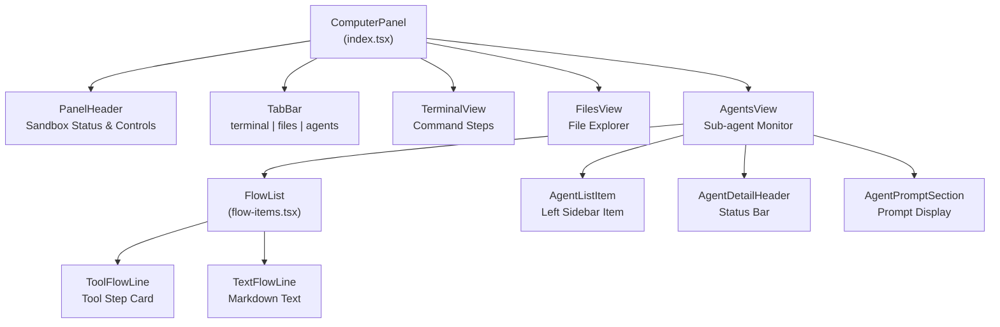
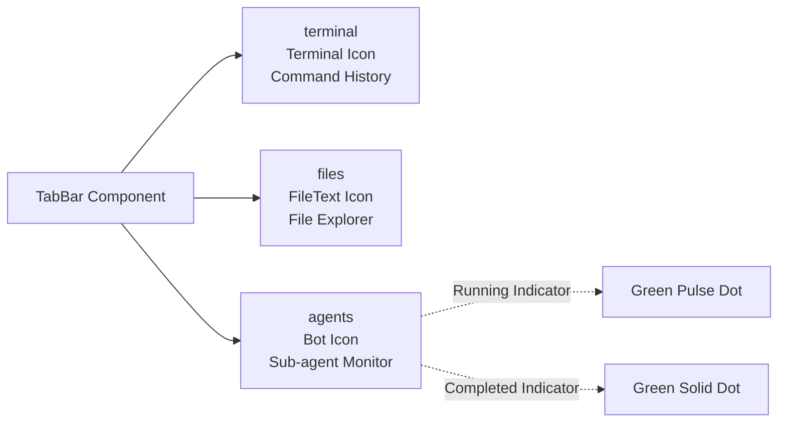
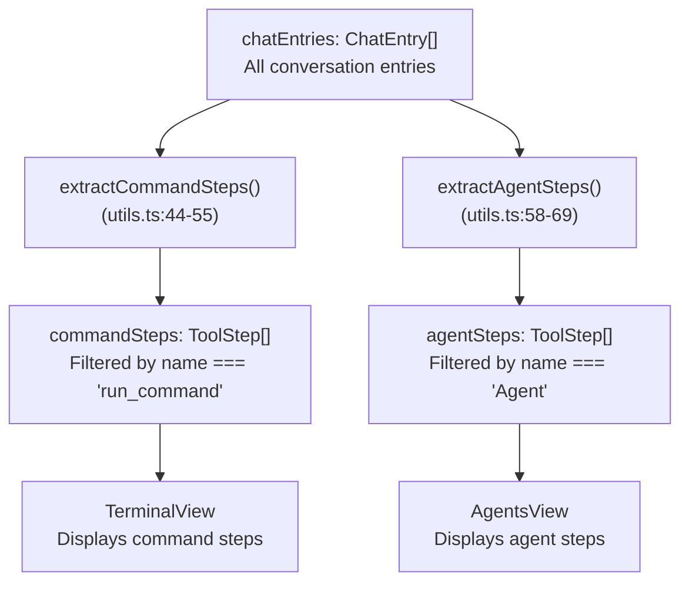
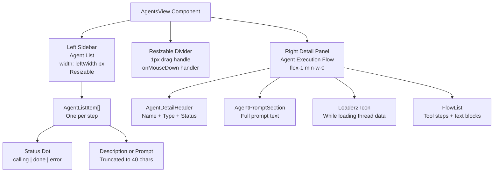
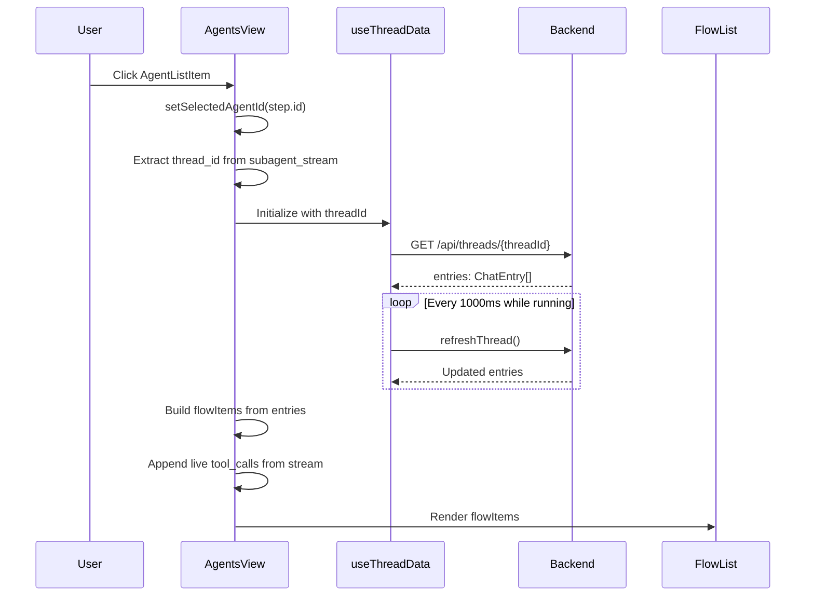
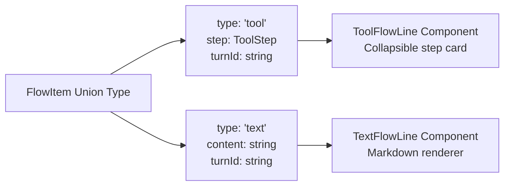
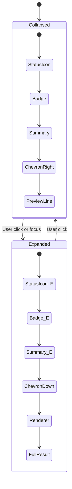
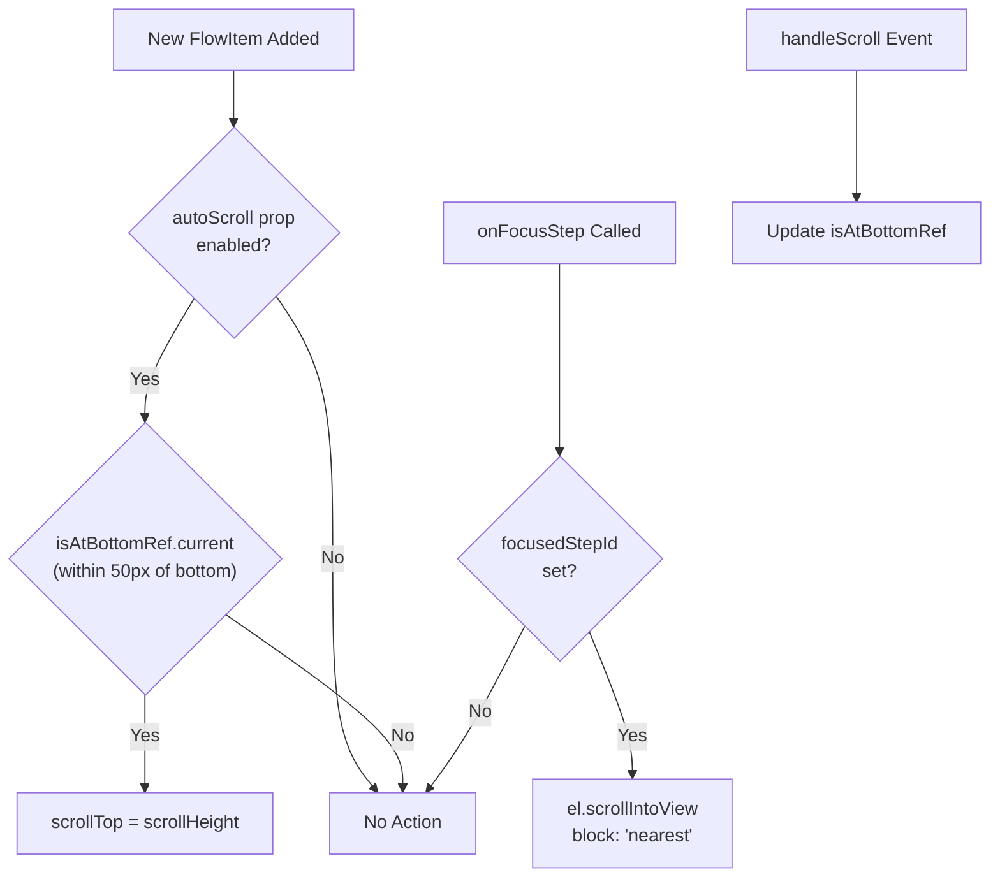
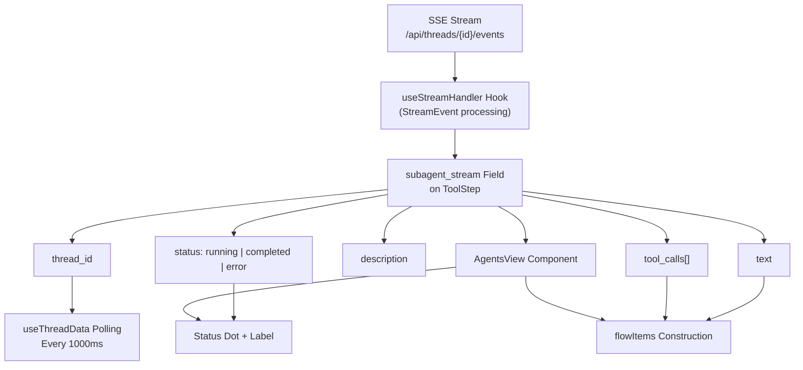

<!-- source: DeepWiki mcp.deepwiki.com · repo OpenDCAI/Mycel · page 7.4 Computer Panel and Activity Visualization · fetched 2026-11-02 -->

# Computer Panel and Activity Visualization

<details>
<summary>Relevant source files</summary>

The following files were used as context for generating this wiki page:

- [frontend/app/src/components/chat-area/constants.ts](frontend/app/src/components/chat-area/constants.ts)
- [frontend/app/src/components/chat-area/utils.ts](frontend/app/src/components/chat-area/utils.ts)
- [frontend/app/src/components/computer-panel/AgentsView.tsx](frontend/app/src/components/computer-panel/AgentsView.tsx)
- [frontend/app/src/components/computer-panel/TabBar.tsx](frontend/app/src/components/computer-panel/TabBar.tsx)
- [frontend/app/src/components/computer-panel/flow-items.tsx](frontend/app/src/components/computer-panel/flow-items.tsx)
- [frontend/app/src/components/computer-panel/index.tsx](frontend/app/src/components/computer-panel/index.tsx)
- [frontend/app/src/components/computer-panel/types.ts](frontend/app/src/components/computer-panel/types.ts)
- [frontend/app/src/components/computer-panel/utils.ts](frontend/app/src/components/computer-panel/utils.ts)
- [frontend/app/src/hooks/use-app-actions.ts](frontend/app/src/hooks/use-app-actions.ts)

</details>


The Computer Panel provides a real-time visualization of agent activity, tool execution, and system state. It displays a tabbed interface showing terminal commands, file system operations, and sub-agent execution with detailed step-by-step progress tracking.

For information about the chat interface where assistant messages appear, see [Chat Interface Components](#7.2). For SSE streaming and event handling that feeds data to the panel, see [Real-time Streaming and Event Handling](#7.3).

## Component Architecture

The `ComputerPanel` component serves as the orchestrator for three specialized views: terminal command history, file system explorer, and sub-agent activity monitor. The panel maintains a resizable width and responds to real-time SSE events to update its displays incrementally.

**Component Hierarchy Diagram**



Sources: [frontend/app/src/components/computer-panel/index.tsx:1-103](), [frontend/app/src/components/computer-panel/AgentsView.tsx:1-243](), [frontend/app/src/components/computer-panel/flow-items.tsx:1-197]()

The main component structure is defined in `ComputerPanel`:

| Component | File | Purpose |
|-----------|------|---------|
| `ComputerPanel` | [index.tsx]() | Root orchestrator, manages tab state and dimensions |
| `PanelHeader` | [PanelHeader.tsx]() | Displays sandbox status (lease, session) and refresh controls |
| `TabBar` | [TabBar.tsx]() | Tab switcher with activity indicators |
| `TerminalView` | [TerminalView.tsx]() | Shows `run_command` tool steps |
| `FilesView` | [FilesView.tsx]() | File tree explorer with resizable panes |
| `AgentsView` | [AgentsView.tsx]() | Sub-agent execution monitor with master-detail layout |

Sources: [frontend/app/src/components/computer-panel/types.ts:1-48]()

## Tab System and Navigation

The panel supports three tabs defined by the `TabType` union: `"terminal"`, `"files"`, and `"agents"`. Tab state can be controlled externally via props or managed internally.

**Tab Configuration**



Sources: [frontend/app/src/components/computer-panel/TabBar.tsx:1-42]()

The `TabBar` component displays visual indicators for agent activity:

- **Green pulsing dot**: Shown when `hasRunningAgents` is true (any agent with `status === "calling"`)
- **Green solid dot**: Shown when agents exist but none are running
- **Tab state**: Controlled by `activeTab` prop with `onTabChange` callback

Sources: [frontend/app/src/components/computer-panel/TabBar.tsx:17-42]()

The tab selection affects which content view is rendered in the panel body:

```typescript
// From index.tsx:76-98
{activeTab === "terminal" && <TerminalView steps={commandSteps} />}
{activeTab === "agents" && <AgentsView steps={agentSteps} />}
{activeTab === "files" && <FilesView ... />}
```

Sources: [frontend/app/src/components/computer-panel/index.tsx:76-98]()

## Step Extraction and Filtering

The panel extracts relevant tool steps from `ChatEntry[]` using utility functions that filter assistant message segments by tool name:

**Step Extraction Flow**



Sources: [frontend/app/src/components/computer-panel/utils.ts:44-69](), [frontend/app/src/components/computer-panel/index.tsx:30-31]()

Each extraction function iterates through assistant turns and filters tool segments:

```typescript
// Example: extractAgentSteps (utils.ts:58-69)
for (const entry of entries) {
  if (entry.role !== "assistant") continue;
  for (const seg of entry.segments) {
    if (seg.type === "tool" && seg.step.name === "Agent") {
      steps.push(seg.step);
    }
  }
}
```

Sources: [frontend/app/src/components/computer-panel/utils.ts:58-69]()

## AgentsView: Sub-agent Execution Monitor

The `AgentsView` component provides a master-detail interface for monitoring sub-agent execution. It displays a list of spawned agents on the left and detailed execution flow on the right.

**AgentsView Layout Structure**



Sources: [frontend/app/src/components/computer-panel/AgentsView.tsx:109-163]()

### Agent List Item Display

Each `AgentListItem` extracts display information from tool arguments using `parseAgentArgs`:

| Field | Source Priority | Purpose |
|-------|----------------|---------|
| `displayName` | `subagent_stream.description` → `args.description` → `args.prompt.slice(0,40)` → `"子任务"` | Main label shown in list |
| `prompt` | `args.prompt` | Secondary text (truncated) |
| `subagent_type` | `args.subagent_type` | Agent type badge (e.g., "code", "planner") |
| `status` | `subagent_stream.status` + `step.status` | Determines status dot color/animation |

Sources: [frontend/app/src/components/computer-panel/AgentsView.tsx:167-193](), [frontend/app/src/components/computer-panel/utils.ts:97-107]()

The status dot visual states:

```typescript
// AgentsView.tsx:175
const statusDot = isRunning ? "bg-green-400 animate-pulse" 
  : isError ? "bg-red-400" 
  : isDone ? "bg-green-500" 
  : "bg-yellow-400 animate-pulse";
```

Sources: [frontend/app/src/components/computer-panel/AgentsView.tsx:175]()

### Agent Detail Flow Integration

When an agent is selected (`selectedAgentId`), the right panel shows its execution details:

1. **Thread Data Loading**: Uses `useThreadData` hook to fetch sub-agent's thread entries
2. **Polling**: Refreshes every 1000ms while `isRunning` is true
3. **Flow Item Construction**: Merges polling data with live SSE data from `subagent_stream`

**Data Flow for Selected Agent**



Sources: [frontend/app/src/components/computer-panel/AgentsView.tsx:26-37](), [frontend/app/src/components/computer-panel/AgentsView.tsx:39-76]()

The flow item construction logic at [AgentsView.tsx:39-76]() performs three steps:

1. Extract tools and text from polled `entries`
2. Append live tool calls from `stream.tool_calls` that haven't appeared in entries yet
3. Show live streaming text if entries are still empty

Sources: [frontend/app/src/components/computer-panel/AgentsView.tsx:39-76]()

## FlowList: Chronological Activity Visualization

The `FlowList` component renders a scrollable chronological list of `FlowItem[]`, where each item is either a tool execution step or a text block.

**FlowItem Type Definition**



Sources: [frontend/app/src/components/computer-panel/utils.ts:4-9](), [frontend/app/src/components/computer-panel/flow-items.tsx:17-83]()

### ToolFlowLine: Collapsible Step Card

Each tool step is rendered as a `ToolFlowLine` with three display modes:

**ToolFlowLine Display States**



Sources: [frontend/app/src/components/computer-panel/flow-items.tsx:87-151]()

The collapsed state shows a single-line preview:

```typescript
// flow-items.tsx:127-131
{!expanded && preview && (
  <div className="text-[11px] text-[#a3a3a3] font-mono truncate pl-5 -mt-0.5">
    → {preview}
  </div>
)}
```

Sources: [frontend/app/src/components/computer-panel/flow-items.tsx:127-131]()

The expanded state renders the full tool details using `getToolRenderer`:

```typescript
// flow-items.tsx:134-148
{expanded && (
  <div className="pl-5 mt-1">
    <div className="text-xs">
      <Renderer step={step} expanded={true} />
    </div>
    {step.result && (
      <pre className="mt-1.5 whitespace-pre-wrap break-words font-mono text-[11px]...">
        {step.result}
      </pre>
    )}
  </div>
)}
```

Sources: [frontend/app/src/components/computer-panel/flow-items.tsx:134-148]()

### Tool Badge Styling

Tool steps are color-coded using the `TOOL_BADGE_STYLES` mapping:

| Tool Name | Badge Color | Label |
|-----------|-------------|-------|
| `Bash`, `run_command` | Blue (`bg-blue-50`) | "Bash" |
| `Read`, `read_file` | Emerald (`bg-emerald-50`) | "Read" |
| `Edit`, `edit_file` | Amber (`bg-amber-50`) | "Edit" |
| `Write`, `write_file` | Amber (`bg-amber-50`) | "Write" |
| `Grep`, `Glob`, `search` | Purple (`bg-purple-50`) | "Search" |
| `WebFetch`, `WebSearch` | Cyan (`bg-cyan-50`) | "Web" |
| `Agent`, `Task*` | Violet (`bg-violet-50`) | "Agent"/"Task" |

Sources: [frontend/app/src/components/chat-area/constants.ts:1-31]()

### Status Icon States

Each tool step displays a status icon based on `step.status`:

```typescript
// flow-items.tsx:185-196
function StatusIcon({ status }: { status: ToolStep["status"] }) {
  switch (status) {
    case "calling":
      return <Loader2 className="w-3.5 h-3.5 text-blue-500 animate-spin" />;
    case "done":
      return <CheckCircle2 className="w-3.5 h-3.5 text-[#a3a3a3]" />;
    case "error":
      return <XCircle className="w-3.5 h-3.5 text-red-500" />;
    case "cancelled":
      return <XCircle className="w-3.5 h-3.5 text-[#a3a3a3]" />;
  }
}
```

Sources: [frontend/app/src/components/computer-panel/flow-items.tsx:185-196]()

## Auto-scroll and Focus Behavior

The `FlowList` implements intelligent scrolling behavior to balance auto-scrolling with user control:

**Scroll Behavior Logic**



Sources: [frontend/app/src/components/computer-panel/flow-items.tsx:26-55]()

The scroll tracking implementation:

```typescript
// flow-items.tsx:36-40
const handleScroll = useCallback(() => {
  if (!scrollRef.current) return;
  const { scrollTop, scrollHeight, clientHeight } = scrollRef.current;
  isAtBottomRef.current = scrollHeight - scrollTop - clientHeight < 50;
}, []);
```

Sources: [frontend/app/src/components/computer-panel/flow-items.tsx:36-40]()

Auto-scroll only triggers when both conditions are met:
1. `autoScroll` prop is true (set when agent is running)
2. User hasn't scrolled up (tracked by `isAtBottomRef`)

Sources: [frontend/app/src/components/computer-panel/flow-items.tsx:52-55]()

## Integration with Real-time Streaming

The panel receives real-time updates through the SSE streaming system documented in [Real-time Streaming and Event Handling](#7.3). The `AgentsView` component integrates streaming data via the `subagent_stream` field on `ToolStep`:

**Streaming Data Flow**



Sources: [frontend/app/src/components/computer-panel/AgentsView.tsx:10-11](), [frontend/app/src/components/computer-panel/AgentsView.tsx:26-37]()

The `subagent_stream` object structure:

```typescript
type SubagentStream = {
  thread_id: string;
  status: "running" | "completed" | "error";
  description?: string;
  tool_calls: Array<{
    id: string;
    name: string;
    args: unknown;
    status: "calling" | "done";
    result?: string;
  }>;
  text: string;
};
```

This data is populated by the backend's `StreamingService` when processing sub-agent execution events. The `AgentsView` uses it to show live progress before polling catches up.

Sources: [frontend/app/src/components/computer-panel/AgentsView.tsx:54-68]()

## State Management and Props

The `ComputerPanel` component supports both controlled and uncontrolled mode for tab state:

**Props Interface**

| Prop | Type | Purpose |
|------|------|---------|
| `isOpen` | `boolean` | Controls panel visibility |
| `onClose` | `() => void` | Callback to close panel |
| `threadId` | `string \| null` | Current thread for sandbox status |
| `sandboxType` | `string \| null` | Provider type (local/docker/e2b/etc) |
| `chatEntries` | `ChatEntry[]` | Full conversation history for step extraction |
| `width` | `number` | Panel width in pixels (default 600) |
| `activeTab` | `TabType \| undefined` | Controlled tab state (optional) |
| `onTabChange` | `(tab: TabType) => void` | Controlled tab change handler (optional) |
| `isStreaming` | `boolean \| undefined` | Currently unused flag |

Sources: [frontend/app/src/components/computer-panel/types.ts:5-15]()

The controlled/uncontrolled pattern:

```typescript
// index.tsx:25-27
const [internalTab, setInternalTab] = useState<TabType>("terminal");
const activeTab = controlledTab ?? internalTab;
const setActiveTab = onTabChange ?? setInternalTab;
```

Sources: [frontend/app/src/components/computer-panel/index.tsx:25-27]()

## Integration with App Actions

The panel integrates with the global app actions via `useAppActions` hook, which provides:

```typescript
// From use-app-actions.ts:42-77
interface AppActionsState {
  computerOpen: boolean;
  computerTab: TabType;
  focusedAgentStepId: string | null;
  // ... other UI state
}

interface AppActionsHandlers {
  handleFocusAgent: (stepId: string) => void;  // Opens panel + switches to agents tab
  // ...
}
```

Sources: [frontend/app/src/hooks/use-app-actions.ts:17-77]()

The `handleFocusAgent` handler enables cross-component navigation:

```typescript
// use-app-actions.ts:53-57
const handleFocusAgent = useCallback((stepId: string) => {
  setFocusedAgentStepId(stepId);
  setComputerTab("agents");
  setComputerOpen(true);
}, []);
```

This allows the chat area to trigger agent focus when a user clicks an agent tool call badge, automatically opening the panel and navigating to the correct view.

Sources: [frontend/app/src/hooks/use-app-actions.ts:53-57]()

## TextFlowLine: Markdown Rendering

Text segments in the flow are rendered using `MarkdownContent` with expand/collapse for long text:

```typescript
// flow-items.tsx:155-181
function TextFlowLine({ content }: { content: string }) {
  const [expanded, setExpanded] = useState(false);
  const isLong = content.length > 300;

  if (!isLong || expanded) {
    return (
      <div className="pl-3">
        <MarkdownContent content={content} />
        {isLong && <button onClick={() => setExpanded(false)}>收起</button>}
      </div>
    );
  }

  return (
    <div className="pl-3 cursor-pointer" onClick={() => setExpanded(true)}>
      <MarkdownContent content={content.slice(0, 297) + "..."} />
      <span className="text-[11px]...">展开</span>
    </div>
  );
}
```

Sources: [frontend/app/src/components/computer-panel/flow-items.tsx:155-181]()

This allows agents to output intermediate reasoning or explanations that appear in the activity flow without cluttering the main chat area.

## Summary

The Computer Panel provides comprehensive real-time visualization of agent activity through:

1. **Tab-based navigation** between terminal, files, and agents views
2. **AgentsView master-detail layout** with resizable panes
3. **FlowList chronological rendering** with expand/collapse and auto-scroll
4. **Live streaming integration** via `subagent_stream` with polling fallback
5. **Color-coded tool badges** and status icons for quick visual scanning
6. **Focus and scroll management** for navigating complex agent hierarchies

The component architecture separates concerns cleanly: extraction utilities filter steps by type, view components handle presentation, and hooks manage data fetching and state. This enables the panel to handle deeply nested sub-agent execution while maintaining responsive UI performance.

---

