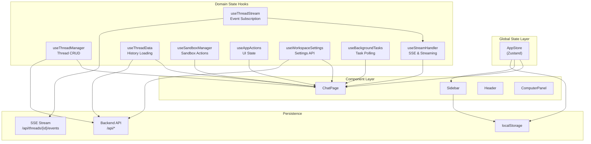
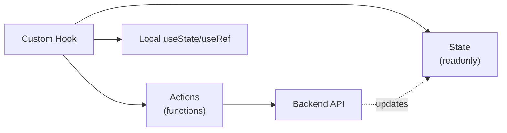
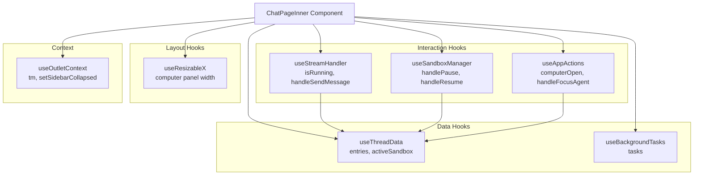
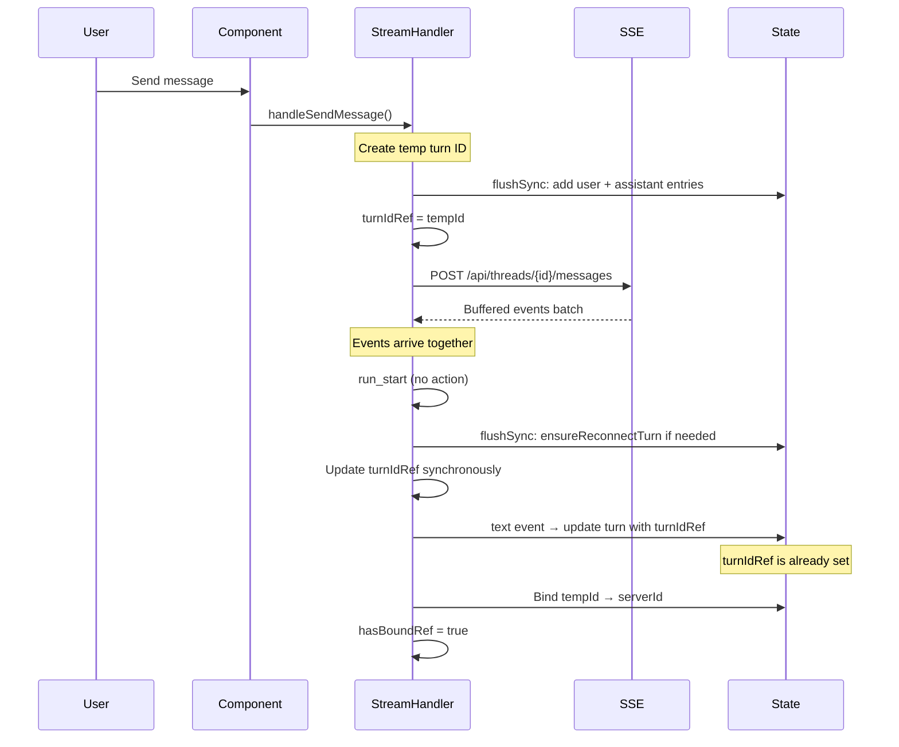
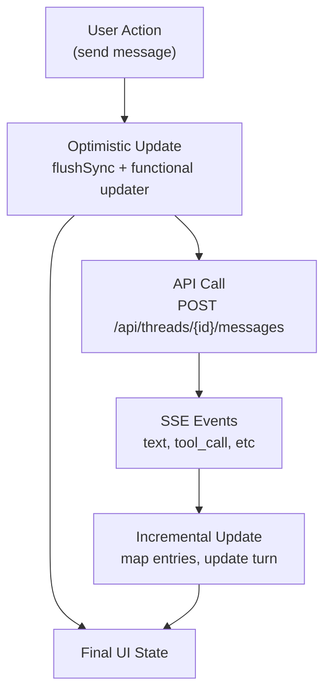

<!-- source: DeepWiki mcp.deepwiki.com · repo OpenDCAI/Mycel · page 7.5 State Management · fetched 2026-11-02 -->

# State Management

<details>
<summary>Relevant source files</summary>

The following files were used as context for generating this wiki page:

- [frontend/app/src/api/message-mapper.ts](frontend/app/src/api/message-mapper.ts)
- [frontend/app/src/api/types.ts](frontend/app/src/api/types.ts)
- [frontend/app/src/components/CenteredInputBox.tsx](frontend/app/src/components/CenteredInputBox.tsx)
- [frontend/app/src/components/DragHandle.tsx](frontend/app/src/components/DragHandle.tsx)
- [frontend/app/src/components/ModelSelector.tsx](frontend/app/src/components/ModelSelector.tsx)
- [frontend/app/src/components/NewChatDialog.tsx](frontend/app/src/components/NewChatDialog.tsx)
- [frontend/app/src/components/Sidebar.tsx](frontend/app/src/components/Sidebar.tsx)
- [frontend/app/src/components/chat-area/AssistantBlock.tsx](frontend/app/src/components/chat-area/AssistantBlock.tsx)
- [frontend/app/src/components/chat-area/NoticeBubble.tsx](frontend/app/src/components/chat-area/NoticeBubble.tsx)
- [frontend/app/src/hooks/stream-event-handlers.ts](frontend/app/src/hooks/stream-event-handlers.ts)
- [frontend/app/src/hooks/use-stream-handler.ts](frontend/app/src/hooks/use-stream-handler.ts)
- [frontend/app/src/hooks/use-thread-manager.ts](frontend/app/src/hooks/use-thread-manager.ts)
- [frontend/app/src/hooks/use-workspace-settings.ts](frontend/app/src/hooks/use-workspace-settings.ts)
- [frontend/app/src/main.tsx](frontend/app/src/main.tsx)
- [frontend/app/src/pages/AppLayout.tsx](frontend/app/src/pages/AppLayout.tsx)
- [frontend/app/src/pages/ChatPage.tsx](frontend/app/src/pages/ChatPage.tsx)
- [frontend/app/src/pages/NewChatPage.tsx](frontend/app/src/pages/NewChatPage.tsx)
- [frontend/app/src/pages/RootLayout.tsx](frontend/app/src/pages/RootLayout.tsx)
- [frontend/app/src/router.tsx](frontend/app/src/router.tsx)

</details>


This document explains the state management architecture in the Mycel frontend application. It covers the global state store, custom hook patterns, local component state, and specialized state synchronization mechanisms for real-time streaming.

For information about real-time event handling and SSE connections, see [Real-time Streaming and Event Handling](#7.3). For details on the React component hierarchy, see [Application Structure and Routing](#7.1).

---

## State Management Architecture Overview

The Mycel frontend uses a multi-layered state management approach that combines global state, domain-specific hooks, and local component state. This architecture prioritizes modularity and separation of concerns while maintaining type safety and efficient rendering.

**State Management Layers**



Sources: [frontend/app/src/pages/ChatPage.tsx:1-220](), [frontend/app/src/pages/RootLayout.tsx:1-316](), [frontend/app/src/store/app-store]()

---

## Global State (Zustand Store)

The application uses a single Zustand store (`AppStore`) for shared state that needs to be accessible across multiple routes and components. The store is kept minimal to avoid unnecessary coupling.

**AppStore Responsibilities**

| State Slice | Type | Purpose |
|-------------|------|---------|
| `memberList` | `Member[]` | Agent member configurations available for chat |
| `userProfile` | `{name, email, initials}` | Current user information |
| `tasks` | `Task[]` | Global task list |
| `fetchMembers()` | Action | Load member list from `/api/members` |
| `loadAll()` | Action | Bootstrap all global data |
| `addTask()` | Action | Create a new task via API |

**Usage Pattern**

Components access the store using selector hooks to minimize re-renders:

```typescript
// Select specific slices
const memberList = useAppStore(s => s.memberList);
const loadAll = useAppStore(s => s.loadAll);

// Multiple selectors in one component
const { userProfile, loadAll } = useAppStore(s => ({
  userProfile: s.userProfile,
  loadAll: s.loadAll,
}));
```

The store is used in [frontend/app/src/pages/RootLayout.tsx:32-36]() for user profile display, [frontend/app/src/components/Sidebar.tsx:180]() for member filtering, and [frontend/app/src/pages/AppLayout.tsx:21-22]() for bootstrapping member data.

**Store Update Pattern**

Updates to the store are made through actions that encapsulate API calls and optimistic updates:

[frontend/app/src/pages/RootLayout.tsx:61-75]() shows the `addTask` action being called, which updates both the backend and the store state atomically.

Sources: [frontend/app/src/pages/RootLayout.tsx:32-36](), [frontend/app/src/components/Sidebar.tsx:180](), [frontend/app/src/pages/AppLayout.tsx:21-22]()

---

## Domain-Specific State Hooks

The application uses custom hooks to encapsulate domain logic and state management for specific concerns. Each hook provides both state and actions, following a consistent interface pattern.

**Hook Interface Pattern**



### useThreadManager

Manages the thread list, sandbox types, and thread CRUD operations.

**Interface:**
```typescript
interface ThreadManagerState {
  threads: ThreadSummary[];
  sandboxTypes: SandboxType[];
  selectedSandbox: string;
  loading: boolean;
}

interface ThreadManagerActions {
  setSelectedSandbox: (name: string) => void;
  setThreads: React.Dispatch<React.SetStateAction<ThreadSummary[]>>;
  refreshThreads: () => Promise<void>;
  handleCreateThread: (sandbox?: string, cwd?: string, agent?: string) => Promise<string>;
  handleDeleteThread: (threadId: string) => Promise<void>;
}
```

**Implementation:** [frontend/app/src/hooks/use-thread-manager.ts:26-74]()

The hook maintains local state for threads and sandbox types, loads them on mount ([frontend/app/src/hooks/use-thread-manager.ts:38-50]()), and provides memoized actions for thread operations. When a thread is created, it optimistically updates the local `threads` array ([frontend/app/src/hooks/use-thread-manager.ts:53-59]()).

### useStreamHandler

Manages the streaming state for a single chat thread, handling SSE events and converting them into UI state updates.

**Interface:**
```typescript
interface StreamHandlerState {
  runtimeStatus: StreamStatus | null;
  isRunning: boolean;
}

interface StreamHandlerActions {
  handleSendMessage: (message: string) => Promise<void>;
  handleStopStreaming: () => Promise<void>;
}
```

**Implementation:** [frontend/app/src/hooks/use-stream-handler.ts:72-268]()

This hook uses `useThreadStream` for the SSE connection and maintains critical synchronous state using refs ([frontend/app/src/hooks/use-stream-handler.ts:106-111]()). See the [Streaming State Synchronization](#streaming-state-synchronization) section for details on the ref-based pattern.

### useThreadData

Loads and caches the conversation history for a thread.

**Responsibilities:**
- Fetch thread snapshot from `/api/threads/{id}/snapshot` on mount
- Convert backend message format to frontend `ChatEntry[]` format
- Manage loading state and active sandbox info

[frontend/app/src/pages/ChatPage.tsx:82]() shows its usage in `ChatPageInner`, where it provides the initial `entries` array and `activeSandbox` state.

### useWorkspaceSettings

Manages user workspace preferences and recent workspace history.

**Interface:**
```typescript
interface UserSettings {
  default_workspace: string | null;
  recent_workspaces: string[];
  default_model: string;
  enabled_models: string[];
}
```

**Implementation:** [frontend/app/src/hooks/use-workspace-settings.ts:10-68]()

The hook fetches settings from `/api/settings` on mount and provides methods to update workspace preferences that persist to the backend and then refresh the local state ([frontend/app/src/hooks/use-workspace-settings.ts:28-41]()).

Sources: [frontend/app/src/hooks/use-thread-manager.ts:26-74](), [frontend/app/src/hooks/use-stream-handler.ts:72-268](), [frontend/app/src/pages/ChatPage.tsx:82](), [frontend/app/src/hooks/use-workspace-settings.ts:10-68]()

---

## Hook Composition Pattern

The `ChatPage` component demonstrates the hook composition pattern, where multiple domain hooks are combined to build a complete feature.

**ChatPage Hook Composition**



**Composition Implementation:**

[frontend/app/src/pages/ChatPage.tsx:82-108]() shows how hooks are composed in the component. Each hook:

1. Receives minimal dependencies (typically just `threadId`)
2. Returns state and actions with clear interfaces
3. Can depend on other hooks' outputs (e.g., `useStreamHandler` receives `loading` from `useThreadData`)
4. Manages its own internal state and side effects

This pattern keeps each hook focused on a single concern while allowing complex behavior to emerge from their composition.

Sources: [frontend/app/src/pages/ChatPage.tsx:82-108]()

---

## Component Local State

Components use React's `useState` for UI-specific state that doesn't need to be shared or persisted.

**Common Local State Patterns**

| Pattern | Example | Location |
|---------|---------|----------|
| Modal visibility | `const [showCreate, setShowCreate] = useState(false)` | [frontend/app/src/pages/RootLayout.tsx:28-30]() |
| Form inputs | `const [message, setMessage] = useState("")` | [frontend/app/src/components/CenteredInputBox.tsx:66]() |
| Expansion state | `const [expandedMembers, setExpandedMembers] = useState<Set<string>>(new Set())` | [frontend/app/src/components/Sidebar.tsx:182]() |
| Selection mode | `const [isSelectMode, setIsSelectMode] = useState(false)` | [frontend/app/src/components/Sidebar.tsx:184-185]() |
| Popover open state | `const [workspacePopoverOpen, setWorkspacePopoverOpen] = useState(false)` | [frontend/app/src/components/CenteredInputBox.tsx:72]() |

**Persistent Local State Pattern**

For UI state that should survive page refreshes (like sidebar width), components use `localStorage` with lazy initialization:

```typescript
const [expanded, setExpanded] = useState(() => {
  const saved = localStorage.getItem("sidebar-expanded");
  return saved ? saved === "true" : false;
});

useEffect(() => {
  localStorage.setItem("sidebar-expanded", String(expanded));
}, [expanded]);
```

This pattern is used in [frontend/app/src/pages/RootLayout.tsx:38-43]() for the sidebar expansion state.

**Derived State Pattern**

When state can be computed from props or other state, components use `useMemo` to avoid unnecessary recalculations:

[frontend/app/src/components/Sidebar.tsx:218-251]() computes grouped and sorted threads based on the `threads` and `memberList` arrays. The expensive computation is memoized and only re-runs when dependencies change.

Sources: [frontend/app/src/pages/RootLayout.tsx:28-30](), [frontend/app/src/components/CenteredInputBox.tsx:66](), [frontend/app/src/components/Sidebar.tsx:182-185](), [frontend/app/src/pages/RootLayout.tsx:38-43](), [frontend/app/src/components/Sidebar.tsx:218-251]()

---

## Streaming State Synchronization

The real-time streaming features present a unique state management challenge: SSE events arrive in rapid bursts and must update the UI synchronously to avoid race conditions.

### The Synchronization Problem

When the SSE connection replays buffered events, multiple events (e.g., `run_start`, `text`, `tool_call`) arrive in a single `reader.read()` batch. React's default batching behavior would delay state updates until after all events are processed, causing later events to operate on stale state.

**Problem Example:**
```
1. run_start event arrives → sets turnIdRef in deferred state update
2. text event arrives → needs turnIdRef to update correct turn
3. React batch executes → turnIdRef is still empty when text handler runs
4. Result: text is lost or attached to wrong turn
```

### The flushSync Solution

The streaming hooks use `flushSync` from `react-dom` to force synchronous state updates at critical points:

[frontend/app/src/hooks/use-stream-handler.ts:118-128]() shows the `ensureReconnectTurn` function that uses `flushSync` to ensure `turnIdRef` is set before the next event is processed:

```typescript
function ensureReconnectTurn() {
  const fallbackId = makeId("reconnect-turn");
  flushSync(() => {
    onUpdateRef.current((prev) => {
      const { entries, turnId } = applyReconnectTurn(prev, fallbackId);
      turnIdRef.current = turnId;  // ← Must be set BEFORE next event
      return entries;
    });
  });
}
```

**Critical Ref State**

[frontend/app/src/hooks/use-stream-handler.ts:106-111]() defines the refs that must be updated synchronously:

```typescript
const turnIdRef = useRef<string>("");     // Current assistant turn being updated
const hasBoundRef = useRef(false);        // Whether temp ID has been bound to server ID
```

These refs are read and written during event processing and must never be out of sync with the displayed entries.

### Message ID Binding Pattern

When a user sends a message, a temporary turn ID is created. When the server responds with the real message ID, the temp ID must be atomically replaced:

[frontend/app/src/hooks/use-stream-handler.ts:188-200]() shows the binding logic that updates both the ref and the entry state in one transaction.

**State Synchronization Flow**



Sources: [frontend/app/src/hooks/use-stream-handler.ts:106-128](), [frontend/app/src/hooks/use-stream-handler.ts:188-200]()

---

## Context Passing Patterns

The application uses React Router's outlet context to pass state down the route hierarchy without prop drilling.

### Outlet Context Structure

**AppLayout Context:**

[frontend/app/src/pages/AppLayout.tsx:70]() provides context to nested chat routes:

```typescript
interface OutletContext {
  tm: ThreadManagerState & ThreadManagerActions;
  sidebarCollapsed: boolean;
  setSidebarCollapsed: React.Dispatch<React.SetStateAction<boolean>>;
  setSessionsOpen: (value: boolean) => void;
}
```

**Usage in ChatPage:**

[frontend/app/src/pages/ChatPage.tsx:36]() consumes the context:

```typescript
const { tm, setSidebarCollapsed } = useOutletContext<OutletContext>();
```

This allows `ChatPage` to access thread manager actions (for refreshing the sidebar) and control sidebar state without receiving them as props.

### When to Use Context vs Props

| Pattern | Use Case | Example |
|---------|----------|---------|
| **Outlet Context** | State shared across route hierarchy | Thread manager, sidebar controls |
| **Props** | Direct parent-child communication | Event handlers, render props |
| **Global Store** | Cross-cutting concerns, unrelated components | User profile, member list |
| **Hooks** | Encapsulated domain logic | Thread operations, streaming |

The codebase avoids deep prop drilling by using outlet context for layout state while keeping domain logic in hooks.

Sources: [frontend/app/src/pages/AppLayout.tsx:70](), [frontend/app/src/pages/ChatPage.tsx:36]()

---

## State Update Patterns

The application follows consistent patterns for updating state in response to user actions and server events.

### Optimistic Updates

When creating or deleting threads, the UI updates immediately before the server confirms:

[frontend/app/src/hooks/use-thread-manager.ts:53-59]() shows optimistic thread creation:

```typescript
const handleCreateThread = useCallback(async (sandbox?: string, cwd?: string, agent?: string): Promise<string> => {
  const type = sandbox ?? selectedSandbox;
  const thread = await createThread(type, cwd, agent);  // API call
  setThreads((prev) => [thread, ...prev]);              // Optimistic update
  setSelectedSandbox(type);
  return thread.thread_id;
}, [selectedSandbox]);
```

If the API call fails, the error propagates to the caller, but the local state has already been updated. In practice, thread creation rarely fails, and the optimistic update provides instant feedback.

### Incremental Streaming Updates

Streaming events update state incrementally by mapping over the entries array and updating the matching turn:

[frontend/app/src/hooks/stream-event-handlers.ts:16-26]() defines the core update pattern:

```typescript
function updateTurnSegments(
  onUpdate: UpdateEntries,
  turnId: string,
  updater: (turn: AssistantTurn) => AssistantTurn,
) {
  onUpdate((prev) =>
    prev.map((e) =>
      e.id === turnId && e.role === "assistant" ? updater(e as AssistantTurn) : e,
    ),
  );
}
```

This pattern:
1. Iterates through entries once
2. Identifies the target turn by ID
3. Applies the updater function only to that turn
4. Returns a new array with the updated turn

Text streaming uses this pattern to append chunks to the last text segment ([frontend/app/src/hooks/stream-event-handlers.ts:35-49]()), while tool events insert new tool segments or update existing ones.

### Batch Updates with Functional Updates

Multiple state updates in quick succession use functional updaters to ensure they operate on the latest state:

[frontend/app/src/hooks/use-stream-handler.ts:225-228]() uses functional updates when sending a message:

```typescript
flushSync(() => {
  onUpdateRef.current((prev) => [...prev, userEntry, assistantTurn]);
  setSendPending(true);
});
```

The functional updater `(prev) => ...` receives the most recent state, avoiding stale closures.

**State Update Flow Diagram**



Sources: [frontend/app/src/hooks/use-thread-manager.ts:53-59](), [frontend/app/src/hooks/stream-event-handlers.ts:16-49](), [frontend/app/src/hooks/use-stream-handler.ts:225-228]()

---

## State Debugging and Observability

The application includes patterns for debugging state updates and tracking state flow.

### Console Logging in Development

Stream event handlers include diagnostic logging to trace event flow:

[frontend/app/src/hooks/use-stream-handler.ts:115]() and [frontend/app/src/hooks/use-stream-handler.ts:131]() log event types and critical ref values:

```typescript
console.log("[STREAM-DIAG] subscriber registered");
// ...
console.log(`[STREAM-DIAG] event=${event.type}, turnId=${turnIdRef.current}, hasBound=${hasBoundRef.current}`);
```

These logs help diagnose issues with event ordering, turn ID binding, and reconnection logic.

### State Inspection in React DevTools

All hooks return plain objects that are visible in React DevTools:

- `useThreadManager` state shows current threads and sandbox types
- `useStreamHandler` state shows `isRunning` and `runtimeStatus`
- Component local state is visible under the component's hooks section

### Frontend Logging to Backend

All `console.log` calls are intercepted and sent to the backend for centralized logging:

[frontend/app/src/main.tsx:34-47]() intercepts console.log:

```typescript
console.log = (...args: unknown[]) => {
  originalLog(...args);
  const message = args.map((arg) => serializeLogArg(arg)).join(' ')
  fetch('/api/debug/log', {
    method: 'POST',
    headers: { 'Content-Type': 'application/json' },
    body: JSON.stringify({ message, timestamp: new Date().toISOString() }),
  }).catch((error) => {
    originalLog('[frontend-debug-log] failed to send /api/debug/log:', error)
  })
};
```

This enables debugging production issues by viewing frontend logs on the backend.

Sources: [frontend/app/src/hooks/use-stream-handler.ts:115-131](), [frontend/app/src/main.tsx:34-47]()

---

## Summary

The Mycel frontend uses a layered state management architecture:

1. **Global State (Zustand)**: Minimal shared state for user profile, members, and tasks
2. **Domain Hooks**: Encapsulated state management for threads, streaming, settings, etc.
3. **Local Component State**: UI-specific state that doesn't need to be shared
4. **Synchronous Refs**: Critical state for streaming that must update atomically
5. **Context Passing**: Outlet context for route hierarchy state sharing

Key patterns:
- Hook composition for building complex features from simple hooks
- Optimistic updates for instant UI feedback
- `flushSync` for synchronous state updates during streaming
- Functional updaters to avoid stale closures
- Incremental updates via array mapping for streaming content

This architecture prioritizes modularity, type safety, and efficient rendering while handling the complex requirements of real-time streaming and multi-threaded conversations.

---

