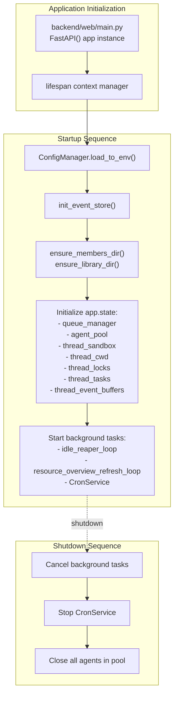
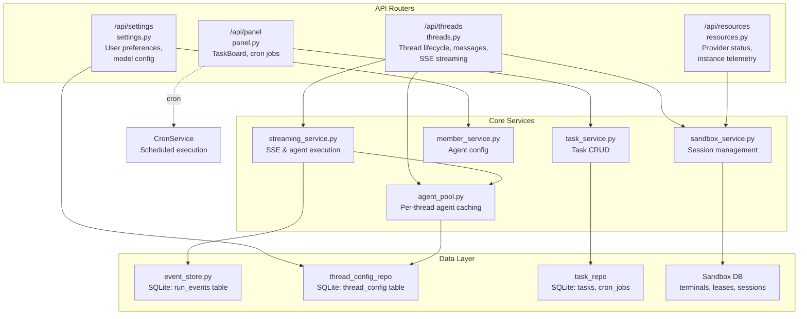
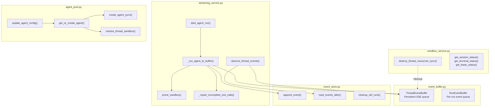
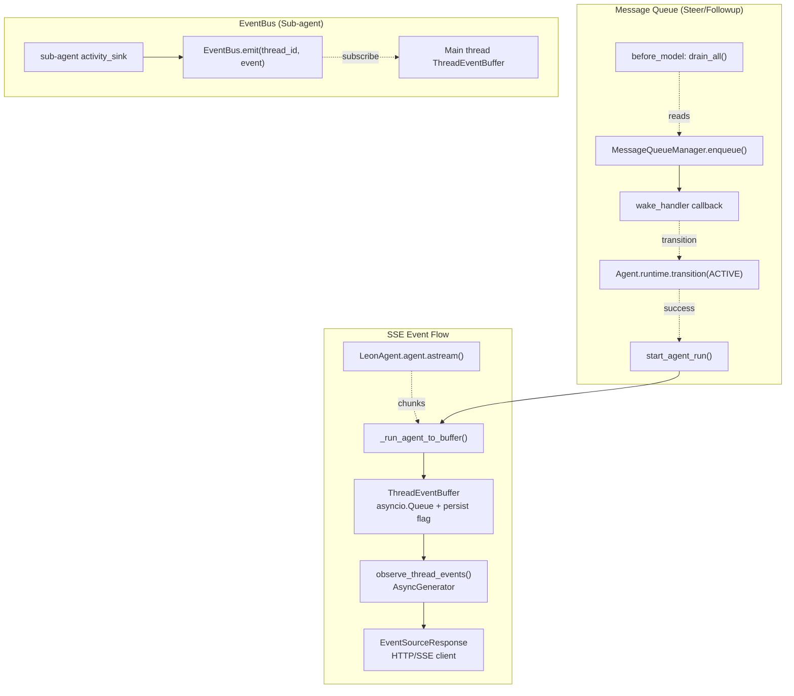
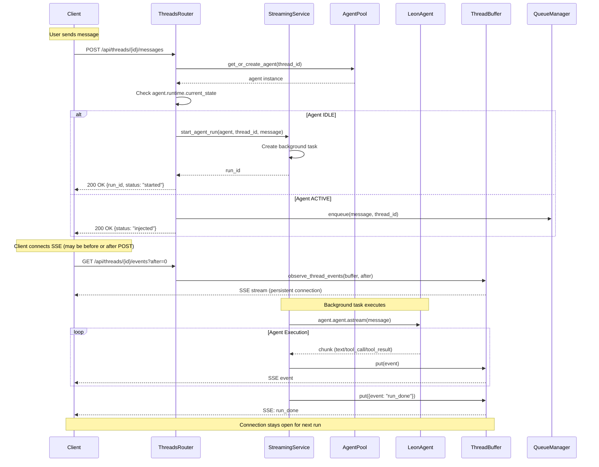
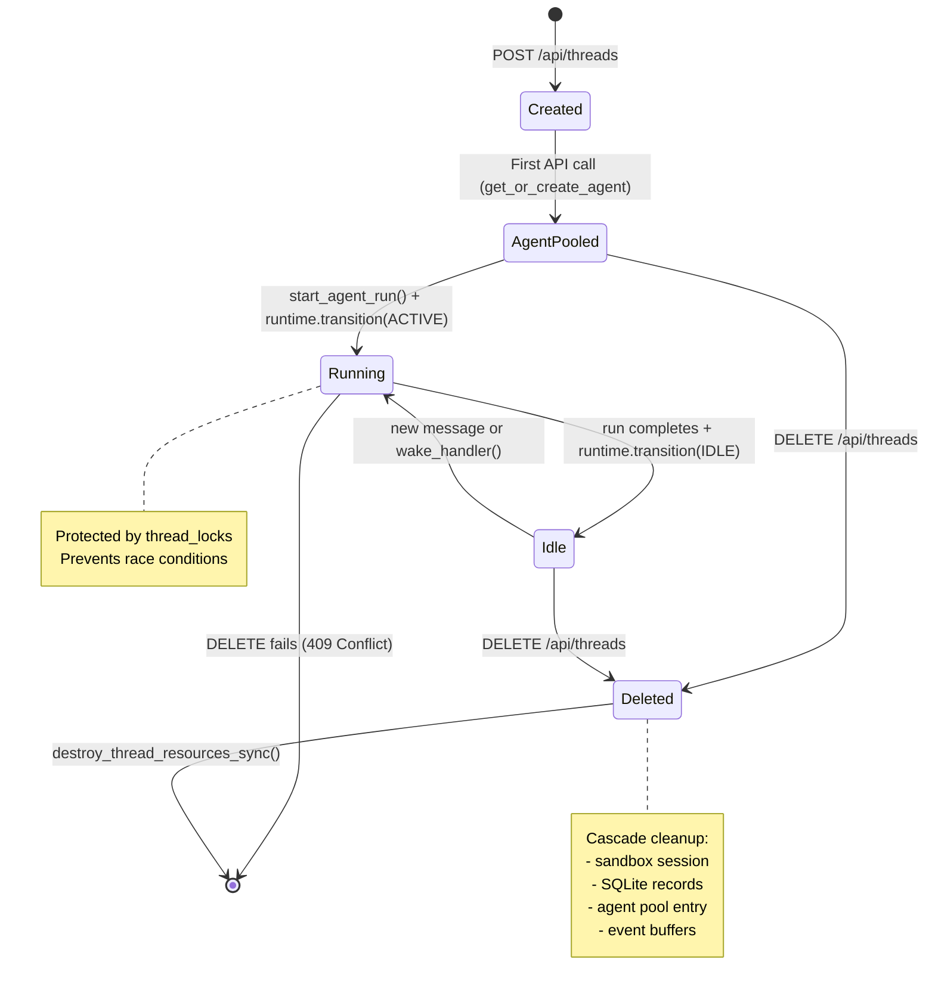

<!-- source: DeepWiki mcp.deepwiki.com · repo OpenDCAI/Mycel · page 8 Backend Architecture · fetched 2026-11-02 -->

# Backend Architecture

<details>
<summary>Relevant source files</summary>

The following files were used as context for generating this wiki page:

- [backend/web/core/lifespan.py](backend/web/core/lifespan.py)
- [backend/web/models/thread_config.py](backend/web/models/thread_config.py)
- [backend/web/routers/threads.py](backend/web/routers/threads.py)
- [backend/web/services/agent_pool.py](backend/web/services/agent_pool.py)
- [backend/web/services/streaming_service.py](backend/web/services/streaming_service.py)
- [backend/web/utils/helpers.py](backend/web/utils/helpers.py)

</details>


## Purpose and Scope

This document provides a high-level overview of the Mycel backend architecture, including the FastAPI application structure, router organization, service layer design, and event-driven patterns. The backend serves as the bridge between user interfaces (Web UI, TUI, CLI) and the agent runtime, coordinating agent execution, managing persistent state, and streaming real-time updates via Server-Sent Events (SSE).

For detailed information about specific subsystems:
- API endpoint specifications: see [8.1 API Routers and Endpoints](#8.1)
- SSE streaming implementation: see [8.2 Streaming Service and SSE](#8.2)
- Agent lifecycle and caching: see [8.3 Agent Pool Management](#8.3)
- Message queueing patterns: see [8.4 Event System and Message Queuing](#8.4)
- Scheduled tasks and cleanup: see [8.5 Background Workers](#8.5)

For agent runtime internals (middleware, tools, execution): see [5 Agent Runtime](#5).

For sandbox provider integration: see [6 Sandbox System](#6).

---

## FastAPI Application Structure

The backend is built on **FastAPI**, a modern Python web framework chosen for its native async support, automatic OpenAPI documentation, and type safety. The application follows a layered architecture with clear separation between HTTP routing, business logic, and persistence.

### Application Entry Point

The main FastAPI application is defined in `backend/web/main.py` and includes:

**Diagram: FastAPI Application Initialization**



**Sources:** [backend/web/core/lifespan.py:16-85]()

The `lifespan` context manager ([backend/web/core/lifespan.py:16-85]()) handles all startup and shutdown logic:

| Phase | Actions | Purpose |
|-------|---------|---------|
| **Startup** | Load configuration from disk | Initialize environment variables and settings |
| | Initialize `event_store` SQLite tables | Ensure event persistence schema exists |
| | Create `members/` and `library/` directories | Ensure agent config directories exist |
| | Initialize `app.state` dictionaries | Set up in-memory state containers |
| | Start background workers | Launch idle cleanup, resource monitoring, cron scheduler |
| **Shutdown** | Cancel background tasks | Graceful termination of worker loops |
| | Stop `CronService` | Flush pending scheduled jobs |
| | Close all agents in pool | Release model connections, cleanup runtime state |

### Application State Management

FastAPI's `app.state` object stores runtime state accessible across all routes and middleware. Mycel uses this for thread-scoped resource management:

**Table: Application State Containers**

| State Key | Type | Purpose |
|-----------|------|---------|
| `queue_manager` | `MessageQueueManager` | Per-thread message queues for followup/steer messages |
| `agent_pool` | `dict[str, Any]` | Cached `LeonAgent` instances keyed by `thread_id:sandbox_type` |
| `thread_sandbox` | `dict[str, str]` | Thread ID → sandbox provider mapping (memory cache) |
| `thread_cwd` | `dict[str, str]` | Thread ID → custom working directory mapping |
| `thread_locks` | `dict[str, asyncio.Lock]` | Per-thread locks for atomic state transitions |
| `thread_locks_guard` | `asyncio.Lock` | Lock-of-locks for safe lock creation |
| `thread_tasks` | `dict[str, asyncio.Task]` | Active agent execution tasks keyed by thread ID |
| `thread_event_buffers` | `dict[str, ThreadEventBuffer]` | Per-thread SSE event queues (persistent across runs) |
| `subagent_buffers` | `dict[str, RunEventBuffer]` | Per-subagent event buffers (deprecated in favor of EventBus) |
| `idle_reaper_task` | `asyncio.Task \| None` | Background task for sandbox idle timeout enforcement |
| `cron_service` | `CronService \| None` | Scheduled job executor |
| `_event_loop` | `asyncio.AbstractEventLoop` | Reference to main event loop for thread-safe scheduling |
| `monitor_resources_task` | `asyncio.Task \| None` | Background task for provider resource monitoring |

**Sources:** [backend/web/core/lifespan.py:34-47]()

---

## Router Organization

The backend exposes its API through FastAPI routers, each handling a specific domain:

**Diagram: Router Architecture**



**Sources:** [backend/web/routers/threads.py:1-654](), [backend/web/services/streaming_service.py:1-1040](), [backend/web/services/agent_pool.py:1-180]()

### Thread Management Router

`/api/threads` is the primary router for user interactions. It handles thread creation, message sending, agent execution, and SSE event streaming.

**Key Endpoints:**

| Method | Path | Purpose |
|--------|------|---------|
| `POST` | `/api/threads` | Create new thread with optional sandbox/cwd |
| `GET` | `/api/threads` | List all threads with metadata and status |
| `GET` | `/api/threads/{thread_id}` | Get messages and sandbox info for thread |
| `DELETE` | `/api/threads/{thread_id}` | Delete thread and destroy resources |
| `POST` | `/api/threads/{thread_id}/messages` | Send message (auto-routes: start run or enqueue steer) |
| `POST` | `/api/threads/{thread_id}/queue` | Enqueue followup message |
| `GET` | `/api/threads/{thread_id}/queue` | List pending queue messages |
| `GET` | `/api/threads/{thread_id}/history` | Get compact conversation history |
| `GET` | `/api/threads/{thread_id}/runtime` | Get agent runtime status (tokens, cost, state) |
| `POST` | `/api/threads/{thread_id}/runs` | Start agent run (returns run_id) |
| `POST` | `/api/threads/{thread_id}/runs/cancel` | Cancel active run |
| `GET` | `/api/threads/{thread_id}/events` | **SSE**: Persistent event stream (survives across runs) |
| `POST` | `/api/threads/{thread_id}/sandbox/pause` | Pause sandbox session |
| `POST` | `/api/threads/{thread_id}/sandbox/resume` | Resume paused sandbox |
| `DELETE` | `/api/threads/{thread_id}/sandbox` | Destroy sandbox session |
| `GET` | `/api/threads/{thread_id}/session` | Get ChatSession status |
| `GET` | `/api/threads/{thread_id}/terminal` | Get Terminal state |
| `GET` | `/api/threads/{thread_id}/lease` | Get SandboxLease status |
| `GET` | `/api/threads/{thread_id}/tasks` | List background tasks (bash + agent) |
| `GET` | `/api/threads/{thread_id}/tasks/{task_id}` | Get task details |
| `POST` | `/api/threads/{thread_id}/tasks/{task_id}/cancel` | Cancel background task |

**Sources:** [backend/web/routers/threads.py:42-654]()

### Settings Router

`/api/settings` manages user preferences and global configuration. See [8.1](#8.1) for details.

### Panel Router

`/api/panel` exposes the task board system (task CRUD, cron jobs). See [10.1](#10.1) for task board details.

### Resources Router

`/api/resources` provides real-time provider status, instance telemetry, and quota tracking. See [10.2](#10.2) for resource monitoring details.

---

## Service Layer Architecture

The service layer encapsulates business logic and coordinates between routers, agent runtime, and persistence. Services are stateless and rely on `app.state` for runtime state and SQLite/filesystem for persistence.

**Diagram: Service Layer Responsibilities**



**Sources:** [backend/web/services/streaming_service.py:1-1040](), [backend/web/services/agent_pool.py:1-180]()

### Streaming Service

`streaming_service.py` is the core orchestrator for agent execution. It manages:

1. **Run Lifecycle**: `start_agent_run()` creates a background task that runs the agent and emits SSE events ([backend/web/services/streaming_service.py:839-919]())
2. **Event Emission**: All agent outputs (text chunks, tool calls, tool results) are written to `ThreadEventBuffer` and persisted to SQLite ([backend/web/services/streaming_service.py:344-809]())
3. **Sandbox Priming**: `prime_sandbox()` ensures sandbox session is ready before execution, handling resume-on-demand for paused sessions ([backend/web/services/streaming_service.py:31-53]())
4. **Error Recovery**: Automatic retry with exponential backoff for network errors, incomplete tool call repair for interrupted runs ([backend/web/services/streaming_service.py:519-704]())
5. **Observation Integration**: Langfuse/LangSmith tracing callbacks injected into LangGraph config ([backend/web/services/streaming_service.py:410-462]())

See [8.2](#8.2) for detailed streaming architecture.

### Agent Pool

`agent_pool.py` implements per-thread agent caching to avoid repeated initialization overhead:

- **Pool Key**: `f"{thread_id}:{sandbox_type}"` ensures complete isolation between threads and sandbox providers ([backend/web/services/agent_pool.py:50-51]())
- **Lazy Creation**: Agents are created on-demand, not at server startup ([backend/web/services/agent_pool.py:40-92]())
- **Model Hotswap**: `update_agent_config()` allows runtime model changes without destroying the agent ([backend/web/services/agent_pool.py:114-179]())
- **Workspace Resolution**: For local sandbox, thread-specific `cwd` is loaded from memory cache → SQLite fallback → default workspace root ([backend/web/services/agent_pool.py:60-66]())

See [8.3](#8.3) for detailed pool management.

### Event Store

`event_store.py` provides SQLite-backed persistence for SSE events:

- **Schema**: `run_events` table with columns: `thread_id`, `run_id`, `event`, `data`, `seq`, `message_id`, `created_at`
- **Reconnection**: Clients reconnect with `?after=N` or `Last-Event-ID` header to replay events from sequence number
- **Cleanup**: `cleanup_old_runs()` purges old run data, keeping only the latest run per thread ([backend/web/services/streaming_service.py:800-805]())

### Sandbox Service

`sandbox_service.py` wraps the sandbox manager for REST API access:

- **Session Lifecycle**: Create, pause, resume, destroy operations
- **Status Queries**: Return JSON-serializable status for ChatSession, Terminal, SandboxLease entities
- **Resource Cleanup**: Thread deletion triggers cascade cleanup across all sandbox DB tables

---

## Event-Driven Architecture

The backend uses an event-driven architecture for real-time communication and asynchronous coordination. Three event systems coexist:

**Diagram: Event System Architecture**



**Sources:** [backend/web/services/streaming_service.py:230-337](), [backend/web/services/event_buffer.py]()

### ThreadEventBuffer

`ThreadEventBuffer` is a persistent event queue that survives across multiple runs for the same thread:

- **Architecture**: `asyncio.Queue` with `mark_done` logic removed — queue never closes ([backend/web/services/event_buffer.py]())
- **Lifecycle**: Created on first connection, remains in `app.state.thread_event_buffers` until thread deletion
- **Reconnection**: SSE clients reconnect with `?after=N` to replay events from SQLite starting at sequence number N
- **In-band Signals**: `run_start` / `run_done` events signal run boundaries; connection stays open across runs

**Sources:** [backend/web/services/event_buffer.py](), [backend/web/routers/threads.py:429-482]()

### MessageQueueManager

`MessageQueueManager` implements unified queue-based message injection for both steer (interrupt) and followup (next turn) messages:

- **Unified Queue**: Single FIFO queue per thread replaces separate steer/followup queues
- **Wake Handler**: When agent is IDLE, enqueue triggers `wake_handler()` which transitions agent to ACTIVE and starts a new run ([backend/web/services/streaming_service.py:281-326]())
- **Drain Pattern**: When agent is ACTIVE, enqueue writes to queue; agent's `before_model` callback drains queue at next LLM call

See [8.4](#8.4) for detailed message queue patterns.

### EventBus

`EventBus` enables sub-agent events to flow into the main thread's SSE stream:

- **Subscription**: Main thread subscribes to `thread_id` during handler setup ([backend/web/services/streaming_service.py:330-336]())
- **Emission**: Sub-agents emit events via `EventBus.emit(thread_id, event)` (via `agent_service.py`)
- **Routing**: EventBus forwards events to all subscribers (typically just the main thread's `activity_sink`)

**Sources:** [backend/web/event_bus.py](), [backend/web/services/streaming_service.py:330-336]()

---

## Request/Response Flow Patterns

### HTTP → Agent → SSE Pattern

The typical user interaction follows a two-channel pattern:

**Diagram: Dual-Channel Request Flow**



**Key Characteristics:**

1. **Async POST**: `POST /messages` returns immediately with status; agent runs in background task
2. **SSE Persistence**: SSE connection survives across multiple runs (persistent `ThreadEventBuffer`)
3. **State-Based Routing**: Message routing (start run vs. enqueue) determined by agent state at POST time
4. **Reconnection Support**: Client reconnects with `?after=N` to replay from last seen sequence number

**Sources:** [backend/web/routers/threads.py:159-189](), [backend/web/routers/threads.py:429-482](), [backend/web/services/streaming_service.py:839-919]()

### Thread Lifecycle Coordination

Thread state transitions require coordination across multiple subsystems:

**Diagram: Thread Lifecycle State Management**



**Locking Strategy:**

- `app.state.thread_locks` maps `thread_id` to `asyncio.Lock`
- Critical sections acquire lock before state transitions ([backend/web/routers/threads.py:182-189]())
- Prevents race conditions between concurrent DELETE and POST /messages requests

**Deletion Constraints:**

- Cannot delete thread while `agent.runtime.current_state == AgentState.ACTIVE` ([backend/web/routers/threads.py:134-135]())
- Cleanup includes: unbind runtime handlers, unregister wake handler, destroy sandbox resources, purge SQLite, remove from agent pool

**Sources:** [backend/web/routers/threads.py:122-156](), [backend/web/routers/threads.py:159-189]()

---

## Integration with Other Subsystems

### Agent Runtime Integration

The backend interacts with `LeonAgent` via the agent pool. Key integration points:

- **Model Configuration**: Thread-specific model lookup from `thread_config` table or preferences default ([backend/web/services/agent_pool.py:68-74]())
- **Runtime Transitions**: Service layer calls `agent.runtime.transition(AgentState.ACTIVE/IDLE)` for state management ([backend/web/routers/threads.py:184-187]())
- **Middleware State**: Per-thread agent ensures complete isolation of memory, todo, filesystem, and steering state

See [5 Agent Runtime](#5) for agent internals.

### Sandbox Manager Integration

The backend delegates all sandbox operations to `SandboxManager` via the agent's `_sandbox` attribute:

- **Session Creation**: `agent._sandbox.ensure_session(thread_id)` ([backend/web/services/streaming_service.py:43]())
- **Pause/Resume**: `agent._sandbox.pause_thread(thread_id)`, `agent._sandbox.resume_thread(thread_id)` ([backend/web/routers/threads.py:341-361]())
- **Status Queries**: Wrapper functions in `thread_state_service.py` convert internal state to JSON ([backend/web/services/thread_state_service.py]())

See [6 Sandbox System](#6) for sandbox architecture.

### Storage Container Integration

The backend uses `StorageContainer` for all persistent data access:

- **Build Once**: Global `_cached_container` created on first access ([backend/web/utils/helpers.py:73-79]())
- **Repository Pattern**: `thread_config_repo()`, `run_event_repo()`, `file_operation_repo()` factories provide typed repos
- **Thread Purge**: `container.purge_thread(thread_id)` cascades across all storage-managed tables ([backend/web/utils/helpers.py:199]())

**Sources:** [backend/web/utils/helpers.py:73-79](), [backend/web/utils/helpers.py:196-211]()

---

## Architectural Principles

### Stateless Services

All services are stateless functions that accept dependencies as parameters. Runtime state lives in `app.state`, not in service module globals. This enables:

- **Testability**: Services can be tested with mocked `app.state` or in-memory repos
- **Concurrency Safety**: No shared mutable state between requests
- **Clean Shutdown**: All state cleared by garbage collection on server stop

### Per-Thread Isolation

Each thread has its own agent instance, event buffer, queue, and lock:

- **Pool Key**: `f"{thread_id}:{sandbox_type}"` ensures threads with different sandboxes get separate agents
- **No Cross-Thread Interference**: Memory middleware, steering queue, filesystem operations are isolated
- **Independent Lifecycle**: Thread deletion cleans up only its resources

### Event Sourcing for Replay

All agent outputs are persisted to SQLite with monotonic sequence numbers:

- **Reconnection**: Client sends `Last-Event-ID` or `?after=N`, server replays from SQLite ([backend/web/routers/threads.py:442-477]())
- **Audit Trail**: Full conversation history reconstructable from event log
- **Incremental Update**: SSE delivers events in real-time; SQLite serves as durable replay cache

### Async-First Design

All blocking operations (`agent.agent.astream()`, SQLite writes, config file I/O) run in `asyncio.to_thread()`:

- **Non-Blocking I/O**: Web server remains responsive during long-running agent execution
- **Backpressure**: SSE clients control flow by consuming events; slow clients don't block other threads
- **Graceful Cancellation**: Run cancellation via `task.cancel()` triggers `asyncio.CancelledError` handling ([backend/web/services/streaming_service.py:747-761]())

**Sources:** [backend/web/services/streaming_service.py:31-53](), [backend/web/routers/threads.py:341-377]()

---

## Configuration and Dependencies

### Thread Configuration Hierarchy

Thread configuration follows a three-layer hierarchy:

1. **Runtime State** (`app.state.thread_sandbox`, `app.state.thread_cwd`): In-memory cache, fastest access
2. **SQLite** (`thread_config` table via `ThreadConfigRepo`): Persistent, survives server restart
3. **Sandbox DB** (`sandbox_leases` table): Fallback for legacy threads, detected via `lookup_sandbox_for_thread()`

**Table: ThreadConfig Fields**

| Field | Type | Purpose | Default |
|-------|------|---------|---------|
| `sandbox_type` | `str` | Provider name: "local", "docker", "e2b", etc. | `"local"` |
| `cwd` | `str \| None` | Custom workspace root for local sandbox | `None` |
| `model` | `str \| None` | LLM model (supports `leon:*` virtual names) | `None` (falls back to preferences) |
| `queue_mode` | `str` | Deprecated, kept for schema compat | `"steer"` |
| `observation_provider` | `str \| None` | "langfuse" or "langsmith" | `None` |
| `agent` | `str \| None` | Member name (e.g. "__leon__") | `None` |

**Sources:** [backend/web/models/thread_config.py:1-15](), [backend/web/utils/helpers.py:86-156]()

### FastAPI Dependency Injection

The backend uses FastAPI's dependency injection for common parameters:

```python
from backend.web.core.dependencies import get_app, get_thread_agent, get_thread_lock

@router.post("/{thread_id}/sandbox/pause")
async def pause_thread_sandbox(
    thread_id: str,
    agent: Annotated[Any, Depends(get_thread_agent)] = None,
) -> dict[str, Any]:
    # agent is pre-fetched by dependency
    ok = await asyncio.to_thread(agent._sandbox.pause_thread, thread_id)
    ...
```

**Dependencies:**

- `get_app`: Returns `request.app` (FastAPI application instance)
- `get_thread_agent`: Looks up agent from pool or raises 404
- `get_thread_lock`: Gets or creates `asyncio.Lock` for thread

**Sources:** [backend/web/core/dependencies.py](), [backend/web/routers/threads.py:336-361]()

---

## Summary

The Mycel backend architecture prioritizes:

1. **Real-time Responsiveness**: SSE streaming + async execution for sub-second UI updates
2. **Thread Isolation**: Per-thread agent instances prevent cross-contamination
3. **Reconnection Resilience**: SQLite-backed event replay enables clients to recover from network failures
4. **Clean Abstractions**: Services, routers, and storage layers have clear boundaries
5. **Extensibility**: Event-driven patterns support future features (webhooks, analytics, multi-agent coordination)

For detailed subsystem documentation, see child pages [8.1](#8.1) through [8.5](#8.5).

---

