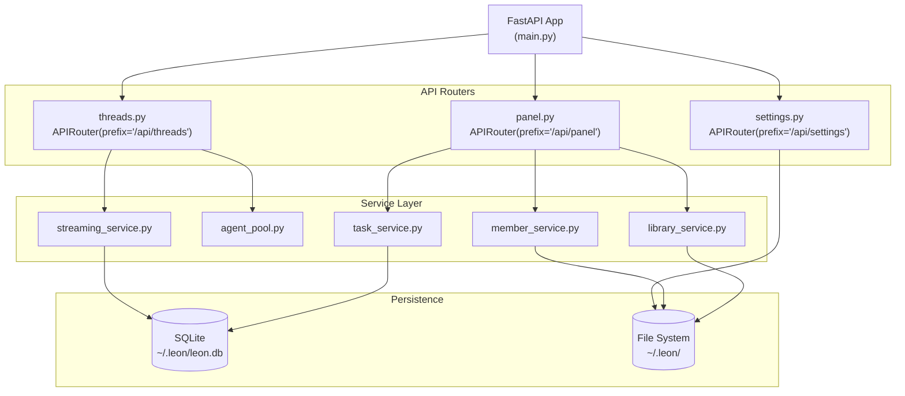
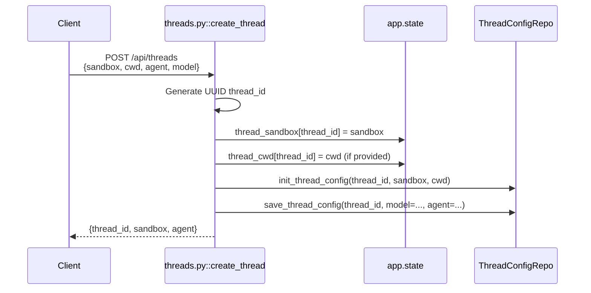
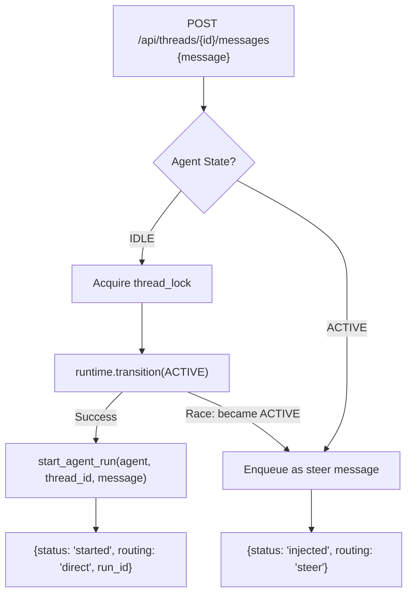
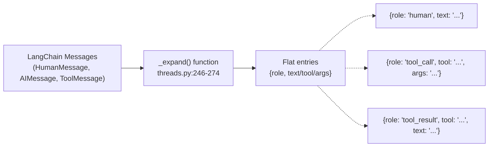
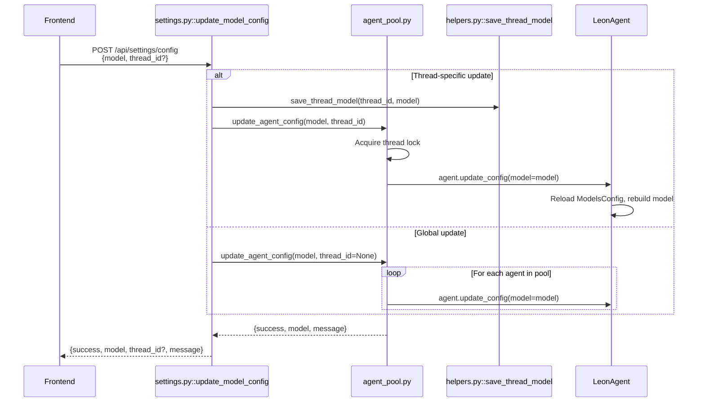

<!-- source: DeepWiki mcp.deepwiki.com · repo OpenDCAI/Mycel · page 8.1 API Routers and Endpoints · fetched 2026-11-02 -->

# API Routers and Endpoints

<details>
<summary>Relevant source files</summary>

The following files were used as context for generating this wiki page:

- [backend/web/core/lifespan.py](backend/web/core/lifespan.py)
- [backend/web/models/panel.py](backend/web/models/panel.py)
- [backend/web/models/thread_config.py](backend/web/models/thread_config.py)
- [backend/web/routers/panel.py](backend/web/routers/panel.py)
- [backend/web/routers/settings.py](backend/web/routers/settings.py)
- [backend/web/routers/threads.py](backend/web/routers/threads.py)
- [backend/web/services/agent_pool.py](backend/web/services/agent_pool.py)
- [backend/web/services/cron_job_service.py](backend/web/services/cron_job_service.py)
- [backend/web/services/cron_service.py](backend/web/services/cron_service.py)
- [backend/web/services/library_service.py](backend/web/services/library_service.py)
- [backend/web/services/streaming_service.py](backend/web/services/streaming_service.py)
- [backend/web/services/task_service.py](backend/web/services/task_service.py)
- [backend/web/utils/helpers.py](backend/web/utils/helpers.py)
- [config/models_schema.py](config/models_schema.py)
- [core/runtime/middleware/monitor/cost.py](core/runtime/middleware/monitor/cost.py)
- [core/runtime/middleware/monitor/models.json](core/runtime/middleware/monitor/models.json)
- [frontend/app/index.html](frontend/app/index.html)
- [frontend/app/public/favicon.svg](frontend/app/public/favicon.svg)
- [frontend/app/src/components/LibraryEditor.tsx](frontend/app/src/components/LibraryEditor.tsx)
- [frontend/app/src/components/ModelMappingSection.tsx](frontend/app/src/components/ModelMappingSection.tsx)
- [frontend/app/src/components/ModelPoolSection.tsx](frontend/app/src/components/ModelPoolSection.tsx)
- [frontend/app/src/components/ObservationSection.tsx](frontend/app/src/components/ObservationSection.tsx)
- [frontend/app/src/components/ProvidersSection.tsx](frontend/app/src/components/ProvidersSection.tsx)
- [frontend/app/src/components/SandboxSection.tsx](frontend/app/src/components/SandboxSection.tsx)
- [frontend/app/src/components/cron-editor.tsx](frontend/app/src/components/cron-editor.tsx)
- [frontend/app/src/components/task-modal.tsx](frontend/app/src/components/task-modal.tsx)
- [frontend/app/src/pages/SettingsPage.tsx](frontend/app/src/pages/SettingsPage.tsx)
- [frontend/app/src/pages/TasksPage.tsx](frontend/app/src/pages/TasksPage.tsx)
- [tests/test_cron_api.py](tests/test_cron_api.py)
- [tests/test_cron_job_service.py](tests/test_cron_job_service.py)
- [tests/test_cron_service.py](tests/test_cron_service.py)
- [tests/test_model_config_enrichment.py](tests/test_model_config_enrichment.py)
- [tests/test_task_service.py](tests/test_task_service.py)
- [tests/test_taskboard_middleware.py](tests/test_taskboard_middleware.py)

</details>


This page provides comprehensive documentation of all REST API endpoints exposed by the Mycel backend. The FastAPI application organizes endpoints into three primary routers: `/api/threads` for thread management and agent execution, `/api/settings` for user preferences and configuration, and `/api/panel` for panel management (members, tasks, library). 

For information about the streaming service and SSE event handling, see [Streaming Service and SSE](#8.2). For details on the service layer implementations, see other sections under [Backend Architecture](#8).

---

## Router Organization

The backend uses FastAPI's `APIRouter` to organize endpoints into logical groupings. Each router is defined in a separate module with a consistent prefix pattern.

**Router Registration Structure**



Sources: [backend/web/routers/threads.py:1-654](), [backend/web/routers/settings.py:1-702](), [backend/web/routers/panel.py:1-244]()

---

## `/api/threads` Router

The threads router handles thread lifecycle, message sending, agent execution, and sandbox management. This is the primary interface for chat interactions and agent orchestration.

### Thread Lifecycle Endpoints

| Method | Endpoint | Description | Request Body | Response |
|--------|----------|-------------|--------------|----------|
| `POST` | `/api/threads` | Create new thread | `CreateThreadRequest` (optional) | `{thread_id, sandbox, agent}` |
| `GET` | `/api/threads` | List all threads | None | `{threads: []}` |
| `GET` | `/api/threads/{thread_id}` | Get thread messages and state | None | `{thread_id, messages, sandbox}` |
| `DELETE` | `/api/threads/{thread_id}` | Delete thread and resources | None | `{ok, thread_id}` |

**Thread Creation Flow**



Sources: [backend/web/routers/threads.py:55-84]()

### Message and Execution Endpoints

| Method | Endpoint | Description | Request Body | Response |
|--------|----------|-------------|--------------|----------|
| `POST` | `/api/threads/{thread_id}/messages` | Send message (auto-routing) | `SendMessageRequest` | `{status, routing, run_id?}` |
| `POST` | `/api/threads/{thread_id}/queue` | Enqueue followup message | `SendMessageRequest` | `{status, thread_id}` |
| `GET` | `/api/threads/{thread_id}/queue` | List pending queue items | None | `{messages, thread_id}` |
| `POST` | `/api/threads/{thread_id}/runs` | Start agent run | `RunRequest` | `{run_id, thread_id}` |
| `POST` | `/api/threads/{thread_id}/runs/cancel` | Cancel active run | None | `{ok, message}` |
| `GET` | `/api/threads/{thread_id}/events` | SSE event stream | Query: `?after=N` | Server-Sent Events |

**Message Routing Logic**



Sources: [backend/web/routers/threads.py:159-190]()

### Debugging and Inspection Endpoints

| Method | Endpoint | Description | Query Params | Response |
|--------|----------|-------------|--------------|----------|
| `GET` | `/api/threads/{thread_id}/history` | Compact conversation history | `limit`, `truncate` | `{thread_id, messages, total, showing}` |
| `GET` | `/api/threads/{thread_id}/runtime` | Runtime status and metrics | `stream` (bool) | Compact or verbose status dict |

The `/history` endpoint returns a flattened, human-readable view of the conversation by expanding `AIMessage` with `tool_calls` into separate entries and truncating content for debugging:



Sources: [backend/web/routers/threads.py:215-286]()

### Sandbox Control Endpoints

| Method | Endpoint | Description | Response |
|--------|----------|-------------|----------|
| `POST` | `/api/threads/{thread_id}/sandbox/pause` | Pause sandbox instance | `{ok, thread_id}` |
| `POST` | `/api/threads/{thread_id}/sandbox/resume` | Resume paused sandbox | `{ok, thread_id}` |
| `DELETE` | `/api/threads/{thread_id}/sandbox` | Destroy sandbox session | `{ok, thread_id}` |
| `GET` | `/api/threads/{thread_id}/session` | Get ChatSession status | Session status dict |
| `GET` | `/api/threads/{thread_id}/terminal` | Get AbstractTerminal state | Terminal status dict |
| `GET` | `/api/threads/{thread_id}/lease` | Get SandboxLease status | Lease status dict |

Sources: [backend/web/routers/threads.py:334-415]()

### Background Task Endpoints

| Method | Endpoint | Description | Response |
|--------|----------|-------------|----------|
| `GET` | `/api/threads/{thread_id}/tasks` | List background runs (bash + agent) | `[{task_id, task_type, status, ...}]` |
| `GET` | `/api/threads/{thread_id}/tasks/{task_id}` | Get background run details | `{task_id, task_type, result, ...}` |
| `POST` | `/api/threads/{thread_id}/tasks/{task_id}/cancel` | Cancel background run | `{success}` |

These endpoints expose the agent's `_background_runs` dictionary, which tracks both bash commands and sub-agent runs spawned via the `AgentService`.

Sources: [backend/web/routers/threads.py:535-654]()

---

## `/api/settings` Router

The settings router manages user preferences, model configuration, sandbox providers, and observation settings. It operates on two primary config files: `~/.leon/preferences.json` (workspace, default model) and `~/.leon/models.json` (model pool, mapping, providers).

### Configuration Files Managed

| File | Purpose | Schema |
|------|---------|--------|
| `~/.leon/preferences.json` | Workspace path, recent workspaces, default virtual model | `WorkspaceSettings` |
| `~/.leon/models.json` | Model mapping, pool (enabled/custom), provider credentials | `ModelsConfig` |
| `~/.leon/observation.json` | Observation provider config (Langfuse, LangSmith) | `ObservationConfig` |
| `~/.leon/sandboxes/*.json` | Per-provider sandbox configurations | `SandboxConfig` |

### Combined Settings Endpoint

| Method | Endpoint | Description | Response |
|--------|----------|-------------|----------|
| `GET` | `/api/settings` | Get combined settings (workspace + models) | `UserSettings` (merged view) |

The response merges `preferences.json` and `models.json` into a single `UserSettings` object for frontend compatibility:

Sources: [backend/web/routers/settings.py:112-134]()

### Workspace Management

| Method | Endpoint | Description | Request Body | Response |
|--------|----------|-------------|--------------|----------|
| `POST` | `/api/settings/workspace` | Set default workspace | `WorkspaceRequest` | `{success, workspace}` |
| `POST` | `/api/settings/workspace/recent` | Add to recent workspaces | `WorkspaceRequest` | `{success}` |
| `GET` | `/api/settings/browse` | Browse filesystem | Query: `path`, `include_files` | `{current_path, parent_path, items}` |
| `GET` | `/api/settings/read` | Read local file content | Query: `path` | `{path, content, truncated}` |

Sources: [backend/web/routers/settings.py:186-224]()

### Model Configuration

**Model Mapping Endpoints**

| Method | Endpoint | Description | Request Body | Response |
|--------|----------|-------------|--------------|----------|
| `GET` | `/api/settings/available-models` | List all models and virtual models | None | `{models, virtual_models}` |
| `POST` | `/api/settings/model-mapping` | Update virtual model mapping | `ModelMappingRequest` | `{success, model_mapping}` |
| `POST` | `/api/settings/default-model` | Set default virtual model | `DefaultModelRequest` | `{success, default_model}` |
| `POST` | `/api/settings/config` | Hot-reload model config per thread | `ModelConfigRequest` | `{success, model, thread_id?}` |

**Model Pool Endpoints**

| Method | Endpoint | Description | Request Body | Response |
|--------|----------|-------------|--------------|----------|
| `POST` | `/api/settings/models/toggle` | Enable/disable model | `ModelToggleRequest` | `{success, enabled_models}` |
| `POST` | `/api/settings/models/custom` | Add custom model | `CustomModelRequest` | `{success, custom_models, enabled_models}` |
| `DELETE` | `/api/settings/models/custom` | Remove custom model | Query: `model_id` | `{success, custom_models}` |
| `POST` | `/api/settings/models/custom/config` | Update custom model config | `CustomModelConfigRequest` | `{success, custom_config}` |
| `POST` | `/api/settings/models/test` | Test model connectivity | `ModelTestRequest` | `{success, model?, response?, error?}` |

**Model Configuration Flow**



Sources: [backend/web/routers/settings.py:249-268](), [backend/web/services/agent_pool.py:114-180]()

### Provider Credentials

| Method | Endpoint | Description | Request Body | Response |
|--------|----------|-------------|--------------|----------|
| `POST` | `/api/settings/providers` | Update provider credentials | `ProviderRequest` | `{success, provider}` |

Provider credentials (API keys, base URLs) are stored in `~/.leon/models.json` under the `providers` key and merged with system defaults by `ModelsLoader`.

Sources: [backend/web/routers/settings.py:528-541]()

### Observation Provider

| Method | Endpoint | Description | Request Body | Response |
|--------|----------|-------------|--------------|----------|
| `GET` | `/api/settings/observation` | Get observation config | None | `ObservationConfig` dict |
| `POST` | `/api/settings/observation` | Update observation config | `ObservationRequest` | `{success, active}` |
| `GET` | `/api/settings/observation/verify` | Verify provider by fetching traces | None | `{success, provider?, traces?, error?}` |

The verification endpoint queries the SDK to confirm credentials work:

Sources: [backend/web/routers/settings.py:562-670]()

### Sandbox Configurations

| Method | Endpoint | Description | Request Body | Response |
|--------|----------|-------------|--------------|----------|
| `GET` | `/api/settings/sandboxes` | List all sandbox configs | None | `{sandboxes: {name: config}}` |
| `POST` | `/api/settings/sandboxes` | Save sandbox config | `SandboxConfigRequest` | `{success, path}` |

Sandbox configurations are stored as individual JSON files in `~/.leon/sandboxes/` with provider-specific schemas validated by `SandboxConfig`.

Sources: [backend/web/routers/settings.py:677-702]()

---

## `/api/panel` Router

The panel router provides CRUD operations for members, tasks, library resources, and user profile. It serves the panel management UI and background job system.

### Members (Agent Configurations)

| Method | Endpoint | Description | Request Body | Response |
|--------|----------|-------------|--------------|----------|
| `GET` | `/api/panel/members` | List all members | None | `{items: []}` |
| `GET` | `/api/panel/members/{member_id}` | Get member details | None | Member dict |
| `POST` | `/api/panel/members` | Create new member | `CreateMemberRequest` | Member dict |
| `PUT` | `/api/panel/members/{member_id}` | Update member metadata | `UpdateMemberRequest` | Member dict |
| `PUT` | `/api/panel/members/{member_id}/config` | Update member config (tools, prompts, rules) | `MemberConfigPayload` | Member dict |
| `PUT` | `/api/panel/members/{member_id}/publish` | Publish member version | `PublishMemberRequest` | Member dict |
| `DELETE` | `/api/panel/members/{member_id}` | Delete member | None | `{success}` |

Member data is stored as `~/.leon/members/{member_id}/agent.md` files managed by `member_service.py`.

Sources: [backend/web/routers/panel.py:29-82]()

### Tasks (Task Board)

| Method | Endpoint | Description | Request Body | Response |
|--------|----------|-------------|--------------|----------|
| `GET` | `/api/panel/tasks` | List all tasks | None | `{items: []}` |
| `POST` | `/api/panel/tasks` | Create task | `CreateTaskRequest` | Task dict |
| `PUT` | `/api/panel/tasks/{task_id}` | Update task | `UpdateTaskRequest` | Task dict |
| `DELETE` | `/api/panel/tasks/{task_id}` | Delete task | None | `{success}` |
| `PUT` | `/api/panel/tasks/bulk-status` | Bulk update status | `BulkTaskStatusRequest` | `{updated: count}` |
| `POST` | `/api/panel/tasks/bulk-delete` | Bulk delete tasks | `BulkDeleteTasksRequest` | `{deleted: count}` |

Tasks are stored in `panel_tasks` table in SQLite with schema defined in [backend/web/services/task_service.py:13-49]().

**Task Table Schema**

| Column | Type | Description |
|--------|------|-------------|
| `id` | TEXT PRIMARY KEY | UUID hex |
| `title` | TEXT | Task title |
| `description` | TEXT | Task description |
| `assignee_id` | TEXT | Member ID assigned to task |
| `status` | TEXT | `pending`, `running`, `completed`, `failed` |
| `priority` | TEXT | `high`, `medium`, `low` |
| `progress` | INTEGER | 0-100 |
| `deadline` | TEXT | ISO timestamp or empty |
| `created_at` | INTEGER | Unix timestamp (ms) |
| `thread_id` | TEXT | Thread ID if task spawned agent run |
| `source` | TEXT | `manual`, `cron`, `agent`, `queue` |
| `cron_job_id` | TEXT | Cron job ID if task created by scheduler |
| `result` | TEXT | Task result or error message |
| `started_at` | INTEGER | Unix timestamp (ms) |
| `completed_at` | INTEGER | Unix timestamp (ms) |
| `tags` | TEXT | JSON array of tag strings |

Sources: [backend/web/routers/panel.py:84-123](), [backend/web/services/task_service.py:1-175]()

### Cron Jobs

| Method | Endpoint | Description | Request Body | Response |
|--------|----------|-------------|--------------|----------|
| `GET` | `/api/panel/cron-jobs` | List all cron jobs | None | `{items: []}` |
| `POST` | `/api/panel/cron-jobs` | Create cron job | `CreateCronJobRequest` | `{item: job}` |
| `PUT` | `/api/panel/cron-jobs/{job_id}` | Update cron job | `UpdateCronJobRequest` | `{item: job}` |
| `DELETE` | `/api/panel/cron-jobs/{job_id}` | Delete cron job | None | `{ok}` |
| `POST` | `/api/panel/cron-jobs/{job_id}/run` | Manually trigger cron job | None | `{item: created_task}` |

Cron jobs are stored in `cron_jobs` table in SQLite. The `/run` endpoint triggers immediate task creation from the job's `task_template` JSON.

Sources: [backend/web/routers/panel.py:125-175]()

### Library (Skills and Agents)

| Method | Endpoint | Description | Request Body | Response |
|--------|----------|-------------|--------------|----------|
| `GET` | `/api/panel/library/{resource_type}` | List resources | None | `{items: []}` |
| `POST` | `/api/panel/library/{resource_type}` | Create resource | `CreateResourceRequest` | Resource dict |
| `PUT` | `/api/panel/library/{resource_type}/{resource_id}` | Update resource metadata | `UpdateResourceRequest` | Resource dict |
| `DELETE` | `/api/panel/library/{resource_type}/{resource_id}` | Delete resource | None | `{success}` |
| `GET` | `/api/panel/library/{resource_type}/names` | List resource names only | None | `{items: []}` |
| `GET` | `/api/panel/library/{resource_type}/{resource_name}/used-by` | List members using resource | None | `{count, members}` |
| `GET` | `/api/panel/library/{resource_type}/{resource_id}/content` | Get resource file content | None | `{content}` |
| `PUT` | `/api/panel/library/{resource_type}/{resource_id}/content` | Update resource file content | `UpdateResourceContentRequest` | `{success}` |

Library resources are stored in `~/.leon/library/{resource_type}/` as individual files managed by `library_service.py`.

Sources: [backend/web/routers/panel.py:177-232]()

### Profile

| Method | Endpoint | Description | Request Body | Response |
|--------|----------|-------------|--------------|----------|
| `GET` | `/api/panel/profile` | Get user profile | None | Profile dict |
| `PUT` | `/api/panel/profile` | Update user profile | `UpdateProfileRequest` | Profile dict |

Sources: [backend/web/routers/panel.py:234-244]()

---

## Request/Response Models

The API uses Pydantic models for request validation and response serialization. Models are organized by domain.

### Thread Models

```python
# backend/web/models/requests.py

class CreateThreadRequest(BaseModel):
    sandbox: str = "local"
    cwd: str | None = None
    agent: str | None = None
    model: str | None = None

class SendMessageRequest(BaseModel):
    message: str

class RunRequest(BaseModel):
    message: str
    model: str | None = None
    enable_trajectory: bool = False
```

Sources: [backend/web/models/requests.py]() (inferred from usage in [backend/web/routers/threads.py:56-84]())

### Panel Models

```python
# backend/web/models/panel.py

class CreateTaskRequest(BaseModel):
    title: str = "新任务"
    description: str = ""
    assignee_id: str = ""
    priority: str = "medium"  # high | medium | low
    deadline: str = ""
    tags: list[str] = []

class UpdateTaskRequest(BaseModel):
    title: str | None = None
    description: str | None = None
    assignee_id: str | None = None
    status: str | None = None  # pending | running | completed | failed
    priority: str | None = None
    progress: int | None = None
    deadline: str | None = None
    tags: list[str] | None = None

class CreateCronJobRequest(BaseModel):
    name: str
    description: str = ""
    cron_expression: str  # Validated with croniter
    task_template: str = "{}"  # JSON template for task creation
    enabled: bool = True
```

Sources: [backend/web/models/panel.py:1-150]()

---

## Common Patterns

### Error Handling

All routers use FastAPI's `HTTPException` for error responses with appropriate status codes:

| Status Code | Usage |
|-------------|-------|
| `400` | Invalid request (validation failure, empty message, invalid path) |
| `404` | Resource not found (thread, task, member, cron job) |
| `409` | Conflict (thread already running, cannot delete active thread) |
| `500` | Internal server error (caught exceptions) |
| `503` | Service unavailable (cron service not started) |

Sources: [backend/web/routers/threads.py:122-157](), [backend/web/routers/settings.py:158-162]()

### Dependency Injection

Routers use FastAPI's `Depends()` for dependency injection:

```python
from backend.web.core.dependencies import get_app, get_thread_agent, get_thread_lock

@router.post("/{thread_id}/sandbox/pause")
async def pause_thread_sandbox(
    thread_id: str,
    agent: Annotated[Any, Depends(get_thread_agent)] = None,
) -> dict[str, Any]:
    ok = await asyncio.to_thread(agent._sandbox.pause_thread, thread_id)
    if not ok:
        raise HTTPException(409, f"Failed to pause sandbox for thread {thread_id}")
    return {"ok": ok, "thread_id": thread_id}
```

Common dependencies:
- `get_app`: Returns FastAPI app instance for accessing `app.state`
- `get_thread_agent`: Resolves and returns agent for a thread
- `get_thread_lock`: Returns asyncio lock for thread-safe operations

Sources: [backend/web/routers/threads.py:334-347](), [backend/web/core/dependencies.py]() (inferred)

### Thread Safety

Operations that modify agent state or start runs use asyncio locks to prevent race conditions:

```python
lock = await get_thread_lock(app, thread_id)
async with lock:
    if hasattr(agent, "runtime") and not agent.runtime.transition(AgentState.ACTIVE):
        raise HTTPException(status_code=409, detail="Thread is already running")
    run_id = start_agent_run(agent, thread_id, payload.message, app)
```

Sources: [backend/web/routers/threads.py:182-189]()

### Async Thread Execution

Synchronous operations (database queries, file I/O, agent operations) run in thread pool via `asyncio.to_thread()` to avoid blocking the event loop:

```python
# Pattern used throughout panel router
@router.get("/tasks")
async def list_tasks() -> dict[str, Any]:
    items = await asyncio.to_thread(task_service.list_tasks)
    return {"items": items}
```

Sources: [backend/web/routers/panel.py:86-90]()

### SSE Headers

SSE endpoints disable proxy buffering for real-time streaming:

```python
SSE_HEADERS = {
    "Cache-Control": "no-cache",
    "X-Accel-Buffering": "no",  # Disable nginx buffering
}

@router.get("/{thread_id}/events")
async def stream_thread_events(...) -> EventSourceResponse:
    return EventSourceResponse(
        observe_thread_events(thread_buf, after=after),
        headers=SSE_HEADERS,
    )
```

Sources: [backend/web/routers/threads.py:417-482]()

---

