<!-- source: DeepWiki mcp.deepwiki.com · repo OpenDCAI/Mycel · page 8.2 Streaming Service and SSE · fetched 2026-11-02 -->

# Streaming Service and SSE

<details>
<summary>Relevant source files</summary>

The following files were used as context for generating this wiki page:

- [backend/web/core/lifespan.py](backend/web/core/lifespan.py)
- [backend/web/models/thread_config.py](backend/web/models/thread_config.py)
- [backend/web/routers/threads.py](backend/web/routers/threads.py)
- [backend/web/services/agent_pool.py](backend/web/services/agent_pool.py)
- [backend/web/services/streaming_service.py](backend/web/services/streaming_service.py)
- [backend/web/utils/helpers.py](backend/web/utils/helpers.py)

</details>


## Purpose and Scope

The streaming service (`streaming_service.py`) implements the real-time event delivery layer for agent execution. It manages Server-Sent Events (SSE) connections, orchestrates agent runs, and provides persistent event buffering with reconnection support. This page covers the SSE architecture, event types, run lifecycle, and error recovery mechanisms.

For agent pool management and per-thread agent caching, see [Agent Pool Management](#8.3). For message queue-driven followups and wake handlers, see [Event System and Message Queuing](#8.4). For the API endpoints that consume this service, see [API Routers and Endpoints](#8.1).

## Architecture Overview

The streaming service follows a **producer-consumer** architecture with persistent buffering:

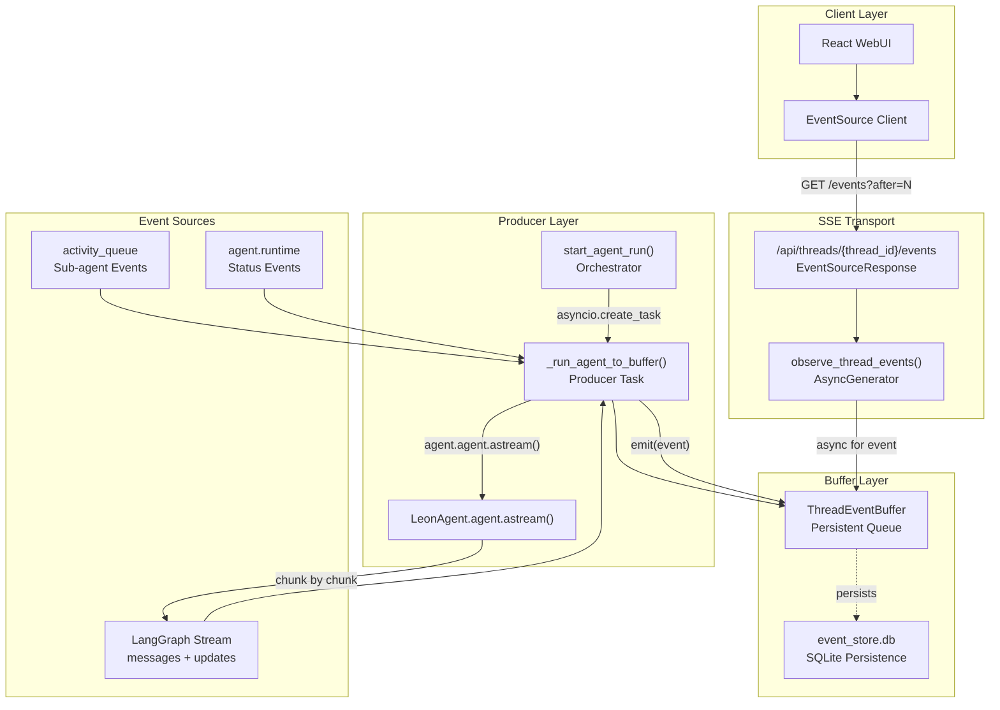

**Sources:** [backend/web/services/streaming_service.py:1-1044](), [backend/web/routers/threads.py:429-482]()

### Key Components

| Component | File | Responsibility |
|-----------|------|----------------|
| `ThreadEventBuffer` | `event_buffer.py` | Per-thread persistent event queue with sequence numbers |
| `start_agent_run()` | `streaming_service.py:839-883` | Orchestrator: transitions agent to ACTIVE, spawns producer task |
| `_run_agent_to_buffer()` | `streaming_service.py:344-809` | Producer: runs agent, emits events to buffer |
| `observe_thread_events()` | `streaming_service.py:885-1044` | Consumer: async generator yielding SSE events from buffer |
| `/api/threads/{id}/events` | `threads.py:429-482` | SSE endpoint returning `EventSourceResponse` |

**Sources:** [backend/web/services/streaming_service.py:230-237](), [backend/web/services/event_buffer.py]()

## ThreadEventBuffer: Persistent Event Queue

Each thread has a persistent `ThreadEventBuffer` that survives across runs. Events are written to both in-memory queue and SQLite storage:

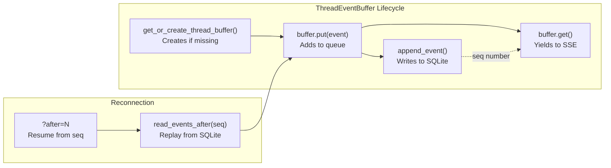

**Sources:** [backend/web/services/streaming_service.py:230-237](), [backend/web/services/event_store.py]()

### Buffer Management

- **Creation**: `get_or_create_thread_buffer(app, thread_id)` retrieves existing buffer or creates new one [streaming_service.py:230-237]()
- **Persistence**: `app.state.thread_event_buffers` dict stores buffers in FastAPI app state [backend/web/core/lifespan.py:42]()
- **Cleanup**: Buffer is **not** cleared between runs (persistent across run boundaries) [streaming_service.py:780]()
- **Deletion**: Only removed when thread is deleted [threads.py:150]()

**Sources:** [backend/web/services/streaming_service.py:230-237](), [backend/web/core/lifespan.py:42](), [backend/web/routers/threads.py:150]()

## SSE Endpoint Architecture

The `/api/threads/{thread_id}/events` endpoint provides persistent SSE streaming:

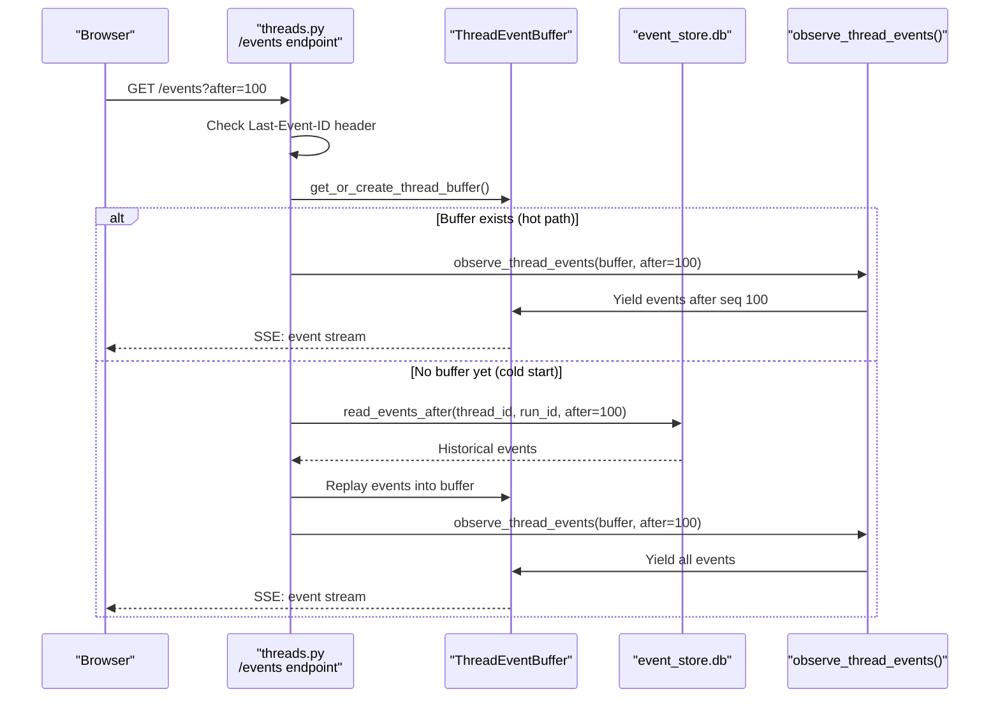

**Sources:** [backend/web/routers/threads.py:429-482]()

### Endpoint Implementation

[backend/web/routers/threads.py:429-482]()

```python
@router.get("/{thread_id}/events")
async def stream_thread_events(
    thread_id: str,
    request: Request,
    after: int = 0,  # Resume from sequence number
    app: Annotated[Any, Depends(get_app)] = None,
) -> EventSourceResponse:
    """Persistent SSE event stream for a thread — survives across runs."""
```

**Key features:**
- **Reconnection**: Supports `?after=N` query param and `Last-Event-ID` header
- **Replay**: On reconnection with `after > 0`, replays events from SQLite
- **Headers**: Returns `Cache-Control: no-cache`, `X-Accel-Buffering: no` to prevent proxy buffering [threads.py:418-421]()

**Sources:** [backend/web/routers/threads.py:429-482](), [backend/web/routers/threads.py:418-421]()

## Run Lifecycle and Event Flow

### Starting a Run

Runs are initiated via two paths:

| Path | Endpoint | Behavior |
|------|----------|----------|
| **Direct** | `POST /threads/{id}/messages` | If agent IDLE → start new run; if ACTIVE → enqueue as steer message |
| **Explicit** | `POST /threads/{id}/runs` | Start run unconditionally (409 if already active) |

**Sources:** [backend/web/routers/threads.py:159-190](), [backend/web/routers/threads.py:486-509]()

### Run State Transition

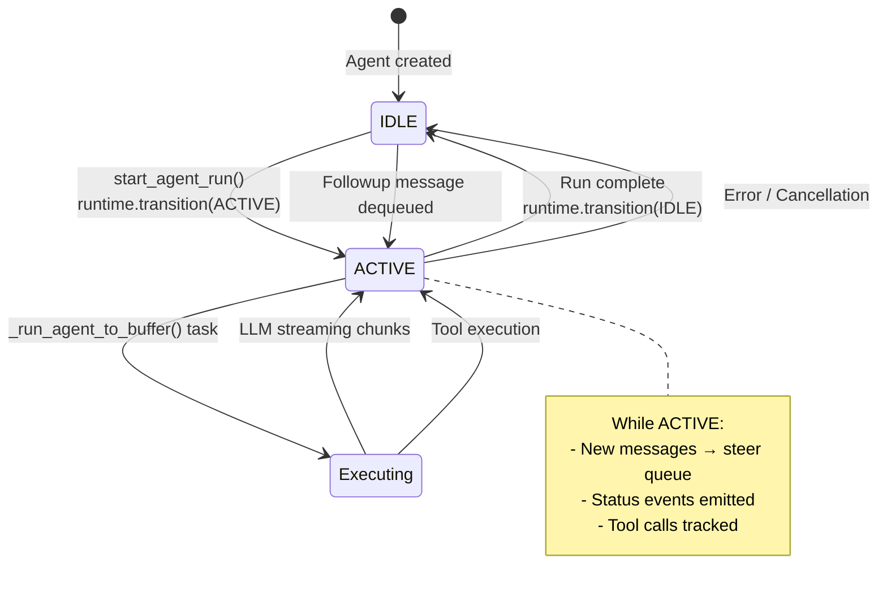

**Sources:** [backend/web/services/streaming_service.py:839-883](), [core/runtime/middleware/monitor.py]()

### Agent Execution Flow

[backend/web/services/streaming_service.py:344-809]()

The `_run_agent_to_buffer()` producer executes the agent and emits events:

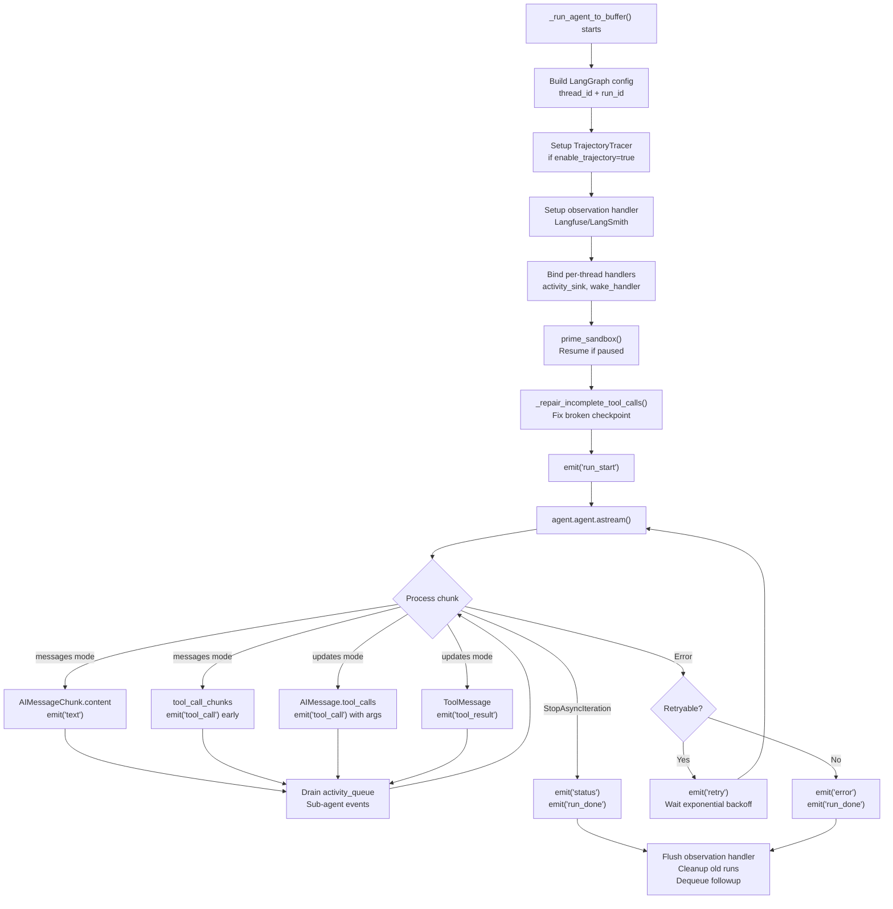

**Sources:** [backend/web/services/streaming_service.py:344-809]()

### Event Emission Pipeline

Events flow through this pipeline:

1. **Producer emits** → `emit(event)` function [streaming_service.py:359-377]()
2. **Persistence** → `append_event()` writes to SQLite, returns sequence number [streaming_service.py:355-365]()
3. **Buffer** → `thread_buf.put(event)` enqueues with `_seq` and `_run_id` [streaming_service.py:377]()
4. **Consumer** → `observe_thread_events()` yields from buffer [streaming_service.py:885-1044]()
5. **Transport** → `EventSourceResponse` formats as SSE and sends to client

**Sources:** [backend/web/services/streaming_service.py:359-377](), [backend/web/services/event_store.py]()

## Event Types and Schema

### SSE Event Catalog

| Event | Data Schema | Emitted When |
|-------|-------------|--------------|
| `run_start` | `{thread_id, run_id}` | Run begins |
| `text` | `{content}` | AIMessage chunk with text content |
| `tool_call` | `{id, name, args}` | LLM calls tool (emitted twice: early with `args:{}`, then with full args) |
| `tool_result` | `{tool_call_id, name, content, metadata}` | Tool execution completes |
| `status` | `{state, current_tool, tokens, cost, ...}` | Runtime state changes |
| `run_done` | `{thread_id, run_id}` | Run completes (success or error) |
| `error` | `{error}` | Unrecoverable error |
| `cancelled` | `{message, cancelled_tool_call_ids}` | Run cancelled by user |
| `retry` | `{attempt, max_attempts, wait_seconds}` | Retrying after network error |
| `notice` | `{content, notification_type}` | System notification (queue message) |
| `activity` | Sub-agent specific | Forwarded from sub-agents via EventBus |

**Sources:** [backend/web/services/streaming_service.py:500-677]()

### Event Structure

All events include:
- **event**: Event type string
- **data**: JSON-encoded payload
- **_seq**: Sequence number (injected by buffer)
- **_run_id**: Run UUID (injected by producer)

Optional fields (via `Last-Event-ID` for reconnection):
- **id**: Sequence number as SSE id (for `Last-Event-ID` header)

**Sources:** [backend/web/services/streaming_service.py:266-276](), [backend/web/services/streaming_service.py:372-376]()

### Early vs Full Tool Call Emission

Tool calls are emitted **twice** to optimize perceived latency:

1. **Early emission** (messages mode): As soon as LLM streams `tool_call_chunks` with `id` and `name`, emit with `args: {}` [streaming_service.py:572-602]()
   - **Purpose**: UI shows tool name within ~1s of LLM start
   - **Timing**: During LLM generation, before full response

2. **Full emission** (updates mode): After LLM completes, emit with complete `args` [streaming_service.py:620-645]()
   - **Purpose**: UI receives full arguments for display/execution tracking
   - **Timing**: After LLM finishes generating the response

**Sources:** [backend/web/services/streaming_service.py:572-602](), [backend/web/services/streaming_service.py:620-645]()

## Error Handling and Recovery

### Network Error Retry

The service implements exponential backoff retry for transient network errors:

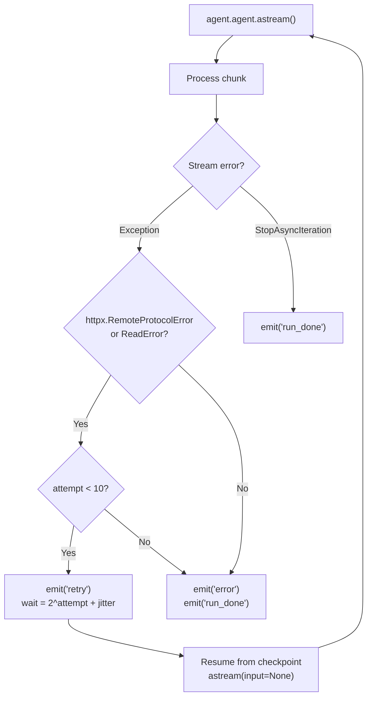

**Implementation:** [streaming_service.py:519-704]()

Key features:
- **Max attempts**: 10 retries (`MAX_STREAM_RETRIES`)
- **Backoff**: `wait = max(min(2^attempt, 30) + random(-1.0, 1.0), 1.0)`
- **Resume**: On retry, pass `input=None` to LangGraph so it resumes from checkpoint without re-appending user message [streaming_service.py:535]()
- **Detectable errors**: `httpx.RemoteProtocolError`, `httpx.ReadError` [streaming_service.py:521-530]()

**Sources:** [backend/web/services/streaming_service.py:519-704](), [backend/web/services/streaming_service.py:521-530]()

### Incomplete Tool Call Repair

If server restarts mid-run, checkpoint may have `AIMessage` with `tool_calls` but no matching `ToolMessage` responses. This breaks LLM validation. The service auto-repairs:

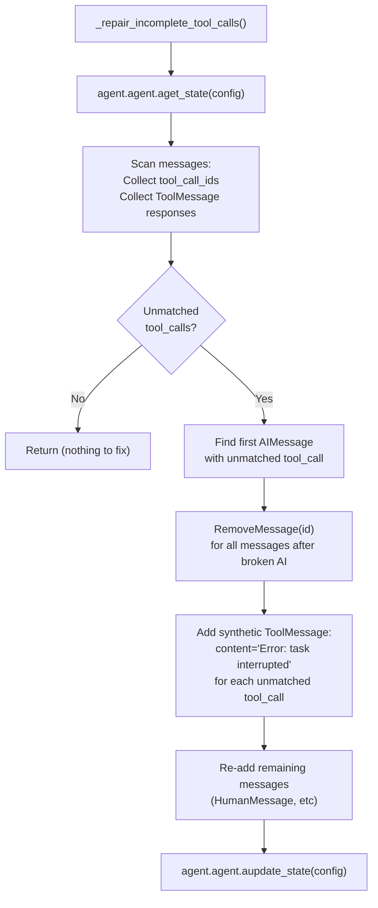

**Implementation:** [streaming_service.py:127-223]()

**Repair strategy:**
1. Identify all `tool_call_id` → `tool_name` pairs from `AIMessage.tool_calls`
2. Identify all `tool_call_id` responses from `ToolMessage`
3. Find unmatched tool calls (present in AI but no ToolMessage)
4. Remove all messages after the broken `AIMessage`
5. Insert synthetic `ToolMessage` with error content
6. Re-add remaining messages in order

**Sources:** [backend/web/services/streaming_service.py:127-223]()

### Cancellation Handling

When user cancels a run via `POST /threads/{id}/runs/cancel`:

1. **Cancel task**: `task.cancel()` triggers `asyncio.CancelledError` [threads.py:521]()
2. **Write markers**: `write_cancellation_markers()` creates `ToolMessage` for pending tool calls [streaming_service.py:55-124]()
3. **Update checkpoint**: Writes cancellation markers to LangGraph checkpoint so next run sees completed (cancelled) tool calls
4. **Emit cancelled**: `emit('cancelled', {cancelled_tool_call_ids})` [streaming_service.py:747-760]()
5. **Emit run_done**: Ensures frontend knows run ended [streaming_service.py:761]()

**Sources:** [backend/web/services/streaming_service.py:747-761](), [backend/web/routers/threads.py:512-522](), [backend/web/services/streaming_service.py:55-124]()

## Per-Thread Handler Binding

Each thread has persistent handlers that survive across runs:

### Handler Setup

[backend/web/services/streaming_service.py:245-336]()

`_ensure_thread_handlers()` binds (idempotent):

1. **activity_sink**: Receives sub-agent events, writes to buffer
   - Bound via `runtime.bind_thread(activity_sink=...)`
   - Writes to both `event_store` and `ThreadEventBuffer`
   - Filters to SSE-valid fields: `{event, data, id, retry, comment}` [streaming_service.py:275]()

2. **wake_handler**: Called when message enqueued while agent IDLE
   - Registered via `queue_manager.register_wake(thread_id, wake_handler)`
   - Transitions agent to ACTIVE and starts new run [streaming_service.py:300-325]()
   - Handles race condition if agent became ACTIVE between enqueue and wake

3. **EventBus subscription**: Forwards sub-agent events to thread's SSE stream
   - `get_event_bus().subscribe(thread_id, activity_sink)` [streaming_service.py:332-336]()

**Sources:** [backend/web/services/streaming_service.py:245-336]()

### Handler Lifecycle

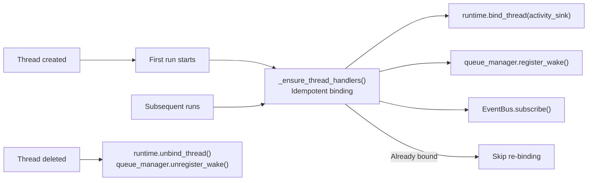

**Persistence rules:**
- **Bound once per thread**: First `_run_agent_to_buffer()` call binds handlers [streaming_service.py:476]()
- **Survive runs**: NOT cleared between runs (unlike per-run `event_callback`)
- **Cleaned on delete**: `runtime.unbind_thread()` called when thread deleted [threads.py:138]()

**Sources:** [backend/web/services/streaming_service.py:245-336](), [backend/web/routers/threads.py:138]()

## Observation Provider Integration

The streaming service integrates LLM tracing providers for run observability:

### Provider Setup

[backend/web/services/streaming_service.py:410-461]()

**Configuration sources:**
1. **Provider selection**: `thread_config.observation_provider` (per-thread) [helpers.py:102-120]()
2. **Credentials**: `observation.yaml` (global config) via `ObservationLoader`

**Supported providers:**

| Provider | Handler Class | Configuration |
|----------|--------------|---------------|
| **Langfuse** | `langfuse.langchain.CallbackHandler` | `public_key`, `secret_key`, `host` |
| **LangSmith** | `langchain_core.tracers.langchain.LangChainTracer` | `api_key`, `endpoint`, `project` |

**Sources:** [backend/web/services/streaming_service.py:410-461](), [backend/web/utils/helpers.py:132-138]()

### Integration Flow

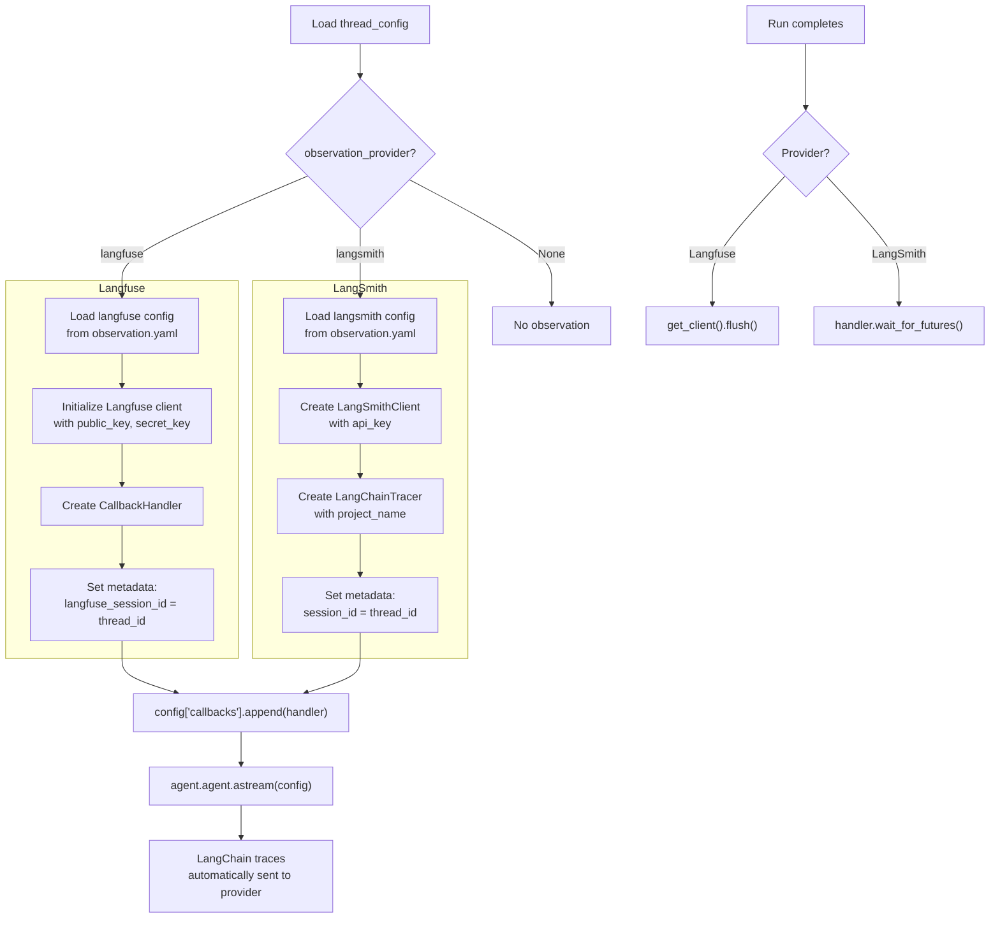

**Sources:** [backend/web/services/streaming_service.py:410-461](), [backend/web/services/streaming_service.py:771-779]()

### Error Handling

- **Import errors**: Warns if provider package not installed, suggests `uv pip install 'leonai[langfuse]'` [streaming_service.py:458-459]()
- **Configuration errors**: Warns and continues without observation [streaming_service.py:460-461]()
- **Flush errors**: Logs warning but doesn't fail run [streaming_service.py:779]()

**Sources:** [backend/web/services/streaming_service.py:458-461](), [backend/web/services/streaming_service.py:779]()

## Activity Event Pipeline

Activity events (sub-agent actions, command progress, etc.) flow through a separate pipeline:

### Activity Event Sources

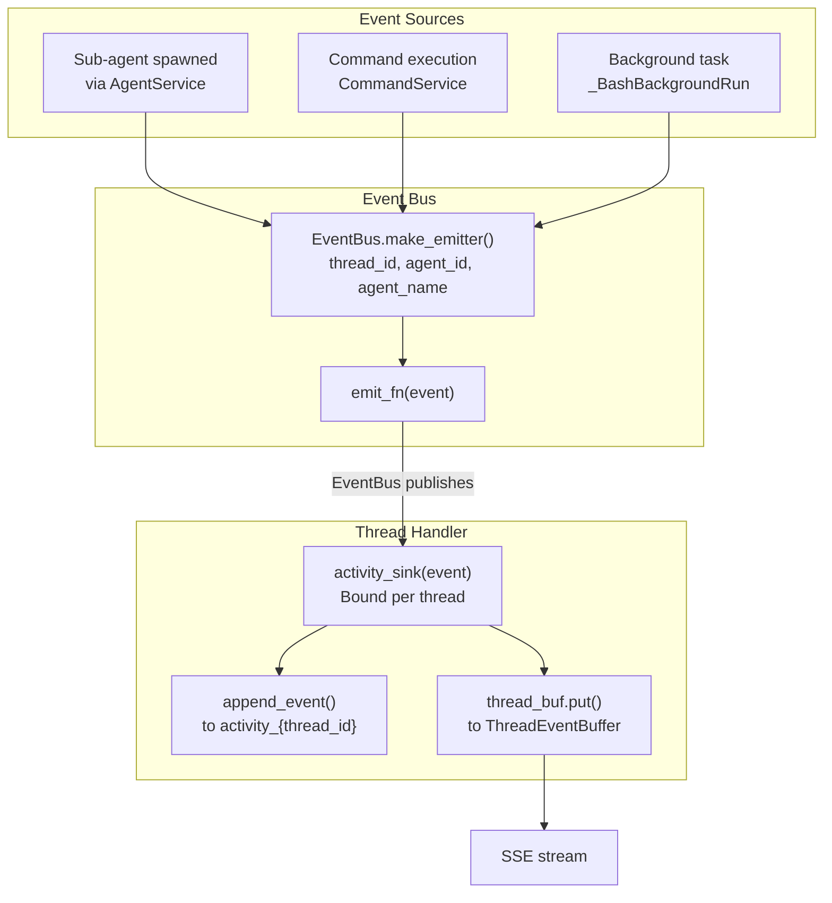

**Sources:** [backend/web/services/streaming_service.py:263-276](), [backend/web/event_bus.py]()

### Activity Event Types

Activity events use the same SSE schema but originate from background operations:

- `step_start` / `step_end`: Tool execution boundaries
- `agent_start` / `agent_end`: Sub-agent lifecycle
- `task_start` / `task_done`: Background bash task
- `command_start` / `command_end`: Bash command execution
- Custom events from middleware

**Note:** Activity events bypass the main LangGraph stream and are drained from `activity_queue` during chunk processing [streaming_service.py:679-685]()

**Sources:** [backend/web/services/streaming_service.py:464-473](), [backend/web/services/streaming_service.py:679-685]()

## Reconnection and Replay

### Reconnection Protocol

SSE clients reconnect automatically on disconnect. The endpoint supports seamless resume:

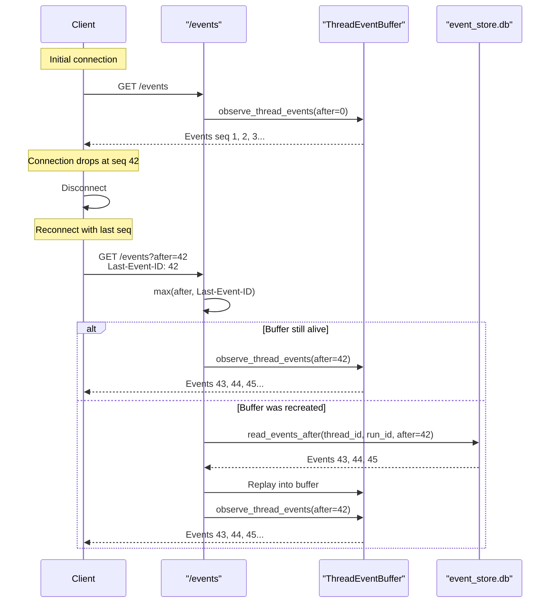

**Sources:** [backend/web/routers/threads.py:442-447](), [backend/web/routers/threads.py:460-477]()

### Replay Logic

[backend/web/routers/threads.py:460-477]()

On reconnection with `after > 0`:
1. Load latest `run_id` for thread
2. Query `event_store.db` for events with `seq > after` in that run
3. Replay events into `ThreadEventBuffer` (in memory)
4. Return `EventSourceResponse` that yields from buffer

This ensures clients receive missed events even if buffer was garbage collected.

**Sources:** [backend/web/routers/threads.py:460-477](), [backend/web/services/event_store.py]()

## Sandbox Priming

Before each run, the service primes the sandbox to avoid race conditions:

### Prime Flow

[backend/web/services/streaming_service.py:31-53]()

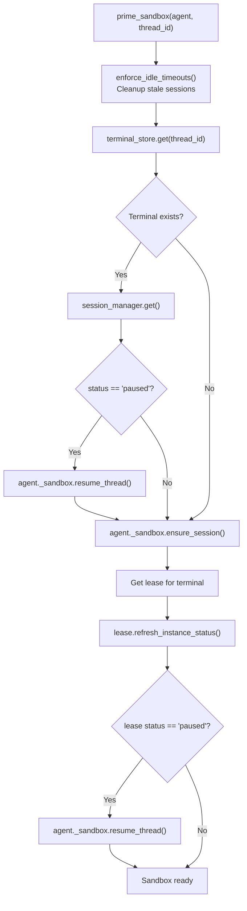

**Purpose:**
- **Resume paused sessions**: Auto-resume if session or instance was paused
- **Enforce timeouts**: Clean up idle sessions before starting new work
- **Avoid race conditions**: Ensure session exists before tool execution begins

**Sources:** [backend/web/services/streaming_service.py:31-53]()

## Code Organization

### Module Structure

```
backend/web/services/
├── streaming_service.py      # Main orchestration (1044 lines)
│   ├── start_agent_run()     # Entry point: orchestrates run lifecycle
│   ├── _run_agent_to_buffer() # Producer: executes agent, emits events
│   ├── observe_thread_events() # Consumer: yields SSE from buffer
│   ├── observe_run_events()   # (Legacy: replaced by observe_thread_events)
│   ├── prime_sandbox()        # Prepares sandbox before execution
│   ├── write_cancellation_markers() # Handles cancellation checkpoint updates
│   └── _repair_incomplete_tool_calls() # Repairs broken checkpoints
│
├── event_buffer.py           # ThreadEventBuffer, RunEventBuffer
├── event_store.py            # SQLite persistence for events
└── agent_pool.py             # Agent lifecycle (see 8.3)

backend/web/routers/
└── threads.py                # HTTP endpoints for threads
    ├── POST /threads/{id}/messages  # Send message (auto-routes)
    ├── POST /threads/{id}/runs      # Start run explicitly
    ├── GET /threads/{id}/events     # SSE stream (persistent)
    └── POST /threads/{id}/runs/cancel # Cancel active run
```

**Sources:** [backend/web/services/streaming_service.py:1-1044](), [backend/web/routers/threads.py:1-654]()

### Key Function Signatures

```python
# Orchestrator
def start_agent_run(
    agent: Any,
    thread_id: str,
    message: str,
    app: Any,
    enable_trajectory: bool = False,
    message_metadata: dict[str, Any] | None = None,
) -> str:  # Returns run_id

# Producer
async def _run_agent_to_buffer(
    agent: Any,
    thread_id: str,
    message: str,
    app: Any,
    enable_trajectory: bool,
    thread_buf: ThreadEventBuffer,
    run_id: str,
    message_metadata: dict[str, Any] | None = None,
) -> None:

# Consumer
async def observe_thread_events(
    thread_buf: ThreadEventBuffer,
    after: int = 0,
) -> AsyncGenerator[dict, None]:
```

**Sources:** [backend/web/services/streaming_service.py:839-883](), [backend/web/services/streaming_service.py:344-809](), [backend/web/services/streaming_service.py:885-1044]()

### Threading Model

| Operation | Context | Rationale |
|-----------|---------|-----------|
| `start_agent_run()` | Main event loop | Creates task, returns immediately |
| `_run_agent_to_buffer()` | `asyncio.Task` | Background task for agent execution |
| `observe_thread_events()` | SSE generator | Async generator, runs in request context |
| `prime_sandbox()` | `asyncio.to_thread()` | SandboxManager uses sync I/O |
| `agent.agent.astream()` | Async | LangGraph native async streaming |

**Sources:** [backend/web/services/streaming_service.py:855-883](), [backend/web/services/streaming_service.py:512-516](), [backend/web/services/streaming_service.py:31-53]()

---

**Complete page sources:** [backend/web/services/streaming_service.py:1-1044](), [backend/web/routers/threads.py:1-654](), [backend/web/services/event_buffer.py](), [backend/web/services/event_store.py](), [backend/web/core/lifespan.py:1-85](), [backend/web/services/agent_pool.py:1-180](), [backend/web/utils/helpers.py:1-212](), [backend/web/models/thread_config.py:1-15]()

---

