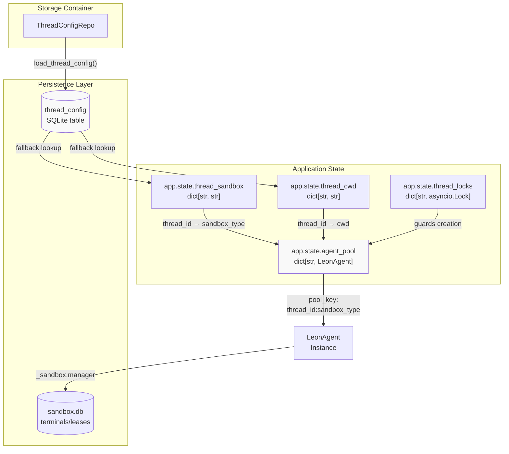
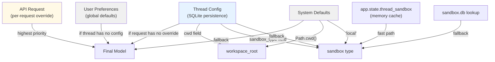
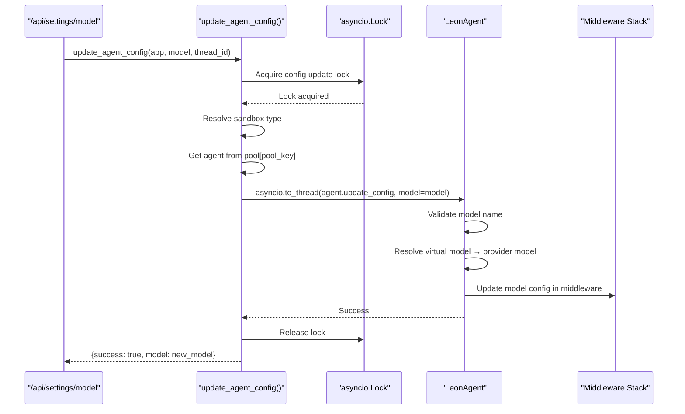
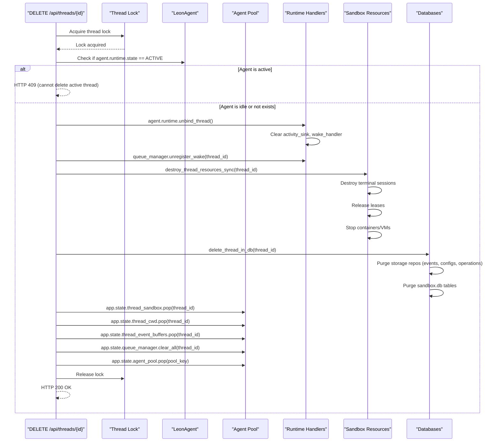

<!-- source: DeepWiki mcp.deepwiki.com · repo OpenDCAI/Mycel · page 8.3 Agent Pool Management · fetched 2026-11-02 -->

# Agent Pool Management

<details>
<summary>Relevant source files</summary>

The following files were used as context for generating this wiki page:

- [backend/web/core/lifespan.py](backend/web/core/lifespan.py)
- [backend/web/models/thread_config.py](backend/web/models/thread_config.py)
- [backend/web/routers/threads.py](backend/web/routers/threads.py)
- [backend/web/services/agent_pool.py](backend/web/services/agent_pool.py)
- [backend/web/services/streaming_service.py](backend/web/services/streaming_service.py)
- [backend/web/utils/helpers.py](backend/web/utils/helpers.py)

</details>


This page documents the agent pool system in the FastAPI backend, which manages `LeonAgent` instances across threads. The agent pool provides per-thread agent isolation, lazy initialization, and hot-reloadable configuration.

**Scope**: This page covers agent pooling, lifecycle management, and configuration resolution. For details about the `LeonAgent` class itself and its initialization process, see [Agent Architecture and Initialization](#5.1). For agent execution and streaming, see [Streaming Service and SSE](#8.2).

---

## Architecture Overview

The agent pool maintains one `LeonAgent` instance per thread to ensure complete isolation of stateful middleware (memory, runtime, filesystem, task board). Agents are created lazily on first request and cached for the lifetime of the thread.

### Pool Key System

Each agent is identified by a composite key combining thread ID and sandbox type:

```
pool_key = f"{thread_id}:{sandbox_type}"
```

This design allows the same thread to have multiple agents if the sandbox type changes (though in practice, threads typically use a single sandbox type throughout their lifetime).

**Sources**: [backend/web/services/agent_pool.py:45-53]()

### State Storage

The agent pool is stored in `app.state.agent_pool` as a dictionary, initialized during application startup:

```python
app.state.agent_pool: dict[str, Any] = {}
```

Related state maintained alongside the pool:
- `app.state.thread_sandbox`: Maps thread IDs to sandbox types (memory cache)
- `app.state.thread_cwd`: Maps thread IDs to custom working directories
- `app.state.thread_locks`: Per-thread asyncio locks for atomic operations
- `app.state.thread_tasks`: Tracks active agent execution tasks

**Sources**: [backend/web/core/lifespan.py:34-42]()

### Agent Pool State Diagram



**Sources**: [backend/web/core/lifespan.py:34-42](), [backend/web/services/agent_pool.py:94-111]()

---

## Agent Lifecycle

### Lazy Initialization

Agents are created on-demand using the `get_or_create_agent()` function. This function is called by API endpoints when they need to access an agent for a specific thread:

1. Compute pool key: `f"{thread_id}:{sandbox_type}"`
2. Check if agent exists in `app.state.agent_pool[pool_key]`
3. If exists, return cached agent
4. If not exists, create new agent and cache it

**Why lazy?** Creating agents upfront for all possible threads would waste memory and delay startup. Lazy initialization creates agents only when threads are actively used.

**Sources**: [backend/web/services/agent_pool.py:40-91]()

### Creation Flow

The agent creation flow resolves configuration from multiple sources and initializes the agent in a background thread:

```mermaid
sequenceDiagram
    participant Router as "API Router"
    participant Pool as "get_or_create_agent()"
    participant Config as "Configuration<br/>Resolution"
    participant Create as "create_agent_sync()"
    participant Agent as "LeonAgent"
    participant Storage as "StorageContainer"
    
    Router->>Pool: get_or_create_agent(app, sandbox_type, thread_id)
    Pool->>Pool: pool_key = f"{thread_id}:{sandbox_type}"
    Pool->>Pool: Check app.state.agent_pool[pool_key]
    
    alt Agent exists
        Pool-->>Router: Return cached agent
    else Agent not in pool
        Pool->>Config: load_thread_config(thread_id)
        Config-->>Pool: ThreadConfig(model, cwd, sandbox_type)
        
        Pool->>Config: resolve workspace_root from cwd
        Config-->>Pool: Path(cwd) or Path.cwd()
        
        Pool->>Config: resolve model_name<br/>(thread config → preferences)
        Config-->>Pool: model_name
        
        Pool->>Create: asyncio.to_thread(create_agent_sync)
        Create->>Storage: build_storage_container()
        Storage-->>Create: storage_container
        
        Create->>Agent: create_leon_agent(model_name, workspace_root, sandbox, storage_container)
        Agent-->>Create: agent instance
        
        Create-->>Pool: agent
        Pool->>Pool: app.state.agent_pool[pool_key] = agent
        Pool-->>Router: Return new agent
    end
```

**Sources**: [backend/web/services/agent_pool.py:40-91](), [backend/web/services/agent_pool.py:20-37]()

### Thread Binding

When an agent is first used for execution, per-thread handlers are bound in `_ensure_thread_handlers()`:

- **Activity sink**: Callback for streaming activity events to SSE
- **Wake handler**: Callback for queue-driven followup runs
- **EventBus subscription**: Routes sub-agent events to thread's SSE stream

These handlers are idempotent and survive across multiple runs within the same thread.

**Sources**: [backend/web/services/streaming_service.py:245-337]()

---

## Configuration Management

### Thread Configuration Schema

Thread-specific configuration is stored in the `thread_config` SQLite table with the following schema:

| Field | Type | Purpose |
|-------|------|---------|
| `thread_id` | TEXT PRIMARY KEY | Unique thread identifier |
| `sandbox_type` | TEXT | Sandbox provider ("local", "docker", "e2b", etc.) |
| `cwd` | TEXT | Custom working directory for local sandbox |
| `model` | TEXT | Model override for this thread |
| `observation_provider` | TEXT | LLM tracing provider ("langfuse", "langsmith") |
| `agent` | TEXT | Member name (display only, not agent type) |
| `queue_mode` | TEXT | Deprecated field (kept for schema compatibility) |

**Sources**: [backend/web/models/thread_config.py:1-15]()

### Configuration Resolution Hierarchy

Agent configuration is resolved using a multi-level hierarchy:



**Sources**: [backend/web/services/agent_pool.py:56-74](), [backend/web/services/agent_pool.py:94-111]()

### Model Resolution

Model name resolution follows this precedence:

1. **Per-request override**: `RunRequest.model` or `CreateThreadRequest.model`
2. **Thread config**: `thread_config.model` from SQLite
3. **User preferences**: `settings.default_model` from preferences file
4. **System default**: None (uses Leon's default model selection)

The system supports virtual model names (`leon:mini`, `leon:medium`, `leon:large`, `leon:max`) which resolve to actual provider models based on `models.toml` configuration.

**Sources**: [backend/web/services/agent_pool.py:68-74](), [backend/web/routers/threads.py:496-502]()

### Workspace Resolution

For local sandboxes, workspace root resolution:

1. **Thread-specific cwd**: `app.state.thread_cwd[thread_id]` (memory cache)
2. **Thread config cwd**: `thread_config.cwd` from SQLite
3. **Global workspace**: `LOCAL_WORKSPACE_ROOT` environment variable or `Path.cwd()`

Custom working directories are validated to ensure they're within the allowed workspace bounds.

**Sources**: [backend/web/services/agent_pool.py:55-66](), [backend/web/utils/helpers.py:158-193]()

### Sandbox Type Resolution

The `resolve_thread_sandbox()` function uses a three-tier lookup:

```python
def resolve_thread_sandbox(app_obj: FastAPI, thread_id: str) -> str:
    # 1. Memory cache (fast path)
    if thread_id in app_obj.state.thread_sandbox:
        return app_obj.state.thread_sandbox[thread_id]
    
    # 2. Thread config SQLite table
    tc = load_thread_config(thread_id)
    if tc:
        app_obj.state.thread_sandbox[thread_id] = tc.sandbox_type
        return tc.sandbox_type
    
    # 3. Sandbox database (terminal → lease → instance_type)
    detected = lookup_sandbox_for_thread(thread_id)
    if detected:
        app_obj.state.thread_sandbox[thread_id] = detected
        return detected
    
    # 4. Default fallback
    return "local"
```

**Sources**: [backend/web/services/agent_pool.py:94-111]()

---

## Hot Reloading

The agent pool supports hot-reloading model configuration without recreating agent instances. This allows users to switch models mid-conversation without losing context.

### Update Mechanism

Model updates are coordinated through `update_agent_config()`:



**Sources**: [backend/web/services/agent_pool.py:114-179]()

### Thread-safe Updates

Agent configuration updates use per-thread locks to prevent race conditions:

```python
_config_update_locks: dict[str, asyncio.Lock] = {}

async def update_agent_config(app_obj: FastAPI, model: str, thread_id: str | None = None):
    lock_key = thread_id or "global"
    if lock_key not in _config_update_locks:
        _config_update_locks[lock_key] = asyncio.Lock()
    
    async with _config_update_locks[lock_key]:
        # ... perform update ...
```

This prevents concurrent updates to the same agent from interfering with each other.

**Sources**: [backend/web/services/agent_pool.py:114-131]()

### Global vs Thread-specific Updates

The update function supports two modes:

| Mode | Usage | Behavior |
|------|-------|----------|
| **Thread-specific** | `update_agent_config(app, model, thread_id="abc123")` | Updates single agent for specified thread |
| **Global** | `update_agent_config(app, model, thread_id=None)` | Updates all existing agents in pool |

Global updates iterate over all agents in the pool and apply the model change to each one.

**Sources**: [backend/web/services/agent_pool.py:133-179]()

---

## Cleanup and Shutdown

### Thread Deletion

When a thread is deleted via `DELETE /api/threads/{thread_id}`, the following cleanup sequence occurs:



**Key invariant**: Threads cannot be deleted while their agent is in `ACTIVE` state. The API returns HTTP 409 Conflict if deletion is attempted during execution.

**Sources**: [backend/web/routers/threads.py:122-156]()

### Application Shutdown

During FastAPI application shutdown, the agent pool is cleaned up in the lifespan context manager:

1. **Cancel background tasks**: Stop idle reaper and resource monitor
2. **Stop cron scheduler**: Await cron service shutdown
3. **Close all agents**: Iterate over `app.state.agent_pool.values()` and call `agent.close()`

```python
finally:
    # Cleanup: stop cron scheduler
    if app.state.cron_service:
        await app.state.cron_service.stop()
    
    # Cleanup: close all agents
    for agent in app.state.agent_pool.values():
        try:
            agent.close()
        except Exception as e:
            print(f"[web] Agent cleanup error: {e}")
```

The `agent.close()` method ensures graceful shutdown of sandbox connections, LLM client sessions, and storage repositories.

**Sources**: [backend/web/core/lifespan.py:64-84]()

---

## Integration Points

### Router Dependencies

API routers obtain agents from the pool using the `get_thread_agent` dependency:

```python
from backend.web.core.dependencies import get_thread_agent

@router.post("/{thread_id}/sandbox/pause")
async def pause_thread_sandbox(
    thread_id: str,
    agent: Annotated[Any, Depends(get_thread_agent)] = None,
):
    ok = await asyncio.to_thread(agent._sandbox.pause_thread, thread_id)
    return {"ok": ok}
```

This dependency handles pool key resolution and agent retrieval internally.

**Sources**: [backend/web/routers/threads.py:334-347]()

### Streaming Service Integration

The streaming service retrieves agents for execution:

```python
sandbox_type = resolve_thread_sandbox(app, thread_id)
agent = await get_or_create_agent(app, sandbox_type, thread_id=thread_id)
```

The agent is then used to start runs, bind handlers, and stream events back to clients.

**Sources**: [backend/web/routers/threads.py:486-509](), [backend/web/services/streaming_service.py:245-337]()

### Storage Container Injection

Each agent receives a `StorageContainer` during creation, providing access to storage repositories:

```python
storage_container = build_storage_container(
    main_db_path=os.getenv("LEON_DB_PATH"),
    eval_db_path=os.getenv("LEON_EVAL_DB_PATH"),
)
return create_leon_agent(
    model_name=model_name,
    workspace_root=workspace_root,
    sandbox=sandbox_name,
    storage_container=storage_container,
    queue_manager=queue_manager,
    verbose=True,
)
```

This allows agents to persist events, file operations, and trajectories to the configured storage backend (SQLite or Supabase).

**Sources**: [backend/web/services/agent_pool.py:22-37]()

---

## Summary

The agent pool provides efficient, thread-safe management of `LeonAgent` instances with the following characteristics:

- **Per-thread isolation**: One agent per thread ensures middleware state is never shared
- **Lazy initialization**: Agents are created on-demand to minimize memory usage
- **Configuration hierarchy**: Thread config → preferences → defaults
- **Hot reloadable**: Model changes don't require agent recreation
- **Clean shutdown**: Graceful cleanup during thread deletion and app shutdown

The pool key format `{thread_id}:{sandbox_type}` ensures agents are correctly scoped to both thread identity and execution environment.

---

