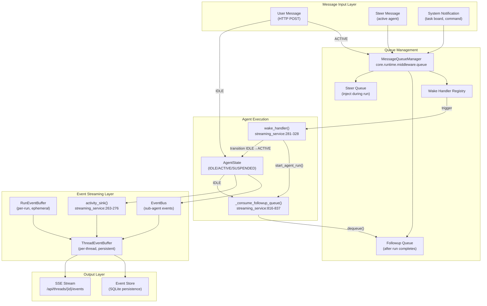
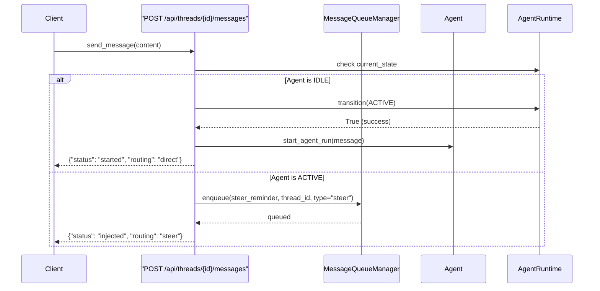
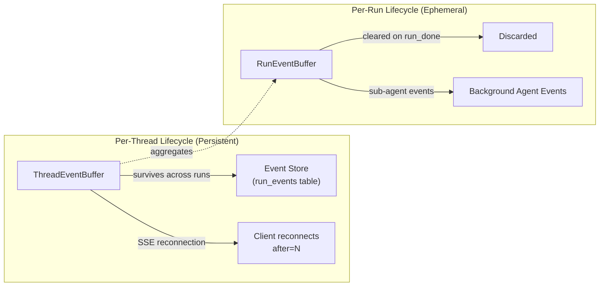
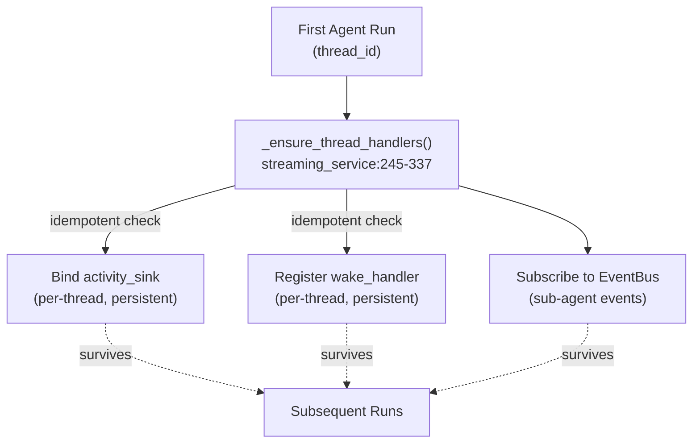
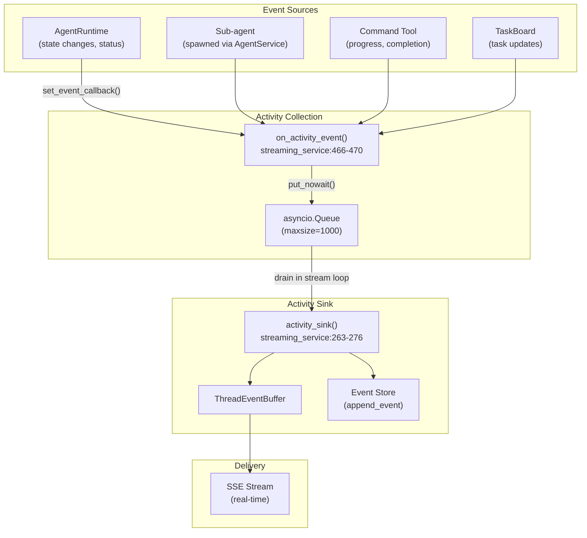
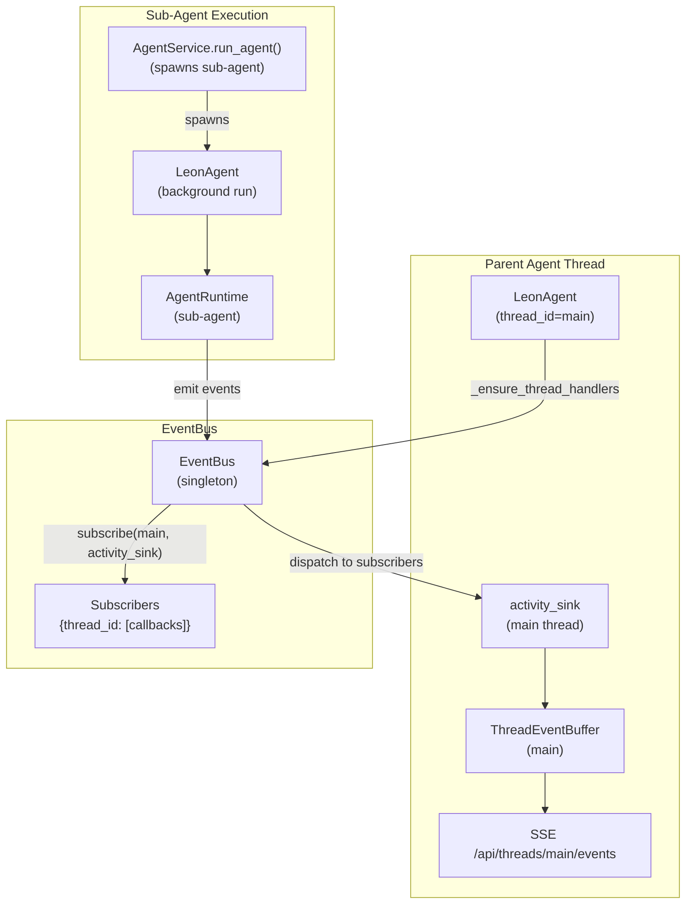
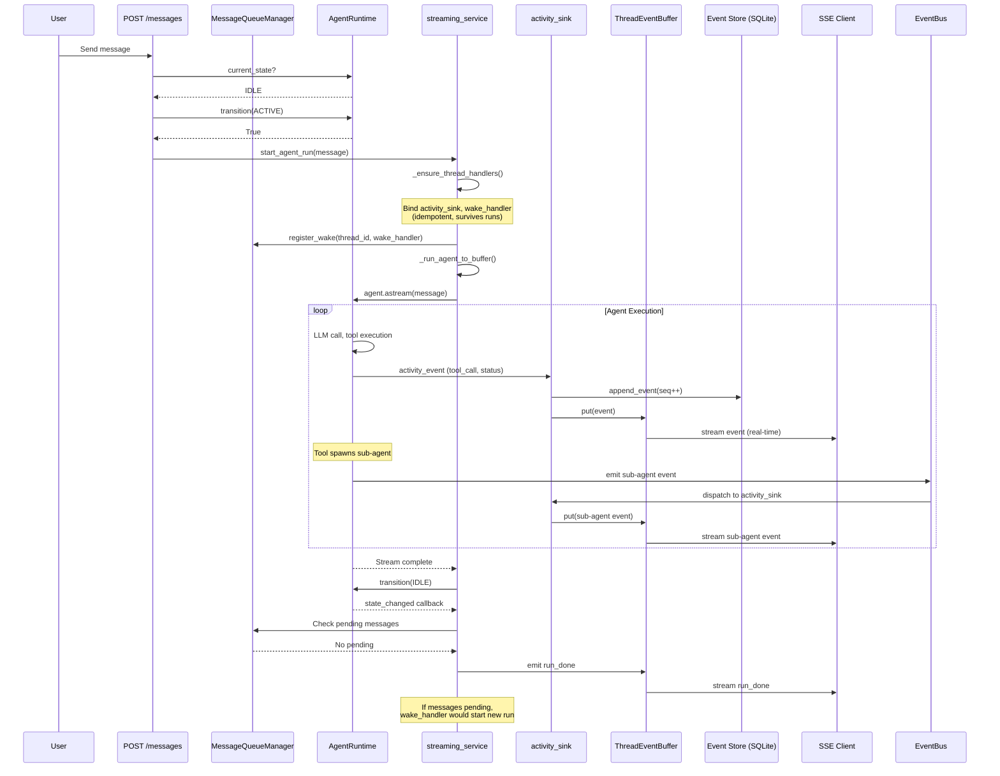

<!-- source: DeepWiki mcp.deepwiki.com · repo OpenDCAI/Mycel · page 8.4 Event System and Message Queuing · fetched 2026-11-02 -->

# Event System and Message Queuing

<details>
<summary>Relevant source files</summary>

The following files were used as context for generating this wiki page:

- [agent.py](agent.py)
- [backend/web/core/lifespan.py](backend/web/core/lifespan.py)
- [backend/web/models/thread_config.py](backend/web/models/thread_config.py)
- [backend/web/routers/threads.py](backend/web/routers/threads.py)
- [backend/web/services/agent_pool.py](backend/web/services/agent_pool.py)
- [backend/web/services/streaming_service.py](backend/web/services/streaming_service.py)
- [backend/web/utils/helpers.py](backend/web/utils/helpers.py)
- [pyproject.toml](pyproject.toml)
- [tui/app.py](tui/app.py)
- [tui/leon_cli.py](tui/leon_cli.py)
- [tui/runner.py](tui/runner.py)
- [tui/widgets/status.py](tui/widgets/status.py)
- [uv.lock](uv.lock)

</details>


This document covers Mycel's event-driven architecture for message queuing, real-time event streaming, and inter-agent communication. The system enables asynchronous message handling, queue-driven agent execution, and persistent event streams for server-sent events (SSE).

**Scope**: This page focuses on the queue management layer (`MessageQueueManager`), event buffering systems (`ThreadEventBuffer`, `RunEventBuffer`), wake handlers, activity sinks, and the `EventBus` for sub-agent communication. For the streaming service that orchestrates these components, see [8.2 Streaming Service and SSE](#8.2). For agent runtime state management, see [5 Agent Runtime](#5).

---

## Architecture Overview

The event system consists of four primary subsystems that work together to provide queue-driven execution and real-time event delivery:



**Sources**: [backend/web/services/streaming_service.py:1-1093](), [core/runtime/middleware/queue.py]() (imported), [backend/web/services/event_buffer.py]() (imported)

---

## MessageQueueManager

The `MessageQueueManager` provides a unified queue system for managing messages that need to be processed when the agent reaches the `IDLE` state. It supports two queue types with different semantics.

### Queue Types

| Queue Type | Trigger | Use Case | Notification Type |
|------------|---------|----------|-------------------|
| **Steer** | During active run (before next LLM call) | User interruptions, mid-run guidance | `steer` |
| **Followup** | After run completes (agent reaches IDLE) | Task completion notices, command results | `command`, `task`, `reminder` |

The queue manager is initialized during application startup and shared across all agents:

```python
# backend/web/core/lifespan.py:35
app.state.queue_manager = MessageQueueManager()
```

Each agent receives a reference to the shared queue manager during creation:

```python
# backend/web/services/agent_pool.py:81-82
qm = getattr(app_obj.state, "queue_manager", None)
agent_obj = await asyncio.to_thread(create_agent_sync, sandbox_type, workspace_root, model_name, agent_name, qm)
```

**Sources**: [backend/web/core/lifespan.py:35](), [backend/web/services/agent_pool.py:81-82](), [core/runtime/middleware/queue.py]() (implementation)

### Message Routing Logic

The system routes messages differently depending on the agent's current state:



The routing implementation:

```python
# backend/web/routers/threads.py:176-189
if hasattr(agent, "runtime") and agent.runtime.current_state == AgentState.ACTIVE:
    qm.enqueue(format_steer_reminder(payload.message), thread_id, notification_type="steer")
    return {"status": "injected", "routing": "steer", "thread_id": thread_id}

# Agent is IDLE — start new run
set_current_thread_id(thread_id)
lock = await get_thread_lock(app, thread_id)
async with lock:
    if hasattr(agent, "runtime") and not agent.runtime.transition(AgentState.ACTIVE):
        qm.enqueue(format_steer_reminder(payload.message), thread_id, notification_type="steer")
        return {"status": "injected", "routing": "steer", "thread_id": thread_id}
    run_id = start_agent_run(agent, thread_id, payload.message, app)
```

**Sources**: [backend/web/routers/threads.py:159-189]()

### Queue API

The queue manager exposes endpoints for inspection and manual queuing:

| Endpoint | Method | Purpose |
|----------|--------|---------|
| `/api/threads/{id}/queue` | POST | Enqueue a followup message explicitly |
| `/api/threads/{id}/queue` | GET | List pending messages in queue |

**Sources**: [backend/web/routers/threads.py:192-212]()

---

## Event Buffers

The event system uses two types of buffers to manage event streams with different lifecycles:

### ThreadEventBuffer vs RunEventBuffer



| Buffer Type | Scope | Lifecycle | Use Case | Storage |
|-------------|-------|-----------|----------|---------|
| **ThreadEventBuffer** | Per thread | Persistent across runs | Main agent SSE stream, survives reconnection | SQLite `run_events` table |
| **RunEventBuffer** | Per run/sub-agent | Ephemeral, cleared on completion | Sub-agent events, background tasks | In-memory only |

**ThreadEventBuffer Creation**:

```python
# backend/web/services/streaming_service.py:230-237
def get_or_create_thread_buffer(app: Any, thread_id: str) -> ThreadEventBuffer:
    """Get existing or create new ThreadEventBuffer for a thread."""
    buf = app.state.thread_event_buffers.get(thread_id)
    if isinstance(buf, ThreadEventBuffer):
        return buf
    buf = ThreadEventBuffer()
    app.state.thread_event_buffers[thread_id] = buf
    return buf
```

**Sources**: [backend/web/services/streaming_service.py:230-237](), [backend/web/services/event_buffer.py]() (implementation)

### Event Persistence and Replay

Events are persisted to SQLite and can be replayed on reconnection:

```python
# backend/web/routers/threads.py:460-477
if after > 0:
    # Replay from SQLite for reconnection
    from backend.web.services.event_store import get_latest_run_id, read_events_after
    
    run_id = await get_latest_run_id(thread_id)
    if run_id:
        events = await read_events_after(thread_id, run_id, after)
        for ev in events:
            seq = ev.get("seq", 0)
            data_str = ev.get("data", "{}")
            # ... reconstruct and enqueue event
            await thread_buf.put({"event": ev["event"], "data": data_str})
```

The SSE endpoint supports reconnection via `Last-Event-ID` header or `?after=N` query parameter to resume from a specific sequence number.

**Sources**: [backend/web/routers/threads.py:429-482](), [backend/web/services/event_store.py]() (persistence)

---

## Wake Handler Pattern

The wake handler pattern enables queue-driven agent execution: when a message is enqueued, the system automatically starts a new agent run if the agent is idle.

### Handler Registration

Wake handlers are registered per-thread during the first agent run and persist across runs:



The registration is idempotent and safe to call on every run:

```python
# backend/web/services/streaming_service.py:245-260
def _ensure_thread_handlers(agent: Any, thread_id: str, app: Any) -> None:
    """Bind per-thread handlers (activity_sink, wake_handler) if not already set.
    
    These handlers have per-thread lifetime and must NOT be cleared between runs.
    Idempotent — safe to call at the start of every run.
    """
    runtime = getattr(agent, "runtime", None)
    if not runtime:
        return
    # Already bound? Skip.
    if getattr(runtime, "_activity_sink", None) is not None:
        return
    # Runtime must support bind_thread (AgentRuntime does, test fakes may not)
    if not hasattr(runtime, "bind_thread"):
        return
    
    thread_buf = get_or_create_thread_buffer(app, thread_id)
    # ... create activity_sink and wake_handler
```

**Sources**: [backend/web/services/streaming_service.py:245-337]()

### Wake Handler Execution Flow

When a message is enqueued, the wake handler attempts to transition the agent to `ACTIVE` and start a new run:

```mermaid
sequenceDiagram
    participant QM as MessageQueueManager
    participant Wake as wake_handler()
    participant Runtime as AgentRuntime
    participant Loop as Event Loop
    participant Stream as streaming_service
    
    Note over QM: Message enqueued
    QM->>Wake: wake_handler(item)
    Wake->>Runtime: transition(IDLE→ACTIVE)
    
    alt Transition succeeds (was IDLE)
        Runtime-->>Wake: True
        Wake->>QM: dequeue(thread_id)
        QM-->>Wake: item
        Wake->>Loop: schedule _start_run()
        Loop->>Stream: start_agent_run(agent, thread_id, item.content)
        Stream->>Runtime: Execute agent.astream(...)
    else Transition fails (already ACTIVE)
        Runtime-->>Wake: False
        Note over Wake: Agent active, drain_all will<br/>process in before_model
        Wake->>Loop: emit notice event
        Loop->>Stream: activity_sink(notice)
    end
```

Implementation:

```python
# backend/web/services/streaming_service.py:281-326
def wake_handler(item: Any) -> None:
    """Called by enqueue() with the newly-enqueued QueueItem — may run in any thread."""
    if not (hasattr(agent, "runtime") and agent.runtime.transition(AgentState.ACTIVE)):
        # Agent already ACTIVE — before_model will drain_all on the next LLM call.
        if loop and not loop.is_closed():
            async def _emit_one_notice() -> None:
                await activity_sink({
                    "event": "notice",
                    "data": json.dumps({
                        "content": item.content,
                        "notification_type": item.notification_type,
                    }, ensure_ascii=False),
                })
            loop.call_soon_threadsafe(loop.create_task, _emit_one_notice())
        return
    
    item = qm.dequeue(thread_id)
    if not item:
        logger.warning("wake_handler: dequeue returned None (race with drain_all), reverting to IDLE")
        if hasattr(agent, "runtime"):
            agent.runtime.transition(AgentState.IDLE)
        return
    
    async def _start_run():
        try:
            start_agent_run(agent, thread_id, item.content, app,
                message_metadata={"source": "system", "notification_type": item.notification_type})
        except Exception:
            logger.error("wake_handler failed for thread %s", thread_id, exc_info=True)
            if hasattr(agent, "runtime"):
                agent.runtime.transition(AgentState.IDLE)
    
    if loop and not loop.is_closed():
        loop.call_soon_threadsafe(loop.create_task, _start_run())
```

**Sources**: [backend/web/services/streaming_service.py:281-326]()

### Followup Queue Consumption

After each run completes, the system automatically checks for pending followup messages:

```python
# backend/web/services/streaming_service.py:816-837
async def _consume_followup_queue(agent: Any, thread_id: str, app: Any) -> None:
    """Dequeue a pending followup message and start a new run.
    
    If starting the new run fails, re-enqueue the message so it is not lost.
    """
    item = None
    try:
        qm = app.state.queue_manager
        item = qm.dequeue(thread_id)
        if item and app:
            if hasattr(agent, "runtime") and agent.runtime.transition(AgentState.ACTIVE):
                start_agent_run(agent, thread_id, item.content, app,
                    message_metadata={"source": "system", "notification_type": item.notification_type})
    except Exception:
        logger.exception("Failed to consume followup queue for thread %s", thread_id)
        # Re-enqueue the message if it was already dequeued to prevent data loss
        if item:
            try:
                app.state.queue_manager.enqueue(item.content, thread_id, notification_type=item.notification_type)
            except Exception:
                logger.error("Failed to re-enqueue followup for thread %s — message lost: %.200s", thread_id, item.content)
```

This function is called in the `finally` block of `_run_agent_to_buffer` after the agent transitions to `IDLE`.

**Sources**: [backend/web/services/streaming_service.py:816-837](), [backend/web/services/streaming_service.py:807-808]()

---

## Activity Sink

The activity sink is a callback that captures real-time events from the agent runtime and streams them to the ThreadEventBuffer for SSE delivery.

### Activity Sink Architecture



**Implementation**:

```python
# backend/web/services/streaming_service.py:263-276
async def activity_sink(event: dict) -> None:
    from backend.web.services.event_store import append_event as _append
    
    seq = await _append(thread_id, f"activity_{thread_id}", event)
    try:
        data = json.loads(event.get("data", "{}")) if isinstance(event.get("data"), str) else event.get("data", {})
    except (json.JSONDecodeError, TypeError):
        data = event.get("data", {})
    if isinstance(data, dict):
        data["_seq"] = seq
        event = {**event, "data": json.dumps(data, ensure_ascii=False)}
    # Only SSE-valid fields: extra metadata stays in event_store
    _SSE_FIELDS = frozenset({"event", "data", "id", "retry", "comment"})
    await thread_buf.put({k: v for k, v in event.items() if k in _SSE_FIELDS})
```

The activity sink:
1. Persists the event to SQLite with a sequence number
2. Enriches the event data with `_seq` 
3. Filters to SSE-valid fields
4. Puts the event into the ThreadEventBuffer for streaming

**Sources**: [backend/web/services/streaming_service.py:263-276](), [backend/web/services/streaming_service.py:464-473]()

### Real-time Event Callback

During agent execution, a per-run event callback captures activity events in real-time:

```python
# backend/web/services/streaming_service.py:464-473
activity_queue: asyncio.Queue[dict] = asyncio.Queue(maxsize=1000)

def on_activity_event(event: dict) -> None:
    try:
        activity_queue.put_nowait(event)
    except asyncio.QueueFull:
        pass  # Backpressure: drop under overload

if hasattr(agent, "runtime"):
    agent.runtime.set_event_callback(on_activity_event)
```

The queue is drained during the streaming loop:

```python
# backend/web/services/streaming_service.py:679-685
# Drain real-time activity events (sub-agent, command progress, etc.)
while not activity_queue.empty():
    try:
        act_event = activity_queue.get_nowait()
    except asyncio.QueueEmpty:
        break
    await emit(act_event)
```

This provides sub-second latency for events like tool execution progress and sub-agent status updates.

**Sources**: [backend/web/services/streaming_service.py:464-473](), [backend/web/services/streaming_service.py:679-685]()

---

## EventBus

The `EventBus` enables cross-agent event propagation, primarily used for sub-agent events to flow into the parent thread's SSE stream.

### EventBus Architecture



**Subscription**:

```python
# backend/web/services/streaming_service.py:330-336
# Subscribe to EventBus so sub-agent events (spawned via AgentService)
# flow into this thread's SSE stream.
try:
    from backend.web.event_bus import get_event_bus
    get_event_bus().subscribe(thread_id, activity_sink)
except ImportError:
    pass
```

When a sub-agent (spawned via `AgentService`) emits events, they are published to the EventBus, which dispatches them to all subscribed activity sinks. This ensures that sub-agent tool calls, status updates, and completion events appear in the parent thread's SSE stream in real-time.

**Sources**: [backend/web/services/streaming_service.py:330-336](), [backend/web/event_bus.py]() (implementation)

---

## Integration Example: Full Message Flow

The following diagram shows how all components interact during a typical user message submission when the agent is idle:



**Sources**: [backend/web/routers/threads.py:159-189](), [backend/web/services/streaming_service.py:344-809](), [backend/web/services/streaming_service.py:816-837]()

---

## TUI Integration

The TUI (Terminal UI) mode uses the same queue and event system but with a slightly different initialization pattern:

```python
# tui/app.py:146-156
def _register_wake_handler(self) -> None:
    """Register wake handler on the unified queue so enqueue() can wake the agent."""
    if not hasattr(self.agent, "queue_manager"):
        return
    
    def wake_handler(item: object) -> None:
        # Schedule followup check on Textual's event loop (thread-safe)
        self.call_later(self._state_driven_followup)
    
    self.agent.queue_manager.register_wake(self.thread_id, wake_handler)
```

The TUI wake handler schedules followup processing on the Textual event loop instead of using `asyncio.create_task`. State-driven followup is triggered by the runtime's state change callback:

```python
# tui/app.py:140-144
def _on_state_changed(self, old_state: AgentState, new_state: AgentState) -> None:
    """状态变化回调：状态驱动的队列处理"""
    if new_state == AgentState.IDLE:
        # IDLE 时自动处理 followup 队列
        self.call_after_refresh(self._state_driven_followup)
```

**Sources**: [tui/app.py:146-156](), [tui/app.py:140-144](), [tui/app.py:530-534]()

---

## Summary

The event system and message queuing architecture provides:

| Component | Purpose | Lifetime | Storage |
|-----------|---------|----------|---------|
| **MessageQueueManager** | Queue steer/followup messages | Application lifetime | In-memory |
| **Wake Handler** | Trigger runs on enqueue | Per-thread (persistent) | N/A |
| **Activity Sink** | Stream real-time events | Per-thread (persistent) | ThreadEventBuffer → SQLite |
| **ThreadEventBuffer** | Persistent event stream | Per-thread (survives runs) | SQLite `run_events` |
| **RunEventBuffer** | Ephemeral sub-agent events | Per-run | In-memory |
| **EventBus** | Cross-agent event dispatch | Application lifetime | N/A |

This architecture enables:
- **Queue-driven execution**: Messages enqueued while agent is active automatically trigger new runs on IDLE
- **Real-time streaming**: Sub-second latency for tool calls, sub-agent events, and status updates
- **Reconnection support**: SSE clients can reconnect with `?after=N` to replay missed events
- **Cross-agent communication**: Sub-agents emit events that flow into parent thread's stream

**Sources**: [backend/web/services/streaming_service.py:1-1093](), [backend/web/routers/threads.py:159-212](), [backend/web/services/event_buffer.py](), [backend/web/event_bus.py](), [core/runtime/middleware/queue.py]()

---

