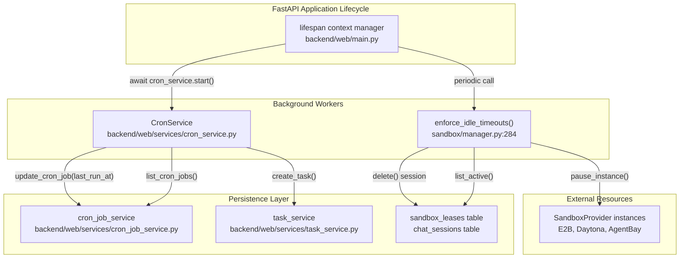
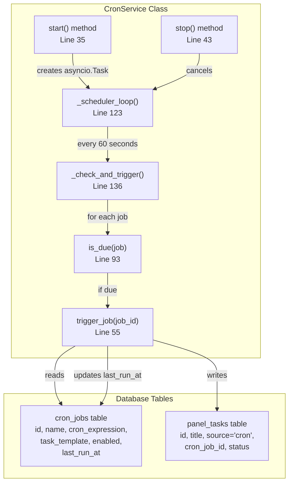
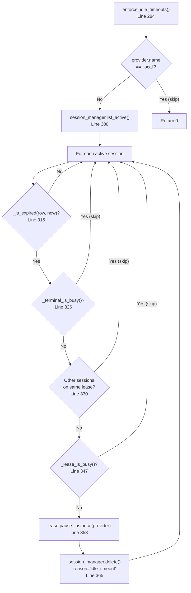

<!-- source: DeepWiki mcp.deepwiki.com · repo OpenDCAI/Mycel · page 8.5 Background Workers · fetched 2026-11-02 -->

# Background Workers

<details>
<summary>Relevant source files</summary>

The following files were used as context for generating this wiki page:

- [backend/web/models/panel.py](backend/web/models/panel.py)
- [backend/web/routers/panel.py](backend/web/routers/panel.py)
- [backend/web/services/cron_job_service.py](backend/web/services/cron_job_service.py)
- [backend/web/services/cron_service.py](backend/web/services/cron_service.py)
- [backend/web/services/library_service.py](backend/web/services/library_service.py)
- [backend/web/services/task_service.py](backend/web/services/task_service.py)
- [frontend/app/src/components/LibraryEditor.tsx](frontend/app/src/components/LibraryEditor.tsx)
- [frontend/app/src/components/cron-editor.tsx](frontend/app/src/components/cron-editor.tsx)
- [frontend/app/src/components/task-modal.tsx](frontend/app/src/components/task-modal.tsx)
- [frontend/app/src/pages/TasksPage.tsx](frontend/app/src/pages/TasksPage.tsx)
- [sandbox/manager.py](sandbox/manager.py)
- [tests/test_cron_api.py](tests/test_cron_api.py)
- [tests/test_cron_job_service.py](tests/test_cron_job_service.py)
- [tests/test_cron_service.py](tests/test_cron_service.py)
- [tests/test_task_service.py](tests/test_task_service.py)
- [tests/test_taskboard_middleware.py](tests/test_taskboard_middleware.py)

</details>


This page documents the background worker processes that run alongside the main FastAPI application to perform scheduled tasks, resource cleanup, and automated maintenance. These workers operate independently of user requests and ensure system health and automation capabilities.

For information about the event-driven messaging system that handles real-time updates, see [Event System and Message Queuing](#8.4). For details on task management and the task board, see [Task Management and TaskBoard](#10.1).

---

## Overview

The Mycel backend employs two primary background workers that run continuously during the application lifecycle:

1. **CronService** - Schedules and triggers task creation based on cron expressions
2. **Idle Timeout Enforcer** - Cleans up inactive sandbox sessions to prevent resource waste

Both workers are started during FastAPI application startup and gracefully shut down on application termination. They operate using asyncio for non-blocking execution and interact with the persistence layer through service modules.

**Worker Architecture Diagram**



**Sources:** [backend/web/services/cron_service.py:1-147](), [sandbox/manager.py:284-368]()

---

## CronService - Scheduled Task Execution

The `CronService` class implements a background scheduler that automatically creates panel tasks based on cron job definitions stored in the database. It runs a continuous asyncio loop that checks for due jobs every 60 seconds.

### Architecture and Lifecycle

**CronService Component Diagram**



**Sources:** [backend/web/services/cron_service.py:26-147]()

The service maintains two key state variables:
- `_running` (bool) - Controls the scheduler loop
- `_task` (asyncio.Task | None) - Reference to the background task

### Job Scheduling Algorithm

The `is_due()` method determines if a cron job should execute by comparing the last execution time against the previous expected fire time calculated by `croniter`:

| Condition | Result |
|-----------|--------|
| `enabled == 0` | Never due |
| `last_run_at == 0` | Due immediately (never run) |
| `last_run_at < prev_fire_time` | Due (missed schedule) |
| `last_run_at >= prev_fire_time` | Not due yet |

**Sources:** [backend/web/services/cron_service.py:93-119]()

### Task Template Processing

When triggering a job, the service parses the JSON `task_template` field and filters only allowed keys to prevent injection:

```python
_ALLOWED_TEMPLATE_KEYS = {"title", "description", "priority", "assignee_id", "deadline", "tags"}
```

Additional fields are automatically set:
- `source` = `"cron"`
- `cron_job_id` = the triggering job's ID

**Sources:** [backend/web/services/cron_service.py:23, 76-78]()

### Integration with Application Lifecycle

The service is started during FastAPI lifespan startup and attached to `app.state`:

```python
# In backend/web/main.py (conceptual)
async def lifespan(app: FastAPI):
    cron_service = CronService()
    await cron_service.start()
    app.state.cron_service = cron_service
    yield
    await cron_service.stop()
```

The `/api/panel/cron-jobs/{job_id}/run` endpoint allows manual triggering of jobs outside the schedule by accessing `request.app.state.cron_service`.

**Sources:** [backend/web/routers/panel.py:167-174]()

### Error Handling

The scheduler loop includes exception handling to prevent crashes:
- Individual job trigger failures are logged but don't stop the loop
- JSON parsing errors return `None` gracefully
- Nonexistent jobs return `None` without raising

**Sources:** [backend/web/services/cron_service.py:123-146]()

---

## Idle Timeout Enforcer

The idle timeout system prevents cloud sandbox instances from running indefinitely, which would incur unnecessary costs. It's implemented as a method on `SandboxManager` rather than a standalone worker class.

### Timeout Rules

Each `chat_sessions` record tracks two timestamps and two timeout thresholds:

| Field | Type | Purpose |
|-------|------|---------|
| `started_at` | INTEGER (ms) | Session creation time |
| `last_active_at` | INTEGER (ms) | Last command execution |
| `idle_ttl_sec` | INTEGER | Max idle time before pause |
| `max_duration_sec` | INTEGER | Max total session lifetime |

A session is expired if **either** condition is true:
- `(now - last_active_at) > idle_ttl_sec`
- `(now - started_at) > max_duration_sec`

**Sources:** [sandbox/manager.py:271-282]()

### Enforcement Algorithm

**Idle Timeout Enforcement Flow**



**Sources:** [sandbox/manager.py:284-368]()

### Local Sandbox Exemption

The local sandbox provider is explicitly exempted from idle timeouts because it doesn't incur hosting costs:

```python
if self.provider.name == "local":
    return 0
```

This allows local development environments to keep sessions running indefinitely without cleanup.

**Sources:** [sandbox/manager.py:293-295]()

### Shared Lease Protection

A critical aspect of the enforcer is handling **shared leases** - multiple terminals (for background commands) that share a single lease:

1. Before pausing a lease, check if other active sessions reference the same `lease_id`
2. Only pause if no other non-expired sessions exist on that lease
3. Check `_lease_is_busy()` to prevent pausing if any terminal has running commands

This prevents premature shutdown of leases that are still in use by other concurrent sessions.

**Sources:** [sandbox/manager.py:330-348]()

### Database Queries for Busy Detection

The enforcer queries the `terminal_commands` table to detect running commands:

```sql
-- _terminal_is_busy
SELECT 1 FROM terminal_commands 
WHERE terminal_id = ? AND status = 'running'

-- _lease_is_busy  
SELECT 1 FROM terminal_commands tc
JOIN abstract_terminals at ON at.terminal_id = tc.terminal_id
WHERE at.lease_id = ? AND tc.status = 'running'
```

**Sources:** [sandbox/manager.py:228-269]()

---

## Background Task Coordination

### Periodic Execution Pattern

Unlike `CronService` which manages its own asyncio loop, the idle timeout enforcer is called periodically by external code. The expected pattern is:

```python
# Conceptual periodic caller (not shown in provided files)
async def periodic_cleanup_loop():
    while running:
        await asyncio.sleep(300)  # Every 5 minutes
        for provider_name in ["e2b", "daytona", "agentbay"]:
            provider = get_provider(provider_name)
            manager = SandboxManager(provider)
            count = manager.enforce_idle_timeouts()
            logger.info(f"[idle-reaper] paused {count} sessions for {provider_name}")
```

This allows different providers to be checked independently at different intervals if needed.

**Sources:** [sandbox/manager.py:284-368]()

### Worker State Management

| Worker | State Storage | Lifecycle Management |
|--------|---------------|---------------------|
| CronService | `app.state.cron_service` | FastAPI lifespan context |
| Idle Timeout | None (stateless method) | Called on-demand |

The `CronService` maintains internal state (`_running`, `_task`) to manage its lifecycle, while the idle enforcer is stateless and idempotent - it can be called repeatedly without side effects beyond the intended cleanup.

**Sources:** [backend/web/services/cron_service.py:29-31](), [sandbox/manager.py:284]()

---

## Task Creation from Cron Jobs

### End-to-End Flow

**Cron Job to Panel Task Creation**

```mermaid
sequenceDiagram
    participant Loop as "_scheduler_loop()"
    participant Check as "_check_and_trigger()"
    participant IsDue as "is_due(job)"
    participant Trigger as "trigger_job(job_id)"
    participant CronJobSvc as "cron_job_service"
    participant TaskSvc as "task_service"
    participant DB as "SQLite DB"
    
    Loop->>Check: Every 60 seconds
    Check->>CronJobSvc: list_cron_jobs()
    CronJobSvc->>DB: SELECT * FROM cron_jobs
    DB-->>CronJobSvc: job rows
    CronJobSvc-->>Check: jobs[]
    
    Check->>IsDue: For each job
    IsDue->>IsDue: croniter.get_prev()
    IsDue-->>Check: True/False
    
    alt Job is due
        Check->>Trigger: trigger_job(job["id"])
        Trigger->>CronJobSvc: get_cron_job(job_id)
        Trigger->>TaskSvc: create_task(**fields)
        TaskSvc->>DB: INSERT INTO panel_tasks
        Trigger->>CronJobSvc: update_cron_job(last_run_at=now)
        CronJobSvc->>DB: UPDATE cron_jobs SET last_run_at
    end
```

**Sources:** [backend/web/services/cron_service.py:123-146, 55-91]()

### Task Source Tracking

Tasks created by cron jobs are tagged for traceability:

| Field | Value | Purpose |
|-------|-------|---------|
| `source` | `"cron"` | Distinguishes from manual/agent tasks |
| `cron_job_id` | Job's UUID | Links back to triggering job |
| `status` | `"pending"` | Initial state |

This allows the UI to display cron-created tasks differently and provides an audit trail.

**Sources:** [backend/web/services/cron_service.py:77-78](), [backend/web/services/task_service.py:26-27]()

---

## API Integration

### Manual Trigger Endpoint

The cron service can be manually triggered via REST API:

```
POST /api/panel/cron-jobs/{job_id}/run
```

This endpoint bypasses the schedule check and creates a task immediately if the job is enabled. It's useful for testing and on-demand execution.

**Implementation:**
```python
@router.post("/cron-jobs/{job_id}/run")
async def trigger_cron_job(job_id: str, request: Request) -> dict[str, Any]:
    cron_service = getattr(request.app.state, "cron_service", None)
    if not cron_service:
        raise HTTPException(503, "Cron service not available")
    task = await cron_service.trigger_job(job_id)
    if not task:
        raise HTTPException(404, "Cron job not found or disabled")
    return {"item": task}
```

**Sources:** [backend/web/routers/panel.py:166-174]()

### Frontend Polling

The Tasks page polls the backend every 5 seconds to refresh task status:

```typescript
useEffect(() => {
  const interval = setInterval(() => {
    fetchTasks().catch(() => {/* background poll failure */});
  }, 5000);
  return () => clearInterval(interval);
}, [fetchTasks]);
```

This ensures cron-created tasks appear in the UI shortly after creation without requiring websocket connections.

**Sources:** [frontend/app/src/pages/TasksPage.tsx:80-85]()

---

## Testing and Verification

### Test Coverage

Both background workers have comprehensive test suites:

| Worker | Test File | Key Tests |
|--------|-----------|-----------|
| CronService | `tests/test_cron_service.py` | Lifecycle, trigger logic, is_due algorithm |
| Idle Timeout | (Covered in sandbox tests) | Busy detection, shared lease handling |

**CronService Test Structure:**
- `TestTriggerJob` - Task creation, disabled jobs, template parsing
- `TestIsDue` - Schedule calculation, never-run jobs, recently-run jobs
- `TestLifecycle` - Start/stop behavior, idempotency

**Sources:** [tests/test_cron_service.py:1-182]()

### Manual Testing

To verify CronService operation:

1. Create a cron job with expression `*/1 * * * *` (every minute)
2. Observe logs for `[cron-service] triggered job {id} → task {task_id}`
3. Check `panel_tasks` table for `source = 'cron'` entries
4. Verify `last_run_at` timestamp updates in `cron_jobs` table

To verify idle timeout enforcement:

1. Create a cloud sandbox session (E2B, Daytona)
2. Set low timeout values in `ChatSessionPolicy`
3. Wait for timeout period to elapse
4. Verify session status changes to `paused` in provider
5. Check `chat_sessions` table shows `status = 'closed'`

**Sources:** [backend/web/services/cron_service.py:88-90](), [sandbox/manager.py:355-356]()

---

## Configuration

### CronService Configuration

| Parameter | Location | Default | Description |
|-----------|----------|---------|-------------|
| Check interval | `_CHECK_INTERVAL_SEC` | 60 | Seconds between schedule checks |
| Allowed template keys | `_ALLOWED_TEMPLATE_KEYS` | See code | Permitted task fields in template |

**Sources:** [backend/web/services/cron_service.py:22-23]()

### Idle Timeout Configuration

Timeout values are set per-session via `ChatSessionPolicy`:

```python
@dataclass
class ChatSessionPolicy:
    idle_ttl_sec: int = 30 * 60        # 30 minutes idle
    max_duration_sec: int = 2 * 60 * 60  # 2 hours total
```

These defaults can be overridden when creating a `SandboxManager` instance.

**Sources:** [sandbox/chat_session.py]() (referenced, not shown in files)

---

## Error Recovery

### CronService Error Handling

The scheduler loop includes multiple layers of error handling:

1. **Invalid JSON templates** - `trigger_job()` returns `None`, logs warning
2. **Individual job failures** - Logged but don't stop loop
3. **Loop cancellation** - Gracefully caught in `stop()`

```python
async def _scheduler_loop(self) -> None:
    while self._running:
        try:
            await asyncio.sleep(_CHECK_INTERVAL_SEC)
            if not self._running:
                break
            await self._check_and_trigger()
        except asyncio.CancelledError:
            break
        except Exception:
            logger.exception("[cron-service] error in scheduler loop")
```

**Sources:** [backend/web/services/cron_service.py:123-134]()

### Idle Timeout Error Handling

The enforcer uses try-except around pause operations:

```python
try:
    paused = lease.pause_instance(self.provider)
except Exception as exc:
    print(f"[idle-reaper] failed to pause expired lease {lease.lease_id}: {exc}")
    continue
```

Failed pauses are logged but don't prevent processing other sessions.

**Sources:** [sandbox/manager.py:352-363]()

---

## Performance Considerations

### CronService Scalability

- **Single instance per app** - One scheduler loop per FastAPI worker
- **Database polling** - Every 60 seconds, lightweight query
- **No locking** - Multiple workers may trigger same job (idempotency needed)

For production deployments with multiple workers, consider:
- Using a distributed lock (Redis) to ensure only one worker checks schedules
- Or accept duplicate task creation and add deduplication logic

**Sources:** [backend/web/services/cron_service.py:136-146]()

### Idle Timeout Efficiency

The enforcer queries all active sessions on each run. For large deployments:
- Add index on `(status, last_active_at)` in `chat_sessions` table
- Consider batch pause operations if provider supports it
- Adjust check frequency based on timeout durations (no need to check every minute for 30-minute timeouts)

**Sources:** [sandbox/manager.py:300]()

---

