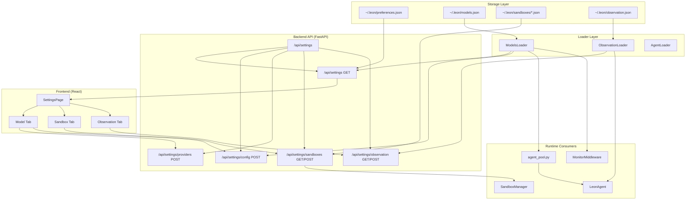
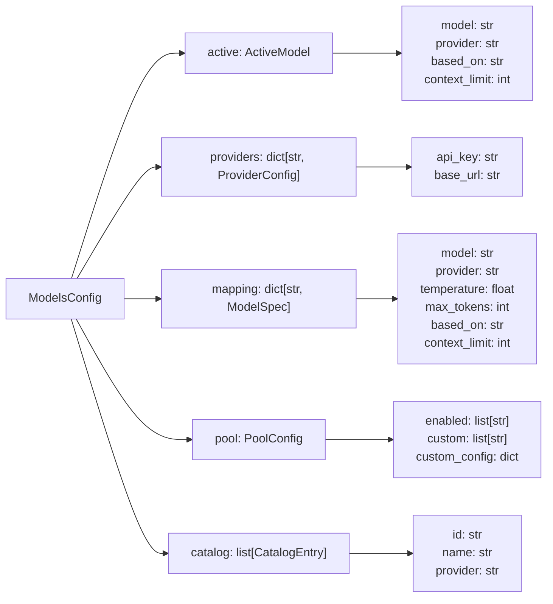
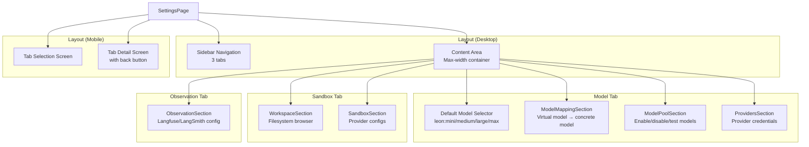

<!-- source: DeepWiki mcp.deepwiki.com · repo OpenDCAI/Mycel · page 9 Configuration and Settings · fetched 2026-11-02 -->

# Configuration and Settings

<details>
<summary>Relevant source files</summary>

The following files were used as context for generating this wiki page:

- [backend/web/routers/settings.py](backend/web/routers/settings.py)
- [config/models_schema.py](config/models_schema.py)
- [core/runtime/middleware/monitor/cost.py](core/runtime/middleware/monitor/cost.py)
- [core/runtime/middleware/monitor/models.json](core/runtime/middleware/monitor/models.json)
- [frontend/app/index.html](frontend/app/index.html)
- [frontend/app/public/favicon.svg](frontend/app/public/favicon.svg)
- [frontend/app/src/components/ModelMappingSection.tsx](frontend/app/src/components/ModelMappingSection.tsx)
- [frontend/app/src/components/ModelPoolSection.tsx](frontend/app/src/components/ModelPoolSection.tsx)
- [frontend/app/src/components/ObservationSection.tsx](frontend/app/src/components/ObservationSection.tsx)
- [frontend/app/src/components/ProvidersSection.tsx](frontend/app/src/components/ProvidersSection.tsx)
- [frontend/app/src/components/SandboxSection.tsx](frontend/app/src/components/SandboxSection.tsx)
- [frontend/app/src/pages/SettingsPage.tsx](frontend/app/src/pages/SettingsPage.tsx)
- [tests/test_model_config_enrichment.py](tests/test_model_config_enrichment.py)

</details>


## Purpose and Scope

This page provides a comprehensive overview of Mycel's configuration and settings system. It covers the architecture, storage locations, and API endpoints for managing user preferences, model configurations, sandbox providers, and observation systems. For detailed guides on specific subsystems, see:

- **Model configuration** (virtual models, mappings, provider credentials): [Model Configuration](#9.1)
- **Sandbox provider configuration** (provider-specific options, workspace settings): [Sandbox Configuration](#9.2)
- **Observation provider integration** (Langfuse, LangSmith): [Observation Providers](#9.3)
- **Agent member definitions** (agent.md format, tools, system prompts): [Member Configuration](#9.4)

This page focuses on the unified architecture that ties these subsystems together, including storage locations, configuration loaders, API endpoints, and the frontend settings interface.

---

## Configuration Files and Storage Locations

Mycel stores configuration in multiple JSON files under the `~/.leon/` directory. Each file serves a specific purpose and is managed by dedicated loader classes and API endpoints.

| Configuration Type | File Path | Schema Class | Purpose |
|-------------------|-----------|--------------|---------|
| User Preferences | `~/.leon/preferences.json` | `WorkspaceSettings` | Default workspace path, recent workspaces, default virtual model |
| Model Configuration | `~/.leon/models.json` | `ModelsConfig` | Provider credentials, virtual model mappings, model pool (enabled/custom) |
| Sandbox Configurations | `~/.leon/sandboxes/<name>.json` | `SandboxConfig` | Provider-specific sandbox settings (Docker, E2B, Daytona, etc.) |
| Observation Settings | `~/.leon/observation.json` | `ObservationConfig` | LLM tracing provider (Langfuse/LangSmith) credentials and active selection |
| Pricing Cache | `~/.leon/pricing_cache.json` | N/A | Cached model pricing data from OpenRouter API (24h TTL) |

**Sources:** [backend/web/routers/settings.py:1-20](), [config/models_schema.py:1-197]()

---

## Configuration Architecture



**Configuration Flow:**

1. **Storage Layer**: JSON files in `~/.leon/` persist configuration across sessions
2. **Loader Layer**: Dedicated loader classes (`ModelsLoader`, `ObservationLoader`) parse and validate configuration, merging system defaults with user overrides
3. **Backend API**: FastAPI router at `/api/settings` exposes REST endpoints for reading and updating configuration
4. **Frontend**: React `SettingsPage` component provides tabbed UI for managing all configuration types
5. **Runtime Consumers**: Core runtime components (`AgentPool`, `LeonAgent`, `SandboxManager`, `MonitorMiddleware`) consume configuration through loaders

**Sources:** [backend/web/routers/settings.py:1-702](), [config/models_schema.py:1-197](), [frontend/app/src/pages/SettingsPage.tsx:1-318]()

---

## User Preferences System

The `preferences.json` file stores lightweight user-level settings that don't require complex validation or merging.

### WorkspaceSettings Schema

```python
class WorkspaceSettings(BaseModel):
    default_workspace: str | None = None
    recent_workspaces: list[str] = []
    default_model: str = "leon:large"
```

### Key Functions

- **`load_settings()`** - Loads `WorkspaceSettings` from `~/.leon/preferences.json`, returns defaults if file missing
- **`save_settings(settings)`** - Persists `WorkspaceSettings` to disk with atomic write
- **`POST /api/settings/workspace`** - Validates and sets default workspace path
- **`POST /api/settings/workspace/recent`** - Adds workspace to recent list (max 5, LRU eviction)
- **`POST /api/settings/default-model`** - Sets user's preferred virtual model for new threads

### Recent Workspaces Management

Recent workspaces are maintained as a LIFO queue with a maximum size of 5. When a workspace is set as default or added to recents, it's moved to the front of the list:

```python
if workspace_str in settings.recent_workspaces:
    settings.recent_workspaces.remove(workspace_str)
settings.recent_workspaces.insert(0, workspace_str)
settings.recent_workspaces = settings.recent_workspaces[:5]
```

**Sources:** [backend/web/routers/settings.py:23-60](), [backend/web/routers/settings.py:185-237]()

---

## Model Configuration Overview

The model configuration system manages LLM provider credentials, virtual model mappings (leon:mini/medium/large/max), and the model pool (enabled/custom models). This is the most complex configuration subsystem in Mycel.

### models.json Schema



### Virtual Model Resolution

Virtual models (leon:mini, leon:medium, leon:large, leon:max) are resolved through `ModelsConfig.resolve_model()`:

1. Check if name starts with `leon:` → lookup in `mapping` dict
2. Extract `ModelSpec` for virtual model
3. Resolve concrete model name from `spec.model`
4. Merge overrides: `based_on`, `context_limit`, `temperature`, `max_tokens`
5. Return `(actual_model_name, overrides_dict)`

For non-virtual models, the method checks `active` and `pool.custom_config` for overrides.

### Configuration Hot-Reload

The `/api/settings/config` endpoint supports hot-reloading model configuration for running agents:

```python
@router.post("/config")
async def update_model_config(request: ModelConfigRequest, req: Request):
    # Persist model per-thread if thread_id provided
    if request.thread_id:
        save_thread_model(request.thread_id, request.model)
    
    # Hot-reload agent config in agent_pool
    result = await update_agent_config(app_obj=req.app, model=request.model, thread_id=request.thread_id)
    result["model"] = request.model
    return result
```

This triggers `agent_pool.update_agent_config()`, which reloads the agent's `MonitorMiddleware` and `PromptCachingMiddleware` with the new model.

**Sources:** [config/models_schema.py:81-197](), [backend/web/routers/settings.py:244-268]()

For detailed information on model system internals, including virtual model configuration, custom model definitions, and pricing/context limit resolution, see [Model Configuration](#9.1).

---

## Sandbox Configuration Overview

Sandbox configurations define provider-specific settings for execution environments (Local, Docker, E2B, Daytona, AgentBay). Each provider type has its own schema stored in separate JSON files under `~/.leon/sandboxes/`.

### Sandbox Config Storage

Unlike the monolithic `models.json`, sandbox configurations are stored as individual files:

- `~/.leon/sandboxes/docker.json` - Docker provider settings
- `~/.leon/sandboxes/e2b.json` - E2B provider settings
- `~/.leon/sandboxes/my_custom_docker.json` - Named custom configuration

### Provider-Specific Fields

Each sandbox configuration specifies a `provider` field and nested provider-specific options:

```json
{
  "provider": "docker",
  "on_exit": "pause",
  "init_commands": ["pip install pandas", "git config --global user.name 'Leon'"],
  "docker": {
    "image": "python:3.12-slim",
    "mount_path": "/workspace"
  }
}
```

The frontend `SandboxSection` component defines field schemas per provider type in `PROVIDER_FIELDS`:

```typescript
const PROVIDER_FIELDS: Record<string, FieldDef[]> = {
  agentbay: [
    { key: "api_key", label: "API 密钥", type: "password", nested: "agentbay" },
    { key: "region_id", label: "区域", type: "text", placeholder: "ap-southeast-1", nested: "agentbay" },
    { key: "context_path", label: "上下文路径", type: "text", placeholder: "/home/wuying", nested: "agentbay" },
    { key: "image_id", label: "镜像 ID", type: "text", nested: "agentbay" },
  ],
  docker: [
    { key: "image", label: "镜像", type: "text", placeholder: "python:3.12-slim", nested: "docker" },
    { key: "mount_path", label: "挂载路径", type: "text", placeholder: "/workspace", nested: "docker" },
  ],
  // ... other providers
};
```

### API Endpoints

- **`GET /api/settings/sandboxes`** - Lists all sandbox configurations from `~/.leon/sandboxes/*.json`
- **`POST /api/settings/sandboxes`** - Validates and saves a sandbox configuration using `SandboxConfig` schema

**Sources:** [backend/web/routers/settings.py:547-702](), [frontend/app/src/components/SandboxSection.tsx:1-209]()

For detailed provider-specific configuration options and usage examples, see [Sandbox Configuration](#9.2).

---

## Observation Providers Overview

The observation system integrates LLM tracing platforms (Langfuse, LangSmith) for agent execution monitoring. Configuration is stored in `~/.leon/observation.json` and managed through the `ObservationLoader`.

### Observation Config Schema

```json
{
  "active": "langfuse",
  "langfuse": {
    "secret_key": "sk-lf-...",
    "public_key": "pk-lf-...",
    "host": "https://cloud.langfuse.com"
  },
  "langsmith": {
    "api_key": "ls-...",
    "project": "mycel-prod",
    "endpoint": "https://api.smith.langchain.com"
  }
}
```

### Provider Locking and Credential Refresh

**Important:** The `active` provider is locked per thread at creation time. Only credentials are read live from `observation.json`, allowing users to rotate keys without recreating threads:

> "New threads will pick up the active provider at creation time. Existing threads keep their locked provider — only credentials are read live."

This design prevents mid-conversation provider switches while allowing secure credential rotation.

### Verification Endpoint

`GET /api/settings/observation/verify` queries the active provider's API to validate credentials:

- **Langfuse**: Fetches recent traces using `FernLangfuse` client
- **LangSmith**: Lists recent runs using `langsmith.Client`

Returns:
```json
{
  "success": true,
  "provider": "langfuse",
  "record_type": "trace",
  "traces": [
    {"id": "...", "name": "...", "timestamp": "..."}
  ]
}
```

**Sources:** [backend/web/routers/settings.py:551-670](), [frontend/app/src/components/ObservationSection.tsx:1-302]()

For integration guides and provider-specific configuration details, see [Observation Providers](#9.3).

---

## Settings API Endpoints Reference

The `/api/settings` router exposes a comprehensive REST API for managing all configuration types.

### Endpoint Categories

```mermaid
graph TB
    SettingsRouter["/api/settings"]
    
    subgraph "User Preferences"
        GetSettings["GET /api/settings<br/>Combined settings response"]
        SetWorkspace["POST /api/settings/workspace<br/>Set default workspace"]
        AddRecent["POST /api/settings/workspace/recent<br/>Add to recent workspaces"]
        SetDefaultModel["POST /api/settings/default-model<br/>Set default virtual model"]
    end
    
    subgraph "Model Configuration"
        GetAvailable["GET /api/settings/available-models<br/>List all models + virtual models"]
        UpdateMapping["POST /api/settings/model-mapping<br/>Update virtual model mapping"]
        ToggleModel["POST /api/settings/models/toggle<br/>Enable/disable model"]
        AddCustom["POST /api/settings/models/custom<br/>Add custom model"]
        RemoveCustom["DELETE /api/settings/models/custom<br/>Remove custom model"]
        UpdateCustomCfg["POST /api/settings/models/custom/config<br/>Update custom model config"]
        TestModel["POST /api/settings/models/test<br/>Test model reachability"]
        HotReload["POST /api/settings/config<br/>Hot-reload agent model"]
    end
    
    subgraph "Providers"
        UpdateProvider["POST /api/settings/providers<br/>Update provider credentials"]
    end
    
    subgraph "Sandboxes"
        ListSandboxes["GET /api/settings/sandboxes<br/>List sandbox configs"]
        SaveSandbox["POST /api/settings/sandboxes<br/>Save sandbox config"]
    end
    
    subgraph "Observation"
        GetObservation["GET /api/settings/observation<br/>Get observation config"]
        UpdateObservation["POST /api/settings/observation<br/>Update observation config"]
        VerifyObservation["GET /api/settings/observation/verify<br/>Verify provider credentials"]
    end
    
    subgraph "Filesystem Utilities"
        Browse["GET /api/settings/browse<br/>Browse filesystem"]
        ReadFile["GET /api/settings/read<br/>Read local file"]
    end
    
    SettingsRouter --> GetSettings
    SettingsRouter --> SetWorkspace
    SettingsRouter --> AddRecent
    SettingsRouter --> SetDefaultModel
    
    SettingsRouter --> GetAvailable
    SettingsRouter --> UpdateMapping
    SettingsRouter --> ToggleModel
    SettingsRouter --> AddCustom
    SettingsRouter --> RemoveCustom
    SettingsRouter --> UpdateCustomCfg
    SettingsRouter --> TestModel
    SettingsRouter --> HotReload
    
    SettingsRouter --> UpdateProvider
    
    SettingsRouter --> ListSandboxes
    SettingsRouter --> SaveSandbox
    
    SettingsRouter --> GetObservation
    SettingsRouter --> UpdateObservation
    SettingsRouter --> VerifyObservation
    
    SettingsRouter --> Browse
    SettingsRouter --> ReadFile
```



### Combined Settings Response

`GET /api/settings` returns a unified view of user preferences and model configuration:

```python
class UserSettings(BaseModel):
    # From preferences.json
    default_workspace: str | None = None
    recent_workspaces: list[str] = []
    default_model: str = "leon:large"
    
    # From models.json
    model_mapping: dict[str, str] = {}
    enabled_models: list[str] = []
    custom_models: list[str] = []
    custom_config: dict[str, dict[str, Any]] = {}
    providers: dict[str, ProviderConfig] = {}
```

This combines data from `load_settings()` (preferences) and `load_merged_models()` (models) into a single response for frontend convenience.

### Model Testing Endpoint

`POST /api/settings/models/test` validates model reachability by sending a minimal inference request:

1. Resolves virtual model using `ModelsConfig.resolve_model()`
2. Infers provider from model name or checks `custom_providers` mapping
3. Retrieves provider credentials from `ModelsConfig.providers`
4. Initializes model using `init_chat_model()` with credentials and base_url
5. Sends "hi" message with 15-second timeout
6. Returns success/failure with response preview or error message

This helps users verify API keys and network connectivity before using models in production.

**Sources:** [backend/web/routers/settings.py:92-134](), [backend/web/routers/settings.py:409-466]()

---

## Settings UI Architecture

The frontend settings interface is organized as a tabbed page with three main sections: Model, Sandbox, and Observation.

### Component Hierarchy



### State Management

The `SettingsPage` component manages all configuration state locally and syncs with the backend on change:

```typescript
const [availableModels, setAvailableModels] = useState<AvailableModelsData | null>(null);
const [settings, setSettings] = useState<Settings | null>(null);
const [sandboxes, setSandboxes] = useState<Record<string, Record<string, unknown>>>({});
const [observationConfig, setObservationConfig] = useState<Record<string, unknown>>({});

// Load all data on mount
useEffect(() => {
  const [modelsRes, settingsRes, sandboxesRes, observationRes] = await Promise.all([
    fetch("/api/settings/available-models"),
    fetch("/api/settings"),
    fetch("/api/settings/sandboxes"),
    fetch("/api/settings/observation"),
  ]);
  // ...
}, []);
```

Each configuration change triggers an immediate API call to persist the update:

```typescript
const handleMappingChange = async (virtualId: string, modelId: string) => {
  const newMapping = { ...modelMapping, [virtualId]: modelId };
  onUpdate(newMapping);
  
  await fetch("/api/settings/model-mapping", {
    method: "POST",
    headers: { "Content-Type": "application/json" },
    body: JSON.stringify({ mapping: { [virtualId]: { model: modelId } } }),
  });
};
```

### Responsive Layout

The UI adapts between desktop and mobile:

- **Desktop**: Fixed sidebar navigation with tab list, scrollable content area
- **Mobile**: Two-screen flow with tab selection → tab detail (back button returns to selection)

**Sources:** [frontend/app/src/pages/SettingsPage.tsx:1-318](), [frontend/app/src/components/ModelMappingSection.tsx:1-133](), [frontend/app/src/components/ModelPoolSection.tsx:1-300]()

---

## Configuration Precedence and Merging

Multiple configuration sources are merged with a defined precedence hierarchy.

### Model Configuration Merging

The `ModelsLoader` merges configuration from three sources:

1. **System defaults** (bundled in codebase): Virtual model definitions, default mappings
2. **User-level config** (`~/.leon/models.json`): User's provider credentials, custom models
3. **Project-level config** (`.leon/models.json` in workspace): Project-specific overrides

Later sources override earlier ones. The loader implements merge semantics:

```python
class ModelsLoader:
    def load(self) -> ModelsConfig:
        system_config = self._load_system_defaults()
        user_config = self._load_user_config()
        project_config = self._load_project_config()
        
        # Merge with precedence: project > user > system
        return self._merge_configs(system_config, user_config, project_config)
```

### Custom Model Config Priority

For custom models, `based_on` and `context_limit` overrides follow this priority:

1. **User-specified values** in `pool.custom_config[model_id]` (highest priority)
2. **OpenRouter pricing data** (fetched at startup, cached 24h)
3. **Bundled pricing snapshot** (`core/runtime/middleware/monitor/models.json`)
4. **Default values** (128k context, no pricing data)

This three-tier fallback ensures pricing/context data is available even offline, while allowing users to override incorrect metadata.

**Sources:** [config/models_schema.py:94-149](), [core/runtime/middleware/monitor/cost.py:153-244](), [tests/test_model_config_enrichment.py:138-158]()

---

## Security and Secret Management

### Masked Input Fields

The frontend implements masked secret inputs that prevent accidental disclosure while allowing editing:

```typescript
// Password-type secrets are only editable when visibility is toggled
const isMaskedSecret = isSecret && !showKey && value.length > 0;

<input
  type={isSecret && !showKey ? "password" : "text"}
  value={isMaskedSecret ? maskValue(value) : value}
  readOnly={isMaskedSecret}
  // Clicking eye icon toggles visibility for editing
/>
```

The `maskValue()` function displays first 4 and last 4 characters with asterisks in between, preventing accidental exposure in screenshots or screen shares.

### API Key Storage

- Provider API keys (`anthropic`, `openai`, etc.) are stored in `~/.leon/models.json` under `providers[provider_name].api_key`
- Observation provider secrets are stored in `~/.leon/observation.json`
- Files are written with user-only permissions (inherited from `~/.leon/` directory creation)

### Environment Variable Fallback

The `ModelsConfig` class provides fallback logic for API keys:

```python
def get_api_key(self) -> str | None:
    # From active provider
    p = self.get_active_provider()
    if p and p.api_key:
        return p.api_key
    
    # From any provider with a key
    for pc in self.providers.values():
        if pc.api_key:
            return pc.api_key
    
    # From environment variables
    return os.getenv("ANTHROPIC_API_KEY") or os.getenv("OPENAI_API_KEY") or os.getenv("OPENROUTER_API_KEY")
```

This allows users to avoid storing secrets in config files by setting environment variables instead.

**Sources:** [frontend/app/src/components/SandboxSection.tsx:100-152](), [frontend/app/src/components/ProvidersSection.tsx:106-126](), [config/models_schema.py:160-174]()

---

