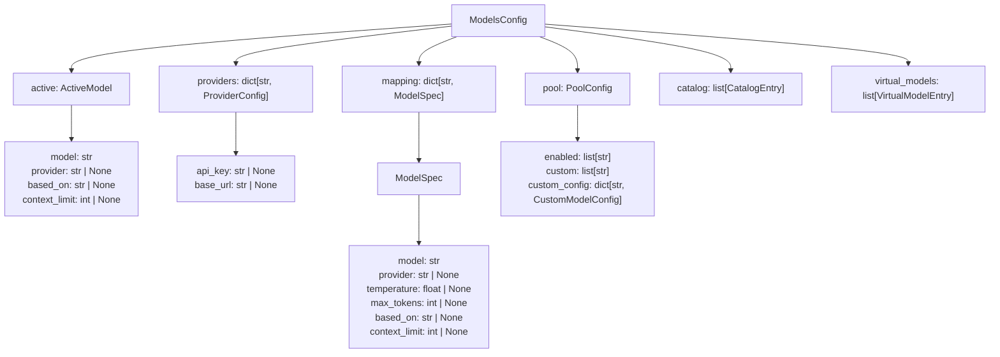
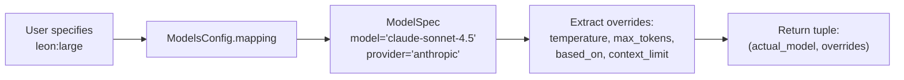
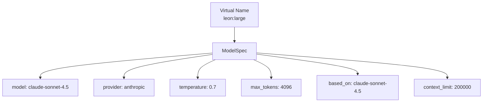
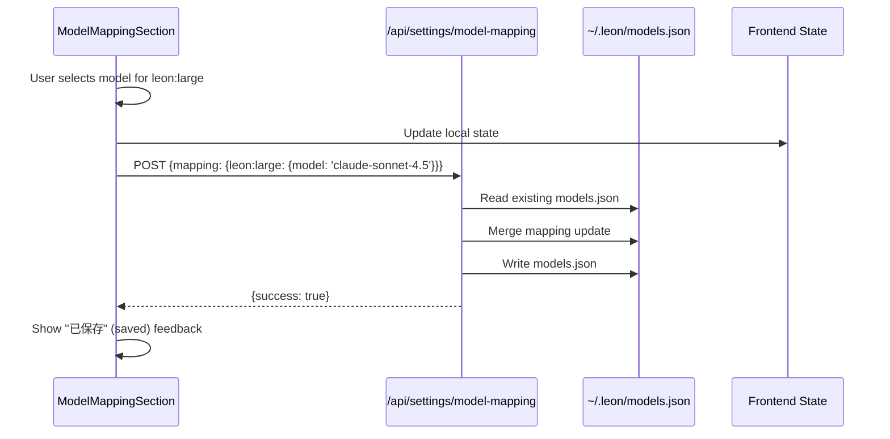
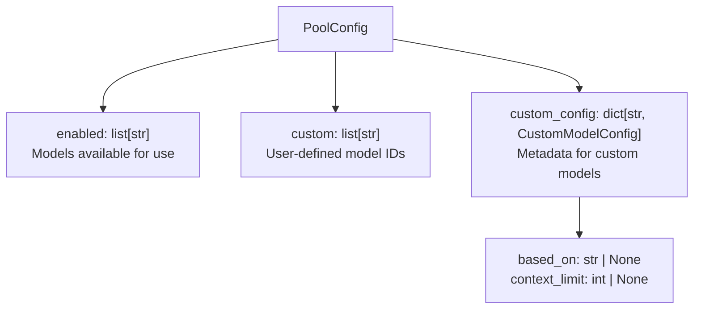
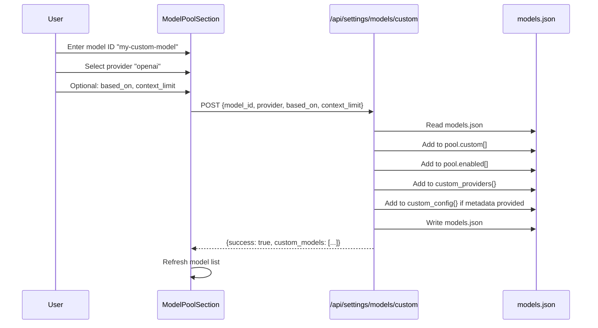
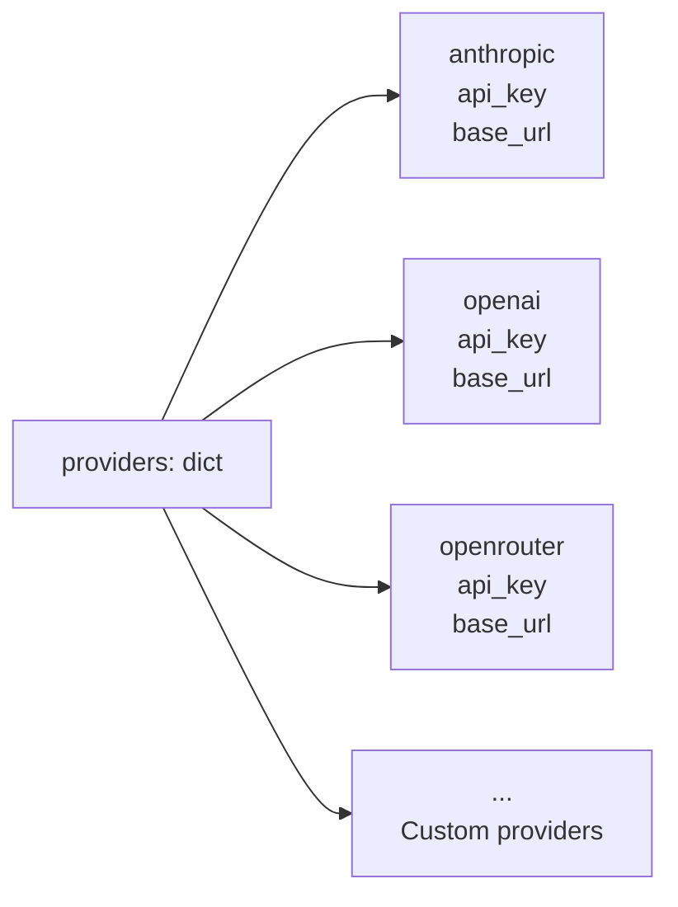
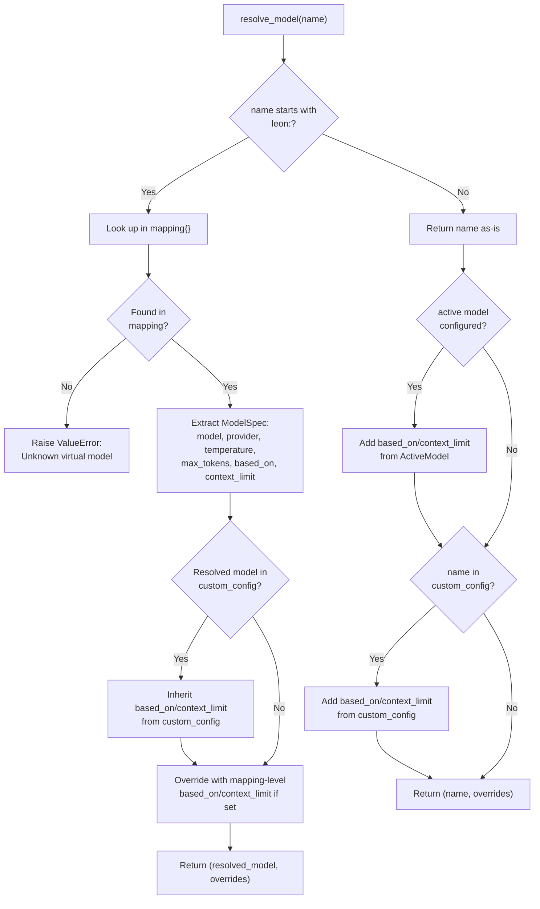
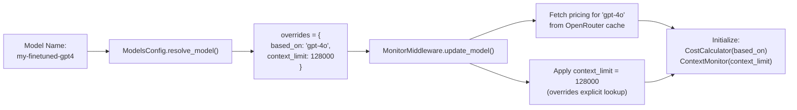
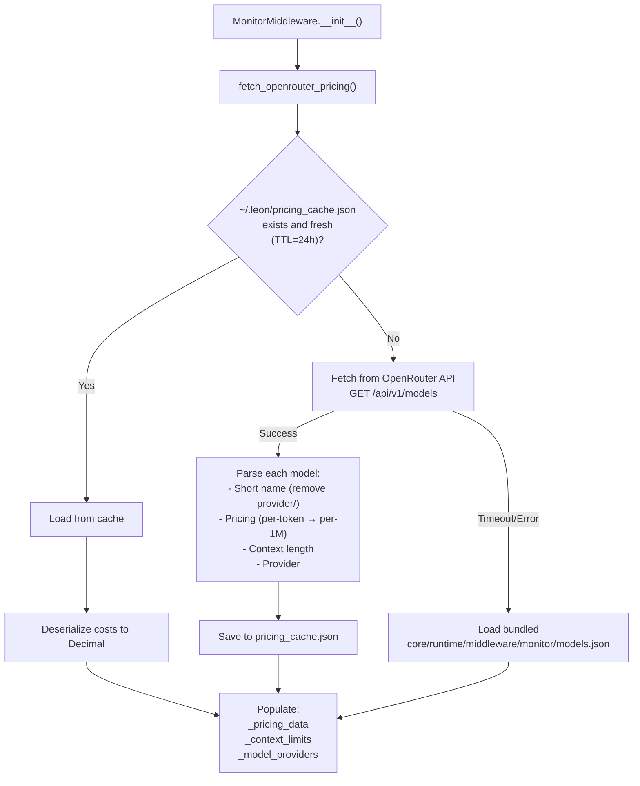

<!-- source: DeepWiki mcp.deepwiki.com · repo OpenDCAI/Mycel · page 9.1 Model Configuration · fetched 2026-11-02 -->

# Model Configuration

<details>
<summary>Relevant source files</summary>

The following files were used as context for generating this wiki page:

- [backend/web/routers/settings.py](backend/web/routers/settings.py)
- [config/models_schema.py](config/models_schema.py)
- [core/runtime/middleware/monitor/cost.py](core/runtime/middleware/monitor/cost.py)
- [core/runtime/middleware/monitor/models.json](core/runtime/middleware/monitor/models.json)
- [frontend/app/index.html](frontend/app/index.html)
- [frontend/app/public/favicon.svg](frontend/app/public/favicon.svg)
- [frontend/app/src/components/ModelMappingSection.tsx](frontend/app/src/components/ModelMappingSection.tsx)
- [frontend/app/src/components/ModelPoolSection.tsx](frontend/app/src/components/ModelPoolSection.tsx)
- [frontend/app/src/components/ObservationSection.tsx](frontend/app/src/components/ObservationSection.tsx)
- [frontend/app/src/components/ProvidersSection.tsx](frontend/app/src/components/ProvidersSection.tsx)
- [frontend/app/src/components/SandboxSection.tsx](frontend/app/src/components/SandboxSection.tsx)
- [frontend/app/src/pages/SettingsPage.tsx](frontend/app/src/pages/SettingsPage.tsx)
- [tests/test_model_config_enrichment.py](tests/test_model_config_enrichment.py)

</details>


This page documents the model configuration system in Mycel, which manages LLM model selection, credentials, and mapping through a layered configuration approach. The system supports virtual model names (like `leon:large`) that resolve to concrete models (like `claude-sonnet-4.5`), provider credential management, custom model definitions, and automatic pricing/context data from OpenRouter.

For information about configuring observation providers (Langfuse, LangSmith), see [Observation Providers](#9.3). For agent-level model configuration and system prompts, see [Member Configuration](#9.4).

---

## Configuration File Structure

The model configuration system uses two primary JSON files in the `~/.leon/` directory:

| File | Purpose | Schema |
|------|---------|--------|
| `models.json` | Model definitions, mappings, provider credentials, and model pool | `ModelsConfig` |
| `preferences.json` | User preferences including default workspace and default model | `WorkspaceSettings` |

### models.json Schema



**Configuration Merge Hierarchy**

The system merges configurations from multiple sources with the following priority (highest to lowest):

1. **User-level** (`~/.leon/models.json`) - User-specific customizations
2. **System defaults** (bundled with codebase) - Default virtual model mappings and catalog

Sources: [config/models_schema.py:1-197](), [backend/web/routers/settings.py:62-87]()

---

## Virtual Models

Virtual models provide stable semantic names that insulate users from concrete model changes. The system defines four virtual model tiers:

| Virtual Model | Default Mapping | Use Case |
|---------------|-----------------|----------|
| `leon:mini` | Fast, cost-efficient model | Quick tasks, high-volume operations |
| `leon:medium` | Balanced performance | General-purpose tasks |
| `leon:large` | High capability | Complex reasoning, coding |
| `leon:max` | Frontier performance | Most demanding tasks |

### Virtual Model Resolution Flow



**Default Model Preference**

Users can set their preferred default virtual model in the UI (Settings → Model → Default Model). This preference is stored in `preferences.json` and applies to new conversations.

Sources: [config/models_schema.py:94-149](), [frontend/app/src/pages/SettingsPage.tsx:136-168](), [backend/web/routers/settings.py:226-236]()

---

## Model Mapping Section

The model mapping system translates virtual model names to concrete model identifiers with optional parameter overrides.

### Mapping Data Structure



### Frontend Mapping Editor

The `ModelMappingSection` component allows users to configure virtual model mappings through the Settings UI:

- Displays all virtual models with descriptions and icons
- Shows a dropdown of enabled models for each virtual model
- Auto-saves changes via `/api/settings/model-mapping` endpoint
- Filters models based on `pool.enabled` status

**API Flow for Mapping Updates**



Sources: [frontend/app/src/components/ModelMappingSection.tsx:1-132](), [backend/web/routers/settings.py:323-341]()

---

## Model Pool Management

The model pool controls which models are available for selection in the UI and for mapping to virtual models.

### Pool Structure



### Model Pool Operations

| Operation | Endpoint | UI Component |
|-----------|----------|--------------|
| Enable/Disable Model | `POST /api/settings/models/toggle` | `ModelPoolSection` toggle switches |
| Add Custom Model | `POST /api/settings/models/custom` | `ModelPoolSection` search + add form |
| Remove Custom Model | `DELETE /api/settings/models/custom?model_id=X` | `ModelPoolSection` remove button |
| Update Custom Config | `POST /api/settings/models/custom/config` | `ModelPoolSection` config editor |
| Test Model | `POST /api/settings/models/test` | `ModelPoolSection` test button |

### Custom Model Addition Flow



**Model Testing**

The test button invokes `/api/settings/models/test` which:
1. Resolves the model name (handles virtual models)
2. Looks up provider credentials
3. Initializes a `ChatModel` instance
4. Sends a minimal test message ("hi")
5. Returns success/failure with response preview or error

Sources: [frontend/app/src/components/ModelPoolSection.tsx:1-299](), [backend/web/routers/settings.py:349-488]()

---

## Provider Credentials

Provider credentials (API keys and base URLs) are stored per-provider in the `providers` section of `models.json`.

### Supported Providers



### Provider Configuration UI

The `ProvidersSection` component provides credential management for each provider:

- **API Key Input**: Masked password field with show/hide toggle
- **Base URL Override**: Optional checkbox + text input for custom endpoints
- **Auto-save**: Changes persist immediately to `models.json`
- **Success Feedback**: Visual confirmation after save

**Provider Credential Lookup Priority**

When resolving credentials for a model:

1. Explicit provider from `ModelSpec.provider` or `ActiveModel.provider`
2. Inferred provider from model name (via `_attempt_infer_model_provider`)
3. Custom provider mapping from `pool.custom_providers`
4. Environment variables (`ANTHROPIC_API_KEY`, `OPENAI_API_KEY`, etc.)

Sources: [frontend/app/src/components/ProvidersSection.tsx:1-195](), [backend/web/routers/settings.py:522-540](), [config/models_schema.py:160-196]()

---

## Model Resolution Process

The `ModelsConfig.resolve_model()` method converts a model name (virtual or concrete) into a tuple of `(actual_model, overrides)` for LLM initialization.

### Resolution Algorithm



**Override Priority for Custom Models**

When a virtual model maps to a custom model (e.g., `leon:medium → Day53`), the override priority is:

1. **Mapping-level overrides** (highest): `ModelSpec.based_on`, `ModelSpec.context_limit`
2. **Custom config overrides**: `PoolConfig.custom_config[model_id].based_on`, etc.
3. **Base model defaults** (lowest)

This allows virtual models to override custom model defaults while still inheriting from them when not overridden.

Sources: [config/models_schema.py:94-149](), [tests/test_model_config_enrichment.py:79-103]()

---

## Custom Model Enrichment

Custom models support two enrichment fields for monitoring and cost calculation:

### Enrichment Fields

| Field | Type | Purpose |
|-------|------|---------|
| `based_on` | `str \| None` | Reference model for pricing/context lookup |
| `context_limit` | `int \| None` | Explicit context window override |

**Use Case: Fine-tuned Models**

When deploying a fine-tuned model (e.g., a custom GPT-4 variant), you can specify:

```json
{
  "pool": {
    "custom": ["my-finetuned-gpt4"],
    "custom_config": {
      "my-finetuned-gpt4": {
        "based_on": "gpt-4o",
        "context_limit": 128000
      }
    }
  }
}
```

This tells `MonitorMiddleware` to use GPT-4o's pricing and default to 128k context, which can be overridden by the explicit `context_limit`.

### Integration with MonitorMiddleware



**Context Limit Priority**

1. **Explicit override**: `context_limit` in overrides (highest priority)
2. **Based-on lookup**: Context from `based_on` model in OpenRouter data
3. **Default fallback**: 128,000 tokens

Sources: [tests/test_model_config_enrichment.py:1-158](), [core/runtime/middleware/monitor/cost.py:254-266]()

---

## Pricing and Context Data

The system fetches model pricing and context window data from OpenRouter to populate the model catalog and enable cost tracking.

### Data Sources and Caching



### Available Models Endpoint

The `/api/settings/available-models` endpoint combines:

1. **Bundled models**: Parsed from `core/runtime/middleware/monitor/models.json`
2. **Custom models**: From `pool.custom` in user's `models.json`
3. **Orphaned enabled models**: In `pool.enabled` but not in bundled catalog
4. **Virtual models**: UI metadata from system defaults

**Response Structure**

```json
{
  "models": [
    {
      "id": "claude-sonnet-4.5",
      "name": "Anthropic: Claude Sonnet 4.5",
      "provider": "anthropic",
      "context_length": 200000
    },
    {
      "id": "my-custom-model",
      "name": "my-custom-model",
      "custom": true,
      "provider": "openai"
    }
  ],
  "virtual_models": [
    {
      "id": "leon:large",
      "name": "Large",
      "description": "High capability model",
      "icon": "🚀"
    }
  ]
}
```

Sources: [core/runtime/middleware/monitor/cost.py:1-331](), [backend/web/routers/settings.py:275-316]()

---

## API Endpoints Reference

### Settings Retrieval

**`GET /api/settings`**

Returns combined user settings including workspace, default model, model mapping, and provider credentials.

Response schema: `UserSettings`

Sources: [backend/web/routers/settings.py:112-133]()

---

### Default Model

**`POST /api/settings/default-model`**

Request:
```json
{
  "model": "leon:large"
}
```

Updates `preferences.json` with the new default virtual model.

Sources: [backend/web/routers/settings.py:230-236]()

---

### Model Mapping

**`POST /api/settings/model-mapping`**

Request:
```json
{
  "mapping": {
    "leon:large": {
      "model": "claude-sonnet-4.5",
      "temperature": 0.7
    }
  }
}
```

Merges mapping updates into `models.json`. Partial updates supported.

Sources: [backend/web/routers/settings.py:328-341]()

---

### Model Pool Toggle

**`POST /api/settings/models/toggle`**

Request:
```json
{
  "model_id": "gpt-4o",
  "enabled": true
}
```

Adds or removes model from `pool.enabled` list.

Sources: [backend/web/routers/settings.py:354-369]()

---

### Custom Model Management

**`POST /api/settings/models/custom`**

Request:
```json
{
  "model_id": "my-model",
  "provider": "openai",
  "based_on": "gpt-4o",
  "context_limit": 128000
}
```

Adds model to `pool.custom`, auto-enables it, and stores metadata in `custom_config`.

Sources: [backend/web/routers/settings.py:379-406]()

**`DELETE /api/settings/models/custom?model_id=X`**

Removes model from `pool.custom`, `pool.enabled`, `custom_providers`, and `custom_config`.

Sources: [backend/web/routers/settings.py:468-488]()

**`POST /api/settings/models/custom/config`**

Request:
```json
{
  "model_id": "my-model",
  "based_on": "claude-sonnet-4.5",
  "context_limit": 200000,
  "provider": "anthropic"
}
```

Updates enrichment metadata for an existing custom model.

Sources: [backend/web/routers/settings.py:498-514]()

---

### Model Testing

**`POST /api/settings/models/test`**

Request:
```json
{
  "model_id": "my-custom-model"
}
```

Response (success):
```json
{
  "success": true,
  "model": "my-custom-model",
  "response": "Hi! How can I help you today?"
}
```

Response (failure):
```json
{
  "success": false,
  "error": "Invalid API key"
}
```

Performs a live test by:
1. Resolving virtual models
2. Inferring provider from model name or custom_providers
3. Fetching credentials from `providers` config
4. Initializing `init_chat_model()` with normalized kwargs
5. Sending a test message with 15s timeout

Sources: [backend/web/routers/settings.py:413-465]()

---

### Provider Credentials

**`POST /api/settings/providers`**

Request:
```json
{
  "provider": "anthropic",
  "api_key": "sk-ant-...",
  "base_url": "https://api.anthropic.com"
}
```

Updates provider credentials in `models.json`. Both fields are optional; omit to clear.

Sources: [backend/web/routers/settings.py:528-540]()

---

### Hot-Reload Model Config

**`POST /api/settings/config`**

Request:
```json
{
  "model": "leon:max",
  "thread_id": "abc123"
}
```

Updates the active agent's model configuration without recreating the agent instance:

1. Saves model preference to thread metadata if `thread_id` provided
2. Calls `update_agent_config()` to hot-reload the agent pool
3. Returns the updated configuration

This enables model switching mid-conversation.

Sources: [backend/web/routers/settings.py:249-267]()

---

## Configuration Best Practices

### Organizing Custom Models

For teams deploying multiple fine-tuned models:

```json
{
  "pool": {
    "custom": [
      "ft-gpt4-customer-support",
      "ft-gpt4-code-review",
      "ft-claude-medical"
    ],
    "custom_providers": {
      "ft-gpt4-customer-support": "openai",
      "ft-gpt4-code-review": "openai",
      "ft-claude-medical": "anthropic"
    },
    "custom_config": {
      "ft-gpt4-customer-support": {
        "based_on": "gpt-4o",
        "context_limit": 128000
      },
      "ft-gpt4-code-review": {
        "based_on": "gpt-4o",
        "context_limit": 128000
      },
      "ft-claude-medical": {
        "based_on": "claude-sonnet-4.5",
        "context_limit": 200000
      }
    }
  },
  "mapping": {
    "leon:medium": {
      "model": "ft-gpt4-customer-support",
      "temperature": 0.3
    },
    "leon:large": {
      "model": "ft-gpt4-code-review"
    }
  }
}
```

### Provider Base URL Patterns

Different providers expect different URL formats:

| Provider | Default Base URL | Notes |
|----------|------------------|-------|
| `anthropic` | `https://api.anthropic.com` | Do NOT append `/v1` |
| `openai` | `https://api.openai.com/v1` | Include `/v1` |
| `openrouter` | `https://openrouter.ai/api/v1` | Include `/v1` |

The test endpoint automatically normalizes base URLs by removing trailing `/v1` for non-Anthropic providers and re-adding it.

Sources: [backend/web/routers/settings.py:448-454]()

---

