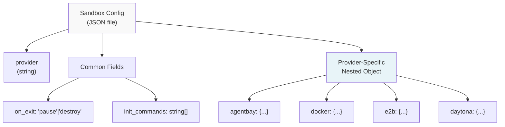
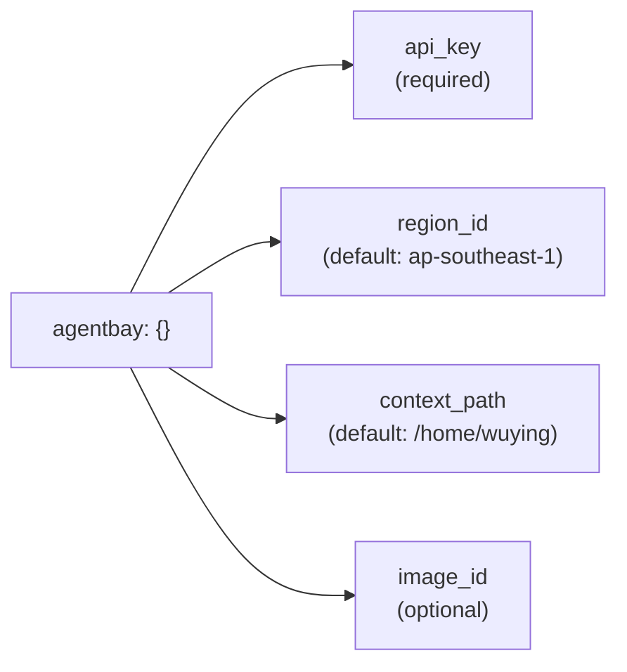
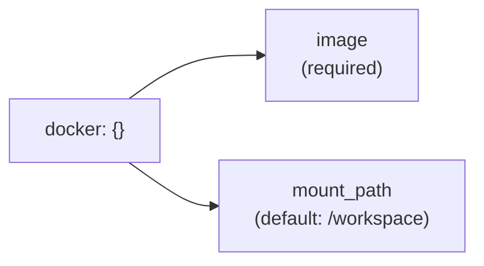
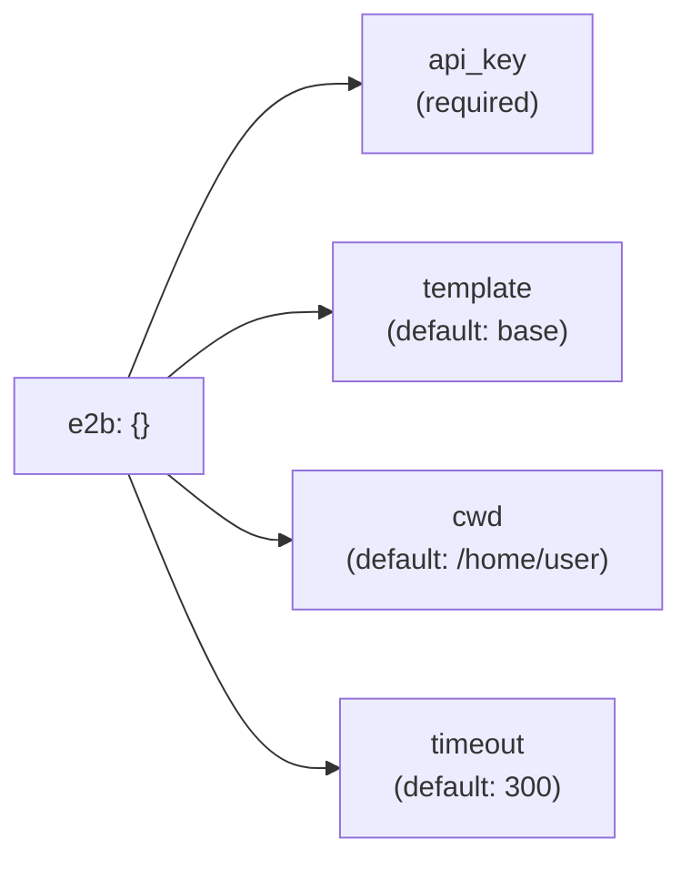
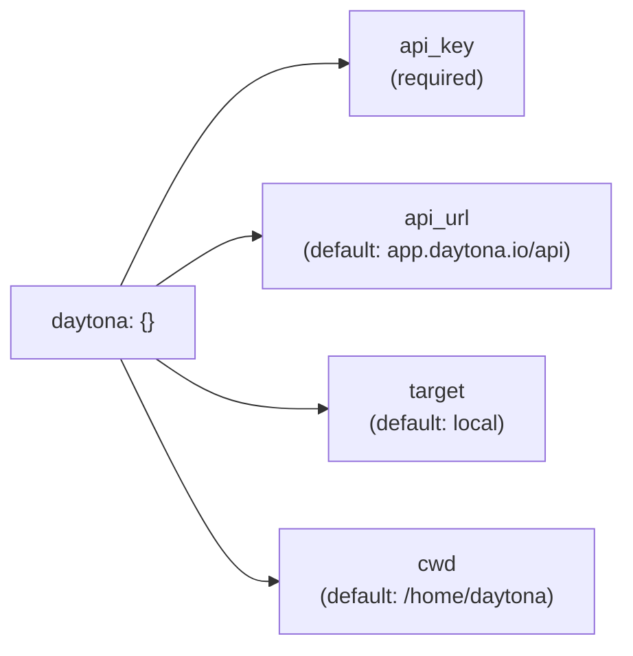
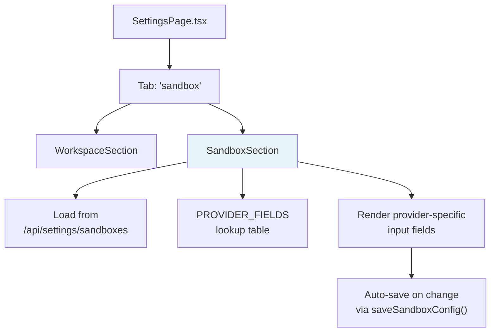
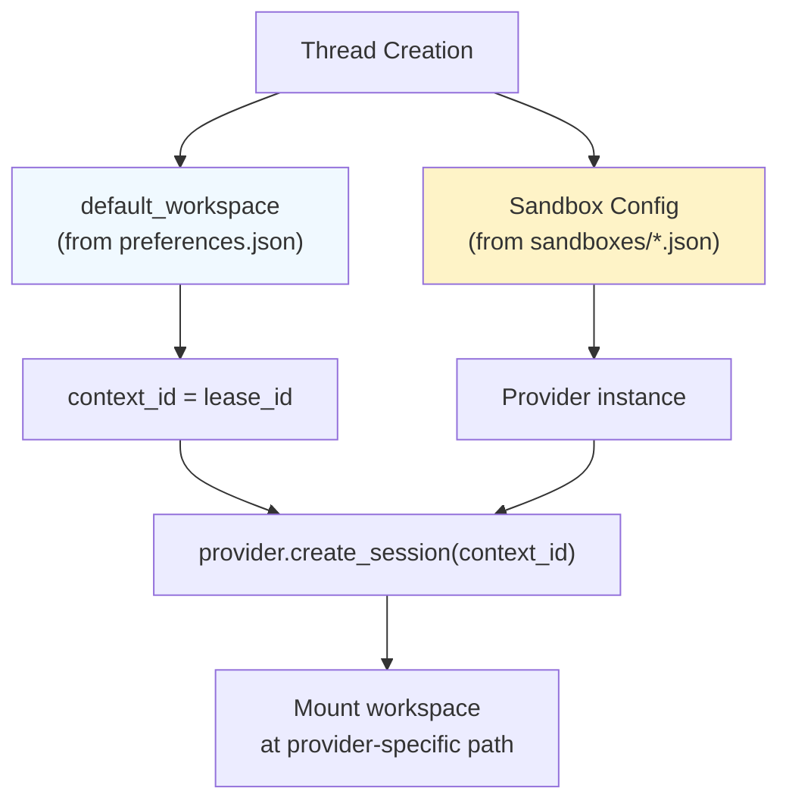

<!-- source: DeepWiki mcp.deepwiki.com · repo OpenDCAI/Mycel · page 9.2 Sandbox Configuration · fetched 2026-11-02 -->

# Sandbox Configuration

<details>
<summary>Relevant source files</summary>

The following files were used as context for generating this wiki page:

- [backend/web/routers/settings.py](backend/web/routers/settings.py)
- [config/models_schema.py](config/models_schema.py)
- [core/runtime/middleware/monitor/cost.py](core/runtime/middleware/monitor/cost.py)
- [core/runtime/middleware/monitor/models.json](core/runtime/middleware/monitor/models.json)
- [frontend/app/index.html](frontend/app/index.html)
- [frontend/app/public/favicon.svg](frontend/app/public/favicon.svg)
- [frontend/app/src/components/ModelMappingSection.tsx](frontend/app/src/components/ModelMappingSection.tsx)
- [frontend/app/src/components/ModelPoolSection.tsx](frontend/app/src/components/ModelPoolSection.tsx)
- [frontend/app/src/components/ObservationSection.tsx](frontend/app/src/components/ObservationSection.tsx)
- [frontend/app/src/components/ProvidersSection.tsx](frontend/app/src/components/ProvidersSection.tsx)
- [frontend/app/src/components/SandboxSection.tsx](frontend/app/src/components/SandboxSection.tsx)
- [frontend/app/src/pages/SettingsPage.tsx](frontend/app/src/pages/SettingsPage.tsx)
- [sandbox/provider.py](sandbox/provider.py)
- [sandbox/providers/__init__.py](sandbox/providers/__init__.py)
- [sandbox/providers/agentbay.py](sandbox/providers/agentbay.py)
- [sandbox/providers/daytona.py](sandbox/providers/daytona.py)
- [sandbox/providers/docker.py](sandbox/providers/docker.py)
- [sandbox/providers/e2b.py](sandbox/providers/e2b.py)
- [sandbox/providers/local.py](sandbox/providers/local.py)
- [tests/test_model_config_enrichment.py](tests/test_model_config_enrichment.py)

</details>


This page explains how to configure sandbox providers in Mycel. Sandbox configuration determines where and how agent code executes, including cloud providers (E2B, Daytona, AgentBay), containerized environments (Docker), or direct host access (local).

For information about the sandbox provider abstraction and capabilities, see [Sandbox Provider Interface](#6.1). For runtime behavior and session orchestration, see [Session Management and Orchestration](#6.3).

---

## Configuration File Location

Sandbox configurations are stored as individual JSON files in `~/.leon/sandboxes/`. Each file represents one named configuration that can be referenced when creating threads or chat sessions.

```
~/.leon/
  sandboxes/
    agentbay_default.json
    docker_python.json
    e2b_base.json
    daytona_dev.json
```

The configuration name is derived from the filename (without `.json` extension) and serves as the identifier when selecting a sandbox provider in the UI or API.

**Sources:** [backend/web/routers/settings.py:547-548](), [frontend/app/src/components/SandboxSection.tsx:84-207]()

---

## Configuration Structure

### File Format

Each sandbox configuration file follows this general structure:



**Schema Example:**
```json
{
  "provider": "docker",
  "on_exit": "pause",
  "init_commands": ["apt-get update", "pip install requests"],
  "docker": {
    "image": "python:3.12-slim",
    "mount_path": "/workspace"
  }
}
```

**Sources:** [frontend/app/src/components/SandboxSection.tsx:20-48](), [backend/web/routers/settings.py:672-701]()

---

## Common Configuration Fields

These fields apply to all sandbox providers and control lifecycle behavior:

| Field | Type | Values | Description |
|-------|------|--------|-------------|
| `provider` | string | `agentbay`, `docker`, `e2b`, `daytona`, `local` | Identifies which provider implementation to use |
| `on_exit` | string | `pause`, `destroy` | Action when session becomes idle (pause preserves state, destroy terminates) |
| `init_commands` | string[] | Array of shell commands | Commands executed once when session is first created |

The `on_exit` field determines idle timeout behavior:
- **`pause`**: Session is paused when idle (if provider supports `can_pause`), preserving all state. Resumes automatically on next command.
- **`destroy`**: Session is destroyed when idle, releasing all resources. A new session is created on next use.

The `init_commands` array is executed sequentially after session creation, before the first user command. Useful for installing dependencies or configuring the environment.

**Sources:** [frontend/app/src/components/SandboxSection.tsx:45-48](), [sandbox/providers/agentbay.py:27-83]()

---

## Provider-Specific Configuration

Each provider type has its own nested configuration object. The field schema is validated when saving via `SandboxConfig` class.

### AgentBay Provider

AgentBay is Alibaba Cloud's sandbox service supporting Linux/Windows/Browser environments with context sync for persistence.



| Field | Type | Required | Default | Description |
|-------|------|----------|---------|-------------|
| `api_key` | string | Yes | - | AgentBay API key for authentication |
| `region_id` | string | No | `"ap-southeast-1"` | Alibaba Cloud region identifier |
| `context_path` | string | No | `"/home/wuying"` | Directory path for context sync mounting |
| `image_id` | string | No | - | Custom image ID (if not using default) |

**Additional runtime parameters** (not stored in config file, but accepted by constructor):
- `provider_name`: Override the provider identifier (default: `"agentbay"`)
- `supports_pause`: Override capability declaration for pause support
- `supports_resume`: Override capability declaration for resume support

**Implementation:** [sandbox/providers/agentbay.py:62-82]()

**Sources:** [frontend/app/src/components/SandboxSection.tsx:21-26](), [sandbox/providers/agentbay.py:62-82]()

---

### Docker Provider

Docker provider creates isolated containers on the local Docker host.



| Field | Type | Required | Default | Description |
|-------|------|----------|---------|-------------|
| `image` | string | Yes | - | Docker image name (e.g., `"python:3.12-slim"`) |
| `mount_path` | string | No | `"/workspace"` | Working directory inside container |

**Additional runtime parameters**:
- `command_timeout_sec`: Timeout for Docker CLI operations (default: 20.0)
- `provider_name`: Override provider identifier
- `docker_host`: Custom Docker daemon socket (e.g., `"unix:///var/run/docker.sock"`)

If a `context_id` is provided during session creation, Docker creates a named volume for persistence. The volume name equals the `context_id`, mounted at `mount_path` inside the container.

**Implementation:** [sandbox/providers/docker.py:76-90]()

**Sources:** [frontend/app/src/components/SandboxSection.tsx:27-30](), [sandbox/providers/docker.py:76-112]()

---

### E2B Provider

E2B is a cloud sandbox service with pause/resume and snapshot capabilities.



| Field | Type | Required | Default | Description |
|-------|------|----------|---------|-------------|
| `api_key` | string | Yes | - | E2B API key |
| `template` | string | No | `"base"` | E2B template identifier |
| `cwd` | string | No | `"/home/user"` | Default working directory |
| `timeout` | integer | No | `300` | Session timeout in seconds |

E2B sessions use `beta_create(auto_pause=True)` so sandboxes automatically pause on timeout instead of being destroyed. The API key is set in both the `E2BProvider` constructor and `os.environ["E2B_API_KEY"]` for SDK compatibility.

**Note:** E2B does not support persistent storage via `context_id`. Use pause/resume to preserve state between uses.

**Implementation:** [sandbox/providers/e2b.py:64-89]()

**Sources:** [frontend/app/src/components/SandboxSection.tsx:31-36](), [sandbox/providers/e2b.py:64-95]()

---

### Daytona Provider

Daytona provides cloud or self-hosted development sandboxes with PTY-backed terminal semantics.



| Field | Type | Required | Default | Description |
|-------|------|----------|---------|-------------|
| `api_key` | string | Yes | - | Daytona API key |
| `api_url` | string | No | `"https://app.daytona.io/api"` | Daytona API endpoint (use custom URL for self-hosted) |
| `target` | string | No | `"local"` | Daytona target identifier |
| `cwd` | string | No | `"/home/daytona"` | Default working directory |

The API key is set in `os.environ["DAYTONA_API_KEY"]` and API URL in `os.environ["DAYTONA_API_URL"]` for SDK compatibility. Daytona uses persistent PTY sessions for terminal state management.

**Important:** If `cwd` points to a non-existent directory, PTY creation will fail with "fork/exec: no such file" error. Ensure the working directory exists in your Daytona snapshot/image.

**Implementation:** [sandbox/providers/daytona.py:59-79]()

**Sources:** [frontend/app/src/components/SandboxSection.tsx:37-42](), [sandbox/providers/daytona.py:59-79]()

---

### Local Provider

Local provider executes commands directly on the host system without isolation. Suitable for development or trusted environments only.

The local provider has minimal configuration:

| Field | Type | Required | Default | Description |
|-------|------|----------|---------|-------------|
| `default_cwd` | string | No | Current working directory | Default directory for command execution |

**No nested object is required** — the local provider accepts `default_cwd` as a top-level parameter or uses the current working directory by default.

**Security Note:** Local provider grants direct host access. All filesystem operations and commands execute with the same permissions as the Mycel process. Use only in trusted environments.

**Implementation:** [sandbox/providers/local.py:29-66]()

**Sources:** [sandbox/providers/local.py:29-66]()

---

## Configuration Management via API

### Listing Configurations

**Endpoint:** `GET /api/settings/sandboxes`

Returns all sandbox configurations as a dictionary keyed by configuration name:

```json
{
  "sandboxes": {
    "docker_python": {
      "provider": "docker",
      "docker": { "image": "python:3.12-slim", "mount_path": "/workspace" }
    },
    "agentbay_default": {
      "provider": "agentbay",
      "agentbay": { "api_key": "...", "region_id": "ap-southeast-1" }
    }
  }
}
```

**Implementation:** [backend/web/routers/settings.py:677-688]()

---

### Saving Configurations

**Endpoint:** `POST /api/settings/sandboxes`

**Request Body:**
```json
{
  "name": "docker_python",
  "config": {
    "provider": "docker",
    "docker": { "image": "python:3.12-slim" }
  }
}
```

**Response:**
```json
{
  "success": true,
  "path": "/home/user/.leon/sandboxes/docker_python.json"
}
```

The backend validates the configuration using `SandboxConfig` class before saving. Invalid configurations return HTTP 400 with validation error details.

**Implementation:** [backend/web/routers/settings.py:691-701]()

**Sources:** [backend/web/routers/settings.py:677-701](), [frontend/app/src/components/SandboxSection.tsx:89-99]()

---

## Configuration UI

### Settings Page Integration



The `SandboxSection` component uses a field lookup table (`PROVIDER_FIELDS`) to dynamically render configuration forms based on `provider` type. Each field definition specifies:

- `key`: Field name
- `label`: Display label
- `type`: Input type (`"text"`, `"password"`, `"number"`, `"select"`)
- `nested`: Parent object key (e.g., `"agentbay"` for `agentbay.api_key`)
- `placeholder`: Placeholder text
- `options`: Select options (for `"select"` type)

**Password fields** are masked by default with a toggle button to reveal the actual value. The masking uses a helper function `maskValue()` that shows first 4 and last 4 characters.

**Auto-save behavior:** All field changes immediately persist to the backend via `saveSandboxConfig()`, providing instant feedback with success indicators.

**Implementation:** [frontend/app/src/components/SandboxSection.tsx:20-207]()

**Sources:** [frontend/app/src/pages/SettingsPage.tsx:215-227](), [frontend/app/src/components/SandboxSection.tsx:20-207]()

---

## Workspace Settings Integration

Sandbox configurations work in conjunction with workspace settings to define the execution environment:



The **workspace path** (stored in `~/.leon/preferences.json` as `default_workspace`) defines the local directory mounted into sandbox sessions. The **sandbox configuration** determines how and where the session runs.

For providers supporting persistent storage:
- **Docker**: Creates a named volume with `context_id` as the volume name
- **AgentBay**: Uses context sync to map `context_id` to a cloud storage context

The workspace path serves as the **initial working directory** for the terminal runtime, synchronized to the sandbox's mounted volume.

**Sources:** [backend/web/routers/settings.py:28-59](), [sandbox/providers/docker.py:92-120](), [sandbox/providers/agentbay.py:84-109]()

---

## Context Persistence

Context persistence allows sandbox state (filesystem, environment) to survive across pause/resume cycles or session destruction.

### Persistence Mechanisms by Provider

| Provider | Mechanism | Controlled By | State Preserved |
|----------|-----------|---------------|-----------------|
| **AgentBay** | Context sync | `context_id` → cloud storage context | Filesystem in `context_path` directory |
| **Docker** | Named volume | `context_id` → volume name | Filesystem in `mount_path` directory |
| **E2B** | Pause/resume only | Session pause via `beta_pause()` | All session state (no cross-session persistence) |
| **Daytona** | Session snapshots | Target-specific storage | Filesystem, not terminal state |
| **Local** | Direct host | No isolation | Persistent by nature (host filesystem) |

**Context ID mapping:**
When a thread is created with a specific workspace, the `SandboxManager` generates a `context_id` based on the lease ID. This ID is passed to `provider.create_session(context_id)` to enable provider-specific persistence.

**Terminal state persistence** is handled separately via SQLite database, storing `cwd` and `env_delta` for each terminal. This allows the runtime to restore shell state even if the underlying provider doesn't support it natively.

**Sources:** [sandbox/providers/agentbay.py:84-109](), [sandbox/providers/docker.py:92-120](), [sandbox/providers/e2b.py:81-96]()

---

## Configuration Validation

The `SandboxConfig` class (referenced but not provided in source files) validates configuration structure before persisting to disk. Validation ensures:

1. **Provider field is valid** — Must be one of: `"agentbay"`, `"docker"`, `"e2b"`, `"daytona"`, `"local"`
2. **Required nested fields are present** — Each provider validates its required fields
3. **Field types are correct** — String fields are strings, numeric fields are numbers
4. **Enum values are valid** — `on_exit` must be `"pause"` or `"destroy"`

Invalid configurations are rejected with HTTP 400 status and a descriptive error message.

**Endpoint behavior:** [backend/web/routers/settings.py:691-701]()

**Sources:** [backend/web/routers/settings.py:691-701]()

---

## Example Configurations

### Production AgentBay Setup

```json
{
  "provider": "agentbay",
  "on_exit": "pause",
  "init_commands": [
    "pip install --upgrade pip",
    "pip install requests pandas numpy"
  ],
  "agentbay": {
    "api_key": "your-api-key-here",
    "region_id": "ap-southeast-1",
    "context_path": "/home/wuying",
    "image_id": "custom-python-image-v2"
  }
}
```

### Development Docker Setup

```json
{
  "provider": "docker",
  "on_exit": "destroy",
  "init_commands": [
    "apt-get update",
    "apt-get install -y git curl",
    "pip install pytest black"
  ],
  "docker": {
    "image": "python:3.12-slim",
    "mount_path": "/workspace"
  }
}
```

### E2B with Custom Template

```json
{
  "provider": "e2b",
  "on_exit": "pause",
  "e2b": {
    "api_key": "your-e2b-api-key",
    "template": "python-ml",
    "cwd": "/home/user/projects",
    "timeout": 600
  }
}
```

### Self-Hosted Daytona

```json
{
  "provider": "daytona",
  "on_exit": "pause",
  "daytona": {
    "api_key": "your-daytona-key",
    "api_url": "https://daytona.yourcompany.com/api",
    "target": "dev-cluster",
    "cwd": "/home/daytona/workspace"
  }
}
```

**Sources:** [frontend/app/src/components/SandboxSection.tsx:20-48](), [sandbox/providers/agentbay.py:62-109](), [sandbox/providers/docker.py:76-120]()

---

## Field Lookup Table (Frontend Implementation)

The `SandboxSection` component uses a static field definition table to drive the UI:

```typescript
const PROVIDER_FIELDS: Record<string, FieldDef[]> = {
  agentbay: [
    { key: "api_key", label: "API 密钥", type: "password", nested: "agentbay" },
    { key: "region_id", label: "区域", type: "text", placeholder: "ap-southeast-1", nested: "agentbay" },
    { key: "context_path", label: "上下文路径", type: "text", placeholder: "/home/wuying", nested: "agentbay" },
    { key: "image_id", label: "镜像 ID", type: "text", nested: "agentbay" },
  ],
  docker: [ /* ... */ ],
  e2b: [ /* ... */ ],
  daytona: [ /* ... */ ],
};
```

This table-driven approach allows adding new providers or fields without modifying rendering logic. The `renderField()` function consumes these definitions to generate appropriate input components with validation and masking.

**Implementation:** [frontend/app/src/components/SandboxSection.tsx:20-43]()

**Sources:** [frontend/app/src/components/SandboxSection.tsx:20-207]()

---

## Troubleshooting

### Configuration Not Loading

If sandbox configurations don't appear in the UI:
1. Check `~/.leon/sandboxes/` directory exists and is readable
2. Verify JSON syntax is valid (use `jq` or JSON linter)
3. Check browser console for API errors from `/api/settings/sandboxes`

### Invalid Configuration Errors

When saving fails with validation errors:
1. Ensure `provider` field matches one of the supported types exactly
2. Verify required fields are present (e.g., `api_key` for cloud providers)
3. Check nested structure: provider-specific fields must be in nested object (e.g., `agentbay.api_key`, not top-level)

### Provider Connection Failures

If sandbox sessions fail to create:
1. **AgentBay/E2B/Daytona**: Verify API key is valid and has not expired
2. **Docker**: Ensure Docker daemon is running (`docker ps` should work)
3. **All providers**: Check provider-specific logs for authentication or network errors

**Sources:** [backend/web/routers/settings.py:677-701](), [frontend/app/src/components/SandboxSection.tsx:89-99]()

---

