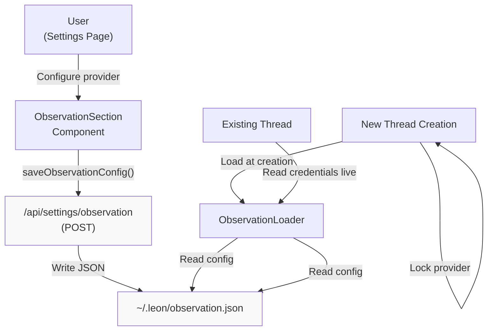
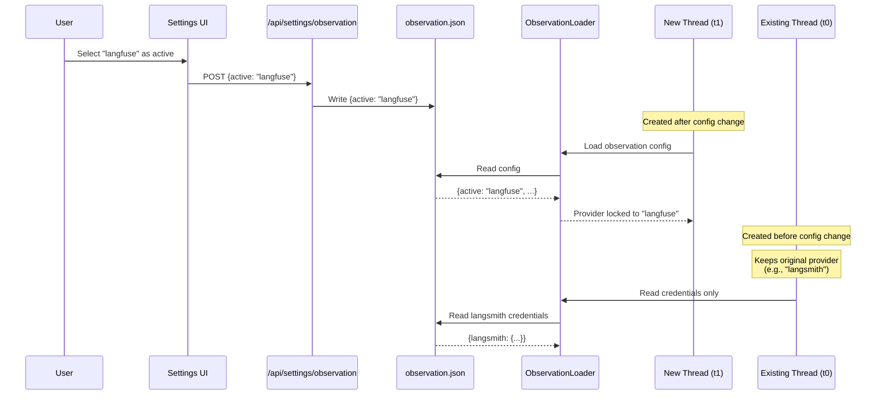
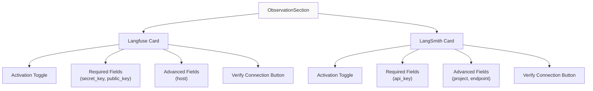
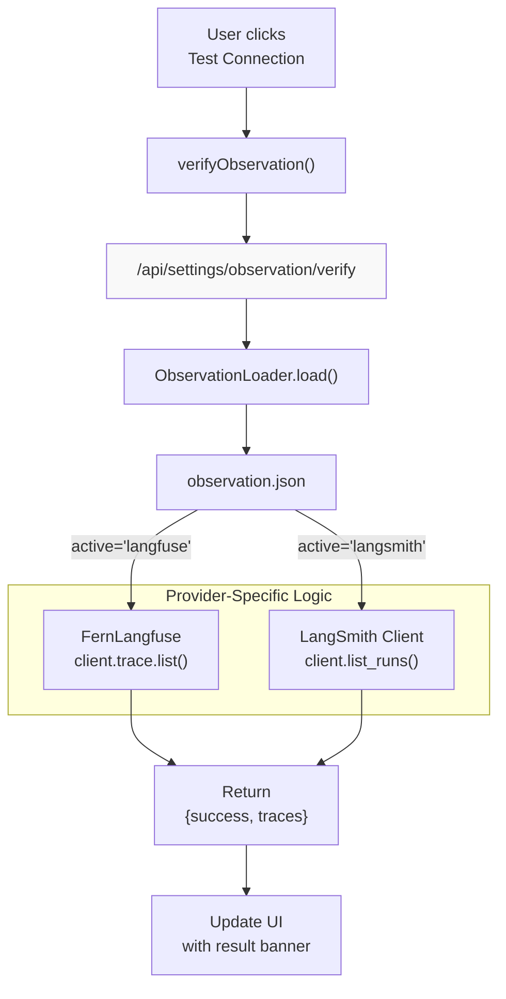

<!-- source: DeepWiki mcp.deepwiki.com · repo OpenDCAI/Mycel · page 9.3 Observation Providers · fetched 2026-11-02 -->

# Observation Providers

<details>
<summary>Relevant source files</summary>

The following files were used as context for generating this wiki page:

- [backend/web/routers/settings.py](backend/web/routers/settings.py)
- [config/models_schema.py](config/models_schema.py)
- [core/runtime/middleware/monitor/cost.py](core/runtime/middleware/monitor/cost.py)
- [core/runtime/middleware/monitor/models.json](core/runtime/middleware/monitor/models.json)
- [frontend/app/index.html](frontend/app/index.html)
- [frontend/app/public/favicon.svg](frontend/app/public/favicon.svg)
- [frontend/app/src/components/ModelMappingSection.tsx](frontend/app/src/components/ModelMappingSection.tsx)
- [frontend/app/src/components/ModelPoolSection.tsx](frontend/app/src/components/ModelPoolSection.tsx)
- [frontend/app/src/components/ObservationSection.tsx](frontend/app/src/components/ObservationSection.tsx)
- [frontend/app/src/components/ProvidersSection.tsx](frontend/app/src/components/ProvidersSection.tsx)
- [frontend/app/src/components/SandboxSection.tsx](frontend/app/src/components/SandboxSection.tsx)
- [frontend/app/src/pages/SettingsPage.tsx](frontend/app/src/pages/SettingsPage.tsx)
- [tests/test_model_config_enrichment.py](tests/test_model_config_enrichment.py)

</details>


Observation providers enable distributed tracing and observability for LLM agent execution. Mycel supports integration with external platforms (Langfuse, LangSmith) to collect, visualize, and analyze traces of model invocations, tool calls, and agent workflows in real-time.

This page covers configuration, activation, and verification of observation providers. For model cost tracking and token statistics, see [Cost and Token Monitoring](#10.4). For general model configuration, see [Model Configuration](#9.1).

---

## Purpose and Scope

Observation providers capture execution traces from the agent runtime and forward them to external platforms for persistence and analysis. Each provider exposes a different set of features:

- **Langfuse**: Open-source LLM observability platform with self-hosting support
- **LangSmith**: LangChain's managed tracing and evaluation service

Mycel integrates observation providers at the thread level, meaning each conversation thread locks to a specific provider at creation time. Once a thread is created, its observation target remains fixed, though credentials can be updated live without restarting the thread.

---

## Configuration Storage

Observation provider settings are stored in `~/.leon/observation.json` with the following structure:

```json
{
  "active": "langfuse",
  "langfuse": {
    "secret_key": "sk-lf-...",
    "public_key": "pk-lf-...",
    "host": "https://cloud.langfuse.com"
  },
  "langsmith": {
    "api_key": "ls__...",
    "project": "default",
    "endpoint": "https://api.smith.langchain.com"
  }
}
```

The `active` field determines which provider receives new traces. Setting `active` to `null` disables observation for new threads. Existing threads continue using their locked provider.

**Sources:** [backend/web/routers/settings.py:548-601]()

---

## Configuration Workflow

### Observation Configuration Flow



**Sources:** [backend/web/routers/settings.py:571-601](), [frontend/app/src/components/ObservationSection.tsx:89-137]()

### API Endpoints

The backend exposes three endpoints for observation management:

| Endpoint | Method | Purpose |
|----------|--------|---------|
| `/api/settings/observation` | GET | Retrieve current configuration |
| `/api/settings/observation` | POST | Update configuration and persist to disk |
| `/api/settings/observation/verify` | GET | Test provider connection by fetching recent traces |

**Sources:** [backend/web/routers/settings.py:562-670]()

---

## Supported Providers

### Langfuse

Langfuse is an open-source observability platform supporting self-hosted deployments. Mycel requires two API keys and optionally a custom host URL.

#### Required Configuration

| Field | Type | Description |
|-------|------|-------------|
| `secret_key` | string | Secret API key (starts with `sk-lf-`) |
| `public_key` | string | Public API key (starts with `pk-lf-`) |
| `host` | string | Optional. Defaults to `https://cloud.langfuse.com` |

#### Verification

When verifying Langfuse, the system instantiates `FernLangfuse` client and queries the most recent 5 traces:

```python
client = FernLangfuse(
    username=cfg.public_key,
    password=cfg.secret_key,
    base_url=cfg.host or "https://cloud.langfuse.com",
)
traces = client.trace.list(limit=5)
```

**Sources:** [backend/web/routers/settings.py:613-638]()

### LangSmith

LangSmith is LangChain's managed tracing service. It uses a single API key and organizes traces by project.

#### Required Configuration

| Field | Type | Description |
|-------|------|-------------|
| `api_key` | string | LangSmith API key (starts with `ls__`) |
| `project` | string | Optional. Project name, defaults to `"default"` |
| `endpoint` | string | Optional. Defaults to `https://api.smith.langchain.com` |

#### Verification

When verifying LangSmith, the system creates a `Client` instance and lists recent runs:

```python
client = Client(
    api_key=cfg.api_key,
    api_url=cfg.endpoint or "https://api.smith.langchain.com",
)
runs = list(client.list_runs(
    project_name=cfg.project or "default",
    limit=5,
))
```

**Sources:** [backend/web/routers/settings.py:640-668]()

---

## Thread-Level Provider Locking

### Provider Activation Model



**Key Behavior:**

1. **New threads** read `active` field at creation and lock to that provider for their lifetime
2. **Existing threads** ignore `active` field changes but read credentials live, allowing credential rotation without thread restart
3. Setting `active` to `null` disables observation for new threads without affecting existing ones

This design ensures stable tracing per conversation while supporting credential updates and provider migration over time.

**Sources:** [backend/web/routers/settings.py:571-577]()

---

## Frontend Configuration UI

### ObservationSection Component Structure



**Sources:** [frontend/app/src/components/ObservationSection.tsx:1-302]()

### Field Masking and Security

The UI implements masked password inputs for API keys:

- **Display mode**: Shows masked string (e.g., `sk-l•••••••••••4321`)
- **Edit mode**: Reveals full key when focused
- **Persistence**: Auto-saves on change via `handleFieldSave()`

Masking logic prevents accidental clipboard leaks and supports eye icon toggle for temporary visibility.

**Sources:** [frontend/app/src/components/ObservationSection.tsx:84-87, 139-178]()

---

## Verification Mechanism

### Verification Flow



**Sources:** [backend/web/routers/settings.py:603-669](), [frontend/app/src/components/ObservationSection.tsx:126-137]()

### Verification Response Format

The `/api/settings/observation/verify` endpoint returns a standardized response:

```typescript
interface VerificationResult {
  success: boolean;
  provider?: string;           // "langfuse" | "langsmith"
  record_type?: string;        // "trace" | "run"
  records?: Array<{            // Recent traces/runs
    id: string;
    name: string;
    timestamp: string;
  }>;
  error?: string;              // Present on failure
}
```

**Success example:**

```json
{
  "success": true,
  "provider": "langfuse",
  "record_type": "trace",
  "records": [
    {"id": "trace-abc123", "name": "Chat thread xyz", "timestamp": "2026-01-15T10:30:00Z"}
  ]
}
```

**Failure example:**

```json
{
  "success": false,
  "provider": "langsmith",
  "error": "Invalid API key"
}
```

**Sources:** [backend/web/routers/settings.py:630-668]()

---

## Integration with Agent Runtime

While the observation configuration system is documented here, the actual integration with LangGraph/LangChain's tracing callbacks occurs at agent initialization. The observation provider config is loaded via `ObservationLoader` and passed to the agent constructor, which sets up the appropriate callback handlers.

For details on how the agent runtime consumes observation configuration, see [Agent Architecture and Initialization](#5.1).

**Sources:** [backend/web/routers/settings.py:565-568]()

---

## Configuration Persistence Strategy

### Three-Tier Separation

Mycel maintains strict separation between different configuration concerns:

| Config File | Purpose | Scope |
|-------------|---------|-------|
| `~/.leon/models.json` | Model selection, credentials, virtual mappings | Per-model settings |
| `~/.leon/observation.json` | Tracing provider, API keys | Cross-cutting observability |
| `~/.leon/preferences.json` | Workspace, default model | User preferences |

This separation ensures that:
1. Model changes don't affect tracing configuration
2. Provider credentials can be rotated independently
3. Workspace/UI preferences remain isolated from runtime config

**Sources:** [backend/web/routers/settings.py:19-20, 548]()

---

## Key Implementation Details

### Password Field Masking Guard

The ObservationSection component implements a masking guard to prevent persisting placeholder asterisks as real credentials:

```typescript
const isMaskedSecret = isSecret && !showKey && value.length > 0;

<input
  value={isMaskedSecret ? maskValue(value) : value}
  readOnly={isMaskedSecret}
  onChange={(e) => {
    if (isMaskedSecret) return;  // Block edits when masked
    handleFieldSave(providerId, field, e.target.value);
  }}
/>
```

This ensures that clicking on a masked field (without toggling the eye icon) doesn't accidentally save `•••••••` as the new API key.

**Sources:** [frontend/app/src/components/ObservationSection.tsx:139-165]()

### Auto-Save on Field Change

Unlike some configuration UIs that require explicit "Save" buttons, the observation settings persist immediately on field change:

```typescript
const handleFieldSave = async (providerId: string, field: FieldDef, value: string) => {
  const updatedConfig = setNestedValue(config, field, value);
  onUpdate(updatedConfig);  // Update local state
  
  await saveObservationConfig(
    updatedConfig.active as string | null,
    { [providerId]: updatedConfig[providerId] },
  );
  
  // Show transient success indicator
  setSavedFields((prev) => ({ ...prev, [`${providerId}-${field.key}`]: true }));
  setTimeout(() => setSavedFields((prev) => ({ ...prev, [fieldId]: false })), 1500);
};
```

This provides immediate feedback and eliminates the risk of unsaved changes.

**Sources:** [frontend/app/src/components/ObservationSection.tsx:110-124]()

---

## Provider Definition Schema

The frontend defines providers using a declarative schema:

```typescript
interface ProviderDef {
  id: string;                    // "langfuse" | "langsmith"
  name: string;                  // Display name
  description: string;           // One-line description
  icon: React.ReactNode;         // SVG icon component
  fields: FieldDef[];            // Configuration fields
}

interface FieldDef {
  key: string;                   // JSON field name
  label: string;                 // Display label
  type: "text" | "password";     // Input type
  required: boolean;             // Whether field is mandatory
  placeholder?: string;          // Input placeholder
  helpText?: string;             // Additional guidance
  nested: string;                // Parent object key (e.g., "langfuse")
}
```

This schema drives both UI rendering and field persistence logic, ensuring consistency between display and storage.

**Sources:** [frontend/app/src/components/ObservationSection.tsx:10-69]()

---

