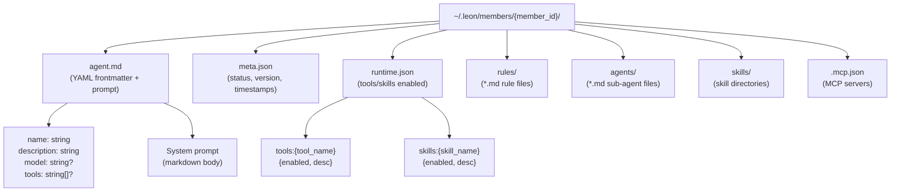
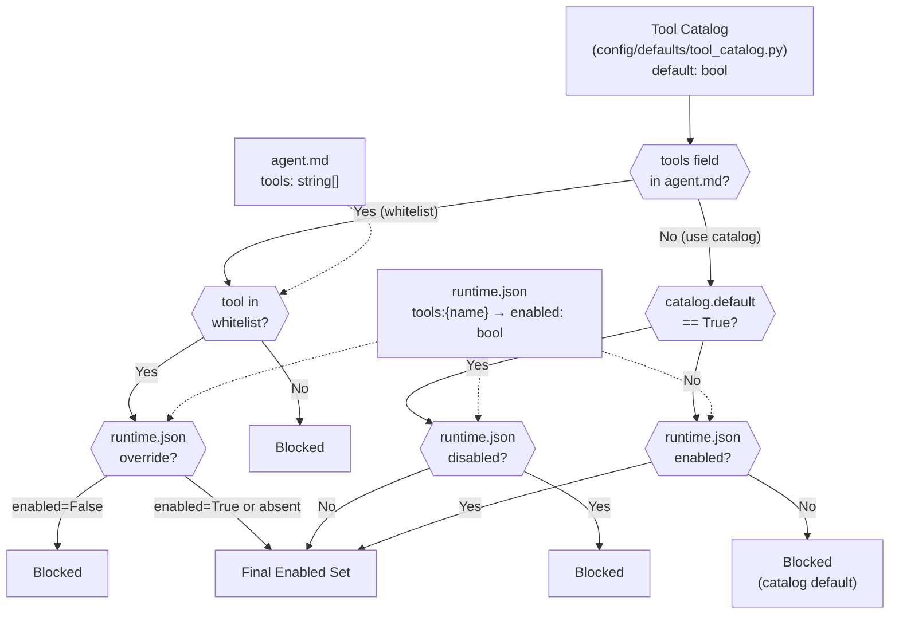
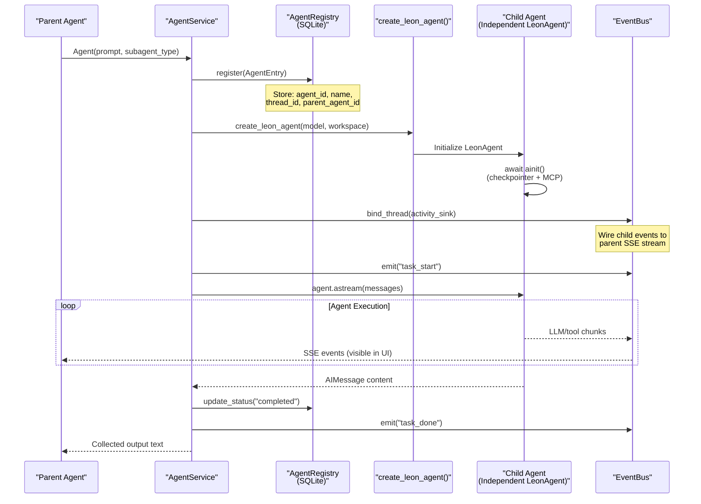
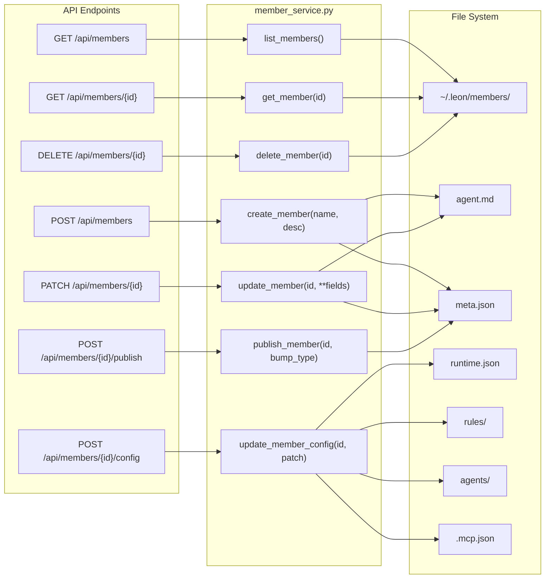
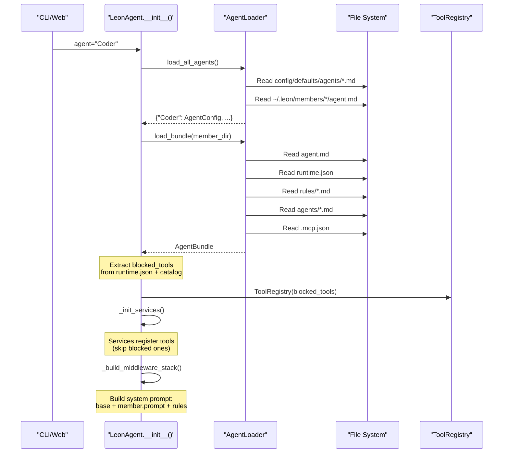

<!-- source: DeepWiki mcp.deepwiki.com · repo OpenDCAI/Mycel · page 9.4 Member Configuration · fetched 2026-11-02 -->

# Member Configuration

<details>
<summary>Relevant source files</summary>

The following files were used as context for generating this wiki page:

- [backend/taskboard/middleware.py](backend/taskboard/middleware.py)
- [backend/taskboard/service.py](backend/taskboard/service.py)
- [backend/web/routers/settings.py](backend/web/routers/settings.py)
- [backend/web/services/member_service.py](backend/web/services/member_service.py)
- [config/defaults/tool_catalog.py](config/defaults/tool_catalog.py)
- [config/models_schema.py](config/models_schema.py)
- [core/agents/communication/service.py](core/agents/communication/service.py)
- [core/agents/service.py](core/agents/service.py)
- [core/runtime/agent.py](core/runtime/agent.py)
- [core/runtime/middleware/monitor/cost.py](core/runtime/middleware/monitor/cost.py)
- [core/runtime/middleware/monitor/models.json](core/runtime/middleware/monitor/models.json)
- [core/runtime/registry.py](core/runtime/registry.py)
- [core/tools/command/service.py](core/tools/command/service.py)
- [frontend/app/index.html](frontend/app/index.html)
- [frontend/app/public/favicon.svg](frontend/app/public/favicon.svg)
- [frontend/app/src/components/ModelMappingSection.tsx](frontend/app/src/components/ModelMappingSection.tsx)
- [frontend/app/src/components/ModelPoolSection.tsx](frontend/app/src/components/ModelPoolSection.tsx)
- [frontend/app/src/components/ObservationSection.tsx](frontend/app/src/components/ObservationSection.tsx)
- [frontend/app/src/components/ProvidersSection.tsx](frontend/app/src/components/ProvidersSection.tsx)
- [frontend/app/src/components/SandboxSection.tsx](frontend/app/src/components/SandboxSection.tsx)
- [frontend/app/src/pages/SettingsPage.tsx](frontend/app/src/pages/SettingsPage.tsx)
- [sandbox/capability.py](sandbox/capability.py)
- [tests/test_model_config_enrichment.py](tests/test_model_config_enrichment.py)

</details>


Members are agent configurations that define specialized behaviors, tool access, system prompts, rules, and sub-agent definitions. Each member is stored as a file-based bundle in `~/.leon/members/` and loaded by `AgentLoader` at runtime. This page documents the member bundle format, configuration files, tool enablement logic, and CRUD operations.

For model configuration and virtual model mapping, see [Model Configuration](#9.1). For runtime settings like temperature and max_tokens, see [Core Concepts - Agents and Members](#4.2).

## Member Storage Layout

Each member is a directory under `~/.leon/members/{member_id}/` containing:

```
{member_id}/
├── agent.md          # Identity: YAML frontmatter + system prompt
├── meta.json         # Status, version, timestamps
├── runtime.json      # Tool/skill enable/disable + descriptions
├── rules/            # One .md file per rule
├── agents/           # One .md file per sub-agent definition
├── skills/           # One directory per skill
└── .mcp.json         # MCP server configurations
```

The special member `__leon__` represents the built-in general-purpose agent. Custom members inherit from `__leon__` by default and can override any configuration.

**Sources:** [backend/web/services/member_service.py:1-12]()

---

## Member File Structure



**Sources:** [backend/web/services/member_service.py:1-12]()

---

## agent.md Format

The `agent.md` file uses YAML frontmatter to declare identity and configuration, followed by a markdown body for the system prompt:

```markdown
---
name: Coder
description: Specialized agent for code generation and refactoring
model: leon:large
tools:
  - Read
  - Write
  - Edit
  - Bash
---

You are a specialized coding assistant focused on writing clean, maintainable code.
Always explain your reasoning before making changes.
```

### Frontmatter Fields

| Field | Type | Required | Description |
|-------|------|----------|-------------|
| `name` | string | Yes | Member display name |
| `description` | string | No | Short description (used in UI) |
| `model` | string | No | Model override (e.g. `leon:large`, `claude-sonnet-4-5-20250929`) |
| `tools` | string[] | No | Tool whitelist. `["*"]` = all tools. Omit for all tools. |

When `tools` is specified, only listed tools are enabled. When omitted or `["*"]`, all catalog tools with `default=True` are enabled (respecting `runtime.json` overrides).

**Sources:** [backend/web/services/member_service.py:56-68](), [backend/web/services/member_service.py:71-94]()

---

## Tool Enablement Logic

Tool availability follows a three-level resolution hierarchy:



### Resolution Rules

1. **Catalog default=True, absent from runtime.json** → Enabled
2. **Catalog default=True, runtime enabled=False** → Blocked
3. **Catalog default=False, absent from runtime.json** → Blocked (catalog wins)
4. **Catalog default=False, runtime enabled=True** → Enabled (explicit override)
5. **agent.md tools whitelist** → Only whitelisted tools considered, then apply rules 1-4

The blocked tools set is computed in `LeonAgent._get_member_blocked_tools()` and passed to `ToolRegistry`:

**Sources:** [core/runtime/agent.py:337-369](), [config/defaults/tool_catalog.py:1-87]()

---

## runtime.json Schema

The `runtime.json` file stores per-tool and per-skill overrides:

```json
{
  "tools:Bash": {
    "enabled": false,
    "desc": "Blocked for security"
  },
  "tools:WebSearch": {
    "enabled": true,
    "desc": "Tavily-powered web search"
  },
  "skills:git_commit": {
    "enabled": true,
    "desc": "Commit staged changes with message"
  }
}
```

Keys use the format `{category}:{name}` where category is `tools` or `skills`. The `desc` field overrides the catalog description shown in the UI.

**Sources:** [backend/web/services/member_service.py:126-137](), [backend/web/services/member_service.py:478-506]()

---

## Tool Catalog

All available tools are defined in `config/defaults/tool_catalog.py`:

| Tool | Group | Mode | Default | Description |
|------|-------|------|---------|-------------|
| Read | filesystem | inline | true | Read file contents |
| Write | filesystem | inline | true | Write file |
| Edit | filesystem | inline | true | Edit file (precise replacement) |
| list_dir | filesystem | inline | true | List directory contents |
| Grep | search | inline | true | Regex search (ripgrep) |
| Glob | search | inline | true | Find files by glob pattern |
| Bash | command | inline | true | Execute shell command |
| WebSearch | web | inline | true | Search internet |
| WebFetch | web | inline | true | Fetch webpage with AI extraction |
| TaskOutput | agent | inline | true | Get background task output |
| TaskStop | agent | inline | true | Stop background task |
| Agent | agent | inline | true | Spawn sub-agent |
| SendMessage | agent | inline | true | Send message to another agent |
| TaskCreate | todo | deferred | true | Create TODO task |
| TaskGet | todo | deferred | true | Get task details |
| TaskList | todo | deferred | true | List all tasks |
| TaskUpdate | todo | deferred | true | Update task status |
| load_skill | skills | inline | true | Load skill |
| tool_search | system | inline | true | Search available tools |
| ListBoardTasks | taskboard | inline | **false** | List taskboard tasks |
| ClaimTask | taskboard | inline | **false** | Claim taskboard task |
| UpdateTaskProgress | taskboard | inline | **false** | Update task progress |
| CompleteTask | taskboard | inline | **false** | Mark task complete |
| FailTask | taskboard | inline | **false** | Mark task failed |
| CreateBoardTask | taskboard | inline | **false** | Create taskboard task |

Tools with `default=false` (taskboard group) must be explicitly enabled in `runtime.json` for dedicated scheduler members.

**Sources:** [config/defaults/tool_catalog.py:46-87]()

---

## Rules System

Rules are stored as individual markdown files in `rules/`:

```
rules/
├── code_style.md
├── security.md
└── testing.md
```

Each rule file contains markdown instructions appended to the system prompt. Rules are loaded and concatenated in alphabetical order. Rules can reference other rules or build on each other.

### Creating Rules via API

```typescript
// POST /api/members/{member_id}/config
{
  "rules": [
    { "name": "code_style", "content": "Always use 4-space indentation..." },
    { "name": "security", "content": "Never commit credentials..." }
  ]
}
```

Rules are replaced atomically — the `rules/` directory is deleted and recreated.

**Sources:** [backend/web/services/member_service.py:427-440]()

---

## Sub-agent Definitions

Sub-agents are specialized agent configurations that can be spawned by the parent agent using the `Agent` tool. Each sub-agent is defined in `agents/{name}.md` with the same format as `agent.md`:

```markdown
---
name: Explore
description: File system explorer for discovery tasks
tools:
  - Read
  - list_dir
  - Grep
  - Glob
---

You are a file system explorer. Your job is to understand the structure of
codebases and find relevant files. Always explain what you find.
```

### Built-in vs Custom Sub-agents

The system provides built-in sub-agents in `config/defaults/agents/`:
- `general.md` — General-purpose assistant
- `explore.md` — File system explorer
- `plan.md` — Task planner

Custom members can:
1. Override built-in sub-agents by creating `agents/{name}.md` with the same name
2. Add new sub-agents by creating `agents/{custom_name}.md`
3. Reference built-in sub-agents without defining them

When loading a member, `AgentLoader.load_bundle()` merges built-in and custom sub-agents:

**Sources:** [backend/web/services/member_service.py:443-476](), [backend/web/services/member_service.py:274-291]()

---

## Sub-agent Spawning Flow



### Background vs Blocking Execution

- **Blocking (default):** Parent agent waits for child completion. Child output becomes tool result.
- **Background (`run_in_background=True`):** Parent receives task_id immediately. Use `TaskOutput` to poll.

**Sources:** [core/agents/service.py:200-253](), [core/agents/service.py:254-399]()

---

## MCP Server Configuration

MCP (Model Context Protocol) servers are configured in `.mcp.json`:

```json
{
  "mcpServers": {
    "filesystem": {
      "command": "npx",
      "args": ["-y", "@modelcontextprotocol/server-filesystem", "/workspace"],
      "env": {},
      "disabled": false
    },
    "github": {
      "command": "npx",
      "args": ["-y", "@modelcontextprotocol/server-github"],
      "env": {
        "GITHUB_TOKEN": "${GITHUB_TOKEN}"
      },
      "disabled": false
    }
  }
}
```

MCP servers provide tools, resources, and prompts to agents. They are spawned as subprocesses when the agent initializes.

**Sources:** [backend/web/services/member_service.py:509-544]()

---

## Member CRUD API



### List Members

```
GET /api/members
```

Returns all members including `__leon__`. Response:

```json
[
  {
    "id": "__leon__",
    "name": "Leon",
    "description": "通用数字成员，随时准备为你工作",
    "status": "active",
    "version": "1.0.0",
    "config": {
      "prompt": "",
      "rules": [],
      "tools": [...],
      "mcps": [],
      "skills": [],
      "subAgents": [...]
    },
    "created_at": 0,
    "updated_at": 0,
    "builtin": true
  }
]
```

**Sources:** [backend/web/services/member_service.py:311-320]()

---

### Get Member

```
GET /api/members/{member_id}
```

Returns single member. Response format same as list item.

**Sources:** [backend/web/services/member_service.py:323-335]()

---

### Create Member

```
POST /api/members
```

Request body:

```json
{
  "name": "Coder",
  "description": "Specialized coding assistant"
}
```

Creates member directory with timestamp-based ID, initializes `agent.md` and `meta.json` with status `draft`.

**Sources:** [backend/web/services/member_service.py:338-348]()

---

### Update Member Metadata

```
PATCH /api/members/{member_id}
```

Request body (all optional):

```json
{
  "name": "Updated Name",
  "description": "Updated description",
  "status": "active"
}
```

Updates `agent.md` (for name/description) and `meta.json` (for status). Sets `updated_at` timestamp.

**Sources:** [backend/web/services/member_service.py:351-380]()

---

### Update Member Configuration

```
POST /api/members/{member_id}/config
```

Request body (all optional):

```json
{
  "prompt": "You are a specialized coding assistant...",
  "rules": [
    { "name": "code_style", "content": "..." },
    { "name": "security", "content": "..." }
  ],
  "tools": [
    { "name": "Read", "enabled": true, "desc": "..." },
    { "name": "Bash", "enabled": false, "desc": "..." }
  ],
  "skills": [
    { "name": "git_commit", "enabled": true, "desc": "..." }
  ],
  "subAgents": [
    {
      "name": "Explore",
      "desc": "File explorer",
      "tools": ["Read", "list_dir", "Grep"],
      "system_prompt": "You are a file system explorer...",
      "builtin": false
    }
  ],
  "mcps": [
    {
      "name": "github",
      "command": "npx",
      "args": ["-y", "@modelcontextprotocol/server-github"],
      "env": { "GITHUB_TOKEN": "${GITHUB_TOKEN}" },
      "disabled": false
    }
  ]
}
```

This endpoint atomically updates all configuration files:
- `prompt` → `agent.md` body
- `rules` → `rules/` (replaces all)
- `tools` → `runtime.json` (replaces all `tools:*` keys)
- `skills` → `runtime.json` (replaces all `skills:*` keys)
- `subAgents` → `agents/` (replaces all)
- `mcps` → `.mcp.json` (replaces all)

**Sources:** [backend/web/services/member_service.py:383-422]()

---

### Publish Member

```
POST /api/members/{member_id}/publish
```

Request body:

```json
{
  "bump_type": "patch"  // or "minor" or "major"
}
```

Increments version according to semantic versioning, sets status to `active`, updates `updated_at`.

**Sources:** [backend/web/services/member_service.py:549-566]()

---

### Delete Member

```
DELETE /api/members/{member_id}
```

Deletes member directory. Cannot delete `__leon__`.

**Sources:** [backend/web/services/member_service.py:569-576]()

---

## Member Loading Flow



### AgentBundle Structure

The `AgentLoader.load_bundle()` returns an `AgentBundle` containing:

- `agent: AgentConfig` — Parsed from `agent.md` frontmatter
- `meta: dict` — Parsed from `meta.json`
- `runtime: dict[str, RuntimeConfig]` — Parsed from `runtime.json` (keys are `tools:*` or `skills:*`)
- `rules: list[dict]` — List of `{name, content}` from `rules/*.md`
- `agents: list[AgentConfig]` — Sub-agents from `agents/*.md` (merged with built-ins)
- `mcp: dict[str, MCPServerConfig]` — Parsed from `.mcp.json`

**Sources:** [core/runtime/agent.py:371-442](), [config/loader.py:425-456]()

---

## Legacy Migration

Pre-0.9 members used a single `config.json` file. When `member_service` encounters a member with `config.json`, it automatically migrates:

1. `rules` (string) → `rules/default.md`
2. `subAgents` (array) → `agents/{name}.md`
3. `tools`/`skills` (arrays) → `runtime.json`
4. `mcps` (array) → `.mcp.json`
5. Delete `config.json`

Migration is transparent and happens on first read.

**Sources:** [backend/web/services/member_service.py:98-156]()

---

## Model Override

Members can override the model at three levels:

1. **agent.md frontmatter:** `model: leon:large`
2. **Active model in models.json:** Applies globally if no member override
3. **Per-thread model:** User can change model mid-conversation

The resolution order is: member.model → thread model → active model → DEFAULT_MODEL.

**Sources:** [core/runtime/agent.py:169-174]()

---

## Best Practices

### Tool Whitelisting

**Use explicit tool lists for specialized members:**

```yaml
---
name: ReadOnlyExplorer
tools:
  - Read
  - list_dir
  - Grep
  - Glob
---
```

**Use `["*"]` or omit for general-purpose members:**

```yaml
---
name: GeneralAssistant
tools: ["*"]  # or omit entirely
---
```

### Rule Organization

**Keep rules focused and composable:**

```
rules/
├── code_style.md       # Style guidelines
├── security.md         # Security requirements
├── testing.md          # Testing requirements
└── documentation.md    # Documentation requirements
```

### Sub-agent Specialization

**Define sub-agents for distinct capabilities:**

```
agents/
├── explore.md    # File system discovery
├── test.md       # Test generation
├── refactor.md   # Code refactoring
└── debug.md      # Debugging assistance
```

### MCP Server Selection

**Enable MCP servers based on member needs:**

- Filesystem access → `@modelcontextprotocol/server-filesystem`
- Git operations → `@modelcontextprotocol/server-git`
- GitHub API → `@modelcontextprotocol/server-github`
- Browser automation → `@modelcontextprotocol/server-puppeteer`

**Sources:** General best practices derived from system architecture

---

