# Page: Overview

# Overview

<details>
<summary>Relevant source files</summary>

The following files were used as context for generating this wiki page:

- [agent.py](agent.py)
- [backend/taskboard/middleware.py](backend/taskboard/middleware.py)
- [backend/taskboard/service.py](backend/taskboard/service.py)
- [backend/web/core/lifespan.py](backend/web/core/lifespan.py)
- [backend/web/models/thread_config.py](backend/web/models/thread_config.py)
- [backend/web/routers/threads.py](backend/web/routers/threads.py)
- [backend/web/services/agent_pool.py](backend/web/services/agent_pool.py)
- [backend/web/services/member_service.py](backend/web/services/member_service.py)
- [backend/web/services/streaming_service.py](backend/web/services/streaming_service.py)
- [backend/web/utils/helpers.py](backend/web/utils/helpers.py)
- [config/defaults/tool_catalog.py](config/defaults/tool_catalog.py)
- [core/agents/communication/service.py](core/agents/communication/service.py)
- [core/agents/service.py](core/agents/service.py)
- [core/runtime/agent.py](core/runtime/agent.py)
- [core/runtime/registry.py](core/runtime/registry.py)
- [core/tools/command/service.py](core/tools/command/service.py)
- [pyproject.toml](pyproject.toml)
- [sandbox/capability.py](sandbox/capability.py)
- [tui/app.py](tui/app.py)
- [tui/leon_cli.py](tui/leon_cli.py)
- [tui/runner.py](tui/runner.py)
- [tui/widgets/status.py](tui/widgets/status.py)
- [uv.lock](uv.lock)

</details>


This document provides a high-level introduction to the Mycel codebase, explaining its architecture, key components, and how they work together. Mycel is a proactive AI coding assistant that executes tasks autonomously in isolated sandbox environments with persistent memory and real-time streaming.

**Scope**: This page covers the overall system architecture and component relationships. For detailed documentation on specific subsystems:
- User interface details: [User Interfaces](#3)
- Agent runtime internals: [Agent Runtime](#5)
- Sandbox implementation: [Sandbox System](#6)
- Frontend/backend architecture: [Frontend Architecture](#7), [Backend Architecture](#8)
- Configuration and setup: [Getting Started](#2), [Configuration and Settings](#9)

## System Purpose

Mycel is a multi-interface AI coding assistant designed for:
- **Autonomous task execution**: Agents can spawn sub-agents, execute shell commands, and perform file operations
- **Persistent memory**: Conversation history and sandbox state persist across sessions with checkpoint/restore capabilities
- **Real-time streaming**: Server-Sent Events (SSE) deliver incremental updates to frontends
- **Sandbox isolation**: Multiple providers (local, Docker, E2B, Daytona, AgentBay) enable safe execution
- **Multi-agent coordination**: Inter-agent messaging and hierarchical agent spawning

The system supports three interaction modes:
1. **Web UI** (React SPA) - Full-featured browser interface with real-time activity panels
2. **Terminal UI** (Textual) - Rich terminal interface with time travel debugging
3. **CLI** - Non-interactive and interactive command-line modes

Sources: [pyproject.toml:1-137](), [README.md (implied)](), [Diagram 1 from system overview]()

---

## High-Level Architecture

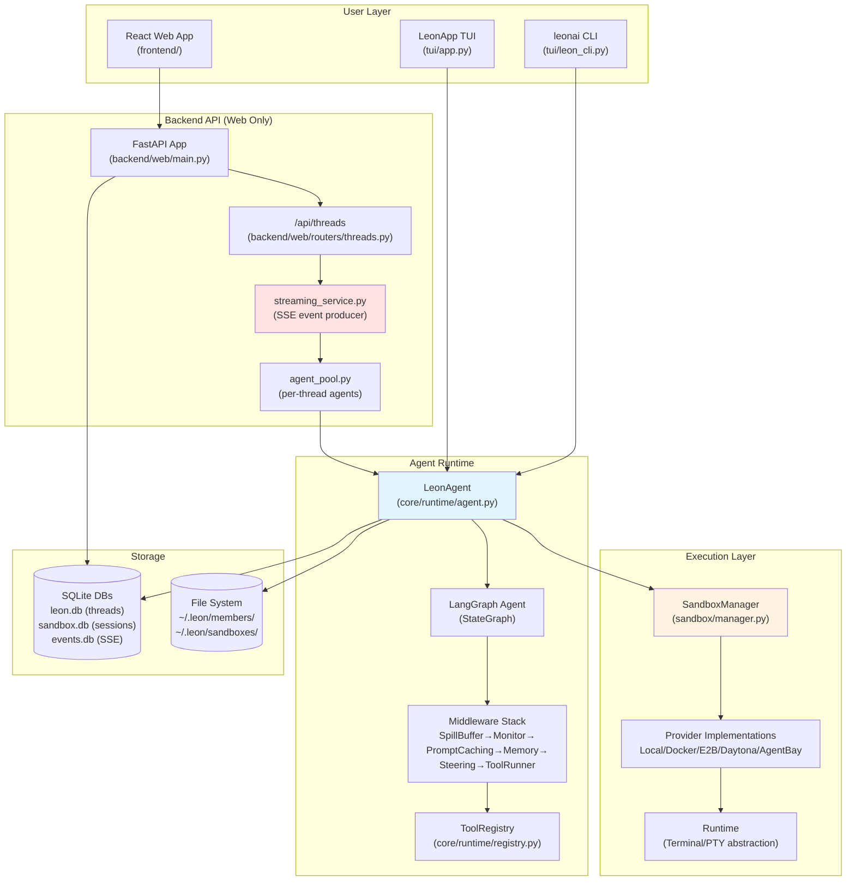

**Key architectural principles:**

1. **Multi-frontend, shared runtime**: All three UIs use the same `LeonAgent` class from [core/runtime/agent.py:92-268]()
2. **Middleware pipeline**: Request/response flow through ordered middleware [core/runtime/agent.py:4-6]()
3. **Event-driven streaming**: Web backend uses SSE for real-time updates [backend/web/services/streaming_service.py:1-1093]()
4. **Sandbox abstraction**: Uniform interface to multiple execution providers [sandbox/manager.py]()
5. **Tool registry pattern**: Services register tools into central registry [core/runtime/registry.py:28-78]()

Sources: [core/runtime/agent.py:1-1021](), [backend/web/routers/threads.py:1-654](), [tui/leon_cli.py:1-797](), [tui/app.py:1-897]()

---

## Request Execution Flow

The following diagram shows how a user message flows through the system, from input to response:

```mermaid
sequenceDiagram
    participant User
    participant Interface["Interface<br/>(Web/TUI/CLI)"]
    participant LeonAgent["LeonAgent"]
    participant Middleware["Middleware Stack"]
    participant LLM["LLM Provider"]
    participant ToolRunner["ToolRunner"]
    participant Sandbox["SandboxProvider"]
    
    User->>Interface: "Write hello.txt"
    Interface->>LeonAgent: agent.astream(message)
    LeonAgent->>LeonAgent: Set thread context<br/>set_current_thread_id()
    LeonAgent->>Middleware: Process via pipeline
    
    Middleware->>LLM: LLM call (via Monitor)
    LLM-->>Middleware: tool_call: Write
    
    Middleware->>ToolRunner: Execute Write tool
    ToolRunner->>ToolRunner: Lookup in ToolRegistry
    ToolRunner->>Sandbox: fs.write_file(path, content)
    Sandbox-->>ToolRunner: result
    ToolRunner-->>Middleware: ToolMessage
    
    Middleware->>LLM: LLM call with result
    LLM-->>Middleware: "File created"
    
    Middleware-->>LeonAgent: Stream complete
    LeonAgent-->>Interface: Chunks (text/tool_call/tool_result)
    Interface-->>User: Display response
```

**Flow details:**

1. **Context setup**: Thread ID set via `set_current_thread_id()` [sandbox/thread_context.py]()
2. **State machine**: Agent transitions through states (IDLE→ACTIVE→IDLE) [core/runtime/middleware/monitor/__init__.py]()
3. **Streaming**: LangGraph `astream()` yields chunks incrementally [core/runtime/agent.py:408-413]()
4. **Tool dispatch**: `ToolRunner` resolves tool name→handler via registry [core/runtime/runner.py]()
5. **Sandbox execution**: Commands/file ops route through provider abstraction [sandbox/capability.py:26-70]()

Sources: [backend/web/services/streaming_service.py:344-809](), [tui/app.py:298-528](), [core/runtime/runner.py]()

---

## Core Subsystems

### LeonAgent and Runtime

The `LeonAgent` class ([core/runtime/agent.py:92-268]()) is the central orchestrator that:
- Creates LangGraph agent with middleware stack
- Manages model configuration and API keys
- Initializes tool registry and services
- Handles async initialization for web contexts

**Key initialization sequence:**
1. Load configuration (models, sandbox, workspace) [core/runtime/agent.py:149-195]()
2. Create LLM model [core/runtime/agent.py:203]()
3. Initialize tool registry and services [core/runtime/agent.py:224-226]()
4. Build middleware stack [core/runtime/agent.py:228]()
5. Create LangGraph agent [core/runtime/agent.py:242-248]()

The middleware stack wraps the LLM in layers (outer→inner):
- `SpillBufferMiddleware`: Handles large outputs
- `MonitorMiddleware`: Tracks costs, tokens, state
- `PromptCachingMiddleware`: Optimizes cache usage
- `MemoryMiddleware`: Manages context window
- `SteeringMiddleware`: Injects queued messages
- `ToolRunner`: Dispatches tool calls

Sources: [core/runtime/agent.py:92-268](), [agent.py:1-8]()

---

### Tool and Service Architecture

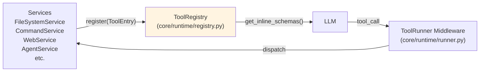

**Service registration pattern** (all services follow this):
```python
class FileSystemService:
    def __init__(self, registry: ToolRegistry, ...):
        registry.register(ToolEntry(
            name="Read",
            mode=ToolMode.INLINE,
            schema={...},
            handler=self._read,
            source="FileSystemService"
        ))
```

**Registered services and their tools:**

| Service | Tools | Source File |
|---------|-------|-------------|
| FileSystemService | Read, Write, Edit, list_dir | [core/tools/filesystem/service.py]() |
| CommandService | Bash | [core/tools/command/service.py:32-96]() |
| SearchService | Grep, Glob | [core/tools/search/service.py]() |
| WebService | WebSearch, WebFetch | [core/tools/web/service.py]() |
| AgentService | Agent, TaskOutput, TaskStop | [core/agents/service.py:150-434]() |
| SendMessageService | SendMessage | [core/agents/communication/service.py:98-158]() |
| TaskBoardService | ListBoardTasks, ClaimTask, etc. | [backend/taskboard/service.py:31-246]() |
| SkillsService | load_skill (dynamic) | [core/tools/skills/service.py]() |

**Tool modes:**
- `INLINE`: Injected into every LLM call [core/runtime/registry.py:58-61]()
- `DEFERRED`: Only discoverable via `tool_search` [core/runtime/registry.py:14]()

Sources: [core/runtime/registry.py:28-78](), [core/runtime/runner.py](), [core/runtime/agent.py:224-226](), [config/defaults/tool_catalog.py:1-95]()

---

### Backend API (Web Mode)

When running as a web server, FastAPI provides REST and SSE endpoints:

**Key routers:**

| Router | Endpoints | Purpose |
|--------|-----------|---------|
| `threads.py` | `/api/threads/*` | Thread CRUD, message sending, SSE streaming |
| `settings.py` | `/api/settings/*` | User preferences, model config |
| `panel.py` | `/api/panel/*` | Task board, cron jobs |
| `resources.py` | `/api/resources/*` | Provider monitoring, sandbox status |

**Thread lifecycle:**
1. `POST /api/threads` - Create thread, initialize config [backend/web/routers/threads.py:55-83]()
2. `POST /api/threads/{id}/messages` - Send message, route based on state [backend/web/routers/threads.py:159-189]()
3. `GET /api/threads/{id}/events` - SSE stream for real-time updates [backend/web/routers/threads.py:429-482]()

**Agent pool management:**
- One `LeonAgent` per `(thread_id, sandbox_type)` tuple [backend/web/services/agent_pool.py:40-91]()
- Lazy initialization on first access
- Per-thread model/config overrides supported [backend/web/services/agent_pool.py:69-75]()

**SSE event streaming:**
- `ThreadEventBuffer` - Persistent per-thread event queue [backend/web/services/event_buffer.py]()
- Events: `run_start`, `text`, `tool_call`, `tool_result`, `run_done`, `status` [backend/web/services/streaming_service.py:500-746]()
- Reconnection support via `?after=N` or `Last-Event-ID` header [backend/web/routers/threads.py:442-447]()

Sources: [backend/web/routers/threads.py:1-654](), [backend/web/services/agent_pool.py:1-180](), [backend/web/services/streaming_service.py:1-1093]()

---

### Sandbox System

The sandbox abstraction provides isolated execution environments:

```mermaid
graph TB
    SandboxManager["SandboxManager<br/>(sandbox/manager.py)"]
    ChatSession["ChatSession<br/>(per thread)"]
    Runtime["Runtime<br/>(LocalPersistentShellRuntime<br/>DockerPtyRuntime<br/>E2BPtyRuntime, etc.)"]
    Terminal["AbstractTerminal<br/>(state: cwd, env)"]
    Lease["SandboxLease<br/>(instance reservation)"]
    Provider["SandboxProvider<br/>(interface)"]
    Impl["Provider Implementations<br/>LocalSessionProvider<br/>DockerProvider<br/>E2BProvider<br/>DaytonaProvider<br/>AgentBayProvider"]
    
    SandboxManager -->|"get_or_create_session"| ChatSession
    ChatSession --> Runtime
    ChatSession --> Terminal
    ChatSession --> Lease
    SandboxManager --> Provider
    Provider <|-- Impl
    Lease -->|"ensure_active_instance"| Provider
    
    style SandboxManager fill:#fff4e1
```

**Hierarchy**: Thread → ChatSession → Runtime → Terminal → Lease → Instance

**Key classes:**
- `SandboxManager` [sandbox/manager.py](): Session orchestration, lifecycle management
- `ChatSession` [sandbox/chat_session.py](): Binds terminal+runtime+lease for a thread
- `AbstractTerminal` [sandbox/terminal.py](): Persistent shell state (cwd, env vars)
- `SandboxLease` [sandbox/lease.py](): Instance reservation and status tracking
- `SandboxProvider` [sandbox/provider.py:11-194](): Abstract interface with capability flags

**Provider capabilities** (declared via `ProviderCapability`):
- `can_pause/can_resume`: Pause/resume support [sandbox/provider.py:15-24]()
- `can_get_metrics`: Resource monitoring [sandbox/provider.py:25]()
- `has_screenshots`: UI snapshots [sandbox/provider.py:26]()
- `has_web_url`: Browser access [sandbox/provider.py:27]()

**Configuration**: Providers loaded from `~/.leon/sandboxes/*.json` [tui/leon_cli.py:226-251]()

Sources: [sandbox/manager.py](), [sandbox/chat_session.py](), [sandbox/capability.py:1-236](), [sandbox/provider.py:1-194]()

---

### State Management and Persistence

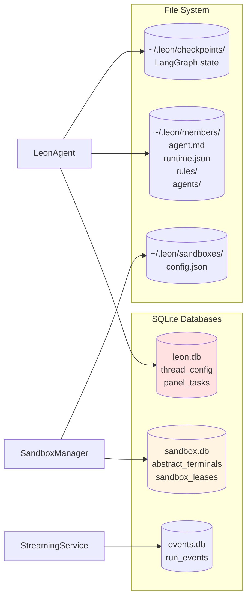

**Storage layers:**

1. **Thread metadata** (`leon.db:thread_config`): Sandbox type, cwd, model [storage/providers/sqlite/thread_config_repo.py]()
2. **Sandbox sessions** (`sandbox.db`): Terminal/lease state [sandbox/terminal.py](), [sandbox/lease.py]()
3. **SSE events** (`events.db`): Per-run event history [backend/web/services/event_store.py]()
4. **LangGraph checkpoints**: Conversation state [langgraph-checkpoint-sqlite]()
5. **Member configs**: Agent definitions [backend/web/services/member_service.py:1-564]()

**Context variables** for thread/run tracking:
- `current_thread_id` - Active thread [sandbox/thread_context.py]()
- `current_run_id` - Current execution [sandbox/thread_context.py]()

Sources: [storage/container.py](), [storage/providers/sqlite/](), [sandbox/thread_context.py](), [backend/web/services/event_store.py]()

---

## Inter-Component Communication

### Frontend ↔ Backend (Web Mode)

**HTTP endpoints** - Control operations:
- Thread management: Create, delete, list threads
- Message sending: POST to `/api/threads/{id}/messages`
- Configuration: Settings, model selection

**SSE streams** - Real-time data:
- Event stream: `/api/threads/{id}/events` [backend/web/routers/threads.py:429-482]()
- Event types: text chunks, tool calls, tool results, status updates

**React state management:**
- `AppStore` (Zustand): Global UI state [frontend/src/stores/useAppStore.ts (implied)]()
- `useThreadManager`: Thread CRUD operations
- `useStreamHandler`: SSE connection and event processing

Sources: [backend/web/routers/threads.py:1-654](), Frontend source files (implied from diagrams)

---

### Inter-Agent Communication

Agents communicate via:

1. **Message queues** (`MessageQueueManager`): Steer injection, followup messages [core/runtime/middleware/queue/manager.py]()
2. **SendMessage tool**: Direct agent→agent messaging [core/agents/communication/service.py:1-158]()
3. **EventBus**: Sub-agent events flow to parent thread [backend/web/event_bus.py (implied)]()
4. **AgentRegistry**: Name resolution for routing [core/agents/registry.py]()

**Queue routing:**
- `steer` type: Inject into active agent's next LLM call [core/runtime/middleware/queue/steering.py]()
- `followup` type: Execute when agent transitions to IDLE

Sources: [core/runtime/middleware/queue/manager.py](), [core/agents/communication/service.py:1-158](), [core/agents/service.py:254-399]()

---

## Entry Points and Initialization

**CLI entry point** (`leonai` command):
```
tui/leon_cli.py:main() → _launch_tui() → run_tui()
                       → cmd_run() (non-interactive)
                       → cmd_thread() (thread management)
                       → cmd_sandbox() (sandbox TUI)
```

**Web server entry point**:
```
backend/web/main.py:app → lifespan() → routers registration
```

**Agent creation factory**:
```python
create_leon_agent(
    model_name="gpt-4",
    workspace_root=Path.cwd(),
    sandbox="local",  # or provider name
    agent="general",  # member name
    verbose=False
) → LeonAgent instance
```

Sources: [tui/leon_cli.py:572-797](), [backend/web/main.py (implied)](), [core/runtime/agent.py:1021-1075](), [agent.py:1-8]()

---

## Configuration Hierarchy

Mycel uses a three-level configuration system:

1. **Global** (`~/.leon/config.json`, `~/.leon/models.json`): API keys, default model
2. **Per-thread** (SQLite `thread_config` table): Sandbox, model, cwd overrides
3. **Per-member** (`~/.leon/members/*/`): Agent-specific tool/prompt configuration

**Configuration precedence** (highest to lowest):
1. Runtime parameter (e.g., `update_config(model="gpt-4")`)
2. Thread config override
3. Member config
4. Global defaults

**Model resolution**: Virtual names (`leon:mini/medium/large/max`) map to real models [config/models_loader.py]()

Sources: [backend/web/utils/helpers.py:86-148](), [config/loader.py](), [config/models_loader.py](), [backend/web/services/member_service.py:1-564]()

---

## Deployment Modes

Mycel supports three deployment modes:

| Mode | Entry Point | Use Case |
|------|-------------|----------|
| **CLI** | `leonai run` | Non-interactive scripts, CI/CD |
| **TUI** | `leonai` | Interactive terminal, local development |
| **Web** | `uvicorn backend.web.main:app` | Multi-user web service |

**Shared components**: All modes use the same `LeonAgent` runtime and tool registry.

**Web-specific additions**:
- Agent pool for per-thread isolation [backend/web/services/agent_pool.py]()
- SSE streaming service [backend/web/services/streaming_service.py]()
- Cron scheduler [backend/web/services/cron_service.py (implied)]()
- Background workers (idle reaper, resource monitor) [backend/web/core/lifespan.py:44-61]()

Sources: [tui/runner.py:1-373](), [tui/leon_cli.py:1-797](), [backend/web/core/lifespan.py:1-85]()

---

## Next Steps

For detailed information on specific subsystems, see:

- **[Getting Started](#2)** - Installation and first steps
- **[Core Concepts](#4)** - Threads, agents, sandboxes, tools
- **[Agent Runtime](#5)** - Middleware, tool execution, memory management
- **[Sandbox System](#6)** - Provider implementations, session management
- **[Frontend Architecture](#7)** - React components, state management, streaming
- **[Backend Architecture](#8)** - API design, agent pool, event system
- **[Configuration](#9)** - Models, sandboxes, observation providers

---

# Page: Getting Started

# Getting Started

<details>
<summary>Relevant source files</summary>

The following files were used as context for generating this wiki page:

- [agent.py](agent.py)
- [backend/web/routers/settings.py](backend/web/routers/settings.py)
- [config/models_schema.py](config/models_schema.py)
- [core/runtime/middleware/monitor/cost.py](core/runtime/middleware/monitor/cost.py)
- [core/runtime/middleware/monitor/models.json](core/runtime/middleware/monitor/models.json)
- [frontend/app/index.html](frontend/app/index.html)
- [frontend/app/public/favicon.svg](frontend/app/public/favicon.svg)
- [frontend/app/src/components/ModelMappingSection.tsx](frontend/app/src/components/ModelMappingSection.tsx)
- [frontend/app/src/components/ModelPoolSection.tsx](frontend/app/src/components/ModelPoolSection.tsx)
- [frontend/app/src/components/ObservationSection.tsx](frontend/app/src/components/ObservationSection.tsx)
- [frontend/app/src/components/ProvidersSection.tsx](frontend/app/src/components/ProvidersSection.tsx)
- [frontend/app/src/components/SandboxSection.tsx](frontend/app/src/components/SandboxSection.tsx)
- [frontend/app/src/pages/SettingsPage.tsx](frontend/app/src/pages/SettingsPage.tsx)
- [pyproject.toml](pyproject.toml)
- [tests/test_model_config_enrichment.py](tests/test_model_config_enrichment.py)
- [tui/app.py](tui/app.py)
- [tui/leon_cli.py](tui/leon_cli.py)
- [tui/runner.py](tui/runner.py)
- [tui/widgets/status.py](tui/widgets/status.py)
- [uv.lock](uv.lock)

</details>


This guide covers installing Mycel, configuring it for first use, and running your first chat session. For detailed information about specific interfaces, see [User Interfaces](#3). For configuration options beyond initial setup, see [Configuration and Settings](#9).

## Prerequisites

**System Requirements:**
- Python 3.12 or higher (3.13+ also supported)
- Operating System: Linux, macOS, or Windows
- Internet connection for API access

**Required Credentials:**
At minimum, you need an API key from one of these providers:
- Anthropic (Claude models)
- OpenAI (GPT models)
- OpenRouter (access to multiple providers)

Sources: [pyproject.toml:10](), [pyproject.toml:29-44]()

## Installation

### From PyPI (Recommended)

```bash
# Basic installation
pip install leonai

# With all optional dependencies
pip install "leonai[all]"

# With specific features
pip install "leonai[sandbox]"  # AgentBay support
pip install "leonai[e2b]"       # E2B sandbox support
pip install "leonai[langfuse]"  # Langfuse tracing
```

### From Source

```bash
git clone https://github.com/OpenDCAI/Mycel.git
cd Mycel
pip install -e .
```

The installation registers the `leonai` CLI command, which serves as the main entry point for all interfaces.

Sources: [pyproject.toml:6](), [pyproject.toml:46-58](), [pyproject.toml:59-60]()

## System Initialization Flow

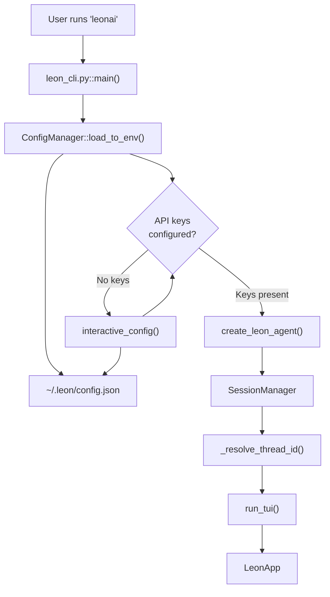

**Initialization Components:**

| Component | File Location | Purpose |
|-----------|--------------|---------|
| `main()` | [tui/leon_cli.py:572-612]() | CLI entry point, command routing |
| `ConfigManager` | [tui/config.py]() | Load/save API keys and preferences |
| `SessionManager` | [tui/session.py]() | Track conversation threads |
| `create_leon_agent()` | [agent.py:2-5]() | Initialize agent runtime |
| `LeonApp` | [tui/app.py:62-115]() | Main TUI application class |

Sources: [tui/leon_cli.py:572-761](), [agent.py:1-7](), [tui/app.py:62-176]()

## Initial Configuration

### Interactive Configuration Wizard

On first run without API keys, Leon automatically launches the configuration wizard:

```bash
leonai config
```

The wizard prompts for:
1. **Primary API Provider** - Choose Anthropic, OpenAI, or OpenRouter
2. **API Key** - Enter your credentials
3. **Default Model** (optional) - Select from `leon:mini`, `leon:medium`, `leon:large`, `leon:max`

Configuration is saved to `~/.leon/config.json` and automatically loaded on subsequent runs.

### Manual Configuration

You can also set API keys via environment variables:

```bash
# Anthropic
export ANTHROPIC_API_KEY="sk-ant-..."

# OpenAI
export OPENAI_API_KEY="sk-..."

# OpenRouter
export OPENROUTER_API_KEY="sk-or-..."
```

### Configuration File Structure

```
~/.leon/
├── config.json          # API keys (from ConfigManager)
├── preferences.json     # User preferences (workspace, default model)
├── models.json          # Model configuration (mapping, pool)
├── observation.json     # Tracing configuration (Langfuse/LangSmith)
└── sandboxes/          # Sandbox provider configs
    ├── agentbay.json
    ├── docker.json
    └── e2b.json
```

Sources: [tui/leon_cli.py:709-719](), [backend/web/routers/settings.py:19-20](), [backend/web/routers/settings.py:547-548]()

## Configuration Loading Flow

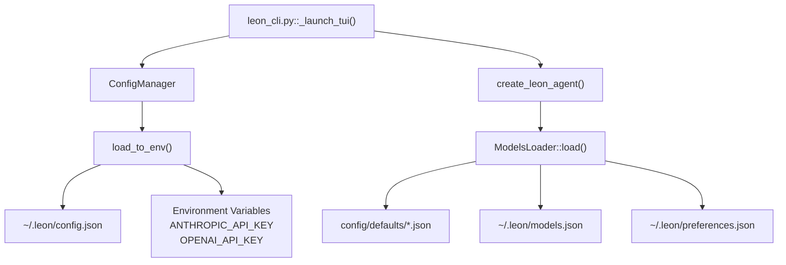

**Configuration Merge Priority:** System defaults → User config (`~/.leon/`) → Environment variables → CLI arguments

Sources: [tui/leon_cli.py:707-719](), [config/models_schema.py:81-93](), [backend/web/routers/settings.py:84-86]()

## Running Your First Session

### Launch the TUI (Default)

The simplest way to start:

```bash
leonai
```

This launches the Textual-based terminal UI with:
- Full-screen chat interface
- Real-time streaming responses
- Tool execution visualization
- Command palette for advanced features

### Command-Line Options

```bash
# Continue last conversation
leonai -c

# Use specific model
leonai --model leon:large

# Use specific agent preset
leonai --agent coder

# Set workspace directory
leonai --workspace ~/projects/myapp

# Resume specific thread
leonai --thread tui-abc12345
```

### Non-Interactive Mode

For scripting and automation:

```bash
# Single message
leonai run "Explain what this project does"

# Read from stdin (messages separated by blank lines)
echo -e "First message\n\nSecond message" | leonai run --stdin

# Interactive mode (simple readline, no TUI)
leonai run -i

# With debug output
leonai run -d "What files are in the current directory?"
```

Sources: [tui/leon_cli.py:614-650](), [tui/leon_cli.py:707-761](), [tui/runner.py:21-343]()

## First Session Components

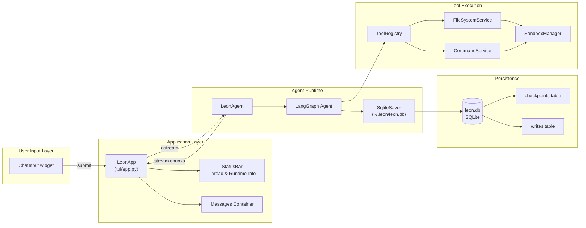

**Key Components:**

| Component | Type | Location | Purpose |
|-----------|------|----------|---------|
| `LeonApp` | Textual App | [tui/app.py:62]() | Main TUI container |
| `ChatInput` | Widget | [tui/widgets/chat_input.py]() | Message input field |
| `LeonAgent` | Runtime | [core/runtime/agent.py]() | Agent orchestration |
| `SqliteSaver` | Checkpointer | External (langgraph) | Conversation persistence |
| `ToolRegistry` | Service | [core/tools/registry.py]() | Tool management |
| `SandboxManager` | Service | [sandbox/manager.py]() | Execution environment |

Sources: [tui/app.py:62-176](), [tui/app.py:298-527](), [core/runtime/agent.py]()

## Understanding Your First Interaction

### Message Flow

When you type a message and press Enter:

1. **User Input** → `ChatInput.on_submit()` emits `ChatInput.Submitted` event
2. **Event Handler** → `LeonApp.on_chat_input_submitted()` receives event
3. **User Message Rendering** → Immediately mount `UserMessage` widget (visible before agent starts)
4. **Agent Execution** → Start async worker calling `agent.astream()`
5. **Streaming Updates** → Process chunks: text content, tool calls, tool results
6. **Real-time Display** → Update `AssistantMessage`, `ToolCallMessage`, `ToolResultMessage` widgets
7. **State Transition** → AgentState: IDLE → ACTIVE → IDLE

### Thread Management

Each conversation is identified by a `thread_id`:
- **Format**: `"tui-{8-char-hex}"` (TUI) or `"chat-{8-char-hex}"` (Web)
- **Persistence**: Stored in SQLite checkpointer at `~/.leon/leon.db`
- **Session Tracking**: `SessionManager` maintains thread list in `~/.leon/sessions.json`

View all threads:
```bash
leonai thread ls
```

Resume a thread:
```bash
leonai --thread tui-abc12345
```

Sources: [tui/app.py:198-212](), [tui/app.py:298-527](), [tui/leon_cli.py:47-96](), [tui/leon_cli.py:763-778]()

## Model Selection

### Virtual Models

Leon uses virtual model aliases that map to concrete models:

| Virtual Model | Default Mapping | Use Case |
|--------------|----------------|----------|
| `leon:mini` | Fast, economical model | Quick tasks, high throughput |
| `leon:medium` | Balanced performance | General-purpose work |
| `leon:large` | High capability | Complex reasoning, coding |
| `leon:max` | Most capable | Difficult problems, research |

### Model Configuration Priority

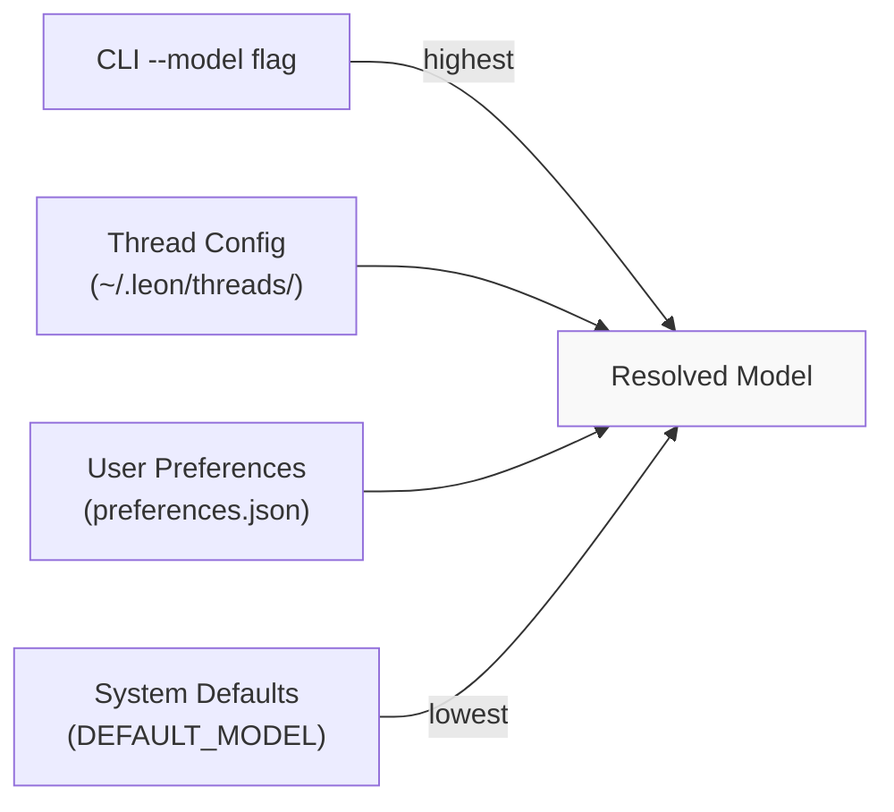

Change model mid-conversation (Web UI):
- Model selector in header
- Per-thread model persistence
- Hot-reload without restarting agent

Sources: [backend/web/routers/settings.py:226-236](), [backend/web/routers/settings.py:249-268](), [config/models_schema.py:94-148]()

## Workspace and Sandbox

### Workspace Directory

The **workspace** is the root directory the agent operates in:
- Default: Current working directory (`cwd`)
- Set via: `--workspace` flag or Settings page
- All file operations are scoped to this directory

### Sandbox Providers

For code execution, Leon uses sandbox providers:

| Provider | Location | Use Case |
|----------|----------|----------|
| `local` | Host machine | Development, trusted code |
| `docker` | Local containers | Isolation, reproducibility |
| `e2b` | Cloud sandbox | Production, scalability |
| `agentbay` | Cloud sandbox | Managed infrastructure |
| `daytona` | Cloud IDE | Development environments |

Default provider is `local`. Configure others via Settings page or `~/.leon/sandboxes/*.json`.

Sources: [tui/leon_cli.py:720-722](), [tui/leon_cli.py:226-301](), [sandbox/providers]()

## TUI Key Bindings

Essential keyboard shortcuts:

| Key | Action |
|-----|--------|
| `Enter` | Send message |
| `Shift+Enter` | New line in input |
| `ESC ESC` | Time travel (checkpoint browser) |
| `Ctrl+C` | Interrupt agent (or exit if not running) |
| `Ctrl+D` | Quit immediately |
| `Ctrl+L` | Clear conversation history |
| `Ctrl+E` | Export conversation to markdown |
| `Ctrl+Y` | Copy last assistant message |
| `Ctrl+↑/↓` | Navigate input history |

Sources: [tui/app.py:105-114]()

## Next Steps

Now that you have Leon running, explore:

- **[User Interfaces](#3)** - Learn about Web UI, TUI, and CLI in depth
- **[Core Concepts](#4)** - Understand threads, agents, sandboxes, and tools
- **[Configuration and Settings](#9)** - Customize models, providers, and workspaces
- **[Agent Runtime](#5)** - Deep dive into how the agent works
- **[Sandbox System](#6)** - Configure execution environments

For troubleshooting:
- Check `~/.leon/config.json` exists and has valid API keys
- Verify Python version: `python --version` (must be ≥3.12)
- Test model access: `leonai run "hi"` with `-d` flag for debug output
- View logs: Check console output for errors during startup

Sources: [tui/leon_cli.py:572-797](), [tui/app.py:1-797]()

---

# Page: User Interfaces

# User Interfaces

<details>
<summary>Relevant source files</summary>

The following files were used as context for generating this wiki page:

- [agent.py](agent.py)
- [frontend/app/src/api/message-mapper.ts](frontend/app/src/api/message-mapper.ts)
- [frontend/app/src/api/types.ts](frontend/app/src/api/types.ts)
- [frontend/app/src/components/CenteredInputBox.tsx](frontend/app/src/components/CenteredInputBox.tsx)
- [frontend/app/src/components/DragHandle.tsx](frontend/app/src/components/DragHandle.tsx)
- [frontend/app/src/components/ModelSelector.tsx](frontend/app/src/components/ModelSelector.tsx)
- [frontend/app/src/components/NewChatDialog.tsx](frontend/app/src/components/NewChatDialog.tsx)
- [frontend/app/src/components/Sidebar.tsx](frontend/app/src/components/Sidebar.tsx)
- [frontend/app/src/components/chat-area/AssistantBlock.tsx](frontend/app/src/components/chat-area/AssistantBlock.tsx)
- [frontend/app/src/components/chat-area/NoticeBubble.tsx](frontend/app/src/components/chat-area/NoticeBubble.tsx)
- [frontend/app/src/hooks/stream-event-handlers.ts](frontend/app/src/hooks/stream-event-handlers.ts)
- [frontend/app/src/hooks/use-stream-handler.ts](frontend/app/src/hooks/use-stream-handler.ts)
- [frontend/app/src/hooks/use-thread-manager.ts](frontend/app/src/hooks/use-thread-manager.ts)
- [frontend/app/src/hooks/use-workspace-settings.ts](frontend/app/src/hooks/use-workspace-settings.ts)
- [frontend/app/src/main.tsx](frontend/app/src/main.tsx)
- [frontend/app/src/pages/AppLayout.tsx](frontend/app/src/pages/AppLayout.tsx)
- [frontend/app/src/pages/ChatPage.tsx](frontend/app/src/pages/ChatPage.tsx)
- [frontend/app/src/pages/NewChatPage.tsx](frontend/app/src/pages/NewChatPage.tsx)
- [frontend/app/src/pages/RootLayout.tsx](frontend/app/src/pages/RootLayout.tsx)
- [frontend/app/src/router.tsx](frontend/app/src/router.tsx)
- [pyproject.toml](pyproject.toml)
- [tui/app.py](tui/app.py)
- [tui/leon_cli.py](tui/leon_cli.py)
- [tui/runner.py](tui/runner.py)
- [tui/widgets/status.py](tui/widgets/status.py)
- [uv.lock](uv.lock)

</details>


Mycel provides three distinct user interfaces for interacting with AI agents, each optimized for different use cases and environments. This page documents the architecture, entry points, and key components of each interface.

For detailed information about the backend APIs that power these interfaces, see [Backend Architecture](#8). For information about real-time streaming architecture, see [Real-time Streaming and Event Handling](#7.3).

---

## Overview of Interface Options

Mycel supports three user interfaces that share the same agent runtime and backend services:

| Interface | Entry Point | Primary Use Case | Key Technologies |
|-----------|-------------|------------------|------------------|
| **Web UI** | `http://localhost:8000` | Rich visual interaction, multi-tab workflows | React, TypeScript, Server-Sent Events |
| **Terminal UI (TUI)** | `leonai` command | Local terminal sessions, keyboard-driven workflows | Textual, Python |
| **CLI** | `leonai run`, `leonai thread`, etc. | Scripting, automation, non-interactive execution | argparse, Python asyncio |

All three interfaces communicate with the same FastAPI backend and share thread state through SQLite persistence.

**Sources**: [pyproject.toml:1-137](), [tui/leon_cli.py:1-797](), [frontend/app/src/main.tsx:1-55]()

---

## Web Interface Architecture

The web interface is a React single-page application (SPA) that provides the richest visual experience for interacting with Leon agents.

### Application Entry and Routing

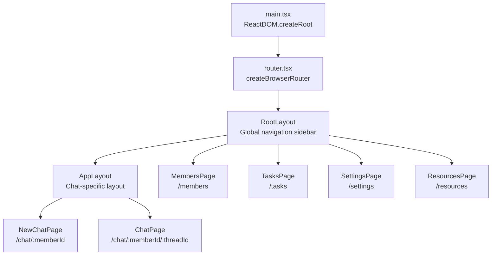

**Application Bootstrap Flow**:

1. [frontend/app/src/main.tsx:49-54]() - React strict mode mount
2. [frontend/app/src/router.tsx:13-66]() - Browser router configuration with nested routes
3. [frontend/app/src/pages/RootLayout.tsx:24-178]() - Global navigation shell
4. [frontend/app/src/pages/AppLayout.tsx:15-101]() - Chat layout with sidebar and thread management

**Sources**: [frontend/app/src/main.tsx:1-55](), [frontend/app/src/router.tsx:1-67](), [frontend/app/src/pages/RootLayout.tsx:1-200](), [frontend/app/src/pages/AppLayout.tsx:1-140]()

---

### Chat Interface Components

The chat interface (`ChatPage`) is the core interaction point, orchestrating multiple sub-components and real-time streaming.

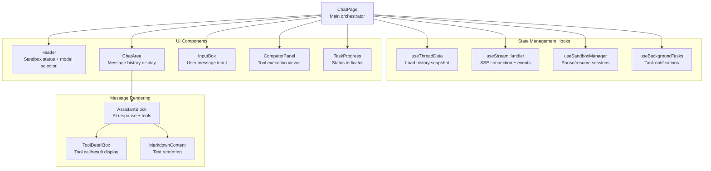

**Key Component Responsibilities**:

- **ChatPage** [frontend/app/src/pages/ChatPage.tsx:28-220]() - Root component, mounts with `key={threadId}` to reset state on thread change
- **ChatArea** - Renders message history, handles scrolling, displays `AssistantBlock` and `UserMessage` entries
- **AssistantBlock** [frontend/app/src/components/chat-area/AssistantBlock.tsx:92-170]() - Renders assistant turns with text segments, tool calls, and streaming indicators
- **InputBox** - Text input with sandbox/model selectors, handles Enter to send, Shift+Enter for newline
- **ComputerPanel** - Side panel showing tool execution details, agent hierarchy, and step-by-step flow

**Sources**: [frontend/app/src/pages/ChatPage.tsx:1-221](), [frontend/app/src/components/chat-area/AssistantBlock.tsx:1-171]()

---

### Real-Time Event Flow

The web interface uses Server-Sent Events (SSE) for real-time streaming of agent responses.

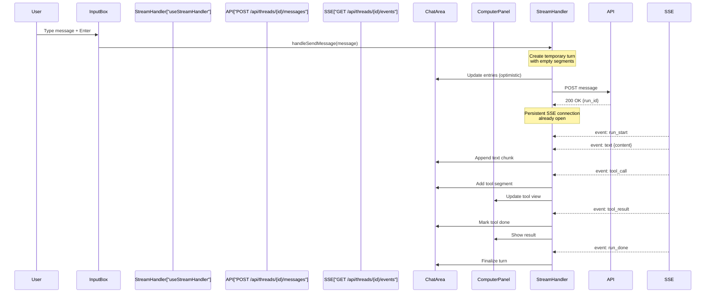

**Event Processing Pipeline**:

1. [frontend/app/src/hooks/use-stream-handler.ts:72-268]() - `useStreamHandler` hook manages connection and turn state
2. [frontend/app/src/hooks/use-thread-stream.ts]() - `useThreadStream` maintains persistent SSE connection
3. [frontend/app/src/hooks/stream-event-handlers.ts:233-267]() - `processStreamEvent()` routes events to handlers
4. [frontend/app/src/api/message-mapper.ts:169-180]() - `mapBackendEntries()` converts history snapshots to UI format

**Critical Implementation Details**:

- **Persistent Connection**: SSE connection stays open across multiple runs (no reconnect on each message)
- **Turn Grouping**: Events with same `run_id` are grouped into a single `AssistantTurn`
- **Optimistic UI**: User message and empty assistant turn created immediately, then populated by events
- **State Synchronization**: `flushSync()` used to ensure turn ID is set before processing batched events

**Sources**: [frontend/app/src/hooks/use-stream-handler.ts:1-269](), [frontend/app/src/hooks/stream-event-handlers.ts:1-268]()

---

### New Chat Creation Flow

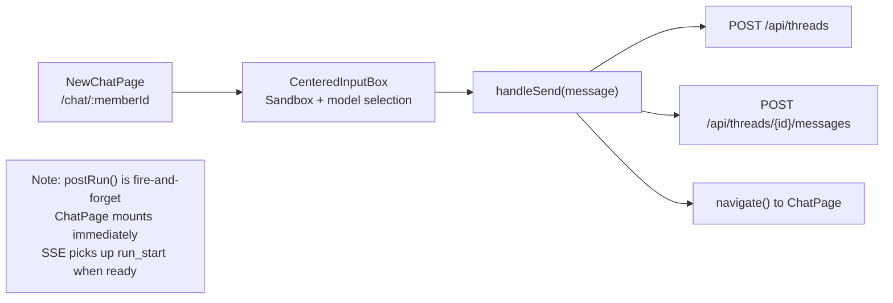

**Flow Explanation**:

1. User types message in `CenteredInputBox` [frontend/app/src/components/CenteredInputBox.tsx:80-93]()
2. `handleSend()` in `NewChatPage` [frontend/app/src/pages/NewChatPage.tsx:28-46]():
   - Creates thread via `handleCreateThread()`
   - Fires `postRun()` without awaiting (fire-and-forget)
   - Navigates immediately to `ChatPage` with state `{runStarted: true}`
3. `ChatPage` mounts with optimistic user message + empty assistant turn
4. SSE connection starts at `seq=0` to catch buffered events
5. Agent creation completes (3-5s), `run_start` event arrives

**Sources**: [frontend/app/src/pages/NewChatPage.tsx:1-106](), [frontend/app/src/components/CenteredInputBox.tsx:1-280]()

---

## Terminal UI (TUI)

The Terminal UI provides a full-screen interactive experience using the Textual framework.

### TUI Application Structure

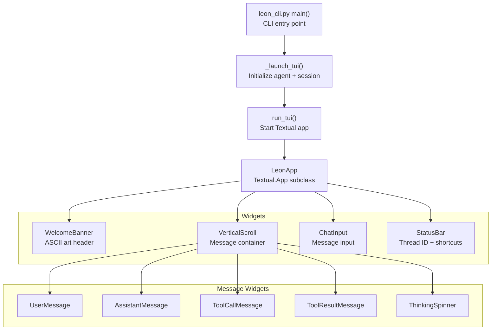

**TUI Entry Point Flow**:

1. [tui/leon_cli.py:572-612]() - `main()` parses arguments and routes to subcommands
2. [tui/leon_cli.py:707-761]() - `_launch_tui()` creates agent and session manager
3. [tui/app.py:116-165]() - `LeonApp.__init__()` sets up state and registers callbacks
4. [tui/app.py:157-176]() - `LeonApp.on_mount()` loads history and registers wake handler

**Sources**: [tui/leon_cli.py:572-797](), [tui/app.py:1-800]()

---

### TUI Message Handling

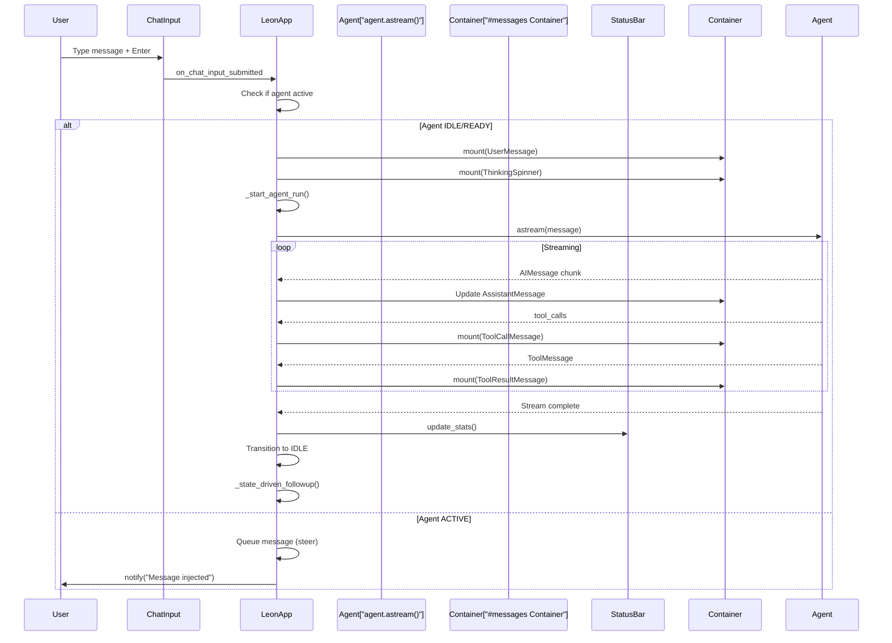

**Message Processing Details**:

- [tui/app.py:198-212]() - `on_chat_input_submitted()` routes based on agent state
- [tui/app.py:298-332]() - `_handle_submission()` mounts user message with `await` for immediate render
- [tui/app.py:333-528]() - `_process_message()` streams agent response and mounts widgets
- [tui/app.py:530-534]() - `_state_driven_followup()` processes queued messages when agent becomes IDLE

**TUI-Specific Features**:

- **Refocus Input**: [tui/app.py:178-187]() - Click anywhere refocuses input after processing events
- **Double ESC**: [tui/app.py:189-196]() - Opens time-travel checkpoint browser
- **Keyboard Shortcuts**: Ctrl+Y (copy), Ctrl+E (export), Ctrl+L (clear), Ctrl+↑/↓ (history)
- **Command Mode**: [tui/app.py:214-246]() - `/help`, `/clear`, `/history`, `/resume`, `/rollback N`, `/compact`

**Sources**: [tui/app.py:157-800](), [tui/widgets/status.py:1-70]()

---

## Command Line Interface (CLI)

The CLI provides non-interactive and scripting capabilities through `leonai` commands.

### CLI Command Structure

```mermaid
graph TB
    main["main()<br/>Argument parser"]
    
    subgraph "Commands"
        launchTui["Launch TUI<br/>(default, no command)"]
        config["config [show]<br/>Interactive setup"]
        thread["thread ls|history|rewind|rm"]
        sandbox["sandbox ls|new|pause|resume|rm"]
        run["run [message]<br/>Non-interactive execution"]
    end
    
    subgraph "Thread Management"
        threadList["cmd_thread_list()<br/>List all threads"]
        threadHistory["cmd_thread_history()<br/>Show checkpoints"]
        threadRewind["cmd_thread_rewind()<br/>Time travel"]
        threadRm["cmd_thread_rm()<br/>Delete thread"]
    end
    
    subgraph "Sandbox Management"
        sandboxList["_cmd_sandbox_list()<br/>List sessions"]
        sandboxNew["_cmd_sandbox_new()<br/>Create session"]
        sandboxPause["_cmd_sandbox_pause()"]
        sandboxResume["_cmd_sandbox_resume()"]
        sandboxMetrics["_cmd_sandbox_metrics()"]
    end
    
    subgraph "Run Modes"
        runSingle["Single message"]
        runStdin["stdin (blank line separator)"]
        runInteractive["Interactive readline"]
    end
    
    main --> launchTui
    main --> config
    main --> thread
    main --> sandbox
    main --> run
    
    thread --> threadList
    thread --> threadHistory
    thread --> threadRewind
    thread --> threadRm
    
    sandbox --> sandboxList
    sandbox --> sandboxNew
    sandbox --> sandboxPause
    sandbox --> sandboxResume
    sandbox --> sandboxMetrics
    
    run --> runSingle
    run --> runStdin
    run --> runInteractive
```

**Command Categories**:

| Command | Subcommands | Purpose |
|---------|-------------|---------|
| `leonai` | *(none)* | Launch TUI with optional `--thread`, `--model`, `--sandbox`, `--agent` flags |
| `leonai config` | `show` | Interactive API key setup, display current configuration |
| `leonai thread` | `ls`, `history <id>`, `rewind <id> <checkpoint>`, `rm <id>` | Thread lifecycle and time-travel management |
| `leonai sandbox` | *(none)*, `ls`, `new [provider]`, `pause <id>`, `resume <id>`, `rm <id>`, `metrics <id>` | Sandbox session management (TUI or CLI) |
| `leonai run` | `"message"`, `--stdin`, `-i`, `-d` | Non-interactive execution modes |

**Sources**: [tui/leon_cli.py:572-797]()

---

### CLI Run Modes

The `leonai run` command supports multiple execution patterns for automation and scripting.

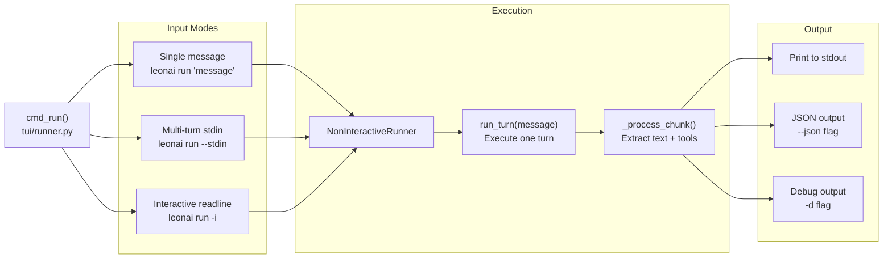

**Run Mode Details**:

1. **Single Message** [tui/runner.py:246-279]() - Execute one turn, print response, exit
   ```bash
   leonai run "Explain the agent architecture"
   ```

2. **Multi-Turn via stdin** [tui/runner.py:281-311]() - Read messages separated by blank lines
   ```bash
   echo -e "First question\n\nSecond question" | leonai run --stdin
   ```

3. **Interactive Mode** [tui/runner.py:313-349]() - Simple readline loop (no TUI)
   ```bash
   leonai run -i
   ```

4. **Debug Output** [tui/runner.py:39-42]() - Show tool calls, token stats, runtime state
   ```bash
   leonai run -d "Complex task"
   ```

**NonInteractiveRunner Implementation**:

- [tui/runner.py:21-40]() - Constructor initializes agent and debug flags
- [tui/runner.py:44-109]() - `run_turn()` executes one conversation turn with timing
- [tui/runner.py:174-233]() - `_process_chunk()` extracts AIMessage content and tool calls
- [tui/runner.py:111-172]() - Debug output shows tokens, cost, context usage, memory stats

**Sources**: [tui/runner.py:1-349](), [tui/leon_cli.py:700-705]()

---

### CLI Thread Management

Thread management commands provide programmatic access to conversation history and checkpointing.

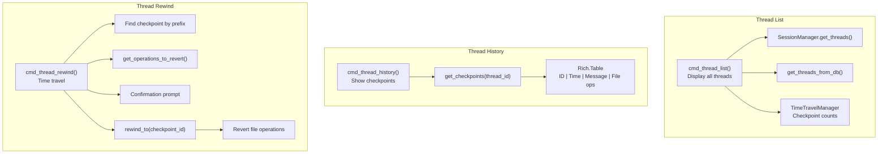

**Thread Command Examples**:

```bash
# List all threads with message counts and last active time
leonai thread ls

# Show checkpoint history for a specific thread
leonai thread history tui-abc12345

# Rewind to a previous checkpoint (time travel)
leonai thread rewind tui-abc12345 checkpoint-xyz -y

# Delete a thread
leonai thread rm tui-abc12345 -y
```

**Implementation Details**:

- [tui/leon_cli.py:47-96]() - `cmd_thread_list()` displays threads with Rich table
- [tui/leon_cli.py:99-143]() - `cmd_thread_history()` shows checkpoints with file operation counts
- [tui/leon_cli.py:146-202]() - `cmd_thread_rewind()` performs time travel with confirmation
- [tui/leon_cli.py:204-224]() - `cmd_thread_rm()` deletes thread from session manager

**Sources**: [tui/leon_cli.py:47-224]()

---

### CLI Sandbox Management

The `leonai sandbox` command provides both CLI and TUI interfaces for managing sandbox sessions.

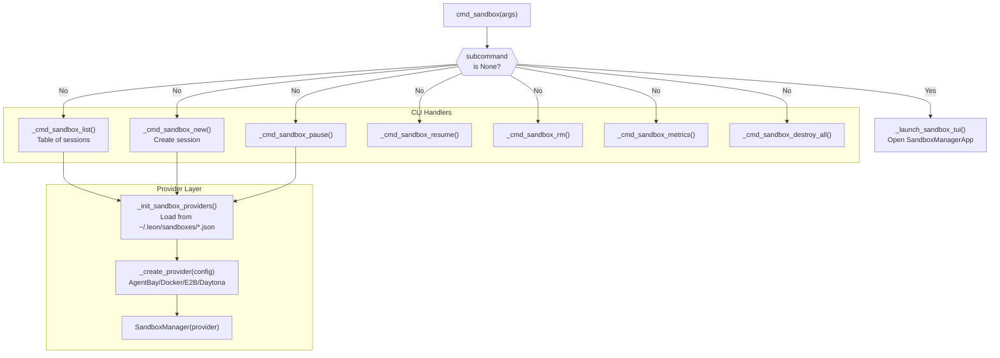

**Sandbox Command Examples**:

```bash
# Launch interactive TUI for managing sessions
leonai sandbox

# List all active sandbox sessions
leonai sandbox ls

# Create new session with default provider
leonai sandbox new

# Create session with specific provider
leonai sandbox new agentbay

# Pause a running session
leonai sandbox pause abc123

# Resume a paused session
leonai sandbox resume abc123

# Show resource metrics for a session
leonai sandbox metrics abc123

# Destroy all sessions (confirmation required)
leonai sandbox destroy-all-sessions
```

**Implementation Details**:

- [tui/leon_cli.py:334-372]() - `cmd_sandbox()` dispatches to subcommand handlers
- [tui/leon_cli.py:374-387]() - `_launch_sandbox_tui()` starts Textual sandbox manager
- [tui/leon_cli.py:226-251]() - `_init_sandbox_providers()` loads configs and creates providers
- [tui/leon_cli.py:253-302]() - `_create_provider()` instantiates provider from config
- [tui/leon_cli.py:389-409]() - `_cmd_sandbox_list()` displays session table
- [tui/leon_cli.py:506-539]() - `_cmd_sandbox_metrics()` shows CPU/memory/disk/network stats

**Sources**: [tui/leon_cli.py:226-570]()

---

## Interface Comparison

| Feature | Web UI | TUI | CLI |
|---------|--------|-----|-----|
| **Launch Command** | `uvicorn` or production server | `leonai` | `leonai run [options]` |
| **Primary Use Case** | Visual exploration, multi-tab workflows | Local terminal, keyboard-driven | Scripting, automation, CI/CD |
| **Message Display** | Rich HTML/CSS rendering | Textual widgets | Plain text or JSON |
| **Real-Time Updates** | SSE streaming | Async widget updates | Buffered output |
| **Tool Visualization** | ComputerPanel with collapsible steps | ToolCallMessage/ToolResultMessage widgets | Text output with optional debug |
| **Thread Management** | Sidebar with search | `/history` command + time travel | `leonai thread ls/history/rewind/rm` |
| **Sandbox Management** | Header status + modal dialogs | `/resume` command | `leonai sandbox [subcommand]` |
| **Multi-Threading** | Yes (browser tabs) | No (single thread per session) | Yes (separate process per thread) |
| **Offline Support** | No | Yes (local mode) | Yes (local mode) |
| **Mobile Support** | Yes (responsive design) | No | No |

**Sources**: [frontend/app/src/pages/ChatPage.tsx:1-221](), [tui/app.py:1-800](), [tui/runner.py:1-349]()

---

## Shared Backend Communication

All three interfaces communicate with the same FastAPI backend through REST and SSE endpoints.

```mermaid
graph TB
    subgraph "User Interfaces"
        webUI["Web UI<br/>React SPA"]
        tui["TUI<br/>Textual App"]
        cli["CLI<br/>Non-interactive"]
    end
    
    subgraph "Backend API Endpoints"
        threads["/api/threads"]
        messages["/api/threads/{id}/messages"]
        events["/api/threads/{id}/events"]
        settings["/api/settings"]
        panel["/api/panel"]
        resources["/api/resources"]
    end
    
    subgraph "Backend Services"
        streamingSvc["streaming_service.py<br/>SSE & Agent Execution"]
        agentPool["agent_pool.py<br/>Per-thread Agents"]
        taskSvc["task_service.py<br/>Task CRUD"]
        sandboxSvc["sandbox_service.py<br/>Session Management"]
    end
    
    subgraph "Persistence"
        sqlite[("SQLite<br/>threads.db")]
        filesystem[("File System<br/>~/.leon/")]
    end
    
    webUI -->|HTTP + SSE| threads
    webUI -->|HTTP + SSE| messages
    webUI -->|SSE| events
    
    tui -->|No HTTP<br/>Direct agent.astream()| agentPool
    cli -->|No HTTP<br/>Direct agent.astream()| agentPool
    
    webUI -->|HTTP| settings
    webUI -->|HTTP| panel
    webUI -->|HTTP| resources
    
    threads --> streamingSvc
    messages --> streamingSvc
    events --> streamingSvc
    
    streamingSvc --> agentPool
    streamingSvc --> sqlite
    
    settings --> filesystem
    panel --> taskSvc
    resources --> sandboxSvc
    
    taskSvc --> sqlite
    sandboxSvc --> sqlite
```

**Key Differences**:

- **Web UI**: Uses HTTP/SSE for all communication, requires backend server running
- **TUI/CLI**: Bypass backend, call `agent.astream()` directly, write to SQLite directly

**Sources**: [frontend/app/src/api/index.ts](), [tui/app.py:333-528](), [tui/runner.py:44-109]()

---

# Page: Web Interface

# Web Interface

<details>
<summary>Relevant source files</summary>

The following files were used as context for generating this wiki page:

- [frontend/app/src/api/message-mapper.ts](frontend/app/src/api/message-mapper.ts)
- [frontend/app/src/api/types.ts](frontend/app/src/api/types.ts)
- [frontend/app/src/components/CenteredInputBox.tsx](frontend/app/src/components/CenteredInputBox.tsx)
- [frontend/app/src/components/ChatArea.tsx](frontend/app/src/components/ChatArea.tsx)
- [frontend/app/src/components/ComputerPanel.tsx](frontend/app/src/components/ComputerPanel.tsx)
- [frontend/app/src/components/DragHandle.tsx](frontend/app/src/components/DragHandle.tsx)
- [frontend/app/src/components/Header.tsx](frontend/app/src/components/Header.tsx)
- [frontend/app/src/components/InputBox.tsx](frontend/app/src/components/InputBox.tsx)
- [frontend/app/src/components/ModelSelector.tsx](frontend/app/src/components/ModelSelector.tsx)
- [frontend/app/src/components/NewChatDialog.tsx](frontend/app/src/components/NewChatDialog.tsx)
- [frontend/app/src/components/NewThreadModal.tsx](frontend/app/src/components/NewThreadModal.tsx)
- [frontend/app/src/components/SandboxSessionsModal.tsx](frontend/app/src/components/SandboxSessionsModal.tsx)
- [frontend/app/src/components/Sidebar.tsx](frontend/app/src/components/Sidebar.tsx)
- [frontend/app/src/components/TaskProgress.tsx](frontend/app/src/components/TaskProgress.tsx)
- [frontend/app/src/components/chat-area/AssistantBlock.tsx](frontend/app/src/components/chat-area/AssistantBlock.tsx)
- [frontend/app/src/components/chat-area/NoticeBubble.tsx](frontend/app/src/components/chat-area/NoticeBubble.tsx)
- [frontend/app/src/hooks/stream-event-handlers.ts](frontend/app/src/hooks/stream-event-handlers.ts)
- [frontend/app/src/hooks/use-stream-handler.ts](frontend/app/src/hooks/use-stream-handler.ts)
- [frontend/app/src/hooks/use-thread-manager.ts](frontend/app/src/hooks/use-thread-manager.ts)
- [frontend/app/src/hooks/use-workspace-settings.ts](frontend/app/src/hooks/use-workspace-settings.ts)
- [frontend/app/src/main.tsx](frontend/app/src/main.tsx)
- [frontend/app/src/pages/AppLayout.tsx](frontend/app/src/pages/AppLayout.tsx)
- [frontend/app/src/pages/ChatPage.tsx](frontend/app/src/pages/ChatPage.tsx)
- [frontend/app/src/pages/NewChatPage.tsx](frontend/app/src/pages/NewChatPage.tsx)
- [frontend/app/src/pages/RootLayout.tsx](frontend/app/src/pages/RootLayout.tsx)
- [frontend/app/src/router.tsx](frontend/app/src/router.tsx)
- [frontend/app/vite.config.ts](frontend/app/vite.config.ts)

</details>


This page documents the React-based web application for Mycel, including its architecture, navigation structure, chat interface, real-time streaming features, and component organization. For information about the Terminal UI, see [Terminal UI (TUI)](#3.2). For CLI usage, see [Command Line Interface](#3.3).

## Application Architecture

The web interface is a single-page React application built with TypeScript, React Router, and Zustand for state management. The application follows a hierarchical layout structure with persistent navigation and dynamic route-based content.

### Technology Stack

| Technology | Purpose |
|------------|---------|
| React 18 | UI framework with concurrent features |
| TypeScript | Type-safe development |
| React Router | Client-side routing |
| Zustand | Global state management |
| Vite | Build tool and dev server |
| Tailwind CSS | Styling framework |
| Lucide React | Icon library |

**Sources:** [frontend/app/vite.config.ts:1-48](), [frontend/app/src/main.tsx:1-55]()

### Application Entry Point

The application bootstraps in `main.tsx`, which:
1. Intercepts `console.log` to send logs to backend at `/api/debug/log`
2. Renders the router with StrictMode enabled
3. Provides a global toast notification system

**Diagram: Application Bootstrap Flow**

```mermaid
graph TB
    main["main.tsx<br/>Application Entry"]
    router["React Router<br/>createBrowserRouter"]
    root["RootLayout<br/>/"]
    app["AppLayout<br/>/chat"]
    pages["Page Components"]
    
    main --> router
    router --> root
    root --> app
    root --> pages
    
    toaster["Sonner Toaster<br/>Global Notifications"]
    logger["Console Interceptor<br/>/api/debug/log"]
    
    main --> toaster
    main --> logger
```

**Sources:** [frontend/app/src/main.tsx:1-55](), [frontend/app/src/router.tsx:1-67]()

## Navigation Structure

### Route Hierarchy

The application defines a nested route structure with two main layouts: `RootLayout` for global navigation and `AppLayout` for chat-specific features.

**Diagram: Route Hierarchy**

```mermaid
graph TB
    root["RootLayout<br/>/"]
    chat["AppLayout<br/>/chat"]
    newChat["NewChatPage<br/>/chat/:memberId"]
    chatPage["ChatPage<br/>/chat/:memberId/:threadId"]
    members["MembersPage<br/>/members"]
    tasks["TasksPage<br/>/tasks"]
    resources["ResourcesPage<br/>/resources"]
    settings["SettingsPage<br/>/settings"]
    
    root --> chat
    root --> members
    root --> tasks
    root --> resources
    root --> settings
    
    chat --> newChat
    chat --> chatPage
```

**Sources:** [frontend/app/src/router.tsx:13-66]()

### RootLayout Component

`RootLayout` provides the application shell with:

- **Collapsible sidebar** with drag-to-resize functionality ([frontend/app/src/pages/RootLayout.tsx:83-113]())
- **Navigation items**: Messages, Members, Tasks, Resources, Library
- **User profile** display with avatar
- **Create button** with dropdown menu for new chat/member/task
- **Mobile-responsive** layout with bottom tab bar

The sidebar auto-collapses when entering `/chat` routes and expands when leaving, optimizing screen space for conversations.

**Diagram: RootLayout Component Structure**

```mermaid
graph TB
    root["RootLayout"]
    sidebar["Sidebar Nav<br/>Collapsible"]
    outlet["React Router Outlet<br/>Child Routes"]
    dragHandle["Drag Handle<br/>Resize Control"]
    createBtn["Create Button<br/>+ Dropdown Menu"]
    
    root --> sidebar
    root --> outlet
    sidebar --> dragHandle
    sidebar --> createBtn
    
    navItems["Navigation Items"]
    userProfile["User Profile<br/>Avatar + Name"]
    
    sidebar --> navItems
    sidebar --> userProfile
```

**Sources:** [frontend/app/src/pages/RootLayout.tsx:24-271]()

### AppLayout Component

`AppLayout` wraps chat-related routes and provides:

- **Thread sidebar** ([Sidebar.tsx]()) with thread list grouped by agent
- **Thread management** hooks via `useThreadManager`
- **Modals**: NewThreadModal, SearchModal, SandboxSessionsModal
- **Responsive behavior**: Mobile shows thread list or chat, never both

**Sources:** [frontend/app/src/pages/AppLayout.tsx:1-159]()

## Chat Interface

The chat interface is the primary interaction point, composed of several coordinated components that handle message display, input, and real-time updates.

### ChatPage Component

`ChatPage` ([frontend/app/src/pages/ChatPage.tsx]()) is the main container that orchestrates:

1. **Thread data loading** via `useThreadData` hook
2. **Real-time streaming** via `useStreamHandler` hook
3. **Sandbox management** via `useSandboxManager` hook
4. **Background tasks** via `useBackgroundTasks` hook
5. **UI state** via `useAppActions` hook

**Key Pattern:** The component uses a remount strategy - wrapping the inner component with `key={threadId}` forces a full remount when switching threads, resetting all hook state naturally ([frontend/app/src/pages/ChatPage.tsx:27-32]()).

**Diagram: ChatPage Component Hierarchy**

```mermaid
graph TB
    chatPage["ChatPage<br/>Container + Remount Key"]
    inner["ChatPageInner<br/>Main Logic"]
    
    header["Header<br/>Sandbox Status + Model"]
    chatArea["ChatArea<br/>Message Display"]
    inputBox["InputBox<br/>Message Input"]
    computerPanel["ComputerPanel<br/>Agent Activity"]
    taskProgress["TaskProgress<br/>Status Bar"]
    tokenStats["TokenStats<br/>Cost Display"]
    
    chatPage --> inner
    inner --> header
    inner --> chatArea
    inner --> inputBox
    inner --> computerPanel
    inner --> taskProgress
    inner --> tokenStats
```

**Sources:** [frontend/app/src/pages/ChatPage.tsx:1-221]()

### ChatArea Component

`ChatArea` renders the conversation history as a scrollable list. It maps over `entries` and renders different components based on entry type:

| Entry Type | Component | Purpose |
|------------|-----------|---------|
| `"user"` | `UserBubble` | User messages |
| `"assistant"` | `AssistantBlock` | AI responses with tools/text |
| `"notice"` | `NoticeBubble` | System notifications |

The component uses `useStickyScroll` to automatically scroll to bottom during streaming while allowing user to scroll up.

**Sources:** [frontend/app/src/components/ChatArea.tsx:1-50]()

### AssistantBlock Component

`AssistantBlock` renders AI turns with sophisticated phase-based rendering:

1. **Phase splitting**: Segments are split at `notice` boundaries ([frontend/app/src/components/chat-area/AssistantBlock.tsx:17-31]())
2. **Tool visualization**: `ToolDetailBox` shows tool calls and results
3. **Text rendering**: `MarkdownContent` renders final text response
4. **Streaming indicators**: `ThinkingIndicator` shows during initial boot

**Diagram: AssistantBlock Rendering Flow**

```mermaid
graph TB
    assistantBlock["AssistantBlock"]
    splitPhases["splitPhases()<br/>Group by Notice"]
    
    contentPhase["ContentPhaseBlock<br/>Tools + Text"]
    noticePhase["NoticeDivider<br/>System Notification"]
    
    toolBox["ToolDetailBox<br/>Tool Execution"]
    markdown["MarkdownContent<br/>Text Response"]
    thinking["ThinkingIndicator<br/>Loading State"]
    
    assistantBlock --> splitPhases
    splitPhases --> contentPhase
    splitPhases --> noticePhase
    
    contentPhase --> toolBox
    contentPhase --> markdown
    contentPhase --> thinking
```

**Sources:** [frontend/app/src/components/chat-area/AssistantBlock.tsx:1-171]()

### InputBox Component

The input box provides message composition with:

- **Auto-resize textarea** that grows up to 160px
- **Enter to send**, Shift+Enter for newline
- **Queue message mode**: During streaming, allows sending steer messages
- **Stop button**: Shows when streaming and input is empty

**Sources:** [frontend/app/src/components/InputBox.tsx:1-123]()

### NewChatPage Component

`NewChatPage` provides the welcome screen for new conversations with:

- **Model selector** with virtual models (Mini/Medium/Large/Max) and custom models
- **Sandbox selector** dropdown
- **Workspace picker** for local sandbox (browse/recent/manual tabs)
- **Capability tags** showing what the agent can do

The page fires `postRun` immediately on send, then navigates to `ChatPage` with `runStarted: true` state, allowing the chat page to show optimistic UI while the backend prepares the agent.

**Sources:** [frontend/app/src/pages/NewChatPage.tsx:1-106]()

## Real-time Streaming

The web interface uses Server-Sent Events (SSE) for real-time updates. The streaming architecture ensures that text and tool execution updates appear incrementally as the agent works.

### SSE Connection Management

The `useThreadStream` hook (referenced in `useStreamHandler`) maintains a persistent SSE connection:

1. **Connection lifecycle**: Opens `/api/threads/{threadId}/events` on mount
2. **Automatic reconnection**: Retries with exponential backoff on disconnect
3. **Sequence tracking**: Uses `?from_seq=N` to resume from last received event
4. **Run detection**: Monitors `isRunning` state from status events

**Sources:** [frontend/app/src/hooks/use-stream-handler.ts:72-268]()

### Stream Event Processing

The `useStreamHandler` hook processes events and updates UI state:

**Diagram: Stream Event Flow**

```mermaid
graph TB
    sse["SSE Connection<br/>/api/threads/{id}/events"]
    buffer["ThreadEventBuffer<br/>Backend Buffer"]
    handler["useStreamHandler<br/>Event Processor"]
    
    subscriber["Event Subscriber<br/>Callback"]
    updater["State Updater<br/>onUpdate Callback"]
    
    entries["ChatEntry[]<br/>React State"]
    assistantTurn["AssistantTurn<br/>Streaming Segments"]
    
    sse --> buffer
    buffer --> handler
    handler --> subscriber
    subscriber --> updater
    updater --> entries
    entries --> assistantTurn
```

**Event Types and Handlers:**

| Event Type | Handler | Purpose |
|-----------|---------|---------|
| `text` | `handleText` | Append text chunks to current turn |
| `tool_call` | `handleToolCall` | Create/update tool segment |
| `tool_result` | `handleToolResult` | Mark tool as done with result |
| `task_start` | `handleTaskStart` | Initialize subagent stream |
| `task_done` | `handleTaskDone` | Mark subagent complete |
| `error` | `handleError` | Append error message |
| `cancelled` | `handleCancelled` | Mark tools as cancelled |
| `retry` | `handleRetry` | Show retry indicator |
| `notice` | special handling | Insert notice entry or segment |
| `run_start` | lifecycle | Ensure turn exists |
| `run_done` | lifecycle | Finalize turn |
| `status` | lifecycle | Update runtime status |

**Sources:** [frontend/app/src/hooks/stream-event-handlers.ts:1-268](), [frontend/app/src/api/types.ts:1-234]()

### Turn Grouping and Message Binding

The system implements sophisticated turn grouping logic:

1. **Temporary ID assignment**: User sends message → creates temp turn ID
2. **Server ID binding**: First event with `message_id` binds to temp ID ([frontend/app/src/hooks/use-stream-handler.ts:188-200]())
3. **Run-based grouping**: Backend injects `run_id` in metadata to group messages
4. **Notice folding**: System messages with same `run_id` fold into the current turn as notice segments

This ensures that multi-step agent runs (LLM call → tool → LLM call) render as a single cohesive turn.

**Sources:** [frontend/app/src/hooks/use-stream-handler.ts:44-70](), [frontend/app/src/api/message-mapper.ts:99-121]()

### Reconnection and Resume

When the SSE connection drops mid-run, the system:

1. **Detects reconnection**: `useThreadStream` re-establishes connection
2. **Reuses last turn**: `applyReconnectTurn` marks the last assistant turn as streaming ([frontend/app/src/hooks/use-stream-handler.ts:44-70]())
3. **Requests from last seq**: Uses `?from_seq=N` to get missed events
4. **Prevents duplication**: `hasBoundRef` ensures message ID binds only once

**Sources:** [frontend/app/src/hooks/use-stream-handler.ts:114-202]()

## Thread Management

### Sidebar Component

The `Sidebar` component provides thread navigation with:

- **Agent grouping**: Threads grouped by agent name
- **Collapsible groups**: Chevron toggles expand/collapse
- **Live status indicators**: Running spinner, updated timestamps
- **Bulk operations**: Select mode for multi-delete
- **Responsive width**: Drag-to-resize handle

**Diagram: Sidebar Thread Organization**

```mermaid
graph TB
    sidebar["Sidebar Component"]
    search["Search Input<br/>Filter Threads"]
    groups["Thread Groups<br/>By Agent"]
    
    group1["Leon Group<br/>Collapsed/Expanded"]
    group2["Test Researcher Group"]
    
    thread1["Thread Item<br/>Preview + Timestamp"]
    thread2["Thread Item"]
    thread3["Thread Item"]
    
    actions["Action Bar<br/>Select/Delete"]
    
    sidebar --> search
    sidebar --> groups
    groups --> group1
    groups --> group2
    
    group1 --> thread1
    group1 --> thread2
    group2 --> thread3
    
    sidebar --> actions
```

**Key Features:**

- **Auto-expand**: Most recent agent group expands on first load ([frontend/app/src/components/Sidebar.tsx:254-259]())
- **Active indicator**: Left border line marks current thread
- **Delete confirmation**: Two-step delete (click → confirm) for single threads
- **Select mode**: Long-press or click "管理" enters bulk mode ([frontend/app/src/components/Sidebar.tsx:184-215]())

**Sources:** [frontend/app/src/components/Sidebar.tsx:1-449]()

### Thread Creation Flow

**Diagram: Thread Creation Flow**

```mermaid
sequenceDiagram
    participant User
    participant NewChatPage
    participant ThreadManager
    participant Backend
    participant ChatPage
    
    User->>NewChatPage: "Types message + selects model"
    NewChatPage->>ThreadManager: "handleCreateThread(sandbox, cwd)"
    ThreadManager->>Backend: "POST /api/threads"
    Backend-->>ThreadManager: "{thread_id}"
    ThreadManager-->>NewChatPage: "thread_id"
    NewChatPage->>Backend: "POST /api/threads/{id}/messages"
    Note over NewChatPage: "Fire-and-forget postRun"
    NewChatPage->>ChatPage: "navigate with state.runStarted=true"
    ChatPage->>ChatPage: "Shows optimistic spinner"
    Backend-->>ChatPage: "SSE: run_start event arrives"
```

The create-then-navigate pattern allows instant navigation while the agent initializes in the background (3-5s for first call).

**Sources:** [frontend/app/src/pages/NewChatPage.tsx:28-46](), [frontend/app/src/hooks/use-thread-manager.ts:53-59]()

## Agent Activity Visualization

### ComputerPanel Component

The `ComputerPanel` provides a side panel showing real-time agent execution details:

**Tabs:**
1. **Agents**: Hierarchical view of main agent + sub-agents
2. **Steps**: Flat chronological list of all tool calls
3. **Flow**: Visual flowchart of execution sequence

The panel is toggled via the TaskProgress bar button and resizable via drag handle.

**Sources:** [frontend/app/src/components/ComputerPanel.tsx:1-4]()

### Tool Visualization

Tool execution is visualized with:

- **Tool cards**: Show name, arguments, and result
- **Status indicators**: Calling (spinner), done (checkmark), error (X)
- **Subagent expansion**: Agent tool calls expand to show nested execution
- **Markdown rendering**: Results rendered with syntax highlighting

**Sources:** [frontend/app/src/components/chat-area/AssistantBlock.tsx:57-64]()

## State Management

The web interface uses a hybrid state management approach:

### Global State (Zustand)

`AppStore` ([frontend/app/src/store/app-store.ts]()) maintains:
- **Member list**: Agent configurations
- **User profile**: Name, email, initials
- **Task list**: Background tasks
- **Settings**: Workspace, models

**Sources:** Referenced in [frontend/app/src/pages/RootLayout.tsx:32-35]()

### Local State (React Hooks)

**Custom Hooks:**

| Hook | Purpose |
|------|---------|
| `useThreadManager` | Thread list, CRUD operations |
| `useStreamHandler` | SSE connection, event processing |
| `useThreadData` | Load thread history, sandbox info |
| `useSandboxManager` | Pause/resume sandbox controls |
| `useBackgroundTasks` | Poll background task status |
| `useAppActions` | ComputerPanel toggle, agent focus |
| `useWorkspaceSettings` | Workspace configuration |

**Sources:** [frontend/app/src/hooks/use-thread-manager.ts:1-75](), [frontend/app/src/hooks/use-stream-handler.ts:1-269]()

### State Flow Pattern

**Diagram: State Management Pattern**

```mermaid
graph TB
    appStore["AppStore<br/>Zustand Global"]
    
    threadMgr["useThreadManager<br/>Thread List"]
    streamHandler["useStreamHandler<br/>SSE + Entries"]
    threadData["useThreadData<br/>History Load"]
    
    chatPage["ChatPage Component"]
    chatArea["ChatArea Component"]
    sidebar["Sidebar Component"]
    
    appStore --> threadMgr
    threadMgr --> chatPage
    threadMgr --> sidebar
    
    streamHandler --> chatPage
    threadData --> chatPage
    
    chatPage --> chatArea
```

**Sources:** [frontend/app/src/pages/ChatPage.tsx:82-113]()

## Component Hierarchy

**Complete Component Tree:**

```mermaid
graph TB
    main["main.tsx<br/>Bootstrap"]
    router["BrowserRouter"]
    root["RootLayout<br/>Global Nav"]
    
    appLayout["AppLayout<br/>Chat Container"]
    otherPages["Other Pages<br/>Members/Tasks/etc"]
    
    sidebar["Sidebar<br/>Thread List"]
    outlet["Outlet<br/>Route Content"]
    
    newChat["NewChatPage<br/>Welcome Screen"]
    chat["ChatPage<br/>Active Conversation"]
    
    header["Header<br/>Controls"]
    chatArea["ChatArea<br/>Messages"]
    inputBox["InputBox<br/>Compose"]
    taskProgress["TaskProgress<br/>Status Bar"]
    computerPanel["ComputerPanel<br/>Activity"]
    
    assistantBlock["AssistantBlock<br/>AI Turn"]
    userBubble["UserBubble<br/>User Message"]
    noticeBubble["NoticeBubble<br/>System Notice"]
    
    main --> router
    router --> root
    root --> appLayout
    root --> otherPages
    
    appLayout --> sidebar
    appLayout --> outlet
    outlet --> newChat
    outlet --> chat
    
    chat --> header
    chat --> chatArea
    chat --> inputBox
    chat --> taskProgress
    chat --> computerPanel
    
    chatArea --> assistantBlock
    chatArea --> userBubble
    chatArea --> noticeBubble
```

**Sources:** [frontend/app/src/main.tsx:49-54](), [frontend/app/src/pages/RootLayout.tsx:191-270](), [frontend/app/src/pages/AppLayout.tsx:56-100](), [frontend/app/src/pages/ChatPage.tsx:151-219]()

## Mobile Responsiveness

The interface adapts to mobile devices:

- **Bottom tab navigation**: Replaces sidebar with tab bar
- **Full-screen chat**: Thread list and chat never shown simultaneously
- **Touch-optimized**: Larger tap targets, swipe gestures
- **Safe area handling**: Respects notch/home indicator with `env(safe-area-inset-bottom)`

**Sources:** [frontend/app/src/pages/RootLayout.tsx:156-187](), [frontend/app/src/pages/AppLayout.tsx:34-54]()

---

**Key Takeaways:**

1. The web interface uses a **persistent SSE connection** for real-time updates
2. **Turn grouping** by `run_id` ensures multi-step agent executions render cohesively
3. **Remount strategy** (key={threadId}) simplifies state management when switching threads
4. **Phase-based rendering** allows notices to split assistant turns into logical sections
5. **Optimistic UI** shows spinners immediately while agent initializes in background

---

# Page: Terminal UI (TUI)

# Terminal UI (TUI)

<details>
<summary>Relevant source files</summary>

The following files were used as context for generating this wiki page:

- [agent.py](agent.py)
- [pyproject.toml](pyproject.toml)
- [tui/app.py](tui/app.py)
- [tui/leon_cli.py](tui/leon_cli.py)
- [tui/runner.py](tui/runner.py)
- [tui/widgets/status.py](tui/widgets/status.py)
- [uv.lock](uv.lock)

</details>


The Terminal UI (TUI) is a full-featured terminal-based interface for Mycel built using the [Textual framework](https://textual.textualize.io/). It provides a rich, interactive chat experience directly in the terminal with real-time message streaming, tool execution visualization, and advanced features like time travel and conversation management. 

The TUI is the primary interactive interface for local development and terminal-based workflows. For web-based usage, see [Web Interface](#3.1). For non-interactive command-line execution, see [Command Line Interface](#3.3).

Sources: [tui/app.py:1-913](), [pyproject.toml:34]()

---

## Application Architecture

The TUI is implemented as a Textual `App` subclass called `LeonApp` that orchestrates the entire user interface. Textual provides a reactive, component-based framework similar to modern web frameworks but for terminal applications.

### Core Application Structure

```mermaid
graph TB
    subgraph "LeonApp (Main Application)"
        Header[Header<br/>Textual Built-in]
        ChatContainer[VerticalScroll#chat-container<br/>Scrollable Area]
        InputContainer[Container#input-container<br/>Input Area]
        StatusBar[StatusBar#status-bar<br/>Custom Widget]
        Footer[Footer<br/>Textual Built-in]
    end
    
    subgraph "Chat Container Contents"
        WelcomeBanner[WelcomeBanner<br/>Static Banner]
        MessagesContainer[Container#messages<br/>Message List]
    end
    
    subgraph "Message Types"
        UserMessage[UserMessage<br/>User Input Display]
        AssistantMessage[AssistantMessage<br/>AI Response Display]
        ToolCallMessage[ToolCallMessage<br/>Tool Execution]
        ToolResultMessage[ToolResultMessage<br/>Tool Output]
        SystemMessage[SystemMessage<br/>System Notifications]
        ThinkingSpinner[ThinkingSpinner<br/>Loading Indicator]
    end
    
    subgraph "Input Area"
        ChatInput[ChatInput<br/>Multi-line Input Widget]
    end
    
    LeonApp --> Header
    LeonApp --> ChatContainer
    LeonApp --> InputContainer
    LeonApp --> StatusBar
    LeonApp --> Footer
    
    ChatContainer --> WelcomeBanner
    ChatContainer --> MessagesContainer
    
    MessagesContainer -.contains.-> UserMessage
    MessagesContainer -.contains.-> AssistantMessage
    MessagesContainer -.contains.-> ToolCallMessage
    MessagesContainer -.contains.-> ToolResultMessage
    MessagesContainer -.contains.-> SystemMessage
    MessagesContainer -.contains.-> ThinkingSpinner
    
    InputContainer --> ChatInput
    
    style LeonApp fill:#e1f5ff
    style MessagesContainer fill:#fff4e1
    style ChatInput fill:#ffe1e1
```

**Diagram 1: Textual Widget Hierarchy**

The `LeonApp` class manages the entire application lifecycle and coordinates between the agent runtime, message display, and user input.

Sources: [tui/app.py:62-166]()

### Key Application Properties

| Property | Type | Purpose |
|----------|------|---------|
| `agent` | `LeonAgent` | The agent instance handling AI interactions |
| `workspace_root` | `Path` | Working directory for file operations |
| `thread_id` | `str` | Unique identifier for the conversation thread |
| `session_mgr` | `SessionManager` | Manages thread persistence and history |
| `_agent_worker` | `Worker` | Textual worker for async agent execution |
| `_current_assistant_msg` | `AssistantMessage` | Currently streaming assistant message widget |
| `_shown_tool_calls` | `set` | Tracks displayed tool calls to prevent duplicates |
| `_message_count` | `int` | Number of messages in current thread |

Sources: [tui/app.py:116-132]()

---

## Main Components

### ChatInput Widget

The `ChatInput` widget provides a multi-line text input area with command history and special command handling. It supports:

- **Multi-line input**: Shift+Enter for new lines, Enter to submit
- **Command history**: Ctrl+Up/Down to navigate previous inputs
- **Command palette**: Special commands like `/help`, `/clear`, `/history`
- **Double-ESC detection**: Opens time travel interface

Sources: [tui/app.py:99-102](), [tui/widgets/chat_input.py]() (referenced but not provided)

### Message Widgets

Each message type is rendered as a separate widget mounted in the `#messages` container:

| Widget Class | Purpose | Visual Style |
|--------------|---------|--------------|
| `UserMessage` | Display user input | Blue border, user icon |
| `AssistantMessage` | Display AI responses with streaming updates | Green border, assistant icon |
| `ToolCallMessage` | Show tool execution with name and arguments | Yellow/orange, collapsible |
| `ToolResultMessage` | Display tool execution results | Gray, indented |
| `SystemMessage` | Show system notifications and help text | Cyan, informational |
| `ThinkingSpinner` | Animated loading indicator during agent execution | Animated dots |

Sources: [tui/app.py:17](), [tui/widgets/messages.py]() (referenced)

### StatusBar Widget

The `StatusBar` displays contextual information at the bottom of the screen:

```
Leon Agent | Thread: tui-abc123 | 消息: 5 | Ctrl+↑/↓: 历史 | Ctrl+E: 导出 | Ctrl+Y: 复制
```

It dynamically updates to show:
- Current thread ID
- Message count
- Runtime status (when agent is executing)
- Available keyboard shortcuts

Sources: [tui/widgets/status.py:1-70]()

---

## Message Flow and Streaming

### User Input to Agent Execution

```mermaid
sequenceDiagram
    participant User
    participant ChatInput
    participant LeonApp
    participant AgentWorker as "Textual Worker"
    participant Agent as "LeonAgent"
    participant MessagesContainer as "#messages Container"
    participant ChatContainer as "#chat-container"
    
    User->>ChatInput: Types message + Enter
    ChatInput->>LeonApp: on_chat_input_submitted(event)
    LeonApp->>LeonApp: _handle_special_command()?
    
    alt Special command (/help, /clear, etc.)
        LeonApp->>MessagesContainer: mount(SystemMessage)
    else Agent is ACTIVE
        LeonApp->>Agent: queue_manager.enqueue(steer)
        LeonApp->>User: Notify "Message queued"
    else Normal execution
        LeonApp->>Agent: runtime.transition(ACTIVE)
        LeonApp->>AgentWorker: run_worker(_handle_submission)
        
        AgentWorker->>MessagesContainer: await mount(UserMessage)
        AgentWorker->>MessagesContainer: await mount(ThinkingSpinner)
        AgentWorker->>ChatContainer: scroll_end()
        AgentWorker->>LeonApp: refresh() + sleep(0.05)
        
        AgentWorker->>Agent: agent.astream(message, config)
        
        loop For each chunk
            Agent-->>AgentWorker: chunk (AIMessage/ToolMessage)
            AgentWorker->>AgentWorker: _process_chunk()
            
            alt Text content
                AgentWorker->>MessagesContainer: Remove ThinkingSpinner
                AgentWorker->>MessagesContainer: mount(AssistantMessage)
                AgentWorker->>AssistantMessage: update_content(text)
            else Tool call
                AgentWorker->>MessagesContainer: mount(ToolCallMessage)
            else Tool result
                AgentWorker->>ToolCallMessage: mark_completed()
                AgentWorker->>MessagesContainer: mount(ToolResultMessage)
            end
        end
        
        AgentWorker->>Agent: runtime.transition(IDLE)
        AgentWorker->>ChatInput: focus_input()
    end
```

**Diagram 2: Message Submission and Streaming Flow**

Sources: [tui/app.py:198-213](), [tui/app.py:298-528]()

### Critical Rendering Sequence

The TUI ensures the user message is **visible before** agent execution begins to provide immediate feedback:

1. **Await mount**: Use `await messages_container.mount(user_msg)` to ensure synchronous rendering
2. **Force refresh**: Call `self.refresh()` to update the screen
3. **Sleep briefly**: `await asyncio.sleep(0.05)` gives UI time to paint
4. **Then process**: Only after visual confirmation, start agent processing

This prevents the common UX issue where the user sees a delay before their message appears.

Sources: [tui/app.py:298-332]()

### Streaming Updates

The `AssistantMessage` widget supports incremental content updates during streaming:

```python
# In _process_message
if content and content != last_content:
    if not self._current_assistant_msg:
        self._current_assistant_msg = AssistantMessage()
        await messages_container.mount(self._current_assistant_msg)
    
    # Throttle updates to avoid excessive refreshes
    current_time = time.time()
    if current_time - last_update_time >= update_interval:
        self._current_assistant_msg.update_content(content)
        last_update_time = current_time
```

Updates are throttled to 50ms intervals (`update_interval = 0.05`) to balance responsiveness with performance.

Sources: [tui/app.py:436-454]()

---

## Keyboard Shortcuts and Commands

### Global Keyboard Bindings

| Shortcut | Action | Implementation |
|----------|--------|----------------|
| `Ctrl+D` | Quit application | `action_quit()` |
| `Ctrl+L` | Clear conversation history | `action_clear_history()` |
| `Ctrl+Up` | Previous input from history | `action_history_up()` |
| `Ctrl+Down` | Next input from history | `action_history_down()` |
| `Ctrl+E` | Export conversation to Markdown | `action_export_conversation()` |
| `Ctrl+Y` | Copy last assistant message | `action_copy_last_message()` |
| `ESC` | Interrupt running agent | `action_interrupt_agent()` |
| `ESC ESC` | Open time travel (checkpoint browser) | `action_time_travel()` |

Sources: [tui/app.py:105-114]()

### Slash Commands

Users can type special commands in the chat input:

| Command | Effect |
|---------|--------|
| `/help` | Display help information with all shortcuts and commands |
| `/clear` | Clear conversation and start new thread |
| `/history` | Open input history browser |
| `/resume` | Switch to a different conversation thread |
| `/rollback N` or `/回退 N` | Revert input to N steps ago |
| `/compact` | Manually trigger memory compaction |
| `/exit` or `/quit` | Exit the application |

Sources: [tui/app.py:214-246]()

---

## Advanced Features

### Time Travel and Checkpointing

The TUI integrates with LangGraph's checkpointing system to enable "time travel" - reverting the conversation to a previous state.

**Time Travel Flow:**

```mermaid
graph LR
    subgraph "User Action"
        DoubleESC["Double ESC"]
    end
    
    subgraph "TimeTravelManager"
        GetCheckpoints["get_checkpoints()<br/>Query SQLite"]
        FilterUserTurns["Filter user_turns_only=True"]
    end
    
    subgraph "CheckpointBrowser Widget"
        DisplayList["Display checkpoint list<br/>with metadata"]
        UserSelection["User selects checkpoint"]
    end
    
    subgraph "Rewind Execution"
        GetOpsToRevert["get_operations_to_revert()<br/>File operations since checkpoint"]
        RevertFiles["Revert file changes"]
        TruncateCheckpoint["Truncate checkpoint history"]
        ReloadMessages["Reload messages from checkpoint"]
    end
    
    DoubleESC --> GetCheckpoints
    GetCheckpoints --> FilterUserTurns
    FilterUserTurns --> DisplayList
    DisplayList --> UserSelection
    UserSelection --> GetOpsToRevert
    GetOpsToRevert --> RevertFiles
    RevertFiles --> TruncateCheckpoint
    TruncateCheckpoint --> ReloadMessages
    
    style DoubleESC fill:#e1f5ff
    style CheckpointBrowser fill:#ffe1e1
    style RewindExecution fill:#fff4e1
```

**Diagram 3: Time Travel Feature Architecture**

The `TimeTravelManager` tracks file operations at each checkpoint and can revert them when rewinding:

1. **Checkpoint Recording**: Each user turn creates a checkpoint with associated file operations
2. **Selection**: User browses checkpoints and selects target
3. **Impact Analysis**: System shows which file operations will be reverted
4. **Execution**: Files are reverted, checkpoint history is truncated, UI reloads

Sources: [tui/app.py:752-797](), [tui/time_travel.py]() (referenced)

### History Browser

The `HistoryBrowser` widget displays previous user inputs for quick access:

- Triggered by `/history` command or programmatically
- Shows list of all previous inputs in current session
- User can select an input to populate the chat input field
- Implements fuzzy search/filtering

Sources: [tui/app.py:572-590](), [tui/widgets/history_browser.py]() (referenced)

### Thread Selector

The `ThreadSelector` widget enables switching between conversation threads:

- Triggered by `/resume` command
- Lists all available threads with metadata (message count, first message preview)
- Switching threads clears current display and loads selected thread history
- Integrates with `SessionManager` for thread persistence

Sources: [tui/app.py:799-845](), [tui/widgets/thread_selector.py]() (referenced)

---

## State Management and Queue Integration

### Agent State Tracking

The TUI synchronizes with the agent's runtime state machine to provide accurate status information and handle message routing correctly.

**State-Driven Message Routing:**

| Agent State | User Input Behavior |
|-------------|---------------------|
| `IDLE` | Start new agent run, transition to `ACTIVE` |
| `ACTIVE` | Enqueue message as steer (interrupt/redirect) |
| `SUSPENDED` | Resume and start new run |
| `ERROR` | Recover, transition to `READY`, then `ACTIVE` |

Sources: [tui/app.py:134-138](), [tui/app.py:207-278]()

### Queue-Driven Followups

The TUI registers a wake handler with the agent's `MessageQueueManager` to automatically process queued messages when the agent becomes idle:

```python
def _register_wake_handler(self) -> None:
    """Register wake handler on the unified queue"""
    def wake_handler(item: object) -> None:
        # Schedule followup check on Textual's event loop (thread-safe)
        self.call_later(self._state_driven_followup)
    
    self.agent.queue_manager.register_wake(self.thread_id, wake_handler)
```

When the agent transitions to `IDLE`, the `_on_state_changed` callback triggers `_state_driven_followup`, which dequeues and processes the next message.

Sources: [tui/app.py:146-173](), [tui/app.py:530-534]()

### Observation Provider Integration

The TUI supports optional integration with observation providers (Langfuse, LangSmith) for LLM tracing:

```python
# Observation provider (langfuse / langsmith)
obs_handler = None
obs_config = getattr(self.agent, "observation_config", None)

if obs_config and obs_config.active == "langfuse":
    from langfuse.langchain import CallbackHandler as LangfuseHandler
    obs_handler = LangfuseHandler(public_key=cfg.public_key)
    config.setdefault("callbacks", []).append(obs_handler)
    config.setdefault("metadata", {})["langfuse_session_id"] = self.thread_id

elif obs_config and obs_config.active == "langsmith":
    from langchain_core.tracers.langchain import LangChainTracer
    obs_handler = LangChainTracer(client=ls_client, project_name=cfg.project)
    config.setdefault("callbacks", []).append(obs_handler)
```

Handlers are flushed at the end of each agent run to ensure traces are captured.

Sources: [tui/app.py:365-407](), [tui/app.py:499-508]()

---

## Running the TUI

### Launch Methods

The TUI is launched via the `leonai` CLI command (see [Command Line Interface](#3.3) for full CLI documentation):

```bash
# Basic launch (new conversation)
leonai

# Continue last conversation
leonai -c

# Resume specific thread
leonai --thread tui-abc123

# Specify model
leonai --model claude-3-5-sonnet-20241022

# Specify workspace
leonai --workspace /path/to/project

# Specify sandbox configuration
leonai --sandbox agentbay

# Specify agent preset
leonai --agent coder
```

Sources: [tui/leon_cli.py:572-612](), [tui/leon_cli.py:707-761]()

### Initialization Sequence

```mermaid
graph TB
    CLIEntry["leonai command"]
    ParseArgs["Parse arguments"]
    LoadConfig["ConfigManager.load_to_env()"]
    CheckAPIKey["Check API keys"]
    ResolveThread["Resolve thread_id"]
    AutoDetectSandbox["Auto-detect sandbox<br/>if resuming thread"]
    CreateAgent["create_leon_agent()"]
    CreateApp["LeonApp(agent, workspace, thread_id)"]
    RunApp["app.run()"]
    OnMount["on_mount()"]
    RegisterWake["Register wake handler"]
    LoadHistory["_load_history()"]
    FocusInput["focus_input()"]
    
    CLIEntry --> ParseArgs
    ParseArgs --> LoadConfig
    LoadConfig --> CheckAPIKey
    CheckAPIKey --> ResolveThread
    ResolveThread --> AutoDetectSandbox
    AutoDetectSandbox --> CreateAgent
    CreateAgent --> CreateApp
    CreateApp --> RunApp
    RunApp --> OnMount
    OnMount --> RegisterWake
    RegisterWake --> LoadHistory
    LoadHistory --> FocusInput
    
    style CreateAgent fill:#e1f5ff
    style LeonApp fill:#ffe1e1
    style OnMount fill:#fff4e1
```

**Diagram 4: TUI Initialization Flow**

Sources: [tui/leon_cli.py:707-761](), [tui/app.py:167-177]()

### Session Persistence

The `SessionManager` tracks active threads and persists the last active thread ID:

- **Thread list**: Stored in `~/.leon/tui_sessions.json`
- **Thread metadata**: Retrieved from SQLite checkpoint database
- **Resume behavior**: `-c` flag loads last thread, `--thread` loads specific thread
- **Auto-save**: Thread ID saved on app exit

Sources: [tui/leon_cli.py:707-761](), [tui/session.py]() (referenced)

---

## Configuration and Customization

### CSS Styling

The TUI uses Textual's CSS-like styling system. Key styles are defined in `LeonApp.CSS`:

```python
CSS = """
Screen {
    layout: vertical;
}

#chat-container {
    height: 1fr;
    padding: 1 2;
    background: $background;
    scrollbar-gutter: stable;
}

#input-container {
    height: auto;
    min-height: 3;
    max-height: 10;
    padding: 0 2 1 2;
    background: $surface;
}

ChatInput {
    height: 100%;
    border: solid $primary;
}
"""
```

The `1fr` height for `#chat-container` makes it expand to fill available space, while `#input-container` uses `auto` with constraints to adapt to content.

Sources: [tui/app.py:65-103]()

### Widget Organization

Custom widgets are organized in `tui/widgets/`:

- `chat_input.py` - Multi-line input with history
- `messages.py` - Message display widgets
- `status.py` - Status bar
- `checkpoint_browser.py` - Time travel interface
- `history_browser.py` - Input history browser
- `thread_selector.py` - Thread switching dialog
- `loading.py` - Thinking spinner
- `sandbox_manager.py` - Sandbox session TUI (see [Sandbox Manager TUI](#6.5))

Sources: [tui/app.py:11-19]()

---

## Error Handling and Recovery

### Agent Interruption

When the user presses ESC during agent execution:

1. `action_interrupt_agent()` is called
2. Agent worker is cancelled via `self._agent_worker.cancel()`
3. `asyncio.CancelledError` is caught in `_process_message()`
4. System message "⚠ 已中断" is displayed
5. Agent state transitions to `SUSPENDED`

The user can then send a new message to resume the conversation.

Sources: [tui/app.py:487-492](), [tui/app.py:705-709]()

### Error State Handling

If an exception occurs during agent execution:

1. Exception is caught in `_process_message()` finally block
2. Error message is displayed as `AssistantMessage`
3. Agent runtime state is marked with error via `state.mark_error(e)`
4. State transitions to `ERROR`
5. Next user message triggers recovery: `ERROR → RECOVERING → READY → ACTIVE`

Sources: [tui/app.py:493-498](), [tui/app.py:267-273]()

### Graceful Shutdown

On exit (Ctrl+D or `/exit`):

1. Current thread ID and workspace are saved via `session_mgr.save_session()`
2. Agent resources are cleaned up via `agent.close()`
3. Sandbox sessions remain active (not destroyed) for later resume

Sources: [tui/leon_cli.py:754-760]()

---

## Performance Considerations

### Rendering Optimization

- **Update throttling**: Assistant message updates are throttled to 50ms intervals to prevent excessive screen refreshes during streaming
- **Scroll debouncing**: `scroll_end()` is called with `animate=False` to avoid animation overhead
- **Widget reuse**: `AssistantMessage` widget is reused for incremental updates rather than creating new widgets

Sources: [tui/app.py:348-349](), [tui/app.py:447-453]()

### Memory Management

- **Message history**: All messages remain in the `#messages` container; use `/clear` to reset
- **Tool call tracking**: Sets track shown tool calls/results to prevent duplicates without storing message content
- **Checkpoint browser**: Only loads checkpoints on-demand when time travel is triggered

Sources: [tui/app.py:122-126](), [tui/app.py:752-797]()

### Async Execution

The TUI leverages Textual's async-first architecture:

- Agent execution runs in a Textual `Worker` (managed thread pool)
- All UI updates use `await mount()` for non-blocking rendering
- Callbacks use `call_after_refresh()` and `call_later()` for thread-safe UI updates

Sources: [tui/app.py:176-177](), [tui/app.py:278]()

---

# Page: Command Line Interface

# Command Line Interface

<details>
<summary>Relevant source files</summary>

The following files were used as context for generating this wiki page:

- [agent.py](agent.py)
- [pyproject.toml](pyproject.toml)
- [tui/app.py](tui/app.py)
- [tui/leon_cli.py](tui/leon_cli.py)
- [tui/runner.py](tui/runner.py)
- [tui/widgets/status.py](tui/widgets/status.py)
- [uv.lock](uv.lock)

</details>


This page documents the `leonai` command-line interface (CLI), which provides terminal-based access to Mycel's agent capabilities. The CLI supports multiple execution modes: interactive TUI, non-interactive runs, thread management, sandbox operations, and configuration. For the full-screen Terminal UI experience, see [Terminal UI (TUI)](#3.2). For the web-based interface, see [Web Interface](#3.1).

## Installation and Entry Point

The CLI is installed as the `leonai` command via the package's entry point configuration. When installed, the command becomes globally available in your shell.

**Entry Point Registration:**
- Package name: `leonai`
- Command: `leonai`
- Entry function: `tui.leon_cli:main`

Sources: [pyproject.toml:59-60]()

## Command Architecture

The CLI follows a hierarchical command structure with a main command and multiple subcommands, each with their own options and arguments.

### Command Hierarchy Diagram

```mermaid
graph TB
    leonai["leonai"]
    
    subgraph "Default Mode"
        tui["Launch TUI<br/>(no command)"]
    end
    
    subgraph "Configuration"
        config["config"]
        config_show["config show"]
    end
    
    subgraph "Thread Management"
        thread["thread"]
        thread_ls["thread ls/list"]
        thread_history["thread history &lt;id&gt;"]
        thread_rewind["thread rewind &lt;id&gt; &lt;checkpoint&gt;"]
        thread_rm["thread rm &lt;id&gt;"]
    end
    
    subgraph "Sandbox Management"
        sandbox["sandbox"]
        sandbox_tui["sandbox<br/>(no subcommand)"]
        sandbox_ls["sandbox ls/list"]
        sandbox_new["sandbox new [provider]"]
        sandbox_rm["sandbox rm &lt;id&gt;"]
        sandbox_pause["sandbox pause &lt;id&gt;"]
        sandbox_resume["sandbox resume &lt;id&gt;"]
        sandbox_metrics["sandbox metrics &lt;id&gt;"]
        sandbox_destroy["sandbox destroy-all-sessions"]
    end
    
    subgraph "Non-Interactive Execution"
        run["run"]
        run_single["run &quot;message&quot;"]
        run_stdin["run --stdin"]
        run_interactive["run -i"]
    end
    
    leonai --> tui
    leonai --> config
    leonai --> thread
    leonai --> sandbox
    leonai --> run
    
    config --> config_show
    
    thread --> thread_ls
    thread --> thread_history
    thread --> thread_rewind
    thread --> thread_rm
    
    sandbox --> sandbox_tui
    sandbox --> sandbox_ls
    sandbox --> sandbox_new
    sandbox --> sandbox_rm
    sandbox --> sandbox_pause
    sandbox --> sandbox_resume
    sandbox --> sandbox_metrics
    sandbox --> sandbox_destroy
    
    run --> run_single
    run --> run_stdin
    run --> run_interactive
```

Sources: [tui/leon_cli.py:572-611](), [tui/leon_cli.py:614-650]()

### Main Execution Flow

```mermaid
graph TB
    main["main()"]
    parse["argparse.ArgumentParser"]
    
    main --> parse
    
    parse --> check_help{"args.help?"}
    check_help -->|yes| show_help["_show_main_help()"]
    check_help -->|no| check_command
    
    check_command{"args.command?"}
    check_command -->|config| handle_config["_handle_config_command()"]
    check_command -->|thread| handle_thread["_handle_thread_command()"]
    check_command -->|sandbox| handle_sandbox["_handle_sandbox_command()"]
    check_command -->|run| handle_run["_handle_run_command()"]
    check_command -->|none| launch_tui["_launch_tui()"]
    
    handle_config --> config_interactive["interactive_config()"]
    handle_config --> config_show["show_config()"]
    
    handle_thread --> thread_list["cmd_thread_list()"]
    handle_thread --> thread_history["cmd_thread_history()"]
    handle_thread --> thread_rewind["cmd_thread_rewind()"]
    handle_thread --> thread_rm["cmd_thread_rm()"]
    
    handle_sandbox --> sandbox_tui["SandboxManagerApp().run()"]
    handle_sandbox --> sandbox_handlers["_cmd_sandbox_*()"]
    
    handle_run --> runner["NonInteractiveRunner"]
    
    launch_tui --> create_agent["create_leon_agent()"]
    create_agent --> run_tui["run_tui()"]
```

Sources: [tui/leon_cli.py:572-611](), [tui/leon_cli.py:614-761]()

## Default Mode: Interactive TUI

When invoked without any command, `leonai` launches the full-screen Textual-based Terminal User Interface (TUI). This provides a rich interactive experience with chat history, real-time streaming, keyboard shortcuts, and visual feedback.

**Usage:**
```bash
leonai                          # Start new conversation
leonai -c                       # Continue last conversation
leonai --model claude-3-5-sonnet-20241022  # Use specific model
leonai --agent coder            # Use specific agent preset
leonai --workspace ~/myproject  # Set working directory
leonai --sandbox docker         # Use Docker sandbox
leonai --thread abc123          # Resume specific thread
```

**Common Options:**
| Option | Description |
|--------|-------------|
| `--model <name>` | Override model (e.g., `claude-3-5-sonnet-20241022`, `gpt-4`) |
| `--agent <name>` | Agent preset: `default`, `coder`, `researcher`, `tester` |
| `--workspace <dir>` | Working directory for file operations |
| `--sandbox <name>` | Sandbox configuration from `~/.leon/sandboxes/<name>.json` |
| `--thread <id>` | Resume specific conversation thread |
| `-c, --continue` | Continue last conversation |
| `--profile <path>` | Custom profile configuration file |

**Thread Resolution:**
The system automatically resolves the thread ID in priority order:
1. Explicit `--thread <id>`
2. `--continue` flag (loads last active thread from `SessionManager`)
3. Auto-generate new thread ID with format `tui-{uuid[:8]}`

**Sandbox Auto-Detection:**
When resuming a thread (`--thread` or `--continue`), the CLI automatically detects and loads the sandbox provider used in previous sessions by querying the sandbox database.

Sources: [tui/leon_cli.py:707-761](), [tui/leon_cli.py:763-792]()

For full TUI documentation, see [Terminal UI (TUI)](#3.2).

## Configuration Management

The `config` command provides interactive setup and display of API keys, model preferences, and observation providers.

### Commands

**Interactive Configuration:**
```bash
leonai config
```
Launches an interactive wizard that prompts for:
- API keys (OpenAI, Anthropic)
- Default model preference
- Observation providers (Langfuse, LangSmith)

**Show Current Configuration:**
```bash
leonai config show
```
Displays current configuration values from `~/.leon/config.json` without exposing sensitive keys.

### Configuration Flow

The `interactive_config()` function uses `ConfigManager` to read/write configuration to `~/.leon/config.json`. The configuration is then loaded into environment variables at startup via `config_manager.load_to_env()`.

Sources: [tui/leon_cli.py:652-657](), [tui/leon_cli.py:709-716]()

## Thread Management

Thread commands enable inspection, navigation, and manipulation of conversation history stored in the SQLite checkpoint database.

### Thread List

```bash
leonai thread ls        # List all threads
leonai thread list      # Alias for ls
```

**Output Format:**
```
┏━━━━━━━━━━━━┳━━━━━━┳━━━━━━━━━━━━━━━━━━━━━━━━━━━━┳━━━━━━━━━━━━┳━━━━━━━━┓
┃ Thread ID  ┃ 消息  ┃ 首条消息                    ┃ 最后活跃    ┃ 状态    ┃
┡━━━━━━━━━━━━╇━━━━━━╇━━━━━━━━━━━━━━━━━━━━━━━━━━━━╇━━━━━━━━━━━━╇━━━━━━━━┩
│ tui-a1b2c3 │ 5    │ Read the README.md file     │ 2 小时前   │ (当前) │
│ tui-d4e5f6 │ 12   │ List all Python files       │ 1 天前     │        │
└────────────┴──────┴─────────────────────────────┴────────────┴────────┘
```

**Implementation Details:**
- Retrieves thread list from `SessionManager.get_threads()` (session tracking)
- Enriches with metadata from `SessionManager.get_threads_from_db()` (SQLite)
- Fetches message counts via `TimeTravelManager.get_checkpoints()`
- Displays first message preview and relative time formatting

Sources: [tui/leon_cli.py:47-96]()

### Thread History

```bash
leonai thread history <thread_id>
```

Displays checkpoint history for a specific thread, showing user turns and file operations.

**Output Format:**
```
┏━━━┳━━━━━━━━━━━━━━━┳━━━━━━━━┳━━━━━━━━━━━━━━━━━━━━━━┳━━━━━━━━━━┓
┃ # ┃ Checkpoint ID ┃ 时间    ┃ 消息                  ┃ 文件操作  ┃
┡━━━╇━━━━━━━━━━━━━━━╇━━━━━━━━╇━━━━━━━━━━━━━━━━━━━━━━╇━━━━━━━━━━┩
│ 1 │ abc123...     │ 3 分钟前│ Read the README       │ -        │
│ 2 │ def456...     │ 2 分钟前│ List all files        │ 2        │
│ 3 │ ghi789... (当前)│ 1 分钟前│ Update main.py        │ 1        │
└───┴───────────────┴────────┴───────────────────────┴──────────┘
```

**Data Source:**
Uses `TimeTravelManager.get_checkpoints(thread_id, user_turns_only=True)` to retrieve checkpoint metadata including:
- Checkpoint ID
- Timestamp
- User message
- File operation count
- Current checkpoint indicator

Sources: [tui/leon_cli.py:99-143]()

### Thread Rewind

```bash
leonai thread rewind <thread_id> <checkpoint_id> [-y]
```

Rewinds a thread to a previous checkpoint, reverting file operations and conversation state.

**Interactive Confirmation:**
Without the `-y` flag, displays operations that will be reverted:
```
将撤销 3 个文件操作:
  - write: src/main.py
  - create: src/utils.py
  - edit: README.md
  
确认回退? [y/N]
```

**Execution:**
1. `TimeTravelManager.get_operations_to_revert()` - Identifies file operations to undo
2. User confirmation (unless `-y` provided)
3. `TimeTravelManager.rewind_to()` - Executes rewind operation
4. Displays success/error messages

Sources: [tui/leon_cli.py:146-202]()

### Thread Delete

```bash
leonai thread rm <thread_id> [-y]
```

Permanently deletes a thread from session storage. Requires confirmation unless `-y` flag is provided.

**Safety Mechanism:**
- Prompts for confirmation: `确认删除对话 {thread_id}? [y/N]`
- `-y` or `--yes` flag bypasses confirmation
- Uses `SessionManager.delete_thread()` for deletion

Sources: [tui/leon_cli.py:204-223]()

## Sandbox Management

Sandbox commands provide terminal-based control over execution environment sessions across multiple providers (local, Docker, E2B, Daytona, AgentBay).

### Sandbox TUI Manager

```bash
leonai sandbox
```

Launches the full-screen `SandboxManagerApp` TUI for visual session management. This provides a rich interface for monitoring sessions, viewing metrics, and controlling lifecycle.

Sources: [tui/leon_cli.py:374-386]()

See [Sandbox Manager TUI](#6.5) for detailed documentation.

### Sandbox List

```bash
leonai sandbox ls
leonai sandbox list     # Alias
```

**Output Format:**
```
┏━━━━━━━━━━━━━━━━┳━━━━━━━━┳━━━━━━━━━━━┳━━━━━━━━━━━━┓
┃ Session ID     ┃ Status ┃ Provider  ┃ Thread     ┃
┡━━━━━━━━━━━━━━━━╇━━━━━━━━╇━━━━━━━━━━━╇━━━━━━━━━━━━┩
│ ab12cd34...    │ running│ docker    │ tui-abc123 │
│ ef56gh78...    │ paused │ agentbay  │ tui-def456 │
└────────────────┴────────┴───────────┴────────────┘
```

**Implementation:**
- Loads all sandbox providers from `~/.leon/sandboxes/*.json` via `_init_sandbox_providers()`
- Creates `SandboxManager` instances for each provider
- Parallel fetches session lists via `ThreadPoolExecutor`
- Aggregates and displays sessions across all providers

Sources: [tui/leon_cli.py:389-408](), [tui/leon_cli.py:226-251](), [tui/leon_cli.py:304-323]()

### Sandbox Session Creation

```bash
leonai sandbox new [provider]
```

Creates a new sandbox session. If no provider specified, auto-selects first available from: `agentbay`, `e2b`, `docker`, `daytona`.

**Process:**
1. Load provider configurations from `~/.leon/sandboxes/`
2. Select provider (explicit or auto-detect)
3. Generate thread ID: `sandbox-{random_hex}`
4. Call `SandboxManager.get_or_create_session(thread_id)`
5. Display session ID and thread ID

Sources: [tui/leon_cli.py:411-436]()

### Sandbox Session Control

**Pause:**
```bash
leonai sandbox pause <session_id>
```
Pauses a running session (frees resources while preserving state).

**Resume:**
```bash
leonai sandbox resume <session_id>
```
Resumes a paused session.

**Delete:**
```bash
leonai sandbox rm <session_id>
leonai sandbox delete <session_id>   # Alias
```
Permanently destroys a session and its resources.

**Implementation Pattern:**
All control commands follow the same pattern:
1. Load all sessions via `_load_all_sessions()`
2. Find target session by ID or prefix via `_find_session()`
3. Get appropriate `SandboxManager` for provider
4. Execute operation (`pause_session()`, `resume_session()`, `destroy_session()`)

Sources: [tui/leon_cli.py:439-503]()

### Sandbox Metrics

```bash
leonai sandbox metrics <session_id>
```

Displays resource usage metrics for a session.

**Output Example:**
```
Session: ab12cd34ef56gh78
  CPU:     15.3%
  Memory:  512MB / 2048MB
  Disk:    1.2GB / 10.0GB
  Network: RX 125.0 KB/s | TX 45.3 KB/s
  URL:     https://ab12cd34.agentbay.dev
```

**Data Source:**
Calls `provider.get_metrics(session_id)` which returns a `SessionMetrics` object with CPU, memory, disk, and network statistics. AgentBay provider also includes web URL.

Sources: [tui/leon_cli.py:506-538]()

### Bulk Destroy

```bash
leonai sandbox destroy-all-sessions
```

**Safety Mechanism:**
1. Lists all active sessions
2. Requires explicit confirmation: `Type 'yes' to confirm:`
3. Parallel destruction via `ThreadPoolExecutor`
4. Reports each destroyed session

**Use Case:**
Cleanup utility for development/testing environments with multiple abandoned sessions.

Sources: [tui/leon_cli.py:541-569]()

## Non-Interactive Execution (Run Mode)

The `run` command enables headless, scriptable execution of agent tasks without the TUI. This supports CI/CD integration, batch processing, and programmatic agent invocation.

### Run Mode Architecture

```mermaid
graph TB
    cmd_run["cmd_run()"]
    parse["_parse_run_args()"]
    config["ConfigManager.load_to_env()"]
    
    cmd_run --> config
    cmd_run --> parse
    
    parse --> validate{"Validate<br/>mode"}
    validate -->|invalid| show_help["_show_run_help()"]
    validate -->|valid| create_agent["_create_agent()"]
    
    create_agent --> agent["create_leon_agent()"]
    agent --> runner["NonInteractiveRunner"]
    
    runner --> mode{"Execution<br/>Mode"}
    
    mode -->|message| run_single["run_single()"]
    mode -->|--stdin| run_stdin["run_stdin()"]
    mode -->|--interactive| run_interactive["run_interactive()"]
    
    subgraph "NonInteractiveRunner"
        run_single --> run_turn["run_turn()"]
        run_stdin --> run_turn
        run_interactive --> readline["input() loop"]
        readline --> run_turn
        
        run_turn --> astream["agent.agent.astream()"]
        astream --> process["_process_chunk()"]
        process --> extract["Extract AI response<br/>and tool calls"]
    end
```

Sources: [tui/runner.py:345-398](), [tui/runner.py:21-110]()

### Single Message Execution

```bash
leonai run "message text"
```

Executes a single message and exits. Output defaults to assistant response only (clean mode).

**Example:**
```bash
$ leonai run "List files in current directory"
Here are the files in the current directory:
- main.py
- README.md
- requirements.txt
```

**With Debug Output:**
```bash
$ leonai run -d "Read README.md"

==================================================
=== Turn 1 ===
[USER] Read README.md

[TOOL_CALL] read_file
  path: README.md

[TOOL_RESULT]
  # My Project
  This is a demo project...

[ASSISTANT]
The README.md file contains a project description...

[STATE] IDLE
[TOKENS] total=1234 (in=800, out=434, cache_r=0, cache_w=0, reasoning=0)
[COST] $0.0123
[LLM_CALLS] 1
[CONTEXT] ~1500 tokens (15% of limit)
[MEMORY] summary_cached=no

[TURN] Duration: 2.34s

==================================================
[SUMMARY]
  Thread: run-a1b2c3d4
  Total turns: 1
  Total tool calls: 1
```

Sources: [tui/runner.py:317-332]()

### Stdin Mode (Batch Processing)

```bash
echo -e "First message\n\nSecond message" | leonai run --stdin -d
```

Reads multiple messages from stdin, separated by blank lines. Each message executes as a separate turn within the same conversation thread.

**Use Case:**
- Batch processing workflows
- CI/CD test scenarios
- Scripted multi-turn interactions

**Processing:**
1. Read full stdin content
2. Split by `\n\n` (blank lines)
3. Execute each message sequentially via `run_turn()`
4. Print summary statistics

Sources: [tui/runner.py:301-315]()

### Interactive Readline Mode

```bash
leonai run -i
```

Provides a simple readline-based interactive loop without TUI overhead. Useful for:
- Remote SSH sessions with limited terminal support
- Debugging/testing
- Integration with other terminal tools

**Commands:**
| Command | Action |
|---------|--------|
| `/exit`, `/quit` | Exit the session |
| `/clear` | Start new conversation (new thread ID) |
| `/thread` | Display current thread ID |

**Features:**
- Persistent conversation context
- Simple input/output (no TUI)
- Compatible with pipe/redirect
- Ctrl+C or Ctrl+D to exit

Sources: [tui/runner.py:266-299]()

### Run Mode Options

| Option | Description |
|--------|-------------|
| `MESSAGE` | Single message to execute |
| `--stdin` | Read messages from stdin (blank-line separated) |
| `-i, --interactive` | Interactive readline mode |
| `-d, --debug` | Enable debug output (tool calls, tokens, state) |
| `--json` | JSON output format (single message mode only) |
| `--thread <id>` | Thread ID for multi-turn persistence |
| `--workspace <dir>` | Working directory |
| `--model <name>` | Model override |
| `--sandbox <name>` | Sandbox configuration |

Sources: [tui/runner.py:400-448](), [tui/runner.py:451-471]()

### NonInteractiveRunner Implementation

The `NonInteractiveRunner` class orchestrates agent execution and provides structured output.

**Key Methods:**

| Method | Purpose |
|--------|---------|
| `run_turn(message)` | Execute single conversation turn |
| `run_single(message)` | Single-shot execution |
| `run_stdin()` | Batch stdin processing |
| `run_interactive()` | Interactive readline loop |
| `_process_chunk()` | Extract data from streaming chunks |
| `_print_runtime_state()` | Display token stats and context |

**State Tracking:**
- Turn count
- Total tool call count
- Per-turn tool calls
- Assistant responses
- Duration metrics

**Debug Output:**
When `-d` flag is enabled, displays:
- User messages
- Tool call names and arguments
- Tool result previews
- Token statistics (input, output, cache read/write, reasoning)
- Cost calculations
- Context usage percentage
- Memory middleware state
- Queue sizes (steer/followup)
- Runtime state (ACTIVE/IDLE)

Sources: [tui/runner.py:21-343]()

### Thread Persistence in Run Mode

The `--thread` option enables multi-turn conversations across separate CLI invocations:

```bash
# First message
leonai run --thread task-123 "Create a new Python file called utils.py"

# Continue same conversation
leonai run --thread task-123 "Add a function to read JSON files"

# Further continuation
leonai run --thread task-123 "Write tests for the JSON reader"
```

Each invocation shares the same conversation history stored in the SQLite checkpoint database. The agent maintains context across runs.

**Auto-Detection:**
When resuming a thread, the CLI automatically detects and loads the sandbox provider used previously via `lookup_sandbox_for_thread()`.

Sources: [tui/runner.py:473-484]()

## Global Options

These options apply across all commands and modes:

| Option | Scope | Description |
|--------|-------|-------------|
| `--model <name>` | Agent creation | Override default model (e.g., `claude-3-5-sonnet-20241022`, `gpt-4`) |
| `--agent <name>` | Agent creation | Agent preset: `default`, `coder`, `researcher`, `tester` |
| `--workspace <dir>` | Agent creation | Working directory for file operations (default: `cwd`) |
| `--sandbox <name>` | Agent creation | Sandbox config from `~/.leon/sandboxes/<name>.json` (default: `local`) |
| `--thread <id>` | Thread context | Thread ID for conversation persistence |
| `--profile <path>` | Agent creation | Custom profile configuration file |
| `-c, --continue` | TUI mode only | Continue last conversation |
| `-h, --help` | All | Show help message |

**Model Resolution:**
Priority order: `--model` flag → `MODEL_NAME` env var → `DEFAULT_MODEL` constant

Sources: [tui/leon_cli.py:574-585](), [tui/runner.py:487-513]()

## Provider Configuration Loading

Sandbox providers are loaded dynamically from configuration files at runtime.

### Configuration Discovery Flow

```mermaid
graph TB
    init["_init_sandbox_providers()"]
    scan["Scan ~/.leon/sandboxes/*.json"]
    
    init --> scan
    scan --> load_config["SandboxConfig.load(name)"]
    
    load_config --> create["_create_provider(config)"]
    
    create --> detect{"config.provider?"}
    
    detect -->|agentbay| agentbay["AgentBayProvider"]
    detect -->|docker| docker["DockerProvider"]
    detect -->|e2b| e2b["E2BProvider"]
    detect -->|daytona| daytona["DaytonaProvider"]
    detect -->|local| local["LocalSessionProvider"]
    
    agentbay --> manager["SandboxManager(provider)"]
    docker --> manager
    e2b --> manager
    daytona --> manager
    local --> manager
    
    manager --> providers["providers dict"]
    manager --> managers["managers dict"]
```

**Configuration File Format:**
```json
{
  "provider": "docker",
  "docker": {
    "image": "leonai/sandbox:latest",
    "mount_path": "/workspace"
  }
}
```

**API Key Resolution:**
Providers check configuration files first, then fall back to environment variables:
- AgentBay: `config.agentbay.api_key` → `$AGENTBAY_API_KEY`
- E2B: `config.e2b.api_key` → `$E2B_API_KEY`
- Daytona: `config.daytona.api_key` → `$DAYTONA_API_KEY`

Sources: [tui/leon_cli.py:226-251](), [tui/leon_cli.py:253-301]()

## Exit Codes and Error Handling

The CLI uses Python's default exit code behavior:
- **0**: Successful execution
- **1**: Error (exception, invalid config, missing API key)
- **130**: Interrupted (Ctrl+C)

**Common Error Scenarios:**
- Missing API key → Launches interactive configuration
- Invalid thread ID → Error message, exit 1
- Invalid sandbox config → Warning message, skip provider
- Agent initialization failure → Error message, exit 1

Sources: [tui/leon_cli.py:712-718](), [tui/runner.py:510-513]()

---

# Page: Core Concepts

# Core Concepts

<details>
<summary>Relevant source files</summary>

The following files were used as context for generating this wiki page:

- [agent.py](agent.py)
- [backend/taskboard/middleware.py](backend/taskboard/middleware.py)
- [backend/taskboard/service.py](backend/taskboard/service.py)
- [backend/web/services/member_service.py](backend/web/services/member_service.py)
- [config/defaults/tool_catalog.py](config/defaults/tool_catalog.py)
- [core/agents/communication/service.py](core/agents/communication/service.py)
- [core/agents/service.py](core/agents/service.py)
- [core/runtime/agent.py](core/runtime/agent.py)
- [core/runtime/registry.py](core/runtime/registry.py)
- [core/tools/command/service.py](core/tools/command/service.py)
- [pyproject.toml](pyproject.toml)
- [sandbox/capability.py](sandbox/capability.py)
- [sandbox/manager.py](sandbox/manager.py)
- [tui/app.py](tui/app.py)
- [tui/leon_cli.py](tui/leon_cli.py)
- [tui/runner.py](tui/runner.py)
- [tui/widgets/status.py](tui/widgets/status.py)
- [uv.lock](uv.lock)

</details>


This page introduces the four fundamental abstractions that form the foundation of Mycel's architecture: **Threads**, **Agents**, **Sandboxes**, and **Tools**. Understanding these concepts is essential for working with Mycel, whether as a user configuring agents or a developer extending the system.

For detailed implementation information, see the child pages: [Threads and Chat Sessions](#4.1), [Agents and Members](#4.2), [Sandboxes and Execution Environments](#4.3), and [Tools and Capabilities](#4.4).

---

## System Architecture Overview

The diagram below shows how the four core concepts relate to each other in the system architecture:

**Architecture: Four Core Concepts and Their Relationships**

```mermaid
graph TB
    subgraph "Thread Layer"
        Thread["Thread<br/>(thread_id)"]
        Checkpointer["LangGraph Checkpointer<br/>(AsyncSqliteSaver)"]
        MessageHistory["Message History<br/>(HumanMessage, AIMessage, ToolMessage)"]
    end
    
    subgraph "Agent Layer"
        LeonAgent["LeonAgent<br/>(core/runtime/agent.py)"]
        Member["Member Config<br/>(agent.md + runtime.json)"]
        AgentService["AgentService<br/>(spawns sub-agents)"]
    end
    
    subgraph "Sandbox Layer"
        SandboxManager["SandboxManager<br/>(sandbox/manager.py)"]
        ChatSession["ChatSession<br/>(per thread)"]
        SandboxProvider["SandboxProvider<br/>(local/docker/e2b/daytona/agentbay)"]
    end
    
    subgraph "Tool Layer"
        ToolRegistry["ToolRegistry<br/>(core/runtime/registry.py)"]
        ToolRunner["ToolRunner<br/>(dispatches tool calls)"]
        Services["Services<br/>(FileSystemService, CommandService, etc)"]
    end
    
    Thread --> LeonAgent
    Thread --> Checkpointer
    Thread --> MessageHistory
    
    LeonAgent --> Member
    LeonAgent --> ToolRegistry
    LeonAgent --> SandboxManager
    
    AgentService --> LeonAgent
    
    SandboxManager --> ChatSession
    SandboxManager --> SandboxProvider
    
    ToolRegistry --> ToolRunner
    ToolRunner --> Services
    Services --> SandboxManager
    
    style Thread fill:#e1f5ff
    style LeonAgent fill:#ffe1e1
    style SandboxManager fill:#fff4e1
    style ToolRegistry fill:#e1ffe1
```

Sources: [core/runtime/agent.py:92-268](), [sandbox/manager.py:46-133](), [core/runtime/registry.py:1-80](), [core/agents/service.py:150-199]()

---

## Threads: Conversation Contexts

A **thread** is a persistent conversation context identified by a unique `thread_id` (e.g., `"tui-a3f8b2c1"`, `"subagent-7d4e9a1b"`). Threads serve as:

1. **State isolation** — Each thread has independent conversation history and checkpoint state
2. **Persistence boundary** — All messages, tool calls, and agent state are saved per-thread
3. **Routing key** — Queue messages, sandbox sessions, and sub-agents are associated with threads

### Thread Lifecycle

```mermaid
stateDiagram-v2
    [*] --> Created: thread_id generated
    Created --> Active: First message
    Active --> Active: Message exchange
    Active --> Suspended: User interrupt (ESC)
    Suspended --> Active: Resume
    Active --> Idle: Agent completes
    Idle --> Active: New message
    Idle --> Paused: Idle timeout (sandbox only)
    Paused --> Active: Resume
    Active --> [*]: Thread deleted
```

Sources: [tui/leon_cli.py:763-777](), [tui/app.py:116-177](), [core/runtime/middleware/monitor:1-100]()

### Checkpointing and Persistence

Thread state is persisted via LangGraph's `AsyncSqliteSaver` checkpointer stored in `~/.leon/leon.db`. Each user interaction creates a checkpoint that can be restored for time-travel debugging.

| Component | Storage Location | Purpose |
|-----------|-----------------|---------|
| `AsyncSqliteSaver` | `~/.leon/leon.db` | Message history, agent state, LangGraph checkpoints |
| `TerminalStore` | `~/.leon/sandbox.db` | Terminal state (cwd, env_delta) per thread |
| `LeaseStore` | `~/.leon/sandbox.db` | Sandbox instance bindings per thread |

Sources: [core/runtime/agent.py:293-320](), [sandbox/manager.py:57-64]()

---

## Agents: Intelligent Workers

An **agent** is an autonomous AI worker powered by a Large Language Model (LLM) with access to tools. In Mycel, agents are implemented as `LeonAgent` instances.

### LeonAgent Class

The `LeonAgent` class ([core/runtime/agent.py:92-268]()) is the core agent implementation. Each instance represents one agent with:

- **Model** — LLM configuration resolved from `models.json` (supports virtual names like `leon:mini`, `leon:large`)
- **Workspace** — Root directory for file operations (all paths are absolute)
- **Middleware Stack** — SpillBuffer → Monitor → PromptCaching → Memory → Steering → ToolRunner
- **Tool Registry** — Available capabilities (filesystem, command, web, agents, etc.)
- **Sandbox** — Execution environment (local, Docker, E2B, Daytona, AgentBay)

**Agent Initialization Flow**

```mermaid
sequenceDiagram
    participant Caller
    participant LeonAgent
    participant AgentLoader
    participant ModelsLoader
    participant ToolRegistry
    participant SandboxManager
    
    Caller->>LeonAgent: create_leon_agent(model, workspace, agent)
    LeonAgent->>AgentLoader: load(agent_name)
    AgentLoader-->>LeonAgent: AgentBundle (agent.md + runtime.json)
    LeonAgent->>ModelsLoader: load(model_name)
    ModelsLoader-->>LeonAgent: resolve_model() → actual provider + model
    LeonAgent->>LeonAgent: _create_model() → LLM instance
    LeonAgent->>ToolRegistry: ToolRegistry(blocked_tools)
    LeonAgent->>LeonAgent: _init_services() → register tools
    LeonAgent->>SandboxManager: create_sandbox(config)
    SandboxManager-->>LeonAgent: Sandbox instance
    LeonAgent->>LeonAgent: _build_middleware_stack()
    LeonAgent->>LeonAgent: create_agent() → LangGraph agent
    LeonAgent-->>Caller: LeonAgent instance
```

Sources: [core/runtime/agent.py:107-268](), [config/loader.py:1-50]()

### Members: Agent Configurations

**Members** are pre-configured agent templates stored in `~/.leon/members/{member_name}/`. Each member directory contains:

```
~/.leon/members/researcher/
├── agent.md          # YAML frontmatter + system prompt
├── meta.json         # status, version, timestamps
├── runtime.json      # tools/skills enabled + descriptions
├── rules/            # *.md rule files
├── agents/           # *.md sub-agent definitions
└── .mcp.json         # MCP server configurations
```

The `agent.md` file defines the member's identity:

```markdown
---
name: Researcher
description: Expert at information gathering
model: leon:large
tools: ["*"]  # or specific tool list
---

You are a research specialist...
```

Sources: [backend/web/services/member_service.py:96-156](), [config/loader.py:1-50]()

### Agent Hierarchy

Agents can spawn **sub-agents** for parallel task execution:

```mermaid
graph TB
    Main["Main Agent<br/>thread: tui-a3f8"]
    Sub1["Sub-Agent 1<br/>thread: subagent-7d4e<br/>type: Explore"]
    Sub2["Sub-Agent 2<br/>thread: subagent-9a1c<br/>type: Coder"]
    TaskAgent["Background Task<br/>task_id: 5f2b3d8a"]
    
    Main -->|Agent tool| Sub1
    Main -->|Agent tool<br/>run_in_background=true| TaskAgent
    Sub1 -->|Agent tool| Sub2
    
    Main -.SendMessage.-> Sub1
    Sub1 -.SendMessage.-> Main
```

Sources: [core/agents/service.py:96-253](), [core/agents/communication/service.py:98-118]()

---

## Sandboxes: Execution Environments

A **sandbox** is an isolated execution environment where agents run shell commands and access filesystems. Mycel abstracts sandbox providers behind a unified interface, supporting local execution and remote cloud providers.

### Sandbox Architecture Layers

The sandbox system uses a multi-layer architecture to map threads to physical instances:

**Sandbox Hierarchy: Thread → Instance Mapping**

```mermaid
graph LR
    Thread["Thread<br/>(thread_id)"]
    ChatSession["ChatSession<br/>(session_id)"]
    Runtime["Runtime<br/>(PTY handler)"]
    Terminal["Terminal<br/>(terminal_id)"]
    Lease["Lease<br/>(lease_id)"]
    Instance["Instance<br/>(container/VM)"]
    
    Thread -->|"1:N<br/>multiple terminals"| Terminal
    Terminal -->|"N:1<br/>shared lease"| Lease
    Thread -->|"1:1<br/>active session"| ChatSession
    ChatSession --> Runtime
    ChatSession --> Terminal
    ChatSession --> Lease
    Lease -->|"1:1"| Instance
```

Sources: [sandbox/manager.py:1-133](), [sandbox/capability.py:26-70]()

### SandboxProvider Interface

All sandbox providers implement the `SandboxProvider` abstract interface:

| Provider | Implementation | Use Case |
|----------|---------------|----------|
| `LocalSessionProvider` | [sandbox/providers/local:1-100]() | Direct host access (development) |
| `DockerProvider` | [sandbox/providers/docker:1-150]() | Container isolation (local) |
| `E2BProvider` | [sandbox/providers/e2b:1-200]() | Cloud sandbox (E2B.dev) |
| `DaytonaProvider` | [sandbox/providers/daytona:1-200]() | Cloud IDE workspaces |
| `AgentBayProvider` | [sandbox/providers/agentbay:1-250]() | Agent Cloud VMs |

Each provider declares its capabilities via `ProviderCapability`:

```python
@dataclass
class ProviderCapability:
    pause_resume: bool           # Can pause/resume instances
    metrics: bool                # Provides CPU/memory metrics
    screenshot: bool             # Supports GUI screenshots
    eager_instance_binding: bool # Binds instance on lease creation
    inspect_visible: bool        # Visible in web UI
```

Sources: [sandbox/provider.py:1-100](), [sandbox/capability.py:1-70]()

### Sandbox Manager Orchestration

`SandboxManager` ([sandbox/manager.py:46-593]()) orchestrates the sandbox lifecycle:

1. **get_sandbox(thread_id)** → Returns `SandboxCapability` wrapping `ChatSession`
2. **Lazy initialization** → Creates Terminal → Lease → Instance on first access
3. **Resume-on-demand** → Paused sessions auto-resume on new activity
4. **Idle timeout enforcement** → Pauses expired remote sessions to save costs

Sources: [sandbox/manager.py:134-181](), [sandbox/manager.py:284-368]()

---

## Tools: Agent Capabilities

**Tools** are functions that agents can call to interact with the world. Mycel uses a service-based architecture where each tool domain registers its tools into a central `ToolRegistry`.

### Tool Registry Architecture

**ToolRegistry Flow: Registration to Execution**

```mermaid
graph TB
    subgraph "Service Layer"
        FileSystemService["FileSystemService"]
        CommandService["CommandService"]
        WebService["WebService"]
        AgentService["AgentService"]
    end
    
    subgraph "Registry Layer"
        ToolRegistry["ToolRegistry<br/>(core/runtime/registry.py)"]
        InlineTools["Inline Tools<br/>(injected every call)"]
        DeferredTools["Deferred Tools<br/>(tool_search only)"]
    end
    
    subgraph "Execution Layer"
        ToolRunner["ToolRunner<br/>(middleware)"]
        Validator["ToolValidator"]
    end
    
    FileSystemService -->|"register(Read, Write, Edit)"| ToolRegistry
    CommandService -->|"register(Bash)"| ToolRegistry
    WebService -->|"register(WebSearch, WebFetch)"| ToolRegistry
    AgentService -->|"register(Agent, TaskOutput)"| ToolRegistry
    
    ToolRegistry --> InlineTools
    ToolRegistry --> DeferredTools
    
    InlineTools --> ToolRunner
    DeferredTools -.tool_search.-> ToolRunner
    
    ToolRunner --> Validator
    Validator --> FileSystemService
    Validator --> CommandService
```

Sources: [core/runtime/registry.py:28-80](), [core/runtime/runner.py:1-100](), [core/runtime/agent.py:224-227]()

### Tool Modes

Tools are registered with one of two modes:

| Mode | Description | Injection |
|------|-------------|-----------|
| `ToolMode.INLINE` | Always available to agent | Every LLM call |
| `ToolMode.DEFERRED` | Discoverable via search | Via `tool_search` tool |

**Inline tools** ([core/runtime/registry.py:58-61]()) are injected into the model's function schema on every call. **Deferred tools** ([core/runtime/registry.py:63-76]()) are only loaded when the agent explicitly searches for them using the `tool_search` tool, enabling dynamic tool loading without context pollution.

Sources: [core/runtime/registry.py:11-14](), [core/tools/tool_search/service.py:1-50]()

### Service Pattern

Each tool domain is implemented as a **Service** class that registers tools into `ToolRegistry`:

```python
class CommandService:
    def __init__(self, registry: ToolRegistry, workspace_root: Path, ...):
        self._register(registry)
    
    def _register(self, registry: ToolRegistry):
        registry.register(ToolEntry(
            name="Bash",
            mode=ToolMode.INLINE,
            schema={...},
            handler=self._bash,
            source="CommandService",
        ))
    
    async def _bash(self, command: str, ...) -> str:
        # Tool implementation
```

**Available Services:**

- `FileSystemService` — Read, Write, Edit, list_dir ([core/tools/filesystem/service.py:1-100]())
- `SearchService` — Grep, Glob ([core/tools/search/service.py:1-100]())
- `CommandService` — Bash ([core/tools/command/service.py:32-59]())
- `WebService` — WebSearch, WebFetch ([core/tools/web/service.py:1-100]())
- `AgentService` — Agent, TaskOutput, TaskStop ([core/agents/service.py:150-199]())
- `SendMessageService` — SendMessage ([core/agents/communication/service.py:98-118]())
- `TaskBoardService` — ListBoardTasks, ClaimTask, CompleteTask ([backend/taskboard/service.py:31-206]())

Sources: [core/runtime/agent.py:224-227](), [core/tools/command/service.py:32-96]()

---

## How the Concepts Work Together

The four core concepts interact in every agent execution. Here's how they work together in a typical user interaction:

**Complete Interaction Flow: User Message → Agent Response**

```mermaid
sequenceDiagram
    participant User
    participant Thread as Thread<br/>(thread_id)
    participant Agent as LeonAgent
    participant Registry as ToolRegistry
    participant Sandbox as SandboxManager
    participant Provider as SandboxProvider
    
    User->>Thread: Send message
    Thread->>Agent: astream(message, thread_id)
    
    Note over Agent: Load checkpoint state<br/>from thread_id
    
    Agent->>Registry: get_inline_schemas()
    Registry-->>Agent: [Bash, Read, Write, Agent, ...]
    
    Agent->>Agent: LLM call with tools
    
    Note over Agent: LLM decides to call Bash
    
    Agent->>Registry: get("Bash")
    Registry-->>Agent: ToolEntry(handler=CommandService._bash)
    
    Agent->>Sandbox: get_sandbox(thread_id)
    Sandbox->>Sandbox: get_or_create ChatSession
    Sandbox->>Provider: ensure_instance()
    Provider-->>Sandbox: Instance ready
    Sandbox-->>Agent: SandboxCapability
    
    Agent->>Agent: Execute tool handler
    Note over Agent: await CommandService._bash(...)
    
    Agent->>Sandbox: capability.command.execute(cmd)
    Sandbox->>Provider: runtime.execute(cmd)
    Provider-->>Sandbox: CommandResult
    Sandbox-->>Agent: Tool result
    
    Agent->>Agent: LLM processes result
    Agent->>Thread: Save checkpoint
    Agent-->>User: Stream response chunks
```

Sources: [tui/app.py:298-527](), [core/runtime/agent.py:92-268](), [sandbox/manager.py:134-181](), [core/runtime/runner.py:1-100]()

### Key Invariants

The system maintains several critical invariants:

1. **One lease per thread** — All terminals created for a thread share a single `Lease` ([sandbox/manager.py:109-122]())
2. **Thread-provider binding** — Once a thread uses a provider, it cannot switch ([sandbox/manager.py:82-88]())
3. **Active terminal pointer** — Each thread has exactly one active terminal ([sandbox/manager.py:90-98]())
4. **Checkpoint persistence** — Every message exchange creates a checkpoint ([core/runtime/agent.py:293-320]())
5. **Tool isolation** — Blocked tools are silently filtered at registry level ([core/runtime/registry.py:48-53]())

Sources: [sandbox/manager.py:82-122](), [core/runtime/registry.py:35-53]()

---

## Summary

The four core concepts form a cohesive system:

- **Threads** provide conversation persistence and state isolation
- **Agents** orchestrate LLM reasoning with tool access
- **Sandboxes** isolate command execution in configurable environments  
- **Tools** expose capabilities through a pluggable registry system

Together, these abstractions enable Mycel to run multiple concurrent agents, each with their own conversation context, isolated execution environment, and customized tool access — all while maintaining clean separation of concerns and extensibility.

For implementation details on each concept, see the child pages: [Threads and Chat Sessions](#4.1), [Agents and Members](#4.2), [Sandboxes and Execution Environments](#4.3), and [Tools and Capabilities](#4.4).

---

# Page: Threads and Chat Sessions

# Threads and Chat Sessions

<details>
<summary>Relevant source files</summary>

The following files were used as context for generating this wiki page:

- [backend/web/core/lifespan.py](backend/web/core/lifespan.py)
- [backend/web/models/thread_config.py](backend/web/models/thread_config.py)
- [backend/web/routers/threads.py](backend/web/routers/threads.py)
- [backend/web/services/agent_pool.py](backend/web/services/agent_pool.py)
- [backend/web/services/streaming_service.py](backend/web/services/streaming_service.py)
- [backend/web/utils/helpers.py](backend/web/utils/helpers.py)
- [sandbox/manager.py](sandbox/manager.py)

</details>


This page explains the core abstractions for organizing conversations and execution contexts in Mycel. A **thread** represents a conversation context with persistent message history, while a **chat session** represents an execution context that manages sandbox lifecycle and resource allocation.

For information about sandbox providers and execution environments, see [Sandboxes and Execution Environments](#4.3). For details about agent initialization and tool execution, see [Agent Runtime](#5).

---

## Overview

Mycel organizes user interactions around two primary abstractions:

- **Thread**: A persistent conversation context identified by a UUID `thread_id`. Threads store message history via LangGraph checkpointing and maintain per-thread configuration (model, sandbox type, workspace root, observation provider).

- **ChatSession**: An execution context that manages the lifecycle of a sandbox connection for a thread. Chat sessions enforce resource policies (idle timeout, max duration) and orchestrate the hierarchy: Thread → ChatSession → Runtime → Terminal → Lease → Instance.

**Key relationships:**
- Each thread is mapped to exactly one `LeonAgent` instance in the agent pool (key: `{thread_id}:{sandbox_type}`)
- Each thread can have multiple terminals (for background commands), but all share a single lease (single physical instance)
- The "active" terminal pointer identifies which terminal receives interactive commands
- Chat sessions are ephemeral and managed by `SandboxManager`; threads are persistent and stored in SQLite

**Sources:** [backend/web/routers/threads.py:1-654](), [sandbox/manager.py:1-593](), [backend/web/services/agent_pool.py:1-180]()

---

## Thread Lifecycle

### Thread Creation

Threads are created via `POST /api/threads` with optional parameters for sandbox type, initial working directory, model, and agent member.

```mermaid
sequenceDiagram
    participant Client
    participant ThreadsRouter as "/api/threads"
    participant AppState as "app.state"
    participant ThreadConfigRepo
    participant AgentPool

    Client->>ThreadsRouter: POST /api/threads<br/>{sandbox, cwd, model, agent}
    ThreadsRouter->>ThreadsRouter: thread_id = uuid4()
    ThreadsRouter->>AppState: thread_sandbox[thread_id] = sandbox_type
    ThreadsRouter->>AppState: thread_cwd[thread_id] = cwd (if provided)
    ThreadsRouter->>ThreadConfigRepo: init_thread_config(thread_id, sandbox, cwd)
    ThreadsRouter->>ThreadConfigRepo: save_thread_config(model, obs_provider, agent)
    ThreadsRouter-->>Client: {thread_id, sandbox, agent}
    
    Note over Client,ThreadsRouter: Agent is created lazily on first use
    
    Client->>ThreadsRouter: GET /api/threads/{thread_id}
    ThreadsRouter->>AgentPool: get_or_create_agent(thread_id, sandbox_type)
    AgentPool->>AgentPool: pool_key = f"{thread_id}:{sandbox_type}"
    AgentPool->>AgentPool: create_leon_agent(model, workspace, sandbox)
    AgentPool-->>ThreadsRouter: agent instance
    ThreadsRouter->>ThreadsRouter: agent.agent.aget_state(thread_id)
    ThreadsRouter-->>Client: {messages, sandbox_info}
```

**Thread configuration hierarchy:**
- **In-memory cache**: `app.state.thread_sandbox`, `app.state.thread_cwd` (ephemeral, survives until server restart)
- **SQLite storage**: `thread_config` table via `ThreadConfigRepo` (persistent)
- **Sandbox database**: `abstract_terminals` and `sandbox_leases` tables (persistent, provider-specific)

**Sources:** [backend/web/routers/threads.py:55-84](), [backend/web/services/agent_pool.py:40-92](), [backend/web/utils/helpers.py:86-130]()

### Thread Configuration

Each thread stores persistent configuration in the `thread_config` table:

| Field | Type | Description |
|-------|------|-------------|
| `thread_id` | UUID | Primary key |
| `sandbox_type` | string | Provider name: `"local"`, `"docker"`, `"e2b"`, `"daytona"`, `"agentbay"` |
| `cwd` | string | Initial working directory for local sandbox |
| `model` | string | Model name (supports `leon:*` virtual names) |
| `observation_provider` | string | `"langfuse"`, `"langsmith"`, or `null` |
| `agent` | string | Member name (display only, not used for agent type selection) |

Configuration is accessed via helper functions:

```python
# Load full config
config = load_thread_config(thread_id)  # Returns ThreadConfig or None

# Update specific fields
save_thread_config(thread_id, model="gpt-4", observation_provider="langfuse")

# Resolve sandbox type with fallback chain: memory → SQLite → sandbox DB → "local"
sandbox_type = resolve_thread_sandbox(app, thread_id)
```

**Sources:** [backend/web/models/thread_config.py:1-15](), [backend/web/utils/helpers.py:86-156](), [backend/web/services/agent_pool.py:94-112]()

### Thread Deletion

Deleting a thread involves coordinated cleanup across multiple subsystems:

```mermaid
graph TB
    DeleteRequest["DELETE /api/threads/{thread_id}"]
    CheckRunning["Check agent state"]
    ClearHandlers["Clear per-thread handlers<br/>runtime.unbind_thread()"]
    UnregisterWake["Unregister wake handler<br/>queue_manager.unregister_wake()"]
    DestroySandbox["destroy_thread_resources_sync()<br/>• Close chat sessions<br/>• Delete terminals<br/>• Destroy instance<br/>• Delete lease"]
    DeleteDB["delete_thread_in_db()<br/>• Purge storage repos<br/>• Delete sandbox DB rows"]
    CleanupState["Clean up app.state:<br/>• thread_sandbox<br/>• thread_cwd<br/>• thread_event_buffers<br/>• queue_manager"]
    RemoveAgent["Remove from agent_pool"]
    
    DeleteRequest --> CheckRunning
    CheckRunning -->|"state != ACTIVE"| ClearHandlers
    CheckRunning -->|"state == ACTIVE"| Error["HTTP 409:<br/>Cannot delete<br/>thread while<br/>run is active"]
    ClearHandlers --> UnregisterWake
    UnregisterWake --> DestroySandbox
    DestroySandbox --> DeleteDB
    DeleteDB --> CleanupState
    CleanupState --> RemoveAgent
    RemoveAgent --> Success["200 OK"]
```

**Deletion invariants:**
- Thread must not be running (agent state must be `IDLE`, not `ACTIVE`)
- All sandbox resources (sessions, terminals, leases, instances) are destroyed before database cleanup
- Per-thread handlers (`activity_sink`, `wake_handler`) are unregistered before agent removal
- Event buffers and message queues are cleared to prevent memory leaks

**Sources:** [backend/web/routers/threads.py:122-156](), [backend/web/services/sandbox_service.py](), [backend/web/utils/helpers.py:196-212]()

---

## Chat Session Architecture

The chat session system implements a five-layer hierarchy for managing sandbox execution contexts:

```mermaid
graph TB
    Thread["Thread<br/>(conversation context)"]
    ChatSession["ChatSession<br/>(execution context)"]
    Runtime["Runtime<br/>(PTY/shell semantics)"]
    Terminal["Terminal<br/>(persistent state)"]
    Lease["Lease<br/>(instance reservation)"]
    Instance["Instance<br/>(physical container/VM)"]
    
    Thread -->|"has active pointer to"| Terminal
    Thread -->|"can have multiple"| Terminal
    ChatSession -->|"binds"| Terminal
    ChatSession -->|"references"| Lease
    Runtime -->|"executes in"| Instance
    Terminal -->|"tracks cwd/env"| TerminalState["TerminalState"]
    Terminal -->|"belongs to"| Lease
    Lease -->|"manages"| Instance
    
    style Thread fill:#e1f5ff
    style ChatSession fill:#ffe1e1
    style Instance fill:#fff4e1
```

### Layer Responsibilities

| Layer | Responsibility | Persistence | Lifetime |
|-------|---------------|-------------|----------|
| **Thread** | Conversation grouping, message history | SQLite (via LangGraph checkpointer) | User-controlled (created/deleted via API) |
| **ChatSession** | Resource policy enforcement, status tracking | SQLite (`chat_sessions` table) | Ephemeral (auto-closed on idle timeout) |
| **Runtime** | PTY connection, command execution | In-memory (provider-specific) | Matches ChatSession |
| **Terminal** | Working directory, environment variables | SQLite (`abstract_terminals` table) | Persistent (survives pause/resume) |
| **Lease** | Instance reservation, provider binding | SQLite (`sandbox_leases` table) | Persistent (survives pause/resume) |
| **Instance** | Physical compute resource | Provider-managed | Provider-dependent (paused on idle) |

**Sources:** [sandbox/manager.py:46-182](), [sandbox/chat_session.py](), [sandbox/terminal.py](), [sandbox/lease.py]()

### Thread-to-Session Mapping

The `SandboxManager` orchestrates the hierarchy with these key methods:

```python
class SandboxManager:
    def get_sandbox(self, thread_id: str) -> SandboxCapability:
        """Get or create active sandbox capability for a thread.
        
        Flow:
        1. Look up active terminal via thread_pointer table
        2. If chat session exists and status == "paused", resume before returning
        3. If no session, create new session with new/existing terminal
        4. Ensure lease has bound instance (for eager providers)
        5. Return SandboxCapability wrapper
        """
        
    def create_background_command_session(self, thread_id: str, initial_cwd: str):
        """Fork a new terminal for background command execution.
        
        - Inherits env/cwd state from default terminal
        - Shares the same lease (single instance per thread)
        - Used by CommandService for non-blocking commands
        """
```

**Key invariants enforced by SandboxManager:**

- **Single lease per thread**: All terminals within a thread share one lease (verified at [sandbox/manager.py:114-117]())
- **Active terminal pointer**: If terminals exist, exactly one must be marked active (verified at [sandbox/manager.py:90-98]())
- **Provider consistency**: All terminals for a thread must reference leases from the same provider (verified at [sandbox/manager.py:82-88]())

**Sources:** [sandbox/manager.py:134-182](), [sandbox/manager.py:183-218]()

---

## Session Lifecycle Management

### Session Status States

Chat sessions transition through the following states:

```mermaid
stateDiagram-v2
    [*] --> active: create_session()
    active --> idle: session_manager.touch()<br/>(no activity for threshold)
    idle --> active: new command / touch()
    active --> paused: enforce_idle_timeouts()<br/>(idle_ttl_sec exceeded)
    idle --> paused: enforce_idle_timeouts()<br/>(max_duration_sec exceeded)
    paused --> active: resume_session()
    active --> closed: delete()
    idle --> closed: delete()
    paused --> closed: delete()
    closed --> [*]
```

**Status definitions:**

- **`active`**: Session has a running runtime and recently received commands
- **`idle`**: Session runtime is alive but no commands for some time (eligible for timeout)
- **`paused`**: Session runtime closed, lease instance paused (remote providers only), can be resumed
- **`closed`**: Session permanently terminated, runtime destroyed

**Sources:** [sandbox/chat_session.py](), [sandbox/manager.py:284-368]()

### Idle Timeout Enforcement

The `enforce_idle_timeouts()` method runs periodically in the background (`idle_reaper_loop`) to pause expired sessions:

**Timeout rules:**
- **Idle timeout**: `(now - last_active_at) > idle_ttl_sec`
- **Max duration**: `(now - started_at) > max_duration_sec`
- **Local sandbox exemption**: Local provider never times out (no cost to keep running)

**Pause conditions (all must be true):**
```python
# 1. Session is expired
idle_elapsed > idle_ttl_sec or total_elapsed > max_duration_sec

# 2. Terminal has no running commands
not _terminal_is_busy(terminal_id)

# 3. No other sessions on same lease are active/non-expired
not has_other_active_sessions_on_lease

# 4. Lease has no running commands across all terminals
not _lease_is_busy(lease_id)
```

**Pause actions:**
1. Call `lease.pause_instance(provider)` to pause the physical instance
2. Call `session_manager.delete(session_id, reason="idle_timeout")` to close runtime and mark session closed
3. Terminal and lease records persist in SQLite for future resume

**Sources:** [sandbox/manager.py:284-368](), [backend/web/services/idle_reaper.py]()

### Resume-on-Demand

When a thread receives new activity after being paused, the system automatically resumes:

```mermaid
sequenceDiagram
    participant Tool as "Tool Execution"
    participant SandboxMgr as "SandboxManager"
    participant Lease
    participant Provider
    participant SessionMgr as "ChatSessionManager"

    Tool->>SandboxMgr: get_sandbox(thread_id)
    SandboxMgr->>SandboxMgr: terminal = get_active_terminal(thread_id)
    SandboxMgr->>SessionMgr: session = get(thread_id, terminal_id)
    SessionMgr-->>SandboxMgr: ChatSession(status="paused")
    
    Note over SandboxMgr: Auto-resume on activity
    SandboxMgr->>SandboxMgr: resume_session(thread_id)
    SandboxMgr->>Lease: resume_instance(provider)
    Lease->>Provider: resume(instance_id)
    Provider-->>Lease: instance running
    Lease-->>SandboxMgr: True
    SandboxMgr->>SessionMgr: resume(session_id)
    SessionMgr->>SessionMgr: Create new runtime
    SessionMgr-->>SandboxMgr: ChatSession(status="active")
    SandboxMgr-->>Tool: SandboxCapability(session)
```

**Resume trigger points:**
- `SandboxManager.get_sandbox()` checks session status and resumes if paused ([sandbox/manager.py:134-148]())
- `prime_sandbox()` before agent runs resumes paused sessions ([backend/web/services/streaming_service.py:31-52]())

**Sources:** [sandbox/manager.py:403-424](), [backend/web/services/streaming_service.py:31-52]()

---

## Event Streaming and Real-time Updates

### ThreadEventBuffer Architecture

Each thread has a persistent `ThreadEventBuffer` that survives across multiple runs:

```mermaid
graph LR
    Run1["Run 1<br/>(run_id_1)"]
    Run2["Run 2<br/>(run_id_2)"]
    Run3["Run 3<br/>(run_id_3)"]
    ThreadBuffer["ThreadEventBuffer<br/>(thread_id)"]
    SQLite[("SQLite<br/>event_store table")]
    SSE1["SSE Client 1<br/>(browser tab)"]
    SSE2["SSE Client 2<br/>(reconnection)"]
    
    Run1 -->|"emit events"| ThreadBuffer
    Run2 -->|"emit events"| ThreadBuffer
    Run3 -->|"emit events"| ThreadBuffer
    
    ThreadBuffer -->|"persist"| SQLite
    ThreadBuffer -->|"stream"| SSE1
    ThreadBuffer -->|"replay from seq"| SSE2
    
    SQLite -.->|"replay after=N"| ThreadBuffer
    
    style ThreadBuffer fill:#e1f5ff
    style SQLite fill:#fff4e1
```

**Key design principles:**

- **Persistent buffer per thread**: `app.state.thread_event_buffers[thread_id]` is never marked "done" or cleared ([backend/web/services/event_buffer.py:ThreadEventBuffer]())
- **In-band run lifecycle**: `run_start` and `run_done` are regular events in the stream, not connection lifecycle signals
- **Reconnection via sequence numbers**: Clients send `?after=N` or `Last-Event-ID` header to replay missed events from SQLite ([backend/web/routers/threads.py:429-482]())

**Event types:**
- `run_start`, `run_done`: Run lifecycle markers
- `text`: LLM text chunks
- `tool_call`, `tool_result`: Tool execution
- `status`: Agent runtime status updates
- `notice`: System notifications (queue items, command completion)
- `error`, `cancelled`, `retry`: Error handling

**Sources:** [backend/web/services/event_buffer.py](), [backend/web/routers/threads.py:429-482](), [backend/web/services/streaming_service.py:230-238]()

### Per-Thread Handler Binding

Each thread has persistent handlers bound via `_ensure_thread_handlers()` that survive across runs:

```mermaid
graph TB
    Thread["Thread<br/>(thread_id)"]
    Runtime["AgentRuntime"]
    ActivitySink["activity_sink(event)<br/>→ persist to SQLite<br/>→ emit to SSE"]
    WakeHandler["wake_handler(item)<br/>→ transition to ACTIVE<br/>→ start_agent_run()"]
    QueueManager["MessageQueueManager"]
    ThreadBuffer["ThreadEventBuffer"]
    EventBus["EventBus<br/>(sub-agent events)"]
    
    Runtime -->|"set_event_callback"| ActivitySink
    Runtime -->|"bind_thread"| ActivitySink
    QueueManager -->|"register_wake"| WakeHandler
    EventBus -->|"subscribe"| ActivitySink
    
    ActivitySink -->|"emit"| ThreadBuffer
    WakeHandler -->|"on enqueue"| Runtime
    
    Note1["Bound once per thread,<br/>survives across runs"]
    Note2["Cleared only on<br/>thread deletion"]
```

**Handler lifecycle:**

- **Binding**: Idempotent, called at the start of every run via `_ensure_thread_handlers()` ([backend/web/services/streaming_service.py:245-337]())
- **Persistence**: Handlers remain bound across runs, not cleared in `finally` block
- **Unbinding**: Only when thread is deleted via `runtime.unbind_thread()` ([backend/web/routers/threads.py:138]())

**Activity sink responsibilities:**
- Persist events to SQLite via `append_event()`
- Inject `_seq` sequence number into event data
- Emit to thread's SSE stream via `ThreadEventBuffer.put()`
- Handle sub-agent events from `EventBus`

**Wake handler responsibilities:**
- Triggered when `queue_manager.enqueue()` adds an item
- Transition agent from `IDLE` → `ACTIVE`
- Dequeue the item and start a new run with `start_agent_run()`
- Emit notice immediately if agent is already `ACTIVE` (no run started)

**Sources:** [backend/web/services/streaming_service.py:245-337](), [core/runtime/middleware/queue.py]()

---

## Thread-Agent Mapping and Isolation

### Agent Pool Architecture

The agent pool maintains one `LeonAgent` instance per `{thread_id}:{sandbox_type}` combination:

```python
# Agent pool key format
pool_key = f"{thread_id}:{sandbox_type}"

# Example keys:
# "abc123-...:local"
# "abc123-...:docker"
# "def456-...:e2b"
```

**Isolation guarantees:**

- **Separate middleware state**: Each agent has independent `MemoryMiddleware`, `MonitorMiddleware`, `SteeringMiddleware`, etc.
- **Separate sandbox manager**: Each agent has its own `SandboxManager` with provider-specific state
- **Separate file operation context**: Each agent has isolated `FileOperationRecorder` for workspace operations
- **Separate LangGraph checkpointer**: Each agent references a different thread_id in checkpoint config

**Agent creation is lazy**: Agents are created on first use (GET `/api/threads/{thread_id}` or POST `/api/threads/{thread_id}/messages`), not at thread creation time.

**Sources:** [backend/web/services/agent_pool.py:40-92](), [backend/web/routers/threads.py:98-119]()

### Per-Request Model Override

Threads support lightweight per-request model override without rebuilding the agent:

```python
# POST /api/threads/{thread_id}/runs with {"model": "gpt-4"}
await asyncio.to_thread(agent.update_config, model="gpt-4")
```

This updates the agent's model configuration in-place without clearing middleware state or LangGraph checkpoints. The new model takes effect for subsequent LLM calls within the same run.

**Sources:** [backend/web/routers/threads.py:486-509](), [backend/web/services/agent_pool.py:114-179]()

---

## Persistence and State Management

### Database Schema

Mycel uses three SQLite databases for thread and session persistence:

**1. Main database (`backend/data/myceldb.sqlite`):**
- `thread_config`: Per-thread configuration (model, sandbox_type, cwd, observation_provider)
- `event_store`: Run events for SSE reconnection and history replay
- `file_operations`: Workspace file operation audit log

**2. Sandbox database (`sandbox/data/sandbox.sqlite`):**
- `abstract_terminals`: Terminal state (cwd, env_delta, lease_id, thread_id)
- `sandbox_leases`: Instance reservations (provider_name, instance_id, observed_state)
- `chat_sessions`: Execution context lifecycle (status, started_at, last_active_at, idle_ttl_sec)
- `terminal_commands`: Command execution history for busy-state checks
- `thread_pointer`: Active terminal pointer for each thread

**3. LangGraph checkpointer (`~/.leon/checkpoints.sqlite` or in-memory):**
- Message history for conversation threads
- Checkpoint states for time-travel and resumption

**Sources:** [backend/web/core/config.py](), [sandbox/config.py](), [storage/contracts.py]()

### State Consistency Guarantees

The system enforces the following consistency invariants:

**Thread-level invariants:**
```python
# If terminals exist for a thread, exactly one must be active
terminals = terminal_store.list_by_thread(thread_id)
if terminals:
    assert terminal_store.get_active(thread_id) is not None  # Line 96-97

# All terminals for a thread share exactly one lease
lease_ids = {t.lease_id for t in terminals}
assert len(lease_ids) == 1  # Line 115-116

# Lease provider must match SandboxManager provider
assert lease.provider_name == self.provider.name  # Line 83-88
```

**Session-level invariants:**
- Chat session must reference an existing terminal and lease
- Paused sessions must have runtime closed but terminal/lease preserved
- Resume must restore runtime with same terminal state (cwd, env)

**Event stream invariants:**
- `_seq` numbers are monotonically increasing per thread
- Each event is persisted to SQLite before emission to SSE
- Replay from `?after=N` includes all events with `seq > N`

**Sources:** [sandbox/manager.py:90-122](), [backend/web/services/event_store.py]()

---

## API Reference

### Thread Management Endpoints

| Endpoint | Method | Description |
|----------|--------|-------------|
| `/api/threads` | POST | Create new thread with optional sandbox/cwd/model/agent |
| `/api/threads` | GET | List all threads with metadata and running status |
| `/api/threads/{thread_id}` | GET | Get messages and sandbox info for a thread |
| `/api/threads/{thread_id}` | DELETE | Delete thread and destroy all resources |
| `/api/threads/{thread_id}/messages` | POST | Send message (auto-routes to new run or steer queue) |
| `/api/threads/{thread_id}/queue` | POST | Enqueue followup message (consumed when agent reaches IDLE) |
| `/api/threads/{thread_id}/queue` | GET | List pending followup messages |
| `/api/threads/{thread_id}/history` | GET | Get compact conversation history for debugging |
| `/api/threads/{thread_id}/runtime` | GET | Get runtime status (state, model, tokens, cost, context) |

### Run and Streaming Endpoints

| Endpoint | Method | Description |
|----------|--------|-------------|
| `/api/threads/{thread_id}/runs` | POST | Start agent run (returns `run_id`, observe via SSE) |
| `/api/threads/{thread_id}/runs/cancel` | POST | Cancel active run for thread |
| `/api/threads/{thread_id}/events` | GET | SSE stream for thread events (supports `?after=N` reconnection) |

### Session Control Endpoints

| Endpoint | Method | Description |
|----------|--------|-------------|
| `/api/threads/{thread_id}/sandbox/pause` | POST | Pause sandbox instance for thread |
| `/api/threads/{thread_id}/sandbox/resume` | POST | Resume paused sandbox instance |
| `/api/threads/{thread_id}/sandbox` | DELETE | Destroy sandbox session (keeps thread and history) |
| `/api/threads/{thread_id}/session` | GET | Get ChatSession status |
| `/api/threads/{thread_id}/terminal` | GET | Get Terminal state (cwd, env) |
| `/api/threads/{thread_id}/lease` | GET | Get Lease status (instance_id, observed_state) |

**Sources:** [backend/web/routers/threads.py:1-654]()

---

# Page: Agents and Members

# Agents and Members

<details>
<summary>Relevant source files</summary>

The following files were used as context for generating this wiki page:

- [backend/taskboard/middleware.py](backend/taskboard/middleware.py)
- [backend/taskboard/service.py](backend/taskboard/service.py)
- [backend/web/routers/settings.py](backend/web/routers/settings.py)
- [backend/web/services/member_service.py](backend/web/services/member_service.py)
- [config/defaults/tool_catalog.py](config/defaults/tool_catalog.py)
- [config/models_schema.py](config/models_schema.py)
- [core/agents/communication/service.py](core/agents/communication/service.py)
- [core/agents/service.py](core/agents/service.py)
- [core/runtime/agent.py](core/runtime/agent.py)
- [core/runtime/middleware/monitor/cost.py](core/runtime/middleware/monitor/cost.py)
- [core/runtime/middleware/monitor/models.json](core/runtime/middleware/monitor/models.json)
- [core/runtime/registry.py](core/runtime/registry.py)
- [core/tools/command/service.py](core/tools/command/service.py)
- [frontend/app/index.html](frontend/app/index.html)
- [frontend/app/public/favicon.svg](frontend/app/public/favicon.svg)
- [frontend/app/src/components/ModelMappingSection.tsx](frontend/app/src/components/ModelMappingSection.tsx)
- [frontend/app/src/components/ModelPoolSection.tsx](frontend/app/src/components/ModelPoolSection.tsx)
- [frontend/app/src/components/ObservationSection.tsx](frontend/app/src/components/ObservationSection.tsx)
- [frontend/app/src/components/ProvidersSection.tsx](frontend/app/src/components/ProvidersSection.tsx)
- [frontend/app/src/components/SandboxSection.tsx](frontend/app/src/components/SandboxSection.tsx)
- [frontend/app/src/pages/SettingsPage.tsx](frontend/app/src/pages/SettingsPage.tsx)
- [sandbox/capability.py](sandbox/capability.py)
- [tests/test_model_config_enrichment.py](tests/test_model_config_enrichment.py)

</details>


This page explains agent configurations (called **members**) in Mycel: how they are defined, structured, and loaded into agent runtime instances. Members are persistent configuration bundles stored on disk that define an agent's identity, system prompt, enabled tools, rules, and sub-agents.

For information about agent runtime execution and the LeonAgent class, see [Agent Architecture and Initialization](#5.1). For tool registration and execution mechanics, see [Tool Registry and Execution](#5.2). For spawning independent agent tasks, see [Sub-agents and Inter-agent Communication](#5.4).

---

## Overview

**Members** are named agent configurations stored in `~/.leon/members/` as directory bundles. Each member defines:
- Agent identity (name, description, model preference)
- System prompt and behavioral rules
- Enabled/disabled tools and skills
- Sub-agent definitions
- MCP server configurations

**Agents** are runtime instances of `LeonAgent` that execute with a member's configuration. A single member can be used across multiple threads, and each thread maintains its own agent instance with the member's settings.

The system distinguishes between:
- **Builtin member** (`__leon__`) — the default general-purpose agent
- **Custom members** — user-defined specialized agents stored in timestamped directories
- **Builtin sub-agents** — read-only agent definitions in `config/defaults/agents/`

**Sources:** [backend/web/services/member_service.py:1-577](), [config/loader.py](), [core/runtime/agent.py:92-268]()

---

## Member File Structure

Each member is stored as a directory bundle with the following layout:

```
~/.leon/members/{member_id}/
├── agent.md          # Identity (YAML frontmatter) + system prompt (markdown body)
├── meta.json         # Status, version, created_at, updated_at
├── runtime.json      # Tool/skill enable states + descriptions
├── rules/            # Behavioral rules (one .md file per rule)
│   ├── default.md
│   └── coding.md
├── agents/           # Sub-agent definitions (one .md per agent)
│   ├── Explore.md
│   └── Coder.md
├── skills/           # Skill implementations (one directory per skill)
│   └── my_skill/
└── .mcp.json         # MCP server configurations
```

### agent.md Format

The identity file uses YAML frontmatter followed by markdown content:

```yaml
---
name: MyAgent
description: Specialized coding assistant
model: leon:large
tools:
  - Read
  - Write
  - Bash
---

You are a specialized coding assistant focused on clean, maintainable code.
Follow PEP 8 for Python and use type hints.
```

**Fields:**
- `name` (required) — agent display name
- `description` (optional) — short description shown in UI
- `model` (optional) — preferred model (overrides global config)
- `tools` (optional) — explicit tool list; omit or use `["*"]` for all tools

The markdown body becomes the agent's system prompt.

**Sources:** [backend/web/services/member_service.py:56-68](), [backend/web/services/member_service.py:71-93](), [config/loader.py]()

---

## Member Directory Structure

```mermaid
graph TB
    subgraph "Disk Storage"
        MembersDir["~/.leon/members/"]
        LeonDir["__leon__/<br/>(builtin)"]
        CustomDir["{timestamp}/<br/>(custom)"]
    end
    
    subgraph "Member Bundle Files"
        AgentMd["agent.md<br/>YAML + prompt"]
        MetaJson["meta.json<br/>status, version"]
        RuntimeJson["runtime.json<br/>tools, skills"]
        RulesDir["rules/<br/>*.md files"]
        AgentsDir["agents/<br/>sub-agents"]
        McpJson[".mcp.json<br/>MCP servers"]
    end
    
    subgraph "AgentLoader"
        LoadBundle["load_bundle()"]
        ParseAgent["parse_agent_file()"]
        Bundle["AgentBundle<br/>(agent, meta, runtime, rules, agents, mcp)"]
    end
    
    MembersDir --> LeonDir
    MembersDir --> CustomDir
    
    CustomDir --> AgentMd
    CustomDir --> MetaJson
    CustomDir --> RuntimeJson
    CustomDir --> RulesDir
    CustomDir --> AgentsDir
    CustomDir --> McpJson
    
    AgentMd --> ParseAgent
    MetaJson --> LoadBundle
    RuntimeJson --> LoadBundle
    RulesDir --> LoadBundle
    AgentsDir --> LoadBundle
    McpJson --> LoadBundle
    
    ParseAgent --> Bundle
    LoadBundle --> Bundle
```

**Sources:** [backend/web/services/member_service.py:28-30](), [backend/web/services/member_service.py:160-249](), [config/loader.py]()

---

## The Tool Catalog and Runtime Overrides

Tools are managed through a two-level system:

1. **Tool Catalog** (`config/defaults/tool_catalog.py`) — authoritative registry defining all available tools with their default enabled state
2. **runtime.json** — per-member overrides for enable state and custom descriptions

### Tool Catalog Structure

The catalog defines each tool with:

```python
class ToolDef(BaseModel):
    name: str                    # Tool identifier
    desc: str                    # Default description
    group: ToolGroup            # Category (filesystem, command, web, etc)
    mode: ToolMode              # INLINE (always available) or DEFERRED (via tool_search)
    default: bool = True        # Enabled by default for new members
```

**Default Behavior:**
- `default=True` → enabled unless explicitly disabled in runtime.json
- `default=False` → disabled unless explicitly enabled in runtime.json

**Sources:** [config/defaults/tool_catalog.py:1-87]()

---

### runtime.json Format

Per-member tool and skill overrides:

```json
{
  "tools:Bash": {
    "enabled": true,
    "desc": "Execute shell commands with environment setup"
  },
  "tools:WebSearch": {
    "enabled": false,
    "desc": ""
  },
  "skills:code_review": {
    "enabled": true,
    "desc": "Automated code review skill"
  }
}
```

**Resolution Logic:**
1. If `tools:{name}` exists in runtime.json → use its `enabled` state
2. Else if catalog has `default=True` → enabled
3. Else if catalog has `default=False` → disabled

**Sources:** [backend/web/services/member_service.py:478-506](), [core/runtime/agent.py:337-369]()

---

## Tool Blocking and ToolRegistry

When a member's configuration is loaded into a `LeonAgent`, disabled tools are converted to a blocked set passed to `ToolRegistry`:

```mermaid
graph LR
    subgraph "Member Configuration"
        RuntimeJson["runtime.json<br/>tools:Bash enabled=false"]
        Catalog["Tool Catalog<br/>Bash default=true"]
    end
    
    subgraph "Resolution Logic"
        GetBlocked["_get_member_blocked_tools()"]
    end
    
    subgraph "Agent Initialization"
        BlockedSet["blocked_tools={'Bash'}"]
        ToolRegistry["ToolRegistry<br/>(blocked_tools)"]
    end
    
    RuntimeJson --> GetBlocked
    Catalog --> GetBlocked
    GetBlocked --> BlockedSet
    BlockedSet --> ToolRegistry
    
    ToolRegistry -->|"register() silently skips"| Skip["Bash tool not registered"]
```

**Blocked Tool Calculation** [core/runtime/agent.py:337-369]():

```python
def _get_member_blocked_tools(self) -> set[str]:
    """Return disabled tool names, respecting catalog defaults."""
    blocked = set()
    
    # Tools explicitly disabled in runtime.json
    for key, rc in runtime.items():
        if key.startswith("tools:") and not rc.enabled:
            blocked.add(key.split(":", 1)[1])
    
    # Catalog tools with default=False that aren't explicitly enabled
    for tool_name, tool_def in TOOLS_BY_NAME.items():
        if not tool_def.default:
            runtime_key = f"tools:{tool_name}"
            if runtime_key not in runtime:
                blocked.add(tool_name)
    
    return blocked
```

The `ToolRegistry` silently skips registration for blocked tools [core/runtime/registry.py:48-53]().

**Sources:** [core/runtime/agent.py:337-369](), [core/runtime/registry.py:28-80](), [config/defaults/tool_catalog.py:46-87]()

---

## Member Lifecycle: Creation to Agent Instantiation

```mermaid
graph TB
    subgraph "1. Member Creation (UI)"
        CreateUI["User clicks 'New Member'<br/>in Settings page"]
        CreateAPI["POST /api/members/"]
        MemberService["member_service.create_member()"]
    end
    
    subgraph "2. Disk Storage"
        GenId["Generate timestamp ID"]
        MkDir["Create ~/.leon/members/{id}/"]
        WriteFiles["Write agent.md, meta.json"]
    end
    
    subgraph "3. Thread Initialization (Backend)"
        CreateThread["User creates thread"]
        AgentPool["agent_pool.get_or_create()"]
        LoadConfig["AgentLoader.load()"]
    end
    
    subgraph "4. Agent Instantiation"
        LoadMember["Load member bundle"]
        ResolveTools["Calculate blocked_tools"]
        CreateLeonAgent["LeonAgent.__init__()"]
        InitToolRegistry["ToolRegistry(blocked_tools)"]
        RegisterServices["Register tool services"]
    end
    
    CreateUI --> CreateAPI
    CreateAPI --> MemberService
    MemberService --> GenId
    GenId --> MkDir
    MkDir --> WriteFiles
    
    CreateThread --> AgentPool
    AgentPool --> LoadConfig
    LoadConfig --> LoadMember
    LoadMember --> ResolveTools
    ResolveTools --> CreateLeonAgent
    CreateLeonAgent --> InitToolRegistry
    InitToolRegistry --> RegisterServices
```

**Sources:** [backend/web/services/member_service.py:338-348](), [backend/web/services/agent_pool.py](), [core/runtime/agent.py:106-268]()

---

## Model Configuration Priority

Members can override the global model configuration:

**Priority (highest to lowest):**
1. **Member's agent.md** — `model` field in frontmatter
2. **User's preferences.json** — `default_model` setting
3. **System default** — `leon:large`

**Implementation** [core/runtime/agent.py:163-174]():

```python
# Resolve virtual model name
active_model = self.models_config.active.model if self.models_config.active else model_name
if not active_model:
    active_model = DEFAULT_MODEL

# Member model override: agent.md's model field takes precedence
if hasattr(self, "_agent_override") and self._agent_override and self._agent_override.model:
    active_model = self._agent_override.model

resolved_model, model_overrides = self.models_config.resolve_model(active_model)
```

**Sources:** [core/runtime/agent.py:163-174](), [config/models_schema.py:94-148](), [backend/web/routers/settings.py:230-237]()

---

## Sub-agent Definitions

Members can define sub-agents in the `agents/` directory. Each sub-agent is a separate agent.md file:

**agents/Explore.md:**
```yaml
---
name: Explore
description: Explore and analyze codebases
tools:
  - Read
  - Grep
  - Glob
  - list_dir
---

You are an exploration specialist. Your task is to understand codebases
by reading files, searching for patterns, and mapping structure.
```

### Builtin vs Custom Sub-agents

- **Builtin sub-agents** — stored in `config/defaults/agents/`, read-only, displayed in UI with `builtin: true` flag
- **Custom sub-agents** — stored in member's `agents/` directory, editable

**Resolution Logic** [backend/web/services/member_service.py:198-218]():

```python
for a in bundle.agents:
    is_builtin = a.source_dir is not None and a.source_dir.resolve() == _SYSTEM_AGENTS_DIR
    sub_agents_list.append({
        "name": a.name,
        "desc": a.description,
        "tools": agent_tools,
        "system_prompt": a.system_prompt,
        "builtin": is_builtin,
    })
```

When spawning a sub-agent via the `Agent` tool, the `subagent_type` parameter references the sub-agent name [core/agents/service.py:25-63]().

**Sources:** [backend/web/services/member_service.py:198-218](), [backend/web/services/member_service.py:274-291](), [core/agents/service.py:200-252]()

---

## Sub-agent Spawning Flow

```mermaid
sequenceDiagram
    participant Parent as Parent Agent
    participant AgentService as AgentService
    participant Registry as AgentRegistry
    participant NewAgent as Sub-agent (LeonAgent)
    participant DB as SQLite (leon.db)
    
    Parent->>AgentService: Agent(prompt, subagent_type="Explore")
    AgentService->>Registry: register(AgentEntry)
    Registry->>DB: INSERT agent record
    
    AgentService->>NewAgent: create_leon_agent(model, workspace)
    NewAgent->>NewAgent: Load member bundle for "Explore"
    NewAgent->>NewAgent: Calculate blocked_tools
    NewAgent->>NewAgent: Register tools
    
    AgentService->>NewAgent: agent.astream(prompt)
    
    loop Agent Execution
        NewAgent->>NewAgent: LLM generates response
        NewAgent->>NewAgent: Execute tools
        NewAgent-->>AgentService: Yield chunks
    end
    
    AgentService->>Registry: update_status("completed")
    AgentService-->>Parent: Return collected output
```

**Key Points:**

1. **Isolation:** Sub-agents run in independent `LeonAgent` instances with their own tool registries
2. **Context Isolation:** [core/agents/service.py:266-274]() clears `var_child_runnable_config` to prevent callback leakage
3. **Thread Management:** Each sub-agent gets its own thread_id (`subagent-{task_id}`)
4. **Blocking vs Background:** By default, parent blocks until sub-agent completes; `run_in_background=True` fires-and-forgets

**Sources:** [core/agents/service.py:200-252](), [core/agents/service.py:254-399](), [core/agents/registry.py]()

---

## Member CRUD Operations

### Creating Members

**API:** `POST /api/members/`

**Backend Flow** [backend/web/services/member_service.py:338-348]():

```python
def create_member(name: str, description: str = "") -> dict[str, Any]:
    now = int(time.time() * 1000)
    member_id = str(now)  # Timestamp-based ID
    member_dir = MEMBERS_DIR / member_id
    member_dir.mkdir(parents=True, exist_ok=True)
    
    _write_agent_md(member_dir / "agent.md", name=name, description=description)
    _write_json(member_dir / "meta.json", {
        "status": "draft",
        "version": "0.1.0",
        "created_at": now,
        "updated_at": now,
    })
    
    return get_member(member_id)
```

### Updating Member Configuration

**API:** `POST /api/members/{id}/config`

**Supported Fields:**
- `prompt` → agent.md body
- `rules` → rules/ directory (replaces all)
- `tools` → runtime.json tools section
- `skills` → runtime.json skills section
- `subAgents` → agents/ directory (replaces all)
- `mcps` → .mcp.json

**Sources:** [backend/web/services/member_service.py:383-422](), [backend/web/services/member_service.py:425-545]()

---

## Member Configuration in Settings UI

The Settings page provides a unified interface for managing members, models, and tools:

**Frontend Structure:**
- **Model Tab** — Virtual model mapping, model pool, providers
- **Sandbox Tab** — Workspace and sandbox provider configuration
- **Observation Tab** — Langfuse/LangSmith tracing setup

**Model Configuration Flow:**

```mermaid
graph TB
    subgraph "Settings Page"
        DefaultModel["Default Model Selector<br/>leon:mini/medium/large/max"]
        ModelMapping["ModelMappingSection<br/>Virtual → Concrete"]
        ModelPool["ModelPoolSection<br/>Enable/Disable Models"]
        Providers["ProvidersSection<br/>API Keys + Base URLs"]
    end
    
    subgraph "Backend APIs"
        API1["/api/settings/default-model"]
        API2["/api/settings/model-mapping"]
        API3["/api/settings/models/toggle"]
        API4["/api/settings/providers"]
    end
    
    subgraph "Config Files"
        Prefs["~/.leon/preferences.json<br/>default_model"]
        Models["~/.leon/models.json<br/>mapping, pool, providers"]
    end
    
    DefaultModel --> API1
    ModelMapping --> API2
    ModelPool --> API3
    Providers --> API4
    
    API1 --> Prefs
    API2 --> Models
    API3 --> Models
    API4 --> Models
```

**Sources:** [frontend/app/src/pages/SettingsPage.tsx:1-317](), [backend/web/routers/settings.py:1-702]()

---

## Member Loading and AgentLoader

The `AgentLoader` class provides the core loading logic:

**Key Methods:**

| Method | Purpose | Returns |
|--------|---------|---------|
| `load_all_agents()` | Scan and parse all agent.md files (members + builtins) | `dict[str, AgentConfig]` |
| `load_bundle(source_dir)` | Load full member bundle from directory | `AgentBundle` |
| `parse_agent_file(path)` | Parse single agent.md file | `AgentConfig` |
| `load(cli_overrides)` | Load merged configuration (system + user + project + CLI) | `LeonSettings` |

**AgentBundle Structure:**

```python
class AgentBundle:
    agent: AgentConfig          # Parsed agent.md
    meta: dict[str, Any]        # meta.json contents
    runtime: dict[str, RuntimeConfig]  # runtime.json (tools:* and skills:*)
    rules: list[dict]           # rules/*.md files
    agents: list[AgentConfig]   # agents/*.md files
    mcp: dict[str, MCPServerConfig]  # .mcp.json
```

**Usage in LeonAgent** [core/runtime/agent.py:410-436]():

```python
if agent_name:
    all_agents = loader.load_all_agents()
    agent_def = all_agents.get(agent_name)
    if agent_def.source_dir:
        self._agent_bundle = loader.load_bundle(agent_def.source_dir)
    self._agent_override = agent_def
```

**Sources:** [config/loader.py](), [core/runtime/agent.py:371-442]()

---

## Member-to-Agent Configuration Flow

```mermaid
graph TB
    subgraph "Member Bundle"
        AgentMd["agent.md<br/>name, model, tools, prompt"]
        RuntimeJson["runtime.json<br/>tool overrides"]
        Rules["rules/*.md"]
        SubAgents["agents/*.md"]
    end
    
    subgraph "AgentLoader"
        ParseAgentMd["parse_agent_file()"]
        LoadBundle["load_bundle()"]
        AgentConfig["AgentConfig<br/>(name, model, tools, system_prompt)"]
        AgentBundle["AgentBundle<br/>(agent, runtime, rules, agents)"]
    end
    
    subgraph "LeonAgent Initialization"
        LoadConfig["_load_config()"]
        ResolveModel["_resolve_workspace_root()"]
        GetBlocked["_get_member_blocked_tools()"]
        CreateModel["_create_model()"]
        InitToolRegistry["ToolRegistry(blocked_tools)"]
        BuildPrompt["_build_system_prompt()"]
        CreateAgent["create_agent()"]
    end
    
    AgentMd --> ParseAgentMd
    RuntimeJson --> LoadBundle
    Rules --> LoadBundle
    SubAgents --> LoadBundle
    
    ParseAgentMd --> AgentConfig
    LoadBundle --> AgentBundle
    
    AgentConfig --> LoadConfig
    AgentBundle --> LoadConfig
    LoadConfig --> ResolveModel
    LoadConfig --> GetBlocked
    LoadConfig --> CreateModel
    
    GetBlocked --> InitToolRegistry
    AgentConfig --> BuildPrompt
    CreateModel --> CreateAgent
    InitToolRegistry --> CreateAgent
    BuildPrompt --> CreateAgent
```

**System Prompt Composition** [core/runtime/agent.py:236-239]():

```python
self.system_prompt = self._build_system_prompt()
custom_prompt = self.config.system_prompt
if custom_prompt:
    self.system_prompt += f"\n\n**Custom Instructions:**\n{custom_prompt}"
```

**Sources:** [core/runtime/agent.py:371-442](), [core/runtime/agent.py:92-268](), [config/loader.py]()

---

## Summary: Key Concepts

| Concept | Description | Storage Location |
|---------|-------------|------------------|
| **Member** | Named agent configuration bundle | `~/.leon/members/{id}/` |
| **Builtin Member** | Default Leon agent | `~/.leon/members/__leon__/` |
| **Custom Member** | User-defined specialized agent | `~/.leon/members/{timestamp}/` |
| **Builtin Sub-agent** | Read-only agent definition | `config/defaults/agents/*.md` |
| **Tool Catalog** | Authoritative tool registry | `config/defaults/tool_catalog.py` |
| **Runtime Config** | Per-member tool overrides | `{member}/runtime.json` |
| **Agent Instance** | Runtime LeonAgent with member config | In-memory, per-thread |
| **AgentBundle** | Loaded member configuration | In-memory |
| **Blocked Tools** | Disabled tools for member | Calculated at init time |

**Configuration Hierarchy:**
1. System defaults (tool_catalog.py, system agents/)
2. User config (~/.leon/models.json, preferences.json)
3. Member config (agent.md, runtime.json)
4. Thread overrides (hot-reload via update_config())

**Sources:** [backend/web/services/member_service.py:1-577](), [config/loader.py](), [core/runtime/agent.py:92-268](), [config/defaults/tool_catalog.py:1-87]()

---

# Page: Sandboxes and Execution Environments

# Sandboxes and Execution Environments

<details>
<summary>Relevant source files</summary>

The following files were used as context for generating this wiki page:

- [sandbox/manager.py](sandbox/manager.py)
- [sandbox/provider.py](sandbox/provider.py)
- [sandbox/providers/__init__.py](sandbox/providers/__init__.py)
- [sandbox/providers/agentbay.py](sandbox/providers/agentbay.py)
- [sandbox/providers/daytona.py](sandbox/providers/daytona.py)
- [sandbox/providers/docker.py](sandbox/providers/docker.py)
- [sandbox/providers/e2b.py](sandbox/providers/e2b.py)
- [sandbox/providers/local.py](sandbox/providers/local.py)
- [tui/widgets/sandbox_manager.py](tui/widgets/sandbox_manager.py)

</details>


This page explains the sandbox abstraction layer in Mycel, which provides isolated execution environments for running agent tools. Mycel supports multiple sandbox providers (local, Docker, E2B, Daytona, AgentBay), each with different capabilities and lifecycle management. The sandbox system orchestrates a hierarchy of resources: threads map to chat sessions, which manage terminals, which are backed by leases that control physical instances.

For sandbox configuration details, see [Sandbox Configuration](#9.2). For the terminal runtime implementations, see [Terminal Runtimes and PTY Handling](#6.4). For the overall agent architecture that uses sandboxes, see [Agent Runtime](#5).

## Provider Abstraction Layer

Mycel defines a unified `SandboxProvider` interface that all execution environments must implement. This abstraction allows tools to execute commands, read/write files, and inspect resources without knowing which provider is active.

### Core Provider Interface

The `SandboxProvider` abstract class [sandbox/provider.py:104-209]() defines the contract for all providers:

```mermaid
classDiagram
    class SandboxProvider {
        <<abstract>>
        +str name
        +get_capability() ProviderCapability
        +create_session(context_id) SessionInfo
        +destroy_session(session_id, sync) bool
        +pause_session(session_id) bool
        +resume_session(session_id) bool
        +get_session_status(session_id) str
        +execute(session_id, command, timeout_ms, cwd) ProviderExecResult
        +read_file(session_id, path) str
        +write_file(session_id, path, content) str
        +list_dir(session_id, path) list[dict]
        +get_metrics(session_id) Metrics
        +create_runtime(terminal, lease) PhysicalTerminalRuntime
    }
    
    class ProviderCapability {
        +bool can_pause
        +bool can_resume
        +bool can_destroy
        +bool supports_webhook
        +bool supports_status_probe
        +bool eager_instance_binding
        +bool inspect_visible
        +str runtime_kind
        +dict resource_capabilities
    }
    
    class SessionInfo {
        +str session_id
        +str provider
        +str status
        +dict metadata
    }
    
    class Metrics {
        +float cpu_percent
        +float memory_used_mb
        +float memory_total_mb
        +float disk_used_gb
        +float disk_total_gb
        +float network_rx_kbps
        +float network_tx_kbps
    }
    
    SandboxProvider --> ProviderCapability
    SandboxProvider --> SessionInfo
    SandboxProvider --> Metrics
```

**Sources:** [sandbox/provider.py:104-209](), [sandbox/provider.py:60-76](), [sandbox/provider.py:78-84](), [sandbox/provider.py:93-102]()

### Provider Capabilities

Each provider declares its capabilities via `ProviderCapability` [sandbox/provider.py:60-76](). Capabilities fall into two categories:

**Lifecycle Capabilities:**
- `can_pause`: Provider supports pausing instances to save costs
- `can_resume`: Provider can resume paused instances
- `can_destroy`: Provider can destroy instances
- `supports_webhook`: Provider can notify on lifecycle events
- `supports_status_probe`: Provider can query instance status
- `eager_instance_binding`: Instance is created immediately on session creation

**Resource Capabilities** [sandbox/provider.py:14-57]():

| Capability | Description |
|------------|-------------|
| `filesystem` | Read/write files, list directories |
| `terminal` | Execute shell commands |
| `metrics` | CPU, memory, disk, network metrics |
| `screenshot` | Capture visual output (GUI environments) |
| `web` | Provide web UI access URL |
| `process` | List running processes |
| `hooks` | Support lifecycle hooks/webhooks |
| `snapshot` | Save/restore workspace state |

**Sources:** [sandbox/provider.py:60-76](), [sandbox/provider.py:14-57]()

## Available Providers

Mycel includes five built-in sandbox providers. Each has different trade-offs for performance, isolation, cost, and features.

### Provider Comparison

| Provider | Type | Isolation | Pause/Resume | Metrics | Best For |
|----------|------|-----------|--------------|---------|----------|
| **LocalSessionProvider** | Host | None | In-memory only | Yes (macOS/Linux) | Development, testing |
| **DockerProvider** | Container | Process + filesystem | Yes | Yes | Local isolation |
| **E2BProvider** | Cloud VM | Full VM | Yes | Yes | Cloud execution |
| **DaytonaProvider** | Cloud IDE | Full VM | Yes | Yes | Remote development |
| **AgentBayProvider** | Cloud VM | Full VM | Yes (tier-dependent) | Yes | Production cloud |

**Sources:** [sandbox/providers/local.py:30-211](), [sandbox/providers/docker.py:42-460](), [sandbox/providers/e2b.py:35-274](), [sandbox/providers/daytona.py:32-290](), [sandbox/providers/agentbay.py:27-253]()

### LocalSessionProvider

Direct host access with no isolation. Executes commands using the host's shell [sandbox/providers/local.py:30-211]().

```mermaid
graph LR
    LocalSessionProvider["LocalSessionProvider"] --> LocalPersistentShellRuntime["LocalPersistentShellRuntime"]
    LocalPersistentShellRuntime --> SubprocessPtySession["_SubprocessPtySession"]
    SubprocessPtySession --> HostShell["/bin/bash (host)"]
```

**Key Characteristics:**
- `runtime_kind`: `"local"` [sandbox/providers/local.py:43]()
- No actual isolation; runs directly on host
- Pause/resume is in-memory state only (not cross-process) [sandbox/providers/local.py:76-106]()
- `eager_instance_binding`: `True` - no lazy instance creation [sandbox/providers/local.py:41]()
- `supports_status_probe`: `False` - status is in-memory only [sandbox/providers/local.py:40]()
- Platform-specific metrics: fast macOS native commands, falls back to Linux commands [sandbox/providers/local.py:156-206]()

**Sources:** [sandbox/providers/local.py:30-211](), [sandbox/providers/local.py:228-336]()

### DockerProvider

Runs each session in a Docker container [sandbox/providers/docker.py:42-393]().

```mermaid
graph LR
    DockerProvider["DockerProvider"] --> DockerPtyRuntime["DockerPtyRuntime"]
    DockerPtyRuntime --> SubprocessPtySession["_SubprocessPtySession"]
    SubprocessPtySession --> DockerExec["docker exec -it <container> /bin/sh"]
    DockerExec --> Container["Container Process"]
```

**Key Characteristics:**
- `runtime_kind`: `"docker_pty"` [sandbox/providers/docker.py:60]()
- Uses `docker run` with named containers [sandbox/providers/docker.py:92-120]()
- Optional volume mounting for context persistence [sandbox/providers/docker.py:106-110]()
- Pause via `docker pause`, resume via `docker unpause` [sandbox/providers/docker.py:130-138]()
- Metrics from `docker stats` for CPU/memory, `df` inside container for disk [sandbox/providers/docker.py:249-315]()
- Paused containers still report disk usage via `docker ps --size` [sandbox/providers/docker.py:317-342]()

**Sources:** [sandbox/providers/docker.py:42-460](), [sandbox/providers/docker.py:465-566]()

### E2BProvider

Cloud sandbox using E2B's SDK [sandbox/providers/e2b.py:35-274]().

```mermaid
graph LR
    E2BProvider["E2BProvider"] --> E2BPtyRuntime["E2BPtyRuntime"]
    E2BPtyRuntime --> E2BSDK["E2B SDK PTY API"]
    E2BSDK --> CloudVM["E2B Cloud VM"]
```

**Key Characteristics:**
- `runtime_kind`: `"e2b_pty"` [sandbox/providers/e2b.py:46]()
- Creates sandboxes with `Sandbox.beta_create(auto_pause=True)` [sandbox/providers/e2b.py:84-89]()
- Pause via `beta_pause()`, resume via `Sandbox.connect()` [sandbox/providers/e2b.py:112-135]()
- No persistent storage; pause is the only way to preserve state [sandbox/providers/e2b.py:8-10]()
- Workspace snapshot/restore via recursive file download/upload [sandbox/providers/e2b.py:222-252]()
- Batch status check via `Sandbox.list()` paginator [sandbox/providers/e2b.py:152-166]()
- Uses persistent PTY handle with marker-based output parsing [sandbox/providers/e2b.py:297-421]()

**Sources:** [sandbox/providers/e2b.py:35-274](), [sandbox/providers/e2b.py:297-421]()

### DaytonaProvider

Daytona cloud IDE sandbox [sandbox/providers/daytona.py:32-290]().

```mermaid
graph LR
    DaytonaProvider["DaytonaProvider"] --> DaytonaSessionRuntime["DaytonaSessionRuntime"]
    DaytonaSessionRuntime --> DaytonaPTY["Daytona PTY WebSocket"]
    DaytonaPTY --> CloudSandbox["Daytona Cloud Sandbox"]
```

**Key Characteristics:**
- `runtime_kind`: `"daytona_pty"` [sandbox/providers/daytona.py:43]()
- Uses Daytona Python SDK for lifecycle and filesystem [sandbox/providers/daytona.py:59-79]()
- PTY-backed runtime for both SaaS and self-hosted [sandbox/providers/daytona.py:6-7]()
- Websocket-based PTY with JSON control messages [sandbox/providers/daytona.py:369-398]()
- Background state snapshot to avoid blocking command streaming [sandbox/providers/daytona.py:528-611]()
- Metrics via cgroup v2 (`/sys/fs/cgroup/cpu.stat`, `/sys/fs/cgroup/memory.current`) [sandbox/providers/daytona.py:190-274]()
- Workspace usage via `du -sm` (no per-container disk quota) [sandbox/providers/daytona.py:212-222]()
- Automatic PTY recovery on infrastructure errors [sandbox/providers/daytona.py:536-548]()

**Sources:** [sandbox/providers/daytona.py:32-290](), [sandbox/providers/daytona.py:318-633]()

### AgentBayProvider

Alibaba Cloud AgentBay sandbox [sandbox/providers/agentbay.py:27-253]().

**Key Characteristics:**
- Uses AgentBay Python SDK [sandbox/providers/agentbay.py:71-75]()
- Context sync for persistent storage [sandbox/providers/agentbay.py:84-96]()
- Rich inspection: metrics, screenshot, process list [sandbox/providers/agentbay.py:205-234]()
- Web UI access via `resource_url` [sandbox/providers/agentbay.py:236-239]()
- Account tier may disable pause/resume; capability override supported [sandbox/providers/agentbay.py:68-82]()
- Pause/resume failures raise RuntimeError for explicit handling [sandbox/providers/agentbay.py:118-132]()
- Uses `RemoteWrappedRuntime` (non-PTY shell wrapper) [sandbox/providers/agentbay.py:250-252]()

**Sources:** [sandbox/providers/agentbay.py:27-253]()

## Session Orchestration

The `SandboxManager` class [sandbox/manager.py:46-593]() orchestrates the mapping between logical threads and physical execution resources.

### Resource Hierarchy

```mermaid
graph TD
    Thread["Thread<br/>(conversation context)"] --> ChatSession["ChatSession<br/>(execution context)"]
    ChatSession --> Terminal["Terminal<br/>(abstract shell)"]
    Terminal --> Lease["Lease<br/>(instance reservation)"]
    Lease --> Instance["Instance<br/>(physical VM/container)"]
    
    Thread -->|"1:N"| Terminal
    Terminal -->|"N:1"| Lease
    Lease -->|"1:1"| Instance
    
    DB[(SQLite)] -.->|"stores"| Terminal
    DB -.->|"stores"| Lease
    DB -.->|"stores"| ChatSession
```

**Sources:** [sandbox/manager.py:1-4](), [sandbox/manager.py:46-65]()

### SandboxManager Architecture

The `SandboxManager` coordinates three storage layers and one runtime layer:

```mermaid
graph TB
    SandboxManager["SandboxManager"] --> TerminalStore["TerminalStore<br/>(abstract_terminals table)"]
    SandboxManager --> LeaseStore["LeaseStore<br/>(sandbox_leases table)"]
    SandboxManager --> ChatSessionManager["ChatSessionManager<br/>(chat_sessions table)"]
    SandboxManager --> Provider["SandboxProvider"]
    
    Provider --> Instance["Physical Instance"]
    
    TerminalStore -.->|"persists"| Terminal["Terminal state<br/>(cwd, env_delta)"]
    LeaseStore -.->|"persists"| Lease["Lease binding<br/>(provider, instance_id)"]
    ChatSessionManager -.->|"persists"| Session["Session status<br/>(active/paused/closed)"]
```

**Sources:** [sandbox/manager.py:46-65]()

### Core Operations

**Getting a Sandbox** [sandbox/manager.py:134-182]():

The `get_sandbox(thread_id)` method resolves or creates the full hierarchy:

1. Check for active terminal → if exists, get associated session
2. If session exists and is paused, resume it automatically [sandbox/manager.py:139-146]()
3. If no terminal exists, create new terminal + lease + session
4. Ensure instance binding if provider requires eager binding [sandbox/manager.py:78-81]()
5. Return `SandboxCapability` wrapper for tool execution

**Thread-Single-Lease Invariant** [sandbox/manager.py:114-117]():

All terminals within a thread must share a single lease. This ensures consistent resource management and prevents resource fragmentation. The manager enforces this invariant during session creation.

**Background Command Sessions** [sandbox/manager.py:183-217]():

Tools can fork background terminals that share the lease but inherit state from the default terminal [sandbox/manager.py:203-210](). This enables non-blocking command execution while maintaining state consistency.

**Sources:** [sandbox/manager.py:134-182](), [sandbox/manager.py:183-217](), [sandbox/manager.py:114-122]()

### Idle Timeout Enforcement

The `enforce_idle_timeouts()` method [sandbox/manager.py:284-368]() implements cost optimization by pausing idle sessions:

**Timeout Rules:**
- Sessions idle longer than `idle_ttl_sec` are paused
- Sessions older than `max_duration_sec` are paused
- Local provider is exempt (no cost to keep running) [sandbox/manager.py:293-295]()
- Terminals with running commands are not paused [sandbox/manager.py:326-328]()
- Shared leases are not paused if any session is still active [sandbox/manager.py:330-348]()

**Sources:** [sandbox/manager.py:284-368]()

### Lifecycle Management

```mermaid
sequenceDiagram
    participant Tool as "Tool Execution"
    participant Manager as "SandboxManager"
    participant Session as "ChatSessionManager"
    participant Provider as "SandboxProvider"
    participant Instance as "Physical Instance"
    
    Tool->>Manager: get_sandbox(thread_id)
    Manager->>Manager: Check active terminal
    alt Terminal exists and session paused
        Manager->>Provider: resume_session(instance_id)
        Provider->>Instance: Resume
        Instance-->>Provider: Running
        Manager->>Session: resume(session_id)
    else No terminal
        Manager->>Manager: Create terminal + lease
        Manager->>Provider: create_session(context_id)
        Provider->>Instance: Create
        Instance-->>Provider: session_id
        Manager->>Session: create(session_id)
    end
    Manager-->>Tool: SandboxCapability
    Tool->>Manager: Execute command
```

**Sources:** [sandbox/manager.py:134-182](), [sandbox/manager.py:374-424]()

## Provider Selection and Configuration

Threads are bound to a provider when the first terminal is created. The provider name is stored in the lease and cannot be changed [sandbox/manager.py:82-88]().

### Provider Lookup

The `lookup_sandbox_for_thread()` function [sandbox/manager.py:23-43]() queries the database to determine which provider a thread is bound to:

```python
# Query joins abstract_terminals and sandbox_leases
SELECT sl.provider_name
FROM abstract_terminals at
JOIN sandbox_leases sl ON at.lease_id = sl.lease_id
WHERE at.thread_id = ?
```

This enables the system to initialize the correct `SandboxManager` when resuming a thread.

**Sources:** [sandbox/manager.py:23-43]()

### Configuration Files

Sandbox providers are configured via JSON files in `~/.leon/sandboxes/`. Each provider has specific configuration options detailed in [Sandbox Configuration](#9.2).

**Sources:** [tui/widgets/sandbox_manager.py:79-133]()

## Sandbox Manager TUI

The `SandboxManagerApp` [tui/widgets/sandbox_manager.py:21-438]() provides a terminal UI for managing sandbox sessions interactively.

### TUI Features

**Session List View:**
- Shows all active sessions across all configured providers
- Displays session ID, status, provider, and thread ID
- Auto-refresh to track session lifecycle

**Actions:**
- **Create**: Spawn new sandbox session [tui/widgets/sandbox_manager.py:209-229]()
- **Delete**: Destroy session and cleanup resources [tui/widgets/sandbox_manager.py:186-207]()
- **Pause**: Pause running session (if provider supports) [tui/widgets/sandbox_manager.py:231-253]()
- **Resume**: Resume paused session [tui/widgets/sandbox_manager.py:255-277]()
- **Metrics**: Display CPU, memory, disk usage [tui/widgets/sandbox_manager.py:279-315]()
- **Open URL**: Open AgentBay web UI in browser [tui/widgets/sandbox_manager.py:317-343]()

**Pause/Resume Capability Detection:**

The TUI detects if pause/resume is unavailable (e.g., AgentBay account tier restriction) and mutes the buttons [tui/widgets/sandbox_manager.py:248-253](), [tui/widgets/sandbox_manager.py:359-379]().

**Launch Command:**
```bash
leonai sandbox [--api-key AGENTBAY_KEY]
```

**Sources:** [tui/widgets/sandbox_manager.py:21-438](), [tui/widgets/sandbox_manager.py:79-133](), [tui/widgets/sandbox_manager.py:161-173]()

### Session Discovery

The TUI discovers sessions via two methods [tui/widgets/sandbox_manager.py:161-173]():

1. **Lease-based sessions**: Query `sandbox_leases` + `abstract_terminals` tables
2. **Provider-orphan sessions**: Call `provider.list_provider_sessions()` for sessions not tracked in the database

This ensures all provider sessions are visible, even those created outside Mycel.

**Sources:** [tui/widgets/sandbox_manager.py:161-173](), [sandbox/manager.py:484-592]()

## Session States and Transitions

Sandbox sessions have the following states:

| State | Description |
|-------|-------------|
| `running` | Instance is active and ready for commands |
| `paused` | Instance is suspended (provider-specific) |
| `deleted` | Instance has been destroyed |
| `unknown` | Status probe failed or provider unavailable |
| `detached` | Session reference removed (local provider only) |

**Activity-Resume Rule** [sandbox/manager.py:139-146]():

Any tool execution against a paused thread automatically resumes the session before executing the command. This ensures transparent recovery from cost-optimized paused state.

**Sources:** [sandbox/manager.py:139-146](), [sandbox/provider.py:130-133]()

## Provider Implementation Guide

To add a new sandbox provider:

1. **Subclass `SandboxProvider`** [sandbox/provider.py:104-209]()
2. **Declare `ProviderCapability`** with lifecycle and resource capabilities
3. **Implement lifecycle methods**: `create_session`, `pause_session`, `resume_session`, `destroy_session`, `get_session_status`
4. **Implement resource methods**: `execute`, `read_file`, `write_file`, `list_dir`, `get_metrics`
5. **Implement `create_runtime`** to return a `PhysicalTerminalRuntime` for persistent shell semantics
6. **Set `CATALOG_ENTRY`** class attribute for provider discovery

**Runtime Kinds:**
- `"local"`: Direct host access (no runtime, uses `LocalPersistentShellRuntime`)
- `"docker_pty"`: Docker containers with PTY shell
- `"e2b_pty"`: E2B cloud with native PTY API
- `"daytona_pty"`: Daytona websocket PTY
- `"remote"`: Generic remote wrapper (AgentBay)

**Sources:** [sandbox/provider.py:104-209](), [sandbox/provider.py:60-76](), [sandbox/providers/local.py:208-210](), [sandbox/providers/docker.py:344-345](), [sandbox/providers/e2b.py:271-273](), [sandbox/providers/daytona.py:287-289](), [sandbox/providers/agentbay.py:250-252]()

---

# Page: Tools and Capabilities

# Tools and Capabilities

<details>
<summary>Relevant source files</summary>

The following files were used as context for generating this wiki page:

- [backend/taskboard/middleware.py](backend/taskboard/middleware.py)
- [backend/taskboard/service.py](backend/taskboard/service.py)
- [backend/web/services/member_service.py](backend/web/services/member_service.py)
- [config/defaults/tool_catalog.py](config/defaults/tool_catalog.py)
- [core/agents/communication/service.py](core/agents/communication/service.py)
- [core/agents/service.py](core/agents/service.py)
- [core/runtime/agent.py](core/runtime/agent.py)
- [core/runtime/registry.py](core/runtime/registry.py)
- [core/tools/command/service.py](core/tools/command/service.py)
- [sandbox/capability.py](sandbox/capability.py)

</details>


This page documents Mycel's tool system: the available tools, how they're organized, registered, and executed. Tools are the primary mechanism by which agents interact with their environment—reading files, executing commands, spawning sub-agents, or searching the web.

For information about how tools are invoked during agent execution, see [Agent Runtime](#5). For details on tool-specific middleware (SpillBuffer, ToolRunner), see [Middleware Stack](#5.3).

---

## Overview

Mycel provides a plugin-based tool system where each tool is:
- **Registered** by a Service into the `ToolRegistry`
- **Categorized** by group (filesystem, command, web, agent, etc.)
- **Mode-classified** as either `INLINE` (always available) or `DEFERRED` (discoverable via `tool_search`)
- **Configurable** per member (can be enabled/disabled in member configuration)

All tool execution flows through the `ToolRunner` middleware, which handles validation, dispatch, and error handling uniformly for all tools.

Sources: [core/runtime/registry.py:1-80](), [config/defaults/tool_catalog.py:1-87]()

---

## Tool Registry Architecture

The tool system is built around three core components:

### ToolRegistry

The `ToolRegistry` is the central catalog of all available tools. It maintains a mapping of tool names to `ToolEntry` objects and provides methods for registration, lookup, and search.

```mermaid
graph TB
    subgraph "Tool Registry System"
        Registry["ToolRegistry<br/>Central Tool Catalog"]
        Entry["ToolEntry<br/>name, mode, schema, handler, source"]
        
        subgraph "Tool Modes"
            Inline["INLINE<br/>Injected into every model call"]
            Deferred["DEFERRED<br/>Only via tool_search"]
        end
        
        subgraph "Services (Register Tools)"
            FileSystem["FileSystemService<br/>Read, Write, Edit, list_dir"]
            Command["CommandService<br/>Bash"]
            Web["WebService<br/>WebSearch, WebFetch"]
            Agent["AgentService<br/>Agent, TaskOutput, TaskStop"]
            SendMsg["SendMessageService<br/>SendMessage"]
            TaskBoard["TaskBoardService<br/>Board management"]
            Search["SearchService<br/>Grep, Glob"]
            Skills["SkillsService<br/>load_skill"]
            Task["TaskService<br/>TaskCreate/Update/List/Get"]
            ToolSearch["ToolSearchService<br/>tool_search"]
        end
        
        Runner["ToolRunner<br/>Middleware<br/>Dispatches all tool calls"]
    end
    
    FileSystem --> Registry
    Command --> Registry
    Web --> Registry
    Agent --> Registry
    SendMsg --> Registry
    TaskBoard --> Registry
    Search --> Registry
    Skills --> Registry
    Task --> Registry
    ToolSearch --> Registry
    
    Registry --> Entry
    Entry --> Inline
    Entry --> Deferred
    
    Registry --> Runner
    Runner --> FileSystem
    Runner --> Command
    Runner --> Web
    Runner --> Agent
```

**Key Classes:**

| Class | File | Purpose |
|-------|------|---------|
| `ToolRegistry` | [core/runtime/registry.py:28-80]() | Central registry, tool lookup/search |
| `ToolEntry` | [core/runtime/registry.py:16-26]() | Tool metadata (name, schema, handler, mode) |
| `ToolMode` | [core/runtime/registry.py:11-14]() | INLINE or DEFERRED classification |
| `ToolRunner` | [core/runtime/runner.py]() | Middleware that dispatches tool calls |

Sources: [core/runtime/registry.py:1-80](), [core/runtime/agent.py:847-910]()

### ToolEntry Structure

Each tool is represented by a `ToolEntry` with:

- **name**: Tool identifier (e.g. "Read", "Bash", "Agent")
- **mode**: `ToolMode.INLINE` or `ToolMode.DEFERRED`
- **schema**: OpenAI function schema (dict or callable returning dict)
- **handler**: Async or sync function that executes the tool
- **source**: Service that registered the tool (for debugging)

Sources: [core/runtime/registry.py:16-26]()

### Tool Modes

**INLINE Tools** are injected into every model call's function schema. The model can call them directly without discovery. Most tools are INLINE.

**DEFERRED Tools** are hidden by default and only discoverable via the `tool_search` tool. This prevents schema bloat for rarely-used tools. Currently only TODO tools (TaskCreate, TaskGet, TaskList, TaskUpdate) are DEFERRED.

```mermaid
graph LR
    ModelCall["Model Call"]
    
    subgraph "INLINE Tools (Always Available)"
        Read["Read"]
        Write["Write"]
        Bash["Bash"]
        Agent["Agent"]
    end
    
    subgraph "DEFERRED Tools (Via tool_search)"
        TaskCreate["TaskCreate"]
        TaskGet["TaskGet"]
        TaskList["TaskList"]
    end
    
    ModelCall --> Read
    ModelCall --> Write
    ModelCall --> Bash
    ModelCall --> Agent
    
    ModelCall --> ToolSearch["tool_search"]
    ToolSearch --> TaskCreate
    ToolSearch --> TaskGet
    ToolSearch --> TaskList
```

The agent must first call `tool_search` to discover deferred tools, then use the returned schemas to call them.

Sources: [core/runtime/registry.py:11-14](), [core/runtime/registry.py:58-76]()

---

## Tool Catalog

Mycel maintains an authoritative tool catalog in [config/defaults/tool_catalog.py:48-83](). This is the single source of truth for all available tools.

### Tool Groups

Tools are organized into groups for UI display:

| Group | Purpose | Tools |
|-------|---------|-------|
| `FILESYSTEM` | File operations | Read, Write, Edit, list_dir |
| `SEARCH` | Content search | Grep, Glob |
| `COMMAND` | Shell execution | Bash |
| `WEB` | Internet access | WebSearch, WebFetch |
| `AGENT` | Multi-agent coordination | Agent, TaskOutput, TaskStop, SendMessage |
| `TODO` | Task management | TaskCreate, TaskGet, TaskList, TaskUpdate |
| `SKILLS` | Dynamic tool loading | load_skill |
| `SYSTEM` | Meta tools | tool_search |
| `TASKBOARD` | Board task management | ListBoardTasks, ClaimTask, UpdateTaskProgress, CompleteTask, FailTask, CreateBoardTask |

Sources: [config/defaults/tool_catalog.py:19-29](), [config/defaults/tool_catalog.py:48-83]()

### Complete Tool List

```mermaid
graph TB
    subgraph "FILESYSTEM"
        Read["Read<br/>读取文件内容"]
        Write["Write<br/>写入文件"]
        Edit["Edit<br/>编辑文件（精确替换）"]
        ListDir["list_dir<br/>列出目录内容"]
    end
    
    subgraph "SEARCH"
        Grep["Grep<br/>正则搜索文件内容"]
        Glob["Glob<br/>按 glob 模式查找文件"]
    end
    
    subgraph "COMMAND"
        Bash["Bash<br/>执行 Shell 命令"]
    end
    
    subgraph "WEB"
        WebSearch["WebSearch<br/>搜索互联网"]
        WebFetch["WebFetch<br/>获取网页内容并 AI 提取信息"]
    end
    
    subgraph "AGENT"
        Agent["Agent<br/>启动子 Agent 执行任务"]
        TaskOutput["TaskOutput<br/>获取后台任务输出"]
        TaskStop["TaskStop<br/>停止后台任务"]
        SendMessage["SendMessage<br/>向其他 Agent 发送消息"]
    end
    
    subgraph "TODO (DEFERRED)"
        TaskCreate["TaskCreate<br/>创建待办任务"]
        TaskGet["TaskGet<br/>获取任务详情"]
        TaskList["TaskList<br/>列出所有任务"]
        TaskUpdate["TaskUpdate<br/>更新任务状态"]
    end
    
    subgraph "SKILLS"
        LoadSkill["load_skill<br/>加载 Skill"]
    end
    
    subgraph "SYSTEM"
        ToolSearch["tool_search<br/>搜索可用工具"]
    end
    
    subgraph "TASKBOARD (Default OFF)"
        ListBoardTasks["ListBoardTasks<br/>列出任务板上的任务"]
        ClaimTask["ClaimTask<br/>认领一个任务板任务"]
        UpdateTaskProgress["UpdateTaskProgress<br/>更新任务进度"]
        CompleteTask["CompleteTask<br/>将任务标记为完成"]
        FailTask["FailTask<br/>将任务标记为失败"]
        CreateBoardTask["CreateBoardTask<br/>在任务板上创建新任务"]
    end
```

Sources: [config/defaults/tool_catalog.py:48-83]()

---

## Tool Descriptions

### Filesystem Tools

**Read** - Read file contents from the workspace.
- **Parameters**: `path` (string)
- **Returns**: File content as text
- **Service**: `FileSystemService`

**Write** - Write content to a file in the workspace.
- **Parameters**: `path` (string), `content` (string)
- **Returns**: Success/error message
- **Service**: `FileSystemService`

**Edit** - Edit a file using precise search-and-replace.
- **Parameters**: `path` (string), `original` (string), `modified` (string)
- **Returns**: Success/error message with applied changes
- **Service**: `FileSystemService`

**list_dir** - List directory contents.
- **Parameters**: `path` (string)
- **Returns**: Array of directory entries with name, type, size
- **Service**: `FileSystemService`

Sources: [core/tools/filesystem/service.py]()

### Search Tools

**Grep** - Search file contents using regex patterns (powered by ripgrep).
- **Parameters**: `pattern` (string), `path` (string, optional)
- **Returns**: Matching lines with file paths and line numbers
- **Service**: `SearchService`

**Glob** - Find files matching glob patterns.
- **Parameters**: `pattern` (string), `path` (string, optional)
- **Returns**: List of matching file paths
- **Service**: `SearchService`

Sources: [core/tools/search/service.py]()

### Command Tools

**Bash** - Execute shell commands in the sandbox environment.
- **Parameters**: 
  - `command` (string): Command to execute
  - `description` (string, optional): Human-readable description (required for background runs)
  - `run_in_background` (boolean, default false): Fire-and-forget execution
  - `timeout` (integer, default 120000): Timeout in milliseconds
- **Returns**: Command output (stdout/stderr) or task_id for background runs
- **Service**: `CommandService`
- **Background execution**: Returns task_id immediately, agent continues without blocking

Sources: [core/tools/command/service.py:1-238]()

### Web Tools

**WebSearch** - Search the internet using configured search providers (Tavily, Exa).
- **Parameters**: `query` (string)
- **Returns**: Search results with titles, URLs, snippets
- **Service**: `WebService`

**WebFetch** - Fetch web page content and extract information using AI.
- **Parameters**: `url` (string), `extraction_prompt` (string, optional)
- **Returns**: Extracted content based on prompt
- **Service**: `WebService`

Sources: [core/tools/web/service.py]()

### Agent Tools

**Agent** - Spawn a sub-agent to handle complex tasks autonomously.
- **Parameters**:
  - `prompt` (string): Task for the agent
  - `subagent_type` (string, optional): Type of agent to spawn (e.g. 'Explore', 'Coder')
  - `name` (string, optional): Agent name for SendMessage routing
  - `description` (string, optional): Short description (required for background runs)
  - `run_in_background` (boolean, default false): Fire-and-forget execution
  - `max_turns` (integer, optional): Maximum agent turns
- **Returns**: Agent output text or task_id for background runs
- **Service**: `AgentService`

**TaskOutput** - Get output of a background task (agent or bash).
- **Parameters**: `task_id` (string)
- **Returns**: Task status and result (if completed)
- **Service**: `AgentService`

**TaskStop** - Stop a running background task.
- **Parameters**: `task_id` (string)
- **Returns**: Cancellation confirmation
- **Service**: `AgentService`

**SendMessage** - Send messages between agents for coordination.
- **Parameters**:
  - `type` (string): message, broadcast, shutdown_request, shutdown_response, plan_approval_response
  - `recipient` (string): Target agent name
  - `content` (string): Message content
  - `summary` (string, optional): 5-10 word preview
  - `approve` (boolean, optional): For responses
  - `request_id` (string, optional): For responses
- **Returns**: Delivery confirmation
- **Service**: `SendMessageService`

Sources: [core/agents/service.py:1-434](), [core/agents/communication/service.py:1-225]()

### TODO Tools (DEFERRED)

**TaskCreate** - Create a personal todo task.
- **Mode**: DEFERRED (discoverable via tool_search)
- **Parameters**: `title` (string), `description` (string, optional)
- **Service**: `TaskService`

**TaskGet** - Get task details by ID.
- **Mode**: DEFERRED
- **Parameters**: `task_id` (string)
- **Service**: `TaskService`

**TaskList** - List all personal todo tasks.
- **Mode**: DEFERRED
- **Parameters**: None
- **Service**: `TaskService`

**TaskUpdate** - Update task status or fields.
- **Mode**: DEFERRED
- **Parameters**: `task_id` (string), fields to update
- **Service**: `TaskService`

Sources: [core/tools/task/service.py]()

### Skills Tools

**load_skill** - Dynamically load a skill (custom tool) from the workspace.
- **Parameters**: `skill_name` (string)
- **Returns**: Success message, skill tools become available
- **Service**: `SkillsService`
- **Note**: Skills are Python modules with tool definitions in `~/.leon/members/{member}/skills/`

Sources: [core/tools/skills/service.py]()

### System Tools

**tool_search** - Search for available tools (including deferred tools).
- **Parameters**: `query` (string)
- **Returns**: Matching tool schemas
- **Service**: `ToolSearchService`
- **Purpose**: Allows agents to discover DEFERRED tools dynamically

Sources: [core/tools/tool_search/service.py]()

### TaskBoard Tools (Default OFF)

These tools manage the shared task board for multi-agent coordination. They are disabled by default and should only be enabled on dedicated scheduler agents.

**ListBoardTasks** - List tasks on the board with optional filters.
- **Parameters**: `Status` (string, optional), `Priority` (string, optional)

**ClaimTask** - Claim a board task for execution.
- **Parameters**: `TaskId` (string)

**UpdateTaskProgress** - Update task progress percentage.
- **Parameters**: `TaskId` (string), `Progress` (integer 0-100), `Note` (string, optional)

**CompleteTask** - Mark task as completed with result.
- **Parameters**: `TaskId` (string), `Result` (string)

**FailTask** - Mark task as failed with reason.
- **Parameters**: `TaskId` (string), `Reason` (string)

**CreateBoardTask** - Create a new board task for dispatching to other agents.
- **Parameters**: `Title` (string), `Description` (string, optional), `Priority` (string)

Sources: [backend/taskboard/service.py:1-335]()

---

## Tool Registration Flow

Tools are registered during `LeonAgent` initialization through Service classes:

```mermaid
sequenceDiagram
    participant Agent as LeonAgent.__init__
    participant Registry as ToolRegistry
    participant FS as FileSystemService
    participant Cmd as CommandService
    participant Web as WebService
    participant AgSvc as AgentService
    participant Msg as SendMessageService
    participant Board as TaskBoardService
    
    Agent->>Registry: Create ToolRegistry(blocked_tools)
    Agent->>Agent: _init_services()
    
    Agent->>FS: FileSystemService(registry, ...)
    FS->>Registry: register(Read)
    FS->>Registry: register(Write)
    FS->>Registry: register(Edit)
    FS->>Registry: register(list_dir)
    
    Agent->>Cmd: CommandService(registry, ...)
    Cmd->>Registry: register(Bash)
    
    Agent->>Web: WebService(registry, ...)
    Web->>Registry: register(WebSearch)
    Web->>Registry: register(WebFetch)
    
    Agent->>AgSvc: AgentService(registry, ...)
    AgSvc->>Registry: register(Agent)
    AgSvc->>Registry: register(TaskOutput)
    AgSvc->>Registry: register(TaskStop)
    
    Agent->>Msg: SendMessageService(registry, ...)
    Msg->>Registry: register(SendMessage)
    
    Agent->>Board: TaskBoardService(registry, ...)
    Board->>Registry: register(ListBoardTasks)
    Board->>Registry: register(ClaimTask)
    Board->>Registry: register(...more...)
    
    Agent->>Agent: Build middleware stack
    Agent->>Agent: ToolRunner(registry) → middleware
```

Each Service:
1. Receives `ToolRegistry` instance
2. Creates `ToolEntry` objects with schemas and handlers
3. Calls `registry.register(entry)` for each tool

The registry checks `blocked_tools` during registration—if a tool is blocked for this member, it's silently skipped.

Sources: [core/runtime/agent.py:847-910](), [core/tools/filesystem/service.py](), [core/tools/command/service.py:59-96]()

---

## Tool Configuration per Member

Members can customize which tools are available by configuring `runtime.json` in their member directory:

```json
{
  "tools:Read": { "enabled": true, "desc": "读取文件内容" },
  "tools:Write": { "enabled": true, "desc": "写入文件" },
  "tools:Bash": { "enabled": false, "desc": "" },
  "tools:WebSearch": { "enabled": true, "desc": "" }
}
```

### Tool Defaults

The tool catalog defines default enabled states via `ToolDef.default`:

- **default=True**: Enabled by default unless explicitly disabled in member config
- **default=False**: Disabled by default unless explicitly enabled in member config

Currently only TaskBoard tools have `default=False`:

```python
ToolDef(name="ListBoardTasks", desc="...", group=ToolGroup.TASKBOARD, default=False)
```

Sources: [config/defaults/tool_catalog.py:36-44]()

### Loading Blocked Tools

When creating a `LeonAgent`, the system:

1. Loads member bundle via `AgentLoader.load_bundle()` [config/loader.py]()
2. Reads `runtime.json` to get tool overrides
3. Applies catalog defaults for tools not in runtime.json
4. Builds `blocked_tools` set for tools with `enabled=False`
5. Passes `blocked_tools` to `ToolRegistry` constructor

The registry then skips registration for any tool in the blocked set.

```mermaid
graph TB
    Bundle["Member Bundle<br/>agent.md + runtime.json"]
    Catalog["Tool Catalog<br/>TOOLS_BY_NAME"]
    
    Bundle --> Runtime["Parse runtime.json<br/>tools:* entries"]
    Catalog --> Defaults["Apply defaults<br/>for missing entries"]
    
    Runtime --> Merge["Merge"]
    Defaults --> Merge
    
    Merge --> Blocked["Build blocked_tools set<br/>enabled=False entries"]
    Blocked --> Registry["ToolRegistry(blocked_tools)"]
    
    Registry --> Skip["Skip registration<br/>for blocked tools"]
```

Sources: [core/runtime/agent.py:337-369](), [backend/web/services/member_service.py:173-183]()

---

## Tool Execution Pipeline

When an agent calls a tool, the request flows through the following pipeline:

```mermaid
graph TB
    Model["LLM generates<br/>tool_call"]
    
    subgraph "LangGraph"
        ToolNode["ToolNode<br/>(LangChain built-in)"]
    end
    
    subgraph "Middleware Stack"
        Runner["ToolRunner<br/>Intercepts all tool calls"]
        Validator["ToolValidator<br/>Schema validation"]
    end
    
    subgraph "ToolRegistry"
        Lookup["Registry.get(tool_name)"]
        Entry["ToolEntry<br/>schema, handler, source"]
    end
    
    subgraph "Service Handlers"
        FSHandler["FileSystemService.handler"]
        CmdHandler["CommandService.handler"]
        AgentHandler["AgentService.handler"]
    end
    
    Model --> ToolNode
    ToolNode --> Runner
    Runner --> Validator
    Validator --> Lookup
    Lookup --> Entry
    Entry --> FSHandler
    Entry --> CmdHandler
    Entry --> AgentHandler
    
    FSHandler --> Result["ToolMessage result"]
    CmdHandler --> Result
    AgentHandler --> Result
    
    Result --> Model
```

### Execution Steps

1. **LLM Call**: Model generates a `tool_call` with name and arguments
2. **ToolNode**: LangChain's `ToolNode` receives the tool call
3. **ToolRunner**: Middleware intercepts via `wrap_tool_call()`
4. **Validation**: `ToolValidator` checks argument schema
5. **Registry Lookup**: `registry.get(tool_name)` retrieves `ToolEntry`
6. **Handler Dispatch**: Calls `entry.handler(**args)` 
7. **Async Handling**: If handler is async, awaits it
8. **Result**: Returns `ToolMessage` with result string
9. **Model Response**: Result flows back to LLM for next turn

Sources: [core/runtime/runner.py](), [core/runtime/validator.py]()

### Background Task Execution

Tools with `run_in_background=True` (Agent, Bash) follow a different flow:

```mermaid
sequenceDiagram
    participant LLM
    participant Tool as Tool Handler<br/>(Agent/Bash)
    participant Task as asyncio.Task
    participant Bus as EventBus
    participant Queue as MessageQueueManager
    participant Parent as Parent Thread
    
    LLM->>Tool: tool_call(run_in_background=True)
    Tool->>Task: asyncio.create_task(...)
    Tool->>Bus: emit("task_start")
    Tool-->>LLM: Return task_id immediately
    
    Note over LLM: Agent continues execution<br/>without blocking
    
    Task->>Task: Execute in background
    Task->>Bus: emit("task_done")
    Task->>Queue: enqueue(notification)
    
    Queue->>Parent: Wake parent thread
    Parent->>LLM: Inject notification as system message
```

The agent receives the task_id immediately and can:
- Continue with other work
- Poll status via `TaskOutput(task_id)`
- Stop the task via `TaskStop(task_id)`
- Wait for automatic notification when task completes

Sources: [core/agents/service.py:200-253](), [core/tools/command/service.py:141-198]()

---

## Tool Discovery and DEFERRED Tools

DEFERRED tools are not included in the model's function schema by default. Agents discover them via `tool_search`:

```mermaid
graph LR
    Agent["Agent needs<br/>TODO functionality"]
    Search["Call tool_search('task')"]
    Registry["Registry.search('task')"]
    Results["Returns TaskCreate,<br/>TaskGet, TaskList schemas"]
    Load["Agent learns schemas"]
    Call["Agent can now call<br/>TaskCreate directly"]
    
    Agent --> Search
    Search --> Registry
    Registry --> Results
    Results --> Load
    Load --> Call
```

**Implementation**: `ToolSearchService` queries the registry and returns matching tool schemas as formatted text. The LLM reads these schemas and can then call the tools.

This prevents cluttering the function schema with rarely-used tools, reducing context window usage and improving model performance.

Sources: [core/tools/tool_search/service.py](), [core/runtime/registry.py:63-76]()

---

## Summary

Mycel's tool system provides:

- **28 built-in tools** across 8 categories
- **Plugin architecture** via Service-based registration
- **Dual-mode system**: INLINE (always available) vs DEFERRED (discoverable)
- **Member-level configuration** for fine-grained control
- **Background execution** for long-running operations
- **Unified execution pipeline** via ToolRunner middleware

All tools share the same registration, validation, and dispatch mechanisms, making the system extensible and maintainable.

Sources: [core/runtime/registry.py:1-80](), [config/defaults/tool_catalog.py:1-87](), [core/runtime/agent.py:847-910]()

---

# Page: Agent Runtime

# Agent Runtime

<details>
<summary>Relevant source files</summary>

The following files were used as context for generating this wiki page:

- [agent.py](agent.py)
- [backend/taskboard/middleware.py](backend/taskboard/middleware.py)
- [backend/taskboard/service.py](backend/taskboard/service.py)
- [backend/web/services/member_service.py](backend/web/services/member_service.py)
- [config/defaults/tool_catalog.py](config/defaults/tool_catalog.py)
- [core/agents/communication/service.py](core/agents/communication/service.py)
- [core/agents/service.py](core/agents/service.py)
- [core/runtime/agent.py](core/runtime/agent.py)
- [core/runtime/registry.py](core/runtime/registry.py)
- [core/tools/command/service.py](core/tools/command/service.py)
- [pyproject.toml](pyproject.toml)
- [sandbox/capability.py](sandbox/capability.py)
- [tui/app.py](tui/app.py)
- [tui/leon_cli.py](tui/leon_cli.py)
- [tui/runner.py](tui/runner.py)
- [tui/widgets/status.py](tui/widgets/status.py)
- [uv.lock](uv.lock)

</details>


**Purpose and Scope**: This page provides a comprehensive overview of the Agent Runtime system, which is the core execution engine of Mycel. The runtime is built around the `LeonAgent` class and integrates LangGraph for agent orchestration, a tool registry system for capability management, and a middleware stack for cross-cutting concerns. This page covers the high-level architecture and execution lifecycle; for detailed implementation specifics, see [Agent Architecture and Initialization](#5.1), [Tool Registry and Execution](#5.2), [Middleware Stack](#5.3), and [Sub-agents and Inter-agent Communication](#5.4).

---

## LeonAgent Architecture

The `LeonAgent` class [core/runtime/agent.py:92-760]() is the primary runtime component that orchestrates all agent capabilities. It provides a unified interface for creating, configuring, and executing AI agents with persistent state, tool access, and memory management.

### Core Responsibilities

The agent runtime handles:

- **Model Management**: Initializes and configures LLM models via `init_chat_model` with support for virtual model names (`leon:mini`, `leon:medium`, `leon:large`, `leon:max`) that resolve to actual provider models
- **Tool Registration**: Maintains a `ToolRegistry` where services register tools that the agent can invoke
- **Middleware Orchestration**: Builds and manages a middleware stack that wraps the LangGraph agent
- **State Persistence**: Uses LangGraph checkpointing with SQLite (`AsyncSqliteSaver`) for conversation history
- **Sandbox Integration**: Provides isolated execution environments through the sandbox abstraction layer
- **Configuration Loading**: Resolves configuration from multiple sources (defaults, workspace, CLI overrides)

### Key Components Diagram

```mermaid
graph TB
    subgraph "LeonAgent Instance"
        Agent["LeonAgent"]
        Model["ChatModel<br/>(via init_chat_model)"]
        LangGraphAgent["LangGraph Agent<br/>(create_agent)"]
        Checkpointer["AsyncSqliteSaver<br/>(~/.leon/leon.db)"]
    end
    
    subgraph "Tool System"
        ToolRegistry["ToolRegistry"]
        FileSystemSvc["FileSystemService"]
        CommandSvc["CommandService"]
        WebSvc["WebService"]
        AgentSvc["AgentService"]
        OtherSvcs["Other Services"]
    end
    
    subgraph "Middleware Stack"
        SpillBuffer["SpillBufferMiddleware"]
        Monitor["MonitorMiddleware"]
        PromptCaching["PromptCachingMiddleware"]
        Memory["MemoryMiddleware"]
        Steering["SteeringMiddleware"]
        ToolRunner["ToolRunner"]
    end
    
    subgraph "Configuration"
        AgentLoader["AgentLoader"]
        ModelsLoader["ModelsLoader"]
        ObservationLoader["ObservationLoader"]
    end
    
    subgraph "Sandbox Layer"
        SandboxMgr["SandboxManager"]
        Provider["SandboxProvider"]
    end
    
    Agent --> Model
    Agent --> LangGraphAgent
    Agent --> Checkpointer
    Agent --> ToolRegistry
    Agent --> SandboxMgr
    
    LangGraphAgent --> SpillBuffer
    SpillBuffer --> Monitor
    Monitor --> PromptCaching
    PromptCaching --> Memory
    Memory --> Steering
    Steering --> ToolRunner
    
    ToolRunner --> ToolRegistry
    
    ToolRegistry --> FileSystemSvc
    ToolRegistry --> CommandSvc
    ToolRegistry --> WebSvc
    ToolRegistry --> AgentSvc
    ToolRegistry --> OtherSvcs
    
    Agent -.loads.-> AgentLoader
    Agent -.loads.-> ModelsLoader
    Agent -.loads.-> ObservationLoader
    
    FileSystemSvc --> SandboxMgr
    CommandSvc --> SandboxMgr
    SandboxMgr --> Provider
```

**Sources**: [core/runtime/agent.py:92-267](), [core/runtime/registry.py:28-80]()

---

## Agent Initialization Flow

The initialization process involves multiple stages, each responsible for loading and configuring different aspects of the runtime.

### Configuration Resolution

Configuration is loaded from multiple sources with explicit precedence:

1. **Built-in Defaults**: System defaults from `config/defaults/`
2. **Workspace Config**: Files in `~/.leon/` and workspace root
3. **CLI Overrides**: Parameters passed to `create_leon_agent()`

The `AgentLoader` [config/loader.py]() and `ModelsLoader` [config/models_loader.py]() handle this layered configuration system.

```mermaid
sequenceDiagram
    participant Client
    participant Factory as create_leon_agent
    participant Agent as LeonAgent.__init__
    participant AgentLoader
    participant ModelsLoader
    participant ModelInit as init_chat_model
    participant ServiceReg as Service Registration
    participant Middleware as Middleware Stack
    participant LangGraph as create_agent
    
    Client->>Factory: create_leon_agent(model_name, workspace_root, ...)
    Factory->>Agent: __init__(...)
    
    Agent->>Agent: _load_config(agent_name, workspace_root, ...)
    Agent->>AgentLoader: load(cli_overrides)
    AgentLoader-->>Agent: LeonSettings
    Agent->>ModelsLoader: load(cli_overrides)
    ModelsLoader-->>Agent: ModelsConfig
    
    Agent->>Agent: _resolve_workspace_root()
    Agent->>Agent: _init_sandbox(sandbox)
    
    Agent->>Agent: _create_model()
    Agent->>ModelInit: init_chat_model(model_name, api_key, ...)
    ModelInit-->>Agent: ChatModel
    
    Agent->>Agent: _init_async_components()
    Agent->>Agent: _init_checkpointer()
    Agent-->>Agent: AsyncSqliteSaver
    
    Agent->>Agent: ToolRegistry(blocked_tools)
    Agent->>ServiceReg: _init_services()
    ServiceReg->>ServiceReg: FileSystemService.register()
    ServiceReg->>ServiceReg: CommandService.register()
    ServiceReg->>ServiceReg: WebService.register()
    ServiceReg->>ServiceReg: AgentService.register()
    ServiceReg->>ServiceReg: Other services...
    
    Agent->>Middleware: _build_middleware_stack()
    Middleware-->>Agent: [SpillBuffer, Monitor, PromptCaching, Memory, Steering, ToolRunner]
    
    Agent->>LangGraph: create_agent(model, tools, system_prompt, middleware, checkpointer)
    LangGraph-->>Agent: CompiledGraph
    
    Agent->>Agent: runtime = _monitor_middleware.runtime
    Agent-->>Client: LeonAgent instance
```

**Sources**: [core/runtime/agent.py:106-267](), [core/runtime/agent.py:371-442]()

### Model Resolution

The system supports **virtual model names** that map to actual provider models:

| Virtual Name | Default Resolution |
|--------------|-------------------|
| `leon:mini` | `gpt-4o-mini` or `claude-3-5-haiku-20241022` |
| `leon:medium` | `gpt-4o` |
| `leon:large` | `claude-3-5-sonnet-20241022` |
| `leon:max` | `claude-3-7-sonnet-20250219` |

Model resolution happens in [core/runtime/agent.py:164-180](), where the `ModelsConfig.resolve_model()` method translates virtual names to concrete model identifiers and retrieves provider-specific configuration.

**Sources**: [core/runtime/agent.py:164-180](), [config/models_schema.py]()

---

## Tool System Overview

The tool system is based on a **service registration pattern** where each capability area provides a service that registers tools into a central `ToolRegistry`.

### Tool Service Architecture

```mermaid
graph LR
    subgraph "Service Layer"
        FileSystemService["FileSystemService"]
        CommandService["CommandService"]
        WebService["WebService"]
        SearchService["SearchService"]
        AgentService["AgentService"]
        SendMessageService["SendMessageService"]
        TaskBoardService["TaskBoardService"]
    end
    
    subgraph "Tool Registry"
        Registry["ToolRegistry"]
        InlineTools["Inline Tools<br/>(injected into every LLM call)"]
        DeferredTools["Deferred Tools<br/>(discoverable via tool_search)"]
    end
    
    subgraph "Execution"
        ToolRunner["ToolRunner<br/>(Middleware)"]
        Handlers["Tool Handlers<br/>(async functions)"]
    end
    
    FileSystemService -->|register| Registry
    CommandService -->|register| Registry
    WebService -->|register| Registry
    SearchService -->|register| Registry
    AgentService -->|register| Registry
    SendMessageService -->|register| Registry
    TaskBoardService -->|register| Registry
    
    Registry --> InlineTools
    Registry --> DeferredTools
    
    ToolRunner -->|execute| Registry
    Registry -->|dispatch| Handlers
```

Each service registers one or more `ToolEntry` objects [core/runtime/registry.py:16-26]():

```python
@dataclass
class ToolEntry:
    name: str                    # Tool name (e.g., "Read", "Bash")
    mode: ToolMode              # INLINE or DEFERRED
    schema: SchemaProvider      # OpenAI function schema
    handler: Handler            # Async function to execute tool
    source: str                 # Service name for debugging
```

### Tool Registration Example

The `CommandService` [core/tools/command/service.py:32-96]() demonstrates the registration pattern:

```python
class CommandService:
    def __init__(self, registry: ToolRegistry, workspace_root: Path, ...):
        self._register(registry)
    
    def _register(self, registry: ToolRegistry) -> None:
        registry.register(ToolEntry(
            name="Bash",
            mode=ToolMode.INLINE,
            schema={
                "name": "Bash",
                "description": "Execute shell command...",
                "parameters": {
                    "type": "object",
                    "properties": {
                        "command": {"type": "string", ...},
                        "run_in_background": {"type": "boolean", ...},
                        "timeout": {"type": "integer", ...}
                    },
                    "required": ["command"]
                }
            },
            handler=self._bash,
            source="CommandService"
        ))
```

The `ToolRegistry` filters tools based on `blocked_tools` configuration [core/runtime/agent.py:337-369](), allowing member-specific tool enablement.

**Sources**: [core/runtime/agent.py:224-226](), [core/runtime/registry.py:28-80](), [core/tools/command/service.py:32-96]()

### Available Tools by Service

| Service | Tools | Mode | Purpose |
|---------|-------|------|---------|
| `FileSystemService` | `Read`, `Write`, `Edit`, `list_dir` | INLINE | File operations within workspace |
| `CommandService` | `Bash` | INLINE | Shell command execution with hooks |
| `SearchService` | `Grep`, `Glob` | INLINE | Code search and file finding |
| `WebService` | `WebSearch`, `WebFetch` | INLINE | Internet search and content extraction |
| `AgentService` | `Agent`, `TaskOutput`, `TaskStop` | INLINE | Sub-agent spawning and management |
| `SendMessageService` | `SendMessage` | INLINE | Inter-agent communication |
| `TaskService` | `TaskCreate`, `TaskUpdate`, `TaskList`, `TaskGet` | DEFERRED | Personal task management |
| `TaskBoardService` | `ListBoardTasks`, `ClaimTask`, `CompleteTask`, etc. | INLINE | Shared task board operations |
| `SkillsService` | `load_skill` | INLINE | Dynamic tool loading from Library |
| `ToolSearchService` | `tool_search` | INLINE | Deferred tool discovery |

**Sources**: [core/runtime/agent.py:634-758](), [config/defaults/tool_catalog.py:48-83]()

---

## Middleware Stack Architecture

The middleware stack provides cross-cutting concerns through a **Russian doll** wrapping pattern, where each middleware wraps the next, processing requests and responses bidirectionally.

### Middleware Execution Order

```mermaid
graph TB
    LLMCall["LLM Call<br/>(from LangGraph)"]
    
    subgraph "Middleware Stack (Outer → Inner)"
        SpillBuffer["SpillBufferMiddleware<br/>Splits large tool outputs"]
        Monitor["MonitorMiddleware<br/>Tracks tokens/cost/state"]
        PromptCaching["PromptCachingMiddleware<br/>Optimizes cache usage"]
        Memory["MemoryMiddleware<br/>Manages context window"]
        Steering["SteeringMiddleware<br/>Injects queue messages"]
        ToolRunner["ToolRunner<br/>Dispatches tools"]
    end
    
    Model["ChatModel<br/>(OpenAI/Anthropic)"]
    
    LLMCall --> SpillBuffer
    SpillBuffer --> Monitor
    Monitor --> PromptCaching
    PromptCaching --> Memory
    Memory --> Steering
    Steering --> ToolRunner
    ToolRunner --> Model
    
    Model -.response.-> ToolRunner
    ToolRunner -.response.-> Steering
    Steering -.response.-> Memory
    Memory -.response.-> PromptCaching
    PromptCaching -.response.-> Monitor
    Monitor -.response.-> SpillBuffer
    SpillBuffer -.response.-> LLMCall
```

Each middleware implements two methods:
- `wrap_model_call()` / `awrap_model_call()`: Intercepts and modifies model requests/responses
- `wrap_tool_call()` / `awrap_tool_call()`: Intercepts and executes tool calls

The middleware stack is built in [core/runtime/agent.py:761-851]():

```python
def _build_middleware_stack(self) -> list:
    middleware = []
    
    # Outer layer: SpillBuffer splits large outputs
    middleware.append(SpillBufferMiddleware())
    
    # Monitor tracks usage and state transitions
    self._monitor_middleware = MonitorMiddleware(...)
    middleware.append(self._monitor_middleware)
    
    # PromptCaching optimizes cache regions
    middleware.append(PromptCachingMiddleware())
    
    # Memory manages context window
    if memory_config.enabled:
        self._memory_middleware = MemoryMiddleware(...)
        middleware.append(self._memory_middleware)
    
    # Steering injects queue messages
    middleware.append(SteeringMiddleware(queue_manager, thread_id))
    
    # Inner layer: ToolRunner dispatches to registry
    middleware.append(ToolRunner(self._tool_registry))
    
    return middleware
```

### Middleware Responsibilities Summary

| Middleware | Purpose | Key Methods |
|------------|---------|-------------|
| `SpillBufferMiddleware` | Splits tool outputs >100KB into separate messages to avoid context overflow | `awrap_tool_call()` |
| `MonitorMiddleware` | Tracks token usage, cost, state transitions (IDLE/ACTIVE/SUSPENDED/ERROR), and provides runtime status | `wrap_model_call()`, `awrap_model_call()` |
| `PromptCachingMiddleware` | Adds `cache_control` markers for Anthropic prompt caching to reduce costs | `wrap_model_call()` |
| `MemoryMiddleware` | Compacts conversation history when context limit is reached via summarization | `wrap_model_call()`, `awrap_model_call()` |
| `SteeringMiddleware` | Injects messages from `MessageQueueManager` queues (steer, followup, agent notifications) | `wrap_model_call()` |
| `ToolRunner` | Dispatches tool calls to registered handlers in `ToolRegistry` | `awrap_tool_call()` |

**Sources**: [core/runtime/agent.py:761-851](), [core/runtime/middleware/]()

---

## Agent Execution Lifecycle

When a user sends a message, the agent runtime coordinates multiple components to process the request, invoke tools, and generate responses.

### Message Processing Flow

```mermaid
sequenceDiagram
    participant User
    participant TUI as LeonApp/CLI
    participant Agent as LeonAgent.agent<br/>(LangGraph)
    participant MW as Middleware Stack
    participant Model as ChatModel
    participant Tools as ToolRegistry
    participant Sandbox as SandboxManager
    
    User->>TUI: Submit message
    TUI->>Agent: astream(messages, config)
    
    loop Agent Turn
        Agent->>MW: Process message through middleware
        MW->>MW: SteeringMiddleware: inject queue messages
        MW->>MW: MemoryMiddleware: check context limit
        MW->>MW: PromptCachingMiddleware: add cache markers
        MW->>MW: MonitorMiddleware: track request
        MW->>Model: Generate response
        Model-->>MW: AIMessage (text + tool_calls)
        MW->>MW: MonitorMiddleware: track response usage
        MW-->>Agent: AIMessage
        Agent-->>TUI: Stream text chunks
        
        opt Tool Calls Present
            loop Each Tool Call
                Agent->>MW: Execute tool
                MW->>Tools: ToolRunner.dispatch(tool_name, args)
                Tools->>Tools: Lookup handler
                
                alt Filesystem Tool
                    Tools->>Sandbox: read_file/write_file/...
                    Sandbox-->>Tools: result
                else Command Tool
                    Tools->>Sandbox: execute(command)
                    Sandbox-->>Tools: result
                else Agent Tool
                    Tools->>Tools: AgentService.spawn_agent()
                    Tools->>Agent: create_leon_agent()
                    Agent-->>Tools: agent output
                end
                
                Tools-->>MW: ToolMessage
                MW->>MW: SpillBufferMiddleware: split if large
                MW-->>Agent: ToolMessage(s)
                Agent-->>TUI: Stream tool result
            end
            
            Agent->>Agent: Continue with tool results
        end
    end
    
    Agent-->>TUI: Stream complete
    TUI-->>User: Display response
```

### State Transitions

The `MonitorMiddleware` manages agent state through an `AgentState` enum [core/runtime/middleware/monitor/state.py]():

```
IDLE → ACTIVE (on message submit)
ACTIVE → IDLE (on successful completion)
ACTIVE → SUSPENDED (on user interrupt/ESC)
ACTIVE → ERROR (on exception)
ERROR → RECOVERING → READY → ACTIVE (on retry)
SUSPENDED → ACTIVE (on resume)
```

State transitions trigger callbacks registered via `runtime.state.on_state_changed()` [tui/app.py:140-144](), enabling queue-driven followup processing.

**Sources**: [core/runtime/agent.py:1-20](), [tui/app.py:298-528](), [core/runtime/middleware/monitor/]()

---

## Sub-agent System Overview

The agent runtime supports **hierarchical agent systems** where agents can spawn independent sub-agents to delegate complex tasks. Sub-agents run as asyncio tasks with their own thread IDs and checkpointer state.

### Sub-agent Architecture

```mermaid
graph TB
    subgraph "Parent Agent Context"
        ParentAgent["Parent LeonAgent<br/>thread_id: tui-abc123"]
        ParentThread["Parent Thread<br/>AsyncSqliteSaver"]
        AgentTool["Agent Tool<br/>(via AgentService)"]
    end
    
    subgraph "AgentService"
        AgentRegistry["AgentRegistry<br/>(SQLite: agent_entries)"]
        BackgroundRuns["Background Runs<br/>(shared dict)"]
    end
    
    subgraph "Sub-agent Context"
        SubAgent["Sub-agent LeonAgent<br/>thread_id: subagent-xyz789"]
        SubThread["Sub-agent Thread<br/>AsyncSqliteSaver"]
        SubTools["Independent Tool Stack"]
    end
    
    subgraph "Inter-agent Communication"
        QueueMgr["MessageQueueManager"]
        SendMessage["SendMessage Tool<br/>(via SendMessageService)"]
    end
    
    ParentAgent -->|calls Agent tool| AgentTool
    AgentTool --> AgentRegistry
    AgentTool -->|spawn| SubAgent
    
    SubAgent --> SubThread
    SubAgent --> SubTools
    
    AgentRegistry -.tracks.-> SubAgent
    BackgroundRuns -.tracks.-> SubAgent
    
    SubAgent -->|SendMessage| SendMessage
    SendMessage --> QueueMgr
    QueueMgr -->|enqueue| ParentAgent
    
    ParentAgent --> ParentThread
```

### Blocking vs Background Execution

The `Agent` tool [core/agents/service.py:200-252]() supports two execution modes:

1. **Blocking (default)**: Parent waits for sub-agent completion, receives output as tool result
2. **Background (`run_in_background=True`)**: Returns `task_id` immediately, use `TaskOutput` to poll for results

Background execution enables long-running sub-agents that notify the parent via `MessageQueueManager` when complete [core/agents/service.py:361-370]().

### Inter-agent Communication

The `SendMessage` tool [core/agents/communication/service.py:98-207]() enables agents to communicate via message types:

- `message`: Direct message to named agent
- `broadcast`: Message to all running agents
- `shutdown_request`: Request another agent to terminate
- `shutdown_response`: Respond to shutdown request
- `plan_approval_response`: Approve/reject a plan from another agent

Messages are routed through `MessageQueueManager` and resolved via `AgentRegistry` name lookups [core/agents/communication/service.py:141-156]().

**Sources**: [core/agents/service.py:1-434](), [core/agents/communication/service.py:1-207](), [core/agents/registry.py]()

---

## Runtime Context Variables

The runtime uses Python's `contextvars` to track thread-scoped state across async boundaries:

| Context Var | Module | Purpose |
|-------------|--------|---------|
| `current_thread_id` | `core.operations` | Tracks active thread ID for file operation recording |
| Sandbox thread context | `sandbox.thread_context` | Tracks thread ID and run ID for sandbox session management |

These are set at the start of each agent run [tui/app.py:352-363]() and used by services to associate operations with the correct thread/session.

**Sources**: [tui/app.py:352-363](), [sandbox/thread_context.py](), [core/operations.py]()

---

## Agent Factory Function

While `LeonAgent` can be instantiated directly, the recommended entry point is the `create_leon_agent()` factory [core/runtime/agent.py:865-932]():

```python
def create_leon_agent(
    model_name: str | None = None,
    api_key: str | None = None,
    workspace_root: str | Path | None = None,
    *,
    profile: str | None = None,        # Path to profile YAML
    agent: str | None = None,          # Member name to load
    sandbox: Any = None,               # Sandbox name or instance
    storage_container: StorageContainer | None = None,
    queue_manager: MessageQueueManager | None = None,
    verbose: bool = False,
    **kwargs
) -> LeonAgent:
```

This factory:
1. Validates the sandbox configuration
2. Loads profile configuration if specified
3. Creates the `LeonAgent` instance with merged configuration
4. Returns the initialized agent ready for use

**Sources**: [core/runtime/agent.py:865-932]()

---

## Integration with User Interfaces

The agent runtime is interface-agnostic and supports multiple interaction modes:

| Interface | Module | Integration Point |
|-----------|--------|-------------------|
| **TUI** | `tui.app.LeonApp` | `agent.agent.astream()` with Textual UI updates |
| **CLI** | `tui.runner.NonInteractiveRunner` | `agent.agent.astream()` with stdio output |
| **Web** | `backend.web.services.streaming_service` | `agent.agent.astream()` with SSE events |

All interfaces use the same streaming API (`agent.astream()`) and receive identical chunk structures, ensuring consistent behavior across modes.

**Sources**: [tui/app.py:298-528](), [tui/runner.py:44-109](), [backend/web/services/streaming_service.py]()

---

## Summary

The Agent Runtime provides a modular, extensible architecture for AI agent execution:

- **LeonAgent** serves as the orchestration layer, integrating model, tools, middleware, and state
- **Tool services** register capabilities into a central `ToolRegistry` using a standardized pattern
- **Middleware stack** provides cross-cutting concerns (monitoring, memory, caching) without coupling to business logic
- **Sub-agent system** enables hierarchical delegation with independent execution contexts
- **State persistence** via LangGraph checkpointing ensures conversation continuity across sessions

For implementation details on specific subsystems, see:
- [Agent Architecture and Initialization](#5.1) - Detailed initialization process and configuration loading
- [Tool Registry and Execution](#5.2) - Tool registration patterns, validation, and execution pipeline
- [Middleware Stack](#5.3) - In-depth middleware behavior and request/response processing
- [Sub-agents and Inter-agent Communication](#5.4) - Sub-agent lifecycle and messaging protocols

---

# Page: Agent Architecture and Initialization

# Agent Architecture and Initialization

<details>
<summary>Relevant source files</summary>

The following files were used as context for generating this wiki page:

- [backend/taskboard/middleware.py](backend/taskboard/middleware.py)
- [backend/taskboard/service.py](backend/taskboard/service.py)
- [backend/web/services/member_service.py](backend/web/services/member_service.py)
- [config/defaults/tool_catalog.py](config/defaults/tool_catalog.py)
- [core/agents/communication/service.py](core/agents/communication/service.py)
- [core/agents/service.py](core/agents/service.py)
- [core/runtime/agent.py](core/runtime/agent.py)
- [core/runtime/registry.py](core/runtime/registry.py)
- [core/tools/command/service.py](core/tools/command/service.py)
- [sandbox/capability.py](sandbox/capability.py)

</details>


This page documents the `LeonAgent` class structure, its initialization pipeline, configuration loading system, and model setup process. The `LeonAgent` class is the core runtime component that orchestrates LLM interactions, tool execution, and middleware processing.

For information about the middleware stack built during initialization, see [Middleware Stack](#5.3). For details on tool registration and execution, see [Tool Registry and Execution](#5.2). For sub-agent spawning mechanics, see [Sub-agents and Inter-agent Communication](#5.4).

---

## LeonAgent Class Overview

The `LeonAgent` class ([core/runtime/agent.py:92-267]()) is the primary agent runtime that coordinates all aspects of agent execution. It serves as the container for model instances, tool registries, middleware stacks, sandbox integrations, and configuration state.

**Key Responsibilities:**
- **Configuration Loading**: Load and merge agent definitions, model configurations, and runtime settings from multiple sources
- **Model Management**: Resolve virtual model names (e.g., `leon:mini`) to concrete models and instantiate LLM clients
- **Service Initialization**: Register all tool services (filesystem, command, web, agent, etc.) into the `ToolRegistry`
- **Middleware Assembly**: Build the middleware stack (SpillBuffer → Monitor → PromptCaching → Memory → Steering → ToolRunner)
- **LangGraph Agent Creation**: Construct the LangGraph state machine with model, tools, system prompt, and middleware
- **Sandbox Integration**: Connect to execution environments (local, Docker, E2B, etc.) via the sandbox abstraction
- **Checkpointer Management**: Initialize SQLite-backed LangGraph checkpointer for conversation persistence

**Class Structure:**

```mermaid
graph TB
    subgraph "LeonAgent Instance"
        Config["config: LeonSettings<br/>Runtime configuration"]
        ModelsConfig["models_config: ModelsConfig<br/>Model mappings & credentials"]
        Model["model: ChatModel<br/>LLM instance with configurable_fields"]
        Agent["agent: CompiledGraph<br/>LangGraph state machine"]
        Registry["_tool_registry: ToolRegistry<br/>Centralized tool catalog"]
        Sandbox["_sandbox: Sandbox<br/>Execution environment"]
        Checkpointer["checkpointer: AsyncSqliteSaver<br/>Conversation persistence"]
        Runtime["runtime: AgentRuntime<br/>Activity tracking & metrics"]
        QueueManager["queue_manager: MessageQueueManager<br/>Steering messages"]
    end
    
    Agent --> Model
    Agent --> Checkpointer
    Agent --> Registry
    Registry --> Sandbox
    Runtime -.exposed by.-> Monitor["MonitorMiddleware"]
    
    style Config fill:#f9f9f9
    style ModelsConfig fill:#f9f9f9
    style Agent fill:#e8f4f8
```

Sources: [core/runtime/agent.py:92-267]()

---

## Initialization Pipeline

Agent initialization follows a multi-phase process that handles both synchronous and asynchronous contexts. The pipeline resolves configuration, prepares the execution environment, initializes services, and constructs the LangGraph agent.

### Initialization Phases

```mermaid
graph TB
    Start[/"__init__() Entry"/]
    LoadConfig["Phase 1: Configuration<br/>_load_config()"]
    ResolveWorkspace["Phase 2: Workspace<br/>_resolve_workspace_root()<br/>_init_config_attributes()"]
    InitSandbox["Phase 3: Sandbox<br/>_init_sandbox()"]
    CreateModel["Phase 4: Model<br/>_create_model()"]
    AsyncCheck{"In async<br/>context?"}
    SyncAsync["Phase 5a: Sync Async Init<br/>_init_async_components()"]
    MarkNeedsAsync["Phase 5b: Defer Async Init<br/>_needs_async_init = True"]
    InitServices["Phase 6: Services<br/>_init_services()"]
    BuildMiddleware["Phase 7: Middleware<br/>_build_middleware_stack()"]
    CreateAgent["Phase 8: LangGraph Agent<br/>create_agent()"]
    MarkReady["Phase 9: Mark Ready<br/>_monitor_middleware.mark_ready()"]
    End[/"Initialization Complete"/]
    
    Start --> LoadConfig
    LoadConfig --> ResolveWorkspace
    ResolveWorkspace --> InitSandbox
    InitSandbox --> CreateModel
    CreateModel --> AsyncCheck
    AsyncCheck -->|No| SyncAsync
    AsyncCheck -->|Yes| MarkNeedsAsync
    SyncAsync --> InitServices
    MarkNeedsAsync --> InitServices
    InitServices --> BuildMiddleware
    BuildMiddleware --> CreateAgent
    CreateAgent --> MarkReady
    MarkReady --> End
    
    style LoadConfig fill:#fff4e6
    style CreateModel fill:#e6f3ff
    style InitServices fill:#e6ffe6
    style CreateAgent fill:#ffe6f0
```

Sources: [core/runtime/agent.py:107-267]()

### Phase 1: Configuration Loading

The configuration system loads agent definitions, model mappings, and runtime settings from multiple sources with a clear precedence hierarchy.

**Configuration Sources (highest to lowest precedence):**
1. CLI overrides (passed to `__init__`)
2. Member-specific configs (`~/.leon/members/{id}/`)
3. Workspace configs (`{workspace}/.leon/`)
4. User home configs (`~/.leon/`)
5. System defaults (`config/defaults/`)

```mermaid
graph LR
    LoadConfig["_load_config()"]
    AgentLoader["AgentLoader"]
    ModelsLoader["ModelsLoader"]
    
    LoadConfig --> AgentLoader
    LoadConfig --> ModelsLoader
    
    AgentLoader --> RuntimeConfig["LeonSettings<br/>(runtime config)"]
    AgentLoader --> MemberBundle["AgentBundle<br/>(agent.md + rules + sub-agents)"]
    
    ModelsLoader --> ModelsConfig["ModelsConfig<br/>(model mappings)"]
    
    RuntimeConfig --> Attributes["allowed_file_extensions<br/>block_dangerous_commands<br/>enable_web_tools<br/>temperature, max_tokens"]
    
    ModelsConfig --> Resolution["Virtual model resolution<br/>leon:mini → gpt-4o-mini<br/>leon:max → claude-3-5-sonnet"]
    
    MemberBundle --> Override["Member model override<br/>system prompt<br/>tool blocklist"]
    
    style RuntimeConfig fill:#f0f8ff
    style ModelsConfig fill:#fff0f5
    style MemberBundle fill:#f5fff0
```

**Configuration Loading Logic:**

The `_load_config` method ([core/runtime/agent.py:371-442]()) orchestrates configuration loading:

1. **Runtime Config**: `AgentLoader` loads `LeonSettings` by merging:
   - `runtime.json` (command hooks, context limits, temperature)
   - CLI overrides (passed as `cli_overrides` dict)
   
2. **Models Config**: `ModelsLoader` loads `ModelsConfig` by merging:
   - `models.json` (virtual model mappings, provider credentials)
   - CLI overrides (active model selection)

3. **Member Config**: If `agent` parameter specified (e.g., `agent="bash"`):
   - Load agent definition from `config/defaults/agents/{agent}.md` or `~/.leon/members/{id}/agents/{agent}.md`
   - Parse YAML frontmatter (name, description, tools, model)
   - Load full bundle if member source directory exists (rules, sub-agents, skills, MCP servers)
   - Store in `_agent_override` and `_agent_bundle`

**Model Resolution:**

Virtual model names are resolved through the models config ([core/runtime/agent.py:163-174]()):

```
leon:mini   → gpt-4o-mini (or mapped model)
leon:medium → gpt-4o (or mapped model)
leon:large  → claude-3-5-sonnet-20241022 (or mapped model)
leon:max    → claude-3-5-sonnet-20241022 (or mapped model)
```

Member-defined model overrides take precedence over global config ([core/runtime/agent.py:169-171]()).

Sources: [core/runtime/agent.py:371-442](), [config/loader.py](), [config/models_loader.py]()

---

## Service Initialization

After configuration loading, the agent initializes all tool services and registers them with the `ToolRegistry`. This phase establishes the agent's tool capabilities.

### Service Registration Flow

```mermaid
graph TB
    InitServices["_init_services()"]
    Registry["ToolRegistry<br/>(blocked_tools from member config)"]
    
    InitServices --> Registry
    
    Registry --> FileSystemService["FileSystemService<br/>Read, Write, Edit, list_dir"]
    Registry --> SearchService["SearchService<br/>Grep, Glob"]
    Registry --> CommandService["CommandService<br/>Bash (with hooks)"]
    Registry --> WebService["WebService<br/>WebSearch, WebFetch"]
    Registry --> SkillsService["SkillsService<br/>load_skill"]
    Registry --> TaskService["TaskService<br/>TaskCreate/Get/List/Update"]
    Registry --> AgentServiceNode["AgentService<br/>Agent, TaskOutput, TaskStop"]
    Registry --> SendMessageService["SendMessageService<br/>SendMessage"]
    Registry --> TaskBoardService["TaskBoardService<br/>ListBoardTasks, ClaimTask, etc."]
    Registry --> ToolSearchService["ToolSearchService<br/>tool_search"]
    
    FileSystemService --> Sandbox["Sandbox FS Backend"]
    CommandService --> Sandbox
    AgentServiceNode --> AgentRegistry["AgentRegistry<br/>(SQLite)"]
    
    style Registry fill:#e6f3ff
    style Sandbox fill:#fff4e6
```

**Service Initialization Logic:**

The `_init_services` method ([core/runtime/agent.py:847-1046]()) instantiates each service with its dependencies and registers tools into the `ToolRegistry`:

1. **Create ToolRegistry** with member-defined blocked tools ([core/runtime/agent.py:225]())
2. **Extract Sandbox Backends**: Get filesystem and command backends from sandbox ([core/runtime/agent.py:777-778]())
3. **Initialize Core Services**:
   - `FileSystemService`: File operations (Read, Write, Edit, list_dir)
   - `SearchService`: Content search (Grep, Glob)
   - `CommandService`: Shell execution (Bash) with command hooks
4. **Initialize Optional Services** (based on config):
   - `WebService`: Web search and content fetching (if `enable_web_tools=True`)
   - `SkillsService`: Dynamic tool loading from workspace skills
   - `TaskService`: Deferred task management (TaskCreate, TaskGet, TaskList, TaskUpdate)
   - `TaskBoardService`: Panel task board management (if not blocked)
   - `ToolSearchService`: Tool discovery (tool_search)
5. **Initialize Multi-Agent Services**:
   - `AgentRegistry`: Track running agents in SQLite
   - `AgentService`: Sub-agent spawning (Agent, TaskOutput, TaskStop)
   - `SendMessageService`: Inter-agent messaging (SendMessage)

**Tool Blocking:**

Member configurations can disable tools by adding entries to `runtime.json`:

```json
{
  "tools:WebSearch": {"enabled": false},
  "tools:Bash": {"enabled": false}
}
```

The `_get_member_blocked_tools` method ([core/runtime/agent.py:337-369]()) builds the blocklist by:
1. Collecting tools with `enabled=false` in runtime.json
2. Adding tools with catalog `default=false` unless explicitly enabled in runtime.json

Blocked tools are passed to `ToolRegistry`, which silently skips registration ([core/runtime/registry.py:48-53]()).

Sources: [core/runtime/agent.py:847-1046](), [core/runtime/registry.py:28-80](), [config/defaults/tool_catalog.py:48-86]()

---

## Model Creation and Resolution

Model creation involves resolving virtual model names, determining the provider, constructing credentials, and instantiating the LLM client with configurable fields.

### Model Resolution Pipeline

```mermaid
graph TB
    CreateModel["_create_model()"]
    Resolve["models_config.resolve_model()"]
    Virtual["Virtual Model<br/>leon:mini, leon:max, etc."]
    Mapping["Model Mappings<br/>(models.json)"]
    
    CreateModel --> Resolve
    Resolve --> Virtual
    Virtual --> Mapping
    
    Mapping --> Concrete["Concrete Model<br/>gpt-4o-mini<br/>claude-3-5-sonnet"]
    
    Concrete --> Provider["Determine Provider<br/>_resolve_provider_name()"]
    Provider --> Overrides["Check overrides.model_provider"]
    Provider --> ActiveConfig["Check active.provider"]
    Provider --> Infer["Infer from model name"]
    
    Overrides --> ProviderName["openai / anthropic / etc."]
    ActiveConfig --> ProviderName
    Infer --> ProviderName
    
    ProviderName --> Credentials["Get Credentials<br/>API key, base_url"]
    Credentials --> ProviderConfig["Provider Config<br/>(models.json providers)"]
    Credentials --> EnvVars["Environment Variables<br/>OPENAI_API_KEY, etc."]
    
    ProviderConfig --> BuildKwargs["Build Model Kwargs<br/>_build_model_kwargs()"]
    EnvVars --> BuildKwargs
    
    BuildKwargs --> NormalizeKwargs["normalize_model_kwargs()"]
    NormalizeKwargs --> InitChatModel["init_chat_model()"]
    
    InitChatModel --> ConfigurableModel["ChatModel with<br/>configurable_fields"]
    
    style Virtual fill:#fff4e6
    style Concrete fill:#e6f3ff
    style ProviderName fill:#f0fff0
    style ConfigurableModel fill:#ffe6f0
```

**Model Resolution Steps:**

1. **Virtual Model Resolution** ([core/runtime/agent.py:163-174]()):
   - Input: `leon:mini` or custom model name
   - Member model override checked first ([core/runtime/agent.py:169-171]())
   - Resolve through `models_config.resolve_model()` ([config/models_loader.py]())
   - Output: Concrete model name (e.g., `gpt-4o-mini`) + overrides dict

2. **Provider Determination** ([core/runtime/agent.py:488-498]()):
   - Check `overrides.model_provider` from mapping
   - Check `active.provider` from models config
   - Infer from model name using `_attempt_infer_model_provider()`
   - Look up in environment variables as fallback

3. **Credential Resolution** ([core/runtime/agent.py:176-188]()):
   - Get provider config from `models_config.get_provider(provider_name)`
   - Extract `api_key` from provider config or environment
   - Extract `base_url` from provider config or environment
   - Normalize base URL ([core/runtime/agent.py:508-541]()):
     - OpenAI/OpenRouter: ensure `/v1` suffix
     - Anthropic: no `/v1` (SDK adds `/v1/messages`)

4. **Model Instantiation** ([core/runtime/agent.py:543-555]()):
   - Build kwargs dict with provider, base_url, temperature, max_tokens
   - Call `normalize_model_kwargs()` to apply provider-specific transformations
   - Call `init_chat_model()` with `configurable_fields=("model", "model_provider", "api_key", "base_url")`
   - Store in `self.model` and `self._current_model_config`

**Configurable Fields:**

The model is created with configurable fields ([core/runtime/agent.py:553]()), allowing per-request overrides without rebuilding the graph:

```python
model = init_chat_model(
    model_name,
    api_key=api_key,
    configurable_fields=("model", "model_provider", "api_key", "base_url"),
    **kwargs
)
```

This enables hot-reloading via `update_config()` ([core/runtime/agent.py:606-663]()) by updating `_current_model_config` without reconstructing the LangGraph agent.

Sources: [core/runtime/agent.py:163-174](), [core/runtime/agent.py:488-555](), [core/runtime/agent.py:576-604](), [config/models_loader.py]()

---

## Middleware Stack Construction

After service initialization, the agent builds the middleware stack in the correct order. Middleware wraps the model call, allowing interception of requests and responses for cross-cutting concerns.

**Middleware Order (outer → inner):**

```mermaid
graph LR
    Request["Model Request"] --> SpillBuffer
    SpillBuffer["0. SpillBufferMiddleware<br/>Catches oversized outputs"] --> Monitor
    Monitor["1. MonitorMiddleware<br/>Metrics & cost tracking"] --> PromptCaching
    PromptCaching["2. PromptCachingMiddleware<br/>Cache control markers"] --> Memory
    Memory["3. MemoryMiddleware<br/>Context pruning/compaction"] --> Steering
    Steering["4. SteeringMiddleware<br/>Inject queued messages"] --> ToolRunner
    ToolRunner["5. ToolRunner<br/>Dispatch tool calls"] --> Model["LLM Model"]
    Model --> Response["Model Response"]
    
    Response --> ToolRunner
    ToolRunner --> Steering
    Steering --> Memory
    Memory --> PromptCaching
    PromptCaching --> Monitor
    Monitor --> SpillBuffer
    SpillBuffer --> FinalResponse["Final Response"]
    
    style SpillBuffer fill:#fff4e6
    style Monitor fill:#e6f3ff
    style Memory fill:#f0fff0
    style ToolRunner fill:#ffe6f0
```

The `_build_middleware_stack` method ([core/runtime/agent.py:768-824]()) constructs the stack:

1. **MonitorMiddleware** ([core/runtime/agent.py:784-789]()): Tracks token usage, costs, and context window utilization
2. **PromptCachingMiddleware** ([core/runtime/agent.py:792]()): Adds cache_control markers for prompt caching
3. **MemoryMiddleware** ([core/runtime/agent.py:795-797]()): Prunes old messages and compacts context if enabled
4. **SteeringMiddleware** ([core/runtime/agent.py:800]()): Injects queued messages before model call
5. **ToolRunner** ([core/runtime/agent.py:803-807]()): Routes tool calls to registered handlers
6. **SpillBufferMiddleware** ([core/runtime/agent.py:809-822]()): Truncates oversized tool outputs and writes to files

The stack is passed to `create_agent()` ([core/runtime/agent.py:242-248]()).

Sources: [core/runtime/agent.py:768-824]()

---

## LangGraph Agent Creation

The final initialization phase constructs the LangGraph state machine by combining the model, tools, system prompt, middleware stack, and checkpointer.

### Agent Assembly

```mermaid
graph TB
    CreateAgent["create_agent()"]
    
    Model["model<br/>(with configurable_fields)"]
    Tools["tools<br/>(MCP tools or placeholder)"]
    SystemPrompt["system_prompt<br/>(SystemMessage)"]
    Middleware["middleware<br/>(list of 6 middlewares)"]
    Checkpointer["checkpointer<br/>(AsyncSqliteSaver)"]
    
    CreateAgent --> Model
    CreateAgent --> Tools
    CreateAgent --> SystemPrompt
    CreateAgent --> Middleware
    CreateAgent --> Checkpointer
    
    Model --> CompiledGraph["CompiledGraph<br/>(LangGraph state machine)"]
    Tools --> CompiledGraph
    SystemPrompt --> CompiledGraph
    Middleware --> CompiledGraph
    Checkpointer --> CompiledGraph
    
    CompiledGraph --> Runtime["runtime: AgentRuntime<br/>(from MonitorMiddleware)"]
    
    style CompiledGraph fill:#e6f3ff
    style Runtime fill:#fff4e6
```

**Agent Construction** ([core/runtime/agent.py:242-248]()):

```python
self.agent = create_agent(
    model=self.model,
    tools=mcp_tools,
    system_prompt=SystemMessage(content=[{"type": "text", "text": self.system_prompt}]),
    middleware=middleware,
    checkpointer=self.checkpointer if not self._needs_async_init else None,
)
```

**System Prompt Building** ([core/runtime/agent.py:236-240]()):

The base system prompt is loaded from `config/prompts/leon.md`, then member-specific custom instructions are appended:

```python
self.system_prompt = self._build_system_prompt()
custom_prompt = self.config.system_prompt
if custom_prompt:
    self.system_prompt += f"\n\n**Custom Instructions:**\n{custom_prompt}"
```

Member configs can override system prompts via `agent.md` body ([backend/web/services/member_service.py:56-68]()).

**Tool List Construction:**

MCP tools are loaded asynchronously ([core/runtime/agent.py:215]()). If no MCP tools and no middleware tools exist, a placeholder tool is created to ensure LangGraph creates a ToolNode ([core/runtime/agent.py:232-235]()).

**Runtime Extraction:**

The `AgentRuntime` instance is extracted from `MonitorMiddleware` and exposed as `self.runtime` ([core/runtime/agent.py:251]()):

```python
self.runtime = self._monitor_middleware.runtime
```

This runtime is used by:
- Frontend SSE event emitters (activity tracking)
- Sub-agents to emit events to parent streams
- Memory middleware for context tracking

Sources: [core/runtime/agent.py:236-267]()

---

## Async Initialization Pattern

When `LeonAgent` is instantiated in an async context (e.g., within a coroutine), SQLite connection initialization must be deferred to avoid event loop conflicts.

### Dual-Phase Initialization

```mermaid
graph TB
    Init["__init__()"]
    CheckAsync{"In async<br/>context?"}
    
    Init --> CheckAsync
    
    CheckAsync -->|No| SyncPath["Synchronous Path"]
    CheckAsync -->|Yes| AsyncPath["Asynchronous Path"]
    
    SyncPath --> CreateLoop["Create new event loop"]
    CreateLoop --> InitCheckpointer["Initialize AsyncSqliteSaver"]
    InitCheckpointer --> InitMCP["Initialize MCP tools"]
    InitMCP --> StoreConn["Store connection"]
    StoreConn --> BuildGraph["Build LangGraph agent"]
    BuildGraph --> MarkReady["mark_ready()"]
    
    AsyncPath --> MarkDeferred["_needs_async_init = True"]
    MarkDeferred --> SkipCheckpointer["checkpointer = None"]
    SkipCheckpointer --> BuildGraphPartial["Build LangGraph agent<br/>(no checkpointer)"]
    BuildGraphPartial --> WaitAinit["Wait for ainit() call"]
    
    WaitAinit --> Ainit["ainit()"]
    Ainit --> InitCheckpointerAsync["Initialize AsyncSqliteSaver"]
    InitCheckpointerAsync --> InitMCPAsync["Initialize MCP tools"]
    InitMCPAsync --> UpdateGraph["Update agent.checkpointer"]
    UpdateGraph --> MarkReadyAsync["mark_ready()"]
    
    style SyncPath fill:#e6f3ff
    style AsyncPath fill:#fff4e6
    style Ainit fill:#ffe6f0
```

**Detection Logic** ([core/runtime/agent.py:293-320]()):

```python
def _init_async_components(self):
    try:
        loop = asyncio.get_running_loop()
        return None, []  # Defer to ainit()
    except RuntimeError:
        # Not in async context - initialize synchronously
        loop = asyncio.new_event_loop()
        asyncio.set_event_loop(loop)
        conn = loop.run_until_complete(self._init_checkpointer())
        mcp_tools = loop.run_until_complete(self._init_mcp_tools())
        return conn, mcp_tools
```

**Synchronous Path:**
1. Create new event loop
2. Initialize checkpointer with `run_until_complete()`
3. Initialize MCP tools with `run_until_complete()`
4. Build agent with checkpointer
5. Mark agent as ready

**Asynchronous Path:**
1. Set `_needs_async_init = True` ([core/runtime/agent.py:218]())
2. Build agent without checkpointer ([core/runtime/agent.py:248]())
3. Wait for explicit `ainit()` call
4. Initialize checkpointer asynchronously ([core/runtime/agent.py:280]())
5. Update `agent.checkpointer` ([core/runtime/agent.py:284]())
6. Mark agent as ready ([core/runtime/agent.py:288]())

**Usage in Sub-Agent Creation** ([core/agents/service.py:296-304]()):

Sub-agents are created in async context, so they always follow the asynchronous path:

```python
agent = create_leon_agent(
    model_name=self._model_name,
    workspace_root=self._workspace_root,
    verbose=False,
)
await agent.ainit()  # Complete async initialization
```

Sources: [core/runtime/agent.py:269-292](), [core/runtime/agent.py:293-320](), [core/agents/service.py:296-304]()

---

## Configuration Hot-Reloading

The `update_config` method ([core/runtime/agent.py:606-663]()) enables lightweight model and tool reconfiguration without rebuilding the middleware stack or LangGraph agent.

### Hot-Reload Process

```mermaid
graph TB
    UpdateConfig["update_config(model, **tool_overrides)"]
    
    ToolOverrides{"tool_overrides<br/>provided?"}
    UpdateConfig --> ToolOverrides
    
    ToolOverrides -->|Yes| ReloadRuntime["Reload runtime config<br/>AgentLoader.load()"]
    ToolOverrides -->|No| SkipRuntime["Skip runtime reload"]
    
    ReloadRuntime --> CheckModel{"model<br/>provided?"}
    SkipRuntime --> CheckModel
    
    CheckModel -->|No| Done["Done"]
    CheckModel -->|Yes| ReloadModels["Reload models config<br/>ModelsLoader.load()"]
    
    ReloadModels --> ResolveModel["Resolve virtual model<br/>resolve_model()"]
    ResolveModel --> ResolveProvider["Resolve provider credentials"]
    ResolveProvider --> UpdateModelConfig["Update _current_model_config"]
    UpdateModelConfig --> UpdateMonitor["Update MonitorMiddleware<br/>update_model()"]
    UpdateMonitor --> UpdateMemory["Update MemoryMiddleware<br/>set_context_limit()"]
    UpdateMemory --> Done
    
    style UpdateModelConfig fill:#e6f3ff
    style UpdateMonitor fill:#fff4e6
    style UpdateMemory fill:#f0fff0
```

**Key Properties:**

1. **No Graph Rebuild**: The LangGraph agent is NOT reconstructed
2. **Configurable Fields**: Model changes work via `configurable_fields` passed to `init_chat_model()`
3. **Middleware Updates**: Only MonitorMiddleware and MemoryMiddleware are notified of model changes
4. **Lightweight**: Suitable for per-request model overrides in multi-tenant scenarios

**Update Targets:**

- **MonitorMiddleware** ([core/runtime/agent.py:650-651]()): Updates cost calculator and context limit for token tracking
- **MemoryMiddleware** ([core/runtime/agent.py:654-659]()): Updates context limit for pruning/compaction thresholds
- **Current Model Config** ([core/runtime/agent.py:642-647]()): Stored in `_current_model_config` for use in subsequent runs

**Usage in Agent Pool:**

The agent pool ([backend/web/services/agent_pool.py]()) uses hot-reloading to update per-thread agents without destroying instances:

```python
agent.update_config(model=new_model)
```

Sources: [core/runtime/agent.py:606-663]()

---

## Summary

The `LeonAgent` initialization pipeline coordinates multiple systems:

| Phase | Key Operations | Output |
|-------|----------------|--------|
| **Configuration** | Load agent definitions, model mappings, runtime settings | `config`, `models_config`, `_agent_bundle` |
| **Workspace** | Resolve workspace root, initialize attributes | `workspace_root`, sandbox config attributes |
| **Sandbox** | Initialize execution environment | `_sandbox` instance |
| **Model** | Resolve virtual model, determine provider, create LLM client | `model` with configurable fields |
| **Async Components** | Initialize checkpointer and MCP tools (sync or async) | `checkpointer`, MCP tools list |
| **Services** | Instantiate and register all tool services | `_tool_registry` with all tools |
| **Middleware** | Build 6-layer middleware stack | `middleware` list |
| **LangGraph** | Assemble state machine | `agent` (CompiledGraph) |
| **Finalize** | Extract runtime, mark ready | `runtime`, ready flag |

The architecture supports:
- **Multiple Configuration Sources**: System defaults, user home, workspace, member-specific
- **Virtual Model Mapping**: Abstract model tiers (leon:mini/max) to concrete models
- **Member Customization**: Per-agent system prompts, tool blocklists, sub-agents
- **Async-Safe Initialization**: Dual-phase pattern for async contexts
- **Hot-Reloading**: Lightweight model/config updates without graph rebuild

Sources: [core/runtime/agent.py:92-1275](), [config/loader.py](), [config/models_loader.py](), [backend/web/services/member_service.py]()

---

# Page: Tool Registry and Execution

# Tool Registry and Execution

<details>
<summary>Relevant source files</summary>

The following files were used as context for generating this wiki page:

- [backend/taskboard/middleware.py](backend/taskboard/middleware.py)
- [backend/taskboard/service.py](backend/taskboard/service.py)
- [backend/web/services/member_service.py](backend/web/services/member_service.py)
- [config/defaults/tool_catalog.py](config/defaults/tool_catalog.py)
- [core/agents/communication/service.py](core/agents/communication/service.py)
- [core/agents/service.py](core/agents/service.py)
- [core/runtime/agent.py](core/runtime/agent.py)
- [core/runtime/registry.py](core/runtime/registry.py)
- [core/tools/command/service.py](core/tools/command/service.py)
- [sandbox/capability.py](sandbox/capability.py)

</details>


This document explains the tool registry system in Mycel, which provides a centralized mechanism for registering, discovering, and executing agent tools. The registry acts as a plugin architecture where services register tools with schemas and handlers, and the ToolRunner middleware dispatches tool calls from LLMs to the appropriate handlers.

For information about the middleware stack and how ToolRunner fits into the agent execution flow, see [Middleware Stack](#5.3). For details on implementing specific tool services, see the tool documentation in sections 5.4 and beyond.

---

## ToolRegistry Architecture

The `ToolRegistry` is the central catalog for all agent tools. It maintains a dictionary of tool entries and handles tool filtering, schema retrieval, and discovery queries.

```mermaid
graph TB
    subgraph "Core Classes"
        ToolRegistry["ToolRegistry<br/>(core/runtime/registry.py)"]
        ToolEntry["ToolEntry<br/>dataclass"]
        ToolMode["ToolMode<br/>enum"]
    end
    
    subgraph "Service Layer"
        FileSystemService["FileSystemService"]
        CommandService["CommandService"]
        AgentService["AgentService"]
        WebService["WebService"]
        TaskService["TaskService"]
        TaskBoardService["TaskBoardService"]
        SendMessageService["SendMessageService"]
        SearchService["SearchService"]
        SkillsService["SkillsService"]
        ToolSearchService["ToolSearchService"]
    end
    
    subgraph "Middleware Layer"
        ToolRunner["ToolRunner<br/>(core/runtime/runner.py)"]
    end
    
    FileSystemService -->|"register(ToolEntry)"| ToolRegistry
    CommandService -->|"register(ToolEntry)"| ToolRegistry
    AgentService -->|"register(ToolEntry)"| ToolRegistry
    WebService -->|"register(ToolEntry)"| ToolRegistry
    TaskService -->|"register(ToolEntry)"| ToolRegistry
    TaskBoardService -->|"register(ToolEntry)"| ToolRegistry
    SendMessageService -->|"register(ToolEntry)"| ToolRegistry
    SearchService -->|"register(ToolEntry)"| ToolRegistry
    SkillsService -->|"register(ToolEntry)"| ToolRegistry
    ToolSearchService -->|"register(ToolEntry)"| ToolRegistry
    
    ToolRegistry -->|"get_inline_schemas()"| ToolRunner
    ToolRegistry -->|"get(tool_name)"| ToolRunner
    
    ToolEntry --> ToolMode
    ToolRegistry --> ToolEntry
```

**Sources:** [core/runtime/registry.py:1-80](), [core/runtime/agent.py:847-944]()

### ToolEntry Structure

Each tool is represented by a `ToolEntry` dataclass with five fields:

| Field | Type | Description |
|-------|------|-------------|
| `name` | `str` | Unique tool identifier (e.g., "Read", "Bash", "Agent") |
| `mode` | `ToolMode` | INLINE or DEFERRED execution mode |
| `schema` | `dict \| Callable[[], dict]` | OpenAI function schema or provider function |
| `handler` | `Callable[..., str] \| Callable[..., Awaitable[str]]` | Sync or async function that executes the tool |
| `source` | `str` | Service name that registered the tool (for debugging) |

The schema can be a static dictionary or a callable that returns a schema dynamically (used by `load_skill` for runtime schema generation).

**Sources:** [core/runtime/registry.py:16-26]()

### ToolMode Enum

```python
class ToolMode(Enum):
    INLINE = "inline"    # Injected into every LLM call
    DEFERRED = "deferred" # Only available via tool_search
```

- **INLINE tools** (default) are automatically included in every model request. This includes filesystem operations, commands, web search, and agent spawning.
- **DEFERRED tools** are not injected into model calls but can be discovered via the `tool_search` tool. This reduces token usage for rarely-used tools. Example: TaskCreate/TaskUpdate/TaskList/TaskGet.

**Sources:** [core/runtime/registry.py:11-14](), [config/defaults/tool_catalog.py:31-35]()

---

## Tool Registration Process

Services register tools during LeonAgent initialization in `_init_services()`. Each service receives the `ToolRegistry` instance and calls `registry.register()` with one or more `ToolEntry` instances.

```mermaid
sequenceDiagram
    participant Agent as LeonAgent.__init__()
    participant Registry as ToolRegistry
    participant Service as CommandService
    
    Agent->>Registry: Create ToolRegistry(blocked_tools)
    Agent->>Agent: _init_services()
    Agent->>Service: CommandService(registry, ...)
    Service->>Service: _register(registry)
    Service->>Registry: registry.register(ToolEntry)
    Note over Registry: Checks allowed_tools<br/>and blocked_tools
    Registry->>Registry: self._tools[name] = entry
```

**Sources:** [core/runtime/agent.py:224-227](), [core/runtime/agent.py:847-944]()

### Registration Example: CommandService

The `CommandService` registers a single "Bash" tool:

```python
def _register(self, registry: ToolRegistry) -> None:
    registry.register(ToolEntry(
        name="Bash",
        mode=ToolMode.INLINE,
        schema={
            "name": "Bash",
            "description": "Execute shell command. OS auto-detects shell...",
            "parameters": {
                "type": "object",
                "properties": {
                    "command": {"type": "string", "description": "Command to execute"},
                    "description": {"type": "string", "description": "Human-readable description..."},
                    "run_in_background": {"type": "boolean", "description": "Run in background..."},
                    "timeout": {"type": "integer", "description": "Timeout in milliseconds..."},
                },
                "required": ["command"],
            },
        },
        handler=self._bash,
        source="CommandService",
    ))
```

**Sources:** [core/tools/command/service.py:61-96]()

### Registration Example: AgentService

The `AgentService` registers three tools for hierarchical agent coordination:

| Tool | Purpose | Mode |
|------|---------|------|
| `Agent` | Spawn a sub-agent to execute a task | INLINE |
| `TaskOutput` | Poll output of a background agent task | INLINE |
| `TaskStop` | Cancel a running background task | INLINE |

**Sources:** [core/agents/service.py:178-198]()

---

## Tool Schema Format

Tool schemas follow the OpenAI function calling format with an added wrapper:

```json
{
  "name": "Read",
  "description": "Read the entire contents of a file from the file system.",
  "parameters": {
    "type": "object",
    "properties": {
      "path": {
        "type": "string",
        "description": "The path of the file to read (absolute)"
      }
    },
    "required": ["path"]
  }
}
```

The schema must include:
- `name`: Tool identifier matching the `ToolEntry.name`
- `description`: Natural language explanation of the tool's purpose
- `parameters`: JSON Schema object defining accepted parameters
- `parameters.required`: List of mandatory parameter names

**Sources:** [core/agents/service.py:25-63]()

---

## Tool Execution Pipeline

When the LLM generates a tool call, it flows through the following pipeline:

```mermaid
graph TB
    LLM["LLM generates<br/>tool_call"]
    ToolRunner["ToolRunner.wrap_tool_call()<br/>(middleware)"]
    Registry["ToolRegistry.get(tool_name)"]
    Validator["ToolValidator.validate()"]
    Handler["entry.handler(**args)"]
    ToolMessage["Return ToolMessage"]
    
    LLM --> ToolRunner
    ToolRunner --> Registry
    Registry -->|"ToolEntry"| Validator
    Validator -->|"validation passed"| Handler
    Handler --> ToolMessage
    ToolMessage -->|"to LLM"| LLM
    
    Registry -->|"tool not found"| Error1["ToolMessage(error)"]
    Validator -->|"validation failed"| Error2["ToolMessage(error)"]
    Handler -->|"exception"| Error3["ToolMessage(error)"]
    
    Error1 --> ToolMessage
    Error2 --> ToolMessage
    Error3 --> ToolMessage
```

**Sources:** [core/runtime/runner.py]() (not shown in provided files but referenced in [core/runtime/agent.py:803-807]())

### ToolRunner Dispatch Logic

The ToolRunner middleware intercepts tool calls and:

1. **Lookup**: Retrieves the `ToolEntry` from the registry
2. **Validate**: Checks parameter types and required fields
3. **Execute**: Invokes the handler (sync or async)
4. **Wrap**: Converts result to `ToolMessage` with `tool_call_id`
5. **Error Handling**: Catches exceptions and returns error messages

**Sources:** [core/runtime/agent.py:803-807]()

---

## Tool Filtering and Blocking

The `ToolRegistry` supports two filtering mechanisms:

### Allowed Tools (Whitelist)

```python
ToolRegistry(allowed_tools={"Read", "Write", "Bash"})
```

Only tools in the allowed set are registered. All others are silently skipped during `register()` calls.

### Blocked Tools (Blacklist)

```python
ToolRegistry(blocked_tools={"WebSearch", "WebFetch"})
```

Tools in the blocked set are silently skipped during `register()` calls. This is the primary mechanism for member-based tool configuration.

**Sources:** [core/runtime/registry.py:35-54]()

### Member-Based Tool Configuration

Each member (agent configuration) can enable/disable tools via `runtime.json`:

```json
{
  "tools:WebSearch": {"enabled": false, "desc": ""},
  "tools:Agent": {"enabled": true, "desc": ""}
}
```

The `_get_member_blocked_tools()` method in LeonAgent converts this configuration to a blocked tools set:

```python
def _get_member_blocked_tools(self) -> set[str]:
    blocked = {
        k.split(":", 1)[1]
        for k, v in runtime.items()
        if k.startswith("tools:") and not v.enabled
    }
    # Also block catalog tools with default=False that aren't explicitly enabled
    for tool_name, tool_def in TOOLS_BY_NAME.items():
        if not tool_def.default:
            runtime_key = f"tools:{tool_name}"
            if runtime_key not in runtime:
                blocked.add(tool_name)
    return blocked
```

**Sources:** [core/runtime/agent.py:337-369](), [backend/web/services/member_service.py:173-183]()

---

## Tool Catalog System

The canonical list of all available tools is maintained in `config/defaults/tool_catalog.py` as a typed catalog:

```python
class ToolDef(BaseModel):
    name: str
    desc: str
    group: ToolGroup
    mode: ToolMode = ToolMode.INLINE
    default: bool = True  # False → off by default

TOOLS: list[ToolDef] = [
    ToolDef(name="Read", desc="读取文件内容", group=ToolGroup.FILESYSTEM),
    ToolDef(name="Bash", desc="执行 Shell 命令", group=ToolGroup.COMMAND),
    ToolDef(name="Agent", desc="启动子 Agent 执行任务", group=ToolGroup.AGENT),
    # ...
]

TOOLS_BY_NAME: dict[str, ToolDef] = {t.name: t for t in TOOLS}
```

### Tool Groups

| Group | Purpose | Example Tools |
|-------|---------|---------------|
| FILESYSTEM | File operations | Read, Write, Edit, list_dir |
| COMMAND | Shell execution | Bash |
| AGENT | Multi-agent coordination | Agent, TaskOutput, TaskStop, SendMessage |
| WEB | Internet access | WebSearch, WebFetch |
| SEARCH | Code search | Grep, Glob |
| TODO | Personal task management | TaskCreate, TaskUpdate, TaskList, TaskGet |
| TASKBOARD | Panel task board | ListBoardTasks, ClaimTask, CompleteTask |
| SKILLS | Dynamic skill loading | load_skill |
| SYSTEM | Meta-tools | tool_search |

**Sources:** [config/defaults/tool_catalog.py:1-87]()

---

## Built-in Tool Services

Mycel includes the following tool services, each registering one or more tools:

```mermaid
graph LR
    subgraph "Tool Services"
        FS["FileSystemService<br/>(Read, Write, Edit, list_dir)"]
        CMD["CommandService<br/>(Bash)"]
        AGENT["AgentService<br/>(Agent, TaskOutput, TaskStop)"]
        WEB["WebService<br/>(WebSearch, WebFetch)"]
        SEARCH["SearchService<br/>(Grep, Glob)"]
        TASK["TaskService<br/>(TaskCreate, TaskGet,<br/>TaskList, TaskUpdate)"]
        BOARD["TaskBoardService<br/>(ListBoardTasks, ClaimTask,<br/>CompleteTask, FailTask,<br/>UpdateTaskProgress,<br/>CreateBoardTask)"]
        COMM["SendMessageService<br/>(SendMessage)"]
        SKILL["SkillsService<br/>(load_skill)"]
        SEARCH_TOOL["ToolSearchService<br/>(tool_search)"]
    end
```

### FileSystemService

Registers filesystem tools: Read, Write, Edit, list_dir. Uses the sandbox's filesystem backend for isolated file operations.

**Sources:** [core/runtime/agent.py:856-864]()

### CommandService

Registers the Bash tool for shell command execution. Supports blocking/background modes, timeout control, and command hooks for security validation.

**Sources:** [core/tools/command/service.py:32-238]()

### AgentService

Registers tools for hierarchical agent systems:
- `Agent`: Spawns a sub-agent with its own LeonAgent instance and thread
- `TaskOutput`: Polls background agent/bash task results
- `TaskStop`: Cancels running background tasks

Maintains a shared `_tasks` dict (shared with CommandService) for background run tracking.

**Sources:** [core/agents/service.py:150-434]()

### WebService

Registers web access tools:
- `WebSearch`: Search via Tavily/Exa/Google APIs
- `WebFetch`: Fetch webpage content with LLM-based extraction

**Sources:** [core/runtime/agent.py:874-886]()

### SearchService

Registers code search tools:
- `Grep`: Regex search using ripgrep
- `Glob`: File pattern matching

**Sources:** [core/runtime/agent.py:866-872]()

### TaskService

Registers personal todo management tools (DEFERRED mode):
- `TaskCreate`, `TaskGet`, `TaskList`, `TaskUpdate`

These are deferred to reduce token usage—agents must discover them via `tool_search`.

**Sources:** [core/runtime/agent.py:890-898]()

### TaskBoardService

Registers panel task board management tools (INLINE mode, but default=False in catalog):
- `ListBoardTasks`, `ClaimTask`, `UpdateTaskProgress`
- `CompleteTask`, `FailTask`, `CreateBoardTask`

These tools allow agents to act as workers in a task scheduling system. Off by default; enable on dedicated scheduler members.

**Sources:** [backend/taskboard/service.py:31-335]()

### SendMessageService

Registers inter-agent communication:
- `SendMessage`: Send messages between agents via MessageQueueManager and AgentRegistry

Supports message types: direct message, broadcast, shutdown_request, shutdown_response, plan_approval_response.

**Sources:** [core/agents/communication/service.py:98-225]()

### SkillsService

Registers dynamic skill loading:
- `load_skill`: Load a skill definition and generate its tools at runtime

Uses callable schema provider—the schema is generated when first requested based on available skills.

**Sources:** [core/runtime/agent.py:900-908]()

### ToolSearchService

Registers the meta-tool:
- `tool_search`: Search and discover available tools (including DEFERRED tools)

**Sources:** [core/runtime/agent.py:910-918]()

---

## Tool Handler Signatures

Tool handlers accept named parameters matching the schema and return a string result:

### Synchronous Handler

```python
def _bash(
    self,
    command: str,
    description: str = "",
    run_in_background: bool = False,
    timeout: int = DEFAULT_TIMEOUT_MS,
) -> str:
    # Execute command
    return result.to_tool_result()
```

### Asynchronous Handler

```python
async def _handle_agent(
    self,
    prompt: str,
    subagent_type: str = "General",
    name: str | None = None,
    description: str | None = None,
    run_in_background: bool = False,
    max_turns: int | None = None,
) -> str:
    # Spawn agent
    return json.dumps({"task_id": task_id, ...})
```

The ToolRunner automatically detects whether the handler is sync or async and handles invocation appropriately.

**Sources:** [core/tools/command/service.py:110-238](), [core/agents/service.py:200-253]()

---

## Tool Discovery: tool_search

The `tool_search` tool allows agents to discover available tools at runtime:

```python
async def _handle_search(self, query: str) -> str:
    results = self._registry.search(query)
    tools = [
        {
            "name": entry.name,
            "description": entry.get_schema().get("description", ""),
            "mode": entry.mode.value,
            "source": entry.source,
        }
        for entry in results
    ]
    return json.dumps({"tools": tools, "total": len(tools)})
```

The registry's `search()` method matches tools by name or description. If no matches are found, it returns all tools.

**Sources:** [core/runtime/registry.py:63-76]()

---

## Inline vs Deferred Schema Injection

The ToolRunner middleware injects inline tools into every model request:

```python
def wrap_model_call(self, request: ModelRequest, handler: Callable) -> ModelResponse:
    inline_tools = self._registry.get_inline_schemas()
    tools = list(request.tools or []) + inline_tools
    return handler(request.override(tools=tools))
```

Deferred tools are excluded from injection but remain callable—the LLM must discover them via `tool_search` first.

**Sources:** [core/runtime/agent.py:803-807]()

---

## Background Task Management

Both AgentService and CommandService support background execution via a shared `_tasks` dictionary:

```python
# Shared dict: task_id -> BackgroundRun (_RunningTask | _BashBackgroundRun)
shared_runs: dict[str, BackgroundRun] = {}

agent_service = AgentService(registry, ..., shared_runs=shared_runs)
command_service = CommandService(registry, ..., background_runs=shared_runs)
```

This allows `TaskOutput` and `TaskStop` to work with both agent and bash background runs uniformly.

**Sources:** [core/agents/service.py:146-176](), [core/tools/command/service.py:44-50](), [core/agents/service.py:401-433]()

---

## Summary

The tool registry system provides:
- **Centralized registration**: All tools go through `ToolRegistry.register()`
- **Service-based architecture**: Each functional domain has a service that registers tools
- **Flexible execution**: INLINE tools auto-inject; DEFERRED tools require discovery
- **Configuration control**: Member-based enable/disable via blocked_tools
- **Uniform dispatch**: ToolRunner middleware handles validation and execution
- **Background tasks**: Shared run tracking for agent and bash background execution

This architecture enables extensibility—new tool services can be added by implementing the registration pattern—and maintainability—all tool metadata lives in the registry rather than scattered across the codebase.

---

# Page: Middleware Stack

# Middleware Stack

<details>
<summary>Relevant source files</summary>

The following files were used as context for generating this wiki page:

- [backend/taskboard/middleware.py](backend/taskboard/middleware.py)
- [backend/taskboard/service.py](backend/taskboard/service.py)
- [backend/web/services/member_service.py](backend/web/services/member_service.py)
- [config/defaults/tool_catalog.py](config/defaults/tool_catalog.py)
- [core/agents/communication/service.py](core/agents/communication/service.py)
- [core/agents/service.py](core/agents/service.py)
- [core/runtime/agent.py](core/runtime/agent.py)
- [core/runtime/registry.py](core/runtime/registry.py)
- [core/tools/command/service.py](core/tools/command/service.py)
- [sandbox/capability.py](sandbox/capability.py)

</details>


This document explains the middleware architecture in Mycel's agent runtime. The middleware stack wraps every LLM model call bidirectionally, processing requests before they reach the model and responses after they return. Each middleware layer handles a specific cross-cutting concern such as cost monitoring, memory management, or tool execution.

For information about the agent initialization process and model setup, see [Agent Architecture and Initialization](#5.1). For details on how tools are defined and validated, see [Tool Registry and Execution](#5.2). For sub-agent spawning and communication, see [Sub-agents and Inter-agent Communication](#5.4).

## Architecture Overview

The middleware stack is constructed during `LeonAgent` initialization and wraps the LangGraph agent. Middlewares are ordered from outer to inner, with each layer processing requests in sequence before passing them to the next layer, and processing responses in reverse order on the way back.

### Middleware Stack Diagram

```mermaid
graph TB
    User["User Message"]
    SpillBuffer["SpillBufferMiddleware<br/>(outermost)"]
    Monitor["MonitorMiddleware<br/>(metrics & cost)"]
    PromptCaching["PromptCachingMiddleware<br/>(cache markers)"]
    Memory["MemoryMiddleware<br/>(context pruning)"]
    Steering["SteeringMiddleware<br/>(message injection)"]
    ToolRunner["ToolRunner<br/>(tool dispatch)"]
    LLM["LLM Model<br/>(GPT/Claude/etc)"]
    
    User -->|"1. Request"| SpillBuffer
    SpillBuffer -->|"2. Request"| Monitor
    Monitor -->|"3. Request"| PromptCaching
    PromptCaching -->|"4. Request"| Memory
    Memory -->|"5. Request"| Steering
    Steering -->|"6. Request"| ToolRunner
    ToolRunner -->|"7. Model Call"| LLM
    
    LLM -->|"8. Response"| ToolRunner
    ToolRunner -->|"9. Response"| Steering
    Steering -->|"10. Response"| Memory
    Memory -->|"11. Response"| PromptCaching
    PromptCaching -->|"12. Response"| Monitor
    Monitor -->|"13. Response"| SpillBuffer
    SpillBuffer -->|"14. Response"| User
```

**Sources:** [core/runtime/agent.py:768-824]()

### Stack Construction Order

The middleware stack is built in `_build_middleware_stack()` and follows this specific order:

| Index | Middleware | Purpose | When Applied |
|-------|------------|---------|--------------|
| 0 | `SpillBufferMiddleware` | Catches oversized tool outputs | Always (if enabled in config) |
| 1 | `MonitorMiddleware` | Tracks tokens, cost, context usage | Always |
| 2 | `PromptCachingMiddleware` | Adds cache_control markers | Always |
| 3 | `MemoryMiddleware` | Prunes/compacts conversation history | If memory.pruning or memory.compaction enabled |
| 4 | `SteeringMiddleware` | Injects queued messages | Always |
| 5 | `ToolRunner` | Dispatches tool calls to handlers | Always (innermost) |

**Sources:** [core/runtime/agent.py:768-824]()

## Middleware Components

### SpillBufferMiddleware

The outermost middleware that intercepts tool responses and writes large outputs to files instead of passing them directly to the model. This prevents context overflow when tools return massive outputs (e.g., large log files, directory listings).

**Key Responsibilities:**
- Intercepts `ToolMessage` responses
- Checks output size against per-tool thresholds
- Writes oversized outputs to `~/.spillbuffer/` directory
- Replaces original content with file reference

**Configuration:** Controlled by `config.tools.spill_buffer.enabled` and per-tool thresholds in `config.tools.spill_buffer.thresholds`.

**Sources:** [core/runtime/agent.py:809-822]()

### MonitorMiddleware

The second layer from the outside that observes all model calls and responses to track metrics, calculate costs, and enforce context limits.

**Key Responsibilities:**
- Captures token counts from model responses
- Calculates API costs using provider pricing data
- Tracks context window usage
- Provides runtime telemetry via `MonitorMiddleware.runtime`
- Enforces context limits

**Important:** Must come before `PromptCachingMiddleware`, `MemoryMiddleware`, and `SteeringMiddleware` so token counts are captured before any request transformations.

**Configuration:** Uses `context_limit` from `config.runtime.context_limit` and model name for cost calculation.

**Sources:** [core/runtime/agent.py:780-789]()

### PromptCachingMiddleware

Adds `cache_control` markers to model requests to enable prompt caching on supported providers (Anthropic, OpenAI with specific models).

**Key Responsibilities:**
- Analyzes message history
- Adds cache breakpoints to system messages and long conversation segments
- Reduces token costs for repeated context

**Configuration:** Initialized with `ttl="5m"` and `min_messages_to_cache=0`, meaning caching is attempted on all requests.

**Sources:** [core/runtime/agent.py:792]()

### MemoryMiddleware

Manages conversation history to prevent context overflow. Conditionally enabled based on configuration.

**Key Responsibilities:**
- **Pruning:** Removes old messages based on recency and importance
- **Compaction:** Summarizes conversation segments using a small model
- **Checkpoint Integration:** Works with LangGraph checkpointer to maintain state
- **Storage:** Persists summaries to SQLite or injected storage container

**Configuration:** Controlled by `config.memory.pruning.enabled` and `config.memory.compaction.enabled`. If both are false, this middleware is not added to the stack.

**Dependencies:**
- Requires `checkpointer` for state management
- Uses `summary_repo` from `storage_container` if available
- Falls back to SQLite at `db_path` for summary persistence

**Sources:** [core/runtime/agent.py:794-797](), [core/runtime/agent.py:826-845]()

### SteeringMiddleware

Injects queued messages into the conversation before the model call. This enables background task notifications, inter-agent messages, and other asynchronous communication.

**Key Responsibilities:**
- Checks `MessageQueueManager` for pending messages
- Injects messages as system-reminder format into the conversation
- Supports multiple notification types: agent, command, user

**Integration:** Uses the shared `queue_manager` instance passed during `LeonAgent` initialization.

**Sources:** [core/runtime/agent.py:800]()

### ToolRunner

The innermost middleware that dispatches tool calls to their registered handlers. This is the bridge between the LLM's tool call requests and the actual tool execution.

**Key Responsibilities:**
- Intercepts tool call requests from model responses
- Validates tool schemas using `ToolValidator`
- Dispatches to registered handlers in `ToolRegistry`
- Returns `ToolMessage` responses
- Handles both sync and async tool handlers

**Tool Modes:**
- **INLINE:** Tools are injected into every model call via schemas
- **DEFERRED:** Tools are only discoverable via `tool_search` tool

**Sources:** [core/runtime/agent.py:803-807]()

## Tool Registry Integration

The `ToolRegistry` serves as the central catalog of all available tools. Services register their tools during agent initialization, and `ToolRunner` uses the registry to dispatch tool calls.

### Service Registration Pattern

```mermaid
graph LR
    LeonAgent["LeonAgent.__init__"]
    ToolRegistry["ToolRegistry<br/>(blocked_tools)"]
    
    FileSystemService["FileSystemService"]
    CommandService["CommandService"]
    AgentService["AgentService"]
    WebService["WebService"]
    TaskBoardService["TaskBoardService"]
    
    LeonAgent -->|"1. create"| ToolRegistry
    LeonAgent -->|"2. init with registry"| FileSystemService
    LeonAgent -->|"3. init with registry"| CommandService
    LeonAgent -->|"4. init with registry"| AgentService
    LeonAgent -->|"5. init with registry"| WebService
    LeonAgent -->|"6. init with registry"| TaskBoardService
    
    FileSystemService -->|"register Read/Write/Edit/list_dir"| ToolRegistry
    CommandService -->|"register Bash"| ToolRegistry
    AgentService -->|"register Agent/TaskOutput/TaskStop"| ToolRegistry
    WebService -->|"register WebSearch/WebFetch"| ToolRegistry
    TaskBoardService -->|"register ListBoardTasks/ClaimTask/etc"| ToolRegistry
```

Each service follows this pattern:

1. Accept `ToolRegistry` in constructor
2. Create `ToolEntry` objects with name, mode, schema, and handler
3. Call `registry.register(entry)` for each tool

**Example from CommandService:**

```python
registry.register(ToolEntry(
    name="Bash",
    mode=ToolMode.INLINE,
    schema={...},
    handler=self._bash,
    source="CommandService",
))
```

**Sources:** [core/runtime/agent.py:847-940](), [core/tools/command/service.py:62-96](), [core/agents/service.py:178-198](), [backend/taskboard/service.py:49-205]()

### Tool Blocking and Filtering

Tools can be disabled per-agent via member configuration. The `ToolRegistry` receives a `blocked_tools` set during initialization, which causes `register()` to silently skip disabled tools.

**Blocking Logic:**
- Member's `runtime.json` contains `tools:ToolName` entries with `enabled: false`
- Tool catalog defines default-off tools (e.g., TaskBoard tools)
- `_get_member_blocked_tools()` computes the final blocked set
- Registry skips registration for blocked tools

**Sources:** [core/runtime/agent.py:337-369](), [core/runtime/registry.py:48-53]()

### Tool Modes: INLINE vs DEFERRED

| Mode | Schema Injection | Discovery | Use Case |
|------|------------------|-----------|----------|
| `INLINE` | Injected into every model call | Always visible | Core tools (Read, Write, Bash) |
| `DEFERRED` | Not injected | Via `tool_search` only | Rarely-used tools (TaskCreate) |

**INLINE tools** are added to the model's `tools` parameter on every call. **DEFERRED tools** are not injected but can be discovered when the agent uses the `tool_search` tool with a query.

**Sources:** [core/runtime/registry.py:11-14](), [core/runtime/registry.py:58-61]()

## Request/Response Flow

### Model Call Flow

```mermaid
sequenceDiagram
    participant LangGraph as "LangGraph Agent"
    participant Spill as "SpillBufferMiddleware"
    participant Monitor as "MonitorMiddleware"
    participant Cache as "PromptCachingMiddleware"
    participant Memory as "MemoryMiddleware"
    participant Steering as "SteeringMiddleware"
    participant Runner as "ToolRunner"
    participant Model as "LLM Model"
    
    LangGraph->>Spill: "ModelRequest(messages)"
    Spill->>Monitor: "pass through"
    Monitor->>Cache: "pass through"
    Cache->>Memory: "add cache_control markers"
    Memory->>Steering: "prune/compact messages"
    Steering->>Runner: "inject queued messages"
    Runner->>Model: "add tool schemas + call"
    
    Model-->>Runner: "ModelResponse(tool_calls, usage)"
    Runner-->>Steering: "extract usage metadata"
    Steering-->>Memory: "pass through"
    Memory-->>Cache: "pass through"
    Cache-->>Monitor: "pass through"
    Monitor-->>Spill: "record tokens/cost"
    Spill-->>LangGraph: "pass through"
```

**Sources:** [core/runtime/agent.py:768-824]()

### Tool Call Flow

```mermaid
sequenceDiagram
    participant Model as "LLM Model"
    participant Runner as "ToolRunner"
    participant Registry as "ToolRegistry"
    participant Service as "Service<br/>(e.g. CommandService)"
    participant Sandbox as "SandboxProvider"
    
    Model->>Runner: "ToolCallRequest(Bash, args)"
    Runner->>Registry: "get('Bash')"
    Registry-->>Runner: "ToolEntry(handler=_bash)"
    Runner->>Service: "await handler(command=...)"
    Service->>Sandbox: "execute(command)"
    Sandbox-->>Service: "CommandResult"
    Service-->>Runner: "tool result string"
    Runner->>Model: "ToolMessage(content, tool_call_id)"
    
    Note over Runner: "SpillBufferMiddleware<br/>intercepts large outputs"
```

**Sources:** [core/runtime/runner.py]() (not shown but referenced), [core/tools/command/service.py:110-139]()

## Configuration and Initialization

### Middleware Stack Construction

The stack is built in `LeonAgent.__init__` via `_build_middleware_stack()`:

```python
# 1. Create middleware stack
middleware = self._build_middleware_stack()

# 2. Create LangGraph agent with middleware
self.agent = create_agent(
    model=self.model,
    tools=mcp_tools,
    system_prompt=SystemMessage(...),
    middleware=middleware,  # Stack wraps the agent
    checkpointer=self.checkpointer,
)
```

**Order is critical:** The list order determines wrapping order, where index 0 is the outermost layer.

**Sources:** [core/runtime/agent.py:228-248]()

### Middleware Dependencies

Some middlewares require specific agent state:

| Middleware | Dependencies | Set During |
|------------|--------------|------------|
| `MonitorMiddleware` | Model name, context limit | Construction |
| `MemoryMiddleware` | Checkpointer, summary_repo, runtime, model | Construction + post-init |
| `SteeringMiddleware` | MessageQueueManager | Construction |
| `ToolRunner` | ToolRegistry, ToolValidator | Construction |
| `SpillBufferMiddleware` | FileSystemBackend, workspace_root | Construction |

**Post-initialization injection** is required for `MemoryMiddleware` because it needs the `runtime` object, which is created by `MonitorMiddleware`:

```python
# After agent creation:
self.runtime = self._monitor_middleware.runtime

# Inject runtime/model into MemoryMiddleware
if hasattr(self, "_memory_middleware"):
    self._memory_middleware.set_runtime(self.runtime)
    self._memory_middleware.set_model(self.model)
```

**Sources:** [core/runtime/agent.py:250-256](), [core/runtime/agent.py:826-845]()

### Configuration Hot-Reloading

The middleware stack is **not rebuilt** during `update_config()`. Only specific middleware properties are updated:

- `MonitorMiddleware.update_model()` - updates cost calculator and context limit
- `MemoryMiddleware.set_context_limit()` - updates pruning threshold

This lightweight approach allows model switching without rebuilding the entire LangGraph graph.

**Sources:** [core/runtime/agent.py:606-662]()

## Integration with Services

### Background Task Lifecycle

Several services spawn background tasks and use the middleware stack indirectly:

**AgentService** spawns sub-agents as asyncio tasks:
```python
task = asyncio.create_task(self._run_agent(...))
```

**CommandService** spawns async bash commands:
```python
async_cmd = await self._executor.execute_async(...)
```

Both services emit lifecycle events (`task_start`, `task_done`) that `SteeringMiddleware` can inject as notifications.

**Sources:** [core/agents/service.py:229-232](), [core/tools/command/service.py:141-156]()

### Inter-Agent Communication Flow

```mermaid
graph TB
    AgentA["Agent A<br/>(thread-a)"]
    SendMessage["SendMessageService"]
    QueueMgr["MessageQueueManager"]
    SteeringB["SteeringMiddleware<br/>(Agent B)"]
    AgentB["Agent B<br/>(thread-b)"]
    
    AgentA -->|"1. calls SendMessage tool"| SendMessage
    SendMessage -->|"2. format_agent_message()"| QueueMgr
    QueueMgr -->|"3. enqueue(msg, thread-b)"| QueueMgr
    SteeringB -->|"4. poll queue on next turn"| QueueMgr
    QueueMgr -->|"5. return pending messages"| SteeringB
    SteeringB -->|"6. inject as system-reminder"| AgentB
```

**Message Format:** Messages are formatted as XML:
```xml
<system-reminder>
<agent-message>
  {"message_type": "message", "content": "...", "sender_thread": "thread-a"}
</agent-message>
</system-reminder>
```

**Sources:** [core/agents/communication/service.py:67-96](), [core/runtime/middleware/queue/manager.py]() (not shown)

## Summary

The middleware stack provides a clean separation of concerns for cross-cutting functionality in Mycel's agent runtime. Each layer processes requests and responses in a bidirectional pipeline, with the outermost `SpillBufferMiddleware` handling tool output overflow and the innermost `ToolRunner` dispatching actual tool execution. Services register their tools via `ToolRegistry`, enabling uniform schema injection, validation, and dispatch. The stack integrates with LangGraph's agent system and supports hot-reloading for model changes without graph reconstruction.

**Sources:** [core/runtime/agent.py:1-1225](), [core/runtime/registry.py:1-80](), [core/agents/service.py:1-434](), [core/tools/command/service.py:1-238]()

---

# Page: Sub-agents and Inter-agent Communication

# Sub-agents and Inter-agent Communication

<details>
<summary>Relevant source files</summary>

The following files were used as context for generating this wiki page:

- [backend/taskboard/middleware.py](backend/taskboard/middleware.py)
- [backend/taskboard/service.py](backend/taskboard/service.py)
- [backend/web/core/lifespan.py](backend/web/core/lifespan.py)
- [backend/web/models/thread_config.py](backend/web/models/thread_config.py)
- [backend/web/routers/threads.py](backend/web/routers/threads.py)
- [backend/web/services/agent_pool.py](backend/web/services/agent_pool.py)
- [backend/web/services/member_service.py](backend/web/services/member_service.py)
- [backend/web/services/streaming_service.py](backend/web/services/streaming_service.py)
- [backend/web/utils/helpers.py](backend/web/utils/helpers.py)
- [config/defaults/tool_catalog.py](config/defaults/tool_catalog.py)
- [core/agents/communication/service.py](core/agents/communication/service.py)
- [core/agents/service.py](core/agents/service.py)
- [core/runtime/agent.py](core/runtime/agent.py)
- [core/runtime/registry.py](core/runtime/registry.py)
- [core/tools/command/service.py](core/tools/command/service.py)
- [sandbox/capability.py](sandbox/capability.py)

</details>


This document explains the sub-agent spawning system and inter-agent communication mechanisms in Mycel. It covers how the `Agent` tool creates independent sub-agents, how background task management works for both agent and bash tasks, and how agents communicate via the `SendMessage` tool.

For information about the main agent initialization and architecture, see [Agent Architecture and Initialization](#5.1). For details about the tool registry system, see [Tool Registry and Execution](#5.2).

---

## Overview

Mycel supports hierarchical multi-agent systems where a parent agent can spawn independent sub-agents to handle complex tasks concurrently. Sub-agents are fully isolated `LeonAgent` instances with their own:

- Thread ID and LangGraph state
- Tool execution context
- Event streaming to the parent's SSE connection
- Background task tracking

Sub-agents can run in two modes:
- **Blocking** (default): Parent waits for completion, receives result as tool return value
- **Background** (`run_in_background=true`): Fire-and-forget, returns `task_id` for polling

The system also provides inter-agent communication via `SendMessage` tool, which routes messages through `MessageQueueManager` using `AgentRegistry` for name resolution.

**Sources:** [core/agents/service.py:1-434](), [core/agents/communication/service.py:1-225]()

---

## Agent Spawning Architecture

### AgentService Registration

`AgentService` registers three tools into `ToolRegistry`:

| Tool | Mode | Description |
|------|------|-------------|
| `Agent` | Inline | Spawn a sub-agent with a prompt and optional configuration |
| `TaskOutput` | Inline | Retrieve output from a background agent task |
| `TaskStop` | Inline | Cancel a running background agent task |

**Agent Tool Schema:**

```yaml
name: Agent
parameters:
  subagent_type: string (optional)  # Agent specialization (e.g. 'Explore', 'Coder')
  prompt: string (required)         # Task for the agent
  name: string (optional)           # Name for SendMessage routing
  description: string               # Required for background tasks (shown in UI)
  run_in_background: boolean        # Fire-and-forget mode (default: false)
  max_turns: integer                # Maximum LLM turns (optional)
```

**Sources:** [core/agents/service.py:25-63]()

### Sub-Agent Creation Flow

```mermaid
graph TB
    ParentAgent["Parent LeonAgent"]
    ToolRunner["ToolRunner Middleware"]
    AgentService["AgentService._handle_agent()"]
    Registry["AgentRegistry<br/>(SQLite)"]
    CreateAgent["create_leon_agent()"]
    SubAgent["Sub-Agent LeonAgent<br/>(Independent Instance)"]
    AsyncTask["asyncio.Task"]
    TasksDict["_background_runs[task_id]<br/>(dict[str, BackgroundRun])"]

    ParentAgent -->|"Agent tool call"| ToolRunner
    ToolRunner -->|"dispatch"| AgentService
    AgentService -->|"uuid.uuid4().hex[:8]"| TaskID["task_id generation"]
    TaskID --> Registry
    Registry -->|"register AgentEntry"| AgentService
    AgentService -->|"create independent instance"| CreateAgent
    CreateAgent --> SubAgent
    SubAgent -->|"wrapped in"| AsyncTask
    AgentService -->|"run_in_background=true"| TasksDict
    AgentService -->|"run_in_background=false"| BlockingWait["await task (parent blocks)"]
    
    style AgentService fill:#e1f5ff
    style SubAgent fill:#ffe1e1
    style TasksDict fill:#fff4e1
```

**Sources:** [core/agents/service.py:200-253]()

### Blocking vs Background Execution

**Blocking Mode (default):**
```python
# Parent agent blocks until sub-agent completes
result = agent.astream({"messages": [...]})
# Returns text output directly as tool result
```

**Background Mode (`run_in_background=true`):**
```python
# Returns immediately with task_id
{
  "task_id": "a1b2c3d4",
  "agent_name": "agent-a1b2c3d4",
  "thread_id": "subagent-a1b2c3d4",
  "status": "running",
  "message": "Agent started in background. Use TaskOutput to get result."
}

# Parent can poll via TaskOutput tool
TaskOutput(task_id="a1b2c3d4")
```

**Sources:** [core/agents/service.py:200-252]()

---

## Background Task Management

### Unified Task Registry

Both agent and bash background tasks share a single registry (`_background_runs`) to provide unified tracking via `TaskOutput`/`TaskStop` tools. This enables consistent task management regardless of whether the background work is an agent or a shell command.

```mermaid
graph TB
    subgraph "Shared Registry: _background_runs"
        RunningTask["_RunningTask<br/>(agent background run)"]
        BashRun["_BashBackgroundRun<br/>(bash background run)"]
    end
    
    AgentService["AgentService"]
    CommandService["CommandService"]
    TaskOutput["TaskOutput Tool"]
    TaskStop["TaskStop Tool"]
    
    AgentService -->|"run_in_background=true"| RunningTask
    CommandService -->|"run_in_background=true"| BashRun
    
    TaskOutput -->|"get_result()"| RunningTask
    TaskOutput -->|"get_result()"| BashRun
    TaskStop -->|"task.cancel()"| RunningTask
    TaskStop -->|"process.terminate()"| BashRun
    
    style RunningTask fill:#e1f5ff
    style BashRun fill:#ffe1e1
```

**Sources:** [core/agents/service.py:96-148](), [core/tools/command/service.py:118-156]()

### Task Classes

**`_RunningTask`** (agent background runs):
```python
class _RunningTask:
    task: asyncio.Task        # The agent execution task
    agent_id: str            # Unique agent identifier
    thread_id: str           # Sub-agent thread ID
    description: str         # Human-readable description
    
    @property
    def is_done(self) -> bool:
        return self.task.done()
    
    def get_result(self) -> str | None:
        if not self.task.done():
            return None
        exc = self.task.exception()
        if exc:
            return f"<tool_use_error>{exc}</tool_use_error>"
        return self.task.result()
```

**`_BashBackgroundRun`** (bash background runs):
```python
class _BashBackgroundRun:
    _cmd: AsyncCommand       # The async command handle
    command: str             # Command line
    description: str         # Description for UI
    
    @property
    def is_done(self) -> bool:
        return bool(self._cmd.done)
    
    def get_result(self) -> str | None:
        # Returns stdout + stderr + exit code
```

**Sources:** [core/agents/service.py:96-148]()

### TaskOutput and TaskStop Implementation

**TaskOutput** retrieves results:
```python
async def _handle_task_output(self, task_id: str) -> str:
    running = self._tasks.get(task_id)
    if not running:
        return f"Error: task '{task_id}' not found"
    
    if not running.is_done:
        return json.dumps({
            "task_id": task_id,
            "status": "running",
            "message": "Agent is still running."
        })
    
    result = running.get_result()
    # Returns result or error
```

**TaskStop** cancels tasks:
```python
async def _handle_task_stop(self, task_id: str) -> str:
    running = self._tasks.get(task_id)
    if not running:
        return f"Error: task '{task_id}' not found"
    
    if running.is_done:
        return f"Task {task_id} already completed"
    
    running.task.cancel()  # For agent tasks
    # or process.terminate() for bash tasks
```

**Sources:** [core/agents/service.py:401-433]()

---

## Inter-Agent Communication

### SendMessageService Architecture

`SendMessageService` enables agents to communicate via structured messages routed through `MessageQueueManager`. Messages are resolved using `AgentRegistry` for name-based addressing.

```mermaid
graph TB
    SenderAgent["Sender Agent<br/>(LeonAgent)"]
    SendMessage["SendMessage Tool"]
    SendMsgSvc["SendMessageService"]
    AgentReg["AgentRegistry<br/>(SQLite: agent_registry table)"]
    QueueMgr["MessageQueueManager"]
    RecipientQueue["Recipient Queue"]
    RecipientAgent["Recipient Agent<br/>(LeonAgent)"]
    
    SenderAgent -->|"SendMessage(type, recipient, content)"| SendMessage
    SendMessage --> SendMsgSvc
    SendMsgSvc -->|"get_by_name(recipient)"| AgentReg
    AgentReg -->|"returns AgentEntry<br/>(thread_id, status)"| SendMsgSvc
    SendMsgSvc -->|"enqueue(_format_agent_message())"| QueueMgr
    QueueMgr -->|"wake_handler triggers"| RecipientQueue
    RecipientQueue -->|"injected via SteeringMiddleware"| RecipientAgent
    
    style SendMsgSvc fill:#e1f5ff
    style QueueMgr fill:#ffe1e1
```

**Sources:** [core/agents/communication/service.py:1-225]()

### Message Types

| Type | Description | Required Parameters |
|------|-------------|---------------------|
| `message` | Direct message to specific agent | `recipient`, `content`, `summary` (optional) |
| `broadcast` | Send to all running agents | `content`, `summary` (optional) |
| `shutdown_request` | Request agent shutdown | `recipient`, `content` |
| `shutdown_response` | Respond to shutdown request | `recipient`, `content`, `approve`, `request_id` |
| `plan_approval_response` | Approve/reject a plan | `recipient`, `content`, `approve`, `request_id` |

**Sources:** [core/agents/communication/service.py:19-64]()

### Message Format

Messages are formatted as system-reminder XML and injected into the recipient's next LLM turn:

```xml
<system-reminder>
<agent-message>
  {"message_type": "message",
   "content": "Task completed successfully",
   "sender_thread": "subagent-a1b2c3d4",
   "summary": "Task done"}
</agent-message>
</system-reminder>
```

**Implementation:**
```python
def _format_agent_message(
    msg_type: str,
    content: str,
    sender_thread: str,
    summary: str | None = None,
    approve: bool | None = None,
    request_id: str | None = None,
) -> str:
    payload = {
        "message_type": msg_type,
        "content": content,
        "sender_thread": sender_thread,
    }
    # ... add optional fields
    escaped = escape(json.dumps(payload, ensure_ascii=False))
    return (
        "<system-reminder>\n"
        "<agent-message>\n"
        f"  {escaped}\n"
        "</agent-message>\n"
        "</system-reminder>"
    )
```

**Sources:** [core/agents/communication/service.py:67-95]()

### AgentRegistry Name Resolution

The `AgentRegistry` tracks all running agents by name and thread ID, enabling name-based message routing:

```python
# Register agent on spawn
entry = AgentEntry(
    agent_id=task_id,
    name=agent_name,
    thread_id=thread_id,
    status="running",
    parent_agent_id=parent_thread_id,
    subagent_type=subagent_type,
)
await self._agent_registry.register(entry)

# Resolve recipient by name
entry = await self._agent_registry.get_by_name(recipient)
if not entry:
    return f"Error: agent '{recipient}' not found"

# Enqueue message to recipient's thread
self._queue_manager.enqueue(msg, entry.thread_id, "agent")
```

**Sources:** [core/agents/service.py:217-226](), [core/agents/communication/service.py:141-155]()

---

## Event Flow and SSE Integration

### EventBus Architecture

Sub-agent events are routed to the parent thread's SSE stream via `EventBus` subscription. This enables real-time visibility of sub-agent activity in the UI.

```mermaid
sequenceDiagram
    participant SubAgent as "Sub-Agent Runtime"
    participant EventBus as "EventBus"
    participant ActivitySink as "activity_sink<br/>(bound to parent thread)"
    participant ThreadBuf as "ThreadEventBuffer<br/>(parent thread)"
    participant SSE as "SSE Client<br/>(frontend)"
    
    SubAgent->>EventBus: emit event<br/>(agent_id, agent_name, event)
    EventBus->>ActivitySink: route to subscribers[parent_thread_id]
    ActivitySink->>ThreadBuf: put(event)
    ThreadBuf->>SSE: stream event<br/>(via GET /api/threads/{id}/events)
    
    Note over SubAgent,SSE: All sub-agent events (text, tool_call, tool_result)<br/>appear in parent's SSE stream
```

**Sources:** [backend/web/services/streaming_service.py:330-336]()

### Sub-Agent Event Binding

When a sub-agent is spawned, its runtime is bound to emit events through the parent's `activity_sink`:

```python
# In AgentService._run_agent()
try:
    from backend.web.event_bus import get_event_bus
    event_bus = get_event_bus()
    emit_fn = event_bus.make_emitter(
        thread_id=parent_thread_id,
        agent_id=task_id,
        agent_name=agent_name,
    )
except ImportError:
    pass  # backend not available in standalone core usage

# Wire child agent events to parent's SSE stream
if emit_fn is not None:
    if hasattr(agent, "runtime") and hasattr(agent.runtime, "bind_thread"):
        agent.runtime.bind_thread(activity_sink=emit_fn)
```

**Sources:** [core/agents/service.py:283-310]()

### Task Lifecycle Events

Background tasks emit SSE events at key lifecycle points:

**task_start** (emitted immediately on spawn):
```json
{
  "event": "task_start",
  "data": {
    "task_id": "a1b2c3d4",
    "thread_id": "subagent-a1b2c3d4",
    "background": true,
    "task_type": "agent",  // or "bash"
    "description": "Analyze codebase"
  }
}
```

**task_done** (emitted on completion):
```json
{
  "event": "task_done",
  "data": {
    "task_id": "a1b2c3d4",
    "background": true
  }
}
```

**task_error** (emitted on exception):
```json
{
  "event": "task_error",
  "data": {
    "task_id": "a1b2c3d4",
    "background": true
  }
}
```

**Sources:** [core/agents/service.py:314-322](), [core/agents/service.py:353-357](), [core/agents/service.py:376-382]()

### Queue-Based Notifications

When a background task completes, a notification is enqueued to the parent thread so the parent agent knows the task finished:

```python
# For agent background runs
if run_in_background and self._queue_manager and parent_thread_id:
    label = description or agent_name
    notification = format_background_notification(
        task_id=task_id,
        status="completed",
        summary=label,
        description=label,
    )
    self._queue_manager.enqueue(notification, parent_thread_id, notification_type="agent")
```

**Sources:** [core/agents/service.py:361-369]()

---

## API Endpoints for Background Tasks

The backend provides REST endpoints for querying and managing background tasks (both agent and bash):

### GET /api/threads/{thread_id}/tasks

List all background tasks for a thread:

```json
[
  {
    "task_id": "a1b2c3d4",
    "task_type": "agent",  // or "bash"
    "status": "running",   // or "completed"
    "command_line": null,  // for bash tasks
    "description": "Analyze codebase",
    "exit_code": null,     // for bash tasks
    "error": null
  }
]
```

**Implementation:**
```python
@router.get("/{thread_id}/tasks")
async def list_tasks(thread_id: str, request: Request) -> list[dict]:
    runs = _get_background_runs(request.app, thread_id)
    result = []
    for task_id, run in runs.items():
        run_type = "bash" if run.__class__.__name__ == "_BashBackgroundRun" else "agent"
        result.append({
            "task_id": task_id,
            "task_type": run_type,
            "status": "completed" if run.is_done else "running",
            # ... other fields
        })
    return result
```

**Sources:** [backend/web/routers/threads.py:535-554]()

### GET /api/threads/{thread_id}/tasks/{task_id}

Get detailed status and output for a specific task:

```json
{
  "task_id": "a1b2c3d4",
  "task_type": "agent",
  "status": "completed",
  "command_line": null,
  "result": "Analysis complete. Found 42 issues.",
  "text": "Analysis complete. Found 42 issues."
}
```

**Sources:** [backend/web/routers/threads.py:557-578]()

### POST /api/threads/{thread_id}/tasks/{task_id}/cancel

Cancel a running background task. For agent tasks, calls `task.cancel()`; for bash tasks, calls `process.terminate()`.

After cancellation, emits a `task_done` SSE event and enqueues a cancellation notification to the parent agent.

**Sources:** [backend/web/routers/threads.py:581-654]()

---

## Implementation Details

### LangChain Callback Isolation

Sub-agents inherit the parent's LangChain callback context via `asyncio.create_task()`, which would cause sub-agent LLM tokens to stream directly into the parent's message stream. To prevent this, the context is explicitly cleared:

```python
# In AgentService._run_agent()
from langchain_core.runnables.config import var_child_runnable_config
var_child_runnable_config.set(None)
```

This ensures each sub-agent starts with a fresh, independent callback context.

**Sources:** [core/agents/service.py:266-274]()

### Thread ID Management

Sub-agents use a dedicated thread ID format to avoid collisions:

```python
task_id = uuid.uuid4().hex[:8]
agent_name = name or f"agent-{task_id}"
thread_id = f"subagent-{task_id}"  # Prefix prevents collision
parent_thread_id = get_current_thread_id()
```

The `parent_agent_id` field in `AgentRegistry` maintains the parent-child relationship.

**Sources:** [core/agents/service.py:212-215]()

### Shared Background Runs Dictionary

`CommandService` and `AgentService` share the same `_background_runs` dictionary to provide unified task management:

```python
# In LeonAgent._init_services()
self._background_runs: dict[str, BackgroundRun] = {}

# Passed to both services
CommandService(
    registry=self._tool_registry,
    background_runs=self._background_runs,  # Shared registry
    ...
)

AgentService(
    tool_registry=self._tool_registry,
    shared_runs=self._background_runs,  # Same registry
    ...
)
```

This enables `TaskOutput` and `TaskStop` tools to work uniformly across both agent and bash background tasks.

**Sources:** [core/agents/service.py:169-176](), [core/tools/command/service.py:44-50]()

---

## Summary

Mycel's sub-agent system provides:

1. **Hierarchical agent spawning** via `Agent` tool with blocking and background modes
2. **Unified background task tracking** for both agent and bash tasks via `_background_runs`
3. **Inter-agent messaging** via `SendMessage` tool with name-based routing
4. **Real-time event streaming** from sub-agents to parent SSE connections via `EventBus`
5. **REST API** for querying and managing background tasks

This architecture enables complex multi-agent workflows where agents can spawn specialized sub-agents, communicate via structured messages, and track long-running background tasks through a consistent interface.

---

# Page: Sandbox System

# Sandbox System

<details>
<summary>Relevant source files</summary>

The following files were used as context for generating this wiki page:

- [sandbox/manager.py](sandbox/manager.py)
- [sandbox/provider.py](sandbox/provider.py)
- [sandbox/providers/__init__.py](sandbox/providers/__init__.py)
- [sandbox/providers/agentbay.py](sandbox/providers/agentbay.py)
- [sandbox/providers/daytona.py](sandbox/providers/daytona.py)
- [sandbox/providers/docker.py](sandbox/providers/docker.py)
- [sandbox/providers/e2b.py](sandbox/providers/e2b.py)
- [sandbox/providers/local.py](sandbox/providers/local.py)

</details>


The Sandbox System provides isolated execution environments for agent tool calls and command execution. It abstracts multiple backend providers (local, Docker, cloud services) behind a unified interface, manages session lifecycle, and orchestrates the mapping from conversation threads to physical compute instances.

For details about specific provider implementations and their capabilities, see [Provider Implementations](#6.2). For runtime and PTY handling specifics, see [Terminal Runtimes and PTY Handling](#6.4). For session orchestration details, see [Session Management and Orchestration](#6.3).

---

## Architecture Overview

The sandbox system is organized into five layers that enable agents to execute commands in isolated environments while maintaining persistent state across multiple interactions.

**Multi-Layer Sandbox Architecture**

```mermaid
graph TB
    subgraph "Abstraction Layer"
        SandboxProvider["SandboxProvider<br/>(Abstract Base Class)"]
        ProviderCapability["ProviderCapability<br/>(Dataclass)"]
        SandboxCapability["SandboxCapability<br/>(Runtime Wrapper)"]
    end
    
    subgraph "Provider Implementations"
        LocalSessionProvider["LocalSessionProvider"]
        DockerProvider["DockerProvider"]
        E2BProvider["E2BProvider"]
        DaytonaProvider["DaytonaProvider"]
        AgentBayProvider["AgentBayProvider"]
    end
    
    subgraph "Runtime Layer"
        LocalPersistentShellRuntime["LocalPersistentShellRuntime"]
        DockerPtyRuntime["DockerPtyRuntime"]
        E2BPtyRuntime["E2BPtyRuntime"]
        DaytonaSessionRuntime["DaytonaSessionRuntime"]
        RemoteWrappedRuntime["RemoteWrappedRuntime"]
    end
    
    subgraph "Orchestration Layer"
        SandboxManager["SandboxManager"]
        ChatSessionManager["ChatSessionManager"]
        TerminalStore["TerminalStore"]
        LeaseStore["LeaseStore"]
    end
    
    subgraph "Persistence Layer (SQLite)"
        abstract_terminals["abstract_terminals<br/>(Table)"]
        sandbox_leases["sandbox_leases<br/>(Table)"]
        chat_sessions["chat_sessions<br/>(Table)"]
    end
    
    SandboxProvider --> ProviderCapability
    SandboxProvider -.implemented by.-> LocalSessionProvider
    SandboxProvider -.implemented by.-> DockerProvider
    SandboxProvider -.implemented by.-> E2BProvider
    SandboxProvider -.implemented by.-> DaytonaProvider
    SandboxProvider -.implemented by.-> AgentBayProvider
    
    LocalSessionProvider --> LocalPersistentShellRuntime
    DockerProvider --> DockerPtyRuntime
    E2BProvider --> E2BPtyRuntime
    DaytonaProvider --> DaytonaSessionRuntime
    AgentBayProvider --> RemoteWrappedRuntime
    
    SandboxManager --> ChatSessionManager
    SandboxManager --> TerminalStore
    SandboxManager --> LeaseStore
    SandboxManager --> SandboxProvider
    
    TerminalStore --> abstract_terminals
    LeaseStore --> sandbox_leases
    ChatSessionManager --> chat_sessions
    
    SandboxCapability -.wraps.-> ChatSessionManager
```

**Sources:** [sandbox/provider.py:104-209](), [sandbox/manager.py:46-65](), [sandbox/providers/local.py:30-54](), [sandbox/providers/docker.py:42-75](), [sandbox/providers/e2b.py:35-61](), [sandbox/providers/daytona.py:32-58](), [sandbox/providers/agentbay.py:27-60]()

---

## Core Components

### SandboxProvider Interface

The `SandboxProvider` abstract class [sandbox/provider.py:104-209]() defines the contract all providers must implement:

| Method | Purpose |
|--------|---------|
| `get_capability()` | Returns `ProviderCapability` declaring what the provider supports |
| `create_session()` | Provisions a new sandbox instance |
| `destroy_session()` | Tears down a sandbox instance |
| `pause_session()` | Pauses a running instance (if supported) |
| `resume_session()` | Resumes a paused instance (if supported) |
| `get_session_status()` | Queries current instance state |
| `execute()` | Runs a one-off command |
| `read_file()` / `write_file()` / `list_dir()` | Filesystem operations |
| `get_metrics()` | Retrieves resource usage statistics |
| `create_runtime()` | Instantiates a `PhysicalTerminalRuntime` for persistent shell sessions |

**Sources:** [sandbox/provider.py:104-164]()

### ProviderCapability

The `ProviderCapability` dataclass [sandbox/provider.py:60-76]() declares lifecycle and resource capabilities:

```python
@dataclass(frozen=True)
class ProviderCapability:
    can_pause: bool
    can_resume: bool
    can_destroy: bool
    supports_webhook: bool = False
    supports_status_probe: bool = True
    eager_instance_binding: bool = False
    inspect_visible: bool = True
    runtime_kind: str = "remote"
    resource_capabilities: dict[str, bool] = field(default_factory=dict)
```

Resource capabilities include: `filesystem`, `terminal`, `metrics`, `screenshot`, `web`, `process`, `hooks`, `snapshot` [sandbox/provider.py:14-23]().

**Sources:** [sandbox/provider.py:60-76](), [sandbox/provider.py:14-57]()

### SandboxManager

The `SandboxManager` class [sandbox/manager.py:46-593]() orchestrates session lifecycle across the hierarchy:

- Maps threads to terminals, terminals to leases, leases to instances
- Enforces the invariant that all terminals within a thread share a single lease [sandbox/manager.py:114-122]()
- Implements idle timeout enforcement for cloud providers [sandbox/manager.py:284-368]()
- Provides pause/resume/destroy operations that coordinate across multiple layers
- Handles session-ready callbacks for UI notifications [sandbox/manager.py:74-76]()

**Sources:** [sandbox/manager.py:46-133]()

---

## Orchestration Hierarchy

The sandbox system maintains a strict hierarchy from conversation threads down to physical compute instances:

**Thread → ChatSession → Runtime → Terminal → Lease → Instance Hierarchy**

```mermaid
graph TD
    Thread["Thread<br/>(Conversation Context)"]
    ActivePointer["Active Terminal Pointer<br/>(DB: thread_active_terminals)"]
    Terminal1["Terminal<br/>terminal_id: term-abc123<br/>(DB: abstract_terminals)"]
    Terminal2["Terminal<br/>terminal_id: term-xyz789<br/>(Background Command)"]
    Lease["Lease<br/>lease_id: lease-def456<br/>(DB: sandbox_leases)"]
    Instance["Instance<br/>instance_id: sb-789xyz<br/>(Physical Container/VM)"]
    ChatSession1["ChatSession<br/>session_id: sess-111<br/>(DB: chat_sessions)"]
    ChatSession2["ChatSession<br/>session_id: sess-222<br/>(DB: chat_sessions)"]
    Runtime1["Runtime<br/>(PTY Shell)"]
    Runtime2["Runtime<br/>(PTY Shell)"]
    
    Thread --> ActivePointer
    ActivePointer --> Terminal1
    Thread -.has many.-> Terminal1
    Thread -.has many.-> Terminal2
    Terminal1 --> Lease
    Terminal2 --> Lease
    Terminal1 --> ChatSession1
    Terminal2 --> ChatSession2
    ChatSession1 --> Runtime1
    ChatSession2 --> Runtime2
    Lease --> Instance
    
    style Terminal1 fill:#f9f9f9
    style Terminal2 fill:#f9f9f9
    style Lease fill:#e8f4f8
    style Instance fill:#fff4e1
```

**Key Invariants:**

1. **Single Lease Per Thread** [sandbox/manager.py:114-122](): All terminals created for a thread must share exactly one lease. This ensures resource isolation per thread.

2. **Active Terminal Pointer Consistency** [sandbox/manager.py:95-98](): If terminals exist for a thread but no active pointer is set, the database is in an inconsistent state and operations must fail.

3. **State Inheritance** [sandbox/manager.py:203-210](): Background command terminals inherit `cwd` and `env_delta` from the default terminal at fork time.

**Sources:** [sandbox/manager.py:90-122](), [sandbox/manager.py:183-217]()

---

## Provider Types

Mycel supports five provider implementations with different isolation levels and capabilities:

**Provider Capability Matrix**

| Provider | Type | Pause/Resume | Metrics | Screenshot | Use Case |
|----------|------|--------------|---------|------------|----------|
| `LocalSessionProvider` | Host | Yes (no-op) | Yes | No | Development, testing |
| `DockerProvider` | Container | Yes | Yes | No | Local isolation |
| `E2BProvider` | Cloud | Yes | Yes | No | Scalable cloud sandboxes |
| `DaytonaProvider` | Cloud | Yes | Yes | No | Managed cloud IDE |
| `AgentBayProvider` | Cloud | Yes* | Yes | Yes | Feature-rich cloud platform |

\* AgentBay pause/resume support depends on account tier [sandbox/providers/agentbay.py:79-82]()

**Sources:** [sandbox/providers/local.py:35-54](), [sandbox/providers/docker.py:54-71](), [sandbox/providers/e2b.py:41-57](), [sandbox/providers/daytona.py:38-54](), [sandbox/providers/agentbay.py:41-56]()

### LocalSessionProvider

Direct host access with in-memory state tracking. No actual isolation, but useful for development. Supports pause/resume as state transitions only [sandbox/providers/local.py:76-106]().

**Sources:** [sandbox/providers/local.py:30-211]()

### DockerProvider

Runs commands inside local Docker containers. Each session gets a dedicated container. Supports named volumes for context persistence [sandbox/providers/docker.py:92-120]().

**Sources:** [sandbox/providers/docker.py:42-460]()

### E2BProvider

Cloud sandbox provider using E2B's beta auto-pause API. Sandboxes pause on idle instead of terminating [sandbox/providers/e2b.py:81-96](). Supports workspace snapshots [sandbox/providers/e2b.py:222-252]().

**Sources:** [sandbox/providers/e2b.py:35-274]()

### DaytonaProvider

Managed cloud IDE sandboxes. Uses Daytona's Python SDK for lifecycle and PTY operations [sandbox/providers/daytona.py:59-79](). Includes advanced metrics via cgroup probing [sandbox/providers/daytona.py:210-274]().

**Sources:** [sandbox/providers/daytona.py:32-290]()

### AgentBayProvider

Alibaba Cloud's AgentBay platform. Richest feature set including screenshot capture, process enumeration, and web UI access [sandbox/providers/agentbay.py:222-239](). Requires context sync for data persistence [sandbox/providers/agentbay.py:84-96]().

**Sources:** [sandbox/providers/agentbay.py:27-253]()

---

## Session Lifecycle

The lifecycle of a sandbox session flows through multiple states managed by `SandboxManager`:

**Session State Transitions**

```mermaid
stateDiagram-v2
    [*] --> Creating: get_sandbox(thread_id)
    Creating --> Running: create() success
    Running --> Idle: No activity
    Idle --> Running: New command
    Idle --> Pausing: enforce_idle_timeouts()
    Running --> Pausing: pause_session()
    Pausing --> Paused: provider.pause_session()
    Paused --> Resuming: get_sandbox(thread_id)
    Resuming --> Running: provider.resume_session()
    Running --> Destroying: destroy_thread_resources()
    Paused --> Destroying: destroy_thread_resources()
    Destroying --> [*]: provider.destroy_session()
```

**Sources:** [sandbox/manager.py:134-182](), [sandbox/manager.py:284-368](), [sandbox/manager.py:374-424](), [sandbox/manager.py:458-482]()

### Idle Timeout Enforcement

The `enforce_idle_timeouts()` method [sandbox/manager.py:284-368]() runs periodically to pause expired sessions:

1. **Skip local provider** [sandbox/manager.py:293-295](): Local sandboxes have no cost to keep running
2. **Check expiration** [sandbox/manager.py:315-318](): Compare `idle_ttl_sec` and `max_duration_sec` against timestamps
3. **Skip busy terminals** [sandbox/manager.py:326-327](): Don't pause if commands are running
4. **Shared lease protection** [sandbox/manager.py:330-348](): Don't pause if other sessions on the same lease are active
5. **Pause and close** [sandbox/manager.py:349-365](): Pause the physical instance, then close the chat session

**Sources:** [sandbox/manager.py:284-368]()

### Resume on Demand

When a paused session receives activity, the manager automatically resumes it [sandbox/manager.py:139-146]():

```python
if session.status == "paused":
    if not self.resume_session(thread_id):
        raise RuntimeError(f"Failed to resume paused session for thread {thread_id}")
    session = self.session_manager.get(thread_id, session.terminal.terminal_id)
```

**Sources:** [sandbox/manager.py:134-148]()

---

## Database Schema

The sandbox system uses three SQLite tables to persist state:

**abstract_terminals Table**

Stores terminal metadata and state snapshots [sandbox/terminal.py]():

| Column | Type | Purpose |
|--------|------|---------|
| `terminal_id` | TEXT | Primary key |
| `thread_id` | TEXT | Associated conversation thread |
| `lease_id` | TEXT | Associated lease (foreign key) |
| `cwd` | TEXT | Current working directory |
| `env_delta` | TEXT | JSON-encoded environment variables |
| `state_version` | INTEGER | Snapshot version for optimistic locking |
| `created_at` | TEXT | Creation timestamp |
| `updated_at` | TEXT | Last state update timestamp |

**sandbox_leases Table**

Tracks lease → instance bindings [sandbox/lease.py]():

| Column | Type | Purpose |
|--------|------|---------|
| `lease_id` | TEXT | Primary key |
| `provider_name` | TEXT | Provider identifier |
| `instance_id` | TEXT | Physical instance ID (nullable) |
| `observed_state` | TEXT | Last known state: running/paused/detached |
| `created_at` | TEXT | Lease creation timestamp |
| `updated_at` | TEXT | Last refresh timestamp |

**chat_sessions Table**

Stores chat session runtime state [sandbox/chat_session.py]():

| Column | Type | Purpose |
|--------|------|---------|
| `session_id` | TEXT | Primary key |
| `thread_id` | TEXT | Associated thread |
| `terminal_id` | TEXT | Associated terminal |
| `lease_id` | TEXT | Associated lease |
| `status` | TEXT | active/idle/paused/closed |
| `started_at` | TEXT | Session start time |
| `last_active_at` | TEXT | Last activity timestamp |
| `idle_ttl_sec` | INTEGER | Idle timeout duration |
| `max_duration_sec` | INTEGER | Maximum session lifetime |

**Sources:** [sandbox/manager.py:23-43](), [sandbox/terminal.py](), [sandbox/lease.py]()

---

## Key Patterns

### Provider Selection

Threads are bound to a provider at creation time. The binding persists in the `sandbox_leases` table via `provider_name` [sandbox/manager.py:82-88]():

```python
def _assert_lease_provider(self, lease, thread_id: str) -> None:
    if lease.provider_name != self.provider.name:
        raise RuntimeError(
            f"Thread {thread_id} is bound to provider {lease.provider_name}, "
            f"but current manager provider is {self.provider.name}. "
            "Use the matching sandbox type for this thread or recreate the thread."
        )
```

**Sources:** [sandbox/manager.py:82-88]()

### Eager vs Lazy Instance Binding

Providers declare `eager_instance_binding` in their capability [sandbox/provider.py:69]():

- **Eager** (e.g., `LocalSessionProvider`): Instance is created immediately when the lease is created
- **Lazy** (default): Instance is created on first command execution

**Sources:** [sandbox/provider.py:60-73](), [sandbox/manager.py:78-80]()

### Background Command Isolation

The `create_background_command_session()` method [sandbox/manager.py:183-217]() creates a new terminal that shares the lease with the main terminal but runs in parallel. This enables non-blocking command execution while maintaining resource isolation.

**Sources:** [sandbox/manager.py:183-217]()

---

## Integration Points

### Tool Execution

Tools interact with sandboxes via the `SandboxCapability` wrapper returned by `SandboxManager.get_sandbox()` [sandbox/manager.py:134-181]():

```python
sandbox = manager.get_sandbox(thread_id)
result = await sandbox.execute(command="ls -la", timeout=30.0)
content = await sandbox.read_file("/path/to/file")
```

See [Tool Registry and Execution](#5.2) for details on how tools consume the sandbox interface.

**Sources:** [sandbox/manager.py:134-181]()

### Session Monitoring

The `list_sessions()` method [sandbox/manager.py:484-592]() aggregates state from multiple sources:

1. Query `sandbox_leases` table for lease metadata
2. Refresh instance status from provider APIs
3. Join with `abstract_terminals` to map leases → threads
4. Join with `chat_sessions` for runtime state
5. Detect orphaned instances via `list_provider_sessions()` [sandbox/manager.py:564-590]()

This powers the Resources page in the web UI for monitoring sandbox utilization.

**Sources:** [sandbox/manager.py:484-592]()

### Multi-Process Coordination

For local provider in multi-worker deployments, session state is in-memory only. The implementation handles cross-process pause/resume by treating missing state as "running" for lease-bound sessions [sandbox/providers/local.py:78-113]().

**Sources:** [sandbox/providers/local.py:76-113]()

---

## Next Steps

- For implementing a new provider, see [Sandbox Provider Interface](#6.1)
- For provider-specific configuration and quirks, see [Provider Implementations](#6.2)
- For session lifecycle details and the orchestration hierarchy, see [Session Management and Orchestration](#6.3)
- For PTY runtime internals and state snapshot mechanisms, see [Terminal Runtimes and PTY Handling](#6.4)
- For interactive session management via TUI, see [Sandbox Manager TUI](#6.5)

---

# Page: Sandbox Provider Interface

# Sandbox Provider Interface

<details>
<summary>Relevant source files</summary>

The following files were used as context for generating this wiki page:

- [sandbox/provider.py](sandbox/provider.py)
- [sandbox/providers/__init__.py](sandbox/providers/__init__.py)
- [sandbox/providers/agentbay.py](sandbox/providers/agentbay.py)
- [sandbox/providers/daytona.py](sandbox/providers/daytona.py)
- [sandbox/providers/docker.py](sandbox/providers/docker.py)
- [sandbox/providers/e2b.py](sandbox/providers/e2b.py)
- [sandbox/providers/local.py](sandbox/providers/local.py)

</details>


This document explains the abstract `SandboxProvider` interface, its capability system, and the contract that all provider implementations must fulfill. The provider interface abstracts away differences between local execution, containerized environments, and cloud sandbox services, allowing the sandbox system to work uniformly across different execution backends.

For information about specific provider implementations and their configurations, see [Provider Implementations](#6.2). For session orchestration and lifecycle management performed by the `SandboxManager`, see [Session Management and Orchestration](#6.3). For the runtime layer that handles PTY and terminal semantics, see [Terminal Runtimes and PTY Handling](#6.4).

---

## Abstract Interface Contract

The `SandboxProvider` abstract base class defines the interface that all sandbox providers must implement. It is located in [sandbox/provider.py:104-209]() and specifies methods for session lifecycle, command execution, filesystem operations, and inspection.

```mermaid
graph TB
    ABC["ABC<br/>(Python abstract base class)"]
    SandboxProvider["SandboxProvider<br/>abstract class"]
    
    LocalSessionProvider["LocalSessionProvider<br/>(local.py)"]
    DockerProvider["DockerProvider<br/>(docker.py)"]
    E2BProvider["E2BProvider<br/>(e2b.py)"]
    DaytonaProvider["DaytonaProvider<br/>(daytona.py)"]
    AgentBayProvider["AgentBayProvider<br/>(agentbay.py)"]
    
    ABC --> SandboxProvider
    SandboxProvider --> LocalSessionProvider
    SandboxProvider --> DockerProvider
    SandboxProvider --> E2BProvider
    SandboxProvider --> DaytonaProvider
    SandboxProvider --> AgentBayProvider
    
    SandboxProvider -.defines.-> Lifecycle["Lifecycle Methods<br/>create/destroy/pause/resume"]
    SandboxProvider -.defines.-> Execution["Execution Methods<br/>execute()"]
    SandboxProvider -.defines.-> Filesystem["Filesystem Methods<br/>read/write/list"]
    SandboxProvider -.defines.-> Inspection["Inspection Methods<br/>get_metrics/screenshot"]
    SandboxProvider -.defines.-> RuntimeFactory["Runtime Factory<br/>create_runtime()"]
```

**Sources:** [sandbox/provider.py:104-209](), [sandbox/providers/local.py:30-211](), [sandbox/providers/docker.py:42-460](), [sandbox/providers/e2b.py:35-274](), [sandbox/providers/daytona.py:32-290](), [sandbox/providers/agentbay.py:27-253]()

---

## Provider Capability System

Each provider declares its capabilities through a `ProviderCapability` dataclass returned by the `get_capability()` method. This allows the sandbox system to query what features are available before attempting to use them.

### ProviderCapability Structure

The `ProviderCapability` dataclass is defined in [sandbox/provider.py:60-76]():

| Field | Type | Description |
|-------|------|-------------|
| `can_pause` | `bool` | Provider supports pausing sessions to save costs |
| `can_resume` | `bool` | Provider supports resuming paused sessions |
| `can_destroy` | `bool` | Provider supports destroying sessions |
| `supports_webhook` | `bool` | Provider can receive webhook notifications |
| `supports_status_probe` | `bool` | Provider can query session status without side effects |
| `eager_instance_binding` | `bool` | Sessions bind to instances immediately on create |
| `inspect_visible` | `bool` | Session state visible in monitoring UIs |
| `runtime_kind` | `str` | Runtime implementation type (`local`, `docker_pty`, `e2b_pty`, `daytona_pty`, `remote`) |
| `resource_capabilities` | `dict[str, bool]` | Fine-grained feature flags (see below) |

**Sources:** [sandbox/provider.py:60-76]()

### Resource Capabilities

Resource capabilities are a nested dictionary declaring support for specific features. The system enforces a fixed schema of eight capability keys defined in [sandbox/provider.py:14-23]():

| Capability | Description |
|------------|-------------|
| `filesystem` | Read/write file operations |
| `terminal` | Interactive terminal/shell execution |
| `metrics` | CPU, memory, disk usage telemetry |
| `screenshot` | Desktop screenshot capture (for GUI sandboxes) |
| `web` | Web UI URL access |
| `process` | Process listing and inspection |
| `hooks` | Webhook event notifications |
| `snapshot` | Workspace snapshot and restore |

The system validates that all providers declare exactly these eight keys using `normalize_resource_capabilities()` at [sandbox/provider.py:26-32](). Helper function `build_resource_capabilities()` at [sandbox/provider.py:35-57]() provides a type-safe way to construct valid capability dictionaries.

```mermaid
graph LR
    Provider["SandboxProvider<br/>implementation"]
    get_capability["get_capability()"]
    ProviderCapability["ProviderCapability<br/>dataclass"]
    
    resource_caps["resource_capabilities<br/>dict[str, bool]"]
    
    filesystem["filesystem: bool"]
    terminal["terminal: bool"]
    metrics["metrics: bool"]
    screenshot["screenshot: bool"]
    web["web: bool"]
    process["process: bool"]
    hooks["hooks: bool"]
    snapshot["snapshot: bool"]
    
    Provider --> get_capability
    get_capability --> ProviderCapability
    ProviderCapability --> resource_caps
    
    resource_caps --> filesystem
    resource_caps --> terminal
    resource_caps --> metrics
    resource_caps --> screenshot
    resource_caps --> web
    resource_caps --> process
    resource_caps --> hooks
    resource_caps --> snapshot
```

**Sources:** [sandbox/provider.py:14-76]()

### Example Capability Declarations

Each provider declares a class-level `CAPABILITY` constant. Here are examples from the implementations:

**Docker Provider** [sandbox/providers/docker.py:55-71]():
```python
CAPABILITY = ProviderCapability(
    can_pause=True,
    can_resume=True,
    can_destroy=True,
    supports_webhook=False,
    runtime_kind="docker_pty",
    resource_capabilities=build_resource_capabilities(
        filesystem=True,
        terminal=True,
        metrics=True,
        screenshot=False,
        web=False,
        process=False,
        hooks=False,
        snapshot=False,
    ),
)
```

**E2B Provider** [sandbox/providers/e2b.py:41-57]():
```python
CAPABILITY = ProviderCapability(
    can_pause=True,
    can_resume=True,
    can_destroy=True,
    supports_webhook=False,
    runtime_kind="e2b_pty",
    resource_capabilities=build_resource_capabilities(
        filesystem=True,
        terminal=True,
        metrics=True,
        screenshot=False,
        web=False,
        process=False,
        hooks=False,
        snapshot=True,  # E2B supports workspace snapshots
    ),
)
```

**AgentBay Provider** [sandbox/providers/agentbay.py:41-56]():
```python
CAPABILITY = ProviderCapability(
    can_pause=True,
    can_resume=True,
    can_destroy=True,
    supports_webhook=False,
    resource_capabilities=build_resource_capabilities(
        filesystem=True,
        terminal=True,
        metrics=True,
        screenshot=True,  # AgentBay supports desktop screenshots
        web=True,         # AgentBay exposes web UI URLs
        process=True,     # AgentBay can list running processes
        hooks=False,
        snapshot=False,
    ),
)
```

Note that AgentBay allows runtime capability overrides via constructor parameters [sandbox/providers/agentbay.py:68-82]() to handle account tier limitations.

**Sources:** [sandbox/providers/docker.py:55-71](), [sandbox/providers/e2b.py:41-57](), [sandbox/providers/agentbay.py:41-82]()

---

## Session Lifecycle Methods

Providers must implement four core lifecycle methods for managing sandbox sessions.

### Method: create_session()

```python
@abstractmethod
def create_session(self, context_id: str | None = None) -> SessionInfo:
    pass
```

Creates a new sandbox session. The optional `context_id` parameter enables persistent storage across session lifecycles:
- **Docker**: Creates a named Docker volume mounted at the workspace path [sandbox/providers/docker.py:92-120]()
- **AgentBay**: Links to an AgentBay context storage bucket [sandbox/providers/agentbay.py:84-109]()
- **E2B**: Ignored (E2B has no persistent storage; pause is the only way to preserve state) [sandbox/providers/e2b.py:81-96]()
- **Local**: Used as the session identifier directly [sandbox/providers/local.py:62-66]()

Returns a `SessionInfo` dataclass containing:
- `session_id`: Unique identifier for this session
- `provider`: Provider name string
- `status`: Initial status (typically `"running"`)
- `metadata`: Optional additional data

**Sources:** [sandbox/provider.py:115-116](), [sandbox/providers/docker.py:92-120](), [sandbox/providers/agentbay.py:84-109](), [sandbox/providers/e2b.py:81-96](), [sandbox/providers/local.py:62-66]()

### Method: destroy_session()

```python
@abstractmethod
def destroy_session(self, session_id: str, sync: bool = True) -> bool:
    pass
```

Destroys a sandbox session, releasing all associated resources. The `sync` parameter controls whether to synchronize context storage before destruction (relevant for providers with persistent storage like AgentBay).

Returns `True` if destruction succeeded, `False` otherwise.

**Sources:** [sandbox/provider.py:119-120](), [sandbox/providers/docker.py:122-128](), [sandbox/providers/e2b.py:98-110](), [sandbox/providers/agentbay.py:111-116]()

### Method: pause_session()

```python
@abstractmethod
def pause_session(self, session_id: str) -> bool:
    pass
```

Pauses a running session to save costs. The exact semantics depend on the provider:
- **Docker**: Uses `docker pause` to freeze container processes [sandbox/providers/docker.py:130-133]()
- **E2B**: Calls `beta_pause()` SDK method [sandbox/providers/e2b.py:112-120]()
- **Daytona**: Calls `stop()` on the sandbox object [sandbox/providers/daytona.py:101-108]()
- **Local**: Updates in-memory state tracking [sandbox/providers/local.py:76-92]()

Returns `True` if pause succeeded, `False` otherwise. Some providers (like AgentBay) may raise an exception on failure rather than returning `False` [sandbox/providers/agentbay.py:118-125]().

**Sources:** [sandbox/provider.py:122-123](), [sandbox/providers/docker.py:130-133](), [sandbox/providers/e2b.py:112-120](), [sandbox/providers/daytona.py:101-108](), [sandbox/providers/local.py:76-92](), [sandbox/providers/agentbay.py:118-125]()

### Method: resume_session()

```python
@abstractmethod
def resume_session(self, session_id: str) -> bool:
    pass
```

Resumes a paused session. For cloud providers, this may involve reconnecting to a paused sandbox:
- **E2B**: Uses `Sandbox.connect()` to reconnect to paused session [sandbox/providers/e2b.py:122-135]()
- **Daytona**: Calls `start()` on the sandbox object [sandbox/providers/daytona.py:110-117]()
- **Docker**: Uses `docker unpause` [sandbox/providers/docker.py:135-138]()

Returns `True` if resume succeeded, `False` otherwise (or raises exception).

**Sources:** [sandbox/provider.py:125-126](), [sandbox/providers/docker.py:135-138](), [sandbox/providers/e2b.py:122-135](), [sandbox/providers/daytona.py:110-117]()

### Method: get_session_status()

```python
@abstractmethod
def get_session_status(self, session_id: str) -> str:
    pass
```

Queries the current status of a session. Common return values include:
- `"running"`: Session is active
- `"paused"`: Session is paused
- `"deleted"`: Session no longer exists
- `"unknown"`: Status cannot be determined

Implementations typically query the underlying platform API and map provider-specific status codes to these standardized values. For example, Daytona maps `"started"` → `"running"` and `"stopped"` → `"paused"` [sandbox/providers/daytona.py:119-132]().

**Sources:** [sandbox/provider.py:131-132](), [sandbox/providers/docker.py:140-155](), [sandbox/providers/e2b.py:137-150](), [sandbox/providers/daytona.py:119-132](), [sandbox/providers/agentbay.py:138-152]()

---

## Execution Methods

### Method: execute()

```python
@abstractmethod
def execute(
    self,
    session_id: str,
    command: str,
    timeout_ms: int = 30000,
    cwd: str | None = None,
) -> ProviderExecResult:
    pass
```

Executes a one-shot command in the sandbox session. This is distinct from the persistent PTY-based execution used by runtimes (see [Terminal Runtimes and PTY Handling](#6.4)). The `execute()` method is typically used for:
- Quick filesystem checks during bootstrap
- Metric collection
- Diagnostic commands

Parameters:
- `command`: Shell command string to execute
- `timeout_ms`: Timeout in milliseconds (default 30 seconds)
- `cwd`: Working directory (provider-specific default if `None`)

Returns a `ProviderExecResult` dataclass with:
- `output`: Combined stdout/stderr
- `exit_code`: Process exit code (0 for success)
- `error`: Optional error message string

Implementation approaches vary:
- **Docker**: Uses `docker exec` with shell wrapper [sandbox/providers/docker.py:157-176]()
- **E2B**: Uses SDK `commands.run()` [sandbox/providers/e2b.py:168-191]()
- **Daytona**: Uses SDK `process.exec()` [sandbox/providers/daytona.py:136-148]()
- **Local**: Uses `subprocess.run()` with bash [sandbox/providers/local.py:115-134]()

**Sources:** [sandbox/provider.py:135-142](), [sandbox/providers/docker.py:157-176](), [sandbox/providers/e2b.py:168-191](), [sandbox/providers/daytona.py:136-148](), [sandbox/providers/local.py:115-134]()

---

## Filesystem Methods

Providers must implement three filesystem operations for synchronous file access outside the PTY session.

### Method: read_file()

```python
@abstractmethod
def read_file(self, session_id: str, path: str) -> str:
    pass
```

Reads a file from the sandbox filesystem and returns its contents as a string. Raises `OSError` or other exception on failure.

**Sources:** [sandbox/provider.py:145-146](), [sandbox/providers/docker.py:178-187](), [sandbox/providers/e2b.py:193-195](), [sandbox/providers/daytona.py:152-158](), [sandbox/providers/agentbay.py:175-180](), [sandbox/providers/local.py:136-137]()

### Method: write_file()

```python
@abstractmethod
def write_file(self, session_id: str, path: str, content: str) -> str:
    pass
```

Writes content to a file in the sandbox. Returns a success message (conventionally `"Written: {path}"`). Raises `OSError` on failure.

Docker implementation uses `docker exec -i` with stdin piping [sandbox/providers/docker.py:189-195](), while E2B uses SDK `files.write()` [sandbox/providers/e2b.py:197-200]().

**Sources:** [sandbox/provider.py:148-149](), [sandbox/providers/docker.py:189-195](), [sandbox/providers/e2b.py:197-200](), [sandbox/providers/daytona.py:160-163](), [sandbox/providers/agentbay.py:182-187](), [sandbox/providers/local.py:139-143]()

### Method: list_dir()

```python
@abstractmethod
def list_dir(self, session_id: str, path: str) -> list[dict]:
    pass
```

Lists directory contents. Returns a list of dictionaries with keys:
- `name`: Entry name (string)
- `type`: `"file"` or `"directory"`
- `size`: File size in bytes (integer)

Returns empty list on error.

Docker implementation uses a shell script with `ls` and `stat` [sandbox/providers/docker.py:197-225](), while cloud providers use SDK list methods.

**Sources:** [sandbox/provider.py:151-154](), [sandbox/providers/docker.py:197-225](), [sandbox/providers/e2b.py:202-216](), [sandbox/providers/daytona.py:165-170](), [sandbox/providers/agentbay.py:189-203](), [sandbox/providers/local.py:145-154]()

---

## Inspection Methods

Inspection methods provide telemetry and debugging capabilities. All inspection methods are optional (have default implementations) but providers should implement what they can support.

### Method: get_metrics()

```python
@abstractmethod
def get_metrics(self, session_id: str) -> Metrics | None:
    pass
```

Retrieves resource usage metrics. Returns a `Metrics` dataclass with optional fields:

| Field | Type | Unit | Description |
|-------|------|------|-------------|
| `cpu_percent` | `float \| None` | % | CPU utilization percentage |
| `memory_used_mb` | `float \| None` | MB | RAM in use |
| `memory_total_mb` | `float \| None` | MB | Total RAM available |
| `disk_used_gb` | `float \| None` | GB | Disk space used |
| `disk_total_gb` | `float \| None` | GB | Total disk capacity |
| `network_rx_kbps` | `float \| None` | KB/s | Network receive rate |
| `network_tx_kbps` | `float \| None` | KB/s | Network transmit rate |

Returns `None` if metrics unavailable.

The base class provides a helper method `get_metrics_via_commands()` [sandbox/provider.py:165-199]() that collects metrics by running standard Linux commands (`top`, `free`, `df`). This is used by E2B [sandbox/providers/e2b.py:218-220]() and serves as a fallback for providers without native metrics APIs.

Docker uses `docker stats` for CPU/memory and `df` inside container for disk [sandbox/providers/docker.py:249-315](). Daytona uses cgroup v2 files for efficient metrics collection [sandbox/providers/daytona.py:190-274]().

**Sources:** [sandbox/provider.py:156-199](), [sandbox/providers/docker.py:249-315](), [sandbox/providers/e2b.py:218-220](), [sandbox/providers/daytona.py:190-274](), [sandbox/providers/agentbay.py:205-220](), [sandbox/providers/local.py:156-206]()

### Method: screenshot()

```python
def screenshot(self, session_id: str) -> bytes | str | None:
    return None
```

Captures a screenshot of the sandbox desktop (for GUI environments). Returns image bytes or base64 string, or `None` if unsupported.

Default implementation returns `None` [sandbox/provider.py:201-202](). AgentBay implements this using `session.computer.screenshot()` [sandbox/providers/agentbay.py:222-227]().

**Sources:** [sandbox/provider.py:201-202](), [sandbox/providers/agentbay.py:222-227]()

### Method: list_processes()

```python
def list_processes(self, session_id: str) -> list[dict]:
    return []
```

Lists running processes in the sandbox. Returns list of dictionaries with keys like `pid`, `name`, `cmd`.

Default implementation returns empty list [sandbox/provider.py:204-205](). AgentBay implements this using `session.computer.list_visible_apps()` [sandbox/providers/agentbay.py:229-234]().

**Sources:** [sandbox/provider.py:204-205](), [sandbox/providers/agentbay.py:229-234]()

### Method: get_web_url()

```python
def get_web_url(self, session_id: str) -> str | None:
    return None
```

Returns a web UI URL for accessing the sandbox in a browser (if provider supports it).

Default implementation returns `None` [sandbox/provider.py:207-208](). AgentBay returns `session.resource_url` [sandbox/providers/agentbay.py:236-239]().

**Sources:** [sandbox/provider.py:207-208](), [sandbox/providers/agentbay.py:236-239]()

---

## Runtime Factory Method

### Method: create_runtime()

```python
@abstractmethod
def create_runtime(
    self, 
    terminal: AbstractTerminal, 
    lease: SandboxLease
) -> PhysicalTerminalRuntime:
    pass
```

Factory method that creates the appropriate `PhysicalTerminalRuntime` implementation for this provider. The runtime handles persistent PTY-backed shell execution, state management, and command streaming.

Each provider returns its provider-specific runtime class:

```mermaid
graph TB
    Provider["SandboxProvider<br/>implementation"]
    create_runtime["create_runtime()<br/>factory method"]
    
    LocalSessionProvider["LocalSessionProvider"]
    DockerProvider["DockerProvider"]
    E2BProvider["E2BProvider"]
    DaytonaProvider["DaytonaProvider"]
    AgentBayProvider["AgentBayProvider"]
    
    LocalPersistentShellRuntime["LocalPersistentShellRuntime"]
    DockerPtyRuntime["DockerPtyRuntime"]
    E2BPtyRuntime["E2BPtyRuntime"]
    DaytonaSessionRuntime["DaytonaSessionRuntime"]
    RemoteWrappedRuntime["RemoteWrappedRuntime"]
    
    Provider --> create_runtime
    
    LocalSessionProvider --> LocalPersistentShellRuntime
    DockerProvider --> DockerPtyRuntime
    E2BProvider --> E2BPtyRuntime
    DaytonaProvider --> DaytonaSessionRuntime
    AgentBayProvider --> RemoteWrappedRuntime
    
    LocalSessionProvider -.is a.-> Provider
    DockerProvider -.is a.-> Provider
    E2BProvider -.is a.-> Provider
    DaytonaProvider -.is a.-> Provider
    AgentBayProvider -.is a.-> Provider
```

Implementation examples:
- **Local**: Returns `LocalPersistentShellRuntime` [sandbox/providers/local.py:208-210]()
- **Docker**: Returns `DockerPtyRuntime` [sandbox/providers/docker.py:344-345]()
- **E2B**: Returns `E2BPtyRuntime` [sandbox/providers/e2b.py:271-273]()
- **Daytona**: Returns `DaytonaSessionRuntime` [sandbox/providers/daytona.py:287-289]()
- **AgentBay**: Returns `RemoteWrappedRuntime` (generic remote runtime) [sandbox/providers/agentbay.py:250-252]()

The runtime implementations are detailed in [Terminal Runtimes and PTY Handling](#6.4).

**Sources:** [sandbox/provider.py:161-163](), [sandbox/providers/local.py:208-210](), [sandbox/providers/docker.py:344-345](), [sandbox/providers/e2b.py:271-273](), [sandbox/providers/daytona.py:287-289](), [sandbox/providers/agentbay.py:250-252]()

---

## Provider Catalog Entry

Each provider should define a class-level `CATALOG_ENTRY` dictionary for UI display and provider discovery. This is a convention, not enforced by the abstract class:

```python
CATALOG_ENTRY = {
    "vendor": str | None,        # Vendor name (None for open-source/local)
    "description": str,           # Human-readable description
    "provider_type": str,         # "local", "container", or "cloud"
}
```

Examples:
- **Docker**: `{"vendor": None, "description": "Isolated container sandbox", "provider_type": "container"}` [sandbox/providers/docker.py:52]()
- **E2B**: `{"vendor": "E2B", "description": "Cloud sandbox with runtime metrics", "provider_type": "cloud"}` [sandbox/providers/e2b.py:38]()
- **Daytona**: `{"vendor": "Daytona", "description": "Managed cloud or self-host Daytona sandboxes", "provider_type": "cloud"}` [sandbox/providers/daytona.py:35]()

**Sources:** [sandbox/providers/docker.py:52](), [sandbox/providers/e2b.py:38](), [sandbox/providers/daytona.py:35](), [sandbox/providers/agentbay.py:38](), [sandbox/providers/local.py:33]()

---

## Implementation Checklist

When implementing a new `SandboxProvider`, follow this checklist:

### Required Methods

| Method | Required | Description |
|--------|----------|-------------|
| `get_capability()` | ✅ | Return `ProviderCapability` with accurate flags |
| `create_session()` | ✅ | Create new sandbox session |
| `destroy_session()` | ✅ | Destroy session and free resources |
| `pause_session()` | ✅ | Pause session (or no-op if unsupported) |
| `resume_session()` | ✅ | Resume session (or no-op if unsupported) |
| `get_session_status()` | ✅ | Query session status |
| `execute()` | ✅ | Run one-shot commands |
| `read_file()` | ✅ | Read file contents |
| `write_file()` | ✅ | Write file contents |
| `list_dir()` | ✅ | List directory entries |
| `get_metrics()` | ✅ | Return resource metrics (or `None`) |
| `create_runtime()` | ✅ | Factory for `PhysicalTerminalRuntime` |

### Optional Methods (with defaults)

| Method | Default | Override When |
|--------|---------|---------------|
| `screenshot()` | Returns `None` | Provider supports desktop screenshots |
| `list_processes()` | Returns `[]` | Provider can list running processes |
| `get_web_url()` | Returns `None` | Provider exposes web UI |

### Implementation Steps

1. **Define capability constant**: Create class-level `CAPABILITY` with accurate flags
2. **Implement lifecycle methods**: Handle create/destroy/pause/resume for your platform
3. **Implement execution**: Support `execute()` for one-shot commands
4. **Implement filesystem**: Support read/write/list operations
5. **Implement metrics**: Either use `get_metrics_via_commands()` or platform-specific APIs
6. **Create runtime class**: Implement `PhysicalTerminalRuntime` subclass for PTY semantics
7. **Add factory method**: Return runtime instance from `create_runtime()`
8. **Add catalog entry**: Define `CATALOG_ENTRY` for UI display
9. **Handle errors gracefully**: Return `False` or raise descriptive exceptions on failures
10. **Test pause/resume cycle**: Ensure sessions can pause and resume without data loss

### Common Patterns

**Context ID Handling**: If your provider supports persistent storage, map `context_id` to provider-specific storage:
- Docker: Create named volume [sandbox/providers/docker.py:105-110]()
- AgentBay: Call `context.get(create=True)` [sandbox/providers/agentbay.py:92-96]()

**Session Caching**: Cache SDK session objects in `_sessions` dict to avoid repeated API calls [sandbox/providers/e2b.py:79](), [sandbox/providers/daytona.py:79]()

**Status Mapping**: Map provider-specific status strings to standard values (`"running"`, `"paused"`, `"deleted"`, `"unknown"`) [sandbox/providers/daytona.py:119-132]()

**Metrics Collection**: For Linux-based sandboxes without native metrics APIs, use `get_metrics_via_commands()` helper [sandbox/providers/e2b.py:218-220]()

**Sources:** All implementation files referenced throughout this section.

---

# Page: Provider Implementations

# Provider Implementations

<details>
<summary>Relevant source files</summary>

The following files were used as context for generating this wiki page:

- [backend/web/routers/settings.py](backend/web/routers/settings.py)
- [config/models_schema.py](config/models_schema.py)
- [core/runtime/middleware/monitor/cost.py](core/runtime/middleware/monitor/cost.py)
- [core/runtime/middleware/monitor/models.json](core/runtime/middleware/monitor/models.json)
- [frontend/app/index.html](frontend/app/index.html)
- [frontend/app/public/favicon.svg](frontend/app/public/favicon.svg)
- [frontend/app/src/components/ModelMappingSection.tsx](frontend/app/src/components/ModelMappingSection.tsx)
- [frontend/app/src/components/ModelPoolSection.tsx](frontend/app/src/components/ModelPoolSection.tsx)
- [frontend/app/src/components/ObservationSection.tsx](frontend/app/src/components/ObservationSection.tsx)
- [frontend/app/src/components/ProvidersSection.tsx](frontend/app/src/components/ProvidersSection.tsx)
- [frontend/app/src/components/SandboxSection.tsx](frontend/app/src/components/SandboxSection.tsx)
- [frontend/app/src/pages/SettingsPage.tsx](frontend/app/src/pages/SettingsPage.tsx)
- [sandbox/provider.py](sandbox/provider.py)
- [sandbox/providers/__init__.py](sandbox/providers/__init__.py)
- [sandbox/providers/agentbay.py](sandbox/providers/agentbay.py)
- [sandbox/providers/daytona.py](sandbox/providers/daytona.py)
- [sandbox/providers/docker.py](sandbox/providers/docker.py)
- [sandbox/providers/e2b.py](sandbox/providers/e2b.py)
- [sandbox/providers/local.py](sandbox/providers/local.py)
- [tests/test_model_config_enrichment.py](tests/test_model_config_enrichment.py)

</details>


This page documents the five concrete implementations of the `SandboxProvider` interface in Mycel: Local, Docker, E2B, Daytona, and AgentBay. Each provider offers a different execution environment with specific capabilities, lifecycle management features, and resource characteristics.

For the abstract provider interface and capability contracts, see [Sandbox Provider Interface](#6.1). For session orchestration and lifecycle management, see [Session Management and Orchestration](#6.3). For runtime-specific PTY handling, see [Terminal Runtimes and PTY Handling](#6.4).

## Provider Comparison

All providers implement the `SandboxProvider` abstract class defined in [sandbox/provider.py:104-209](). Each provider declares its capabilities through `ProviderCapability` and implements session lifecycle methods (`create_session`, `destroy_session`, `pause_session`, `resume_session`), execution methods (`execute`), filesystem operations (`read_file`, `write_file`, `list_dir`), and inspection methods (`get_metrics`).

### Capability Matrix

| Provider | Type | Pause/Resume | Context Persistence | Metrics | Runtime Kind | Screenshot | Web URL |
|----------|------|--------------|---------------------|---------|--------------|------------|---------|
| Local | local | ✓ (in-memory) | No | ✓ (host) | `local` | ✗ | ✗ |
| Docker | container | ✓ | Volume-based | ✓ (container) | `docker_pty` | ✗ | ✗ |
| E2B | cloud | ✓ (beta API) | No | ✓ (SDK) | `e2b_pty` | ✗ | ✗ |
| Daytona | cloud | ✓ | No | ✓ (cgroup) | `daytona_pty` | ✗ | ✗ |
| AgentBay | cloud | ✓ | Context sync | ✓ (native) | `remote` | ✓ | ✓ |

### Provider Capability Diagram

```mermaid
graph TB
    subgraph "Provider Implementations"
        Local["LocalSessionProvider<br/>(local)"]
        Docker["DockerProvider<br/>(docker)"]
        E2B["E2BProvider<br/>(e2b)"]
        Daytona["DaytonaProvider<br/>(daytona)"]
        AgentBay["AgentBayProvider<br/>(agentbay)"]
    end
    
    subgraph "Capability Declarations"
        CapLocal["can_pause: true<br/>can_resume: true<br/>supports_status_probe: false<br/>eager_instance_binding: true<br/>inspect_visible: false"]
        CapDocker["can_pause: true<br/>can_resume: true<br/>runtime_kind: docker_pty"]
        CapE2B["can_pause: true<br/>can_resume: true<br/>runtime_kind: e2b_pty<br/>supports snapshot"]
        CapDaytona["can_pause: true<br/>can_resume: true<br/>runtime_kind: daytona_pty<br/>supports_webhook: true"]
        CapAgentBay["can_pause: true<br/>can_resume: true<br/>screenshot: true<br/>web: true<br/>process: true"]
    end
    
    subgraph "Runtime Classes"
        LocalRuntime["LocalPersistentShellRuntime"]
        DockerRuntime["DockerPtyRuntime"]
        E2BRuntime["E2BPtyRuntime"]
        DaytonaRuntime["DaytonaSessionRuntime"]
        AgentBayRuntime["RemoteWrappedRuntime"]
    end
    
    Local --> CapLocal
    Docker --> CapDocker
    E2B --> CapE2B
    Daytona --> CapDaytona
    AgentBay --> CapAgentBay
    
    Local -.creates.-> LocalRuntime
    Docker -.creates.-> DockerRuntime
    E2B -.creates.-> E2BRuntime
    Daytona -.creates.-> DaytonaRuntime
    AgentBay -.creates.-> AgentBayRuntime
```

**Sources:** [sandbox/provider.py:104-209](), [sandbox/providers/local.py:30-58](), [sandbox/providers/docker.py:42-74](), [sandbox/providers/e2b.py:35-62](), [sandbox/providers/daytona.py:32-57](), [sandbox/providers/agentbay.py:27-60]()

## LocalSessionProvider

`LocalSessionProvider` provides direct access to the host system with no isolation. It is the simplest provider, using in-memory state management and a single persistent PTY shell per terminal.

### Architecture

```mermaid
graph LR
    Provider["LocalSessionProvider"]
    State["_session_states<br/>(dict[str, str])"]
    Runtime["LocalPersistentShellRuntime"]
    PTY["_SubprocessPtySession<br/>/bin/bash"]
    Host["Host Process<br/>(direct exec)"]
    
    Provider --> State
    Provider -.create_runtime.-> Runtime
    Runtime --> PTY
    PTY --> Host
```

### Key Characteristics

**Session Management:** Sessions are identified by `session_id` (either `context_id` or generated `local-{uuid}`). State transitions (`running`, `paused`, `detached`) are tracked in the in-memory `_session_states` dictionary [sandbox/providers/local.py:56-74](). 

**Multi-Process Semantics:** In multi-worker web backends, pause/resume requests may land on different processes. For lease-bound sessions (IDs starting with `leon-` or `local-`), missing in-memory state is treated as `running` to maintain idempotent pause/resume semantics across process boundaries [sandbox/providers/local.py:78-106]().

**No Isolation:** The provider executes commands directly on the host via `/bin/bash -lc` [sandbox/providers/local.py:122-134](). All filesystem operations use the host filesystem directly through Python's `Path` API [sandbox/providers/local.py:136-154]().

**Metrics Collection:** 
- **macOS:** Uses native tools (`sysctl`, `vm_stat`, `df`) for fast metrics without sampling delay [sandbox/providers/local.py:156-206]()
- **Linux:** Falls back to `get_metrics_via_commands` using `top`, `free`, `df` [sandbox/providers/local.py:157-158]()

**Runtime:** `LocalPersistentShellRuntime` maintains a single `_SubprocessPtySession` spawning `/bin/bash` with persistent state (cwd, env_delta) [sandbox/providers/local.py:228-326](). Commands execute synchronously in the PTY, with state snapshots captured via `pwd` and `env` after each command [sandbox/providers/local.py:276-286]().

### Configuration Example

```json
{
  "provider": "local",
  "cwd": "/path/to/workspace"
}
```

**Sources:** [sandbox/providers/local.py:1-326](), [sandbox/runtime.py]()

## DockerProvider

`DockerProvider` creates isolated Linux containers using the Docker CLI. It supports persistent storage via named volumes and container pause/unpause for resource management.

### Architecture

```mermaid
graph TB
    Provider["DockerProvider"]
    Sessions["_sessions<br/>(session_id → container_id)"]
    Runtime["DockerPtyRuntime"]
    PTY["_SubprocessPtySession<br/>docker exec -it"]
    Container["Docker Container<br/>(sleep infinity)"]
    Volume["Named Volume<br/>(optional)"]
    
    Provider --> Sessions
    Provider -.create_runtime.-> Runtime
    Runtime --> PTY
    PTY --> Container
    Container -.mount.-> Volume
```

### Key Characteristics

**Session Creation:** Each session creates a dedicated container with label `leon.session_id={session_id}` [sandbox/providers/docker.py:92-120](). If `context_id` is provided, a named Docker volume is created and mounted at `mount_path`, with additional label `leon.context_id={context_id}` for lease probing [sandbox/providers/docker.py:106-111]().

**Container Lifecycle:**
- **Pause:** `docker pause` [sandbox/providers/docker.py:130-133]()
- **Resume:** `docker unpause` [sandbox/providers/docker.py:135-138]()
- **Destroy:** `docker rm -f` [sandbox/providers/docker.py:122-128]()
- **Status:** `docker inspect -f '{{.State.Status}}'` [sandbox/providers/docker.py:140-155]()

**Execution Model:** Short-lived commands use `docker exec {container_id} /bin/sh -lc {command}` [sandbox/providers/docker.py:157-176](). For interactive sessions, `DockerPtyRuntime` spawns a persistent PTY via `docker exec -it {container_id} /bin/sh` [sandbox/providers/docker.py:491-492]().

**Metrics Collection:**
- **Running containers:** `docker stats --no-stream` for CPU/memory, `docker exec df -BG` for disk [sandbox/providers/docker.py:276-315]()
- **Paused/stopped containers:** `docker ps --size` for writable layer disk usage only [sandbox/providers/docker.py:263-274](), [sandbox/providers/docker.py:317-342]()

**Limitations:**
- Memory total is host RAM (not container limit) unless `--memory` flag set [sandbox/providers/docker.py:277-278]()
- Disk total is host disk unless `--storage-opt` specified [sandbox/providers/docker.py:314]()
- `BlockIO` from stats is cumulative read/write, not filesystem capacity [sandbox/providers/docker.py:291-292]()

**Proxy Isolation:** The provider strips all proxy environment variables (`http_proxy`, `https_proxy`, etc.) before invoking `docker` CLI to prevent connection hangs [sandbox/providers/docker.py:373-376]().

**Runtime Recovery:** `DockerPtyRuntime` implements timeout recovery via `_SubprocessPtySession.interrupt_and_recover` (Ctrl-C + drain) [sandbox/providers/docker.py:552-559](). On infra errors, it closes the shell and retries once [sandbox/providers/docker.py:543-550]().

### Configuration Example

```json
{
  "provider": "docker",
  "docker": {
    "image": "python:3.12-slim",
    "mount_path": "/workspace"
  },
  "cwd": "/workspace"
}
```

**Sources:** [sandbox/providers/docker.py:1-566](), [sandbox/runtime.py]()

## E2BProvider

`E2BProvider` uses E2B's cloud sandbox SDK for fully managed Linux containers with beta pause/resume support and workspace snapshotting.

### Architecture

```mermaid
graph TB
    Provider["E2BProvider"]
    SDK["E2B SDK<br/>(Sandbox.beta_create)"]
    Cache["_sandboxes<br/>(session_id → Sandbox)"]
    Runtime["E2BPtyRuntime"]
    PTY["sandbox.pty.connect(pid)"]
    CloudVM["E2B Cloud VM"]
    
    Provider --> SDK
    Provider --> Cache
    Provider -.create_runtime.-> Runtime
    Runtime --> PTY
    PTY --> CloudVM
```

### Key Characteristics

**Session Creation:** Uses `Sandbox.beta_create()` with `auto_pause=True` so sandboxes pause on idle timeout instead of terminating [sandbox/providers/e2b.py:81-96](). The API key must be set in `os.environ["E2B_API_KEY"]` for SDK methods like `beta_pause()` to work [sandbox/providers/e2b.py:74-76]().

**Pause/Resume:**
- **Pause:** `sandbox.beta_pause()` then pops from cache [sandbox/providers/e2b.py:112-120]()
- **Resume:** `Sandbox.connect(session_id)` to reconnect, then cache [sandbox/providers/e2b.py:122-135]()
- **Status:** `Sandbox.list()` returns a paginator; must call `.next_items()` [sandbox/providers/e2b.py:138-150]()

**Batch Status Checking:** `get_all_session_statuses()` calls `Sandbox.list().next_items()` once to fetch all sessions, returning `{}` on API failure (fail-open semantics) [sandbox/providers/e2b.py:152-166]().

**Filesystem:** SDK methods `sandbox.files.read(path)`, `sandbox.files.write(path, content)`, `sandbox.files.list(path)` [sandbox/providers/e2b.py:193-216]().

**Metrics:** E2B sandboxes run Ubuntu with `free`/`top`/`df` available, so metrics delegate to `get_metrics_via_commands` [sandbox/providers/e2b.py:218-220]().

**Workspace Snapshotting:** `snapshot_workspace()` recursively walks `/home/user/workspace`, reading all files into memory as `{"file_path": rel, "content": bytes}` [sandbox/providers/e2b.py:222-245](). `restore_workspace()` uploads files back [sandbox/providers/e2b.py:247-252]().

**Runtime:** `E2BPtyRuntime` creates a PTY process via `sandbox.pty.create()` returning a `pid` [sandbox/providers/e2b.py:352-360](). Commands send input via `sandbox.pty.send_stdin(pid, payload)` and read output via `sandbox.pty.connect(pid)` handle streaming [sandbox/providers/e2b.py:316-332](). The runtime checks if the PTY process is still alive by listing processes and verifying `proc.pid == self._pty_pid` [sandbox/providers/e2b.py:343-350]().

**State Management:** After each command, the runtime captures a snapshot via `pwd` and `env`, computes env delta relative to baseline, and updates terminal state [sandbox/providers/e2b.py:377-390]().

### Configuration Example

```json
{
  "provider": "e2b",
  "e2b": {
    "api_key": "sk-...",
    "template": "base",
    "timeout": 300
  },
  "cwd": "/home/user"
}
```

**Sources:** [sandbox/providers/e2b.py:1-421](), [sandbox/runtime.py]()

## DaytonaProvider

`DaytonaProvider` integrates with Daytona's Python SDK for managed cloud sandboxes or self-hosted instances. It features native PTY support with background state snapshotting for non-blocking command execution.

### Architecture

```mermaid
graph TB
    Provider["DaytonaProvider"]
    SDK["Daytona SDK<br/>(Daytona.create)"]
    Cache["_sandboxes<br/>(session_id → sandbox)"]
    Runtime["DaytonaSessionRuntime"]
    PTY["sandbox.process.connect_pty_session<br/>(WebSocket)"]
    CloudVM["Daytona Cloud/Self-hosted"]
    
    Provider --> SDK
    Provider --> Cache
    Provider -.create_runtime.-> Runtime
    Runtime --> PTY
    PTY --> CloudVM
```

### Key Characteristics

**Session Creation:** `Daytona.create(CreateSandboxFromSnapshotParams)` with `target` and `auto_stop_interval=0` [sandbox/providers/daytona.py:83-89](). API credentials are set via environment variables `DAYTONA_API_KEY` and `DAYTONA_API_URL` [sandbox/providers/daytona.py:76-78]().

**Pause/Resume:**
- **Pause:** `sandbox.stop()` [sandbox/providers/daytona.py:101-108]()
- **Resume:** `sandbox.start()` [sandbox/providers/daytona.py:110-117]()
- **Status:** Always refetch via `self.client.find_one(session_id)` to avoid stale cached status [sandbox/providers/daytona.py:119-132]()

**Metrics Collection:** Uses a composite cgroup v2 command to collect CPU, memory, and disk in one execution (~237ms). The command structure is:
1. Read `cpu.stat` (first sample)
2. Sleep 0.2s
3. Read `memory.current`
4. Read `cpu.stat` (second sample)
5. Run `du -sm /home/daytona`

Markers (`---MEM---`, `---CPU2---`, `---DISK---`) split the output for parsing [sandbox/providers/daytona.py:211-266]().

**Metrics Limitations:**
- Daytona containers don't have `free`/`top` installed [sandbox/providers/daytona.py:192]()
- `df /` shows host disk (useless per-container) [sandbox/providers/daytona.py:212]()
- `memory.max='max'` (no cgroup limit) means memory_total comes from SDK quota only [sandbox/providers/daytona.py:194]()

**Runtime:** `DaytonaSessionRuntime` manages a persistent PTY via Daytona's native WebSocket-based PTY API [sandbox/providers/daytona.py:318-633]().

### Runtime Deep Dive

**PTY Session Management:**
- Sessions are named `leon-pty-{terminal_id[-12:]}` [sandbox/providers/daytona.py:324]()
- On first access, try `connect_pty_session(id)` to reattach; if that fails, call `create_pty_session(id, cwd, envs)` [sandbox/providers/daytona.py:446-482]()

**PTY Fork/Exec Error Handling:** If `create_pty_session` fails with "fork/exec /path: no such file", the runtime diagnoses whether it's a missing shell or missing cwd by running `test -d {cwd}` [sandbox/providers/daytona.py:463-481]().

**Command Execution:**
1. Send command with marker suffix: `{command}\nprintf '\n{marker} %s\n' $?`
2. Read chunks via WebSocket (`handle._ws.recv(timeout)`)
3. Parse control messages (JSON with `type: "control"`, `status: "error"`)
4. Accumulate output until marker appears [sandbox/providers/daytona.py:399-434]()

**State Snapshotting:** After each command, the runtime schedules a background snapshot task (asyncio) to capture cwd/env without blocking the caller [sandbox/providers/daytona.py:528-553](). Snapshots run with a minimum 10s timeout (user timeout may be too aggressive for `env` reads) [sandbox/providers/daytona.py:609]().

**Infra Recovery:** On snapshot or command errors matching infra patterns (WebSocket, connection), the runtime calls `_recover_infra()` to refetch lease truth, then closes and recreates the PTY [sandbox/providers/daytona.py:536-546](), [sandbox/providers/daytona.py:589-603]().

**PTY Cleanup:** On `close()`, cancel any running snapshot task only if it belongs to the current event loop (cross-loop safety check) [sandbox/providers/daytona.py:616-631]().

**State Sanitization:** Before creating a PTY, the runtime sanitizes persisted terminal state by validating cwd is absolute and env keys match `ENV_NAME_RE`. If invalid (legacy prompt noise corruption), it normalizes once and updates DB so future terminals inherit clean state [sandbox/providers/daytona.py:333-351]().

### Configuration Example

```json
{
  "provider": "daytona",
  "daytona": {
    "api_key": "dt-...",
    "api_url": "https://app.daytona.io/api",
    "target": "local"
  },
  "cwd": "/home/daytona"
}
```

**Sources:** [sandbox/providers/daytona.py:1-633](), [sandbox/runtime.py]()

## AgentBayProvider

`AgentBayProvider` integrates with Alibaba Cloud's AgentBay SDK, offering rich inspection APIs including screenshots, process lists, and web UI access. It supports context sync for data persistence across sessions.

### Architecture

```mermaid
graph TB
    Provider["AgentBayProvider"]
    SDK["AgentBay SDK<br/>(client.create)"]
    Cache["_sessions<br/>(session_id → Session)"]
    Context["Context Sync<br/>(SdkCtx-* ID)"]
    Runtime["RemoteWrappedRuntime"]
    Session["session.command.execute_command"]
    CloudVM["AgentBay Cloud VM"]
    
    Provider --> SDK
    Provider --> Cache
    Provider -.create_runtime.-> Runtime
    Runtime --> Session
    Session --> CloudVM
    Context -.persist.-> CloudVM
```

### Key Characteristics

**Session Creation:** `client.create(CreateSessionParams)` with optional `context_syncs` for persistent storage [sandbox/providers/agentbay.py:84-109](). If `context_id` is provided, the provider must call `client.context.get(context_id, create=True)` to resolve the human-readable name to a real `SdkCtx-*` ID before creating the session [sandbox/providers/agentbay.py:91-96]().

**Context Persistence:** `ContextSync.new(context_id, default_context_path)` mounts a persistent context at the specified path (default `/home/wuying`) [sandbox/providers/agentbay.py:96]().

**Pause/Resume with Benefit Level Checking:**
- **Pause:** `client.pause(session)` may fail with `BenefitLevel.NotSupport` for some account tiers; the provider keeps fail-loud (raises) and does not fallback [sandbox/providers/agentbay.py:118-125]()
- **Resume:** `client.resume(session)` then refetch via `client.get(session_id)` to update cache [sandbox/providers/agentbay.py:127-136]()

**Capability Override:** Constructor accepts `supports_pause` and `supports_resume` parameters to override provider-type defaults at runtime, allowing instance-level capability declaration based on account tier [sandbox/providers/agentbay.py:68-82]().

**Execution:** `session.command.execute_command(command, timeout_ms, cwd)` with timeout clamped to 50s max [sandbox/providers/agentbay.py:154-173]().

**Metrics:** Native SDK method `session.get_metrics()` returns structured metrics with all fields populated (CPU, memory, disk, network) [sandbox/providers/agentbay.py:205-220]().

**Inspection APIs:**
- **Screenshot:** `session.computer.screenshot()` returns image bytes [sandbox/providers/agentbay.py:222-227]()
- **Processes:** `session.computer.list_visible_apps()` returns `{pid, name, cmd}` [sandbox/providers/agentbay.py:229-234]()
- **Web URL:** `session.resource_url` provides direct browser access to the sandbox [sandbox/providers/agentbay.py:236-239]()

**Runtime:** `RemoteWrappedRuntime` wraps provider's `execute()` method directly without PTY semantics [sandbox/providers/agentbay.py:250-252](). Each command runs in a new shell session (no persistent state).

### Configuration Example

```json
{
  "provider": "agentbay",
  "agentbay": {
    "api_key": "ab-...",
    "region_id": "ap-southeast-1",
    "context_path": "/home/wuying",
    "image_id": "custom-image-id"
  },
  "cwd": "/home/wuying"
}
```

**Sources:** [sandbox/providers/agentbay.py:1-253](), [sandbox/runtime.py]()

## Configuration and Selection

### Configuration Schema

Provider configurations are stored in `~/.leon/sandboxes/{name}.json`. The frontend reads these via `/api/settings/sandboxes` and allows editing through `SandboxSection` component [frontend/app/src/components/SandboxSection.tsx:1-208]().

### Field Definitions by Provider Type

```mermaid
graph TB
    subgraph "Configuration Fields"
        AgentBayFields["agentbay:<br/>api_key (password)<br/>region_id (text)<br/>context_path (text)<br/>image_id (text)"]
        DockerFields["docker:<br/>image (text)<br/>mount_path (text)"]
        E2BFields["e2b:<br/>api_key (password)<br/>template (text)<br/>cwd (text)<br/>timeout (number)"]
        DaytonaFields["daytona:<br/>api_key (password)<br/>api_url (text)<br/>target (text)<br/>cwd (text)"]
        CommonFields["Common:<br/>on_exit (select: pause/destroy)<br/>init_commands (comma-separated)"]
    end
    
    subgraph "Frontend Components"
        SandboxSection["SandboxSection.tsx"]
        FieldLookup["PROVIDER_FIELDS<br/>(by provider type)"]
    end
    
    subgraph "Backend Storage"
        SettingsAPI["/api/settings/sandboxes"]
        ConfigFiles["~/.leon/sandboxes/*.json"]
    end
    
    SandboxSection --> FieldLookup
    SandboxSection --> SettingsAPI
    SettingsAPI --> ConfigFiles
    
    FieldLookup --> AgentBayFields
    FieldLookup --> DockerFields
    FieldLookup --> E2BFields
    FieldLookup --> DaytonaFields
    FieldLookup --> CommonFields
```

**Field Lookup:** The frontend maintains a `PROVIDER_FIELDS` lookup table indexed by provider type, enabling multiple named configs to reuse the same schema [frontend/app/src/components/SandboxSection.tsx:20-48]().

**Nested Field Handling:** Provider-specific fields are nested under a key matching the provider type (e.g., `config.agentbay.api_key`). The component uses `getNestedValue()` and `setNestedValue()` helpers to read/write nested paths [frontend/app/src/components/SandboxSection.tsx:50-74]().

**Secret Masking:** Password fields show masked placeholders when not focused. Masked secrets are non-editable to prevent persisting asterisks as real credentials [frontend/app/src/components/SandboxSection.tsx:111-151]().

### API Endpoints

```mermaid
graph LR
    Frontend["Frontend<br/>SandboxSection"]
    ListAPI["GET /api/settings/sandboxes"]
    SaveAPI["POST /api/settings/sandboxes"]
    ConfigDir["~/.leon/sandboxes/"]
    
    Frontend -->|"Load configs"| ListAPI
    Frontend -->|"Save config"| SaveAPI
    ListAPI --> ConfigDir
    SaveAPI --> ConfigDir
```

**List Endpoint:** `GET /api/settings/sandboxes` returns `{"sandboxes": {name: config}}` by globbing `~/.leon/sandboxes/*.json` [backend/web/routers/settings.py:677-688]().

**Save Endpoint:** `POST /api/settings/sandboxes` validates the config with `SandboxConfig` Pydantic model, then saves to `~/.leon/sandboxes/{name}.json` via `SandboxConfig.save()` [backend/web/routers/settings.py:691-701]().

**Sources:** [frontend/app/src/components/SandboxSection.tsx:1-208](), [backend/web/routers/settings.py:677-701](), [sandbox/config.py]()

---

# Page: Session Management and Orchestration

# Session Management and Orchestration

<details>
<summary>Relevant source files</summary>

The following files were used as context for generating this wiki page:

- [sandbox/manager.py](sandbox/manager.py)

</details>


This document explains how the `SandboxManager` orchestrates sandbox session lifecycle management in Mycel. The manager maintains the hierarchy Thread → ChatSession → Runtime → Terminal → Lease → Instance, ensuring consistent resource allocation, idle timeout enforcement, and session state transitions.

For details about individual sandbox providers (local, Docker, E2B, etc.), see [Provider Implementations](#6.2). For information about PTY runtime implementations, see [Terminal Runtimes and PTY Handling](#6.4). For the TUI application that visualizes sandbox sessions, see [Sandbox Manager TUI](#6.5).

## Overview

The `SandboxManager` class [sandbox/manager.py:46-592]() serves as the central orchestrator for sandbox sessions in Mycel. It manages the complete lifecycle of execution environments, from initial session creation through idle timeout enforcement to final resource cleanup. The manager maintains critical invariants about resource sharing and ensures that threads can resume paused sessions on-demand.

**Key Responsibilities:**
- Map threads to chat sessions and physical sandbox instances
- Enforce the single-lease-per-thread invariant
- Manage session lifecycle (create, pause, resume, destroy)
- Enforce idle timeouts and automatic session pausing
- Handle background command terminals with shared lease semantics
- Maintain consistency between database state and provider state

Sources: [sandbox/manager.py:1-65]()

## Orchestration Hierarchy

The `SandboxManager` orchestrates a multi-level hierarchy of abstractions, each with distinct lifecycle and ownership semantics:

```mermaid
graph TB
    Thread["Thread<br/>(conversation context)"]
    ChatSession["ChatSession<br/>(execution context)"]
    Terminal["Terminal<br/>(abstract PTY)"]
    Lease["Lease<br/>(instance reservation)"]
    Instance["Instance<br/>(physical sandbox)"]
    
    Thread -->|"1:N"| Terminal
    Terminal -->|"1:1"| ChatSession
    Terminal -->|"N:1"| Lease
    Lease -->|"1:1"| Instance
    
    Thread -.points to.-> ActiveTerminal["active_terminal<br/>(pointer)"]
    Thread -.points to.-> DefaultTerminal["default_terminal<br/>(pointer)"]
```

**Hierarchy Details:**

| Level | Entity | Lifecycle | Database Table | Key Properties |
|-------|--------|-----------|---------------|----------------|
| 1 | **Thread** | Persistent (user conversation) | N/A | `thread_id` |
| 2 | **Terminal** | Persistent until thread deleted | `abstract_terminals` | `terminal_id`, `thread_id`, `lease_id`, `cwd`, `env_delta` |
| 3 | **ChatSession** | Ephemeral (paused/closed on idle) | `chat_sessions` | `session_id`, `thread_id`, `terminal_id`, `status` |
| 4 | **Lease** | Persistent until explicitly destroyed | `sandbox_leases` | `lease_id`, `provider_name`, `instance_id` |
| 5 | **Instance** | Physical (container/VM/process) | Provider-managed | `instance_id`, provider-specific metadata |

Sources: [sandbox/manager.py:1-4](), [sandbox/manager.py:90-123]()

## SandboxManager Initialization

The `SandboxManager` is initialized with a `SandboxProvider` and database path. It creates sub-managers for terminals, leases, and chat sessions:

```mermaid
graph LR
    SandboxManager["SandboxManager"]
    Provider["SandboxProvider<br/>(e.g. DockerProvider)"]
    TerminalStore["TerminalStore<br/>(abstract_terminals table)"]
    LeaseStore["LeaseStore<br/>(sandbox_leases table)"]
    ChatSessionManager["ChatSessionManager<br/>(chat_sessions table)"]
    
    SandboxManager --> Provider
    SandboxManager --> TerminalStore
    SandboxManager --> LeaseStore
    SandboxManager --> ChatSessionManager
    ChatSessionManager --> Provider
```

**Initialization Parameters:**
- `provider`: `SandboxProvider` - The provider implementation (local, Docker, E2B, etc.)
- `db_path`: `Path | None` - SQLite database path (defaults to `DEFAULT_DB_PATH`)
- `on_session_ready`: `Callable[[str, str], None] | None` - Callback fired when session becomes ready

The manager stores the provider's capability declaration via `provider.get_capability()` [sandbox/manager.py:54](), which determines behavior like eager instance binding and pause/resume support.

Sources: [sandbox/manager.py:46-65]()

## Session Creation Flow

### On-Demand Session Creation

The primary entry point for session management is `get_sandbox(thread_id)` [sandbox/manager.py:134-181](), which implements lazy session creation with resume-on-demand semantics:

```mermaid
graph TB
    Start["get_sandbox(thread_id)"]
    CheckTerminal{"Active terminal<br/>exists?"}
    CheckSession{"ChatSession<br/>exists?"}
    CheckPaused{"Status ==<br/>paused?"}
    Resume["Resume session<br/>resume_session()"]
    CreateTerminal["Create Terminal<br/>terminal_id = term-{uuid}"]
    CreateLease["Create Lease<br/>lease_id = lease-{uuid}"]
    CreateSession["Create ChatSession<br/>session_id = sess-{uuid}"]
    BindInstance["Ensure instance bound<br/>if eager_instance_binding"]
    Return["Return SandboxCapability"]
    
    Start --> CheckTerminal
    CheckTerminal -->|Yes| CheckSession
    CheckTerminal -->|No| CreateTerminal
    CheckSession -->|Yes| CheckPaused
    CheckSession -->|No| CreateLease
    CheckPaused -->|Yes| Resume
    CheckPaused -->|No| BindInstance
    Resume --> CheckSession
    CreateTerminal --> CreateLease
    CreateLease --> CreateSession
    CreateSession --> BindInstance
    BindInstance --> Return
```

**Key Implementation Details:**

1. **Terminal Pointer Consistency** [sandbox/manager.py:90-98](): If terminals exist but no active pointer, raises `RuntimeError` to prevent inconsistent database state
2. **Activity Resume** [sandbox/manager.py:139-146](): Paused sessions are automatically resumed before returning the sandbox capability
3. **Eager Instance Binding** [sandbox/manager.py:79-80](), [sandbox/manager.py:147](): Providers with `eager_instance_binding=True` allocate physical instances immediately
4. **Provider Assertion** [sandbox/manager.py:82-88](), [sandbox/manager.py:138](), [sandbox/manager.py:146](): Validates thread's lease matches current provider

Sources: [sandbox/manager.py:134-181](), [sandbox/manager.py:90-98](), [sandbox/manager.py:139-146]()

### Background Command Sessions

Background command sessions enable non-blocking command execution with inherited environment state:

```mermaid
graph TB
    Start["create_background_command_session<br/>(thread_id, initial_cwd)"]
    GetDefault["Get default terminal<br/>terminal_store.get_default()"]
    InheritState["Inherit cwd/env from<br/>default terminal"]
    CreateTerminal["Create new terminal<br/>terminal_id = term-{uuid}"]
    ShareLease["Share lease_id<br/>from default terminal"]
    CreateSession["Create ChatSession"]
    Return["Return session"]
    
    Start --> GetDefault
    GetDefault --> InheritState
    InheritState --> CreateTerminal
    CreateTerminal --> ShareLease
    ShareLease --> CreateSession
    CreateSession --> Return
```

**Key Invariants:**
- Background terminals share the same `lease_id` as the default terminal [sandbox/manager.py:200]()
- Environment state (`cwd`, `env_delta`) is forked from default terminal snapshot [sandbox/manager.py:203-210]()
- The shared lease ensures background commands execute on the same physical instance

Sources: [sandbox/manager.py:183-217]()

## Session Lifecycle Management

### Pause Operation

The `pause_session(thread_id)` method [sandbox/manager.py:374-395]() pauses all terminals in a thread and the underlying physical instance:

```mermaid
sequenceDiagram
    participant Caller
    participant Manager as SandboxManager
    participant Lease as Lease
    participant Provider as SandboxProvider
    participant SessionMgr as ChatSessionManager
    
    Caller->>Manager: pause_session(thread_id)
    Manager->>Manager: Get thread terminals
    Manager->>Manager: Get thread lease
    Manager->>Lease: ensure_active_instance(provider)
    Note over Manager,Provider: Rebind to concrete instance<br/>to avoid stale bindings
    Manager->>Lease: pause_instance(provider)
    Lease->>Provider: pause_instance(instance_id)
    Provider-->>Lease: success
    
    loop For each terminal
        Manager->>SessionMgr: get(thread_id, terminal_id)
        Manager->>SessionMgr: pause(session_id)
    end
    
    Manager-->>Caller: True
```

**Implementation Notes:**
- Pausing rebinds instance to avoid operating on stale detached instances [sandbox/manager.py:385-388]()
- All terminals in the thread are paused together
- Provider's `pause_instance()` implementation determines physical pause behavior

Sources: [sandbox/manager.py:374-395]()

### Resume Operation

The `resume_session(thread_id)` method [sandbox/manager.py:403-424]() resumes paused instances and chat sessions:

```mermaid
sequenceDiagram
    participant Caller
    participant Manager as SandboxManager
    participant Lease as Lease
    participant Provider as SandboxProvider
    participant SessionMgr as ChatSessionManager
    
    Caller->>Manager: resume_session(thread_id)
    Manager->>Manager: Get thread lease
    Manager->>Lease: resume_instance(provider)
    Lease->>Provider: resume_instance(instance_id)
    Provider-->>Lease: success
    
    loop For each terminal
        Manager->>SessionMgr: get(thread_id, terminal_id)
        Manager->>SessionMgr: resume(session_id)
    end
    
    alt No sessions found
        Manager->>Manager: _ensure_chat_session(thread_id)
        Note over Manager: Create new session if needed
    end
    
    Manager-->>Caller: True
```

**Fallback Behavior:**
- If no sessions exist after resume, creates a new chat session [sandbox/manager.py:422-423]()
- This ensures the thread is ready for immediate use after resume

Sources: [sandbox/manager.py:403-424]()

### Destroy Operation

The `destroy_thread_resources(thread_id)` method [sandbox/manager.py:458-482]() performs complete resource cleanup:

```mermaid
graph TB
    Start["destroy_thread_resources<br/>(thread_id)"]
    GetTerminals["Get all terminals<br/>for thread"]
    CollectLeases["Collect unique<br/>lease_ids"]
    CloseChat["Close chat sessions<br/>for each terminal"]
    DeleteTerminals["Delete terminal records"]
    DestroyInstances["Destroy physical instances<br/>for each lease"]
    CheckLeaseUse{"Lease used by<br/>other threads?"}
    DeleteLease["Delete lease record"]
    Done["Return True"]
    
    Start --> GetTerminals
    GetTerminals --> CollectLeases
    CollectLeases --> CloseChat
    CloseChat --> DeleteTerminals
    DeleteTerminals --> DestroyInstances
    DestroyInstances --> CheckLeaseUse
    CheckLeaseUse -->|No| DeleteLease
    CheckLeaseUse -->|Yes| Done
    DeleteLease --> Done
```

**Cleanup Order:**
1. Close all chat sessions [sandbox/manager.py:466-469]()
2. Delete terminal records [sandbox/manager.py:471-472]()
3. Destroy physical instances via `lease.destroy_instance(provider)` [sandbox/manager.py:478]()
4. Delete lease records if not shared [sandbox/manager.py:479-481]()

Sources: [sandbox/manager.py:458-482]()

## Idle Timeout Enforcement

The `enforce_idle_timeouts()` method [sandbox/manager.py:284-368]() implements automatic session pausing based on idle time and maximum duration:

### Timeout Rules

```mermaid
graph TB
    Check["Check active sessions"]
    IdleCheck{"idle_elapsed ><br/>idle_ttl_sec?"}
    DurationCheck{"total_elapsed ><br/>max_duration_sec?"}
    TerminalBusy{"Terminal has<br/>running command?"}
    LeaseBusy{"Lease has any<br/>running command?"}
    OtherActive{"Other sessions on<br/>same lease active?"}
    PauseLease["Pause physical instance<br/>lease.pause_instance()"]
    CloseSession["Close chat session<br/>session_manager.delete()"]
    Skip["Skip (keep running)"]
    
    Check --> IdleCheck
    IdleCheck -->|Yes| TerminalBusy
    IdleCheck -->|No| DurationCheck
    DurationCheck -->|Yes| TerminalBusy
    DurationCheck -->|No| Skip
    TerminalBusy -->|Yes| Skip
    TerminalBusy -->|No| OtherActive
    OtherActive -->|Yes| CloseSession
    OtherActive -->|No| LeaseBusy
    LeaseBusy -->|Yes| Skip
    LeaseBusy -->|No| PauseLease
    PauseLease --> CloseSession
```

### Implementation Details

**Timeout Calculation** [sandbox/manager.py:271-282]():
```
idle_elapsed = (now - last_active_at).total_seconds()
total_elapsed = (now - started_at).total_seconds()
is_expired = idle_elapsed > idle_ttl_sec OR total_elapsed > max_duration_sec
```

**Local Sandbox Exemption** [sandbox/manager.py:293-295]():
- Local provider is exempt from idle timeout (no cost to keep running)
- Early return if `provider.name == "local"`

**Terminal Busy Check** [sandbox/manager.py:228-246]():
- Queries `terminal_commands` table for `status='running'`
- Prevents pausing terminals with active command execution

**Shared Lease Handling** [sandbox/manager.py:329-348]():
- Multiple terminals can share one lease (background commands)
- Only pauses lease if ALL sessions on it are expired
- Prevents disrupting active sessions sharing the same instance

**Lease Busy Check** [sandbox/manager.py:248-269]():
- Checks if ANY terminal under lease has running command
- Prevents pausing lease with busy terminals

Sources: [sandbox/manager.py:284-368](), [sandbox/manager.py:271-282](), [sandbox/manager.py:228-269]()

## Critical Invariants

### Thread Single-Lease Invariant

All terminals created for a thread (via non-blocking operations) must share a single lease [sandbox/manager.py:114-116]():

```
# @@@thread-single-lease-invariant - Terminals created via non-block must share one lease per thread.
if len(lease_ids) != 1:
    raise RuntimeError(f"Thread {thread_id} has inconsistent lease_ids: {sorted(lease_ids)}")
```

**Rationale:**
- Background commands execute on the same physical instance as foreground commands
- Simplifies resource management and billing
- Ensures consistent filesystem state across all terminals in a thread

### Thread Pointer Consistency

If terminals exist for a thread, an active terminal pointer MUST exist [sandbox/manager.py:95-97]():

```
# @@@thread-pointer-consistency - If terminals exist but no active pointer, DB is inconsistent and must fail loudly.
if thread_terminals:
    raise RuntimeError(f"Thread {thread_id} has terminals but no active terminal pointer")
```

**Enforcement Points:**
- `_get_active_terminal()` [sandbox/manager.py:90-98]()
- Prevents silent failures from inconsistent database state

### Provider Consistency

A thread's lease must match the current manager's provider [sandbox/manager.py:82-88]():

```
if lease.provider_name != self.provider.name:
    raise RuntimeError(
        f"Thread {thread_id} is bound to provider {lease.provider_name}, "
        f"but current manager provider is {self.provider.name}. "
        "Use the matching sandbox type for this thread or recreate the thread."
    )
```

**Checked At:**
- Session retrieval [sandbox/manager.py:138](), [sandbox/manager.py:146]()
- Background command creation [sandbox/manager.py:193]()
- Terminal operations [sandbox/manager.py:121]()

Sources: [sandbox/manager.py:82-88](), [sandbox/manager.py:90-98](), [sandbox/manager.py:114-122]()

## Session Listing and Discovery

The `list_sessions()` method [sandbox/manager.py:484-592]() provides a comprehensive view of all active and orphaned sessions:

### Listing Strategy

```mermaid
graph TB
    Start["list_sessions()"]
    GetLeases["Query leases<br/>by provider"]
    RefreshStatus["Refresh instance status<br/>lease.refresh_instance_status()"]
    GetTerminals["Get terminals<br/>for each lease"]
    GetChatSessions["Get active chat sessions"]
    BuildSession["Build session dict with:<br/>- instance_id<br/>- thread_id<br/>- status<br/>- timestamps"]
    CheckOrphans["Provider has<br/>list_provider_sessions()?"]
    FindOrphans["Compare provider sessions<br/>vs tracked instances"]
    AddOrphans["Add orphaned sessions<br/>with thread_id=(orphan)"]
    Return["Return session list"]
    
    Start --> GetLeases
    GetLeases --> RefreshStatus
    RefreshStatus --> GetTerminals
    GetTerminals --> GetChatSessions
    GetChatSessions --> BuildSession
    BuildSession --> CheckOrphans
    CheckOrphans -->|Yes| FindOrphans
    CheckOrphans -->|No| Return
    FindOrphans --> AddOrphans
    AddOrphans --> Return
```

### Session Record Structure

Each session record contains:

| Field | Description | Source |
|-------|-------------|--------|
| `session_id` | Physical instance ID | `instance.instance_id` |
| `thread_id` | Thread ID or `"(untracked)"` / `"(orphan)"` | `terminal.thread_id` |
| `provider` | Provider name | `lease.provider_name` |
| `status` | Instance status | `lease.refresh_instance_status()` |
| `created_at` | Lease creation time | `lease_row["created_at"]` |
| `last_active` | Last activity timestamp | `chat_session["last_active_at"]` or `lease["updated_at"]` |
| `lease_id` | Internal lease ID | `lease.lease_id` |
| `instance_id` | Physical instance ID | `instance.instance_id` |
| `chat_session_id` | Chat session ID if active | `chat_session["session_id"]` |
| `source` | `"lease"` or `"provider_orphan"` | Discovery method |
| `inspect_visible` | Whether provider supports inspection | `provider_capability.inspect_visible` |

### Orphan Detection

Orphaned sessions are discovered by comparing provider-reported sessions against tracked leases [sandbox/manager.py:564-590]():

```
provider_sessions = self.provider.list_provider_sessions()
for ps in provider_sessions:
    if ps.instance_id not in seen_instance_ids:
        # This is an orphan - instance exists but not tracked in our database
```

**Orphan Characteristics:**
- `thread_id = "(orphan)"`
- `source = "provider_orphan"`
- `lease_id = None`
- `chat_session_id = None`

Sources: [sandbox/manager.py:484-592]()

## Helper Methods and Utilities

### Default CWD Detection

The `_default_terminal_cwd()` method [sandbox/manager.py:66-72]() determines initial working directory by checking provider attributes in order:

```python
for attr in ("default_cwd", "default_context_path", "mount_path"):
    if hasattr(self.provider, attr):
        value = getattr(self.provider, attr)
        if isinstance(value, str) and value:
            return value
return "/home/user"
```

### Session Ready Callback

The `_fire_session_ready(session_id, reason)` callback [sandbox/manager.py:74-76]() notifies external systems when sessions become ready:

```python
if self._on_session_ready:
    self._on_session_ready(session_id, reason)
```

Called during session creation [sandbox/manager.py:178-179]() with reason `"create"`.

### Thread Provider Lookup

The module-level `lookup_sandbox_for_thread(thread_id)` function [sandbox/manager.py:23-43]() queries which provider owns a thread:

```sql
SELECT sl.provider_name
FROM abstract_terminals at
JOIN sandbox_leases sl ON at.lease_id = sl.lease_id
WHERE at.thread_id = ?
```

Returns `None` if thread has no terminals or database doesn't exist.

Sources: [sandbox/manager.py:23-43](), [sandbox/manager.py:66-76]()

## Database Schema

The `SandboxManager` coordinates three SQLite tables:

### abstract_terminals

Stores terminal abstractions with environment state:

| Column | Type | Description |
|--------|------|-------------|
| `terminal_id` | TEXT PRIMARY KEY | Unique terminal identifier |
| `thread_id` | TEXT | Owning thread |
| `lease_id` | TEXT | Lease reservation |
| `cwd` | TEXT | Current working directory |
| `env_delta` | JSON | Environment variable changes |
| `state_version` | INTEGER | State version counter |
| `created_at` | TIMESTAMP | Creation time |
| `updated_at` | TIMESTAMP | Last update time |

### sandbox_leases

Stores instance reservations:

| Column | Type | Description |
|--------|------|-------------|
| `lease_id` | TEXT PRIMARY KEY | Unique lease identifier |
| `provider_name` | TEXT | Provider type (local/docker/e2b/etc) |
| `instance_id` | TEXT | Physical instance ID |
| `observed_state` | TEXT | Cached instance state |
| `created_at` | TIMESTAMP | Creation time |
| `updated_at` | TIMESTAMP | Last update time |

### chat_sessions

Stores ephemeral execution sessions:

| Column | Type | Description |
|--------|------|-------------|
| `session_id` | TEXT PRIMARY KEY | Unique session identifier |
| `thread_id` | TEXT | Owning thread |
| `terminal_id` | TEXT | Active terminal |
| `lease_id` | TEXT | Associated lease |
| `status` | TEXT | active/idle/paused/closed |
| `idle_ttl_sec` | INTEGER | Idle timeout duration |
| `max_duration_sec` | INTEGER | Maximum session duration |
| `started_at` | TIMESTAMP | Session start time |
| `last_active_at` | TIMESTAMP | Last activity time |
| `closed_at` | TIMESTAMP | Session close time |

Sources: [sandbox/manager.py:6](), [sandbox/manager.py:58-64]()

## Usage Examples

### Creating or Retrieving Sandbox

```python
manager = SandboxManager(provider=docker_provider, db_path=Path("mycel.db"))
sandbox = manager.get_sandbox("thread-abc123")
# Returns SandboxCapability with session, automatically resuming if paused
```

### Pausing Inactive Thread

```python
success = manager.pause_session("thread-abc123")
# Pauses physical instance and marks chat sessions as paused
```

### Enforcing Timeouts

```python
paused_count = manager.enforce_idle_timeouts()
# Scans all active sessions, pauses expired ones
print(f"Paused {paused_count} expired sessions")
```

### Listing All Sessions

```python
sessions = manager.list_sessions()
for session in sessions:
    print(f"{session['thread_id']}: {session['status']} on {session['provider']}")
```

### Destroying Thread Resources

```python
manager.destroy_thread_resources("thread-abc123")
# Closes sessions, deletes terminals, destroys instances, cleans up leases
```

Sources: [sandbox/manager.py:134-181](), [sandbox/manager.py:374-395](), [sandbox/manager.py:284-368](), [sandbox/manager.py:484-592](), [sandbox/manager.py:458-482]()

---

# Page: Terminal Runtimes and PTY Handling

# Terminal Runtimes and PTY Handling

<details>
<summary>Relevant source files</summary>

The following files were used as context for generating this wiki page:

- [sandbox/provider.py](sandbox/provider.py)
- [sandbox/providers/__init__.py](sandbox/providers/__init__.py)
- [sandbox/providers/agentbay.py](sandbox/providers/agentbay.py)
- [sandbox/providers/daytona.py](sandbox/providers/daytona.py)
- [sandbox/providers/docker.py](sandbox/providers/docker.py)
- [sandbox/providers/e2b.py](sandbox/providers/e2b.py)
- [sandbox/providers/local.py](sandbox/providers/local.py)

</details>


This page documents the runtime layer of the sandbox system, which manages persistent shell sessions using pseudo-terminals (PTY). Runtimes bridge the gap between high-level command execution requests from tools and the physical execution environments managed by sandbox providers. For provider lifecycle management, see [Session Management and Orchestration](#6.3). For the provider abstraction itself, see [Sandbox Provider Interface](#6.1).

## Purpose and Scope

Terminal runtimes provide **persistent shell semantics** for sandbox command execution. Each runtime maintains a long-lived PTY-backed shell session that preserves:

- **Working directory** (cwd) across commands
- **Environment variables** (env_delta) across commands
- **Shell state** (history, session variables)

Runtimes handle provider-specific PTY APIs, implement state synchronization after each command, and recover from infrastructure failures (network errors, container restarts, sandbox pauses). Every provider implementation must supply a runtime via the `create_runtime` method.

Sources: [sandbox/runtime.py](), [sandbox/provider.py:161-163]()

## Runtime Class Hierarchy

```mermaid
graph TB
    AbstractTerminal["AbstractTerminal<br/>(terminal.py)"]
    SandboxLease["SandboxLease<br/>(lease.py)"]
    
    PhysicalTerminalRuntime["PhysicalTerminalRuntime<br/>Abstract Base"]
    
    LocalRuntime["LocalPersistentShellRuntime"]
    DockerRuntime["DockerPtyRuntime"]
    E2BRuntime["E2BPtyRuntime"]
    DaytonaRuntime["DaytonaSessionRuntime"]
    RemoteWrapped["RemoteWrappedRuntime"]
    
    RemoteBase["_RemoteRuntimeBase<br/>Common Remote Logic"]
    
    SubprocessPty["_SubprocessPtySession<br/>PTY Wrapper"]
    
    PhysicalTerminalRuntime --|"takes"| AbstractTerminal
    PhysicalTerminalRuntime --|"takes"| SandboxLease
    
    PhysicalTerminalRuntime <|-- LocalRuntime
    PhysicalTerminalRuntime <|-- RemoteBase
    
    RemoteBase <|-- DockerRuntime
    RemoteBase <|-- E2BRuntime
    RemoteBase <|-- DaytonaRuntime
    RemoteBase <|-- RemoteWrapped
    
    LocalRuntime --|"uses"| SubprocessPty
    DockerRuntime --|"uses"| SubprocessPty
    
    E2BRuntime --|"uses SDK"| E2BAPI["E2B SDK PTY API"]
    DaytonaRuntime --|"uses SDK"| DaytonaAPI["Daytona SDK PTY API"]
```

**Sources:** [sandbox/runtime.py](), [sandbox/providers/local.py:228-336](), [sandbox/providers/docker.py:465-566](), [sandbox/providers/e2b.py:297-421](), [sandbox/providers/daytona.py:318-633]()

## Runtime Interface

All runtimes implement `PhysicalTerminalRuntime` and must provide:

| Method | Purpose |
|--------|---------|
| `execute(command, timeout)` | Execute command in persistent shell, return `ExecuteResult` |
| `close()` | Clean up PTY session resources |
| `update_terminal_state(state)` | Persist cwd/env changes to database |

The `execute` method is the core operation. Runtimes must:

1. Ensure PTY session exists (create if needed, reconnect after pause)
2. Execute command in the persistent shell
3. Capture output incrementally (streaming support)
4. Snapshot updated cwd/env after command completes
5. Handle timeouts, errors, and infrastructure failures
6. Update terminal state in the database

Sources: [sandbox/runtime.py]()

## PTY Session Management

### Subprocess-Based PTY (`_SubprocessPtySession`)

Local and Docker runtimes use `_SubprocessPtySession`, a subprocess-based PTY wrapper that:

- Spawns a shell process with `pty.openpty()` for stdin/stdout/stderr
- Uses marker-based output parsing to detect command completion
- Supports incremental output streaming via callbacks
- Implements timeout recovery with SIGINT + drain

**Initialization:**

```mermaid
sequenceDiagram
    participant Runtime
    participant Session as "_SubprocessPtySession"
    participant Shell as "Shell Process"
    
    Runtime->>Session: __init__(["docker", "exec", "-it", container_id, "/bin/sh"])
    Runtime->>Session: start()
    Session->>Shell: spawn with pty.openpty()
    Session->>Shell: export PS1=''; stty -echo
    Note over Session,Shell: Disable prompt and echo
    Session->>Shell: cd /workspace
    Session->>Shell: export VAR1=value1; export VAR2=value2
    Session->>Shell: env
    Shell-->>Session: baseline environment
    Session-->>Runtime: ready
```

**Sources:** [sandbox/runtime.py:_SubprocessPtySession](), [sandbox/providers/local.py:246-260](), [sandbox/providers/docker.py:480-501]()

### Command Execution with Markers

Runtimes inject a unique marker after each command to detect when output is complete:

```mermaid
sequenceDiagram
    participant Runtime
    participant PTY
    participant Shell
    
    Runtime->>PTY: run("ls -la", timeout=10.0)
    PTY->>Shell: ls -la<br/>printf '\n__LEON_PTY_END_abc123__ %s\n' $?
    Shell-->>PTY: [file listings...]
    Shell-->>PTY: __LEON_PTY_END_abc123__ 0
    PTY->>PTY: detect marker, extract exit code
    PTY-->>Runtime: ExecuteResult(exit_code=0, stdout="...")
```

The marker format is `__LEON_PTY_END_{random_hex}__ {exit_code}`, parsed via regex `marker\s+-?\d+`.

**Sources:** [sandbox/runtime.py:_SubprocessPtySession.run](), [sandbox/providers/daytona.py:399-435](), [sandbox/providers/e2b.py:313-332]()

### SDK-Based PTY (E2B, Daytona)

E2B and Daytona use vendor SDKs with native PTY APIs:

**E2B PTY:**
- `sandbox.pty.create(size, cwd, timeout)` → persistent PTY process with `pid`
- `sandbox.pty.connect(pid, timeout)` → websocket stream handle
- `sandbox.pty.send_stdin(pid, data)` → send input
- Iterator yields `(timestamp, type, data)` tuples

**Daytona PTY:**
- `sandbox.process.create_pty_session(id, cwd, envs, pty_size)` → session handle
- `sandbox.process.connect_pty_session(id)` → reconnect to existing session
- `handle.send_input(payload)` → send input
- `handle._ws.recv(timeout)` → read websocket message

Both use the same marker-based completion detection but handle PTY I/O differently.

**Sources:** [sandbox/providers/e2b.py:300-370](), [sandbox/providers/daytona.py:318-498]()

## State Synchronization

Runtimes snapshot shell state after every command to enable session persistence and recovery. The state includes:

| Field | Purpose |
|-------|---------|
| `cwd` | Current working directory |
| `env_delta` | Environment variables changed from baseline |

### State Snapshot Command

All runtimes use a common snapshot script:

```bash
printf '__STATE_START_marker__\n'
pwd
printf '__ENV_START__\n'
env
printf '__STATE_END_marker__\n'
```

Parsing extracts `cwd` from the first section and `env_delta` by diffing against the baseline environment.

**Sources:** [sandbox/runtime.py:_build_state_snapshot_cmd](), [sandbox/runtime.py:_extract_state_from_output]()

### Environment Delta Computation

Environment variables are tracked as deltas from a **baseline** captured when the PTY session is first created:

```mermaid
graph LR
    Baseline["Baseline Env<br/>(captured at PTY start)"]
    CurrentEnv["Current Env<br/>(from 'env' command)"]
    PreviousDelta["Previous env_delta<br/>(from terminal state)"]
    
    Baseline --> Compute
    CurrentEnv --> Compute
    PreviousDelta --> Compute
    
    Compute["_compute_env_delta()"] --> NewDelta["New env_delta"]
    
    NewDelta --> Terminal["Terminal.update_state()"]
```

The delta computation:

1. Finds all variables in current that differ from baseline
2. Excludes variables that match baseline exactly
3. Preserves variables from previous delta that are no longer in current (user explicitly unset)

This ensures that only **user-modified** environment variables are persisted, not system defaults.

**Sources:** [sandbox/runtime.py:_compute_env_delta](), [sandbox/providers/local.py:281-286](), [sandbox/providers/docker.py:522-525]()

### State Sanitization (Daytona)

Daytona persists PTY sessions across pause/resume, but legacy prompt noise can corrupt the persisted cwd. The runtime sanitizes state before PTY creation:

```python
# @@@daytona-state-sanitize - Legacy prompt noise can corrupt persisted cwd/env_delta
cleaned_env = {k: v for k, v in state.env_delta.items() if ENV_NAME_RE.match(k)}
if not os.path.isabs(state.cwd):
    pwd_hint = cleaned_env.get("PWD")
    if isinstance(pwd_hint, str) and os.path.isabs(pwd_hint):
        cleaned_cwd = pwd_hint
    else:
        raise RuntimeError("Invalid terminal cwd snapshot")
```

**Sources:** [sandbox/providers/daytona.py:333-351]()

## Implementation Comparison

| Feature | Local | Docker | E2B | Daytona |
|---------|-------|--------|-----|---------|
| PTY Technology | subprocess + pty.openpty() | subprocess + docker exec -it | E2B SDK websocket | Daytona SDK websocket |
| Session Binding | lease-local (no infra) | container_id | E2B sandbox pid | Daytona session_id |
| State Snapshot | after every command | after every command | after every command | async background task |
| Timeout Recovery | SIGINT + drain | SIGINT + drain | kill PTY + recreate | not implemented |
| Infra Recovery | N/A (local) | refresh + reconnect | refresh + reconnect | refresh + reconnect + retry |
| Session Reuse | across pause/resume | across pause/resume | PTY killed on pause | persists across pause/resume |

**Sources:** [sandbox/providers/local.py:228-336](), [sandbox/providers/docker.py:465-566](), [sandbox/providers/e2b.py:297-421](), [sandbox/providers/daytona.py:318-633]()

## Error Recovery and Resilience

### Infrastructure Error Detection

Remote runtimes inherit `_looks_like_infra_error()` from `_RemoteRuntimeBase`, which detects transient provider failures:

```python
def _looks_like_infra_error(self, message: str) -> bool:
    keywords = ["connection", "timeout", "unavailable", "not found", "network"]
    return any(kw in message.lower() for kw in keywords)
```

When an infra error is detected, runtimes:

1. Call `lease.refresh_instance_state()` to re-probe provider status
2. Close the PTY session
3. Retry the command once

**Sources:** [sandbox/runtime.py:_RemoteRuntimeBase._looks_like_infra_error]()

### Timeout Recovery

Subprocess-based runtimes implement timeout recovery to salvage the PTY session:

```mermaid
sequenceDiagram
    participant Runtime
    participant PTY as "_SubprocessPtySession"
    participant Shell
    
    Runtime->>PTY: run("long_command", timeout=5.0)
    Note over PTY: 5 seconds elapse
    PTY->>PTY: TimeoutError detected
    PTY->>Shell: send SIGINT (Ctrl+C)
    Shell-->>PTY: ^C<br/>[partial output]
    PTY->>PTY: drain output for 1 second
    PTY->>Shell: printf 'marker %s' $?
    Shell-->>PTY: marker 130
    PTY-->>Runtime: ExecuteResult(exit_code=130)
    Note over Runtime: Session still alive
```

If drain fails, the PTY session is closed and recreated on next command.

**Sources:** [sandbox/runtime.py:_SubprocessPtySession.interrupt_and_recover](), [sandbox/providers/local.py:319-326](), [sandbox/providers/docker.py:552-559]()

### Async State Snapshot (Daytona)

Daytona snapshots run in a background task to avoid blocking command results:

```mermaid
sequenceDiagram
    participant Agent
    participant Runtime as "DaytonaSessionRuntime"
    participant BG as "Background Task"
    participant PTY
    
    Agent->>Runtime: execute("npm install")
    Runtime->>PTY: run command
    PTY-->>Runtime: ExecuteResult (fast)
    Runtime->>Runtime: snapshot_generation++
    Runtime-->>Agent: return result immediately
    Runtime->>BG: schedule_snapshot(generation)
    BG->>PTY: run state snapshot command
    PTY-->>BG: pwd + env output
    BG->>Runtime: update_terminal_state()
```

If a snapshot fails with an infra error, the runtime retries once with PTY refresh. Subsequent commands check `_snapshot_error` and attempt recovery before blocking the user.

**Sources:** [sandbox/providers/daytona.py:528-611]()

## Helper Utilities

The `sandbox/runtime.py` module provides shared utilities used by all runtimes:

| Function | Purpose |
|----------|---------|
| `_build_export_block(env_delta)` | Generate `export VAR=value` commands from env_delta dict |
| `_parse_env_output(output)` | Parse `env` command output into `{name: value}` dict |
| `_compute_env_delta(current, baseline, prev)` | Compute minimal env delta from current state |
| `_build_state_snapshot_cmd()` | Generate marker-wrapped pwd + env snapshot command |
| `_extract_state_from_output(output, start, end)` | Parse snapshot output into cwd + env_map |
| `_extract_marker_exit(output, marker, command)` | Extract stdout + exit code from marker-wrapped output |
| `_sanitize_shell_output(raw)` | Strip echo artifacts, ANSI codes, control characters |
| `_normalize_pty_result(stdout, stderr, exit_code)` | Convert SDK PTY output to standard ExecuteResult |

These utilities ensure consistent behavior across all runtime implementations.

**Sources:** [sandbox/runtime.py]()

## PTY Bootstrap and Hydration

When a runtime creates a new PTY session, it must hydrate the shell with terminal state:

```mermaid
graph TB
    GetState["terminal.get_state()"] --> CWD["cwd: /workspace"]
    GetState --> EnvDelta["env_delta: {VAR1: val1}"]
    
    CWD --> CD["cd /workspace || exit 1"]
    EnvDelta --> Export["export VAR1=val1"]
    
    CD --> Normalize["export PS1=''; stty -echo"]
    Export --> Normalize
    
    Normalize --> Baseline["env → baseline_env"]
    Baseline --> Ready["PTY Ready"]
```

All runtimes follow this pattern:

1. Disable prompt (`PS1=''`) and echo (`stty -echo`) for clean output
2. Change to persisted `cwd`
3. Export persisted `env_delta` variables
4. Capture baseline environment for future delta computation

**Sources:** [sandbox/providers/local.py:246-260](), [sandbox/providers/docker.py:480-501](), [sandbox/providers/e2b.py:353-370](), [sandbox/providers/daytona.py:483-497]()

## Provider-Specific PTY Nuances

### Local: Shell Choice

LocalPersistentShellRuntime uses `/bin/bash` by default but can be configured via `shell_command` parameter.

**Sources:** [sandbox/providers/local.py:238-239]()

### Docker: TTY Allocation

DockerPtyRuntime spawns PTY via `docker exec -it container_id /bin/sh`. The `-it` flags allocate a pseudo-TTY in the container.

**Sources:** [sandbox/providers/docker.py:491]()

### E2B: Process Lifecycle

E2B PTY sessions are processes with a `pid`. The runtime must track the `pid` and kill it on close.

**Sources:** [sandbox/providers/e2b.py:304-305](), [sandbox/providers/e2b.py:410-420]()

### Daytona: Session Persistence

Daytona PTY sessions persist across pause/resume via named session IDs:

```python
self._pty_session_id = f"leon-pty-{terminal.terminal_id[-12:]}"
```

On reconnect, the runtime calls `connect_pty_session(id)` instead of `create_pty_session(id)`, preserving shell state across infrastructure lifecycle.

**Sources:** [sandbox/providers/daytona.py:324](), [sandbox/providers/daytona.py:448-451]()

### Daytona: Fork/Exec Error Diagnosis

Daytona PTY creation can fail with "fork/exec /path: no such file" if either the shell binary or the working directory is missing. The runtime diagnoses by testing if `cwd` exists:

```python
# @@@pty-fork-exec-error - "fork/exec /path: no such file" can mean shell OR cwd missing
result = sandbox.process.exec_sync(f"test -d {effective_cwd} && echo y || echo n", timeout=5)
if "n" in result.stdout:
    raise RuntimeError(f"PTY bootstrap failed: working directory '{effective_cwd}' does not exist.")
```

**Sources:** [sandbox/providers/daytona.py:461-475]()

## Streaming Support

Runtimes support incremental output streaming via the `on_stdout_chunk` callback parameter:

```python
async def execute(
    self,
    command: str,
    timeout: float | None = None,
    on_stdout_chunk: Callable[[str], None] | None = None,
) -> ExecuteResult:
    # Pass callback to PTY session for real-time output
    ...
```

The callback receives sanitized stdout chunks as they arrive, enabling real-time UI updates before the command completes.

**Sources:** [sandbox/providers/local.py:262-267](), [sandbox/providers/docker.py:503-512](), [sandbox/providers/daytona.py:399-434]()

---

# Page: Sandbox Manager TUI

# Sandbox Manager TUI

<details>
<summary>Relevant source files</summary>

The following files were used as context for generating this wiki page:

- [tui/widgets/sandbox_manager.py](tui/widgets/sandbox_manager.py)

</details>


The Sandbox Manager TUI is a terminal-based user interface for managing sandbox sessions across all configured providers. It provides interactive controls for listing, creating, deleting, pausing, resuming, and monitoring sandbox sessions. This tool is useful for inspecting active sandboxes, cleaning up unused sessions, and monitoring resource usage.

For information about the underlying sandbox system architecture, see [Sandbox System](#6). For details about sandbox providers and their capabilities, see [Provider Implementations](#6.2). For session lifecycle and orchestration, see [Session Management and Orchestration](#6.3).

## Overview

The Sandbox Manager TUI is implemented in the `SandboxManagerApp` class and launched via the `leonai sandbox` command. It displays all active sandbox sessions in a table view with sidebar actions for management operations. The interface loads all configured sandbox providers from `~/.leon/sandboxes/*.json` and allows unified management regardless of provider type.

**Sources:** [tui/widgets/sandbox_manager.py:1-23]()

## Application Architecture

```mermaid
graph TB
    subgraph "SandboxManagerApp"
        App["SandboxManagerApp<br/>(Textual App)"]
        Providers["_providers: dict<br/>(Provider instances)"]
        Managers["_managers: dict<br/>(SandboxManager per provider)"]
        Sessions["sessions: list[dict]<br/>(Cached session data)"]
        PauseState["_pause_resume_support_by_session<br/>(Capability cache)"]
    end
    
    subgraph "UI Components"
        Header["Header<br/>(Title bar)"]
        Sidebar["VerticalScroll#sidebar<br/>(Action buttons)"]
        Table["DataTable#table<br/>(Session list)"]
        Detail["Static#detail<br/>(Session details)"]
        Status["Static#status<br/>(Status bar)"]
        Footer["Footer<br/>(Key bindings)"]
    end
    
    subgraph "Sandbox Providers"
        AgentBay["AgentBayProvider"]
        Docker["DockerProvider"]
        E2B["E2BProvider"]
        Daytona["DaytonaProvider"]
    end
    
    subgraph "Configuration"
        ConfigFiles["~/.leon/sandboxes/*.json"]
        SandboxConfig["SandboxConfig.load()"]
    end
    
    App --> Providers
    App --> Managers
    App --> Sessions
    App --> PauseState
    
    App --> Header
    App --> Sidebar
    App --> Table
    App --> Detail
    App --> Status
    App --> Footer
    
    Providers --> AgentBay
    Providers --> Docker
    Providers --> E2B
    Providers --> Daytona
    
    Managers --> Providers
    
    ConfigFiles --> SandboxConfig
    SandboxConfig --> Providers
```

**Sources:** [tui/widgets/sandbox_manager.py:21-52](), [tui/widgets/sandbox_manager.py:79-133]()

## UI Layout

The interface follows a three-column layout with header, footer, and status bar:

| Region | Component ID | Description |
|--------|--------------|-------------|
| Top | `Header` | Application title bar |
| Left (20 chars) | `#sidebar` | Vertical button panel for actions |
| Center | `#content` | Data table displaying sessions |
| Bottom (10 rows) | `#detail` | Detail panel showing selected session info |
| Bottom (3 rows) | `#status` | Status message bar |
| Bottom | `Footer` | Keyboard binding hints |

**Sources:** [tui/widgets/sandbox_manager.py:24-33](), [tui/widgets/sandbox_manager.py:53-68]()

### Sidebar Actions

The sidebar contains seven action buttons:

```mermaid
graph TB
    Refresh["btn-refresh<br/>'Refresh'<br/>variant: primary"]
    New["btn-new<br/>'New'<br/>variant: success"]
    Delete["btn-delete<br/>'Delete'<br/>variant: error"]
    Pause["btn-pause<br/>'Pause'<br/>variant: warning"]
    Resume["btn-resume<br/>'Resume'<br/>variant: success"]
    Metrics["btn-metrics<br/>'Metrics'<br/>variant: primary"]
    URL["btn-url<br/>'Open URL'<br/>variant: primary"]
    
    Refresh --> |Reloads| SessionList
    New --> |Creates| NewSession
    Delete --> |Destroys| SelectedSession
    Pause --> |Pauses| SelectedSession
    Resume --> |Resumes| SelectedSession
    Metrics --> |Displays| SessionMetrics
    URL --> |Opens browser| WebInterface
    
    SessionList["Session list from all providers"]
    NewSession["New session with default provider"]
    SelectedSession["Currently selected session"]
    SessionMetrics["CPU, memory, disk, network stats"]
    WebInterface["AgentBay web terminal"]
```

**Sources:** [tui/widgets/sandbox_manager.py:56-63](), [tui/widgets/sandbox_manager.py:397-409]()

### DataTable Columns

The main table displays four columns:

| Column | Width | Description |
|--------|-------|-------------|
| Session ID | Auto | Full session identifier (UUID or provider-specific ID) |
| Status | Auto | Session status (running, paused, stopped) |
| Provider | Auto | Provider name (agentbay, docker, e2b, daytona) |
| Thread | Auto | Associated thread ID |

The table uses row cursor navigation, and the selected row determines which session receives operations.

**Sources:** [tui/widgets/sandbox_manager.py:70-74](), [tui/widgets/sandbox_manager.py:144-156]()

## Keyboard Bindings

The application supports keyboard shortcuts for all operations:

| Key | Action | Description |
|-----|--------|-------------|
| `r` | `action_refresh` | Refresh session list from all providers |
| `n` | `action_new_session` | Create new session with default provider |
| `d` | `action_delete_session` | Delete selected session |
| `p` | `action_pause_session` | Pause selected session (if supported) |
| `u` | `action_resume_session` | Resume selected session (if supported) |
| `m` | `action_show_metrics` | Display metrics for selected session |
| `o` | `action_open_url` | Open web URL in browser (AgentBay only) |
| `q` | `quit` | Exit application |

**Sources:** [tui/widgets/sandbox_manager.py:35-44]()

## Provider Initialization

During startup, the application scans `~/.leon/sandboxes/` for provider configuration files and initializes providers:

```mermaid
flowchart TD
    Start["SandboxManagerApp.__init__()"]
    ScanDir["Scan ~/.leon/sandboxes/*.json"]
    LoadConfig["For each .json file:<br/>SandboxConfig.load(name)"]
    
    CheckProvider{"config.provider"}
    
    AgentBay["provider == 'agentbay'"]
    Docker["provider == 'docker'"]
    E2B["provider == 'e2b'"]
    Daytona["provider == 'daytona'"]
    
    InitAB["AgentBayProvider(api_key, region_id,<br/>context_path, image_id)"]
    InitDocker["DockerProvider(image, mount_path)"]
    InitE2B["E2BProvider(api_key, template,<br/>cwd, timeout)"]
    InitDaytona["DaytonaProvider(api_key, api_url,<br/>target, cwd)"]
    
    AddProvider["_providers[name] = instance"]
    CreateManager["_managers[name] = SandboxManager(provider)"]
    
    Start --> ScanDir
    ScanDir --> LoadConfig
    LoadConfig --> CheckProvider
    
    CheckProvider --> AgentBay
    CheckProvider --> Docker
    CheckProvider --> E2B
    CheckProvider --> Daytona
    
    AgentBay --> InitAB
    Docker --> InitDocker
    E2B --> InitE2B
    Daytona --> InitDaytona
    
    InitAB --> AddProvider
    InitDocker --> AddProvider
    InitE2B --> AddProvider
    InitDaytona --> AddProvider
    
    AddProvider --> CreateManager
```

**Sources:** [tui/widgets/sandbox_manager.py:46-49](), [tui/widgets/sandbox_manager.py:79-133]()

### API Key Resolution

API keys are resolved from multiple sources in priority order:

1. Provider-specific config field (e.g., `config.agentbay.api_key`)
2. Constructor parameter (`api_key` argument)
3. Environment variable (`AGENTBAY_API_KEY`, `E2B_API_KEY`, `DAYTONA_API_KEY`)

If no key is found, the provider is skipped during initialization.

**Sources:** [tui/widgets/sandbox_manager.py:93-129]()

## Session Listing and Refresh

The refresh operation queries all configured `SandboxManager` instances and aggregates results:

```mermaid
sequenceDiagram
    participant User
    participant App as SandboxManagerApp
    participant Worker as do_refresh (worker thread)
    participant Manager1 as SandboxManager (agentbay)
    participant Manager2 as SandboxManager (docker)
    participant UI as DataTable
    
    User->>App: Press 'r' or click Refresh
    App->>Worker: @work(exclusive=True, thread=True)
    Worker->>Worker: set_status("Loading sessions...")
    
    Worker->>Manager1: list_sessions()
    Manager1-->>Worker: [{session_id, status, provider, thread_id}]
    
    Worker->>Manager2: list_sessions()
    Manager2-->>Worker: [{session_id, status, provider, thread_id}]
    
    Worker->>Worker: Aggregate all sessions
    Worker->>App: call_from_thread(_update_table, sessions)
    App->>UI: table.clear()
    App->>UI: table.add_row() for each session
    App->>App: set_status(f"Found {len} session(s)")
    App->>App: _apply_pause_resume_state()
```

**Sources:** [tui/widgets/sandbox_manager.py:135-173]()

The `@work(exclusive=True, thread=True)` decorator ensures:
- Operations run in a background thread (non-blocking UI)
- Only one refresh can execute at a time
- Thread-safe UI updates via `call_from_thread()`

**Sources:** [tui/widgets/sandbox_manager.py:138-142]()

## Session Operations

### Create New Session

Creating a session uses the default provider (priority: agentbay, e2b, docker, daytona):

```mermaid
flowchart TD
    Start["action_new_session()"]
    SelectProvider["_default_provider_for_create()<br/>(agentbay > e2b > docker > daytona)"]
    
    CheckProvider{"Provider<br/>available?"}
    NoProvider["set_status('No providers available')"]
    
    GenThread["thread_id = f'sandbox-{random_hex}'"]
    GetSession["manager.get_or_create_session(thread_id)"]
    Success["set_status(f'Created: {session_id}')"]
    Refresh["do_refresh()"]
    
    Start --> SelectProvider
    SelectProvider --> CheckProvider
    CheckProvider -->|No| NoProvider
    CheckProvider -->|Yes| GenThread
    GenThread --> GetSession
    GetSession --> Success
    Success --> Refresh
```

The operation generates a synthetic thread ID with format `sandbox-{8 hex chars}` since TUI-created sessions don't correspond to actual conversation threads.

**Sources:** [tui/widgets/sandbox_manager.py:209-230](), [tui/widgets/sandbox_manager.py:433-437]()

### Delete Session

Deleting requires looking up the provider and thread ID from cached session data:

```mermaid
flowchart TD
    Start["action_delete_session()"]
    GetSelected["_get_selected_session()"]
    
    CheckSelected{"Session<br/>selected?"}
    NoSelection["set_status('No session selected')"]
    
    GetProvider["_get_provider_for_session(sid)"]
    GetThread["_get_thread_for_session(sid)"]
    
    CheckProvider{"Provider<br/>found?"}
    NotFound["set_status('Session not found')"]
    
    DestroySession["manager.destroy_session(<br/>thread_id, session_id)"]
    
    CheckResult{"Destroy<br/>success?"}
    Success["set_status(f'Deleted {sid}')"]
    Failed["set_status('Delete failed')"]
    
    Refresh["do_refresh()"]
    
    Start --> GetSelected
    GetSelected --> CheckSelected
    CheckSelected -->|No| NoSelection
    CheckSelected -->|Yes| GetProvider
    GetProvider --> GetThread
    GetThread --> CheckProvider
    CheckProvider -->|No| NotFound
    CheckProvider -->|Yes| DestroySession
    DestroySession --> CheckResult
    CheckResult -->|Yes| Success
    CheckResult -->|No| Failed
    Success --> Refresh
```

**Sources:** [tui/widgets/sandbox_manager.py:186-208](), [tui/widgets/sandbox_manager.py:421-431]()

### Pause and Resume Sessions

Pause/resume operations include capability detection and UI state management:

```mermaid
sequenceDiagram
    participant User
    participant App as SandboxManagerApp
    participant Worker as do_pause (worker thread)
    participant Manager as SandboxManager
    participant Provider as SandboxProvider
    participant State as _pause_resume_support_by_session
    participant UI as Pause/Resume Buttons
    
    User->>App: Press 'p' (pause)
    App->>State: Check _pause_resume_support_by_session[sid]
    
    alt Already known unsupported
        State-->>App: False
        App->>User: set_status("Pause not available (account tier)")
    else Unknown or supported
        App->>Worker: do_pause(sid)
        Worker->>Manager: pause_session(thread_id)
        Manager->>Provider: pause()
        
        alt Success
            Provider-->>Manager: True
            Manager-->>Worker: True
            Worker->>State: _pause_resume_support_by_session[sid] = True
            Worker->>App: set_status("Paused {sid}")
            Worker->>App: do_refresh()
        else Error: BenefitLevel.NotSupport
            Provider-->>Manager: Exception
            Manager-->>Worker: Exception
            Worker->>Worker: _is_pause_resume_not_supported(e)
            Worker->>State: _pause_resume_support_by_session[sid] = False
            Worker->>UI: _mute_pause_resume()
            Worker->>App: set_status("Pause/resume not available (account tier)")
        end
    end
```

The capability cache (`_pause_resume_support_by_session`) persists across refreshes and mutes buttons for sessions that don't support pause/resume (e.g., AgentBay free tier).

**Sources:** [tui/widgets/sandbox_manager.py:231-278](), [tui/widgets/sandbox_manager.py:348-395]()

### Button State Management

The UI dynamically enables/disables pause/resume buttons based on provider capabilities:

| State | Condition | UI Effect |
|-------|-----------|-----------|
| Normal | Capability unknown or supported | Labels: "Pause" / "Resume", no opacity |
| Muted | Provider returned `BenefitLevel.NotSupport` | Labels: "Pause (N/A)" / "Resume (N/A)", opacity: 0.5 |

The state updates when:
1. User selects a different session (`on_data_table_row_highlighted`, `on_data_table_row_selected`)
2. Pause/resume operation fails with `BenefitLevel.NotSupport` error
3. Refresh completes and restores cached state

**Sources:** [tui/widgets/sandbox_manager.py:359-379](), [tui/widgets/sandbox_manager.py:411-419]()

## Metrics Display

The metrics operation fetches resource usage from the provider and displays in the detail panel:

```mermaid
flowchart TD
    Start["action_show_metrics()"]
    GetSelected["_get_selected_session()"]
    GetProvider["_get_provider_for_session(sid)"]
    
    CheckProvider{"Provider<br/>available?"}
    NoProvider["_update_detail('Provider unavailable')"]
    
    GetMetrics["provider.get_metrics(sid)"]
    CheckAgentBay{"Provider ==<br/>'agentbay'?"}
    
    GetURL["provider.get_web_url(sid)"]
    SkipURL["url = None"]
    
    FormatDetail["Format detail text:<br/>- Session ID<br/>- CPU %<br/>- Memory MB<br/>- Disk GB<br/>- Network KB/s<br/>- Web URL (if available)"]
    
    UpdateUI["_update_detail(detail)"]
    SetStatus["set_status('Metrics loaded')"]
    
    Start --> GetSelected
    GetSelected --> GetProvider
    GetProvider --> CheckProvider
    CheckProvider -->|No| NoProvider
    CheckProvider -->|Yes| GetMetrics
    GetMetrics --> CheckAgentBay
    CheckAgentBay -->|Yes| GetURL
    CheckAgentBay -->|No| SkipURL
    GetURL --> FormatDetail
    SkipURL --> FormatDetail
    FormatDetail --> UpdateUI
    UpdateUI --> SetStatus
```

**Sources:** [tui/widgets/sandbox_manager.py:279-315]()

### Metrics Format

The detail panel displays metrics in this format:

```
Session: <full_session_id>
CPU: <cpu_percent>%
Memory: <used_mb>MB / <total_mb>MB
Disk: <used_gb>GB / <total_gb>GB
Network: RX <rx_kbps> KB/s | TX <tx_kbps> KB/s

Web URL: <url_truncated_to_60_chars>...
```

**Sources:** [tui/widgets/sandbox_manager.py:299-307]()

## Web URL Opening

For AgentBay sessions, the "Open URL" action retrieves the web terminal URL and opens it in the default browser:

```mermaid
flowchart TD
    Start["action_open_url()"]
    GetSelected["_get_selected_session()"]
    GetProvider["_get_provider_for_session(sid)"]
    
    CheckAgentBay{"Provider ==<br/>'agentbay'?"}
    NotAgentBay["set_status('No URL available')"]
    
    GetURL["provider.get_web_url(sid)"]
    
    CheckURL{"URL<br/>returned?"}
    NoURL["set_status('No URL available')"]
    
    OpenBrowser["webbrowser.open(url)"]
    Success["set_status('Opened in browser')"]
    
    Start --> GetSelected
    GetSelected --> GetProvider
    GetProvider --> CheckAgentBay
    CheckAgentBay -->|No| NotAgentBay
    CheckAgentBay -->|Yes| GetURL
    GetURL --> CheckURL
    CheckURL -->|No| NoURL
    CheckURL -->|Yes| OpenBrowser
    OpenBrowser --> Success
```

This feature is AgentBay-specific because it's the only provider that exposes a web-based terminal interface.

**Sources:** [tui/widgets/sandbox_manager.py:317-343]()

## Error Handling

### Capability Detection Error Pattern

The pause/resume operations use error code inspection to detect unsupported operations:

```python
def _is_pause_resume_not_supported(result_or_error: object) -> bool:
    # Check error_code or code attribute
    code = getattr(result_or_error, "code", "") or getattr(result_or_error, "error_code", "")
    if code == "BenefitLevel.NotSupport":
        return True
    
    # Check error_message or message attribute
    message = (
        getattr(result_or_error, "error_message", "")
        or getattr(result_or_error, "message", "")
        or str(result_or_error)
    )
    return "BenefitLevel.NotSupport" in message
```

This pattern handles both structured error objects and plain exception messages.

**Sources:** [tui/widgets/sandbox_manager.py:348-357]()

### Thread-safe Error Reporting

All worker operations use `call_from_thread()` to safely update UI from background threads:

```python
@work(exclusive=True, thread=True)
def do_delete(self, sid: str) -> None:
    try:
        # ... operation logic ...
        self.call_from_thread(self.set_status, f"Deleted {sid[:16]}")
    except Exception as e:
        self.call_from_thread(self.set_status, f"Delete failed: {e}")
```

This ensures all status updates appear in the UI without race conditions.

**Sources:** [tui/widgets/sandbox_manager.py:191-207]()

## Session Data Model

The application maintains a simplified session data structure:

| Field | Type | Description |
|-------|------|-------------|
| `id` | `str` | Provider-specific session identifier |
| `status` | `str` | Current session state (running/paused/stopped) |
| `provider` | `str` | Provider name (agentbay/docker/e2b/daytona) |
| `thread` | `str` | Associated thread ID or synthetic ID |

This structure is populated from `SandboxManager.list_sessions()` and cached in `self.sessions` for fast lookups during operations.

**Sources:** [tui/widgets/sandbox_manager.py:161-173]()

## Lifecycle and State Management

The application manages three types of state:

### 1. Provider State (`_providers`, `_managers`)
- Initialized once during `__init__()` from config files
- Immutable during application lifetime
- Maps provider names to provider instances and managers

### 2. Session State (`sessions`)
- Updated by `do_refresh()` worker
- Contains current snapshot of all sessions across providers
- Used for session → provider/thread lookups

### 3. Capability State (`_pause_resume_support_by_session`)
- Lazily populated during pause/resume operations
- Persists across refreshes (filtered to active sessions)
- Controls button muting for unsupported operations

**Sources:** [tui/widgets/sandbox_manager.py:46-51](), [tui/widgets/sandbox_manager.py:144-159]()

## Usage Example

```bash
# Launch the sandbox manager TUI
leonai sandbox

# Or with explicit API key for cloud providers
leonai sandbox --api-key <agentbay_key>
```

Once launched:
1. Press `r` to load all sessions
2. Use arrow keys to navigate table
3. Press `m` to view metrics for selected session
4. Press `p` to pause (if supported)
5. Press `d` to delete unwanted sessions
6. Press `n` to create a test session
7. Press `q` to quit

**Sources:** [tui/widgets/sandbox_manager.py:1-6]()

---

# Page: Frontend Architecture

# Frontend Architecture

<details>
<summary>Relevant source files</summary>

The following files were used as context for generating this wiki page:

- [frontend/app/src/api/message-mapper.ts](frontend/app/src/api/message-mapper.ts)
- [frontend/app/src/api/types.ts](frontend/app/src/api/types.ts)
- [frontend/app/src/components/CenteredInputBox.tsx](frontend/app/src/components/CenteredInputBox.tsx)
- [frontend/app/src/components/DragHandle.tsx](frontend/app/src/components/DragHandle.tsx)
- [frontend/app/src/components/ModelSelector.tsx](frontend/app/src/components/ModelSelector.tsx)
- [frontend/app/src/components/NewChatDialog.tsx](frontend/app/src/components/NewChatDialog.tsx)
- [frontend/app/src/components/Sidebar.tsx](frontend/app/src/components/Sidebar.tsx)
- [frontend/app/src/components/chat-area/AssistantBlock.tsx](frontend/app/src/components/chat-area/AssistantBlock.tsx)
- [frontend/app/src/components/chat-area/NoticeBubble.tsx](frontend/app/src/components/chat-area/NoticeBubble.tsx)
- [frontend/app/src/hooks/stream-event-handlers.ts](frontend/app/src/hooks/stream-event-handlers.ts)
- [frontend/app/src/hooks/use-stream-handler.ts](frontend/app/src/hooks/use-stream-handler.ts)
- [frontend/app/src/hooks/use-thread-manager.ts](frontend/app/src/hooks/use-thread-manager.ts)
- [frontend/app/src/hooks/use-workspace-settings.ts](frontend/app/src/hooks/use-workspace-settings.ts)
- [frontend/app/src/main.tsx](frontend/app/src/main.tsx)
- [frontend/app/src/pages/AppLayout.tsx](frontend/app/src/pages/AppLayout.tsx)
- [frontend/app/src/pages/ChatPage.tsx](frontend/app/src/pages/ChatPage.tsx)
- [frontend/app/src/pages/NewChatPage.tsx](frontend/app/src/pages/NewChatPage.tsx)
- [frontend/app/src/pages/RootLayout.tsx](frontend/app/src/pages/RootLayout.tsx)
- [frontend/app/src/router.tsx](frontend/app/src/router.tsx)

</details>


The frontend is a React-based single-page application that provides the web interface for interacting with Mycel's agent runtime. This page covers the application structure, routing, state management, real-time streaming, and component organization. For backend API details, see [Backend Architecture](#8). For real-time event streaming implementation, see [Streaming Service and SSE](#8.2).

---

## Technology Stack and Build Configuration

The frontend uses the following core technologies:

| Technology | Purpose |
|------------|---------|
| React 18 | UI framework with concurrent features |
| TypeScript | Type-safe development |
| React Router 6 | Client-side routing |
| Zustand | Global state management |
| Tailwind CSS | Utility-first styling |
| Vite | Build tool and dev server |

The application follows modern React patterns including functional components, hooks, and Suspense boundaries. All state updates during streaming use `flushSync` when synchronization is critical to prevent batching issues with rapid SSE events.

**Sources:** [frontend/app/src/main.tsx:1-54](), [frontend/app/package.json]()

---

## Application Structure and Routing

### Route Hierarchy

The application uses nested routes with two layout components that provide different navigation patterns:

**Route Structure Diagram**

```mermaid
graph TB
    Root["/"]
    RootLayout["RootLayout<br/>(Global Sidebar)"]
    AppLayout["AppLayout<br/>(Chat Sidebar)"]
    
    ChatIndex["/chat<br/>(redirect to /chat/leon)"]
    NewChat["/chat/:memberId<br/>NewChatPage"]
    ChatThread["/chat/:memberId/:threadId<br/>ChatPage"]
    
    Members["/members<br/>MembersPage"]
    MemberDetail["/members/:id<br/>AgentDetailPage"]
    Tasks["/tasks<br/>TasksPage"]
    Resources["/resources<br/>ResourcesPage"]
    Library["/library<br/>LibraryPage"]
    Settings["/settings<br/>SettingsPage"]
    
    Root --> RootLayout
    RootLayout --> AppLayout
    RootLayout --> Members
    RootLayout --> MemberDetail
    RootLayout --> Tasks
    RootLayout --> Resources
    RootLayout --> Library
    RootLayout --> Settings
    
    AppLayout --> ChatIndex
    AppLayout --> NewChat
    AppLayout --> ChatThread
```

**Sources:** [frontend/app/src/router.tsx:13-66]()

### RootLayout Component

`RootLayout` provides the global navigation sidebar visible across all pages except during chat interactions. It features:

- **Collapsible sidebar**: Auto-collapses when entering `/chat` routes, expands when leaving
- **Drag-to-resize**: Users can drag the sidebar edge to resize between 60px (collapsed) and 200px (expanded)
- **Quick create menu**: Floating action button for creating members, chats, or tasks
- **Keyboard shortcuts**: `Cmd/Ctrl+B` toggles sidebar, `Escape` closes menus

The sidebar width is persisted to `localStorage` and the collapse behavior is context-aware based on the current route.

**Sources:** [frontend/app/src/pages/RootLayout.tsx:24-271]()

### AppLayout Component

`AppLayout` is a nested layout specifically for chat routes. It renders:

- **Thread list sidebar** (`Sidebar` component): Shows conversation history grouped by member
- **Resizable divider**: Sidebar width adjusts between 200px and 420px
- **Search modal**: Quick search across all threads
- **Mobile adaptive layout**: On mobile, shows either thread list or active chat, never both simultaneously

The layout uses `useThreadManager` hook to manage thread state and passes it down via `Outlet` context to child routes.

**Sources:** [frontend/app/src/pages/AppLayout.tsx:15-101]()

---

## State Management Architecture

The frontend uses a hybrid state management approach:

| State Type | Management Strategy |
|------------|-------------------|
| Global app state | Zustand store (`useAppStore`) |
| Thread-specific state | Local component state + custom hooks |
| URL state | React Router params and location state |
| Streaming state | SSE events → local state via `useStreamHandler` |

### Zustand Store (AppStore)

The global store manages:

- **User profile**: Name, email, initials
- **Member list**: All configured agents
- **Task list**: Background task tracking
- **UI preferences**: Sidebar state, theme settings

**Key Store Actions**

```typescript
// Store interface (conceptual)
interface AppStore {
  // State
  userProfile: { name: string; email: string; initials: string }
  memberList: Member[]
  
  // Actions
  loadAll: () => Promise<void>
  fetchMembers: () => Promise<void>
  addTask: () => Promise<void>
}
```

**Sources:** [frontend/app/src/store/app-store.ts]()

### Custom Hooks Pattern

The frontend extensively uses custom hooks to encapsulate specific concerns:

| Hook | Purpose |
|------|---------|
| `useThreadManager` | Thread CRUD operations, sandbox type listing |
| `useStreamHandler` | SSE event subscription and processing |
| `useThreadData` | Initial thread history loading |
| `useAppActions` | Computer panel state, agent focusing |
| `useSandboxManager` | Sandbox pause/resume operations |
| `useWorkspaceSettings` | Workspace configuration |

This separation allows components to compose multiple concerns without prop drilling.

**Sources:** [frontend/app/src/hooks/use-thread-manager.ts:26-74](), [frontend/app/src/hooks/use-stream-handler.ts:72-268]()

---

## Real-time Streaming Architecture

### SSE Connection Management

The frontend maintains a persistent SSE connection per thread for receiving real-time updates. The connection lifecycle is managed by the `useThreadStream` hook:

**SSE Connection Lifecycle**

```mermaid
stateDiagram-v2
    [*] --> Disconnected
    Disconnected --> Connecting: "Page load or<br/>thread switch"
    Connecting --> Connected: "Connection<br/>established"
    Connected --> Reconnecting: "Connection lost"
    Reconnecting --> Connected: "Reconnect<br/>successful"
    Connected --> Processing: "Event received"
    Processing --> Connected: "Event handled"
    Connected --> Disconnected: "Page unmount"
```

**Connection Initialization**

The hook connects to `/api/threads/{threadId}/events` with the following sequence:

1. Wait for initial history load (`loading === false`)
2. Determine starting sequence number:
   - `seq=0` if `runStarted === true` (fresh run from NewChatPage)
   - `seq=last_seq` otherwise (reconnecting to existing thread)
3. Establish SSE connection with `EventSource`
4. Register event listeners for all `STREAM_EVENT_TYPES`

**Sources:** [frontend/app/src/hooks/use-thread-stream.ts]()

### Event Processing Pipeline

Stream events flow through a multi-stage pipeline:

**Event Flow Diagram**

```mermaid
graph LR
    SSE["SSE EventSource"]
    Stream["useThreadStream<br/>hook"]
    Handler["useStreamHandler<br/>subscriber"]
    Processor["processStreamEvent<br/>function"]
    State["React state<br/>setEntries"]
    UI["UI Components"]
    
    SSE --> Stream
    Stream --> Handler
    Handler --> Processor
    Processor --> State
    State --> UI
```

**Event Types and Handlers**

The system processes these event types through dedicated handlers:

| Event Type | Handler | Purpose |
|------------|---------|---------|
| `text` | `handleText` | Append text chunk to current turn |
| `tool_call` | `handleToolCall` | Create or update tool step |
| `tool_result` | `handleToolResult` | Mark tool complete with result |
| `error` | `handleError` | Display error message |
| `cancelled` | `handleCancelled` | Mark cancelled tools |
| `retry` | `handleRetry` | Show retry attempt indicator |
| `task_start` | `handleTaskStart` | Initialize subagent stream metadata |
| `task_done` | `handleTaskDone` | Mark subagent task complete |
| `notice` | (special) | Insert standalone notice entry |
| `run_start` | (control) | Initialize turn if reconnecting |
| `run_done` | (control) | Finalize turn, mark `streaming: false` |
| `status` | (control) | Update runtime status (tokens, cost, flags) |

**Sources:** [frontend/app/src/hooks/stream-event-handlers.ts:33-267](), [frontend/app/src/api/types.ts:1-12]()

### Turn Management and Message ID Binding

The streaming architecture uses a critical synchronization pattern to avoid lost events:

**Turn ID Binding Flow**

1. **User sends message**: `handleSendMessage` creates temporary turn with `id = "turn-{random}"`
2. **Set turnIdRef synchronously**: `turnIdRef.current = tempTurnId` using `flushSync`
3. **Post to backend**: `POST /api/threads/{id}/messages` (fire-and-forget)
4. **Backend emits events**: `run_start` → `text` → `tool_call` → ... (with `message_id`)
5. **Bind server ID**: First event with `message_id` triggers ID replacement: `tempTurnId` → `message_id`

The use of `flushSync` at [frontend/app/src/hooks/use-stream-handler.ts:225-228]() is critical: SSE may deliver multiple buffered events in a single `reader.read()` batch. Without `flushSync`, React would batch the state update, leaving `turnIdRef` unset when the next event is processed, causing text chunks to be lost.

**Sources:** [frontend/app/src/hooks/use-stream-handler.ts:204-268]()

### Reconnection and Resume Logic

The system handles reconnections gracefully:

**Reconnection Scenarios**

| Scenario | Detection | Behavior |
|----------|-----------|----------|
| User navigates away and back | `useEffect` cleanup → reconnect | Load history, connect at `seq=last_seq` |
| Connection drops mid-stream | `EventSource` error event | Automatic browser reconnect, backend replays from last ack |
| Page refresh during run | Browser reload, `location.state` lost | Load history, connect at `seq=last_seq`, create reconnect turn on first event |
| Wake from notification | `runStarted` undefined, run active | Load history, backend sends `notice` + `run_start`, create turn lazily |

When reconnecting mid-run, the hook uses `ensureReconnectTurn()` to either reuse the last assistant turn (if still streaming) or create a new one:

```typescript
// Conceptual logic from use-stream-handler.ts
function ensureReconnectTurn() {
  const fallbackId = makeId("reconnect-turn");
  flushSync(() => {
    onUpdateRef.current((prev) => {
      const { entries, turnId } = applyReconnectTurn(prev, fallbackId);
      turnIdRef.current = turnId;  // Set BEFORE next event!
      return entries;
    });
  });
}
```

**Sources:** [frontend/app/src/hooks/use-stream-handler.ts:44-70](), [frontend/app/src/hooks/use-stream-handler.ts:119-128]()

---

## Page Components

### ChatPage

`ChatPage` is the main conversation interface. It orchestrates multiple concerns through custom hooks:

**ChatPage Component Structure**

```mermaid
graph TB
    ChatPage["ChatPage<br/>(key={threadId})"]
    ChatPageInner["ChatPageInner"]
    
    ThreadData["useThreadData<br/>entries, activeSandbox"]
    StreamHandler["useStreamHandler<br/>isRunning, handleSendMessage"]
    SandboxMgr["useSandboxManager<br/>pause/resume"]
    AppActions["useAppActions<br/>computerPanel state"]
    
    Header["Header"]
    ChatArea["ChatArea"]
    ComputerPanel["ComputerPanel"]
    InputBox["InputBox"]
    
    ChatPage --> ChatPageInner
    ChatPageInner --> ThreadData
    ChatPageInner --> StreamHandler
    ChatPageInner --> SandboxMgr
    ChatPageInner --> AppActions
    
    ChatPageInner --> Header
    ChatPageInner --> ChatArea
    ChatPageInner --> ComputerPanel
    ChatPageInner --> InputBox
```

**Key Responsibilities**

- **Remount on thread change**: Wrapper uses `key={threadId}` to force full remount, resetting all hook state naturally
- **Optimistic UI**: Pre-populates user message + empty assistant turn when navigating from NewChatPage with `runStarted: true`
- **Model selection**: Loads current model from thread runtime config or falls back to default
- **Task management**: Tracks background tasks, allows cancellation
- **Sandbox controls**: Pause/resume buttons, status display

**Sources:** [frontend/app/src/pages/ChatPage.tsx:28-220]()

### NewChatPage

`NewChatPage` provides the initial chat creation interface with a centered input box:

**Features**

- **Sandbox selector**: Dropdown for choosing execution environment
- **Model selector**: Popover with virtual models (Mini/Medium/Large/Max) and custom models
- **Workspace picker**: Three-tab interface (Browse, Recent, Manual) for setting working directory
- **Fire-and-forget run**: Calls `postRun()` without awaiting, then navigates immediately with `runStarted: true` in location state

The fire-and-forget pattern allows instant navigation while the backend starts agent initialization (which can take 3-5 seconds on first call). ChatPage mounts with a loading indicator while the SSE connection (starting at `seq=0`) waits for the `run_start` event.

**Sources:** [frontend/app/src/pages/NewChatPage.tsx:16-105]()

---

## Chat Interface Components

### ChatArea

`ChatArea` renders the scrollable message history with auto-scroll behavior:

**Component Hierarchy**

```mermaid
graph TB
    ChatArea["ChatArea"]
    
    UserMsg["UserMessage"]
    AssistantBlock["AssistantBlock"]
    NoticeBubble["NoticeBubble"]
    
    ThinkingIndicator["ThinkingIndicator"]
    ContentPhase["ContentPhaseBlock"]
    ToolDetailBox["ToolDetailBox"]
    MarkdownContent["MarkdownContent"]
    NoticeDivider["NoticeDivider<br/>(inline)"]
    
    ChatArea --> UserMsg
    ChatArea --> AssistantBlock
    ChatArea --> NoticeBubble
    
    AssistantBlock --> ThinkingIndicator
    AssistantBlock --> ContentPhase
    AssistantBlock --> NoticeDivider
    
    ContentPhase --> ToolDetailBox
    ContentPhase --> MarkdownContent
```

**Sticky Scroll Logic**

ChatArea maintains scroll position using a `MutationObserver` that watches for DOM changes. When new content is added:

- If user was scrolled to bottom (within 50px threshold): auto-scroll to new bottom
- If user scrolled up: preserve scroll position (don't jump)

This provides a natural chat experience where new messages auto-scroll only when the user is following along.

**Sources:** [frontend/app/src/components/ChatArea.tsx]()

### AssistantBlock

`AssistantBlock` renders a single assistant turn with support for multi-phase content:

**Phase-based Rendering**

Assistant turns can contain multiple phases separated by notice dividers (e.g., when a background task completes mid-turn):

```
Phase 1: [Tool: Agent] → [Text: "Starting task..."]
Notice: "Task T123 completed"
Phase 2: [Tool: ReadFile] → [Text: "Here are the results..."]
```

The component uses `splitPhases()` to group segments between notices, then renders each phase independently. This allows inline notifications without breaking the turn structure.

**Subagent Stream Metadata**

For `Agent` tool calls (sub-agent spawning), the step includes `subagent_stream` metadata:

```typescript
interface ToolStep {
  id: string
  name: string
  subagent_stream?: {
    task_id: string
    thread_id: string
    description?: string
    text: string
    tool_calls: Array<{...}>
    status: "running" | "completed" | "error"
  }
}
```

This metadata is populated by `task_start` events and drives the AgentsView panel in ComputerPanel.

**Sources:** [frontend/app/src/components/chat-area/AssistantBlock.tsx:1-170](), [frontend/app/src/api/types.ts:93-109]()

### InputBox and Message Sending

`InputBox` provides the message input interface with:

- **Textarea with auto-resize**: Grows vertically as user types
- **Keyboard shortcuts**: `Enter` sends, `Shift+Enter` adds newline
- **Queue message mode**: Button to inject steering messages while agent is running
- **Stop button**: Cancel in-flight runs

**Send Message Flow**

1. User types message and presses Enter
2. `handleSendMessage` in `useStreamHandler`:
   - Creates temporary user entry and assistant turn
   - Sets `turnIdRef` and uses `flushSync` to update state synchronously
   - Calls `postRun(threadId, message)` API
3. UI immediately shows message + thinking indicator
4. SSE connection receives `run_start` event, confirming run started
5. Subsequent events populate the assistant turn

**Sources:** [frontend/app/src/components/InputBox.tsx](), [frontend/app/src/hooks/use-stream-handler.ts:204-254]()

---

## Computer Panel and Activity Visualization

The `ComputerPanel` provides a side panel for monitoring agent activity in real-time:

**Panel Tabs**

| Tab | Component | Purpose |
|-----|-----------|---------|
| Agents | `AgentsView` | Tree view of foreground + background agents |
| Steps | `StepsView` | Chronological tool execution log |
| Flow | `FlowList` | Simplified activity feed (legacy) |

**AgentsView Structure**

```mermaid
graph TB
    AgentsView["AgentsView"]
    
    ForegroundAgent["Foreground Agent<br/>(main thread)"]
    BackgroundAgents["Background Agents<br/>(task threads)"]
    
    TaskRow["TaskRow<br/>(collapsible)"]
    StepsList["Agent's tool calls"]
    SubagentRow["Nested subagent"]
    
    AgentsView --> ForegroundAgent
    AgentsView --> BackgroundAgents
    
    BackgroundAgents --> TaskRow
    TaskRow --> StepsList
    StepsList --> SubagentRow
```

**Agent Tracking Logic**

The view reconstructs the agent hierarchy from `chatEntries`:

1. Extract all `ToolSegment` items from assistant turns
2. For foreground agent: show all tool steps from main thread
3. For background agents: group by `task_id` from `subagent_stream` metadata
4. Build nested tree: Task → Tool Calls → Nested Subagents

When a user clicks on a background task notice, the `onTaskNoticeClick` handler calls `handleFocusAgent(stepId)`, which:
- Switches to "Agents" tab
- Expands the matching task row
- Scrolls to the tool step

**Sources:** [frontend/app/src/components/ComputerPanel.tsx](), [frontend/app/src/components/computer-panel/AgentsView.tsx]()

---

## Message Mapping and History Reconstruction

When loading thread history, the frontend must convert backend message format to the frontend's turn-based structure.

**Backend Message Schema**

```typescript
interface BackendMessage {
  id?: string
  type: "HumanMessage" | "AIMessage" | "ToolMessage"
  content: string | Array<{type: "text", text: string}>
  tool_calls?: Array<{id: string, name: string, args: unknown}>
  tool_call_id?: string
  metadata?: { run_id?: string, source?: "system", notification_type?: string, ... }
}
```

**Mapping Logic**

The `mapBackendEntries()` function implements stateful conversion:

**Turn Grouping Rules**

1. **HumanMessage with `metadata.source === "system"`** → Standalone `NoticeMessage` or folded into current turn as `NoticeSegment` (if `run_id` matches)
2. **HumanMessage (normal)** → `UserMessage`, breaks current turn
3. **AIMessage** → Create new `AssistantTurn` or append to current turn if `run_id` matches
4. **ToolMessage** → Find corresponding tool step in current turn, mark as `done`, attach result

**Run ID-based Grouping**

The mapper tracks `currentRunId` to group consecutive AI messages from the same run into a single turn. This ensures multi-step reasoning (where the agent calls multiple tools across several LLM invocations) renders as one cohesive turn rather than fragmented blocks.

**Subagent Metadata Restoration**

For `Agent` tool results, the mapper checks both `metadata` and JSON-parsed content for `task_id` and `thread_id`, restoring the `subagent_stream` structure that drives the AgentsView UI.

**Sources:** [frontend/app/src/api/message-mapper.ts:1-181]()

---

## Mobile Responsiveness

The frontend adapts to mobile screens using the `useIsMobile` hook (based on Tailwind's `md:` breakpoint):

**Desktop vs Mobile Layouts**

| Screen | RootLayout | AppLayout | ChatPage |
|--------|-----------|-----------|----------|
| Desktop | Collapsible sidebar + drag resize | Thread sidebar + chat area | Sidebar, chat, computer panel (resizable) |
| Mobile | Bottom tab bar | Thread list OR chat (mutually exclusive) | Full-screen chat, no sidebar |

On mobile:
- **No resizable panels**: All panels are full-width
- **Navigation via bottom tabs**: Fixed tab bar with 5 primary sections
- **Back navigation**: Uses browser back button to return from thread to list
- **Simplified layouts**: No drag handles, fewer nested panels

**Sources:** [frontend/app/src/pages/RootLayout.tsx:156-188](), [frontend/app/src/pages/AppLayout.tsx:34-55]()

---

## State Synchronization Patterns

### Thread List Updates

The thread list in the sidebar must stay synchronized with backend state:

**Update Triggers**

| Action | Update Method |
|--------|---------------|
| Send message | Optimistic update: `setThreads(prev => ...)` in `handleSendMessage` |
| Complete run | `tm.refreshThreads()` called from `useStreamHandler` on `run_done` |
| Create thread | `setThreads(prev => [newThread, ...prev])` in `handleCreateThread` |
| Delete thread | `setThreads(prev => prev.filter(...))` in `handleDeleteThread` |
| Background task done | `refreshThreads()` triggered by backend notification |

The pattern separates immediate UI feedback (optimistic updates) from eventual consistency (full refresh).

**Sources:** [frontend/app/src/hooks/use-thread-manager.ts:32-67](), [frontend/app/src/hooks/use-stream-handler.ts:75-94]()

### Workspace Settings Persistence

Workspace selection is persisted via backend API and reflected in the Zustand store:

**Settings Flow**

```mermaid
sequenceDiagram
    participant User
    participant UI as "CenteredInputBox"
    participant API as "/api/settings/workspace"
    participant Store as "useWorkspaceSettings"
    
    User->>UI: "Select workspace"
    UI->>API: "POST {workspace: path}"
    API-->>UI: "200 OK"
    UI->>Store: "refreshSettings()"
    Store->>API: "GET /api/settings"
    API-->>Store: "{default_workspace, recent_workspaces, ...}"
    Store-->>UI: "Updated settings"
```

The hook maintains local state that is refreshed after mutations, avoiding stale reads.

**Sources:** [frontend/app/src/hooks/use-workspace-settings.ts:10-68]()

---

## Error Handling and Loading States

The frontend employs several error handling strategies:

**Error Display Patterns**

| Context | Strategy | Example |
|---------|----------|---------|
| Network errors | Show error message in UI, allow retry | Model selector: `setError()` state, display below dropdown |
| Stream errors | Insert error segment into assistant turn | `handleError()` appends `{type: "text", content: "Error: ..."}` |
| API failures | Toast notification (Sonner) | Task creation failure shows toast |
| Sandbox action errors | Banner at top of chat | `sandboxActionError` state displays red banner |

**Loading Skeletons**

Loading states use the `Skeleton` component from shadcn/ui:

- **Thread list loading**: `ThreadSkeleton` with 5 animated placeholder rows
- **Settings loading**: Full-page skeleton for forms
- **Initial page load**: Suspense boundaries (planned)

**Sources:** [frontend/app/src/components/Sidebar.tsx:51-62](), [frontend/app/src/hooks/use-stream-handler.ts:233-251]()

---

## Key Frontend Conventions

### File Naming and Organization

```
frontend/app/src/
├── api/                    # API client functions and types
│   ├── types.ts           # Shared TypeScript interfaces
│   └── message-mapper.ts  # History conversion logic
├── components/            # Reusable UI components
│   ├── ui/               # shadcn/ui primitives
│   ├── chat-area/        # Chat-specific components
│   └── computer-panel/   # Agent monitoring components
├── hooks/                 # Custom React hooks
│   ├── use-stream-handler.ts
│   ├── use-thread-manager.ts
│   └── stream-event-handlers.ts
├── pages/                 # Route page components
│   ├── RootLayout.tsx
│   ├── AppLayout.tsx
│   └── ChatPage.tsx
├── store/                 # Zustand stores
│   └── app-store.ts
└── router.tsx            # Route definitions
```

**Sources:** [frontend/app/src/]()

### TypeScript Patterns

- **Strict null checks**: All optional fields use `?:` or `| null | undefined`
- **Discriminated unions**: `ChatEntry` type uses `role` discriminator
- **Type guards**: Functions like `(s): s is ToolSegment` for narrowing
- **Readonly arrays**: Event types defined as `as const` tuple for literal type inference

**Sources:** [frontend/app/src/api/types.ts:1-234]()

### Component Composition

Components follow a consistent pattern:

1. **Props interface** defining inputs
2. **Local state** for UI concerns
3. **Custom hooks** for data/logic
4. **Effect hooks** for side effects
5. **JSX** with Tailwind classes

Larger components (like ChatPage) delegate to multiple specialized hooks, keeping the component itself focused on composition rather than logic.

**Sources:** [frontend/app/src/pages/ChatPage.tsx:34-220]()

---

# Page: Application Structure and Routing

# Application Structure and Routing

<details>
<summary>Relevant source files</summary>

The following files were used as context for generating this wiki page:

- [frontend/app/src/components/CenteredInputBox.tsx](frontend/app/src/components/CenteredInputBox.tsx)
- [frontend/app/src/components/DragHandle.tsx](frontend/app/src/components/DragHandle.tsx)
- [frontend/app/src/components/ModelSelector.tsx](frontend/app/src/components/ModelSelector.tsx)
- [frontend/app/src/components/NewChatDialog.tsx](frontend/app/src/components/NewChatDialog.tsx)
- [frontend/app/src/components/Sidebar.tsx](frontend/app/src/components/Sidebar.tsx)
- [frontend/app/src/hooks/use-thread-manager.ts](frontend/app/src/hooks/use-thread-manager.ts)
- [frontend/app/src/hooks/use-workspace-settings.ts](frontend/app/src/hooks/use-workspace-settings.ts)
- [frontend/app/src/main.tsx](frontend/app/src/main.tsx)
- [frontend/app/src/pages/AppLayout.tsx](frontend/app/src/pages/AppLayout.tsx)
- [frontend/app/src/pages/NewChatPage.tsx](frontend/app/src/pages/NewChatPage.tsx)
- [frontend/app/src/pages/RootLayout.tsx](frontend/app/src/pages/RootLayout.tsx)
- [frontend/app/src/router.tsx](frontend/app/src/router.tsx)

</details>


This document explains the React application structure, routing configuration, layout hierarchy, and navigation patterns in the Mycel web frontend. For details about individual page components (ChatPage, TasksPage, etc.), see [7.2](#7.2). For state management patterns that coordinate with routing, see [7.5](#7.5).

## Overview

The Mycel frontend is a single-page application (SPA) built with React 18 and React Router v6. The application uses a hierarchical layout system where route components are nested within layout components that provide shared UI elements like navigation sidebars and headers. The routing system supports both desktop and mobile layouts, with different navigation patterns for each.

**Sources:** [frontend/app/src/router.tsx:1-67](), [frontend/app/src/main.tsx:1-55]()

## Route Hierarchy and Structure

### Route Configuration

The application's routing structure is defined in `router.tsx` using `createBrowserRouter`. All routes are nested under a root path with two primary layout levels:

**Route Hierarchy Diagram:**

```mermaid
graph TB
    Root["/"]
    Redirect1["Navigate to /chat"]
    RootLayout["RootLayout<br/>(Sidebar Navigation)"]
    
    Chat["/chat"]
    AppLayout["AppLayout<br/>(Chat-specific Layout)"]
    
    ChatIndex["index → Navigate to /chat/leon"]
    NewChat["/chat/:memberId<br/>NewChatPage"]
    ChatPage["/chat/:memberId/:threadId<br/>ChatPage"]
    
    Members["/members<br/>MembersPage"]
    MemberDetail["/members/:id<br/>AgentDetailPage"]
    Tasks["/tasks<br/>TasksPage"]
    Resources["/resources<br/>ResourcesPage"]
    Library["/library<br/>LibraryPage"]
    Settings["/settings<br/>SettingsPage"]
    
    Root --> Redirect1
    Root --> RootLayout
    
    RootLayout --> Chat
    RootLayout --> Members
    RootLayout --> MemberDetail
    RootLayout --> Tasks
    RootLayout --> Resources
    RootLayout --> Library
    RootLayout --> Settings
    
    Chat --> AppLayout
    AppLayout --> ChatIndex
    AppLayout --> NewChat
    AppLayout --> ChatPage
```

**Sources:** [frontend/app/src/router.tsx:13-66]()

### Route Definitions

The routing configuration follows a nested structure:

| Route Path | Component | Purpose | Layout |
|------------|-----------|---------|--------|
| `/` | `Navigate` | Redirects to `/chat` | None |
| `/chat` | `AppLayout` | Chat container with thread sidebar | `RootLayout` |
| `/chat/:memberId` | `NewChatPage` | New conversation for specific member | `AppLayout` |
| `/chat/:memberId/:threadId` | `ChatPage` | Active conversation thread | `AppLayout` |
| `/members` | `MembersPage` | Agent/member management | `RootLayout` |
| `/members/:id` | `AgentDetailPage` | Single agent details | `RootLayout` |
| `/tasks` | `TasksPage` | Task board | `RootLayout` |
| `/resources` | `ResourcesPage` | Provider monitoring | `RootLayout` |
| `/library` | `LibraryPage` | Capability library | `RootLayout` |
| `/settings` | `SettingsPage` | Configuration | `RootLayout` |

**Sources:** [frontend/app/src/router.tsx:13-66]()

### URL Parameter Structure

The chat routes use a two-level parameter system:

- **`:memberId`** - The agent/member name (e.g., `"leon"`, `"Test Researcher"`)
  - Special handling: `"leon"` represents the default agent
  - Used to select which agent configuration to use for the thread
- **`:threadId`** - The unique thread identifier (UUID format)
  - Used to load and display a specific conversation

**Example URLs:**
- `/chat/leon` - New chat with default Leon agent
- `/chat/leon/abc123-def456` - Existing thread with default agent
- `/chat/Test%20Researcher` - New chat with "Test Researcher" member
- `/chat/Test%20Researcher/xyz789` - Existing thread with custom member

**Sources:** [frontend/app/src/pages/NewChatPage.tsx:18-26](), [frontend/app/src/router.tsx:26-37]()

## Layout Components

### RootLayout: Global Navigation Shell

`RootLayout` provides the primary navigation structure and wraps all top-level routes. It renders a collapsible sidebar with navigation items and user profile, plus a main content area where child routes render via `<Outlet />`.

**Component Structure Diagram:**

```mermaid
graph LR
    RootLayout["RootLayout"]
    Sidebar["Navigation Sidebar"]
    MainArea["Main Content Area"]
    Outlet["Outlet<br/>(Child Routes)"]
    
    NavItems["Navigation Items:<br/>• MessageSquare → /chat<br/>• Users → /members<br/>• ListTodo → /tasks<br/>• Layers → /resources<br/>• Library → /library<br/>• Settings → /settings"]
    
    UserProfile["User Profile<br/>Avatar + Settings"]
    CreateButton["Create Button<br/>(+ icon)"]
    
    RootLayout --> Sidebar
    RootLayout --> MainArea
    
    Sidebar --> CreateButton
    Sidebar --> NavItems
    Sidebar --> UserProfile
    
    MainArea --> Outlet
```

**Key Features:**

1. **Collapsible Sidebar** - Width toggles between 200px (expanded) and 60px (collapsed)
   - Controlled by `expanded` state stored in localStorage
   - Keyboard shortcut: `Cmd/Ctrl + B` to toggle
   - Drag-to-resize functionality via handle on right edge
   - Auto-collapses when entering chat routes

2. **Navigation State** - Active route highlighting with primary color accent bar
   - NavLink components detect current pathname via `useLocation()`
   - Shows tooltip on hover when collapsed

3. **Create Action Dropdown** - Floating button that opens action menu
   - Actions: Create member, Start chat, Create task
   - Opens CreateMemberDialog, NewChatDialog, or navigates to tasks page

4. **Mobile vs Desktop Layout**
   - Desktop: Vertical sidebar with drag-to-resize
   - Mobile: Bottom tab bar with icons only

**Sources:** [frontend/app/src/pages/RootLayout.tsx:1-316]()

### AppLayout: Chat Context Shell

`AppLayout` is the nested layout for chat routes (`/chat/*`). It manages the thread list sidebar (distinct from the RootLayout navigation sidebar) and provides context for chat pages.

**AppLayout Component Structure:**

```mermaid
graph TB
    AppLayout["AppLayout"]
    
    Desktop["Desktop Layout"]
    Mobile["Mobile Layout"]
    
    Sidebar["Sidebar<br/>(Thread List)"]
    DragHandle["DragHandle"]
    MainArea["Main Content<br/>(Outlet)"]
    
    MobileList["MobileThreadList<br/>(Thread Selection)"]
    MobileChatPage["ChatPage<br/>(Active Thread)"]
    
    Modals["Modal Components:<br/>• NewThreadModal<br/>• SearchModal<br/>• SandboxSessionsModal<br/>• NewChatDialog"]
    
    AppLayout --> Desktop
    AppLayout --> Mobile
    
    Desktop --> Sidebar
    Desktop --> DragHandle
    Desktop --> MainArea
    
    Mobile --> MobileList
    Mobile --> MobileChatPage
    
    AppLayout --> Modals
```

**State Management:**

The layout uses `useThreadManager` hook to provide shared state to child routes:

```typescript
interface OutletContext {
  tm: ThreadManagerState & ThreadManagerActions;
  sidebarCollapsed: boolean;
  setSidebarCollapsed: (value: boolean) => void;
  setSessionsOpen: (value: boolean) => void;
}
```

This context is accessed in child pages via `useOutletContext<OutletContext>()`.

**Desktop Features:**

- **Thread Sidebar** (`Sidebar` component) - Shows grouped thread list
  - Resizable width (200-420px, default 272px)
  - Groups threads by member/agent
  - Shows running status, preview text, timestamps
  - Bulk delete mode with checkbox selection
  
- **DragHandle** - Vertical resize handle between sidebar and main content

**Mobile Routing:**

On mobile devices, AppLayout conditionally renders based on `threadId` presence:
- No `threadId`: Renders `MobileThreadList` (thread selection view)
- Has `threadId`: Renders `ChatPage` directly (full-screen conversation)

**Sources:** [frontend/app/src/pages/AppLayout.tsx:1-159](), [frontend/app/src/components/Sidebar.tsx:1-449]()

## Navigation Patterns

### Navigation Implementation

The application uses `react-router-dom` for declarative routing:

**Primary Navigation Methods:**

1. **NavLink Components** - For sidebar navigation items
   ```typescript
   <NavLink to="/chat">
     {/* Automatically adds active class */}
   </NavLink>
   ```
   Active state is determined by pathname matching, adding `bg-sidebar-accent` class.

2. **Link Components** - For internal navigation without active state
   ```typescript
   <Link to={`/chat/${memberId}/${threadId}`}>
     {/* Thread navigation */}
   </Link>
   ```

3. **Programmatic Navigation** - Using `useNavigate()` hook
   ```typescript
   const navigate = useNavigate();
   navigate(`/chat/${memberId}/${threadId}`, {
     state: { selectedModel: model, runStarted: true }
   });
   ```

**Sources:** [frontend/app/src/pages/RootLayout.tsx:131-153](), [frontend/app/src/components/Sidebar.tsx:114-135]()

### Navigation Flow: Starting a New Chat

**New Chat Flow Diagram:**

```mermaid
sequenceDiagram
    participant User
    participant NewChatDialog
    participant NewChatPage
    participant API as Backend API
    participant Router
    participant ChatPage
    
    User->>NewChatDialog: Click member in dialog
    NewChatDialog->>Router: navigate("/chat/:memberId")
    Router->>NewChatPage: Render (no threadId)
    
    User->>NewChatPage: Type message + click Send
    NewChatPage->>API: POST /api/threads (create)
    API-->>NewChatPage: thread_id
    NewChatPage->>API: POST /api/threads/:id/messages (fire-and-forget)
    NewChatPage->>Router: navigate("/chat/:memberId/:threadId")
    Router->>ChatPage: Render with new thread
    ChatPage->>ChatPage: Connect SSE, show spinner
```

**Key Implementation Details:**

1. **NewChatDialog** - Modal for selecting a member
   - Fetches `memberList` from app store
   - Filters members by search query
   - Navigates to `/chat/{member.name}` on selection

2. **NewChatPage** - Landing page for new conversations
   - Shows welcome message and member capabilities
   - `CenteredInputBox` component for message input
   - Sandbox and model selection
   - Calls `handleCreateThread()` to create thread via API
   - Fires `postRun()` without awaiting (fire-and-forget)
   - Immediately navigates to ChatPage with `runStarted: true` state

3. **ChatPage** - Active conversation view
   - Detects `runStarted` navigation state
   - Shows optimistic loading spinner
   - Connects SSE to receive actual run events

**Sources:** [frontend/app/src/components/NewChatDialog.tsx:1-95](), [frontend/app/src/pages/NewChatPage.tsx:16-106]()

### Thread Selection Navigation

The `Sidebar` component implements thread selection with member grouping:

**Sidebar Navigation Structure:**

- **Member Groups** - Collapsible sections per agent
  - Click chevron icon: Toggle expansion
  - Click member name/avatar: Navigate to `/chat/{memberId}` (new chat)
  
- **Thread Items** - Individual conversations within groups
  - Click thread: Navigate to `/chat/{memberId}/{threadId}`
  - Active thread: Highlighted with accent background and left border indicator
  - Running threads: Show spinning loader icon

**URL Construction:**
```typescript
const urlId = group.memberId === "Leon" ? "leon" : group.memberId;
<Link to={`/chat/${urlId}/${thread.thread_id}`}>
```

The URL format ensures the `memberId` parameter matches the original member name, preserving agent configuration across navigation.

**Sources:** [frontend/app/src/components/Sidebar.tsx:218-415]()

## Mobile Navigation Considerations

### Responsive Layout Switching

The application detects mobile devices using the `useIsMobile()` hook, which triggers different rendering paths:

**Mobile-Specific Routing:**

1. **RootLayout Mobile** - Bottom tab bar navigation
   - Fixed bottom position with `safe-area-inset-bottom` padding
   - Tab items for all major routes (chat, members, tasks, resources, library, settings)
   - Active tab highlighted with primary color
   - No collapsible sidebar

2. **AppLayout Mobile** - Conditional rendering based on route
   - `/chat` (no threadId): Shows `MobileThreadList`
     - Full-screen thread selection list
     - Top header with "New Chat" button
     - Thread items with avatar, preview, delete button
   - `/chat/:memberId/:threadId`: Shows `ChatPage` directly
     - Full-screen conversation view
     - Back navigation handled by browser

**Mobile Navigation Flow:**

```mermaid
graph LR
    BottomTabs["Bottom Tab Bar"]
    ChatTab["Chat Tab"]
    ThreadList["MobileThreadList"]
    Thread["ChatPage<br/>(Full Screen)"]
    
    BottomTabs --> ChatTab
    ChatTab --> ThreadList
    ThreadList -->|"Click thread"| Thread
    Thread -->|"Browser back"| ThreadList
```

**Sources:** [frontend/app/src/pages/RootLayout.tsx:156-188](), [frontend/app/src/pages/AppLayout.tsx:34-54](), [frontend/app/src/pages/AppLayout.tsx:103-158]()

## State Synchronization with Routing

### URL as Source of Truth

The application treats URL parameters as the primary source of truth for current context:

**Route Parameter Extraction:**
```typescript
const { memberId, threadId } = useParams<{ memberId?: string; threadId?: string }>();
```

Pages derive their state from these parameters:
- **NewChatPage**: Uses `memberId` to determine which agent configuration to use
- **ChatPage**: Uses both `memberId` and `threadId` to load conversation
- **AgentDetailPage**: Uses `id` parameter to load agent details

### Navigation State

React Router's navigation state mechanism passes ephemeral data between routes:

**Example in NewChatPage:**
```typescript
navigate(`/chat/${memberId}/${threadId}`, {
  state: { selectedModel: model, runStarted: true, message }
});
```

The receiving page accesses this via:
```typescript
const location = useLocation();
const { selectedModel, runStarted, message } = location.state || {};
```

This pattern is used to:
- Pass selected model from NewChatPage to ChatPage
- Signal that a run has been initiated
- Pass the initial message text for optimistic rendering

**Sources:** [frontend/app/src/pages/NewChatPage.tsx:43-45]()

### Thread Manager Integration

The `useThreadManager` hook provides thread data that synchronizes with routing:

**ThreadManager State:**
```typescript
interface ThreadManagerState {
  threads: ThreadSummary[];        // List of all threads
  sandboxTypes: SandboxType[];     // Available sandbox providers
  selectedSandbox: string;         // Current sandbox type
  loading: boolean;                // Bootstrap loading state
}
```

**Actions:**
```typescript
interface ThreadManagerActions {
  refreshThreads: () => Promise<void>;
  handleCreateThread: (sandbox?, cwd?, agent?) => Promise<string>;
  handleDeleteThread: (threadId: string) => Promise<void>;
}
```

The AppLayout provides this context to all chat routes via Outlet context:

```typescript
<Outlet context={{ tm, sidebarCollapsed, setSidebarCollapsed, setSessionsOpen }} />
```

Child routes access it:
```typescript
const { tm } = useOutletContext<OutletContext>();
```

**Sources:** [frontend/app/src/hooks/use-thread-manager.ts:1-75](), [frontend/app/src/pages/AppLayout.tsx:16-20]()

## Application Entry Point

### Initialization Flow

The application bootstraps through `main.tsx`:

```typescript
createRoot(document.getElementById('root')!).render(
  <StrictMode>
    <RouterProvider router={router} />
    <Toaster position="bottom-right" richColors />
  </StrictMode>
)
```

**Bootstrap Sequence:**

1. **Router Initialization** - `createBrowserRouter` creates router instance
2. **Route Matching** - Router determines initial route from browser URL
3. **Layout Rendering** - RootLayout renders with active route
4. **State Hydration** - `useAppStore().loadAll()` fetches initial data
5. **Page Rendering** - Matched page component renders within layouts

**Console Log Interception:**

The application intercepts `console.log` calls to forward them to the backend:

```typescript
console.log = (...args: unknown[]) => {
  originalLog(...args);
  fetch('/api/debug/log', {
    method: 'POST',
    body: JSON.stringify({ message, timestamp }),
  });
};
```

This enables backend aggregation of frontend logs for debugging.

**Sources:** [frontend/app/src/main.tsx:1-55]()

## Sidebar Auto-Collapse Behavior

The RootLayout implements automatic sidebar collapse/expand based on route context:

**Auto-Collapse Logic:**

```typescript
const isChat = location.pathname.startsWith("/chat");

useEffect(() => {
  if (isChat && !prevIsChatRef.current) {
    setExpanded(false);  // Collapse when entering chat
  } else if (!isChat && prevIsChatRef.current) {
    setExpanded(true);   // Expand when leaving chat
  }
  prevIsChatRef.current = isChat;
}, [isChat]);
```

**Rationale:**
- Chat routes have their own thread sidebar (AppLayout's Sidebar)
- Non-chat routes benefit from full navigation visibility
- Provides consistent UX without manual toggling

**Manual Override:**
- Users can still manually toggle via drag-to-resize
- Double-clicking resize handle toggles state
- `Cmd/Ctrl + B` keyboard shortcut
- State persists to localStorage: `"sidebar-expanded"`

**Sources:** [frontend/app/src/pages/RootLayout.tsx:119-128](), [frontend/app/src/pages/RootLayout.tsx:38-43]()

## Route Animation

All page transitions use a fade-in animation defined via CSS class:

```typescript
<div key={location.pathname} className="h-full animate-page-in">
  <Outlet />
</div>
```

The `key={location.pathname}` prop ensures React re-mounts the component on route change, triggering the animation. The `animate-page-in` class applies a fade-in effect defined in the application's CSS.

**Sources:** [frontend/app/src/pages/RootLayout.tsx:161](), [frontend/app/src/pages/RootLayout.tsx:265]()

---

# Page: Chat Interface Components

# Chat Interface Components

<details>
<summary>Relevant source files</summary>

The following files were used as context for generating this wiki page:

- [frontend/app/src/api/message-mapper.ts](frontend/app/src/api/message-mapper.ts)
- [frontend/app/src/api/types.ts](frontend/app/src/api/types.ts)
- [frontend/app/src/components/ChatArea.tsx](frontend/app/src/components/ChatArea.tsx)
- [frontend/app/src/components/ComputerPanel.tsx](frontend/app/src/components/ComputerPanel.tsx)
- [frontend/app/src/components/Header.tsx](frontend/app/src/components/Header.tsx)
- [frontend/app/src/components/InputBox.tsx](frontend/app/src/components/InputBox.tsx)
- [frontend/app/src/components/NewThreadModal.tsx](frontend/app/src/components/NewThreadModal.tsx)
- [frontend/app/src/components/SandboxSessionsModal.tsx](frontend/app/src/components/SandboxSessionsModal.tsx)
- [frontend/app/src/components/TaskProgress.tsx](frontend/app/src/components/TaskProgress.tsx)
- [frontend/app/src/components/chat-area/AssistantBlock.tsx](frontend/app/src/components/chat-area/AssistantBlock.tsx)
- [frontend/app/src/components/chat-area/NoticeBubble.tsx](frontend/app/src/components/chat-area/NoticeBubble.tsx)
- [frontend/app/src/hooks/stream-event-handlers.ts](frontend/app/src/hooks/stream-event-handlers.ts)
- [frontend/app/src/hooks/use-stream-handler.ts](frontend/app/src/hooks/use-stream-handler.ts)
- [frontend/app/src/pages/ChatPage.tsx](frontend/app/src/pages/ChatPage.tsx)
- [frontend/app/vite.config.ts](frontend/app/vite.config.ts)

</details>


This page documents the React components that comprise the main chat interface in the Mycel web application. It covers the component hierarchy, rendering logic for different message types, turn segmentation, and the UI patterns used to display conversations between users and the AI agent.

For information about real-time streaming and event handling, see [Real-time Streaming and Event Handling](#7.3). For the Computer Panel visualization system, see [Computer Panel and Activity Visualization](#7.4). For state management patterns, see [State Management](#7.5).

---

## Component Hierarchy

The chat interface is composed of a hierarchy of presentational and container components. The root `ChatPage` component orchestrates data fetching, streaming, and state management, while delegating rendering to specialized sub-components.

```mermaid
graph TB
    ChatPage["ChatPage<br/>(ChatPageInner)"]
    Header["Header"]
    ChatArea["ChatArea"]
    InputBox["InputBox"]
    TaskProgress["TaskProgress"]
    TokenStats["TokenStats"]
    ComputerPanel["ComputerPanel"]
    
    AssistantBlock["AssistantBlock"]
    UserBubble["UserBubble"]
    NoticeBubble["NoticeBubble"]
    
    ToolDetailBox["ToolDetailBox"]
    MarkdownContent["MarkdownContent"]
    ThinkingIndicator["ThinkingIndicator"]
    InlineNotice["InlineNotice"]
    
    ChatPage --> Header
    ChatPage --> ChatArea
    ChatPage --> InputBox
    ChatPage --> TaskProgress
    ChatPage --> TokenStats
    ChatPage --> ComputerPanel
    
    ChatArea --> AssistantBlock
    ChatArea --> UserBubble
    ChatArea --> NoticeBubble
    
    AssistantBlock --> ToolDetailBox
    AssistantBlock --> MarkdownContent
    AssistantBlock --> ThinkingIndicator
    AssistantBlock --> InlineNotice
    
    style ChatPage fill:#f0f0f0
    style ChatArea fill:#f0f0f0
    style AssistantBlock fill:#f0f0f0
```

**Component Responsibilities:**
- **ChatPage**: Container that manages state, fetches data, handles streaming events
- **Header**: Navigation controls, model selector, sandbox status display
- **ChatArea**: Scrollable container that renders the conversation history
- **AssistantBlock**: Renders a single assistant turn with tools, text, and notices
- **UserBubble**: Renders user messages
- **NoticeBubble**: Renders system notifications
- **InputBox**: Text input with send/queue/stop controls
- **TaskProgress**: Status bar showing sandbox and streaming state
- **TokenStats**: Token usage and cost display

Sources: [frontend/app/src/pages/ChatPage.tsx:1-220](), [frontend/app/src/components/ChatArea.tsx:1-50]()

---

## ChatPage - Main Container

`ChatPage` is the root component for the chat interface. It uses a key-based remount strategy to ensure clean state on thread changes.

### Key-Based Remount Pattern

[frontend/app/src/pages/ChatPage.tsx:27-32]()

The `ChatPage` wrapper component uses the `threadId` as a React key, forcing `ChatPageInner` to fully remount when navigating between threads. This ensures all hooks reset their state naturally, avoiding stale data issues.

### State Management

`ChatPageInner` manages multiple pieces of state:

| State Variable | Purpose | Source |
|---|---|---|
| `entries` | Chat history (user messages, assistant turns, notices) | `useThreadData` |
| `activeSandbox` | Current sandbox session info | `useThreadData` |
| `isRunning` | Whether agent is currently streaming | `useStreamHandler` |
| `runtimeStatus` | Token counts, context usage, current tool | `useStreamHandler` |
| `tasks` | Background task list | `useBackgroundTasks` |
| `currentModel` | Selected model name | Local state + API |

[frontend/app/src/pages/ChatPage.tsx:34-106]()

### Initial Entries Optimization

When navigating from `NewChatPage` after creating a new thread and starting a run, `ChatPageInner` pre-populates the chat history with the user message and an empty assistant turn. This prevents the skeleton loader from flashing and immediately shows the thinking indicator.

[frontend/app/src/pages/ChatPage.tsx:46-56]()

The `initialEntries` array is only created if `runStarted` is true (set by navigation state). The empty assistant turn has `streaming: true` and empty `segments`, which triggers `ThinkingIndicator` rendering.

Sources: [frontend/app/src/pages/ChatPage.tsx:27-106]()

---

## ChatArea - Message Display

`ChatArea` is a presentational component that renders the conversation history. It receives an array of `ChatEntry` objects and delegates to specialized components based on entry type.

### Entry Type Routing

[frontend/app/src/components/ChatArea.tsx:26-44]()

Each entry's `role` field determines which component renders it:
- `"user"` → `UserBubble`
- `"assistant"` → `AssistantBlock`
- `"notice"` → `NoticeBubble`

### Sticky Scroll Behavior

`ChatArea` uses the `useStickyScroll` hook to maintain scroll position at the bottom during streaming. The hook observes DOM mutations via `MutationObserver` to detect when new content is added and automatically scrolls if the user was already at the bottom.

[frontend/app/src/components/ChatArea.tsx:18]()

Sources: [frontend/app/src/components/ChatArea.tsx:1-50]()

---

## Message Entry Types

The chat interface renders three distinct entry types, each with its own TypeScript interface and rendering logic.

```mermaid
graph LR
    ChatEntry["ChatEntry<br/>(union type)"]
    
    UserMessage["UserMessage<br/>{ role: 'user',<br/>content: string }"]
    AssistantTurn["AssistantTurn<br/>{ role: 'assistant',<br/>segments: TurnSegment[] }"]
    NoticeMessage["NoticeMessage<br/>{ role: 'notice',<br/>content: string,<br/>notification_type?: string }"]
    
    TextSegment["TextSegment"]
    ToolSegment["ToolSegment"]
    NoticeSegment["NoticeSegment"]
    RetrySegment["RetrySegment"]
    
    ChatEntry --> UserMessage
    ChatEntry --> AssistantTurn
    ChatEntry --> NoticeMessage
    
    AssistantTurn --> TextSegment
    AssistantTurn --> ToolSegment
    AssistantTurn --> NoticeSegment
    AssistantTurn --> RetrySegment
    
    style ChatEntry fill:#f0f0f0
    style AssistantTurn fill:#f0f0f0
```

### Type Definitions

[frontend/app/src/api/types.ts:148-163]()

### UserMessage

Simple messages from the user. Contains:
- `id`: Unique identifier
- `role`: Always `"user"`
- `content`: Message text
- `timestamp`: Creation time

### AssistantTurn

Complex turns from the AI agent. Contains:
- `id`: Turn identifier
- `messageIds`: Array of backend message IDs (for turn grouping)
- `role`: Always `"assistant"`
- `segments`: Array of `TurnSegment` (text, tools, notices, retries)
- `timestamp`: Start time
- `endTimestamp`: Completion time (optional)
- `streaming`: Whether turn is currently active

### NoticeMessage

System notifications that appear between turns. Contains:
- `id`: Unique identifier
- `role`: Always `"notice"`
- `content`: Notification text (may contain XML tags)
- `notification_type`: Type of notice (`"steer"`, `"command"`, `"agent"`)
- `timestamp`: Creation time

Sources: [frontend/app/src/api/types.ts:111-163]()

---

## Turn Segments

Assistant turns are composed of segments that represent different types of content emitted during agent execution.

### Segment Types

| Segment Type | Purpose | Fields |
|---|---|---|
| `TextSegment` | LLM-generated text | `content: string` |
| `ToolSegment` | Tool call and result | `step: ToolStep` |
| `NoticeSegment` | Inline system notice | `content: string`, `notification_type?: string` |
| `RetrySegment` | Retry indicator | `attempt: number`, `maxAttempts: number`, `waitSeconds: number` |

[frontend/app/src/api/types.ts:111-136]()

### ToolStep Structure

`ToolSegment` contains a `ToolStep` object with detailed execution information:

```typescript
interface ToolStep {
  id: string;                // Tool call ID
  name: string;              // Tool name (e.g., "read_file", "Agent")
  args: unknown;             // Tool arguments
  result?: string;           // Execution result
  status: "calling" | "done" | "error" | "cancelled";
  timestamp: number;
  subagent_stream?: {        // For Agent tool calls
    task_id: string;
    thread_id: string;
    description?: string;
    text: string;
    tool_calls: Array<...>;
    status: "running" | "completed" | "error";
    error?: string;
  };
}
```

[frontend/app/src/api/types.ts:93-109]()

The `subagent_stream` field is populated for `Agent` tool calls to track background sub-agent execution.

Sources: [frontend/app/src/api/types.ts:93-136]()

---

## AssistantBlock - Rendering Assistant Turns

`AssistantBlock` is the most complex rendering component. It handles phase-based rendering, tool visualization, streaming states, and inline notices.

### Phase-Based Rendering

When a turn contains `NoticeSegment` entries, the turn is split into phases separated by notice dividers. This allows system notifications to appear inline within assistant responses.

```mermaid
graph TB
    Segments["segments array"]
    
    Split["splitPhases(segments)"]
    
    ContentPhase1["ContentPhase<br/>{ kind: 'content',<br/>segments: [...] }"]
    NoticePhase["NoticePhase<br/>{ kind: 'notice',<br/>content: '...',<br/>notificationType: 'agent' }"]
    ContentPhase2["ContentPhase<br/>{ kind: 'content',<br/>segments: [...] }"]
    
    Render1["ContentPhaseBlock"]
    Render2["NoticeDivider"]
    Render3["ContentPhaseBlock"]
    
    Segments --> Split
    Split --> ContentPhase1
    Split --> NoticePhase
    Split --> ContentPhase2
    
    ContentPhase1 --> Render1
    NoticePhase --> Render2
    ContentPhase2 --> Render3
    
    style Split fill:#f0f0f0
```

[frontend/app/src/components/chat-area/AssistantBlock.tsx:11-31]()

The `splitPhases` function scans segments and accumulates consecutive content segments into `ContentPhase` objects, inserting `NoticePhase` objects at notice boundaries.

### ContentPhaseBlock Rendering

Each content phase renders:
1. **Tool segments**: Displayed in `ToolDetailBox` (expandable list)
2. **Text segments**: Only the last text segment is displayed (streaming accumulation)
3. **Retry segment**: Shows retry attempt progress

[frontend/app/src/components/chat-area/AssistantBlock.tsx:41-76]()

### Streaming States

`AssistantBlock` displays different UI based on streaming state:

| State | Condition | UI Element |
|---|---|---|
| Booting | `isStreaming && !hasVisible && !runtimeStatus` | Avatar with pulse animation |
| Thinking | `isStreaming && !hasVisible && runtimeStatus` | `ThinkingIndicator` (3 dots) |
| Streaming | `isStreaming && hasVisible` | Content + no copy button |
| Complete | `!isStreaming` | Content + copy button + duration |

[frontend/app/src/components/chat-area/AssistantBlock.tsx:115-167]()

### Duration Display

Completed turns show elapsed time if duration ≥ 1 second. Duration is calculated from `timestamp` to `endTimestamp` and formatted as "Xs" or "Xm Ys".

[frontend/app/src/components/chat-area/AssistantBlock.tsx:87-104]()

Sources: [frontend/app/src/components/chat-area/AssistantBlock.tsx:1-171]()

---

## Turn Grouping and Message Mapping

The frontend groups backend messages into turns based on `run_id` metadata. This allows multiple AI messages from the same agent run to be displayed as a single coherent turn.

### Mapping Logic

The `mapBackendEntries` function transforms the backend message array into `ChatEntry[]`:

```mermaid
graph TB
    Backend["Backend Messages<br/>(HumanMessage, AIMessage, ToolMessage)"]
    
    Mapper["mapBackendEntries"]
    
    State["MapState<br/>{ entries: [],<br/>currentTurn: null,<br/>currentRunId: null }"]
    
    HandleHuman["handleHuman"]
    HandleAI["handleAI"]
    HandleTool["handleTool"]
    
    UserEntry["UserMessage entry"]
    NoticeEntry["NoticeMessage entry<br/>(if source=system)"]
    AssistantEntry["AssistantTurn entry<br/>(grouped by run_id)"]
    
    Backend --> Mapper
    Mapper --> State
    
    State --> HandleHuman
    State --> HandleAI
    State --> HandleTool
    
    HandleHuman --> UserEntry
    HandleHuman --> NoticeEntry
    HandleAI --> AssistantEntry
    HandleTool --> AssistantEntry
    
    style Mapper fill:#f0f0f0
    style State fill:#f0f0f0
```

### Turn Grouping Rules

[frontend/app/src/api/message-mapper.ts:99-121]()

Consecutive `AIMessage` entries are grouped into the same `AssistantTurn` if:
1. Both have the same non-null `metadata.run_id`, OR
2. Both have no `run_id` (legacy backward compatibility)

When a new `run_id` is encountered or a user message appears, the current turn is finalized and a new turn begins.

### Notice Segment Folding

System notifications (`HumanMessage` with `metadata.source === "system"`) can be folded into the current assistant turn as `NoticeSegment` if:
1. The notice has the same `run_id` as the current turn, OR
2. The notice has no `run_id` and a turn is active

Otherwise, the notice creates a standalone `NoticeMessage` entry (turn boundary).

[frontend/app/src/api/message-mapper.ts:59-85]()

### System Reminder Stripping

AI messages may contain `<system-reminder>` blocks that are internal to the agent. These are stripped from text content before rendering.

[frontend/app/src/api/message-mapper.ts:19-22]()

Sources: [frontend/app/src/api/message-mapper.ts:1-181]()

---

## InputBox - Message Input

`InputBox` is a controlled textarea component with auto-resizing, keyboard shortcuts, and context-aware behavior.

### Input States

The input box operates in three modes:

| Mode | Condition | Behavior | Placeholder |
|---|---|---|---|
| Normal | `!disabled && !isStreaming` | Sends new message | "告诉 Leon 你需要什么帮助..." |
| Queue | `isStreaming && onSendQueueMessage` | Sends steer message | "输入消息，将立即插入对话..." |
| Disabled | `disabled && !canSendQueue` | Input disabled | Default placeholder |

[frontend/app/src/components/InputBox.tsx:38-41]()

### Queue Messages (Steer)

During streaming, if `onSendQueueMessage` is provided, the input remains enabled to allow queue messages. These are sent via the queue API and appear as steer notices in the conversation.

[frontend/app/src/components/InputBox.tsx:46-48]()

### Stop Button

When streaming and the input is empty, the send button transforms into a red stop button. Clicking it calls `onStop` to cancel the current run.

[frontend/app/src/components/InputBox.tsx:41-42](), [frontend/app/src/components/InputBox.tsx:100-115]()

### Auto-Resize

The textarea automatically resizes as the user types, capped at 160px height. This provides a better UX for multi-line input without taking excessive vertical space.

[frontend/app/src/components/InputBox.tsx:26-35]()

### Keyboard Shortcuts

- **Enter**: Send message (normal mode) or queue message (queue mode)
- **Shift+Enter**: Insert newline

[frontend/app/src/components/InputBox.tsx:84-89]()

Sources: [frontend/app/src/components/InputBox.tsx:1-123]()

---

## Header - Navigation and Controls

The `Header` component provides navigation, thread title display, sandbox status, and model selection.

### Component Layout

```
┌────────────────────────────────────────────────────────┐
│ [≡] Thread Title [sandbox]    [Model ▾] [Pause/Resume] │
└────────────────────────────────────────────────────────┘
```

### Sandbox Badge

For remote sandboxes (non-local), a small badge displays the sandbox type and status with a colored dot indicator.

[frontend/app/src/components/Header.tsx:75-84]()

**Status Colors:**
- Running: Green (`#22c55e`)
- Paused: Yellow (`#eab308`)
- Other: Gray (`#a3a3a3`)

### Pause/Resume Buttons

When a remote sandbox is active, pause/resume buttons appear in the header. These call the sandbox control handlers passed from `ChatPage`.

[frontend/app/src/components/Header.tsx:94-111]()

### Model Selector

The `ModelSelector` component allows users to change the model mid-conversation. Changes are persisted per-thread via the `/api/settings/config` endpoint.

[frontend/app/src/components/Header.tsx:88-92]()

Sources: [frontend/app/src/components/Header.tsx:1-116]()

---

## TaskProgress - Status Indicator

`TaskProgress` is a compact status bar that displays sandbox state and streaming status. It includes a toggle button to show/hide the Computer Panel.

### Status Bar Layout

```
┌──────────────────────────────────────────────────┐
│ [🖥] ● Local 运行中 · Leon 正在工作    [⤢] │
└──────────────────────────────────────────────────┘
```

[frontend/app/src/components/TaskProgress.tsx:113-148]()

### Retro Computer Icon

The component uses a custom SVG icon depicting a retro CRT monitor with stand, adding visual identity to the sandbox status display.

[frontend/app/src/components/TaskProgress.tsx:33-48]()

### Expand/Collapse Toggle

The toggle button uses corner-mark icons (expand: `┐└`, collapse: `┘┌`) to indicate direction of motion. On hover, a tooltip appears with label text.

[frontend/app/src/components/TaskProgress.tsx:50-111]()

Sources: [frontend/app/src/components/TaskProgress.tsx:1-149]()

---

## NoticeBubble - System Notifications

`NoticeBubble` renders system notifications that appear between turns or inline within assistant turns. The component supports three notification types with distinct visual styles.

### Notification Types

```mermaid
graph TB
    NoticeMessage["NoticeMessage<br/>notification_type"]
    
    Steer["steer<br/>(user injected message)"]
    Command["command<br/>(command lifecycle)"]
    Agent["agent<br/>(sub-agent lifecycle)"]
    Generic["undefined<br/>(generic divider)"]
    
    SteerBubble["SteerBubble<br/>(right-aligned amber bubble)"]
    CommandDivider["CommandDivider<br/>(centered with terminal icon)"]
    AgentDivider["AgentDivider<br/>(centered, clickable)"]
    GenericDivider["GenericDivider<br/>(centered, plain)"]
    
    NoticeMessage --> Steer
    NoticeMessage --> Command
    NoticeMessage --> Agent
    NoticeMessage --> Generic
    
    Steer --> SteerBubble
    Command --> CommandDivider
    Agent --> AgentDivider
    Generic --> GenericDivider
    
    style NoticeMessage fill:#f0f0f0
```

### Steer Bubbles

Steer notices represent user messages sent while the agent was working (queue messages). They render as right-aligned amber bubbles similar to user messages but with a "Steer" label.

[frontend/app/src/components/chat-area/NoticeBubble.tsx:23-38]()

### Command Dividers

Command notices show command execution lifecycle events. They render as centered dividers with a terminal icon and status indicator.

[frontend/app/src/components/chat-area/NoticeBubble.tsx:42-56]()

### Agent Dividers

Agent notices show sub-agent task lifecycle events. They render as centered dividers with status icons and are clickable to focus the agent in the Computer Panel.

[frontend/app/src/components/chat-area/NoticeBubble.tsx:60-85]()

### Notice Parsing

Each notification type has a custom parser that extracts structured information from XML-tagged content:

**Steer:** Extracts user message from template
**Command:** Extracts `<Status>`, `<CommandLine>`, `<Description>`
**Agent:** Extracts `<run-id>`, `<status>`, `<description>`

[frontend/app/src/components/chat-area/NoticeBubble.tsx:159-205]()

Status values are normalized to `"completed"`, `"error"`, or `"pending"` for consistent icon display.

### Inline vs Standalone

The `NoticeBubble` component renders standalone notices between turns. The `InlineNotice` component renders the same styles but is used within `AssistantBlock` for inline notices.

[frontend/app/src/components/chat-area/NoticeBubble.tsx:104-129]()

Sources: [frontend/app/src/components/chat-area/NoticeBubble.tsx:1-206]()

---

## Data Flow - Message Lifecycle

The following diagram illustrates how user messages flow through the system and how streaming events update the UI.

```mermaid
sequenceDiagram
    participant User
    participant InputBox
    participant ChatPage
    participant StreamHandler["useStreamHandler"]
    participant Backend["FastAPI /api/threads"]
    participant ChatArea
    participant AssistantBlock
    
    User->>InputBox: "Type message"
    InputBox->>ChatPage: "handleSendMessage(text)"
    
    ChatPage->>StreamHandler: "handleSendMessage(text)"
    
    Note over StreamHandler: "Create temp entries:<br/>UserMessage + empty AssistantTurn"
    StreamHandler->>ChatPage: "setEntries([...prev, user, assistant])"
    ChatPage->>ChatArea: "entries (immediate UI update)"
    ChatArea->>AssistantBlock: "entry (streaming=true)"
    AssistantBlock-->>User: "Show thinking indicator"
    
    StreamHandler->>Backend: "POST /api/threads/{id}/messages"
    Backend-->>StreamHandler: "200 OK"
    
    Note over Backend: "SSE connection already open"
    Backend-->>StreamHandler: "run_start event"
    Backend-->>StreamHandler: "text event (chunk)"
    StreamHandler->>StreamHandler: "processStreamEvent"
    StreamHandler->>ChatPage: "setEntries (append text)"
    ChatPage->>ChatArea: "entries (updated)"
    ChatArea->>AssistantBlock: "entry (new segment)"
    AssistantBlock-->>User: "Show text content"
    
    Backend-->>StreamHandler: "tool_call event"
    StreamHandler->>ChatPage: "setEntries (add tool segment)"
    ChatArea->>AssistantBlock: "entry (tool segment)"
    AssistantBlock-->>User: "Show tool in ToolDetailBox"
    
    Backend-->>StreamHandler: "tool_result event"
    StreamHandler->>ChatPage: "setEntries (mark tool done)"
    AssistantBlock-->>User: "Update tool status"
    
    Backend-->>StreamHandler: "run_done event"
    StreamHandler->>ChatPage: "setEntries (streaming=false)"
    AssistantBlock-->>User: "Show copy button + duration"
```

### Key Data Structures

**ChatEntry Array:** Main state variable in `ChatPage` that holds the complete conversation history. Updated via `setEntries` with functional updates.

**Turn ID Reference:** `useStreamHandler` maintains `turnIdRef` to track which assistant turn is currently being streamed. This reference is critical for routing streaming events to the correct entry.

**Functional Updates:** All entry updates use functional state setters (`setEntries(prev => ...)`) to ensure updates are based on the latest state, avoiding race conditions during rapid event emission.

Sources: [frontend/app/src/pages/ChatPage.tsx:82-106](), [frontend/app/src/hooks/use-stream-handler.ts:1-269](), [frontend/app/src/hooks/stream-event-handlers.ts:1-268]()

---

## Component Interaction Patterns

### Props Flow

```mermaid
graph TB
    ChatPage["ChatPage"]
    
    ThreadManager["useThreadManager<br/>(from outlet context)"]
    ThreadData["useThreadData<br/>(entries, activeSandbox)"]
    StreamHandler["useStreamHandler<br/>(isRunning, handlers)"]
    SandboxMgr["useSandboxManager<br/>(sandbox controls)"]
    
    Header["Header"]
    ChatArea["ChatArea"]
    InputBox["InputBox"]
    TaskProgress["TaskProgress"]
    ComputerPanel["ComputerPanel"]
    
    ThreadManager --> ChatPage
    ThreadData --> ChatPage
    StreamHandler --> ChatPage
    SandboxMgr --> ChatPage
    
    ChatPage -->|"threadPreview,<br/>sandboxInfo,<br/>handlers"| Header
    ChatPage -->|"entries,<br/>isStreaming,<br/>runtimeStatus"| ChatArea
    ChatPage -->|"disabled,<br/>isStreaming,<br/>handlers"| InputBox
    ChatPage -->|"isStreaming,<br/>sandboxType,<br/>sandboxStatus"| TaskProgress
    ChatPage -->|"threadId,<br/>chatEntries,<br/>isStreaming"| ComputerPanel
    
    style ChatPage fill:#f0f0f0
```

### Event Handlers

| Handler | Source | Target | Purpose |
|---|---|---|---|
| `handleSendMessage` | `useStreamHandler` | `InputBox` | Send new message, start run |
| `handleStopStreaming` | `useStreamHandler` | `InputBox` | Cancel active run |
| `handleSendQueueMessage` | `useAppActions` | `InputBox` | Send steer message during streaming |
| `handlePauseSandbox` | `useSandboxManager` | `Header` | Pause remote sandbox |
| `handleResumeSandbox` | `useSandboxManager` | `Header` | Resume paused sandbox |
| `handleFocusAgent` | `useAppActions` | `ChatArea`, `AssistantBlock` | Focus sub-agent in Computer Panel |
| `onTaskNoticeClick` | `ChatPage` | `NoticeBubble` | Focus agent when clicking task notice |

Sources: [frontend/app/src/pages/ChatPage.tsx:84-196]()

---

## Rendering Optimization

### Memoization

`AssistantBlock` uses `memo` to prevent re-renders when parent state changes but props remain unchanged. This is critical because `ChatArea` re-renders on every state update, but most entries don't change.

[frontend/app/src/components/chat-area/AssistantBlock.tsx:92]()

### Key Strategy

Each entry uses its `id` as the React key. Turn IDs are stable (assigned by backend or generated with `makeId` for temp entries), ensuring entries don't remount unnecessarily.

[frontend/app/src/components/ChatArea.tsx:26-44]()

### Lazy State Initialization

`initialEntries` in `ChatPage` uses lazy state initialization to avoid recreating the array on every render. This optimization matters when navigating from `NewChatPage`.

[frontend/app/src/pages/ChatPage.tsx:49-56]()

Sources: [frontend/app/src/pages/ChatPage.tsx:49-56](), [frontend/app/src/components/ChatArea.tsx:26-44](), [frontend/app/src/components/chat-area/AssistantBlock.tsx:92]()

---

## Summary

The chat interface components form a layered architecture:

1. **Container Layer** (`ChatPage`): Orchestrates state, streaming, and sandbox management
2. **Layout Layer** (`Header`, `ChatArea`, `InputBox`, `TaskProgress`): Provides structure and controls
3. **Content Layer** (`AssistantBlock`, `UserBubble`, `NoticeBubble`): Renders messages
4. **Primitive Layer** (`ToolDetailBox`, `MarkdownContent`, `ThinkingIndicator`): Specialized rendering

Key design patterns:
- **Key-based remounting** for clean state resets
- **Functional state updates** for concurrency safety
- **Phase-based rendering** for inline notices
- **Turn grouping** by `run_id` for coherent display
- **Context-aware input** for queue messages during streaming

This architecture enables real-time streaming updates with minimal re-renders while maintaining clear separation of concerns between data management and presentation.

Sources: [frontend/app/src/pages/ChatPage.tsx:1-220](), [frontend/app/src/components/ChatArea.tsx:1-50](), [frontend/app/src/components/chat-area/AssistantBlock.tsx:1-171](), [frontend/app/src/api/message-mapper.ts:1-181]()

---

# Page: Real-time Streaming and Event Handling

# Real-time Streaming and Event Handling

<details>
<summary>Relevant source files</summary>

The following files were used as context for generating this wiki page:

- [frontend/app/src/api/message-mapper.ts](frontend/app/src/api/message-mapper.ts)
- [frontend/app/src/api/types.ts](frontend/app/src/api/types.ts)
- [frontend/app/src/components/chat-area/AssistantBlock.tsx](frontend/app/src/components/chat-area/AssistantBlock.tsx)
- [frontend/app/src/components/chat-area/NoticeBubble.tsx](frontend/app/src/components/chat-area/NoticeBubble.tsx)
- [frontend/app/src/hooks/stream-event-handlers.ts](frontend/app/src/hooks/stream-event-handlers.ts)
- [frontend/app/src/hooks/use-stream-handler.ts](frontend/app/src/hooks/use-stream-handler.ts)
- [frontend/app/src/pages/ChatPage.tsx](frontend/app/src/pages/ChatPage.tsx)

</details>


This page documents the frontend's real-time event streaming system, which receives Server-Sent Events (SSE) from the backend and updates the chat UI incrementally as the agent executes. It covers event types, connection management, turn grouping logic, and synchronization mechanisms that prevent race conditions during concurrent updates.

For backend streaming implementation, see [Streaming Service and SSE](#8.2). For chat UI components that render streaming content, see [Chat Interface Components](#7.2).

---

## Event Type Taxonomy

The system defines 12 distinct event types, categorized by purpose:

| Category | Event Type | Purpose |
|----------|-----------|---------|
| **Content** | `text` | Incremental text chunks from LLM |
| | `tool_call` | Tool invocation (name + args) |
| | `tool_result` | Tool execution result |
| | `error` | Error message |
| | `cancelled` | User-cancelled tool calls |
| **Background Task** | `task_start` | Sub-agent task started |
| | `task_done` | Sub-agent task completed |
| | `task_error` | Sub-agent task failed |
| **Control** | `status` | Runtime status update (tokens, cost, state) |
| | `run_start` | Agent run started |
| | `run_done` | Agent run completed |
| **Notification** | `retry` | Retry attempt in progress |
| | `notice` | System notification (steer, command, agent) |

**Event Structure:**
```typescript
interface StreamEvent {
  type: StreamEventType;
  data?: unknown;
}

interface ContentEventData {
  parent_tool_call_id?: string;
  background?: boolean;
  seq: number;              // Event sequence number
  run_id: string;           // Run identifier for turn grouping
  message_id?: string;      // Backend message ID
}
```

Sources: [frontend/app/src/api/types.ts:1-34]()

---

## Streaming Architecture Overview

```mermaid
sequenceDiagram
    participant User
    participant ChatPage
    participant useStreamHandler as "useStreamHandler"
    participant useThreadStream as "useThreadStream"
    participant EventSource as "EventSource (SSE)"
    participant Backend as "Backend /api/threads/{id}/events"
    participant processEvent as "processStreamEvent"
    participant ChatArea as "ChatArea Component"

    User->>ChatPage: "Send message"
    ChatPage->>useStreamHandler: "handleSendMessage(msg)"
    
    Note over useStreamHandler: "Create temp user + assistant turn"
    useStreamHandler->>useStreamHandler: "flushSync: update entries"
    useStreamHandler->>Backend: "POST /api/threads/{id}/messages"
    Backend-->>useStreamHandler: "200 OK {run_id}"
    
    useThreadStream->>EventSource: "Connect /api/threads/{id}/events"
    EventSource-->>useThreadStream: "SSE stream"
    
    loop "Agent execution"
        Backend->>EventSource: "emit('run_start')"
        EventSource->>useThreadStream: "StreamEvent {type: 'run_start'}"
        useThreadStream->>useStreamHandler: "subscriber callback"
        
        Backend->>EventSource: "emit('text', chunk)"
        EventSource->>useThreadStream: "StreamEvent {type: 'text'}"
        useStreamHandler->>processEvent: "processStreamEvent(event, turnId, onUpdate)"
        processEvent->>processEvent: "handleText: append chunk"
        processEvent->>ChatPage: "onUpdate(updater)"
        ChatPage->>ChatArea: "Re-render with new text"
        
        Backend->>EventSource: "emit('tool_call', ...)"
        EventSource->>useThreadStream: "StreamEvent {type: 'tool_call'}"
        useStreamHandler->>processEvent: "processStreamEvent(...)"
        processEvent->>processEvent: "handleToolCall: add segment"
        processEvent->>ChatPage: "onUpdate(updater)"
        
        Backend->>EventSource: "emit('tool_result', ...)"
        EventSource->>useThreadStream: "StreamEvent {type: 'tool_result'}"
        useStreamHandler->>processEvent: "processStreamEvent(...)"
        processEvent->>processEvent: "handleToolResult: mark done"
        processEvent->>ChatPage: "onUpdate(updater)"
    end
    
    Backend->>EventSource: "emit('run_done')"
    EventSource->>useThreadStream: "StreamEvent {type: 'run_done'}"
    useStreamHandler->>processEvent: "processStreamEvent(...)"
    processEvent->>ChatPage: "onUpdate: streaming=false"
    ChatArea->>ChatArea: "Show duration, copy button"
```

**Title: SSE Event Flow from Backend to UI**

Sources: [frontend/app/src/hooks/use-stream-handler.ts:1-268](), [frontend/app/src/pages/ChatPage.tsx:84-93]()

---

## useStreamHandler Hook

The `useStreamHandler` hook is the primary interface for managing streaming state in `ChatPage`. It orchestrates SSE connection via `useThreadStream`, processes events via `processStreamEvent`, and manages assistant turn lifecycle.

### Hook Interface

```typescript
interface StreamHandlerDeps {
  threadId: string;
  refreshThreads: () => Promise<void>;  // Sidebar refresh
  onUpdate: (updater: (prev: ChatEntry[]) => ChatEntry[]) => void;
  loading: boolean;       // True while history loads
  runStarted?: boolean;   // True if navigating from NewChatPage
}

interface StreamHandlerState {
  runtimeStatus: StreamStatus | null;  // Tokens, cost, context
  isRunning: boolean;                   // Agent active
}

interface StreamHandlerActions {
  handleSendMessage: (message: string) => Promise<void>;
  handleStopStreaming: () => Promise<void>;
}
```

Sources: [frontend/app/src/hooks/use-stream-handler.ts:16-38]()

### Turn ID Management and Synchronization

**Critical invariant**: `turnIdRef.current` must always point to the active assistant turn before processing any content event. This is maintained through **synchronous updates** using `flushSync`:

```typescript
// CRITICAL: must be set SYNCHRONOUSLY, never inside a deferred React state
// updater. When SSE replays buffered events, run_start + text arrive in the
// same reader.read() batch. React batches the updater, so turnIdRef would
// still be "" when the next event is processed → text lost, streaming stuck.
const turnIdRef = useRef<string>("");
const hasBoundRef = useRef(false);  // True once server message_id bound
```

**Why `flushSync`?** Without it, React batches state updates. When SSE reconnects and replays buffered events (`run_start` + `text` in one batch), the second event would process before the first updater executes, leaving `turnIdRef.current` empty → text chunks lost.

Sources: [frontend/app/src/hooks/use-stream-handler.ts:96-111]()

### Turn Creation Paths

There are **three distinct paths** for creating assistant turns:

**Path 1: User sends message (handleSendMessage)**
```typescript
const handleSendMessage = async (message: string) => {
  const tempTurnId = makeId("turn");
  const assistantTurn: AssistantTurn = {
    id: tempTurnId,
    role: "assistant",
    segments: [],
    timestamp: Date.now(),
    streaming: true,
  };
  
  // Set turn context BEFORE connect so subscriber knows which turn to update
  turnIdRef.current = tempTurnId;
  hasBoundRef.current = false;
  
  flushSync(() => {
    onUpdateRef.current((prev) => [...prev, userEntry, assistantTurn]);
    setSendPending(true);
  });
  
  await postRun(threadId, message);
  // Connection is persistent — no need to reconnect
};
```

**Path 2: Auto-reconnect mid-run (ensureReconnectTurn)**

When SSE reconnects while a run is active, reuse the existing streaming turn:
```typescript
function ensureReconnectTurn() {
  const fallbackId = makeId("reconnect-turn");
  flushSync(() => {
    onUpdateRef.current((prev) => {
      const { entries, turnId } = applyReconnectTurn(prev, fallbackId);
      turnIdRef.current = turnId;
      return entries;
    });
  });
}

function applyReconnectTurn(prev: ChatEntry[], fallbackId: string) {
  const last = prev[prev.length - 1];
  // Only reuse if the last turn is currently streaming (true reconnect mid-run)
  if (last?.role === "assistant" && (last as AssistantTurn).streaming) {
    return { entries: prev, turnId: last.id };  // Reuse
  }
  // Create new turn
  const newTurn: AssistantTurn = { id: fallbackId, role: "assistant", segments: [], timestamp: Date.now(), streaming: true };
  return { entries: [...prev, newTurn], turnId: fallbackId };
}
```

**Path 3: Notice-triggered run (lazy creation)**

When a `notice` event triggers a new run (e.g., background task completion notification), the first **content** event creates a turn:
```typescript
const TURN_CONTENT_EVENTS = new Set([
  "text", "tool_call", "tool_result", "error", "cancelled", "retry"
]);

// Only create a turn for content events that actually render into turns.
// task_start/task_done/task_error are background task lifecycle events —
// they must NOT trigger turn creation
if (!turnIdRef.current && TURN_CONTENT_EVENTS.has(event.type)) {
  ensureReconnectTurn();
}
```

Sources: [frontend/app/src/hooks/use-stream-handler.ts:44-70](), [frontend/app/src/hooks/use-stream-handler.ts:119-178](), [frontend/app/src/hooks/use-stream-handler.ts:204-254]()

### Message ID Binding

When the backend emits the first event, it includes `message_id` (server-assigned). The hook binds this to the temporary turn:

```typescript
const { messageId } = processStreamEvent(event, turnIdRef.current, onUpdateRef.current, () => {});

// Bind temporary turn ID to the server-assigned message ID (first time only)
if (messageId && turnIdRef.current && messageId !== turnIdRef.current && !hasBoundRef.current) {
  hasBoundRef.current = true;
  const tempId = turnIdRef.current;
  turnIdRef.current = messageId;  // Update ref synchronously
  onUpdateRef.current((prev) =>
    prev.map((e) =>
      e.id === tempId && e.role === "assistant"
        ? { ...e, id: messageId, messageIds: [messageId] } as AssistantTurn
        : e,
    ),
  );
}
```

This allows the frontend to track turns by their server IDs while maintaining optimistic UI updates.

Sources: [frontend/app/src/hooks/use-stream-handler.ts:180-201]()

---

## Event Processing Pipeline

```mermaid
graph TB
    subscriber["subscribe callback<br/>(useStreamHandler)"]
    processEvent["processStreamEvent"]
    
    subgraph "Event Handlers"
        handleText["handleText"]
        handleToolCall["handleToolCall"]
        handleToolResult["handleToolResult"]
        handleError["handleError"]
        handleCancelled["handleCancelled"]
        handleRetry["handleRetry"]
        handleTaskStart["handleTaskStart"]
        handleTaskDone["handleTaskDone"]
    end
    
    updateTurn["updateTurnSegments"]
    onUpdate["onUpdate(updater)"]
    ChatPage["ChatPage setState"]
    ChatArea["ChatArea re-render"]
    
    subscriber --> processEvent
    processEvent -->|"type: 'text'"| handleText
    processEvent -->|"type: 'tool_call'"| handleToolCall
    processEvent -->|"type: 'tool_result'"| handleToolResult
    processEvent -->|"type: 'error'"| handleError
    processEvent -->|"type: 'cancelled'"| handleCancelled
    processEvent -->|"type: 'retry'"| handleRetry
    processEvent -->|"type: 'task_start'"| handleTaskStart
    processEvent -->|"type: 'task_done'"| handleTaskDone
    
    handleText --> updateTurn
    handleToolCall --> onUpdate
    handleToolResult --> updateTurn
    handleError --> updateTurn
    handleCancelled --> updateTurn
    handleRetry --> updateTurn
    handleTaskStart --> onUpdate
    handleTaskDone --> updateTurn
    
    updateTurn --> onUpdate
    onUpdate --> ChatPage
    ChatPage --> ChatArea
```

**Title: Event Processing Dispatch Pipeline**

Sources: [frontend/app/src/hooks/stream-event-handlers.ts:218-231]()

### Handler Implementations

**Text Chunks (handleText)**

Appends text to the last text segment or creates new segment:

```typescript
function handleText(event: StreamEvent, turnId: string, onUpdate: UpdateEntries) {
  const payload = event.data as { content?: string } | string | undefined;
  const chunk = typeof payload === "string" ? payload : payload?.content ?? "";
  
  updateTurnSegments(onUpdate, turnId, (turn) => {
    const segs = [...turn.segments];
    const last = segs[segs.length - 1];
    if (last?.type === "text") {
      segs[segs.length - 1] = { type: "text", content: last.content + chunk };
    } else {
      segs.push({ type: "text", content: chunk });
    }
    return { ...turn, segments: segs };
  });
}
```

Sources: [frontend/app/src/hooks/stream-event-handlers.ts:35-49]()

**Tool Calls (handleToolCall)**

Creates or updates tool segment. Handles early emissions with empty args:

```typescript
function handleToolCall(event: StreamEvent, turnId: string, onUpdate: UpdateEntries) {
  const payload = (event.data ?? {}) as { id?: string; name?: string; args?: unknown };
  const toolCallId = payload.id ?? makeId("tc");
  const newArgs = payload.args;
  const hasRealArgs = newArgs != null && !(typeof newArgs === "object" && Object.keys(newArgs as object).length === 0);

  onUpdate((prev) => {
    const existing = findTurnToolSeg(prev, turnId, toolCallId);
    if (existing) {
      // Early emission sent args:{} — update with real args when they arrive
      if (!hasRealArgs) return prev;
      return prev.map((e) => {
        if (e.id !== turnId || e.role !== "assistant") return e;
        const t = e as AssistantTurn;
        return {
          ...t,
          segments: t.segments.map((s) =>
            s.type === "tool" && s.step.id === toolCallId
              ? { ...s, step: { ...s.step, args: newArgs } }
              : s
          ),
        };
      });
    }
    // Create new tool segment
    return prev.map((e) => {
      if (e.id !== turnId || e.role !== "assistant") return e;
      const t = e as AssistantTurn;
      const seg: ToolSegment = {
        type: "tool",
        step: { id: toolCallId, name: payload.name ?? "tool", args: payload.args ?? {}, status: "calling", timestamp: Date.now() },
      };
      return { ...t, segments: [...t.segments, seg] };
    });
  });
}
```

Sources: [frontend/app/src/hooks/stream-event-handlers.ts:51-85]()

**Tool Results (handleToolResult)**

Marks tool as `done` and enriches with subagent metadata for background tasks:

```typescript
function markToolDone(turn: AssistantTurn, tcId: string | undefined, result: string, metadata?: Record<string, unknown>): AssistantTurn {
  return { ...turn, segments: turn.segments.map((s) => {
    if (s.type !== "tool" || s.step.id !== tcId) return s;
    const step = { ...s.step, result, status: "done" as const };
    // For background Task calls: create subagent_stream from metadata so AgentsView can track
    const taskId = metadata?.task_id as string | undefined;
    const threadId = (metadata?.subagent_thread_id as string | undefined) || (taskId ? `subagent-${taskId}` : undefined);
    if (threadId && !step.subagent_stream) {
      step.subagent_stream = {
        task_id: taskId || "",
        thread_id: threadId,
        description: (metadata?.description as string) || undefined,
        text: "",
        tool_calls: [],
        status: "running",
      };
    }
    return { ...s, step };
  }) };
}
```

**Minimum display time**: Tools shown for at least 200ms to prevent flicker:
```typescript
if (seg && Date.now() - seg.step.timestamp < 200) {
  setTimeout(() => updateTurnSegments(onUpdate, turnId, (t) => markToolDone(t, tcId, result, metadata)), 200 - (Date.now() - seg.step.timestamp));
  return prev;
}
```

Sources: [frontend/app/src/hooks/stream-event-handlers.ts:87-123]()

**Task Lifecycle (handleTaskStart, handleTaskDone)**

Background task events enrich the most recent `Agent` tool call with streaming state:

```typescript
function handleTaskStart(event: StreamEvent, turnId: string, onUpdate: UpdateEntries) {
  const data = event.data as { task_id?: string; thread_id?: string; description?: string } | undefined;
  if (!data?.task_id) return;
  const subagentThreadId = data.thread_id || `subagent-${data.task_id}`;

  onUpdate((prev) =>
    prev.map((e) => {
      if (e.id !== turnId || e.role !== "assistant") return e;
      const t = e as AssistantTurn;
      // Find the most recent calling Agent step without subagent_stream
      const idx = t.segments.findLastIndex(
        (s) => s.type === "tool" && s.step.name === "Agent" && s.step.status === "calling" && !s.step.subagent_stream,
      );
      if (idx === -1) return t;
      const segments = t.segments.map((s, i) =>
        i === idx
          ? {
              ...s,
              step: {
                ...s.step,
                subagent_stream: {
                  task_id: data.task_id!,
                  thread_id: subagentThreadId,
                  description: data.description,
                  text: "",
                  tool_calls: [],
                  status: "running" as const,
                },
              },
            }
          : s,
      );
      return { ...t, segments };
    }),
  );
}
```

Sources: [frontend/app/src/hooks/stream-event-handlers.ts:153-201]()

---

## Turn Grouping and Run IDs

The system groups consecutive `AIMessage` responses into a single `AssistantTurn` based on `run_id` metadata. This enables multi-step agent execution to display as one cohesive response.

```mermaid
stateDiagram-v2
    [*] --> NoTurn: "Initial state"
    
    NoTurn --> Turn1: "AIMessage (run_id=R1)"
    Turn1 --> Turn1: "AIMessage (run_id=R1)<br/>Append segments"
    Turn1 --> NoTurn: "HumanMessage<br/>Break turn"
    Turn1 --> Turn2: "AIMessage (run_id=R2)<br/>New run"
    
    Turn2 --> Turn2: "AIMessage (run_id=R2)<br/>Append segments"
    Turn2 --> NoTurn: "HumanMessage"
    
    NoTurn --> NoticeEntry: "HumanMessage (metadata.source='system', run_id≠current)"
    NoticeEntry --> [*]
    
    Turn1 --> Turn1_Notice: "HumanMessage (metadata.source='system', run_id=R1)<br/>Inline notice segment"
    Turn1_Notice --> Turn1
```

**Title: Turn Grouping State Machine**

### Grouping Logic (mapBackendEntries)

Historical messages are mapped during initial page load:

```typescript
function handleAI(msg: BackendMessage, i: number, state: MapState): void {
  const textContent = stripSystemReminders(extractTextContent(msg.content));
  const toolCalls = Array.isArray(msg.tool_calls) ? msg.tool_calls : [];
  const msgId = msg.id ?? `hist-turn-${i}`;
  const msgRunId = (msg.metadata?.run_id as string) || null;

  const segments: TurnSegment[] = [];
  if (textContent) segments.push({ type: "text", content: textContent });
  if (toolCalls.length > 0) segments.push(...buildToolSegments(toolCalls, i, state.now));

  // Group by run_id: same run_id = same Turn
  if (state.currentTurn && msgRunId && msgRunId === state.currentRunId) {
    appendToTurn(state.currentTurn, msgId, segments);
  } else if (state.currentTurn && !msgRunId && !state.currentRunId) {
    // Legacy: no run_id on either → merge consecutive (backward compat)
    appendToTurn(state.currentTurn, msgId, segments);
  } else {
    // New run_id or first message → new Turn
    state.currentTurn = createTurn(msgId, segments, state.now);
    state.currentRunId = msgRunId;
    state.entries.push(state.currentTurn);
  }
}
```

**Notice Folding**: System messages (`metadata.source='system'`) with matching `run_id` are folded into the current turn as `notice` segments:

```typescript
function handleHuman(msg: BackendMessage, i: number, state: MapState): void {
  if (msg.metadata?.source === "system") {
    const content = extractTextContent(msg.content);
    const msgRunId = (msg.metadata?.run_id as string) || null;
    const ntype = msg.metadata?.notification_type as NotificationType | undefined;

    if (state.currentTurn && msgRunId && msgRunId === state.currentRunId) {
      // Same run_id → fold into current assistant turn as a notice segment
      state.currentTurn.segments.push({ type: "notice", content, notification_type: ntype });
      return;
    }
    // Different run_id or no current turn → standalone notice entry (Turn boundary)
    state.currentTurn = null;
    state.currentRunId = null;
    const notice: NoticeMessage = { id: msg.id ?? `hist-notice-${i}`, role: "notice", content, notification_type: ntype, timestamp: state.now };
    state.entries.push(notice);
    return;
  }
  // Normal user message → breaks current turn
  state.currentTurn = null;
  state.currentRunId = null;
  // ... create user entry
}
```

Sources: [frontend/app/src/api/message-mapper.ts:99-121](), [frontend/app/src/api/message-mapper.ts:58-97]()

---

## Notice Events and System Notifications

Notice events carry system notifications that don't originate from user input:
- **Steer**: User sent a message while agent was working (steering)
- **Command**: Long-running command completion (e.g., `npm install`)
- **Agent**: Background task/sub-agent completion

### Notice Types and Rendering

```typescript
export type NotificationType = "steer" | "command" | "agent";

interface NoticeSegment {
  type: "notice";
  content: string;
  notification_type?: NotificationType;
}

interface NoticeMessage {
  id: string;
  role: "notice";
  content: string;
  notification_type?: NotificationType;
  timestamp: number;
}
```

**Standalone vs Inline**:
- **Standalone**: `NoticeMessage` entry between turns (different `run_id`)
- **Inline**: `NoticeSegment` within `AssistantTurn` (same `run_id`)

### Phase Splitting for Inline Notices

When an assistant turn contains notice segments, the content is split into phases at notice boundaries:

```typescript
type ContentPhase = { kind: "content"; segments: TurnSegment[] };
type NoticePhase = { kind: "notice"; content: string; notificationType?: NotificationType };
type Phase = ContentPhase | NoticePhase;

function splitPhases(segments: TurnSegment[]): Phase[] {
  const phases: Phase[] = [];
  let buf: TurnSegment[] = [];
  for (const seg of segments) {
    if (seg.type === "notice") {
      if (buf.length > 0) { phases.push({ kind: "content", segments: buf }); buf = []; }
      const ns = seg as NoticeSegment;
      phases.push({ kind: "notice", content: ns.content, notificationType: ns.notification_type });
    } else {
      buf.push(seg);
    }
  }
  if (buf.length > 0) phases.push({ kind: "content", segments: buf });
  return phases;
}
```

This allows rendering like: `[Tools + Text] → [Notice Divider] → [More Tools + Text]`

Sources: [frontend/app/src/components/chat-area/AssistantBlock.tsx:11-31](), [frontend/app/src/components/chat-area/AssistantBlock.tsx:136-148]()

### Notice Parsing

Notice content is parsed to extract structured data:

```typescript
export interface ParsedNotice {
  text: string;
  status?: "completed" | "error" | "pending";
  taskId?: string;
  commandLine?: string;
}
```

**Example (Agent notification)**:
```
<run-id>task-abc-123</run-id>
<status>completed</status>
<description>Install dependencies</description>
```
Parses to: `{ text: "Install dependencies done", status: "completed", taskId: "task-abc-123" }`

Sources: [frontend/app/src/components/chat-area/NoticeBubble.tsx:9-14](), [frontend/app/src/components/chat-area/NoticeBubble.tsx:198-205]()

---

## Reconnection and Event Replay

The SSE connection is **persistent** — it remains open across multiple runs within a thread. When the connection drops, `useThreadStream` reconnects and requests replay from the last received sequence number.

### Connection Initialization

```typescript
useThreadStream(threadId, { 
  loading,           // Don't connect until history loaded
  refreshThreads,    // Callback when sidebar needs refresh
  runStarted         // True if navigating from NewChatPage
})
```

**`runStarted` flag**: When navigating from `NewChatPage` after calling `postRun`, the SSE connection must start from `seq=0` (not `last_seq`) to avoid missing events emitted between `postRun` and `ChatPage` mount.

### Event Buffering

The backend buffers events in `ThreadEventBuffer` (SQLite-backed). When reconnecting, the client requests:
```
GET /api/threads/{id}/events?last_seq={n}
```

The backend replays all events with `seq > n`, ensuring no events are lost during disconnection.

Sources: [frontend/app/src/hooks/use-stream-handler.ts:20-28](), [frontend/app/src/hooks/use-thread-stream.ts]() (referenced but not provided)

---

## Historical vs Streaming Data Paths

```mermaid
graph TB
    PageLoad["ChatPage mount"]
    
    subgraph "Historical Path"
        fetchHistory["GET /api/threads/{id}/runtime"]
        mapBackend["mapBackendEntries"]
        createTurns["Group by run_id into AssistantTurns"]
        renderHistory["Render complete turns"]
    end
    
    subgraph "Streaming Path"
        connectSSE["Connect SSE /api/threads/{id}/events"]
        receiveEvent["Receive StreamEvent"]
        processEvent["processStreamEvent"]
        updateSegments["Update segments incrementally"]
        renderStreaming["Re-render with streaming=true"]
    end
    
    PageLoad --> fetchHistory
    fetchHistory --> mapBackend
    mapBackend --> createTurns
    createTurns --> renderHistory
    
    renderHistory --> connectSSE
    connectSSE --> receiveEvent
    receiveEvent --> processEvent
    processEvent --> updateSegments
    updateSegments --> renderStreaming
    
    renderStreaming -.New message.-> connectSSE
```

**Title: Historical Load vs Real-time Streaming Paths**

### Historical Path (useThreadData)

Loads complete conversation history on page mount:

```typescript
const { entries, activeSandbox, loading, setEntries, setActiveSandbox, refreshThread } = 
  useThreadData(threadId, runStarted, initialEntries);
```

If `runStarted=true` (navigating from NewChatPage), skip history load and use `initialEntries` (pre-populated user message + empty assistant turn).

**Backend response**:
```json
{
  "messages": [
    { "type": "HumanMessage", "content": "...", "metadata": { "run_id": "R1" } },
    { "type": "AIMessage", "content": "...", "tool_calls": [...], "metadata": { "run_id": "R1" } },
    { "type": "ToolMessage", "tool_call_id": "...", "content": "..." },
    { "type": "AIMessage", "content": "...", "metadata": { "run_id": "R1" } }
  ]
}
```

**Mapping**: `mapBackendEntries` groups messages with the same `run_id` into a single `AssistantTurn`.

Sources: [frontend/app/src/pages/ChatPage.tsx:82-83](), [frontend/app/src/api/message-mapper.ts:169-180]()

### Streaming Path (useStreamHandler)

Receives incremental updates via SSE:

1. **Connection established**: `useThreadStream` opens EventSource
2. **Events arrive**: `run_start`, `text`, `tool_call`, `tool_result`, `run_done`
3. **Processing**: `processStreamEvent` dispatches to handler
4. **UI update**: Handler calls `onUpdate(updater)` → ChatPage `setEntries` → ChatArea re-renders

The assistant turn has `streaming: true` until `run_done` event.

Sources: [frontend/app/src/hooks/use-stream-handler.ts:114-202]()

---

## Performance Optimizations

### React Batching and flushSync

**Problem**: React batches state updates in event handlers. When SSE replays buffered events in one `reader.read()` batch, multiple events are processed before any state commits → `turnIdRef.current` is stale.

**Solution**: Use `flushSync` at critical points:
1. **Turn creation**: Force turn to exist before processing content events
2. **Message send**: Ensure user + assistant entries commit before backend responds

```typescript
flushSync(() => {
  onUpdateRef.current((prev) => {
    const { entries, turnId } = applyReconnectTurn(prev, fallbackId);
    turnIdRef.current = turnId;  // Set ref AFTER state commits
    return entries;
  });
});
```

Sources: [frontend/app/src/hooks/use-stream-handler.ts:96-111](), [frontend/app/src/hooks/use-stream-handler.ts:121-128]()

### Text Chunk Accumulation

Text chunks are accumulated into the last text segment, not batched with `flushSync`:

```typescript
function handleText(event: StreamEvent, turnId: string, onUpdate: UpdateEntries) {
  // No flushSync — let React batch. Sticky scroll observes childList mutations.
  updateTurnSegments(onUpdate, turnId, (turn) => {
    const segs = [...turn.segments];
    const last = segs[segs.length - 1];
    if (last?.type === "text") {
      segs[segs.length - 1] = { type: "text", content: last.content + chunk };
    } else {
      segs.push({ type: "text", content: chunk });
    }
    return { ...turn, segments: segs };
  });
}
```

React batches multiple text events naturally. The sticky scroll observer detects DOM mutations and scrolls incrementally.

Sources: [frontend/app/src/hooks/stream-event-handlers.ts:35-49]()

### Tool Display Debouncing

Tools are displayed for a minimum of 200ms to prevent flicker when tools complete instantly:

```typescript
if (seg && Date.now() - seg.step.timestamp < 200) {
  setTimeout(() => updateTurnSegments(onUpdate, turnId, (t) => markToolDone(t, tcId, result, metadata)), 
    200 - (Date.now() - seg.step.timestamp));
  return prev;
}
```

Sources: [frontend/app/src/hooks/stream-event-handlers.ts:117-120]()

---

## Component Integration

### ChatPage Orchestration

`ChatPage` composes streaming hooks and passes state to components:

```typescript
function ChatPageInner({ threadId }: { threadId: string }) {
  const { entries, activeSandbox, loading, setEntries, setActiveSandbox, refreshThread } = 
    useThreadData(threadId, runStarted, initialEntries);

  const { runtimeStatus, isRunning, handleSendMessage, handleStopStreaming } =
    useStreamHandler({
      threadId,
      refreshThreads: tm.refreshThreads,  // Sidebar list only
      onUpdate: (updater) => setEntries(updater),
      loading,
      runStarted,
    });

  return (
    <>
      <ChatArea
        entries={entries}
        isStreaming={isRunning}
        runtimeStatus={runtimeStatus}
        loading={loading}
        onFocusAgent={handleFocusAgent}
        onTaskNoticeClick={handleTaskNoticeClick}
      />
      <InputBox
        disabled={isRunning}
        isStreaming={isRunning}
        onSendMessage={(msg) => void handleSendMessage(msg)}
        onStop={handleStopStreaming}
      />
    </>
  );
}
```

Sources: [frontend/app/src/pages/ChatPage.tsx:34-219]()

### AssistantBlock Rendering

`AssistantBlock` renders streaming state visually:

```typescript
export const AssistantBlock = memo(function AssistantBlock({ 
  entry, 
  isStreamingThis,  // True if this is the active streaming turn
  runtimeStatus,    // Current runtime status (tokens, cost)
  onFocusAgent 
}: AssistantBlockProps) {
  const hasNotice = entry.segments.some((s) => s.type === "notice");
  const hasVisible = entry.segments.some(s => s.type === "tool" || s.type === "text");
  
  // Show thinking indicator if streaming but no visible content yet
  if (isStreamingThis && !hasVisible && !hasNotice) {
    return <ThinkingIndicator runtimeStatus={runtimeStatus} />;
  }
  
  // Phase-based rendering for turns with inline notices
  if (hasNotice) {
    return splitPhases(entry.segments).map((phase, i) =>
      phase.kind === "notice"
        ? <NoticeDivider content={phase.content} notificationType={phase.notificationType} />
        : <ContentPhaseBlock segments={phase.segments} isStreaming={isStreamingThis} onFocusAgent={onFocusAgent} />
    );
  }
  
  // Standard rendering
  return <ContentPhaseBlock segments={entry.segments} isStreaming={isStreamingThis} />;
});
```

Sources: [frontend/app/src/components/chat-area/AssistantBlock.tsx:92-170]()

---

## Event Type Summary Table

| Event | Handler | UI Update | Turn State |
|-------|---------|-----------|------------|
| `run_start` | `useStreamHandler` subscriber | Ensure turn exists (if reconnecting) | `streaming: true` |
| `text` | `handleText` | Append/merge text segment | No change |
| `tool_call` | `handleToolCall` | Add tool segment `status: 'calling'` | No change |
| `tool_result` | `handleToolResult` | Mark tool `status: 'done'`, enrich metadata | No change |
| `error` | `handleError` | Append error text segment | No change |
| `cancelled` | `handleCancelled` | Mark tools `status: 'cancelled'` | `streaming: false` |
| `retry` | `handleRetry` | Add/replace retry segment | No change |
| `task_start` | `handleTaskStart` | Enrich Agent tool with `subagent_stream` | No change |
| `task_done` | `handleTaskDone` | Mark subagent `status: 'completed'` | No change |
| `task_error` | *(not implemented)* | No-op | No change |
| `notice` | `useStreamHandler` subscriber | Insert notice entry or segment | Depends on `run_id` |
| `status` | `useThreadStream` | Update `runtimeStatus` | No change |
| `run_done` | `useStreamHandler` subscriber | Filter retry segments, `streaming: false`, set `endTimestamp` | `streaming: false` |

Sources: [frontend/app/src/hooks/stream-event-handlers.ts:218-267](), [frontend/app/src/hooks/use-stream-handler.ts:114-202]()

---

# Page: Computer Panel and Activity Visualization

# Computer Panel and Activity Visualization

<details>
<summary>Relevant source files</summary>

The following files were used as context for generating this wiki page:

- [frontend/app/src/components/chat-area/constants.ts](frontend/app/src/components/chat-area/constants.ts)
- [frontend/app/src/components/chat-area/utils.ts](frontend/app/src/components/chat-area/utils.ts)
- [frontend/app/src/components/computer-panel/AgentsView.tsx](frontend/app/src/components/computer-panel/AgentsView.tsx)
- [frontend/app/src/components/computer-panel/TabBar.tsx](frontend/app/src/components/computer-panel/TabBar.tsx)
- [frontend/app/src/components/computer-panel/flow-items.tsx](frontend/app/src/components/computer-panel/flow-items.tsx)
- [frontend/app/src/components/computer-panel/index.tsx](frontend/app/src/components/computer-panel/index.tsx)
- [frontend/app/src/components/computer-panel/types.ts](frontend/app/src/components/computer-panel/types.ts)
- [frontend/app/src/components/computer-panel/utils.ts](frontend/app/src/components/computer-panel/utils.ts)
- [frontend/app/src/hooks/use-app-actions.ts](frontend/app/src/hooks/use-app-actions.ts)

</details>


The Computer Panel provides a real-time visualization of agent activity, tool execution, and system state. It displays a tabbed interface showing terminal commands, file system operations, and sub-agent execution with detailed step-by-step progress tracking.

For information about the chat interface where assistant messages appear, see [Chat Interface Components](#7.2). For SSE streaming and event handling that feeds data to the panel, see [Real-time Streaming and Event Handling](#7.3).

## Component Architecture

The `ComputerPanel` component serves as the orchestrator for three specialized views: terminal command history, file system explorer, and sub-agent activity monitor. The panel maintains a resizable width and responds to real-time SSE events to update its displays incrementally.

**Component Hierarchy Diagram**

```mermaid
graph TB
    ComputerPanel["ComputerPanel<br/>(index.tsx)"]
    PanelHeader["PanelHeader<br/>Sandbox Status & Controls"]
    TabBar["TabBar<br/>terminal | files | agents"]
    TerminalView["TerminalView<br/>Command Steps"]
    FilesView["FilesView<br/>File Explorer"]
    AgentsView["AgentsView<br/>Sub-agent Monitor"]
    
    FlowList["FlowList<br/>(flow-items.tsx)"]
    ToolFlowLine["ToolFlowLine<br/>Tool Step Card"]
    TextFlowLine["TextFlowLine<br/>Markdown Text"]
    
    AgentListItem["AgentListItem<br/>Left Sidebar Item"]
    AgentDetailHeader["AgentDetailHeader<br/>Status Bar"]
    AgentPromptSection["AgentPromptSection<br/>Prompt Display"]
    
    ComputerPanel --> PanelHeader
    ComputerPanel --> TabBar
    ComputerPanel --> TerminalView
    ComputerPanel --> FilesView
    ComputerPanel --> AgentsView
    
    AgentsView --> AgentListItem
    AgentsView --> AgentDetailHeader
    AgentsView --> AgentPromptSection
    AgentsView --> FlowList
    
    FlowList --> ToolFlowLine
    FlowList --> TextFlowLine
```

Sources: [frontend/app/src/components/computer-panel/index.tsx:1-103](), [frontend/app/src/components/computer-panel/AgentsView.tsx:1-243](), [frontend/app/src/components/computer-panel/flow-items.tsx:1-197]()

The main component structure is defined in `ComputerPanel`:

| Component | File | Purpose |
|-----------|------|---------|
| `ComputerPanel` | [index.tsx]() | Root orchestrator, manages tab state and dimensions |
| `PanelHeader` | [PanelHeader.tsx]() | Displays sandbox status (lease, session) and refresh controls |
| `TabBar` | [TabBar.tsx]() | Tab switcher with activity indicators |
| `TerminalView` | [TerminalView.tsx]() | Shows `run_command` tool steps |
| `FilesView` | [FilesView.tsx]() | File tree explorer with resizable panes |
| `AgentsView` | [AgentsView.tsx]() | Sub-agent execution monitor with master-detail layout |

Sources: [frontend/app/src/components/computer-panel/types.ts:1-48]()

## Tab System and Navigation

The panel supports three tabs defined by the `TabType` union: `"terminal"`, `"files"`, and `"agents"`. Tab state can be controlled externally via props or managed internally.

**Tab Configuration**

```mermaid
graph LR
    TabBar["TabBar Component"]
    Terminal["terminal<br/>Terminal Icon<br/>Command History"]
    Files["files<br/>FileText Icon<br/>File Explorer"]
    Agents["agents<br/>Bot Icon<br/>Sub-agent Monitor"]
    
    TabBar --> Terminal
    TabBar --> Files
    TabBar --> Agents
    
    Agents -.Running Indicator.-> PulseGreen["Green Pulse Dot"]
    Agents -.Completed Indicator.-> SolidGreen["Green Solid Dot"]
```

Sources: [frontend/app/src/components/computer-panel/TabBar.tsx:1-42]()

The `TabBar` component displays visual indicators for agent activity:

- **Green pulsing dot**: Shown when `hasRunningAgents` is true (any agent with `status === "calling"`)
- **Green solid dot**: Shown when agents exist but none are running
- **Tab state**: Controlled by `activeTab` prop with `onTabChange` callback

Sources: [frontend/app/src/components/computer-panel/TabBar.tsx:17-42]()

The tab selection affects which content view is rendered in the panel body:

```typescript
// From index.tsx:76-98
{activeTab === "terminal" && <TerminalView steps={commandSteps} />}
{activeTab === "agents" && <AgentsView steps={agentSteps} />}
{activeTab === "files" && <FilesView ... />}
```

Sources: [frontend/app/src/components/computer-panel/index.tsx:76-98]()

## Step Extraction and Filtering

The panel extracts relevant tool steps from `ChatEntry[]` using utility functions that filter assistant message segments by tool name:

**Step Extraction Flow**

```mermaid
graph TB
    ChatEntries["chatEntries: ChatEntry[]<br/>All conversation entries"]
    ExtractCommand["extractCommandSteps()<br/>(utils.ts:44-55)"]
    ExtractAgent["extractAgentSteps()<br/>(utils.ts:58-69)"]
    
    CommandSteps["commandSteps: ToolStep[]<br/>Filtered by name === 'run_command'"]
    AgentSteps["agentSteps: ToolStep[]<br/>Filtered by name === 'Agent'"]
    
    TerminalView["TerminalView<br/>Displays command steps"]
    AgentsView["AgentsView<br/>Displays agent steps"]
    
    ChatEntries --> ExtractCommand
    ChatEntries --> ExtractAgent
    
    ExtractCommand --> CommandSteps
    ExtractAgent --> AgentSteps
    
    CommandSteps --> TerminalView
    AgentSteps --> AgentsView
```

Sources: [frontend/app/src/components/computer-panel/utils.ts:44-69](), [frontend/app/src/components/computer-panel/index.tsx:30-31]()

Each extraction function iterates through assistant turns and filters tool segments:

```typescript
// Example: extractAgentSteps (utils.ts:58-69)
for (const entry of entries) {
  if (entry.role !== "assistant") continue;
  for (const seg of entry.segments) {
    if (seg.type === "tool" && seg.step.name === "Agent") {
      steps.push(seg.step);
    }
  }
}
```

Sources: [frontend/app/src/components/computer-panel/utils.ts:58-69]()

## AgentsView: Sub-agent Execution Monitor

The `AgentsView` component provides a master-detail interface for monitoring sub-agent execution. It displays a list of spawned agents on the left and detailed execution flow on the right.

**AgentsView Layout Structure**

```mermaid
graph TB
    AgentsView["AgentsView Component"]
    
    LeftSidebar["Left Sidebar<br/>Agent List<br/>width: leftWidth px<br/>Resizable"]
    Divider["Resizable Divider<br/>1px drag handle<br/>onMouseDown handler"]
    RightDetail["Right Detail Panel<br/>Agent Execution Flow<br/>flex-1 min-w-0"]
    
    AgentListItems["AgentListItem[]<br/>One per step"]
    StatusDot["Status Dot<br/>calling | done | error"]
    DisplayName["Description or Prompt<br/>Truncated to 40 chars"]
    
    DetailHeader["AgentDetailHeader<br/>Name + Type + Status"]
    PromptSection["AgentPromptSection<br/>Full prompt text"]
    LoadingSpinner["Loader2 Icon<br/>While loading thread data"]
    FlowList["FlowList<br/>Tool steps + text blocks"]
    
    AgentsView --> LeftSidebar
    AgentsView --> Divider
    AgentsView --> RightDetail
    
    LeftSidebar --> AgentListItems
    AgentListItems --> StatusDot
    AgentListItems --> DisplayName
    
    RightDetail --> DetailHeader
    RightDetail --> PromptSection
    RightDetail --> LoadingSpinner
    RightDetail --> FlowList
```

Sources: [frontend/app/src/components/computer-panel/AgentsView.tsx:109-163]()

### Agent List Item Display

Each `AgentListItem` extracts display information from tool arguments using `parseAgentArgs`:

| Field | Source Priority | Purpose |
|-------|----------------|---------|
| `displayName` | `subagent_stream.description` → `args.description` → `args.prompt.slice(0,40)` → `"子任务"` | Main label shown in list |
| `prompt` | `args.prompt` | Secondary text (truncated) |
| `subagent_type` | `args.subagent_type` | Agent type badge (e.g., "code", "planner") |
| `status` | `subagent_stream.status` + `step.status` | Determines status dot color/animation |

Sources: [frontend/app/src/components/computer-panel/AgentsView.tsx:167-193](), [frontend/app/src/components/computer-panel/utils.ts:97-107]()

The status dot visual states:

```typescript
// AgentsView.tsx:175
const statusDot = isRunning ? "bg-green-400 animate-pulse" 
  : isError ? "bg-red-400" 
  : isDone ? "bg-green-500" 
  : "bg-yellow-400 animate-pulse";
```

Sources: [frontend/app/src/components/computer-panel/AgentsView.tsx:175]()

### Agent Detail Flow Integration

When an agent is selected (`selectedAgentId`), the right panel shows its execution details:

1. **Thread Data Loading**: Uses `useThreadData` hook to fetch sub-agent's thread entries
2. **Polling**: Refreshes every 1000ms while `isRunning` is true
3. **Flow Item Construction**: Merges polling data with live SSE data from `subagent_stream`

**Data Flow for Selected Agent**

```mermaid
sequenceDiagram
    participant User
    participant AgentsView
    participant useThreadData
    participant Backend
    participant FlowList
    
    User->>AgentsView: Click AgentListItem
    AgentsView->>AgentsView: setSelectedAgentId(step.id)
    AgentsView->>AgentsView: Extract thread_id from subagent_stream
    
    AgentsView->>useThreadData: Initialize with threadId
    useThreadData->>Backend: GET /api/threads/{threadId}
    Backend-->>useThreadData: entries: ChatEntry[]
    
    loop Every 1000ms while running
        useThreadData->>Backend: refreshThread()
        Backend-->>useThreadData: Updated entries
    end
    
    AgentsView->>AgentsView: Build flowItems from entries
    AgentsView->>AgentsView: Append live tool_calls from stream
    AgentsView->>FlowList: Render flowItems
```

Sources: [frontend/app/src/components/computer-panel/AgentsView.tsx:26-37](), [frontend/app/src/components/computer-panel/AgentsView.tsx:39-76]()

The flow item construction logic at [AgentsView.tsx:39-76]() performs three steps:

1. Extract tools and text from polled `entries`
2. Append live tool calls from `stream.tool_calls` that haven't appeared in entries yet
3. Show live streaming text if entries are still empty

Sources: [frontend/app/src/components/computer-panel/AgentsView.tsx:39-76]()

## FlowList: Chronological Activity Visualization

The `FlowList` component renders a scrollable chronological list of `FlowItem[]`, where each item is either a tool execution step or a text block.

**FlowItem Type Definition**

```mermaid
graph LR
    FlowItem["FlowItem Union Type"]
    ToolItem["type: 'tool'<br/>step: ToolStep<br/>turnId: string"]
    TextItem["type: 'text'<br/>content: string<br/>turnId: string"]
    
    FlowItem --> ToolItem
    FlowItem --> TextItem
    
    ToolItem --> ToolFlowLine["ToolFlowLine Component<br/>Collapsible step card"]
    TextItem --> TextFlowLine["TextFlowLine Component<br/>Markdown renderer"]
```

Sources: [frontend/app/src/components/computer-panel/utils.ts:4-9](), [frontend/app/src/components/computer-panel/flow-items.tsx:17-83]()

### ToolFlowLine: Collapsible Step Card

Each tool step is rendered as a `ToolFlowLine` with three display modes:

**ToolFlowLine Display States**

```mermaid
stateDiagram-v2
    [*] --> Collapsed
    Collapsed --> Expanded: User click or focus
    Expanded --> Collapsed: User click
    
    state Collapsed {
        [*] --> StatusIcon
        StatusIcon --> Badge
        Badge --> Summary
        Summary --> ChevronRight
        ChevronRight --> PreviewLine
    }
    
    state Expanded {
        [*] --> StatusIcon_E
        StatusIcon_E --> Badge_E
        Badge_E --> Summary_E
        Summary_E --> ChevronDown
        ChevronDown --> Renderer
        Renderer --> FullResult
    }
```

Sources: [frontend/app/src/components/computer-panel/flow-items.tsx:87-151]()

The collapsed state shows a single-line preview:

```typescript
// flow-items.tsx:127-131
{!expanded && preview && (
  <div className="text-[11px] text-[#a3a3a3] font-mono truncate pl-5 -mt-0.5">
    → {preview}
  </div>
)}
```

Sources: [frontend/app/src/components/computer-panel/flow-items.tsx:127-131]()

The expanded state renders the full tool details using `getToolRenderer`:

```typescript
// flow-items.tsx:134-148
{expanded && (
  <div className="pl-5 mt-1">
    <div className="text-xs">
      <Renderer step={step} expanded={true} />
    </div>
    {step.result && (
      <pre className="mt-1.5 whitespace-pre-wrap break-words font-mono text-[11px]...">
        {step.result}
      </pre>
    )}
  </div>
)}
```

Sources: [frontend/app/src/components/computer-panel/flow-items.tsx:134-148]()

### Tool Badge Styling

Tool steps are color-coded using the `TOOL_BADGE_STYLES` mapping:

| Tool Name | Badge Color | Label |
|-----------|-------------|-------|
| `Bash`, `run_command` | Blue (`bg-blue-50`) | "Bash" |
| `Read`, `read_file` | Emerald (`bg-emerald-50`) | "Read" |
| `Edit`, `edit_file` | Amber (`bg-amber-50`) | "Edit" |
| `Write`, `write_file` | Amber (`bg-amber-50`) | "Write" |
| `Grep`, `Glob`, `search` | Purple (`bg-purple-50`) | "Search" |
| `WebFetch`, `WebSearch` | Cyan (`bg-cyan-50`) | "Web" |
| `Agent`, `Task*` | Violet (`bg-violet-50`) | "Agent"/"Task" |

Sources: [frontend/app/src/components/chat-area/constants.ts:1-31]()

### Status Icon States

Each tool step displays a status icon based on `step.status`:

```typescript
// flow-items.tsx:185-196
function StatusIcon({ status }: { status: ToolStep["status"] }) {
  switch (status) {
    case "calling":
      return <Loader2 className="w-3.5 h-3.5 text-blue-500 animate-spin" />;
    case "done":
      return <CheckCircle2 className="w-3.5 h-3.5 text-[#a3a3a3]" />;
    case "error":
      return <XCircle className="w-3.5 h-3.5 text-red-500" />;
    case "cancelled":
      return <XCircle className="w-3.5 h-3.5 text-[#a3a3a3]" />;
  }
}
```

Sources: [frontend/app/src/components/computer-panel/flow-items.tsx:185-196]()

## Auto-scroll and Focus Behavior

The `FlowList` implements intelligent scrolling behavior to balance auto-scrolling with user control:

**Scroll Behavior Logic**

```mermaid
graph TD
    NewItem["New FlowItem Added"]
    UserScroll["handleScroll Event"]
    FocusStep["onFocusStep Called"]
    
    CheckAtBottom{"isAtBottomRef.current<br/>(within 50px of bottom)"}
    CheckAutoScroll{"autoScroll prop<br/>enabled?"}
    CheckFocused{"focusedStepId<br/>set?"}
    
    UpdateFlag["Update isAtBottomRef"]
    ScrollToBottom["scrollTop = scrollHeight"]
    ScrollToElement["el.scrollIntoView<br/>block: 'nearest'"]
    NoAction["No Action"]
    
    NewItem --> CheckAutoScroll
    UserScroll --> UpdateFlag
    FocusStep --> CheckFocused
    
    CheckAutoScroll -->|Yes| CheckAtBottom
    CheckAutoScroll -->|No| NoAction
    CheckAtBottom -->|Yes| ScrollToBottom
    CheckAtBottom -->|No| NoAction
    
    CheckFocused -->|Yes| ScrollToElement
    CheckFocused -->|No| NoAction
```

Sources: [frontend/app/src/components/computer-panel/flow-items.tsx:26-55]()

The scroll tracking implementation:

```typescript
// flow-items.tsx:36-40
const handleScroll = useCallback(() => {
  if (!scrollRef.current) return;
  const { scrollTop, scrollHeight, clientHeight } = scrollRef.current;
  isAtBottomRef.current = scrollHeight - scrollTop - clientHeight < 50;
}, []);
```

Sources: [frontend/app/src/components/computer-panel/flow-items.tsx:36-40]()

Auto-scroll only triggers when both conditions are met:
1. `autoScroll` prop is true (set when agent is running)
2. User hasn't scrolled up (tracked by `isAtBottomRef`)

Sources: [frontend/app/src/components/computer-panel/flow-items.tsx:52-55]()

## Integration with Real-time Streaming

The panel receives real-time updates through the SSE streaming system documented in [Real-time Streaming and Event Handling](#7.3). The `AgentsView` component integrates streaming data via the `subagent_stream` field on `ToolStep`:

**Streaming Data Flow**

```mermaid
graph TB
    SSE["SSE Stream<br/>/api/threads/{id}/events"]
    StreamHandler["useStreamHandler Hook<br/>(StreamEvent processing)"]
    SubagentStream["subagent_stream Field<br/>on ToolStep"]
    
    ThreadId["thread_id"]
    Status["status: running | completed | error"]
    Description["description"]
    ToolCalls["tool_calls[]"]
    Text["text"]
    
    AgentsView["AgentsView Component"]
    StatusDisplay["Status Dot + Label"]
    FlowItems["flowItems Construction"]
    Polling["useThreadData Polling<br/>Every 1000ms"]
    
    SSE --> StreamHandler
    StreamHandler --> SubagentStream
    
    SubagentStream --> ThreadId
    SubagentStream --> Status
    SubagentStream --> Description
    SubagentStream --> ToolCalls
    SubagentStream --> Text
    
    SubagentStream --> AgentsView
    AgentsView --> StatusDisplay
    AgentsView --> FlowItems
    
    ThreadId --> Polling
    Status --> StatusDisplay
    ToolCalls --> FlowItems
    Text --> FlowItems
```

Sources: [frontend/app/src/components/computer-panel/AgentsView.tsx:10-11](), [frontend/app/src/components/computer-panel/AgentsView.tsx:26-37]()

The `subagent_stream` object structure:

```typescript
type SubagentStream = {
  thread_id: string;
  status: "running" | "completed" | "error";
  description?: string;
  tool_calls: Array<{
    id: string;
    name: string;
    args: unknown;
    status: "calling" | "done";
    result?: string;
  }>;
  text: string;
};
```

This data is populated by the backend's `StreamingService` when processing sub-agent execution events. The `AgentsView` uses it to show live progress before polling catches up.

Sources: [frontend/app/src/components/computer-panel/AgentsView.tsx:54-68]()

## State Management and Props

The `ComputerPanel` component supports both controlled and uncontrolled mode for tab state:

**Props Interface**

| Prop | Type | Purpose |
|------|------|---------|
| `isOpen` | `boolean` | Controls panel visibility |
| `onClose` | `() => void` | Callback to close panel |
| `threadId` | `string \| null` | Current thread for sandbox status |
| `sandboxType` | `string \| null` | Provider type (local/docker/e2b/etc) |
| `chatEntries` | `ChatEntry[]` | Full conversation history for step extraction |
| `width` | `number` | Panel width in pixels (default 600) |
| `activeTab` | `TabType \| undefined` | Controlled tab state (optional) |
| `onTabChange` | `(tab: TabType) => void` | Controlled tab change handler (optional) |
| `isStreaming` | `boolean \| undefined` | Currently unused flag |

Sources: [frontend/app/src/components/computer-panel/types.ts:5-15]()

The controlled/uncontrolled pattern:

```typescript
// index.tsx:25-27
const [internalTab, setInternalTab] = useState<TabType>("terminal");
const activeTab = controlledTab ?? internalTab;
const setActiveTab = onTabChange ?? setInternalTab;
```

Sources: [frontend/app/src/components/computer-panel/index.tsx:25-27]()

## Integration with App Actions

The panel integrates with the global app actions via `useAppActions` hook, which provides:

```typescript
// From use-app-actions.ts:42-77
interface AppActionsState {
  computerOpen: boolean;
  computerTab: TabType;
  focusedAgentStepId: string | null;
  // ... other UI state
}

interface AppActionsHandlers {
  handleFocusAgent: (stepId: string) => void;  // Opens panel + switches to agents tab
  // ...
}
```

Sources: [frontend/app/src/hooks/use-app-actions.ts:17-77]()

The `handleFocusAgent` handler enables cross-component navigation:

```typescript
// use-app-actions.ts:53-57
const handleFocusAgent = useCallback((stepId: string) => {
  setFocusedAgentStepId(stepId);
  setComputerTab("agents");
  setComputerOpen(true);
}, []);
```

This allows the chat area to trigger agent focus when a user clicks an agent tool call badge, automatically opening the panel and navigating to the correct view.

Sources: [frontend/app/src/hooks/use-app-actions.ts:53-57]()

## TextFlowLine: Markdown Rendering

Text segments in the flow are rendered using `MarkdownContent` with expand/collapse for long text:

```typescript
// flow-items.tsx:155-181
function TextFlowLine({ content }: { content: string }) {
  const [expanded, setExpanded] = useState(false);
  const isLong = content.length > 300;

  if (!isLong || expanded) {
    return (
      <div className="pl-3">
        <MarkdownContent content={content} />
        {isLong && <button onClick={() => setExpanded(false)}>收起</button>}
      </div>
    );
  }

  return (
    <div className="pl-3 cursor-pointer" onClick={() => setExpanded(true)}>
      <MarkdownContent content={content.slice(0, 297) + "..."} />
      <span className="text-[11px]...">展开</span>
    </div>
  );
}
```

Sources: [frontend/app/src/components/computer-panel/flow-items.tsx:155-181]()

This allows agents to output intermediate reasoning or explanations that appear in the activity flow without cluttering the main chat area.

## Summary

The Computer Panel provides comprehensive real-time visualization of agent activity through:

1. **Tab-based navigation** between terminal, files, and agents views
2. **AgentsView master-detail layout** with resizable panes
3. **FlowList chronological rendering** with expand/collapse and auto-scroll
4. **Live streaming integration** via `subagent_stream` with polling fallback
5. **Color-coded tool badges** and status icons for quick visual scanning
6. **Focus and scroll management** for navigating complex agent hierarchies

The component architecture separates concerns cleanly: extraction utilities filter steps by type, view components handle presentation, and hooks manage data fetching and state. This enables the panel to handle deeply nested sub-agent execution while maintaining responsive UI performance.

---

# Page: State Management

# State Management

<details>
<summary>Relevant source files</summary>

The following files were used as context for generating this wiki page:

- [frontend/app/src/api/message-mapper.ts](frontend/app/src/api/message-mapper.ts)
- [frontend/app/src/api/types.ts](frontend/app/src/api/types.ts)
- [frontend/app/src/components/CenteredInputBox.tsx](frontend/app/src/components/CenteredInputBox.tsx)
- [frontend/app/src/components/DragHandle.tsx](frontend/app/src/components/DragHandle.tsx)
- [frontend/app/src/components/ModelSelector.tsx](frontend/app/src/components/ModelSelector.tsx)
- [frontend/app/src/components/NewChatDialog.tsx](frontend/app/src/components/NewChatDialog.tsx)
- [frontend/app/src/components/Sidebar.tsx](frontend/app/src/components/Sidebar.tsx)
- [frontend/app/src/components/chat-area/AssistantBlock.tsx](frontend/app/src/components/chat-area/AssistantBlock.tsx)
- [frontend/app/src/components/chat-area/NoticeBubble.tsx](frontend/app/src/components/chat-area/NoticeBubble.tsx)
- [frontend/app/src/hooks/stream-event-handlers.ts](frontend/app/src/hooks/stream-event-handlers.ts)
- [frontend/app/src/hooks/use-stream-handler.ts](frontend/app/src/hooks/use-stream-handler.ts)
- [frontend/app/src/hooks/use-thread-manager.ts](frontend/app/src/hooks/use-thread-manager.ts)
- [frontend/app/src/hooks/use-workspace-settings.ts](frontend/app/src/hooks/use-workspace-settings.ts)
- [frontend/app/src/main.tsx](frontend/app/src/main.tsx)
- [frontend/app/src/pages/AppLayout.tsx](frontend/app/src/pages/AppLayout.tsx)
- [frontend/app/src/pages/ChatPage.tsx](frontend/app/src/pages/ChatPage.tsx)
- [frontend/app/src/pages/NewChatPage.tsx](frontend/app/src/pages/NewChatPage.tsx)
- [frontend/app/src/pages/RootLayout.tsx](frontend/app/src/pages/RootLayout.tsx)
- [frontend/app/src/router.tsx](frontend/app/src/router.tsx)

</details>


This document explains the state management architecture in the Mycel frontend application. It covers the global state store, custom hook patterns, local component state, and specialized state synchronization mechanisms for real-time streaming.

For information about real-time event handling and SSE connections, see [Real-time Streaming and Event Handling](#7.3). For details on the React component hierarchy, see [Application Structure and Routing](#7.1).

---

## State Management Architecture Overview

The Mycel frontend uses a multi-layered state management approach that combines global state, domain-specific hooks, and local component state. This architecture prioritizes modularity and separation of concerns while maintaining type safety and efficient rendering.

**State Management Layers**

```mermaid
graph TB
    subgraph "Global State Layer"
        AppStore["AppStore<br/>(Zustand)"]
    end
    
    subgraph "Domain State Hooks"
        ThreadManager["useThreadManager<br/>Thread CRUD"]
        StreamHandler["useStreamHandler<br/>SSE & Streaming"]
        ThreadStream["useThreadStream<br/>Event Subscription"]
        ThreadData["useThreadData<br/>History Loading"]
        SandboxManager["useSandboxManager<br/>Sandbox Actions"]
        AppActions["useAppActions<br/>UI State"]
        WorkspaceSettings["useWorkspaceSettings<br/>Settings API"]
        BackgroundTasks["useBackgroundTasks<br/>Task Polling"]
    end
    
    subgraph "Component Layer"
        ChatPage["ChatPage"]
        Sidebar["Sidebar"]
        Header["Header"]
        ComputerPanel["ComputerPanel"]
    end
    
    subgraph "Persistence"
        LocalStorage["localStorage"]
        BackendAPI["Backend API<br/>/api/*"]
        SSE["SSE Stream<br/>/api/threads/{id}/events"]
    end
    
    AppStore --> ChatPage
    AppStore --> Sidebar
    
    ThreadManager --> ChatPage
    StreamHandler --> ChatPage
    ThreadData --> ChatPage
    SandboxManager --> ChatPage
    AppActions --> ChatPage
    
    ThreadStream --> StreamHandler
    WorkspaceSettings --> ChatPage
    BackgroundTasks --> ChatPage
    
    ThreadManager --> BackendAPI
    ThreadData --> BackendAPI
    WorkspaceSettings --> BackendAPI
    ThreadStream --> SSE
    
    AppStore --> LocalStorage
    Sidebar --> LocalStorage
```

Sources: [frontend/app/src/pages/ChatPage.tsx:1-220](), [frontend/app/src/pages/RootLayout.tsx:1-316](), [frontend/app/src/store/app-store]()

---

## Global State (Zustand Store)

The application uses a single Zustand store (`AppStore`) for shared state that needs to be accessible across multiple routes and components. The store is kept minimal to avoid unnecessary coupling.

**AppStore Responsibilities**

| State Slice | Type | Purpose |
|-------------|------|---------|
| `memberList` | `Member[]` | Agent member configurations available for chat |
| `userProfile` | `{name, email, initials}` | Current user information |
| `tasks` | `Task[]` | Global task list |
| `fetchMembers()` | Action | Load member list from `/api/members` |
| `loadAll()` | Action | Bootstrap all global data |
| `addTask()` | Action | Create a new task via API |

**Usage Pattern**

Components access the store using selector hooks to minimize re-renders:

```typescript
// Select specific slices
const memberList = useAppStore(s => s.memberList);
const loadAll = useAppStore(s => s.loadAll);

// Multiple selectors in one component
const { userProfile, loadAll } = useAppStore(s => ({
  userProfile: s.userProfile,
  loadAll: s.loadAll,
}));
```

The store is used in [frontend/app/src/pages/RootLayout.tsx:32-36]() for user profile display, [frontend/app/src/components/Sidebar.tsx:180]() for member filtering, and [frontend/app/src/pages/AppLayout.tsx:21-22]() for bootstrapping member data.

**Store Update Pattern**

Updates to the store are made through actions that encapsulate API calls and optimistic updates:

[frontend/app/src/pages/RootLayout.tsx:61-75]() shows the `addTask` action being called, which updates both the backend and the store state atomically.

Sources: [frontend/app/src/pages/RootLayout.tsx:32-36](), [frontend/app/src/components/Sidebar.tsx:180](), [frontend/app/src/pages/AppLayout.tsx:21-22]()

---

## Domain-Specific State Hooks

The application uses custom hooks to encapsulate domain logic and state management for specific concerns. Each hook provides both state and actions, following a consistent interface pattern.

**Hook Interface Pattern**

```mermaid
graph LR
    Hook["Custom Hook"]
    State["State<br/>(readonly)"]
    Actions["Actions<br/>(functions)"]
    API["Backend API"]
    LocalState["Local useState/useRef"]
    
    Hook --> State
    Hook --> Actions
    Actions --> API
    Hook --> LocalState
    API -.updates.-> State
```

### useThreadManager

Manages the thread list, sandbox types, and thread CRUD operations.

**Interface:**
```typescript
interface ThreadManagerState {
  threads: ThreadSummary[];
  sandboxTypes: SandboxType[];
  selectedSandbox: string;
  loading: boolean;
}

interface ThreadManagerActions {
  setSelectedSandbox: (name: string) => void;
  setThreads: React.Dispatch<React.SetStateAction<ThreadSummary[]>>;
  refreshThreads: () => Promise<void>;
  handleCreateThread: (sandbox?: string, cwd?: string, agent?: string) => Promise<string>;
  handleDeleteThread: (threadId: string) => Promise<void>;
}
```

**Implementation:** [frontend/app/src/hooks/use-thread-manager.ts:26-74]()

The hook maintains local state for threads and sandbox types, loads them on mount ([frontend/app/src/hooks/use-thread-manager.ts:38-50]()), and provides memoized actions for thread operations. When a thread is created, it optimistically updates the local `threads` array ([frontend/app/src/hooks/use-thread-manager.ts:53-59]()).

### useStreamHandler

Manages the streaming state for a single chat thread, handling SSE events and converting them into UI state updates.

**Interface:**
```typescript
interface StreamHandlerState {
  runtimeStatus: StreamStatus | null;
  isRunning: boolean;
}

interface StreamHandlerActions {
  handleSendMessage: (message: string) => Promise<void>;
  handleStopStreaming: () => Promise<void>;
}
```

**Implementation:** [frontend/app/src/hooks/use-stream-handler.ts:72-268]()

This hook uses `useThreadStream` for the SSE connection and maintains critical synchronous state using refs ([frontend/app/src/hooks/use-stream-handler.ts:106-111]()). See the [Streaming State Synchronization](#streaming-state-synchronization) section for details on the ref-based pattern.

### useThreadData

Loads and caches the conversation history for a thread.

**Responsibilities:**
- Fetch thread snapshot from `/api/threads/{id}/snapshot` on mount
- Convert backend message format to frontend `ChatEntry[]` format
- Manage loading state and active sandbox info

[frontend/app/src/pages/ChatPage.tsx:82]() shows its usage in `ChatPageInner`, where it provides the initial `entries` array and `activeSandbox` state.

### useWorkspaceSettings

Manages user workspace preferences and recent workspace history.

**Interface:**
```typescript
interface UserSettings {
  default_workspace: string | null;
  recent_workspaces: string[];
  default_model: string;
  enabled_models: string[];
}
```

**Implementation:** [frontend/app/src/hooks/use-workspace-settings.ts:10-68]()

The hook fetches settings from `/api/settings` on mount and provides methods to update workspace preferences that persist to the backend and then refresh the local state ([frontend/app/src/hooks/use-workspace-settings.ts:28-41]()).

Sources: [frontend/app/src/hooks/use-thread-manager.ts:26-74](), [frontend/app/src/hooks/use-stream-handler.ts:72-268](), [frontend/app/src/pages/ChatPage.tsx:82](), [frontend/app/src/hooks/use-workspace-settings.ts:10-68]()

---

## Hook Composition Pattern

The `ChatPage` component demonstrates the hook composition pattern, where multiple domain hooks are combined to build a complete feature.

**ChatPage Hook Composition**

```mermaid
graph TB
    ChatPage["ChatPageInner Component"]
    
    subgraph "Data Hooks"
        ThreadData["useThreadData<br/>entries, activeSandbox"]
        BackgroundTasks["useBackgroundTasks<br/>tasks"]
    end
    
    subgraph "Interaction Hooks"
        StreamHandler["useStreamHandler<br/>isRunning, handleSendMessage"]
        SandboxManager["useSandboxManager<br/>handlePause, handleResume"]
        AppActions["useAppActions<br/>computerOpen, handleFocusAgent"]
    end
    
    subgraph "Layout Hooks"
        ResizableX["useResizableX<br/>computer panel width"]
    end
    
    subgraph "Context"
        OutletContext["useOutletContext<br/>tm, setSidebarCollapsed"]
    end
    
    ChatPage --> ThreadData
    ChatPage --> BackgroundTasks
    ChatPage --> StreamHandler
    ChatPage --> SandboxManager
    ChatPage --> AppActions
    ChatPage --> ResizableX
    ChatPage --> OutletContext
    
    StreamHandler --> ThreadData
    SandboxManager --> ThreadData
    AppActions --> ThreadData
```

**Composition Implementation:**

[frontend/app/src/pages/ChatPage.tsx:82-108]() shows how hooks are composed in the component. Each hook:

1. Receives minimal dependencies (typically just `threadId`)
2. Returns state and actions with clear interfaces
3. Can depend on other hooks' outputs (e.g., `useStreamHandler` receives `loading` from `useThreadData`)
4. Manages its own internal state and side effects

This pattern keeps each hook focused on a single concern while allowing complex behavior to emerge from their composition.

Sources: [frontend/app/src/pages/ChatPage.tsx:82-108]()

---

## Component Local State

Components use React's `useState` for UI-specific state that doesn't need to be shared or persisted.

**Common Local State Patterns**

| Pattern | Example | Location |
|---------|---------|----------|
| Modal visibility | `const [showCreate, setShowCreate] = useState(false)` | [frontend/app/src/pages/RootLayout.tsx:28-30]() |
| Form inputs | `const [message, setMessage] = useState("")` | [frontend/app/src/components/CenteredInputBox.tsx:66]() |
| Expansion state | `const [expandedMembers, setExpandedMembers] = useState<Set<string>>(new Set())` | [frontend/app/src/components/Sidebar.tsx:182]() |
| Selection mode | `const [isSelectMode, setIsSelectMode] = useState(false)` | [frontend/app/src/components/Sidebar.tsx:184-185]() |
| Popover open state | `const [workspacePopoverOpen, setWorkspacePopoverOpen] = useState(false)` | [frontend/app/src/components/CenteredInputBox.tsx:72]() |

**Persistent Local State Pattern**

For UI state that should survive page refreshes (like sidebar width), components use `localStorage` with lazy initialization:

```typescript
const [expanded, setExpanded] = useState(() => {
  const saved = localStorage.getItem("sidebar-expanded");
  return saved ? saved === "true" : false;
});

useEffect(() => {
  localStorage.setItem("sidebar-expanded", String(expanded));
}, [expanded]);
```

This pattern is used in [frontend/app/src/pages/RootLayout.tsx:38-43]() for the sidebar expansion state.

**Derived State Pattern**

When state can be computed from props or other state, components use `useMemo` to avoid unnecessary recalculations:

[frontend/app/src/components/Sidebar.tsx:218-251]() computes grouped and sorted threads based on the `threads` and `memberList` arrays. The expensive computation is memoized and only re-runs when dependencies change.

Sources: [frontend/app/src/pages/RootLayout.tsx:28-30](), [frontend/app/src/components/CenteredInputBox.tsx:66](), [frontend/app/src/components/Sidebar.tsx:182-185](), [frontend/app/src/pages/RootLayout.tsx:38-43](), [frontend/app/src/components/Sidebar.tsx:218-251]()

---

## Streaming State Synchronization

The real-time streaming features present a unique state management challenge: SSE events arrive in rapid bursts and must update the UI synchronously to avoid race conditions.

### The Synchronization Problem

When the SSE connection replays buffered events, multiple events (e.g., `run_start`, `text`, `tool_call`) arrive in a single `reader.read()` batch. React's default batching behavior would delay state updates until after all events are processed, causing later events to operate on stale state.

**Problem Example:**
```
1. run_start event arrives → sets turnIdRef in deferred state update
2. text event arrives → needs turnIdRef to update correct turn
3. React batch executes → turnIdRef is still empty when text handler runs
4. Result: text is lost or attached to wrong turn
```

### The flushSync Solution

The streaming hooks use `flushSync` from `react-dom` to force synchronous state updates at critical points:

[frontend/app/src/hooks/use-stream-handler.ts:118-128]() shows the `ensureReconnectTurn` function that uses `flushSync` to ensure `turnIdRef` is set before the next event is processed:

```typescript
function ensureReconnectTurn() {
  const fallbackId = makeId("reconnect-turn");
  flushSync(() => {
    onUpdateRef.current((prev) => {
      const { entries, turnId } = applyReconnectTurn(prev, fallbackId);
      turnIdRef.current = turnId;  // ← Must be set BEFORE next event
      return entries;
    });
  });
}
```

**Critical Ref State**

[frontend/app/src/hooks/use-stream-handler.ts:106-111]() defines the refs that must be updated synchronously:

```typescript
const turnIdRef = useRef<string>("");     // Current assistant turn being updated
const hasBoundRef = useRef(false);        // Whether temp ID has been bound to server ID
```

These refs are read and written during event processing and must never be out of sync with the displayed entries.

### Message ID Binding Pattern

When a user sends a message, a temporary turn ID is created. When the server responds with the real message ID, the temp ID must be atomically replaced:

[frontend/app/src/hooks/use-stream-handler.ts:188-200]() shows the binding logic that updates both the ref and the entry state in one transaction.

**State Synchronization Flow**

```mermaid
sequenceDiagram
    participant User
    participant Component
    participant StreamHandler
    participant SSE
    participant State
    
    User->>Component: Send message
    Component->>StreamHandler: handleSendMessage()
    Note over StreamHandler: Create temp turn ID
    StreamHandler->>State: flushSync: add user + assistant entries
    StreamHandler->>StreamHandler: turnIdRef = tempId
    StreamHandler->>SSE: POST /api/threads/{id}/messages
    
    SSE-->>StreamHandler: Buffered events batch
    Note over StreamHandler: Events arrive together
    StreamHandler->>StreamHandler: run_start (no action)
    StreamHandler->>State: flushSync: ensureReconnectTurn if needed
    StreamHandler->>StreamHandler: Update turnIdRef synchronously
    StreamHandler->>State: text event → update turn with turnIdRef
    Note over State: turnIdRef is already set
    StreamHandler->>State: Bind tempId → serverId
    StreamHandler->>StreamHandler: hasBoundRef = true
```

Sources: [frontend/app/src/hooks/use-stream-handler.ts:106-128](), [frontend/app/src/hooks/use-stream-handler.ts:188-200]()

---

## Context Passing Patterns

The application uses React Router's outlet context to pass state down the route hierarchy without prop drilling.

### Outlet Context Structure

**AppLayout Context:**

[frontend/app/src/pages/AppLayout.tsx:70]() provides context to nested chat routes:

```typescript
interface OutletContext {
  tm: ThreadManagerState & ThreadManagerActions;
  sidebarCollapsed: boolean;
  setSidebarCollapsed: React.Dispatch<React.SetStateAction<boolean>>;
  setSessionsOpen: (value: boolean) => void;
}
```

**Usage in ChatPage:**

[frontend/app/src/pages/ChatPage.tsx:36]() consumes the context:

```typescript
const { tm, setSidebarCollapsed } = useOutletContext<OutletContext>();
```

This allows `ChatPage` to access thread manager actions (for refreshing the sidebar) and control sidebar state without receiving them as props.

### When to Use Context vs Props

| Pattern | Use Case | Example |
|---------|----------|---------|
| **Outlet Context** | State shared across route hierarchy | Thread manager, sidebar controls |
| **Props** | Direct parent-child communication | Event handlers, render props |
| **Global Store** | Cross-cutting concerns, unrelated components | User profile, member list |
| **Hooks** | Encapsulated domain logic | Thread operations, streaming |

The codebase avoids deep prop drilling by using outlet context for layout state while keeping domain logic in hooks.

Sources: [frontend/app/src/pages/AppLayout.tsx:70](), [frontend/app/src/pages/ChatPage.tsx:36]()

---

## State Update Patterns

The application follows consistent patterns for updating state in response to user actions and server events.

### Optimistic Updates

When creating or deleting threads, the UI updates immediately before the server confirms:

[frontend/app/src/hooks/use-thread-manager.ts:53-59]() shows optimistic thread creation:

```typescript
const handleCreateThread = useCallback(async (sandbox?: string, cwd?: string, agent?: string): Promise<string> => {
  const type = sandbox ?? selectedSandbox;
  const thread = await createThread(type, cwd, agent);  // API call
  setThreads((prev) => [thread, ...prev]);              // Optimistic update
  setSelectedSandbox(type);
  return thread.thread_id;
}, [selectedSandbox]);
```

If the API call fails, the error propagates to the caller, but the local state has already been updated. In practice, thread creation rarely fails, and the optimistic update provides instant feedback.

### Incremental Streaming Updates

Streaming events update state incrementally by mapping over the entries array and updating the matching turn:

[frontend/app/src/hooks/stream-event-handlers.ts:16-26]() defines the core update pattern:

```typescript
function updateTurnSegments(
  onUpdate: UpdateEntries,
  turnId: string,
  updater: (turn: AssistantTurn) => AssistantTurn,
) {
  onUpdate((prev) =>
    prev.map((e) =>
      e.id === turnId && e.role === "assistant" ? updater(e as AssistantTurn) : e,
    ),
  );
}
```

This pattern:
1. Iterates through entries once
2. Identifies the target turn by ID
3. Applies the updater function only to that turn
4. Returns a new array with the updated turn

Text streaming uses this pattern to append chunks to the last text segment ([frontend/app/src/hooks/stream-event-handlers.ts:35-49]()), while tool events insert new tool segments or update existing ones.

### Batch Updates with Functional Updates

Multiple state updates in quick succession use functional updaters to ensure they operate on the latest state:

[frontend/app/src/hooks/use-stream-handler.ts:225-228]() uses functional updates when sending a message:

```typescript
flushSync(() => {
  onUpdateRef.current((prev) => [...prev, userEntry, assistantTurn]);
  setSendPending(true);
});
```

The functional updater `(prev) => ...` receives the most recent state, avoiding stale closures.

**State Update Flow Diagram**

```mermaid
graph TD
    UserAction["User Action<br/>(send message)"]
    OptimisticUpdate["Optimistic Update<br/>flushSync + functional updater"]
    APICall["API Call<br/>POST /api/threads/{id}/messages"]
    SSEEvent["SSE Events<br/>text, tool_call, etc"]
    IncrementalUpdate["Incremental Update<br/>map entries, update turn"]
    FinalState["Final UI State"]
    
    UserAction --> OptimisticUpdate
    OptimisticUpdate --> APICall
    OptimisticUpdate --> FinalState
    APICall --> SSEEvent
    SSEEvent --> IncrementalUpdate
    IncrementalUpdate --> FinalState
```

Sources: [frontend/app/src/hooks/use-thread-manager.ts:53-59](), [frontend/app/src/hooks/stream-event-handlers.ts:16-49](), [frontend/app/src/hooks/use-stream-handler.ts:225-228]()

---

## State Debugging and Observability

The application includes patterns for debugging state updates and tracking state flow.

### Console Logging in Development

Stream event handlers include diagnostic logging to trace event flow:

[frontend/app/src/hooks/use-stream-handler.ts:115]() and [frontend/app/src/hooks/use-stream-handler.ts:131]() log event types and critical ref values:

```typescript
console.log("[STREAM-DIAG] subscriber registered");
// ...
console.log(`[STREAM-DIAG] event=${event.type}, turnId=${turnIdRef.current}, hasBound=${hasBoundRef.current}`);
```

These logs help diagnose issues with event ordering, turn ID binding, and reconnection logic.

### State Inspection in React DevTools

All hooks return plain objects that are visible in React DevTools:

- `useThreadManager` state shows current threads and sandbox types
- `useStreamHandler` state shows `isRunning` and `runtimeStatus`
- Component local state is visible under the component's hooks section

### Frontend Logging to Backend

All `console.log` calls are intercepted and sent to the backend for centralized logging:

[frontend/app/src/main.tsx:34-47]() intercepts console.log:

```typescript
console.log = (...args: unknown[]) => {
  originalLog(...args);
  const message = args.map((arg) => serializeLogArg(arg)).join(' ')
  fetch('/api/debug/log', {
    method: 'POST',
    headers: { 'Content-Type': 'application/json' },
    body: JSON.stringify({ message, timestamp: new Date().toISOString() }),
  }).catch((error) => {
    originalLog('[frontend-debug-log] failed to send /api/debug/log:', error)
  })
};
```

This enables debugging production issues by viewing frontend logs on the backend.

Sources: [frontend/app/src/hooks/use-stream-handler.ts:115-131](), [frontend/app/src/main.tsx:34-47]()

---

## Summary

The Mycel frontend uses a layered state management architecture:

1. **Global State (Zustand)**: Minimal shared state for user profile, members, and tasks
2. **Domain Hooks**: Encapsulated state management for threads, streaming, settings, etc.
3. **Local Component State**: UI-specific state that doesn't need to be shared
4. **Synchronous Refs**: Critical state for streaming that must update atomically
5. **Context Passing**: Outlet context for route hierarchy state sharing

Key patterns:
- Hook composition for building complex features from simple hooks
- Optimistic updates for instant UI feedback
- `flushSync` for synchronous state updates during streaming
- Functional updaters to avoid stale closures
- Incremental updates via array mapping for streaming content

This architecture prioritizes modularity, type safety, and efficient rendering while handling the complex requirements of real-time streaming and multi-threaded conversations.

---

# Page: Backend Architecture

# Backend Architecture

<details>
<summary>Relevant source files</summary>

The following files were used as context for generating this wiki page:

- [backend/web/core/lifespan.py](backend/web/core/lifespan.py)
- [backend/web/models/thread_config.py](backend/web/models/thread_config.py)
- [backend/web/routers/threads.py](backend/web/routers/threads.py)
- [backend/web/services/agent_pool.py](backend/web/services/agent_pool.py)
- [backend/web/services/streaming_service.py](backend/web/services/streaming_service.py)
- [backend/web/utils/helpers.py](backend/web/utils/helpers.py)

</details>


## Purpose and Scope

This document provides a high-level overview of the Mycel backend architecture, including the FastAPI application structure, router organization, service layer design, and event-driven patterns. The backend serves as the bridge between user interfaces (Web UI, TUI, CLI) and the agent runtime, coordinating agent execution, managing persistent state, and streaming real-time updates via Server-Sent Events (SSE).

For detailed information about specific subsystems:
- API endpoint specifications: see [8.1 API Routers and Endpoints](#8.1)
- SSE streaming implementation: see [8.2 Streaming Service and SSE](#8.2)
- Agent lifecycle and caching: see [8.3 Agent Pool Management](#8.3)
- Message queueing patterns: see [8.4 Event System and Message Queuing](#8.4)
- Scheduled tasks and cleanup: see [8.5 Background Workers](#8.5)

For agent runtime internals (middleware, tools, execution): see [5 Agent Runtime](#5).

For sandbox provider integration: see [6 Sandbox System](#6).

---

## FastAPI Application Structure

The backend is built on **FastAPI**, a modern Python web framework chosen for its native async support, automatic OpenAPI documentation, and type safety. The application follows a layered architecture with clear separation between HTTP routing, business logic, and persistence.

### Application Entry Point

The main FastAPI application is defined in `backend/web/main.py` and includes:

**Diagram: FastAPI Application Initialization**

```mermaid
graph TB
    subgraph "Application Initialization"
        MainModule["backend/web/main.py<br/>FastAPI() app instance"]
        LifespanContext["lifespan context manager"]
    end
    
    subgraph "Startup Sequence"
        LoadConfig["ConfigManager.load_to_env()"]
        InitEventStore["init_event_store()"]
        EnsureDirs["ensure_members_dir()<br/>ensure_library_dir()"]
        InitState["Initialize app.state:<br/>- queue_manager<br/>- agent_pool<br/>- thread_sandbox<br/>- thread_cwd<br/>- thread_locks<br/>- thread_tasks<br/>- thread_event_buffers"]
        StartWorkers["Start background tasks:<br/>- idle_reaper_loop<br/>- resource_overview_refresh_loop<br/>- CronService"]
    end
    
    subgraph "Shutdown Sequence"
        CancelWorkers["Cancel background tasks"]
        StopCron["Stop CronService"]
        CloseAgents["Close all agents in pool"]
    end
    
    MainModule --> LifespanContext
    LifespanContext --> LoadConfig
    LoadConfig --> InitEventStore
    InitEventStore --> EnsureDirs
    EnsureDirs --> InitState
    InitState --> StartWorkers
    
    StartWorkers -.shutdown.-> CancelWorkers
    CancelWorkers --> StopCron
    StopCron --> CloseAgents
```

**Sources:** [backend/web/core/lifespan.py:16-85]()

The `lifespan` context manager ([backend/web/core/lifespan.py:16-85]()) handles all startup and shutdown logic:

| Phase | Actions | Purpose |
|-------|---------|---------|
| **Startup** | Load configuration from disk | Initialize environment variables and settings |
| | Initialize `event_store` SQLite tables | Ensure event persistence schema exists |
| | Create `members/` and `library/` directories | Ensure agent config directories exist |
| | Initialize `app.state` dictionaries | Set up in-memory state containers |
| | Start background workers | Launch idle cleanup, resource monitoring, cron scheduler |
| **Shutdown** | Cancel background tasks | Graceful termination of worker loops |
| | Stop `CronService` | Flush pending scheduled jobs |
| | Close all agents in pool | Release model connections, cleanup runtime state |

### Application State Management

FastAPI's `app.state` object stores runtime state accessible across all routes and middleware. Mycel uses this for thread-scoped resource management:

**Table: Application State Containers**

| State Key | Type | Purpose |
|-----------|------|---------|
| `queue_manager` | `MessageQueueManager` | Per-thread message queues for followup/steer messages |
| `agent_pool` | `dict[str, Any]` | Cached `LeonAgent` instances keyed by `thread_id:sandbox_type` |
| `thread_sandbox` | `dict[str, str]` | Thread ID → sandbox provider mapping (memory cache) |
| `thread_cwd` | `dict[str, str]` | Thread ID → custom working directory mapping |
| `thread_locks` | `dict[str, asyncio.Lock]` | Per-thread locks for atomic state transitions |
| `thread_locks_guard` | `asyncio.Lock` | Lock-of-locks for safe lock creation |
| `thread_tasks` | `dict[str, asyncio.Task]` | Active agent execution tasks keyed by thread ID |
| `thread_event_buffers` | `dict[str, ThreadEventBuffer]` | Per-thread SSE event queues (persistent across runs) |
| `subagent_buffers` | `dict[str, RunEventBuffer]` | Per-subagent event buffers (deprecated in favor of EventBus) |
| `idle_reaper_task` | `asyncio.Task \| None` | Background task for sandbox idle timeout enforcement |
| `cron_service` | `CronService \| None` | Scheduled job executor |
| `_event_loop` | `asyncio.AbstractEventLoop` | Reference to main event loop for thread-safe scheduling |
| `monitor_resources_task` | `asyncio.Task \| None` | Background task for provider resource monitoring |

**Sources:** [backend/web/core/lifespan.py:34-47]()

---

## Router Organization

The backend exposes its API through FastAPI routers, each handling a specific domain:

**Diagram: Router Architecture**

```mermaid
graph TB
    subgraph "API Routers"
        ThreadsRouter["/api/threads<br/>threads.py<br/>Thread lifecycle, messages,<br/>SSE streaming"]
        SettingsRouter["/api/settings<br/>settings.py<br/>User preferences,<br/>model config"]
        PanelRouter["/api/panel<br/>panel.py<br/>TaskBoard, cron jobs"]
        ResourcesRouter["/api/resources<br/>resources.py<br/>Provider status,<br/>instance telemetry"]
    end
    
    subgraph "Core Services"
        StreamingService["streaming_service.py<br/>SSE & agent execution"]
        AgentPool["agent_pool.py<br/>Per-thread agent caching"]
        TaskService["task_service.py<br/>Task CRUD"]
        MemberService["member_service.py<br/>Agent config"]
        SandboxService["sandbox_service.py<br/>Session management"]
    end
    
    subgraph "Data Layer"
        EventStore["event_store.py<br/>SQLite: run_events table"]
        ThreadConfig["thread_config_repo<br/>SQLite: thread_config table"]
        TaskDB["task_repo<br/>SQLite: tasks, cron_jobs"]
        SandboxDB["Sandbox DB<br/>terminals, leases, sessions"]
    end
    
    ThreadsRouter --> StreamingService
    ThreadsRouter --> AgentPool
    ThreadsRouter --> SandboxService
    
    SettingsRouter --> MemberService
    SettingsRouter --> ThreadConfig
    
    PanelRouter --> TaskService
    PanelRouter -.cron.-> CronService["CronService<br/>Scheduled execution"]
    
    ResourcesRouter --> SandboxService
    
    StreamingService --> EventStore
    StreamingService --> AgentPool
    
    AgentPool --> ThreadConfig
    TaskService --> TaskDB
    SandboxService --> SandboxDB
```

**Sources:** [backend/web/routers/threads.py:1-654](), [backend/web/services/streaming_service.py:1-1040](), [backend/web/services/agent_pool.py:1-180]()

### Thread Management Router

`/api/threads` is the primary router for user interactions. It handles thread creation, message sending, agent execution, and SSE event streaming.

**Key Endpoints:**

| Method | Path | Purpose |
|--------|------|---------|
| `POST` | `/api/threads` | Create new thread with optional sandbox/cwd |
| `GET` | `/api/threads` | List all threads with metadata and status |
| `GET` | `/api/threads/{thread_id}` | Get messages and sandbox info for thread |
| `DELETE` | `/api/threads/{thread_id}` | Delete thread and destroy resources |
| `POST` | `/api/threads/{thread_id}/messages` | Send message (auto-routes: start run or enqueue steer) |
| `POST` | `/api/threads/{thread_id}/queue` | Enqueue followup message |
| `GET` | `/api/threads/{thread_id}/queue` | List pending queue messages |
| `GET` | `/api/threads/{thread_id}/history` | Get compact conversation history |
| `GET` | `/api/threads/{thread_id}/runtime` | Get agent runtime status (tokens, cost, state) |
| `POST` | `/api/threads/{thread_id}/runs` | Start agent run (returns run_id) |
| `POST` | `/api/threads/{thread_id}/runs/cancel` | Cancel active run |
| `GET` | `/api/threads/{thread_id}/events` | **SSE**: Persistent event stream (survives across runs) |
| `POST` | `/api/threads/{thread_id}/sandbox/pause` | Pause sandbox session |
| `POST` | `/api/threads/{thread_id}/sandbox/resume` | Resume paused sandbox |
| `DELETE` | `/api/threads/{thread_id}/sandbox` | Destroy sandbox session |
| `GET` | `/api/threads/{thread_id}/session` | Get ChatSession status |
| `GET` | `/api/threads/{thread_id}/terminal` | Get Terminal state |
| `GET` | `/api/threads/{thread_id}/lease` | Get SandboxLease status |
| `GET` | `/api/threads/{thread_id}/tasks` | List background tasks (bash + agent) |
| `GET` | `/api/threads/{thread_id}/tasks/{task_id}` | Get task details |
| `POST` | `/api/threads/{thread_id}/tasks/{task_id}/cancel` | Cancel background task |

**Sources:** [backend/web/routers/threads.py:42-654]()

### Settings Router

`/api/settings` manages user preferences and global configuration. See [8.1](#8.1) for details.

### Panel Router

`/api/panel` exposes the task board system (task CRUD, cron jobs). See [10.1](#10.1) for task board details.

### Resources Router

`/api/resources` provides real-time provider status, instance telemetry, and quota tracking. See [10.2](#10.2) for resource monitoring details.

---

## Service Layer Architecture

The service layer encapsulates business logic and coordinates between routers, agent runtime, and persistence. Services are stateless and rely on `app.state` for runtime state and SQLite/filesystem for persistence.

**Diagram: Service Layer Responsibilities**

```mermaid
graph TB
    subgraph "streaming_service.py"
        StartRun["start_agent_run()"]
        RunAgent["_run_agent_to_buffer()"]
        ObserveEvents["observe_thread_events()"]
        PrimeSandbox["prime_sandbox()"]
        RepairTools["_repair_incomplete_tool_calls()"]
    end
    
    subgraph "agent_pool.py"
        GetAgent["get_or_create_agent()"]
        CreateAgent["create_agent_sync()"]
        UpdateConfig["update_agent_config()"]
        ResolveSandbox["resolve_thread_sandbox()"]
    end
    
    subgraph "event_buffer.py"
        ThreadBuffer["ThreadEventBuffer<br/>Persistent SSE queue"]
        RunBuffer["RunEventBuffer<br/>Per-run event queue"]
    end
    
    subgraph "event_store.py"
        AppendEvent["append_event()"]
        ReadEvents["read_events_after()"]
        CleanupOld["cleanup_old_runs()"]
    end
    
    subgraph "sandbox_service.py"
        DestroyResources["destroy_thread_resources_sync()"]
        GetStatus["get_session_status()<br/>get_terminal_status()<br/>get_lease_status()"]
    end
    
    StartRun --> RunAgent
    RunAgent --> PrimeSandbox
    RunAgent --> RepairTools
    RunAgent --> ThreadBuffer
    RunAgent --> AppendEvent
    
    ObserveEvents --> ThreadBuffer
    ObserveEvents --> ReadEvents
    
    GetAgent --> CreateAgent
    GetAgent --> ResolveSandbox
    UpdateConfig --> GetAgent
    
    DestroyResources -.cleanup.-> ThreadBuffer
```

**Sources:** [backend/web/services/streaming_service.py:1-1040](), [backend/web/services/agent_pool.py:1-180]()

### Streaming Service

`streaming_service.py` is the core orchestrator for agent execution. It manages:

1. **Run Lifecycle**: `start_agent_run()` creates a background task that runs the agent and emits SSE events ([backend/web/services/streaming_service.py:839-919]())
2. **Event Emission**: All agent outputs (text chunks, tool calls, tool results) are written to `ThreadEventBuffer` and persisted to SQLite ([backend/web/services/streaming_service.py:344-809]())
3. **Sandbox Priming**: `prime_sandbox()` ensures sandbox session is ready before execution, handling resume-on-demand for paused sessions ([backend/web/services/streaming_service.py:31-53]())
4. **Error Recovery**: Automatic retry with exponential backoff for network errors, incomplete tool call repair for interrupted runs ([backend/web/services/streaming_service.py:519-704]())
5. **Observation Integration**: Langfuse/LangSmith tracing callbacks injected into LangGraph config ([backend/web/services/streaming_service.py:410-462]())

See [8.2](#8.2) for detailed streaming architecture.

### Agent Pool

`agent_pool.py` implements per-thread agent caching to avoid repeated initialization overhead:

- **Pool Key**: `f"{thread_id}:{sandbox_type}"` ensures complete isolation between threads and sandbox providers ([backend/web/services/agent_pool.py:50-51]())
- **Lazy Creation**: Agents are created on-demand, not at server startup ([backend/web/services/agent_pool.py:40-92]())
- **Model Hotswap**: `update_agent_config()` allows runtime model changes without destroying the agent ([backend/web/services/agent_pool.py:114-179]())
- **Workspace Resolution**: For local sandbox, thread-specific `cwd` is loaded from memory cache → SQLite fallback → default workspace root ([backend/web/services/agent_pool.py:60-66]())

See [8.3](#8.3) for detailed pool management.

### Event Store

`event_store.py` provides SQLite-backed persistence for SSE events:

- **Schema**: `run_events` table with columns: `thread_id`, `run_id`, `event`, `data`, `seq`, `message_id`, `created_at`
- **Reconnection**: Clients reconnect with `?after=N` or `Last-Event-ID` header to replay events from sequence number
- **Cleanup**: `cleanup_old_runs()` purges old run data, keeping only the latest run per thread ([backend/web/services/streaming_service.py:800-805]())

### Sandbox Service

`sandbox_service.py` wraps the sandbox manager for REST API access:

- **Session Lifecycle**: Create, pause, resume, destroy operations
- **Status Queries**: Return JSON-serializable status for ChatSession, Terminal, SandboxLease entities
- **Resource Cleanup**: Thread deletion triggers cascade cleanup across all sandbox DB tables

---

## Event-Driven Architecture

The backend uses an event-driven architecture for real-time communication and asynchronous coordination. Three event systems coexist:

**Diagram: Event System Architecture**

```mermaid
graph TB
    subgraph "SSE Event Flow"
        Agent["LeonAgent.agent.astream()"]
        RunToBuffer["_run_agent_to_buffer()"]
        ThreadBuffer["ThreadEventBuffer<br/>asyncio.Queue + persist flag"]
        ObserveGen["observe_thread_events()<br/>AsyncGenerator"]
        SSEResponse["EventSourceResponse<br/>HTTP/SSE client"]
    end
    
    subgraph "Message Queue (Steer/Followup)"
        EnqueueMsg["MessageQueueManager.enqueue()"]
        WakeHandler["wake_handler callback"]
        AgentTransition["Agent.runtime.transition(ACTIVE)"]
        StartNewRun["start_agent_run()"]
        DrainQueue["before_model: drain_all()"]
    end
    
    subgraph "EventBus (Sub-agent)"
        SubAgentEmit["sub-agent activity_sink"]
        EventBus["EventBus.emit(thread_id, event)"]
        MainBuffer["Main thread ThreadEventBuffer"]
    end
    
    Agent -.chunks.-> RunToBuffer
    RunToBuffer --> ThreadBuffer
    ThreadBuffer --> ObserveGen
    ObserveGen --> SSEResponse
    
    EnqueueMsg --> WakeHandler
    WakeHandler -.transition.-> AgentTransition
    AgentTransition -.success.-> StartNewRun
    StartNewRun --> RunToBuffer
    
    DrainQueue -.reads.-> EnqueueMsg
    
    SubAgentEmit --> EventBus
    EventBus -.subscribe.-> MainBuffer
```

**Sources:** [backend/web/services/streaming_service.py:230-337](), [backend/web/services/event_buffer.py]()

### ThreadEventBuffer

`ThreadEventBuffer` is a persistent event queue that survives across multiple runs for the same thread:

- **Architecture**: `asyncio.Queue` with `mark_done` logic removed — queue never closes ([backend/web/services/event_buffer.py]())
- **Lifecycle**: Created on first connection, remains in `app.state.thread_event_buffers` until thread deletion
- **Reconnection**: SSE clients reconnect with `?after=N` to replay events from SQLite starting at sequence number N
- **In-band Signals**: `run_start` / `run_done` events signal run boundaries; connection stays open across runs

**Sources:** [backend/web/services/event_buffer.py](), [backend/web/routers/threads.py:429-482]()

### MessageQueueManager

`MessageQueueManager` implements unified queue-based message injection for both steer (interrupt) and followup (next turn) messages:

- **Unified Queue**: Single FIFO queue per thread replaces separate steer/followup queues
- **Wake Handler**: When agent is IDLE, enqueue triggers `wake_handler()` which transitions agent to ACTIVE and starts a new run ([backend/web/services/streaming_service.py:281-326]())
- **Drain Pattern**: When agent is ACTIVE, enqueue writes to queue; agent's `before_model` callback drains queue at next LLM call

See [8.4](#8.4) for detailed message queue patterns.

### EventBus

`EventBus` enables sub-agent events to flow into the main thread's SSE stream:

- **Subscription**: Main thread subscribes to `thread_id` during handler setup ([backend/web/services/streaming_service.py:330-336]())
- **Emission**: Sub-agents emit events via `EventBus.emit(thread_id, event)` (via `agent_service.py`)
- **Routing**: EventBus forwards events to all subscribers (typically just the main thread's `activity_sink`)

**Sources:** [backend/web/event_bus.py](), [backend/web/services/streaming_service.py:330-336]()

---

## Request/Response Flow Patterns

### HTTP → Agent → SSE Pattern

The typical user interaction follows a two-channel pattern:

**Diagram: Dual-Channel Request Flow**

```mermaid
sequenceDiagram
    participant Client
    participant ThreadsRouter
    participant StreamingService
    participant AgentPool
    participant LeonAgent
    participant ThreadBuffer
    
    Note over Client: User sends message
    Client->>ThreadsRouter: POST /api/threads/{id}/messages
    ThreadsRouter->>AgentPool: get_or_create_agent(thread_id)
    AgentPool-->>ThreadsRouter: agent instance
    
    ThreadsRouter->>ThreadsRouter: Check agent.runtime.current_state
    alt Agent IDLE
        ThreadsRouter->>StreamingService: start_agent_run(agent, thread_id, message)
        StreamingService->>StreamingService: Create background task
        StreamingService-->>ThreadsRouter: run_id
        ThreadsRouter-->>Client: 200 OK {run_id, status: "started"}
    else Agent ACTIVE
        ThreadsRouter->>QueueManager: enqueue(message, thread_id)
        ThreadsRouter-->>Client: 200 OK {status: "injected"}
    end
    
    Note over Client: Client connects SSE (may be before or after POST)
    Client->>ThreadsRouter: GET /api/threads/{id}/events?after=0
    ThreadsRouter->>ThreadBuffer: observe_thread_events(buffer, after)
    ThreadBuffer-->>Client: SSE stream (persistent connection)
    
    Note over StreamingService,LeonAgent: Background task executes
    StreamingService->>LeonAgent: agent.agent.astream(message)
    loop Agent Execution
        LeonAgent-->>StreamingService: chunk (text/tool_call/tool_result)
        StreamingService->>ThreadBuffer: put(event)
        ThreadBuffer-->>Client: SSE event
    end
    
    StreamingService->>ThreadBuffer: put({event: "run_done"})
    ThreadBuffer-->>Client: SSE: run_done
    Note over Client,ThreadBuffer: Connection stays open for next run
```

**Key Characteristics:**

1. **Async POST**: `POST /messages` returns immediately with status; agent runs in background task
2. **SSE Persistence**: SSE connection survives across multiple runs (persistent `ThreadEventBuffer`)
3. **State-Based Routing**: Message routing (start run vs. enqueue) determined by agent state at POST time
4. **Reconnection Support**: Client reconnects with `?after=N` to replay from last seen sequence number

**Sources:** [backend/web/routers/threads.py:159-189](), [backend/web/routers/threads.py:429-482](), [backend/web/services/streaming_service.py:839-919]()

### Thread Lifecycle Coordination

Thread state transitions require coordination across multiple subsystems:

**Diagram: Thread Lifecycle State Management**

```mermaid
stateDiagram-v2
    [*] --> Created: POST /api/threads
    Created --> AgentPooled: First API call (get_or_create_agent)
    AgentPooled --> Running: start_agent_run() + runtime.transition(ACTIVE)
    Running --> Idle: run completes + runtime.transition(IDLE)
    Idle --> Running: new message or wake_handler()
    
    AgentPooled --> Deleted: DELETE /api/threads
    Idle --> Deleted: DELETE /api/threads
    Running --> [*]: DELETE fails (409 Conflict)
    
    Deleted --> [*]: destroy_thread_resources_sync()
    
    note right of Running
        Protected by thread_locks
        Prevents race conditions
    end note
    
    note right of Deleted
        Cascade cleanup:
        - sandbox session
        - SQLite records
        - agent pool entry
        - event buffers
    end note
```

**Locking Strategy:**

- `app.state.thread_locks` maps `thread_id` to `asyncio.Lock`
- Critical sections acquire lock before state transitions ([backend/web/routers/threads.py:182-189]())
- Prevents race conditions between concurrent DELETE and POST /messages requests

**Deletion Constraints:**

- Cannot delete thread while `agent.runtime.current_state == AgentState.ACTIVE` ([backend/web/routers/threads.py:134-135]())
- Cleanup includes: unbind runtime handlers, unregister wake handler, destroy sandbox resources, purge SQLite, remove from agent pool

**Sources:** [backend/web/routers/threads.py:122-156](), [backend/web/routers/threads.py:159-189]()

---

## Integration with Other Subsystems

### Agent Runtime Integration

The backend interacts with `LeonAgent` via the agent pool. Key integration points:

- **Model Configuration**: Thread-specific model lookup from `thread_config` table or preferences default ([backend/web/services/agent_pool.py:68-74]())
- **Runtime Transitions**: Service layer calls `agent.runtime.transition(AgentState.ACTIVE/IDLE)` for state management ([backend/web/routers/threads.py:184-187]())
- **Middleware State**: Per-thread agent ensures complete isolation of memory, todo, filesystem, and steering state

See [5 Agent Runtime](#5) for agent internals.

### Sandbox Manager Integration

The backend delegates all sandbox operations to `SandboxManager` via the agent's `_sandbox` attribute:

- **Session Creation**: `agent._sandbox.ensure_session(thread_id)` ([backend/web/services/streaming_service.py:43]())
- **Pause/Resume**: `agent._sandbox.pause_thread(thread_id)`, `agent._sandbox.resume_thread(thread_id)` ([backend/web/routers/threads.py:341-361]())
- **Status Queries**: Wrapper functions in `thread_state_service.py` convert internal state to JSON ([backend/web/services/thread_state_service.py]())

See [6 Sandbox System](#6) for sandbox architecture.

### Storage Container Integration

The backend uses `StorageContainer` for all persistent data access:

- **Build Once**: Global `_cached_container` created on first access ([backend/web/utils/helpers.py:73-79]())
- **Repository Pattern**: `thread_config_repo()`, `run_event_repo()`, `file_operation_repo()` factories provide typed repos
- **Thread Purge**: `container.purge_thread(thread_id)` cascades across all storage-managed tables ([backend/web/utils/helpers.py:199]())

**Sources:** [backend/web/utils/helpers.py:73-79](), [backend/web/utils/helpers.py:196-211]()

---

## Architectural Principles

### Stateless Services

All services are stateless functions that accept dependencies as parameters. Runtime state lives in `app.state`, not in service module globals. This enables:

- **Testability**: Services can be tested with mocked `app.state` or in-memory repos
- **Concurrency Safety**: No shared mutable state between requests
- **Clean Shutdown**: All state cleared by garbage collection on server stop

### Per-Thread Isolation

Each thread has its own agent instance, event buffer, queue, and lock:

- **Pool Key**: `f"{thread_id}:{sandbox_type}"` ensures threads with different sandboxes get separate agents
- **No Cross-Thread Interference**: Memory middleware, steering queue, filesystem operations are isolated
- **Independent Lifecycle**: Thread deletion cleans up only its resources

### Event Sourcing for Replay

All agent outputs are persisted to SQLite with monotonic sequence numbers:

- **Reconnection**: Client sends `Last-Event-ID` or `?after=N`, server replays from SQLite ([backend/web/routers/threads.py:442-477]())
- **Audit Trail**: Full conversation history reconstructable from event log
- **Incremental Update**: SSE delivers events in real-time; SQLite serves as durable replay cache

### Async-First Design

All blocking operations (`agent.agent.astream()`, SQLite writes, config file I/O) run in `asyncio.to_thread()`:

- **Non-Blocking I/O**: Web server remains responsive during long-running agent execution
- **Backpressure**: SSE clients control flow by consuming events; slow clients don't block other threads
- **Graceful Cancellation**: Run cancellation via `task.cancel()` triggers `asyncio.CancelledError` handling ([backend/web/services/streaming_service.py:747-761]())

**Sources:** [backend/web/services/streaming_service.py:31-53](), [backend/web/routers/threads.py:341-377]()

---

## Configuration and Dependencies

### Thread Configuration Hierarchy

Thread configuration follows a three-layer hierarchy:

1. **Runtime State** (`app.state.thread_sandbox`, `app.state.thread_cwd`): In-memory cache, fastest access
2. **SQLite** (`thread_config` table via `ThreadConfigRepo`): Persistent, survives server restart
3. **Sandbox DB** (`sandbox_leases` table): Fallback for legacy threads, detected via `lookup_sandbox_for_thread()`

**Table: ThreadConfig Fields**

| Field | Type | Purpose | Default |
|-------|------|---------|---------|
| `sandbox_type` | `str` | Provider name: "local", "docker", "e2b", etc. | `"local"` |
| `cwd` | `str \| None` | Custom workspace root for local sandbox | `None` |
| `model` | `str \| None` | LLM model (supports `leon:*` virtual names) | `None` (falls back to preferences) |
| `queue_mode` | `str` | Deprecated, kept for schema compat | `"steer"` |
| `observation_provider` | `str \| None` | "langfuse" or "langsmith" | `None` |
| `agent` | `str \| None` | Member name (e.g. "__leon__") | `None` |

**Sources:** [backend/web/models/thread_config.py:1-15](), [backend/web/utils/helpers.py:86-156]()

### FastAPI Dependency Injection

The backend uses FastAPI's dependency injection for common parameters:

```python
from backend.web.core.dependencies import get_app, get_thread_agent, get_thread_lock

@router.post("/{thread_id}/sandbox/pause")
async def pause_thread_sandbox(
    thread_id: str,
    agent: Annotated[Any, Depends(get_thread_agent)] = None,
) -> dict[str, Any]:
    # agent is pre-fetched by dependency
    ok = await asyncio.to_thread(agent._sandbox.pause_thread, thread_id)
    ...
```

**Dependencies:**

- `get_app`: Returns `request.app` (FastAPI application instance)
- `get_thread_agent`: Looks up agent from pool or raises 404
- `get_thread_lock`: Gets or creates `asyncio.Lock` for thread

**Sources:** [backend/web/core/dependencies.py](), [backend/web/routers/threads.py:336-361]()

---

## Summary

The Mycel backend architecture prioritizes:

1. **Real-time Responsiveness**: SSE streaming + async execution for sub-second UI updates
2. **Thread Isolation**: Per-thread agent instances prevent cross-contamination
3. **Reconnection Resilience**: SQLite-backed event replay enables clients to recover from network failures
4. **Clean Abstractions**: Services, routers, and storage layers have clear boundaries
5. **Extensibility**: Event-driven patterns support future features (webhooks, analytics, multi-agent coordination)

For detailed subsystem documentation, see child pages [8.1](#8.1) through [8.5](#8.5).

---

# Page: API Routers and Endpoints

# API Routers and Endpoints

<details>
<summary>Relevant source files</summary>

The following files were used as context for generating this wiki page:

- [backend/web/core/lifespan.py](backend/web/core/lifespan.py)
- [backend/web/models/panel.py](backend/web/models/panel.py)
- [backend/web/models/thread_config.py](backend/web/models/thread_config.py)
- [backend/web/routers/panel.py](backend/web/routers/panel.py)
- [backend/web/routers/settings.py](backend/web/routers/settings.py)
- [backend/web/routers/threads.py](backend/web/routers/threads.py)
- [backend/web/services/agent_pool.py](backend/web/services/agent_pool.py)
- [backend/web/services/cron_job_service.py](backend/web/services/cron_job_service.py)
- [backend/web/services/cron_service.py](backend/web/services/cron_service.py)
- [backend/web/services/library_service.py](backend/web/services/library_service.py)
- [backend/web/services/streaming_service.py](backend/web/services/streaming_service.py)
- [backend/web/services/task_service.py](backend/web/services/task_service.py)
- [backend/web/utils/helpers.py](backend/web/utils/helpers.py)
- [config/models_schema.py](config/models_schema.py)
- [core/runtime/middleware/monitor/cost.py](core/runtime/middleware/monitor/cost.py)
- [core/runtime/middleware/monitor/models.json](core/runtime/middleware/monitor/models.json)
- [frontend/app/index.html](frontend/app/index.html)
- [frontend/app/public/favicon.svg](frontend/app/public/favicon.svg)
- [frontend/app/src/components/LibraryEditor.tsx](frontend/app/src/components/LibraryEditor.tsx)
- [frontend/app/src/components/ModelMappingSection.tsx](frontend/app/src/components/ModelMappingSection.tsx)
- [frontend/app/src/components/ModelPoolSection.tsx](frontend/app/src/components/ModelPoolSection.tsx)
- [frontend/app/src/components/ObservationSection.tsx](frontend/app/src/components/ObservationSection.tsx)
- [frontend/app/src/components/ProvidersSection.tsx](frontend/app/src/components/ProvidersSection.tsx)
- [frontend/app/src/components/SandboxSection.tsx](frontend/app/src/components/SandboxSection.tsx)
- [frontend/app/src/components/cron-editor.tsx](frontend/app/src/components/cron-editor.tsx)
- [frontend/app/src/components/task-modal.tsx](frontend/app/src/components/task-modal.tsx)
- [frontend/app/src/pages/SettingsPage.tsx](frontend/app/src/pages/SettingsPage.tsx)
- [frontend/app/src/pages/TasksPage.tsx](frontend/app/src/pages/TasksPage.tsx)
- [tests/test_cron_api.py](tests/test_cron_api.py)
- [tests/test_cron_job_service.py](tests/test_cron_job_service.py)
- [tests/test_cron_service.py](tests/test_cron_service.py)
- [tests/test_model_config_enrichment.py](tests/test_model_config_enrichment.py)
- [tests/test_task_service.py](tests/test_task_service.py)
- [tests/test_taskboard_middleware.py](tests/test_taskboard_middleware.py)

</details>


This page provides comprehensive documentation of all REST API endpoints exposed by the Mycel backend. The FastAPI application organizes endpoints into three primary routers: `/api/threads` for thread management and agent execution, `/api/settings` for user preferences and configuration, and `/api/panel` for panel management (members, tasks, library). 

For information about the streaming service and SSE event handling, see [Streaming Service and SSE](#8.2). For details on the service layer implementations, see other sections under [Backend Architecture](#8).

---

## Router Organization

The backend uses FastAPI's `APIRouter` to organize endpoints into logical groupings. Each router is defined in a separate module with a consistent prefix pattern.

**Router Registration Structure**

```mermaid
graph TB
    FastAPI["FastAPI App<br/>(main.py)"]
    
    subgraph "API Routers"
        ThreadsRouter["threads.py<br/>APIRouter(prefix='/api/threads')"]
        SettingsRouter["settings.py<br/>APIRouter(prefix='/api/settings')"]
        PanelRouter["panel.py<br/>APIRouter(prefix='/api/panel')"]
    end
    
    subgraph "Service Layer"
        StreamingService["streaming_service.py"]
        AgentPool["agent_pool.py"]
        TaskService["task_service.py"]
        MemberService["member_service.py"]
        LibraryService["library_service.py"]
    end
    
    subgraph "Persistence"
        DB[("SQLite<br/>~/.leon/leon.db")]
        FileSystem[("File System<br/>~/.leon/")]
    end
    
    FastAPI --> ThreadsRouter
    FastAPI --> SettingsRouter
    FastAPI --> PanelRouter
    
    ThreadsRouter --> StreamingService
    ThreadsRouter --> AgentPool
    
    SettingsRouter --> FileSystem
    
    PanelRouter --> TaskService
    PanelRouter --> MemberService
    PanelRouter --> LibraryService
    
    StreamingService --> DB
    TaskService --> DB
    MemberService --> FileSystem
    LibraryService --> FileSystem
```

Sources: [backend/web/routers/threads.py:1-654](), [backend/web/routers/settings.py:1-702](), [backend/web/routers/panel.py:1-244]()

---

## `/api/threads` Router

The threads router handles thread lifecycle, message sending, agent execution, and sandbox management. This is the primary interface for chat interactions and agent orchestration.

### Thread Lifecycle Endpoints

| Method | Endpoint | Description | Request Body | Response |
|--------|----------|-------------|--------------|----------|
| `POST` | `/api/threads` | Create new thread | `CreateThreadRequest` (optional) | `{thread_id, sandbox, agent}` |
| `GET` | `/api/threads` | List all threads | None | `{threads: []}` |
| `GET` | `/api/threads/{thread_id}` | Get thread messages and state | None | `{thread_id, messages, sandbox}` |
| `DELETE` | `/api/threads/{thread_id}` | Delete thread and resources | None | `{ok, thread_id}` |

**Thread Creation Flow**

```mermaid
sequenceDiagram
    participant Client
    participant Router as threads.py::create_thread
    participant State as app.state
    participant Storage as ThreadConfigRepo
    
    Client->>Router: POST /api/threads<br/>{sandbox, cwd, agent, model}
    Router->>Router: Generate UUID thread_id
    Router->>State: thread_sandbox[thread_id] = sandbox
    Router->>State: thread_cwd[thread_id] = cwd (if provided)
    Router->>Storage: init_thread_config(thread_id, sandbox, cwd)
    Router->>Storage: save_thread_config(thread_id, model=..., agent=...)
    Router-->>Client: {thread_id, sandbox, agent}
```

Sources: [backend/web/routers/threads.py:55-84]()

### Message and Execution Endpoints

| Method | Endpoint | Description | Request Body | Response |
|--------|----------|-------------|--------------|----------|
| `POST` | `/api/threads/{thread_id}/messages` | Send message (auto-routing) | `SendMessageRequest` | `{status, routing, run_id?}` |
| `POST` | `/api/threads/{thread_id}/queue` | Enqueue followup message | `SendMessageRequest` | `{status, thread_id}` |
| `GET` | `/api/threads/{thread_id}/queue` | List pending queue items | None | `{messages, thread_id}` |
| `POST` | `/api/threads/{thread_id}/runs` | Start agent run | `RunRequest` | `{run_id, thread_id}` |
| `POST` | `/api/threads/{thread_id}/runs/cancel` | Cancel active run | None | `{ok, message}` |
| `GET` | `/api/threads/{thread_id}/events` | SSE event stream | Query: `?after=N` | Server-Sent Events |

**Message Routing Logic**

```mermaid
flowchart TD
    Start["POST /api/threads/{id}/messages<br/>{message}"]
    CheckState{"Agent State?"}
    
    Start --> CheckState
    
    CheckState -->|IDLE| AcquireLock["Acquire thread_lock"]
    CheckState -->|ACTIVE| Steer["Enqueue as steer message"]
    
    AcquireLock --> Transition["runtime.transition(ACTIVE)"]
    Transition -->|Success| StartRun["start_agent_run(agent, thread_id, message)"]
    Transition -->|Race: became ACTIVE| Steer
    
    StartRun --> Return1["{status: 'started', routing: 'direct', run_id}"]
    Steer --> Return2["{status: 'injected', routing: 'steer'}"]
```

Sources: [backend/web/routers/threads.py:159-190]()

### Debugging and Inspection Endpoints

| Method | Endpoint | Description | Query Params | Response |
|--------|----------|-------------|--------------|----------|
| `GET` | `/api/threads/{thread_id}/history` | Compact conversation history | `limit`, `truncate` | `{thread_id, messages, total, showing}` |
| `GET` | `/api/threads/{thread_id}/runtime` | Runtime status and metrics | `stream` (bool) | Compact or verbose status dict |

The `/history` endpoint returns a flattened, human-readable view of the conversation by expanding `AIMessage` with `tool_calls` into separate entries and truncating content for debugging:

```mermaid
graph LR
    LangChain["LangChain Messages<br/>(HumanMessage, AIMessage, ToolMessage)"]
    Expand["_expand() function<br/>threads.py:246-274"]
    Flat["Flat entries<br/>{role, text/tool/args}"]
    
    LangChain --> Expand
    Expand --> Flat
    
    Flat -.-> Human["{role: 'human', text: '...'}"]
    Flat -.-> Tool["{role: 'tool_call', tool: '...', args: '...'}"]
    Flat -.-> Result["{role: 'tool_result', tool: '...', text: '...'}"]
```

Sources: [backend/web/routers/threads.py:215-286]()

### Sandbox Control Endpoints

| Method | Endpoint | Description | Response |
|--------|----------|-------------|----------|
| `POST` | `/api/threads/{thread_id}/sandbox/pause` | Pause sandbox instance | `{ok, thread_id}` |
| `POST` | `/api/threads/{thread_id}/sandbox/resume` | Resume paused sandbox | `{ok, thread_id}` |
| `DELETE` | `/api/threads/{thread_id}/sandbox` | Destroy sandbox session | `{ok, thread_id}` |
| `GET` | `/api/threads/{thread_id}/session` | Get ChatSession status | Session status dict |
| `GET` | `/api/threads/{thread_id}/terminal` | Get AbstractTerminal state | Terminal status dict |
| `GET` | `/api/threads/{thread_id}/lease` | Get SandboxLease status | Lease status dict |

Sources: [backend/web/routers/threads.py:334-415]()

### Background Task Endpoints

| Method | Endpoint | Description | Response |
|--------|----------|-------------|----------|
| `GET` | `/api/threads/{thread_id}/tasks` | List background runs (bash + agent) | `[{task_id, task_type, status, ...}]` |
| `GET` | `/api/threads/{thread_id}/tasks/{task_id}` | Get background run details | `{task_id, task_type, result, ...}` |
| `POST` | `/api/threads/{thread_id}/tasks/{task_id}/cancel` | Cancel background run | `{success}` |

These endpoints expose the agent's `_background_runs` dictionary, which tracks both bash commands and sub-agent runs spawned via the `AgentService`.

Sources: [backend/web/routers/threads.py:535-654]()

---

## `/api/settings` Router

The settings router manages user preferences, model configuration, sandbox providers, and observation settings. It operates on two primary config files: `~/.leon/preferences.json` (workspace, default model) and `~/.leon/models.json` (model pool, mapping, providers).

### Configuration Files Managed

| File | Purpose | Schema |
|------|---------|--------|
| `~/.leon/preferences.json` | Workspace path, recent workspaces, default virtual model | `WorkspaceSettings` |
| `~/.leon/models.json` | Model mapping, pool (enabled/custom), provider credentials | `ModelsConfig` |
| `~/.leon/observation.json` | Observation provider config (Langfuse, LangSmith) | `ObservationConfig` |
| `~/.leon/sandboxes/*.json` | Per-provider sandbox configurations | `SandboxConfig` |

### Combined Settings Endpoint

| Method | Endpoint | Description | Response |
|--------|----------|-------------|----------|
| `GET` | `/api/settings` | Get combined settings (workspace + models) | `UserSettings` (merged view) |

The response merges `preferences.json` and `models.json` into a single `UserSettings` object for frontend compatibility:

Sources: [backend/web/routers/settings.py:112-134]()

### Workspace Management

| Method | Endpoint | Description | Request Body | Response |
|--------|----------|-------------|--------------|----------|
| `POST` | `/api/settings/workspace` | Set default workspace | `WorkspaceRequest` | `{success, workspace}` |
| `POST` | `/api/settings/workspace/recent` | Add to recent workspaces | `WorkspaceRequest` | `{success}` |
| `GET` | `/api/settings/browse` | Browse filesystem | Query: `path`, `include_files` | `{current_path, parent_path, items}` |
| `GET` | `/api/settings/read` | Read local file content | Query: `path` | `{path, content, truncated}` |

Sources: [backend/web/routers/settings.py:186-224]()

### Model Configuration

**Model Mapping Endpoints**

| Method | Endpoint | Description | Request Body | Response |
|--------|----------|-------------|--------------|----------|
| `GET` | `/api/settings/available-models` | List all models and virtual models | None | `{models, virtual_models}` |
| `POST` | `/api/settings/model-mapping` | Update virtual model mapping | `ModelMappingRequest` | `{success, model_mapping}` |
| `POST` | `/api/settings/default-model` | Set default virtual model | `DefaultModelRequest` | `{success, default_model}` |
| `POST` | `/api/settings/config` | Hot-reload model config per thread | `ModelConfigRequest` | `{success, model, thread_id?}` |

**Model Pool Endpoints**

| Method | Endpoint | Description | Request Body | Response |
|--------|----------|-------------|--------------|----------|
| `POST` | `/api/settings/models/toggle` | Enable/disable model | `ModelToggleRequest` | `{success, enabled_models}` |
| `POST` | `/api/settings/models/custom` | Add custom model | `CustomModelRequest` | `{success, custom_models, enabled_models}` |
| `DELETE` | `/api/settings/models/custom` | Remove custom model | Query: `model_id` | `{success, custom_models}` |
| `POST` | `/api/settings/models/custom/config` | Update custom model config | `CustomModelConfigRequest` | `{success, custom_config}` |
| `POST` | `/api/settings/models/test` | Test model connectivity | `ModelTestRequest` | `{success, model?, response?, error?}` |

**Model Configuration Flow**

```mermaid
sequenceDiagram
    participant Frontend
    participant Router as settings.py::update_model_config
    participant AgentPool as agent_pool.py
    participant ThreadConfig as helpers.py::save_thread_model
    participant Agent as LeonAgent
    
    Frontend->>Router: POST /api/settings/config<br/>{model, thread_id?}
    
    alt Thread-specific update
        Router->>ThreadConfig: save_thread_model(thread_id, model)
        Router->>AgentPool: update_agent_config(model, thread_id)
        AgentPool->>AgentPool: Acquire thread lock
        AgentPool->>Agent: agent.update_config(model=model)
        Agent->>Agent: Reload ModelsConfig, rebuild model
    else Global update
        Router->>AgentPool: update_agent_config(model, thread_id=None)
        loop For each agent in pool
            AgentPool->>Agent: agent.update_config(model=model)
        end
    end
    
    AgentPool-->>Router: {success, model, message}
    Router-->>Frontend: {success, model, thread_id?, message}
```

Sources: [backend/web/routers/settings.py:249-268](), [backend/web/services/agent_pool.py:114-180]()

### Provider Credentials

| Method | Endpoint | Description | Request Body | Response |
|--------|----------|-------------|--------------|----------|
| `POST` | `/api/settings/providers` | Update provider credentials | `ProviderRequest` | `{success, provider}` |

Provider credentials (API keys, base URLs) are stored in `~/.leon/models.json` under the `providers` key and merged with system defaults by `ModelsLoader`.

Sources: [backend/web/routers/settings.py:528-541]()

### Observation Provider

| Method | Endpoint | Description | Request Body | Response |
|--------|----------|-------------|--------------|----------|
| `GET` | `/api/settings/observation` | Get observation config | None | `ObservationConfig` dict |
| `POST` | `/api/settings/observation` | Update observation config | `ObservationRequest` | `{success, active}` |
| `GET` | `/api/settings/observation/verify` | Verify provider by fetching traces | None | `{success, provider?, traces?, error?}` |

The verification endpoint queries the SDK to confirm credentials work:

Sources: [backend/web/routers/settings.py:562-670]()

### Sandbox Configurations

| Method | Endpoint | Description | Request Body | Response |
|--------|----------|-------------|--------------|----------|
| `GET` | `/api/settings/sandboxes` | List all sandbox configs | None | `{sandboxes: {name: config}}` |
| `POST` | `/api/settings/sandboxes` | Save sandbox config | `SandboxConfigRequest` | `{success, path}` |

Sandbox configurations are stored as individual JSON files in `~/.leon/sandboxes/` with provider-specific schemas validated by `SandboxConfig`.

Sources: [backend/web/routers/settings.py:677-702]()

---

## `/api/panel` Router

The panel router provides CRUD operations for members, tasks, library resources, and user profile. It serves the panel management UI and background job system.

### Members (Agent Configurations)

| Method | Endpoint | Description | Request Body | Response |
|--------|----------|-------------|--------------|----------|
| `GET` | `/api/panel/members` | List all members | None | `{items: []}` |
| `GET` | `/api/panel/members/{member_id}` | Get member details | None | Member dict |
| `POST` | `/api/panel/members` | Create new member | `CreateMemberRequest` | Member dict |
| `PUT` | `/api/panel/members/{member_id}` | Update member metadata | `UpdateMemberRequest` | Member dict |
| `PUT` | `/api/panel/members/{member_id}/config` | Update member config (tools, prompts, rules) | `MemberConfigPayload` | Member dict |
| `PUT` | `/api/panel/members/{member_id}/publish` | Publish member version | `PublishMemberRequest` | Member dict |
| `DELETE` | `/api/panel/members/{member_id}` | Delete member | None | `{success}` |

Member data is stored as `~/.leon/members/{member_id}/agent.md` files managed by `member_service.py`.

Sources: [backend/web/routers/panel.py:29-82]()

### Tasks (Task Board)

| Method | Endpoint | Description | Request Body | Response |
|--------|----------|-------------|--------------|----------|
| `GET` | `/api/panel/tasks` | List all tasks | None | `{items: []}` |
| `POST` | `/api/panel/tasks` | Create task | `CreateTaskRequest` | Task dict |
| `PUT` | `/api/panel/tasks/{task_id}` | Update task | `UpdateTaskRequest` | Task dict |
| `DELETE` | `/api/panel/tasks/{task_id}` | Delete task | None | `{success}` |
| `PUT` | `/api/panel/tasks/bulk-status` | Bulk update status | `BulkTaskStatusRequest` | `{updated: count}` |
| `POST` | `/api/panel/tasks/bulk-delete` | Bulk delete tasks | `BulkDeleteTasksRequest` | `{deleted: count}` |

Tasks are stored in `panel_tasks` table in SQLite with schema defined in [backend/web/services/task_service.py:13-49]().

**Task Table Schema**

| Column | Type | Description |
|--------|------|-------------|
| `id` | TEXT PRIMARY KEY | UUID hex |
| `title` | TEXT | Task title |
| `description` | TEXT | Task description |
| `assignee_id` | TEXT | Member ID assigned to task |
| `status` | TEXT | `pending`, `running`, `completed`, `failed` |
| `priority` | TEXT | `high`, `medium`, `low` |
| `progress` | INTEGER | 0-100 |
| `deadline` | TEXT | ISO timestamp or empty |
| `created_at` | INTEGER | Unix timestamp (ms) |
| `thread_id` | TEXT | Thread ID if task spawned agent run |
| `source` | TEXT | `manual`, `cron`, `agent`, `queue` |
| `cron_job_id` | TEXT | Cron job ID if task created by scheduler |
| `result` | TEXT | Task result or error message |
| `started_at` | INTEGER | Unix timestamp (ms) |
| `completed_at` | INTEGER | Unix timestamp (ms) |
| `tags` | TEXT | JSON array of tag strings |

Sources: [backend/web/routers/panel.py:84-123](), [backend/web/services/task_service.py:1-175]()

### Cron Jobs

| Method | Endpoint | Description | Request Body | Response |
|--------|----------|-------------|--------------|----------|
| `GET` | `/api/panel/cron-jobs` | List all cron jobs | None | `{items: []}` |
| `POST` | `/api/panel/cron-jobs` | Create cron job | `CreateCronJobRequest` | `{item: job}` |
| `PUT` | `/api/panel/cron-jobs/{job_id}` | Update cron job | `UpdateCronJobRequest` | `{item: job}` |
| `DELETE` | `/api/panel/cron-jobs/{job_id}` | Delete cron job | None | `{ok}` |
| `POST` | `/api/panel/cron-jobs/{job_id}/run` | Manually trigger cron job | None | `{item: created_task}` |

Cron jobs are stored in `cron_jobs` table in SQLite. The `/run` endpoint triggers immediate task creation from the job's `task_template` JSON.

Sources: [backend/web/routers/panel.py:125-175]()

### Library (Skills and Agents)

| Method | Endpoint | Description | Request Body | Response |
|--------|----------|-------------|--------------|----------|
| `GET` | `/api/panel/library/{resource_type}` | List resources | None | `{items: []}` |
| `POST` | `/api/panel/library/{resource_type}` | Create resource | `CreateResourceRequest` | Resource dict |
| `PUT` | `/api/panel/library/{resource_type}/{resource_id}` | Update resource metadata | `UpdateResourceRequest` | Resource dict |
| `DELETE` | `/api/panel/library/{resource_type}/{resource_id}` | Delete resource | None | `{success}` |
| `GET` | `/api/panel/library/{resource_type}/names` | List resource names only | None | `{items: []}` |
| `GET` | `/api/panel/library/{resource_type}/{resource_name}/used-by` | List members using resource | None | `{count, members}` |
| `GET` | `/api/panel/library/{resource_type}/{resource_id}/content` | Get resource file content | None | `{content}` |
| `PUT` | `/api/panel/library/{resource_type}/{resource_id}/content` | Update resource file content | `UpdateResourceContentRequest` | `{success}` |

Library resources are stored in `~/.leon/library/{resource_type}/` as individual files managed by `library_service.py`.

Sources: [backend/web/routers/panel.py:177-232]()

### Profile

| Method | Endpoint | Description | Request Body | Response |
|--------|----------|-------------|--------------|----------|
| `GET` | `/api/panel/profile` | Get user profile | None | Profile dict |
| `PUT` | `/api/panel/profile` | Update user profile | `UpdateProfileRequest` | Profile dict |

Sources: [backend/web/routers/panel.py:234-244]()

---

## Request/Response Models

The API uses Pydantic models for request validation and response serialization. Models are organized by domain.

### Thread Models

```python
# backend/web/models/requests.py

class CreateThreadRequest(BaseModel):
    sandbox: str = "local"
    cwd: str | None = None
    agent: str | None = None
    model: str | None = None

class SendMessageRequest(BaseModel):
    message: str

class RunRequest(BaseModel):
    message: str
    model: str | None = None
    enable_trajectory: bool = False
```

Sources: [backend/web/models/requests.py]() (inferred from usage in [backend/web/routers/threads.py:56-84]())

### Panel Models

```python
# backend/web/models/panel.py

class CreateTaskRequest(BaseModel):
    title: str = "新任务"
    description: str = ""
    assignee_id: str = ""
    priority: str = "medium"  # high | medium | low
    deadline: str = ""
    tags: list[str] = []

class UpdateTaskRequest(BaseModel):
    title: str | None = None
    description: str | None = None
    assignee_id: str | None = None
    status: str | None = None  # pending | running | completed | failed
    priority: str | None = None
    progress: int | None = None
    deadline: str | None = None
    tags: list[str] | None = None

class CreateCronJobRequest(BaseModel):
    name: str
    description: str = ""
    cron_expression: str  # Validated with croniter
    task_template: str = "{}"  # JSON template for task creation
    enabled: bool = True
```

Sources: [backend/web/models/panel.py:1-150]()

---

## Common Patterns

### Error Handling

All routers use FastAPI's `HTTPException` for error responses with appropriate status codes:

| Status Code | Usage |
|-------------|-------|
| `400` | Invalid request (validation failure, empty message, invalid path) |
| `404` | Resource not found (thread, task, member, cron job) |
| `409` | Conflict (thread already running, cannot delete active thread) |
| `500` | Internal server error (caught exceptions) |
| `503` | Service unavailable (cron service not started) |

Sources: [backend/web/routers/threads.py:122-157](), [backend/web/routers/settings.py:158-162]()

### Dependency Injection

Routers use FastAPI's `Depends()` for dependency injection:

```python
from backend.web.core.dependencies import get_app, get_thread_agent, get_thread_lock

@router.post("/{thread_id}/sandbox/pause")
async def pause_thread_sandbox(
    thread_id: str,
    agent: Annotated[Any, Depends(get_thread_agent)] = None,
) -> dict[str, Any]:
    ok = await asyncio.to_thread(agent._sandbox.pause_thread, thread_id)
    if not ok:
        raise HTTPException(409, f"Failed to pause sandbox for thread {thread_id}")
    return {"ok": ok, "thread_id": thread_id}
```

Common dependencies:
- `get_app`: Returns FastAPI app instance for accessing `app.state`
- `get_thread_agent`: Resolves and returns agent for a thread
- `get_thread_lock`: Returns asyncio lock for thread-safe operations

Sources: [backend/web/routers/threads.py:334-347](), [backend/web/core/dependencies.py]() (inferred)

### Thread Safety

Operations that modify agent state or start runs use asyncio locks to prevent race conditions:

```python
lock = await get_thread_lock(app, thread_id)
async with lock:
    if hasattr(agent, "runtime") and not agent.runtime.transition(AgentState.ACTIVE):
        raise HTTPException(status_code=409, detail="Thread is already running")
    run_id = start_agent_run(agent, thread_id, payload.message, app)
```

Sources: [backend/web/routers/threads.py:182-189]()

### Async Thread Execution

Synchronous operations (database queries, file I/O, agent operations) run in thread pool via `asyncio.to_thread()` to avoid blocking the event loop:

```python
# Pattern used throughout panel router
@router.get("/tasks")
async def list_tasks() -> dict[str, Any]:
    items = await asyncio.to_thread(task_service.list_tasks)
    return {"items": items}
```

Sources: [backend/web/routers/panel.py:86-90]()

### SSE Headers

SSE endpoints disable proxy buffering for real-time streaming:

```python
SSE_HEADERS = {
    "Cache-Control": "no-cache",
    "X-Accel-Buffering": "no",  # Disable nginx buffering
}

@router.get("/{thread_id}/events")
async def stream_thread_events(...) -> EventSourceResponse:
    return EventSourceResponse(
        observe_thread_events(thread_buf, after=after),
        headers=SSE_HEADERS,
    )
```

Sources: [backend/web/routers/threads.py:417-482]()

---

# Page: Streaming Service and SSE

# Streaming Service and SSE

<details>
<summary>Relevant source files</summary>

The following files were used as context for generating this wiki page:

- [backend/web/core/lifespan.py](backend/web/core/lifespan.py)
- [backend/web/models/thread_config.py](backend/web/models/thread_config.py)
- [backend/web/routers/threads.py](backend/web/routers/threads.py)
- [backend/web/services/agent_pool.py](backend/web/services/agent_pool.py)
- [backend/web/services/streaming_service.py](backend/web/services/streaming_service.py)
- [backend/web/utils/helpers.py](backend/web/utils/helpers.py)

</details>


## Purpose and Scope

The streaming service (`streaming_service.py`) implements the real-time event delivery layer for agent execution. It manages Server-Sent Events (SSE) connections, orchestrates agent runs, and provides persistent event buffering with reconnection support. This page covers the SSE architecture, event types, run lifecycle, and error recovery mechanisms.

For agent pool management and per-thread agent caching, see [Agent Pool Management](#8.3). For message queue-driven followups and wake handlers, see [Event System and Message Queuing](#8.4). For the API endpoints that consume this service, see [API Routers and Endpoints](#8.1).

## Architecture Overview

The streaming service follows a **producer-consumer** architecture with persistent buffering:

```mermaid
graph TB
    subgraph "Client Layer"
        Browser["React WebUI"]
        SSEClient["EventSource Client"]
    end
    
    subgraph "SSE Transport"
        Endpoint["/api/threads/{thread_id}/events<br/>EventSourceResponse"]
        Generator["observe_thread_events()<br/>AsyncGenerator"]
    end
    
    subgraph "Buffer Layer"
        ThreadBuffer["ThreadEventBuffer<br/>Persistent Queue"]
        EventStore["event_store.db<br/>SQLite Persistence"]
    end
    
    subgraph "Producer Layer"
        StartRun["start_agent_run()<br/>Orchestrator"]
        RunToBuffer["_run_agent_to_buffer()<br/>Producer Task"]
        Agent["LeonAgent.agent.astream()"]
    end
    
    subgraph "Event Sources"
        StreamMode["LangGraph Stream<br/>messages + updates"]
        ActivityQueue["activity_queue<br/>Sub-agent Events"]
        Runtime["agent.runtime<br/>Status Events"]
    end
    
    Browser --> SSEClient
    SSEClient -->|"GET /events?after=N"| Endpoint
    Endpoint --> Generator
    Generator -->|"async for event"| ThreadBuffer
    ThreadBuffer -.persists.-> EventStore
    
    StartRun -->|"asyncio.create_task"| RunToBuffer
    RunToBuffer --> ThreadBuffer
    
    RunToBuffer -->|"agent.agent.astream()"| Agent
    Agent -->|"chunk by chunk"| StreamMode
    StreamMode --> RunToBuffer
    ActivityQueue --> RunToBuffer
    Runtime --> RunToBuffer
    
    RunToBuffer -->|"emit(event)"| ThreadBuffer
```

**Sources:** [backend/web/services/streaming_service.py:1-1044](), [backend/web/routers/threads.py:429-482]()

### Key Components

| Component | File | Responsibility |
|-----------|------|----------------|
| `ThreadEventBuffer` | `event_buffer.py` | Per-thread persistent event queue with sequence numbers |
| `start_agent_run()` | `streaming_service.py:839-883` | Orchestrator: transitions agent to ACTIVE, spawns producer task |
| `_run_agent_to_buffer()` | `streaming_service.py:344-809` | Producer: runs agent, emits events to buffer |
| `observe_thread_events()` | `streaming_service.py:885-1044` | Consumer: async generator yielding SSE events from buffer |
| `/api/threads/{id}/events` | `threads.py:429-482` | SSE endpoint returning `EventSourceResponse` |

**Sources:** [backend/web/services/streaming_service.py:230-237](), [backend/web/services/event_buffer.py]()

## ThreadEventBuffer: Persistent Event Queue

Each thread has a persistent `ThreadEventBuffer` that survives across runs. Events are written to both in-memory queue and SQLite storage:

```mermaid
graph LR
    subgraph "ThreadEventBuffer Lifecycle"
        Create["get_or_create_thread_buffer()<br/>Creates if missing"]
        Put["buffer.put(event)<br/>Adds to queue"]
        Persist["append_event()<br/>Writes to SQLite"]
        Consume["buffer.get()<br/>Yields to SSE"]
    end
    
    Create --> Put
    Put --> Persist
    Put --> Consume
    Persist -.seq number.-> Consume
    
    subgraph "Reconnection"
        Replay["read_events_after(seq)<br/>Replay from SQLite"]
        Resume["?after=N<br/>Resume from seq"]
    end
    
    Resume --> Replay
    Replay --> Put
```

**Sources:** [backend/web/services/streaming_service.py:230-237](), [backend/web/services/event_store.py]()

### Buffer Management

- **Creation**: `get_or_create_thread_buffer(app, thread_id)` retrieves existing buffer or creates new one [streaming_service.py:230-237]()
- **Persistence**: `app.state.thread_event_buffers` dict stores buffers in FastAPI app state [backend/web/core/lifespan.py:42]()
- **Cleanup**: Buffer is **not** cleared between runs (persistent across run boundaries) [streaming_service.py:780]()
- **Deletion**: Only removed when thread is deleted [threads.py:150]()

**Sources:** [backend/web/services/streaming_service.py:230-237](), [backend/web/core/lifespan.py:42](), [backend/web/routers/threads.py:150]()

## SSE Endpoint Architecture

The `/api/threads/{thread_id}/events` endpoint provides persistent SSE streaming:

```mermaid
sequenceDiagram
    participant Client as "Browser"
    participant Router as "threads.py<br/>/events endpoint"
    participant Buffer as "ThreadEventBuffer"
    participant Store as "event_store.db"
    participant Generator as "observe_thread_events()"
    
    Client->>Router: GET /events?after=100
    Router->>Router: Check Last-Event-ID header
    Router->>Buffer: get_or_create_thread_buffer()
    
    alt Buffer exists (hot path)
        Router->>Generator: observe_thread_events(buffer, after=100)
        Generator->>Buffer: Yield events after seq 100
        Buffer-->>Client: SSE: event stream
    else No buffer yet (cold start)
        Router->>Store: read_events_after(thread_id, run_id, after=100)
        Store-->>Router: Historical events
        Router->>Buffer: Replay events into buffer
        Router->>Generator: observe_thread_events(buffer, after=100)
        Generator->>Buffer: Yield all events
        Buffer-->>Client: SSE: event stream
    end
```

**Sources:** [backend/web/routers/threads.py:429-482]()

### Endpoint Implementation

[backend/web/routers/threads.py:429-482]()

```python
@router.get("/{thread_id}/events")
async def stream_thread_events(
    thread_id: str,
    request: Request,
    after: int = 0,  # Resume from sequence number
    app: Annotated[Any, Depends(get_app)] = None,
) -> EventSourceResponse:
    """Persistent SSE event stream for a thread — survives across runs."""
```

**Key features:**
- **Reconnection**: Supports `?after=N` query param and `Last-Event-ID` header
- **Replay**: On reconnection with `after > 0`, replays events from SQLite
- **Headers**: Returns `Cache-Control: no-cache`, `X-Accel-Buffering: no` to prevent proxy buffering [threads.py:418-421]()

**Sources:** [backend/web/routers/threads.py:429-482](), [backend/web/routers/threads.py:418-421]()

## Run Lifecycle and Event Flow

### Starting a Run

Runs are initiated via two paths:

| Path | Endpoint | Behavior |
|------|----------|----------|
| **Direct** | `POST /threads/{id}/messages` | If agent IDLE → start new run; if ACTIVE → enqueue as steer message |
| **Explicit** | `POST /threads/{id}/runs` | Start run unconditionally (409 if already active) |

**Sources:** [backend/web/routers/threads.py:159-190](), [backend/web/routers/threads.py:486-509]()

### Run State Transition

```mermaid
stateDiagram-v2
    [*] --> IDLE: Agent created
    IDLE --> ACTIVE: start_agent_run()<br/>runtime.transition(ACTIVE)
    ACTIVE --> Executing: _run_agent_to_buffer() task
    Executing --> ACTIVE: LLM streaming chunks
    Executing --> ACTIVE: Tool execution
    ACTIVE --> IDLE: Run complete<br/>runtime.transition(IDLE)
    ACTIVE --> IDLE: Error / Cancellation
    IDLE --> ACTIVE: Followup message dequeued
    
    note right of ACTIVE
        While ACTIVE:
        - New messages → steer queue
        - Status events emitted
        - Tool calls tracked
    end note
```

**Sources:** [backend/web/services/streaming_service.py:839-883](), [core/runtime/middleware/monitor.py]()

### Agent Execution Flow

[backend/web/services/streaming_service.py:344-809]()

The `_run_agent_to_buffer()` producer executes the agent and emits events:

```mermaid
graph TD
    Start["_run_agent_to_buffer() starts"]
    Config["Build LangGraph config<br/>thread_id + run_id"]
    Tracer["Setup TrajectoryTracer<br/>if enable_trajectory=true"]
    Observation["Setup observation handler<br/>Langfuse/LangSmith"]
    Handlers["Bind per-thread handlers<br/>activity_sink, wake_handler"]
    Prime["prime_sandbox()<br/>Resume if paused"]
    Repair["_repair_incomplete_tool_calls()<br/>Fix broken checkpoint"]
    
    Start --> Config
    Config --> Tracer
    Tracer --> Observation
    Observation --> Handlers
    Handlers --> Prime
    Prime --> Repair
    
    Repair --> EmitStart["emit('run_start')"]
    EmitStart --> Stream["agent.agent.astream()"]
    
    Stream --> Chunk{Process chunk}
    Chunk -->|"messages mode"| Text["AIMessageChunk.content<br/>emit('text')"]
    Chunk -->|"messages mode"| EarlyTool["tool_call_chunks<br/>emit('tool_call') early"]
    Chunk -->|"updates mode"| FullTool["AIMessage.tool_calls<br/>emit('tool_call') with args"]
    Chunk -->|"updates mode"| ToolResult["ToolMessage<br/>emit('tool_result')"]
    
    Text --> DrainActivity
    EarlyTool --> DrainActivity
    FullTool --> DrainActivity
    ToolResult --> DrainActivity
    
    DrainActivity["Drain activity_queue<br/>Sub-agent events"]
    DrainActivity --> Chunk
    
    Chunk -->|"StopAsyncIteration"| Complete
    Chunk -->|"Error"| Retry{Retryable?}
    Retry -->|"Yes"| WaitBackoff["emit('retry')<br/>Wait exponential backoff"]
    WaitBackoff --> Stream
    Retry -->|"No"| Error["emit('error')"]
    
    Complete["emit('status')<br/>emit('run_done')"]
    Error["emit('error')<br/>emit('run_done')"]
    
    Complete --> Cleanup
    Error --> Cleanup
    
    Cleanup["Flush observation handler<br/>Cleanup old runs<br/>Dequeue followup"]
```

**Sources:** [backend/web/services/streaming_service.py:344-809]()

### Event Emission Pipeline

Events flow through this pipeline:

1. **Producer emits** → `emit(event)` function [streaming_service.py:359-377]()
2. **Persistence** → `append_event()` writes to SQLite, returns sequence number [streaming_service.py:355-365]()
3. **Buffer** → `thread_buf.put(event)` enqueues with `_seq` and `_run_id` [streaming_service.py:377]()
4. **Consumer** → `observe_thread_events()` yields from buffer [streaming_service.py:885-1044]()
5. **Transport** → `EventSourceResponse` formats as SSE and sends to client

**Sources:** [backend/web/services/streaming_service.py:359-377](), [backend/web/services/event_store.py]()

## Event Types and Schema

### SSE Event Catalog

| Event | Data Schema | Emitted When |
|-------|-------------|--------------|
| `run_start` | `{thread_id, run_id}` | Run begins |
| `text` | `{content}` | AIMessage chunk with text content |
| `tool_call` | `{id, name, args}` | LLM calls tool (emitted twice: early with `args:{}`, then with full args) |
| `tool_result` | `{tool_call_id, name, content, metadata}` | Tool execution completes |
| `status` | `{state, current_tool, tokens, cost, ...}` | Runtime state changes |
| `run_done` | `{thread_id, run_id}` | Run completes (success or error) |
| `error` | `{error}` | Unrecoverable error |
| `cancelled` | `{message, cancelled_tool_call_ids}` | Run cancelled by user |
| `retry` | `{attempt, max_attempts, wait_seconds}` | Retrying after network error |
| `notice` | `{content, notification_type}` | System notification (queue message) |
| `activity` | Sub-agent specific | Forwarded from sub-agents via EventBus |

**Sources:** [backend/web/services/streaming_service.py:500-677]()

### Event Structure

All events include:
- **event**: Event type string
- **data**: JSON-encoded payload
- **_seq**: Sequence number (injected by buffer)
- **_run_id**: Run UUID (injected by producer)

Optional fields (via `Last-Event-ID` for reconnection):
- **id**: Sequence number as SSE id (for `Last-Event-ID` header)

**Sources:** [backend/web/services/streaming_service.py:266-276](), [backend/web/services/streaming_service.py:372-376]()

### Early vs Full Tool Call Emission

Tool calls are emitted **twice** to optimize perceived latency:

1. **Early emission** (messages mode): As soon as LLM streams `tool_call_chunks` with `id` and `name`, emit with `args: {}` [streaming_service.py:572-602]()
   - **Purpose**: UI shows tool name within ~1s of LLM start
   - **Timing**: During LLM generation, before full response

2. **Full emission** (updates mode): After LLM completes, emit with complete `args` [streaming_service.py:620-645]()
   - **Purpose**: UI receives full arguments for display/execution tracking
   - **Timing**: After LLM finishes generating the response

**Sources:** [backend/web/services/streaming_service.py:572-602](), [backend/web/services/streaming_service.py:620-645]()

## Error Handling and Recovery

### Network Error Retry

The service implements exponential backoff retry for transient network errors:

```mermaid
graph TD
    Stream["agent.agent.astream()"]
    Chunk["Process chunk"]
    Error{Stream error?}
    Retryable{httpx.RemoteProtocolError<br/>or ReadError?}
    Retry["emit('retry')<br/>wait = 2^attempt + jitter"]
    MaxRetries{attempt < 10?}
    Resume["Resume from checkpoint<br/>astream(input=None)"]
    Fatal["emit('error')<br/>emit('run_done')"]
    
    Stream --> Chunk
    Chunk --> Error
    Error -->|Exception| Retryable
    Retryable -->|Yes| MaxRetries
    MaxRetries -->|Yes| Retry
    Retry --> Resume
    Resume --> Stream
    MaxRetries -->|No| Fatal
    Retryable -->|No| Fatal
    Error -->|StopAsyncIteration| Done["emit('run_done')"]
```

**Implementation:** [streaming_service.py:519-704]()

Key features:
- **Max attempts**: 10 retries (`MAX_STREAM_RETRIES`)
- **Backoff**: `wait = max(min(2^attempt, 30) + random(-1.0, 1.0), 1.0)`
- **Resume**: On retry, pass `input=None` to LangGraph so it resumes from checkpoint without re-appending user message [streaming_service.py:535]()
- **Detectable errors**: `httpx.RemoteProtocolError`, `httpx.ReadError` [streaming_service.py:521-530]()

**Sources:** [backend/web/services/streaming_service.py:519-704](), [backend/web/services/streaming_service.py:521-530]()

### Incomplete Tool Call Repair

If server restarts mid-run, checkpoint may have `AIMessage` with `tool_calls` but no matching `ToolMessage` responses. This breaks LLM validation. The service auto-repairs:

```mermaid
graph TD
    Start["_repair_incomplete_tool_calls()"]
    GetState["agent.agent.aget_state(config)"]
    Scan["Scan messages:<br/>Collect tool_call_ids<br/>Collect ToolMessage responses"]
    Unmatched{Unmatched<br/>tool_calls?}
    
    Start --> GetState
    GetState --> Scan
    Scan --> Unmatched
    
    Unmatched -->|No| Skip["Return (nothing to fix)"]
    Unmatched -->|Yes| FindBroken["Find first AIMessage<br/>with unmatched tool_call"]
    
    FindBroken --> Remove["RemoveMessage(id)<br/>for all messages after broken AI"]
    Remove --> Inject["Add synthetic ToolMessage:<br/>content='Error: task interrupted'<br/>for each unmatched tool_call"]
    Inject --> Restore["Re-add remaining messages<br/>(HumanMessage, etc)"]
    Restore --> Update["agent.agent.aupdate_state(config)"]
```

**Implementation:** [streaming_service.py:127-223]()

**Repair strategy:**
1. Identify all `tool_call_id` → `tool_name` pairs from `AIMessage.tool_calls`
2. Identify all `tool_call_id` responses from `ToolMessage`
3. Find unmatched tool calls (present in AI but no ToolMessage)
4. Remove all messages after the broken `AIMessage`
5. Insert synthetic `ToolMessage` with error content
6. Re-add remaining messages in order

**Sources:** [backend/web/services/streaming_service.py:127-223]()

### Cancellation Handling

When user cancels a run via `POST /threads/{id}/runs/cancel`:

1. **Cancel task**: `task.cancel()` triggers `asyncio.CancelledError` [threads.py:521]()
2. **Write markers**: `write_cancellation_markers()` creates `ToolMessage` for pending tool calls [streaming_service.py:55-124]()
3. **Update checkpoint**: Writes cancellation markers to LangGraph checkpoint so next run sees completed (cancelled) tool calls
4. **Emit cancelled**: `emit('cancelled', {cancelled_tool_call_ids})` [streaming_service.py:747-760]()
5. **Emit run_done**: Ensures frontend knows run ended [streaming_service.py:761]()

**Sources:** [backend/web/services/streaming_service.py:747-761](), [backend/web/routers/threads.py:512-522](), [backend/web/services/streaming_service.py:55-124]()

## Per-Thread Handler Binding

Each thread has persistent handlers that survive across runs:

### Handler Setup

[backend/web/services/streaming_service.py:245-336]()

`_ensure_thread_handlers()` binds (idempotent):

1. **activity_sink**: Receives sub-agent events, writes to buffer
   - Bound via `runtime.bind_thread(activity_sink=...)`
   - Writes to both `event_store` and `ThreadEventBuffer`
   - Filters to SSE-valid fields: `{event, data, id, retry, comment}` [streaming_service.py:275]()

2. **wake_handler**: Called when message enqueued while agent IDLE
   - Registered via `queue_manager.register_wake(thread_id, wake_handler)`
   - Transitions agent to ACTIVE and starts new run [streaming_service.py:300-325]()
   - Handles race condition if agent became ACTIVE between enqueue and wake

3. **EventBus subscription**: Forwards sub-agent events to thread's SSE stream
   - `get_event_bus().subscribe(thread_id, activity_sink)` [streaming_service.py:332-336]()

**Sources:** [backend/web/services/streaming_service.py:245-336]()

### Handler Lifecycle

```mermaid
graph LR
    ThreadCreated["Thread created"]
    FirstRun["First run starts"]
    Bind["_ensure_thread_handlers()<br/>Idempotent binding"]
    
    ThreadCreated --> FirstRun
    FirstRun --> Bind
    
    Bind --> ActivitySink["runtime.bind_thread(activity_sink)"]
    Bind --> Wake["queue_manager.register_wake()"]
    Bind --> Bus["EventBus.subscribe()"]
    
    SubsequentRuns["Subsequent runs"]
    SubsequentRuns --> Bind
    Bind -->|"Already bound"| Skip["Skip re-binding"]
    
    ThreadDeleted["Thread deleted"]
    ThreadDeleted --> Unbind["runtime.unbind_thread()<br/>queue_manager.unregister_wake()"]
```

**Persistence rules:**
- **Bound once per thread**: First `_run_agent_to_buffer()` call binds handlers [streaming_service.py:476]()
- **Survive runs**: NOT cleared between runs (unlike per-run `event_callback`)
- **Cleaned on delete**: `runtime.unbind_thread()` called when thread deleted [threads.py:138]()

**Sources:** [backend/web/services/streaming_service.py:245-336](), [backend/web/routers/threads.py:138]()

## Observation Provider Integration

The streaming service integrates LLM tracing providers for run observability:

### Provider Setup

[backend/web/services/streaming_service.py:410-461]()

**Configuration sources:**
1. **Provider selection**: `thread_config.observation_provider` (per-thread) [helpers.py:102-120]()
2. **Credentials**: `observation.yaml` (global config) via `ObservationLoader`

**Supported providers:**

| Provider | Handler Class | Configuration |
|----------|--------------|---------------|
| **Langfuse** | `langfuse.langchain.CallbackHandler` | `public_key`, `secret_key`, `host` |
| **LangSmith** | `langchain_core.tracers.langchain.LangChainTracer` | `api_key`, `endpoint`, `project` |

**Sources:** [backend/web/services/streaming_service.py:410-461](), [backend/web/utils/helpers.py:132-138]()

### Integration Flow

```mermaid
graph TD
    LoadConfig["Load thread_config"]
    Provider{observation_provider?}
    
    LoadConfig --> Provider
    Provider -->|"langfuse"| LangfuseSetup
    Provider -->|"langsmith"| LangSmithSetup
    Provider -->|None| Skip["No observation"]
    
    subgraph "Langfuse"
        LangfuseSetup["Load langfuse config<br/>from observation.yaml"]
        LangfuseInit["Initialize Langfuse client<br/>with public_key, secret_key"]
        LangfuseHandler["Create CallbackHandler"]
        LangfuseMetadata["Set metadata:<br/>langfuse_session_id = thread_id"]
    end
    
    subgraph "LangSmith"
        LangSmithSetup["Load langsmith config<br/>from observation.yaml"]
        LangSmithClient["Create LangSmithClient<br/>with api_key"]
        LangSmithTracer["Create LangChainTracer<br/>with project_name"]
        LangSmithMetadata["Set metadata:<br/>session_id = thread_id"]
    end
    
    LangfuseSetup --> LangfuseInit
    LangfuseInit --> LangfuseHandler
    LangfuseHandler --> LangfuseMetadata
    LangfuseMetadata --> AddCallback
    
    LangSmithSetup --> LangSmithClient
    LangSmithClient --> LangSmithTracer
    LangSmithTracer --> LangSmithMetadata
    LangSmithMetadata --> AddCallback
    
    AddCallback["config['callbacks'].append(handler)"]
    AddCallback --> AgentStream["agent.agent.astream(config)"]
    
    AgentStream --> LangChain["LangChain traces<br/>automatically sent to provider"]
    
    RunComplete["Run completes"]
    RunComplete --> Flush{Provider?}
    Flush -->|Langfuse| FlushLF["get_client().flush()"]
    Flush -->|LangSmith| FlushLS["handler.wait_for_futures()"]
```

**Sources:** [backend/web/services/streaming_service.py:410-461](), [backend/web/services/streaming_service.py:771-779]()

### Error Handling

- **Import errors**: Warns if provider package not installed, suggests `uv pip install 'leonai[langfuse]'` [streaming_service.py:458-459]()
- **Configuration errors**: Warns and continues without observation [streaming_service.py:460-461]()
- **Flush errors**: Logs warning but doesn't fail run [streaming_service.py:779]()

**Sources:** [backend/web/services/streaming_service.py:458-461](), [backend/web/services/streaming_service.py:779]()

## Activity Event Pipeline

Activity events (sub-agent actions, command progress, etc.) flow through a separate pipeline:

### Activity Event Sources

```mermaid
graph TB
    subgraph "Event Sources"
        SubAgent["Sub-agent spawned<br/>via AgentService"]
        Command["Command execution<br/>CommandService"]
        Task["Background task<br/>_BashBackgroundRun"]
    end
    
    subgraph "Event Bus"
        Emitter["EventBus.make_emitter()<br/>thread_id, agent_id, agent_name"]
        Emit["emit_fn(event)"]
    end
    
    subgraph "Thread Handler"
        ActivitySink["activity_sink(event)<br/>Bound per thread"]
        Store["append_event()<br/>to activity_{thread_id}"]
        Buffer["thread_buf.put()<br/>to ThreadEventBuffer"]
    end
    
    SubAgent --> Emitter
    Command --> Emitter
    Task --> Emitter
    
    Emitter --> Emit
    Emit -->|"EventBus publishes"| ActivitySink
    
    ActivitySink --> Store
    ActivitySink --> Buffer
    Buffer --> SSE["SSE stream"]
```

**Sources:** [backend/web/services/streaming_service.py:263-276](), [backend/web/event_bus.py]()

### Activity Event Types

Activity events use the same SSE schema but originate from background operations:

- `step_start` / `step_end`: Tool execution boundaries
- `agent_start` / `agent_end`: Sub-agent lifecycle
- `task_start` / `task_done`: Background bash task
- `command_start` / `command_end`: Bash command execution
- Custom events from middleware

**Note:** Activity events bypass the main LangGraph stream and are drained from `activity_queue` during chunk processing [streaming_service.py:679-685]()

**Sources:** [backend/web/services/streaming_service.py:464-473](), [backend/web/services/streaming_service.py:679-685]()

## Reconnection and Replay

### Reconnection Protocol

SSE clients reconnect automatically on disconnect. The endpoint supports seamless resume:

```mermaid
sequenceDiagram
    participant Client
    participant Endpoint as "/events"
    participant Buffer as "ThreadEventBuffer"
    participant Store as "event_store.db"
    
    Note over Client: Initial connection
    Client->>Endpoint: GET /events
    Endpoint->>Buffer: observe_thread_events(after=0)
    Buffer-->>Client: Events seq 1, 2, 3...
    
    Note over Client: Connection drops at seq 42
    Client->>Client: Disconnect
    
    Note over Client: Reconnect with last seq
    Client->>Endpoint: GET /events?after=42<br/>Last-Event-ID: 42
    Endpoint->>Endpoint: max(after, Last-Event-ID)
    
    alt Buffer still alive
        Endpoint->>Buffer: observe_thread_events(after=42)
        Buffer-->>Client: Events 43, 44, 45...
    else Buffer was recreated
        Endpoint->>Store: read_events_after(thread_id, run_id, after=42)
        Store-->>Endpoint: Events 43, 44, 45
        Endpoint->>Buffer: Replay into buffer
        Endpoint->>Buffer: observe_thread_events(after=42)
        Buffer-->>Client: Events 43, 44, 45...
    end
```

**Sources:** [backend/web/routers/threads.py:442-447](), [backend/web/routers/threads.py:460-477]()

### Replay Logic

[backend/web/routers/threads.py:460-477]()

On reconnection with `after > 0`:
1. Load latest `run_id` for thread
2. Query `event_store.db` for events with `seq > after` in that run
3. Replay events into `ThreadEventBuffer` (in memory)
4. Return `EventSourceResponse` that yields from buffer

This ensures clients receive missed events even if buffer was garbage collected.

**Sources:** [backend/web/routers/threads.py:460-477](), [backend/web/services/event_store.py]()

## Sandbox Priming

Before each run, the service primes the sandbox to avoid race conditions:

### Prime Flow

[backend/web/services/streaming_service.py:31-53]()

```mermaid
graph TD
    Start["prime_sandbox(agent, thread_id)"]
    Enforce["enforce_idle_timeouts()<br/>Cleanup stale sessions"]
    GetTerminal["terminal_store.get(thread_id)"]
    
    Start --> Enforce
    Enforce --> GetTerminal
    GetTerminal --> HasTerminal{Terminal exists?}
    
    HasTerminal -->|Yes| GetSession["session_manager.get()"]
    GetSession --> Paused{status == 'paused'?}
    Paused -->|Yes| ResumeTerm["agent._sandbox.resume_thread()"]
    Paused -->|No| Ensure
    
    HasTerminal -->|No| Ensure["agent._sandbox.ensure_session()"]
    ResumeTerm --> Ensure
    
    Ensure --> GetLease["Get lease for terminal"]
    GetLease --> LeaseStatus["lease.refresh_instance_status()"]
    LeaseStatus --> PausedLease{lease status == 'paused'?}
    
    PausedLease -->|Yes| ResumeLease["agent._sandbox.resume_thread()"]
    PausedLease -->|No| Done["Sandbox ready"]
    ResumeLease --> Done
```

**Purpose:**
- **Resume paused sessions**: Auto-resume if session or instance was paused
- **Enforce timeouts**: Clean up idle sessions before starting new work
- **Avoid race conditions**: Ensure session exists before tool execution begins

**Sources:** [backend/web/services/streaming_service.py:31-53]()

## Code Organization

### Module Structure

```
backend/web/services/
├── streaming_service.py      # Main orchestration (1044 lines)
│   ├── start_agent_run()     # Entry point: orchestrates run lifecycle
│   ├── _run_agent_to_buffer() # Producer: executes agent, emits events
│   ├── observe_thread_events() # Consumer: yields SSE from buffer
│   ├── observe_run_events()   # (Legacy: replaced by observe_thread_events)
│   ├── prime_sandbox()        # Prepares sandbox before execution
│   ├── write_cancellation_markers() # Handles cancellation checkpoint updates
│   └── _repair_incomplete_tool_calls() # Repairs broken checkpoints
│
├── event_buffer.py           # ThreadEventBuffer, RunEventBuffer
├── event_store.py            # SQLite persistence for events
└── agent_pool.py             # Agent lifecycle (see 8.3)

backend/web/routers/
└── threads.py                # HTTP endpoints for threads
    ├── POST /threads/{id}/messages  # Send message (auto-routes)
    ├── POST /threads/{id}/runs      # Start run explicitly
    ├── GET /threads/{id}/events     # SSE stream (persistent)
    └── POST /threads/{id}/runs/cancel # Cancel active run
```

**Sources:** [backend/web/services/streaming_service.py:1-1044](), [backend/web/routers/threads.py:1-654]()

### Key Function Signatures

```python
# Orchestrator
def start_agent_run(
    agent: Any,
    thread_id: str,
    message: str,
    app: Any,
    enable_trajectory: bool = False,
    message_metadata: dict[str, Any] | None = None,
) -> str:  # Returns run_id

# Producer
async def _run_agent_to_buffer(
    agent: Any,
    thread_id: str,
    message: str,
    app: Any,
    enable_trajectory: bool,
    thread_buf: ThreadEventBuffer,
    run_id: str,
    message_metadata: dict[str, Any] | None = None,
) -> None:

# Consumer
async def observe_thread_events(
    thread_buf: ThreadEventBuffer,
    after: int = 0,
) -> AsyncGenerator[dict, None]:
```

**Sources:** [backend/web/services/streaming_service.py:839-883](), [backend/web/services/streaming_service.py:344-809](), [backend/web/services/streaming_service.py:885-1044]()

### Threading Model

| Operation | Context | Rationale |
|-----------|---------|-----------|
| `start_agent_run()` | Main event loop | Creates task, returns immediately |
| `_run_agent_to_buffer()` | `asyncio.Task` | Background task for agent execution |
| `observe_thread_events()` | SSE generator | Async generator, runs in request context |
| `prime_sandbox()` | `asyncio.to_thread()` | SandboxManager uses sync I/O |
| `agent.agent.astream()` | Async | LangGraph native async streaming |

**Sources:** [backend/web/services/streaming_service.py:855-883](), [backend/web/services/streaming_service.py:512-516](), [backend/web/services/streaming_service.py:31-53]()

---

**Complete page sources:** [backend/web/services/streaming_service.py:1-1044](), [backend/web/routers/threads.py:1-654](), [backend/web/services/event_buffer.py](), [backend/web/services/event_store.py](), [backend/web/core/lifespan.py:1-85](), [backend/web/services/agent_pool.py:1-180](), [backend/web/utils/helpers.py:1-212](), [backend/web/models/thread_config.py:1-15]()

---

# Page: Agent Pool Management

# Agent Pool Management

<details>
<summary>Relevant source files</summary>

The following files were used as context for generating this wiki page:

- [backend/web/core/lifespan.py](backend/web/core/lifespan.py)
- [backend/web/models/thread_config.py](backend/web/models/thread_config.py)
- [backend/web/routers/threads.py](backend/web/routers/threads.py)
- [backend/web/services/agent_pool.py](backend/web/services/agent_pool.py)
- [backend/web/services/streaming_service.py](backend/web/services/streaming_service.py)
- [backend/web/utils/helpers.py](backend/web/utils/helpers.py)

</details>


This page documents the agent pool system in the FastAPI backend, which manages `LeonAgent` instances across threads. The agent pool provides per-thread agent isolation, lazy initialization, and hot-reloadable configuration.

**Scope**: This page covers agent pooling, lifecycle management, and configuration resolution. For details about the `LeonAgent` class itself and its initialization process, see [Agent Architecture and Initialization](#5.1). For agent execution and streaming, see [Streaming Service and SSE](#8.2).

---

## Architecture Overview

The agent pool maintains one `LeonAgent` instance per thread to ensure complete isolation of stateful middleware (memory, runtime, filesystem, task board). Agents are created lazily on first request and cached for the lifetime of the thread.

### Pool Key System

Each agent is identified by a composite key combining thread ID and sandbox type:

```
pool_key = f"{thread_id}:{sandbox_type}"
```

This design allows the same thread to have multiple agents if the sandbox type changes (though in practice, threads typically use a single sandbox type throughout their lifetime).

**Sources**: [backend/web/services/agent_pool.py:45-53]()

### State Storage

The agent pool is stored in `app.state.agent_pool` as a dictionary, initialized during application startup:

```python
app.state.agent_pool: dict[str, Any] = {}
```

Related state maintained alongside the pool:
- `app.state.thread_sandbox`: Maps thread IDs to sandbox types (memory cache)
- `app.state.thread_cwd`: Maps thread IDs to custom working directories
- `app.state.thread_locks`: Per-thread asyncio locks for atomic operations
- `app.state.thread_tasks`: Tracks active agent execution tasks

**Sources**: [backend/web/core/lifespan.py:34-42]()

### Agent Pool State Diagram

```mermaid
graph TB
    subgraph "Application State"
        AgentPool["app.state.agent_pool<br/>dict[str, LeonAgent]"]
        ThreadSandbox["app.state.thread_sandbox<br/>dict[str, str]"]
        ThreadCwd["app.state.thread_cwd<br/>dict[str, str]"]
        ThreadLocks["app.state.thread_locks<br/>dict[str, asyncio.Lock]"]
    end
    
    subgraph "Persistence Layer"
        ThreadConfigDB[("thread_config<br/>SQLite table")]
        SandboxDB[("sandbox.db<br/>terminals/leases")]
    end
    
    subgraph "Storage Container"
        ThreadConfigRepo["ThreadConfigRepo"]
    end
    
    AgentPool -->|"pool_key:<br/>thread_id:sandbox_type"| Agent["LeonAgent<br/>Instance"]
    ThreadSandbox -->|"thread_id → sandbox_type"| AgentPool
    ThreadCwd -->|"thread_id → cwd"| AgentPool
    ThreadLocks -->|"guards creation"| AgentPool
    
    ThreadConfigRepo -->|"load_thread_config()"| ThreadConfigDB
    ThreadConfigDB -->|"fallback lookup"| ThreadSandbox
    ThreadConfigDB -->|"fallback lookup"| ThreadCwd
    
    Agent -->|"_sandbox.manager"| SandboxDB
    
    style AgentPool fill:#f9f9f9
    style ThreadConfigDB fill:#f9f9f9
```

**Sources**: [backend/web/core/lifespan.py:34-42](), [backend/web/services/agent_pool.py:94-111]()

---

## Agent Lifecycle

### Lazy Initialization

Agents are created on-demand using the `get_or_create_agent()` function. This function is called by API endpoints when they need to access an agent for a specific thread:

1. Compute pool key: `f"{thread_id}:{sandbox_type}"`
2. Check if agent exists in `app.state.agent_pool[pool_key]`
3. If exists, return cached agent
4. If not exists, create new agent and cache it

**Why lazy?** Creating agents upfront for all possible threads would waste memory and delay startup. Lazy initialization creates agents only when threads are actively used.

**Sources**: [backend/web/services/agent_pool.py:40-91]()

### Creation Flow

The agent creation flow resolves configuration from multiple sources and initializes the agent in a background thread:

```mermaid
sequenceDiagram
    participant Router as "API Router"
    participant Pool as "get_or_create_agent()"
    participant Config as "Configuration<br/>Resolution"
    participant Create as "create_agent_sync()"
    participant Agent as "LeonAgent"
    participant Storage as "StorageContainer"
    
    Router->>Pool: get_or_create_agent(app, sandbox_type, thread_id)
    Pool->>Pool: pool_key = f"{thread_id}:{sandbox_type}"
    Pool->>Pool: Check app.state.agent_pool[pool_key]
    
    alt Agent exists
        Pool-->>Router: Return cached agent
    else Agent not in pool
        Pool->>Config: load_thread_config(thread_id)
        Config-->>Pool: ThreadConfig(model, cwd, sandbox_type)
        
        Pool->>Config: resolve workspace_root from cwd
        Config-->>Pool: Path(cwd) or Path.cwd()
        
        Pool->>Config: resolve model_name<br/>(thread config → preferences)
        Config-->>Pool: model_name
        
        Pool->>Create: asyncio.to_thread(create_agent_sync)
        Create->>Storage: build_storage_container()
        Storage-->>Create: storage_container
        
        Create->>Agent: create_leon_agent(model_name, workspace_root, sandbox, storage_container)
        Agent-->>Create: agent instance
        
        Create-->>Pool: agent
        Pool->>Pool: app.state.agent_pool[pool_key] = agent
        Pool-->>Router: Return new agent
    end
```

**Sources**: [backend/web/services/agent_pool.py:40-91](), [backend/web/services/agent_pool.py:20-37]()

### Thread Binding

When an agent is first used for execution, per-thread handlers are bound in `_ensure_thread_handlers()`:

- **Activity sink**: Callback for streaming activity events to SSE
- **Wake handler**: Callback for queue-driven followup runs
- **EventBus subscription**: Routes sub-agent events to thread's SSE stream

These handlers are idempotent and survive across multiple runs within the same thread.

**Sources**: [backend/web/services/streaming_service.py:245-337]()

---

## Configuration Management

### Thread Configuration Schema

Thread-specific configuration is stored in the `thread_config` SQLite table with the following schema:

| Field | Type | Purpose |
|-------|------|---------|
| `thread_id` | TEXT PRIMARY KEY | Unique thread identifier |
| `sandbox_type` | TEXT | Sandbox provider ("local", "docker", "e2b", etc.) |
| `cwd` | TEXT | Custom working directory for local sandbox |
| `model` | TEXT | Model override for this thread |
| `observation_provider` | TEXT | LLM tracing provider ("langfuse", "langsmith") |
| `agent` | TEXT | Member name (display only, not agent type) |
| `queue_mode` | TEXT | Deprecated field (kept for schema compatibility) |

**Sources**: [backend/web/models/thread_config.py:1-15]()

### Configuration Resolution Hierarchy

Agent configuration is resolved using a multi-level hierarchy:

```mermaid
graph TB
    Request["API Request<br/>(per-request override)"]
    ThreadConfig["Thread Config<br/>(SQLite persistence)"]
    Preferences["User Preferences<br/>(global defaults)"]
    SystemDefault["System Defaults"]
    
    Request -->|"highest priority"| Model["Final Model"]
    ThreadConfig -->|"if request has no override"| Model
    Preferences -->|"if thread has no config"| Model
    SystemDefault -->|"fallback"| Model
    
    ThreadConfig -->|"cwd field"| Workspace["workspace_root"]
    SystemDefault -->|"Path.cwd()"| Workspace
    
    ThreadConfig -->|"sandbox_type field"| Sandbox["sandbox type"]
    Memory["app.state.thread_sandbox<br/>(memory cache)"]
    SandboxDB["sandbox.db lookup"]
    SystemDefault -->|"'local'"| Sandbox
    
    Memory -->|"fast path"| Sandbox
    ThreadConfig -->|"fallback"| Sandbox
    SandboxDB -->|"fallback"| Sandbox
    
    style Request fill:#fff9e6
    style ThreadConfig fill:#e6f3ff
    style Preferences fill:#f0f0f0
    style SystemDefault fill:#f0f0f0
```

**Sources**: [backend/web/services/agent_pool.py:56-74](), [backend/web/services/agent_pool.py:94-111]()

### Model Resolution

Model name resolution follows this precedence:

1. **Per-request override**: `RunRequest.model` or `CreateThreadRequest.model`
2. **Thread config**: `thread_config.model` from SQLite
3. **User preferences**: `settings.default_model` from preferences file
4. **System default**: None (uses Leon's default model selection)

The system supports virtual model names (`leon:mini`, `leon:medium`, `leon:large`, `leon:max`) which resolve to actual provider models based on `models.toml` configuration.

**Sources**: [backend/web/services/agent_pool.py:68-74](), [backend/web/routers/threads.py:496-502]()

### Workspace Resolution

For local sandboxes, workspace root resolution:

1. **Thread-specific cwd**: `app.state.thread_cwd[thread_id]` (memory cache)
2. **Thread config cwd**: `thread_config.cwd` from SQLite
3. **Global workspace**: `LOCAL_WORKSPACE_ROOT` environment variable or `Path.cwd()`

Custom working directories are validated to ensure they're within the allowed workspace bounds.

**Sources**: [backend/web/services/agent_pool.py:55-66](), [backend/web/utils/helpers.py:158-193]()

### Sandbox Type Resolution

The `resolve_thread_sandbox()` function uses a three-tier lookup:

```python
def resolve_thread_sandbox(app_obj: FastAPI, thread_id: str) -> str:
    # 1. Memory cache (fast path)
    if thread_id in app_obj.state.thread_sandbox:
        return app_obj.state.thread_sandbox[thread_id]
    
    # 2. Thread config SQLite table
    tc = load_thread_config(thread_id)
    if tc:
        app_obj.state.thread_sandbox[thread_id] = tc.sandbox_type
        return tc.sandbox_type
    
    # 3. Sandbox database (terminal → lease → instance_type)
    detected = lookup_sandbox_for_thread(thread_id)
    if detected:
        app_obj.state.thread_sandbox[thread_id] = detected
        return detected
    
    # 4. Default fallback
    return "local"
```

**Sources**: [backend/web/services/agent_pool.py:94-111]()

---

## Hot Reloading

The agent pool supports hot-reloading model configuration without recreating agent instances. This allows users to switch models mid-conversation without losing context.

### Update Mechanism

Model updates are coordinated through `update_agent_config()`:

```mermaid
sequenceDiagram
    participant API as "/api/settings/model"
    participant Update as "update_agent_config()"
    participant Lock as "asyncio.Lock"
    participant Agent as "LeonAgent"
    participant Middleware as "Middleware Stack"
    
    API->>Update: update_agent_config(app, model, thread_id)
    Update->>Lock: Acquire config update lock
    Lock-->>Update: Lock acquired
    
    Update->>Update: Resolve sandbox type
    Update->>Update: Get agent from pool[pool_key]
    
    Update->>Agent: asyncio.to_thread(agent.update_config, model=model)
    Agent->>Agent: Validate model name
    Agent->>Agent: Resolve virtual model → provider model
    Agent->>Middleware: Update model config in middleware
    Agent-->>Update: Success
    
    Update->>Lock: Release lock
    Update-->>API: {success: true, model: new_model}
```

**Sources**: [backend/web/services/agent_pool.py:114-179]()

### Thread-safe Updates

Agent configuration updates use per-thread locks to prevent race conditions:

```python
_config_update_locks: dict[str, asyncio.Lock] = {}

async def update_agent_config(app_obj: FastAPI, model: str, thread_id: str | None = None):
    lock_key = thread_id or "global"
    if lock_key not in _config_update_locks:
        _config_update_locks[lock_key] = asyncio.Lock()
    
    async with _config_update_locks[lock_key]:
        # ... perform update ...
```

This prevents concurrent updates to the same agent from interfering with each other.

**Sources**: [backend/web/services/agent_pool.py:114-131]()

### Global vs Thread-specific Updates

The update function supports two modes:

| Mode | Usage | Behavior |
|------|-------|----------|
| **Thread-specific** | `update_agent_config(app, model, thread_id="abc123")` | Updates single agent for specified thread |
| **Global** | `update_agent_config(app, model, thread_id=None)` | Updates all existing agents in pool |

Global updates iterate over all agents in the pool and apply the model change to each one.

**Sources**: [backend/web/services/agent_pool.py:133-179]()

---

## Cleanup and Shutdown

### Thread Deletion

When a thread is deleted via `DELETE /api/threads/{thread_id}`, the following cleanup sequence occurs:

```mermaid
sequenceDiagram
    participant API as "DELETE /api/threads/{id}"
    participant Lock as "Thread Lock"
    participant Agent as "LeonAgent"
    participant Pool as "Agent Pool"
    participant Handlers as "Runtime Handlers"
    participant Sandbox as "Sandbox Resources"
    participant DB as "Databases"
    
    API->>Lock: Acquire thread lock
    Lock-->>API: Lock acquired
    
    API->>Agent: Check if agent.runtime.state == ACTIVE
    alt Agent is active
        API-->>API: HTTP 409 (cannot delete active thread)
    else Agent is idle or not exists
        API->>Handlers: agent.runtime.unbind_thread()
        Handlers->>Handlers: Clear activity_sink, wake_handler
        
        API->>Handlers: queue_manager.unregister_wake(thread_id)
        
        API->>Sandbox: destroy_thread_resources_sync(thread_id)
        Sandbox->>Sandbox: Destroy terminal sessions
        Sandbox->>Sandbox: Release leases
        Sandbox->>Sandbox: Stop containers/VMs
        
        API->>DB: delete_thread_in_db(thread_id)
        DB->>DB: Purge storage repos (events, configs, operations)
        DB->>DB: Purge sandbox.db tables
        
        API->>Pool: app.state.thread_sandbox.pop(thread_id)
        API->>Pool: app.state.thread_cwd.pop(thread_id)
        API->>Pool: app.state.thread_event_buffers.pop(thread_id)
        API->>Pool: app.state.queue_manager.clear_all(thread_id)
        API->>Pool: app.state.agent_pool.pop(pool_key)
        
        API->>Lock: Release lock
        API-->>API: HTTP 200 OK
    end
```

**Key invariant**: Threads cannot be deleted while their agent is in `ACTIVE` state. The API returns HTTP 409 Conflict if deletion is attempted during execution.

**Sources**: [backend/web/routers/threads.py:122-156]()

### Application Shutdown

During FastAPI application shutdown, the agent pool is cleaned up in the lifespan context manager:

1. **Cancel background tasks**: Stop idle reaper and resource monitor
2. **Stop cron scheduler**: Await cron service shutdown
3. **Close all agents**: Iterate over `app.state.agent_pool.values()` and call `agent.close()`

```python
finally:
    # Cleanup: stop cron scheduler
    if app.state.cron_service:
        await app.state.cron_service.stop()
    
    # Cleanup: close all agents
    for agent in app.state.agent_pool.values():
        try:
            agent.close()
        except Exception as e:
            print(f"[web] Agent cleanup error: {e}")
```

The `agent.close()` method ensures graceful shutdown of sandbox connections, LLM client sessions, and storage repositories.

**Sources**: [backend/web/core/lifespan.py:64-84]()

---

## Integration Points

### Router Dependencies

API routers obtain agents from the pool using the `get_thread_agent` dependency:

```python
from backend.web.core.dependencies import get_thread_agent

@router.post("/{thread_id}/sandbox/pause")
async def pause_thread_sandbox(
    thread_id: str,
    agent: Annotated[Any, Depends(get_thread_agent)] = None,
):
    ok = await asyncio.to_thread(agent._sandbox.pause_thread, thread_id)
    return {"ok": ok}
```

This dependency handles pool key resolution and agent retrieval internally.

**Sources**: [backend/web/routers/threads.py:334-347]()

### Streaming Service Integration

The streaming service retrieves agents for execution:

```python
sandbox_type = resolve_thread_sandbox(app, thread_id)
agent = await get_or_create_agent(app, sandbox_type, thread_id=thread_id)
```

The agent is then used to start runs, bind handlers, and stream events back to clients.

**Sources**: [backend/web/routers/threads.py:486-509](), [backend/web/services/streaming_service.py:245-337]()

### Storage Container Injection

Each agent receives a `StorageContainer` during creation, providing access to storage repositories:

```python
storage_container = build_storage_container(
    main_db_path=os.getenv("LEON_DB_PATH"),
    eval_db_path=os.getenv("LEON_EVAL_DB_PATH"),
)
return create_leon_agent(
    model_name=model_name,
    workspace_root=workspace_root,
    sandbox=sandbox_name,
    storage_container=storage_container,
    queue_manager=queue_manager,
    verbose=True,
)
```

This allows agents to persist events, file operations, and trajectories to the configured storage backend (SQLite or Supabase).

**Sources**: [backend/web/services/agent_pool.py:22-37]()

---

## Summary

The agent pool provides efficient, thread-safe management of `LeonAgent` instances with the following characteristics:

- **Per-thread isolation**: One agent per thread ensures middleware state is never shared
- **Lazy initialization**: Agents are created on-demand to minimize memory usage
- **Configuration hierarchy**: Thread config → preferences → defaults
- **Hot reloadable**: Model changes don't require agent recreation
- **Clean shutdown**: Graceful cleanup during thread deletion and app shutdown

The pool key format `{thread_id}:{sandbox_type}` ensures agents are correctly scoped to both thread identity and execution environment.

---

# Page: Event System and Message Queuing

# Event System and Message Queuing

<details>
<summary>Relevant source files</summary>

The following files were used as context for generating this wiki page:

- [agent.py](agent.py)
- [backend/web/core/lifespan.py](backend/web/core/lifespan.py)
- [backend/web/models/thread_config.py](backend/web/models/thread_config.py)
- [backend/web/routers/threads.py](backend/web/routers/threads.py)
- [backend/web/services/agent_pool.py](backend/web/services/agent_pool.py)
- [backend/web/services/streaming_service.py](backend/web/services/streaming_service.py)
- [backend/web/utils/helpers.py](backend/web/utils/helpers.py)
- [pyproject.toml](pyproject.toml)
- [tui/app.py](tui/app.py)
- [tui/leon_cli.py](tui/leon_cli.py)
- [tui/runner.py](tui/runner.py)
- [tui/widgets/status.py](tui/widgets/status.py)
- [uv.lock](uv.lock)

</details>


This document covers Mycel's event-driven architecture for message queuing, real-time event streaming, and inter-agent communication. The system enables asynchronous message handling, queue-driven agent execution, and persistent event streams for server-sent events (SSE).

**Scope**: This page focuses on the queue management layer (`MessageQueueManager`), event buffering systems (`ThreadEventBuffer`, `RunEventBuffer`), wake handlers, activity sinks, and the `EventBus` for sub-agent communication. For the streaming service that orchestrates these components, see [8.2 Streaming Service and SSE](#8.2). For agent runtime state management, see [5 Agent Runtime](#5).

---

## Architecture Overview

The event system consists of four primary subsystems that work together to provide queue-driven execution and real-time event delivery:

```mermaid
graph TB
    subgraph "Message Input Layer"
        UserMsg["User Message<br/>(HTTP POST)"]
        SteerMsg["Steer Message<br/>(active agent)"]
        SystemMsg["System Notification<br/>(task board, command)"]
    end
    
    subgraph "Queue Management"
        QM["MessageQueueManager<br/>core.runtime.middleware.queue"]
        SteerQueue["Steer Queue<br/>(inject during run)"]
        FollowupQueue["Followup Queue<br/>(after run completes)"]
        WakeRegistry["Wake Handler Registry"]
    end
    
    subgraph "Agent Execution"
        AgentState["AgentState<br/>(IDLE/ACTIVE/SUSPENDED)"]
        WakeHandler["wake_handler()<br/>streaming_service:281-328"]
        ConsumeFollowup["_consume_followup_queue()<br/>streaming_service:816-837"]
    end
    
    subgraph "Event Streaming Layer"
        ThreadBuf["ThreadEventBuffer<br/>(per-thread, persistent)"]
        RunBuf["RunEventBuffer<br/>(per-run, ephemeral)"]
        ActivitySink["activity_sink()<br/>streaming_service:263-276"]
        EventBus["EventBus<br/>(sub-agent events)"]
    end
    
    subgraph "Output Layer"
        SSE["SSE Stream<br/>/api/threads/{id}/events"]
        SQLite["Event Store<br/>(SQLite persistence)"]
    end
    
    UserMsg -->|"IDLE"| AgentState
    UserMsg -->|"ACTIVE"| QM
    SteerMsg --> QM
    SystemMsg --> QM
    
    QM --> SteerQueue
    QM --> FollowupQueue
    QM --> WakeRegistry
    
    WakeRegistry -->|"trigger"| WakeHandler
    WakeHandler -->|"transition IDLE→ACTIVE"| AgentState
    WakeHandler -->|"start_agent_run()"| ConsumeFollowup
    
    AgentState -->|"IDLE"| ConsumeFollowup
    ConsumeFollowup -->|"dequeue()"| FollowupQueue
    
    AgentState --> ActivitySink
    AgentState --> EventBus
    
    ActivitySink --> ThreadBuf
    EventBus --> ThreadBuf
    RunBuf --> ThreadBuf
    
    ThreadBuf --> SSE
    ThreadBuf --> SQLite
```

**Sources**: [backend/web/services/streaming_service.py:1-1093](), [core/runtime/middleware/queue.py]() (imported), [backend/web/services/event_buffer.py]() (imported)

---

## MessageQueueManager

The `MessageQueueManager` provides a unified queue system for managing messages that need to be processed when the agent reaches the `IDLE` state. It supports two queue types with different semantics.

### Queue Types

| Queue Type | Trigger | Use Case | Notification Type |
|------------|---------|----------|-------------------|
| **Steer** | During active run (before next LLM call) | User interruptions, mid-run guidance | `steer` |
| **Followup** | After run completes (agent reaches IDLE) | Task completion notices, command results | `command`, `task`, `reminder` |

The queue manager is initialized during application startup and shared across all agents:

```python
# backend/web/core/lifespan.py:35
app.state.queue_manager = MessageQueueManager()
```

Each agent receives a reference to the shared queue manager during creation:

```python
# backend/web/services/agent_pool.py:81-82
qm = getattr(app_obj.state, "queue_manager", None)
agent_obj = await asyncio.to_thread(create_agent_sync, sandbox_type, workspace_root, model_name, agent_name, qm)
```

**Sources**: [backend/web/core/lifespan.py:35](), [backend/web/services/agent_pool.py:81-82](), [core/runtime/middleware/queue.py]() (implementation)

### Message Routing Logic

The system routes messages differently depending on the agent's current state:

```mermaid
sequenceDiagram
    participant Client
    participant API as "POST /api/threads/{id}/messages"
    participant QM as MessageQueueManager
    participant Agent
    participant Runtime as AgentRuntime
    
    Client->>API: send_message(content)
    API->>Runtime: check current_state
    
    alt Agent is IDLE
        API->>Runtime: transition(ACTIVE)
        Runtime-->>API: True (success)
        API->>Agent: start_agent_run(message)
        API-->>Client: {"status": "started", "routing": "direct"}
    else Agent is ACTIVE
        API->>QM: enqueue(steer_reminder, thread_id, type="steer")
        QM-->>API: queued
        API-->>Client: {"status": "injected", "routing": "steer"}
    end
```

The routing implementation:

```python
# backend/web/routers/threads.py:176-189
if hasattr(agent, "runtime") and agent.runtime.current_state == AgentState.ACTIVE:
    qm.enqueue(format_steer_reminder(payload.message), thread_id, notification_type="steer")
    return {"status": "injected", "routing": "steer", "thread_id": thread_id}

# Agent is IDLE — start new run
set_current_thread_id(thread_id)
lock = await get_thread_lock(app, thread_id)
async with lock:
    if hasattr(agent, "runtime") and not agent.runtime.transition(AgentState.ACTIVE):
        qm.enqueue(format_steer_reminder(payload.message), thread_id, notification_type="steer")
        return {"status": "injected", "routing": "steer", "thread_id": thread_id}
    run_id = start_agent_run(agent, thread_id, payload.message, app)
```

**Sources**: [backend/web/routers/threads.py:159-189]()

### Queue API

The queue manager exposes endpoints for inspection and manual queuing:

| Endpoint | Method | Purpose |
|----------|--------|---------|
| `/api/threads/{id}/queue` | POST | Enqueue a followup message explicitly |
| `/api/threads/{id}/queue` | GET | List pending messages in queue |

**Sources**: [backend/web/routers/threads.py:192-212]()

---

## Event Buffers

The event system uses two types of buffers to manage event streams with different lifecycles:

### ThreadEventBuffer vs RunEventBuffer

```mermaid
graph LR
    subgraph "Per-Thread Lifecycle (Persistent)"
        ThreadBuf["ThreadEventBuffer"]
        ThreadBuf -->|"survives across runs"| SQLite1["Event Store<br/>(run_events table)"]
        ThreadBuf -->|"SSE reconnection"| Client1["Client reconnects<br/>after=N"]
    end
    
    subgraph "Per-Run Lifecycle (Ephemeral)"
        RunBuf["RunEventBuffer"]
        RunBuf -->|"cleared on run_done"| Discard["Discarded"]
        RunBuf -->|"sub-agent events"| SubAgent["Background Agent Events"]
    end
    
    ThreadBuf -.aggregates.-> RunBuf
```

| Buffer Type | Scope | Lifecycle | Use Case | Storage |
|-------------|-------|-----------|----------|---------|
| **ThreadEventBuffer** | Per thread | Persistent across runs | Main agent SSE stream, survives reconnection | SQLite `run_events` table |
| **RunEventBuffer** | Per run/sub-agent | Ephemeral, cleared on completion | Sub-agent events, background tasks | In-memory only |

**ThreadEventBuffer Creation**:

```python
# backend/web/services/streaming_service.py:230-237
def get_or_create_thread_buffer(app: Any, thread_id: str) -> ThreadEventBuffer:
    """Get existing or create new ThreadEventBuffer for a thread."""
    buf = app.state.thread_event_buffers.get(thread_id)
    if isinstance(buf, ThreadEventBuffer):
        return buf
    buf = ThreadEventBuffer()
    app.state.thread_event_buffers[thread_id] = buf
    return buf
```

**Sources**: [backend/web/services/streaming_service.py:230-237](), [backend/web/services/event_buffer.py]() (implementation)

### Event Persistence and Replay

Events are persisted to SQLite and can be replayed on reconnection:

```python
# backend/web/routers/threads.py:460-477
if after > 0:
    # Replay from SQLite for reconnection
    from backend.web.services.event_store import get_latest_run_id, read_events_after
    
    run_id = await get_latest_run_id(thread_id)
    if run_id:
        events = await read_events_after(thread_id, run_id, after)
        for ev in events:
            seq = ev.get("seq", 0)
            data_str = ev.get("data", "{}")
            # ... reconstruct and enqueue event
            await thread_buf.put({"event": ev["event"], "data": data_str})
```

The SSE endpoint supports reconnection via `Last-Event-ID` header or `?after=N` query parameter to resume from a specific sequence number.

**Sources**: [backend/web/routers/threads.py:429-482](), [backend/web/services/event_store.py]() (persistence)

---

## Wake Handler Pattern

The wake handler pattern enables queue-driven agent execution: when a message is enqueued, the system automatically starts a new agent run if the agent is idle.

### Handler Registration

Wake handlers are registered per-thread during the first agent run and persist across runs:

```mermaid
graph TB
    FirstRun["First Agent Run<br/>(thread_id)"]
    EnsureHandlers["_ensure_thread_handlers()<br/>streaming_service:245-337"]
    ActivitySink["Bind activity_sink<br/>(per-thread, persistent)"]
    WakeHandler["Register wake_handler<br/>(per-thread, persistent)"]
    EventBus["Subscribe to EventBus<br/>(sub-agent events)"]
    
    FirstRun --> EnsureHandlers
    EnsureHandlers -->|"idempotent check"| ActivitySink
    EnsureHandlers -->|"idempotent check"| WakeHandler
    EnsureHandlers --> EventBus
    
    ActivitySink -.->|"survives"| SubsequentRuns["Subsequent Runs"]
    WakeHandler -.->|"survives"| SubsequentRuns
    EventBus -.->|"survives"| SubsequentRuns
```

The registration is idempotent and safe to call on every run:

```python
# backend/web/services/streaming_service.py:245-260
def _ensure_thread_handlers(agent: Any, thread_id: str, app: Any) -> None:
    """Bind per-thread handlers (activity_sink, wake_handler) if not already set.
    
    These handlers have per-thread lifetime and must NOT be cleared between runs.
    Idempotent — safe to call at the start of every run.
    """
    runtime = getattr(agent, "runtime", None)
    if not runtime:
        return
    # Already bound? Skip.
    if getattr(runtime, "_activity_sink", None) is not None:
        return
    # Runtime must support bind_thread (AgentRuntime does, test fakes may not)
    if not hasattr(runtime, "bind_thread"):
        return
    
    thread_buf = get_or_create_thread_buffer(app, thread_id)
    # ... create activity_sink and wake_handler
```

**Sources**: [backend/web/services/streaming_service.py:245-337]()

### Wake Handler Execution Flow

When a message is enqueued, the wake handler attempts to transition the agent to `ACTIVE` and start a new run:

```mermaid
sequenceDiagram
    participant QM as MessageQueueManager
    participant Wake as wake_handler()
    participant Runtime as AgentRuntime
    participant Loop as Event Loop
    participant Stream as streaming_service
    
    Note over QM: Message enqueued
    QM->>Wake: wake_handler(item)
    Wake->>Runtime: transition(IDLE→ACTIVE)
    
    alt Transition succeeds (was IDLE)
        Runtime-->>Wake: True
        Wake->>QM: dequeue(thread_id)
        QM-->>Wake: item
        Wake->>Loop: schedule _start_run()
        Loop->>Stream: start_agent_run(agent, thread_id, item.content)
        Stream->>Runtime: Execute agent.astream(...)
    else Transition fails (already ACTIVE)
        Runtime-->>Wake: False
        Note over Wake: Agent active, drain_all will<br/>process in before_model
        Wake->>Loop: emit notice event
        Loop->>Stream: activity_sink(notice)
    end
```

Implementation:

```python
# backend/web/services/streaming_service.py:281-326
def wake_handler(item: Any) -> None:
    """Called by enqueue() with the newly-enqueued QueueItem — may run in any thread."""
    if not (hasattr(agent, "runtime") and agent.runtime.transition(AgentState.ACTIVE)):
        # Agent already ACTIVE — before_model will drain_all on the next LLM call.
        if loop and not loop.is_closed():
            async def _emit_one_notice() -> None:
                await activity_sink({
                    "event": "notice",
                    "data": json.dumps({
                        "content": item.content,
                        "notification_type": item.notification_type,
                    }, ensure_ascii=False),
                })
            loop.call_soon_threadsafe(loop.create_task, _emit_one_notice())
        return
    
    item = qm.dequeue(thread_id)
    if not item:
        logger.warning("wake_handler: dequeue returned None (race with drain_all), reverting to IDLE")
        if hasattr(agent, "runtime"):
            agent.runtime.transition(AgentState.IDLE)
        return
    
    async def _start_run():
        try:
            start_agent_run(agent, thread_id, item.content, app,
                message_metadata={"source": "system", "notification_type": item.notification_type})
        except Exception:
            logger.error("wake_handler failed for thread %s", thread_id, exc_info=True)
            if hasattr(agent, "runtime"):
                agent.runtime.transition(AgentState.IDLE)
    
    if loop and not loop.is_closed():
        loop.call_soon_threadsafe(loop.create_task, _start_run())
```

**Sources**: [backend/web/services/streaming_service.py:281-326]()

### Followup Queue Consumption

After each run completes, the system automatically checks for pending followup messages:

```python
# backend/web/services/streaming_service.py:816-837
async def _consume_followup_queue(agent: Any, thread_id: str, app: Any) -> None:
    """Dequeue a pending followup message and start a new run.
    
    If starting the new run fails, re-enqueue the message so it is not lost.
    """
    item = None
    try:
        qm = app.state.queue_manager
        item = qm.dequeue(thread_id)
        if item and app:
            if hasattr(agent, "runtime") and agent.runtime.transition(AgentState.ACTIVE):
                start_agent_run(agent, thread_id, item.content, app,
                    message_metadata={"source": "system", "notification_type": item.notification_type})
    except Exception:
        logger.exception("Failed to consume followup queue for thread %s", thread_id)
        # Re-enqueue the message if it was already dequeued to prevent data loss
        if item:
            try:
                app.state.queue_manager.enqueue(item.content, thread_id, notification_type=item.notification_type)
            except Exception:
                logger.error("Failed to re-enqueue followup for thread %s — message lost: %.200s", thread_id, item.content)
```

This function is called in the `finally` block of `_run_agent_to_buffer` after the agent transitions to `IDLE`.

**Sources**: [backend/web/services/streaming_service.py:816-837](), [backend/web/services/streaming_service.py:807-808]()

---

## Activity Sink

The activity sink is a callback that captures real-time events from the agent runtime and streams them to the ThreadEventBuffer for SSE delivery.

### Activity Sink Architecture

```mermaid
graph TB
    subgraph "Event Sources"
        Runtime["AgentRuntime<br/>(state changes, status)"]
        SubAgent["Sub-agent<br/>(spawned via AgentService)"]
        Command["Command Tool<br/>(progress, completion)"]
        TaskBoard["TaskBoard<br/>(task updates)"]
    end
    
    subgraph "Activity Collection"
        ActivityQueue["asyncio.Queue<br/>(maxsize=1000)"]
        EventCallback["on_activity_event()<br/>streaming_service:466-470"]
    end
    
    subgraph "Activity Sink"
        Sink["activity_sink()<br/>streaming_service:263-276"]
        ThreadBuf["ThreadEventBuffer"]
        EventStore["Event Store<br/>(append_event)"]
    end
    
    subgraph "Delivery"
        SSE["SSE Stream<br/>(real-time)"]
    end
    
    Runtime -->|"set_event_callback()"| EventCallback
    SubAgent --> EventCallback
    Command --> EventCallback
    TaskBoard --> EventCallback
    
    EventCallback -->|"put_nowait()"| ActivityQueue
    ActivityQueue -->|"drain in stream loop"| Sink
    
    Sink --> EventStore
    Sink --> ThreadBuf
    ThreadBuf --> SSE
```

**Implementation**:

```python
# backend/web/services/streaming_service.py:263-276
async def activity_sink(event: dict) -> None:
    from backend.web.services.event_store import append_event as _append
    
    seq = await _append(thread_id, f"activity_{thread_id}", event)
    try:
        data = json.loads(event.get("data", "{}")) if isinstance(event.get("data"), str) else event.get("data", {})
    except (json.JSONDecodeError, TypeError):
        data = event.get("data", {})
    if isinstance(data, dict):
        data["_seq"] = seq
        event = {**event, "data": json.dumps(data, ensure_ascii=False)}
    # Only SSE-valid fields: extra metadata stays in event_store
    _SSE_FIELDS = frozenset({"event", "data", "id", "retry", "comment"})
    await thread_buf.put({k: v for k, v in event.items() if k in _SSE_FIELDS})
```

The activity sink:
1. Persists the event to SQLite with a sequence number
2. Enriches the event data with `_seq` 
3. Filters to SSE-valid fields
4. Puts the event into the ThreadEventBuffer for streaming

**Sources**: [backend/web/services/streaming_service.py:263-276](), [backend/web/services/streaming_service.py:464-473]()

### Real-time Event Callback

During agent execution, a per-run event callback captures activity events in real-time:

```python
# backend/web/services/streaming_service.py:464-473
activity_queue: asyncio.Queue[dict] = asyncio.Queue(maxsize=1000)

def on_activity_event(event: dict) -> None:
    try:
        activity_queue.put_nowait(event)
    except asyncio.QueueFull:
        pass  # Backpressure: drop under overload

if hasattr(agent, "runtime"):
    agent.runtime.set_event_callback(on_activity_event)
```

The queue is drained during the streaming loop:

```python
# backend/web/services/streaming_service.py:679-685
# Drain real-time activity events (sub-agent, command progress, etc.)
while not activity_queue.empty():
    try:
        act_event = activity_queue.get_nowait()
    except asyncio.QueueEmpty:
        break
    await emit(act_event)
```

This provides sub-second latency for events like tool execution progress and sub-agent status updates.

**Sources**: [backend/web/services/streaming_service.py:464-473](), [backend/web/services/streaming_service.py:679-685]()

---

## EventBus

The `EventBus` enables cross-agent event propagation, primarily used for sub-agent events to flow into the parent thread's SSE stream.

### EventBus Architecture

```mermaid
graph TB
    subgraph "Parent Agent Thread"
        ParentAgent["LeonAgent<br/>(thread_id=main)"]
        ActivitySink["activity_sink<br/>(main thread)"]
        ThreadBuf["ThreadEventBuffer<br/>(main)"]
        SSE["SSE /api/threads/main/events"]
    end
    
    subgraph "Sub-Agent Execution"
        AgentService["AgentService.run_agent()<br/>(spawns sub-agent)"]
        SubAgent["LeonAgent<br/>(background run)"]
        SubRuntime["AgentRuntime<br/>(sub-agent)"]
    end
    
    subgraph "EventBus"
        Bus["EventBus<br/>(singleton)"]
        Subscribers["Subscribers<br/>{thread_id: [callbacks]}"]
    end
    
    ParentAgent -->|"_ensure_thread_handlers"| Bus
    Bus -->|"subscribe(main, activity_sink)"| Subscribers
    
    AgentService -->|"spawns"| SubAgent
    SubAgent --> SubRuntime
    SubRuntime -->|"emit events"| Bus
    Bus -->|"dispatch to subscribers"| ActivitySink
    ActivitySink --> ThreadBuf
    ThreadBuf --> SSE
```

**Subscription**:

```python
# backend/web/services/streaming_service.py:330-336
# Subscribe to EventBus so sub-agent events (spawned via AgentService)
# flow into this thread's SSE stream.
try:
    from backend.web.event_bus import get_event_bus
    get_event_bus().subscribe(thread_id, activity_sink)
except ImportError:
    pass
```

When a sub-agent (spawned via `AgentService`) emits events, they are published to the EventBus, which dispatches them to all subscribed activity sinks. This ensures that sub-agent tool calls, status updates, and completion events appear in the parent thread's SSE stream in real-time.

**Sources**: [backend/web/services/streaming_service.py:330-336](), [backend/web/event_bus.py]() (implementation)

---

## Integration Example: Full Message Flow

The following diagram shows how all components interact during a typical user message submission when the agent is idle:

```mermaid
sequenceDiagram
    participant User
    participant API as POST /messages
    participant QM as MessageQueueManager
    participant Runtime as AgentRuntime
    participant Stream as streaming_service
    participant Sink as activity_sink
    participant ThreadBuf as ThreadEventBuffer
    participant EventStore as Event Store (SQLite)
    participant SSE as SSE Client
    
    User->>API: Send message
    API->>Runtime: current_state?
    Runtime-->>API: IDLE
    
    API->>Runtime: transition(ACTIVE)
    Runtime-->>API: True
    
    API->>Stream: start_agent_run(message)
    Stream->>Stream: _ensure_thread_handlers()
    Note over Stream: Bind activity_sink, wake_handler<br/>(idempotent, survives runs)
    
    Stream->>QM: register_wake(thread_id, wake_handler)
    Stream->>Stream: _run_agent_to_buffer()
    
    Stream->>Runtime: agent.astream(message)
    
    loop Agent Execution
        Runtime->>Runtime: LLM call, tool execution
        Runtime->>Sink: activity_event (tool_call, status)
        Sink->>EventStore: append_event(seq++)
        Sink->>ThreadBuf: put(event)
        ThreadBuf->>SSE: stream event (real-time)
        
        Note over Runtime: Tool spawns sub-agent
        Runtime->>EventBus: emit sub-agent event
        EventBus->>Sink: dispatch to activity_sink
        Sink->>ThreadBuf: put(sub-agent event)
        ThreadBuf->>SSE: stream sub-agent event
    end
    
    Runtime-->>Stream: Stream complete
    Stream->>Runtime: transition(IDLE)
    Runtime-->>Stream: state_changed callback
    
    Stream->>QM: Check pending messages
    QM-->>Stream: No pending
    
    Stream->>ThreadBuf: emit run_done
    ThreadBuf->>SSE: stream run_done
    
    Note over Stream: If messages pending,<br/>wake_handler would start new run
```

**Sources**: [backend/web/routers/threads.py:159-189](), [backend/web/services/streaming_service.py:344-809](), [backend/web/services/streaming_service.py:816-837]()

---

## TUI Integration

The TUI (Terminal UI) mode uses the same queue and event system but with a slightly different initialization pattern:

```python
# tui/app.py:146-156
def _register_wake_handler(self) -> None:
    """Register wake handler on the unified queue so enqueue() can wake the agent."""
    if not hasattr(self.agent, "queue_manager"):
        return
    
    def wake_handler(item: object) -> None:
        # Schedule followup check on Textual's event loop (thread-safe)
        self.call_later(self._state_driven_followup)
    
    self.agent.queue_manager.register_wake(self.thread_id, wake_handler)
```

The TUI wake handler schedules followup processing on the Textual event loop instead of using `asyncio.create_task`. State-driven followup is triggered by the runtime's state change callback:

```python
# tui/app.py:140-144
def _on_state_changed(self, old_state: AgentState, new_state: AgentState) -> None:
    """状态变化回调：状态驱动的队列处理"""
    if new_state == AgentState.IDLE:
        # IDLE 时自动处理 followup 队列
        self.call_after_refresh(self._state_driven_followup)
```

**Sources**: [tui/app.py:146-156](), [tui/app.py:140-144](), [tui/app.py:530-534]()

---

## Summary

The event system and message queuing architecture provides:

| Component | Purpose | Lifetime | Storage |
|-----------|---------|----------|---------|
| **MessageQueueManager** | Queue steer/followup messages | Application lifetime | In-memory |
| **Wake Handler** | Trigger runs on enqueue | Per-thread (persistent) | N/A |
| **Activity Sink** | Stream real-time events | Per-thread (persistent) | ThreadEventBuffer → SQLite |
| **ThreadEventBuffer** | Persistent event stream | Per-thread (survives runs) | SQLite `run_events` |
| **RunEventBuffer** | Ephemeral sub-agent events | Per-run | In-memory |
| **EventBus** | Cross-agent event dispatch | Application lifetime | N/A |

This architecture enables:
- **Queue-driven execution**: Messages enqueued while agent is active automatically trigger new runs on IDLE
- **Real-time streaming**: Sub-second latency for tool calls, sub-agent events, and status updates
- **Reconnection support**: SSE clients can reconnect with `?after=N` to replay missed events
- **Cross-agent communication**: Sub-agents emit events that flow into parent thread's stream

**Sources**: [backend/web/services/streaming_service.py:1-1093](), [backend/web/routers/threads.py:159-212](), [backend/web/services/event_buffer.py](), [backend/web/event_bus.py](), [core/runtime/middleware/queue.py]()

---

# Page: Background Workers

# Background Workers

<details>
<summary>Relevant source files</summary>

The following files were used as context for generating this wiki page:

- [backend/web/models/panel.py](backend/web/models/panel.py)
- [backend/web/routers/panel.py](backend/web/routers/panel.py)
- [backend/web/services/cron_job_service.py](backend/web/services/cron_job_service.py)
- [backend/web/services/cron_service.py](backend/web/services/cron_service.py)
- [backend/web/services/library_service.py](backend/web/services/library_service.py)
- [backend/web/services/task_service.py](backend/web/services/task_service.py)
- [frontend/app/src/components/LibraryEditor.tsx](frontend/app/src/components/LibraryEditor.tsx)
- [frontend/app/src/components/cron-editor.tsx](frontend/app/src/components/cron-editor.tsx)
- [frontend/app/src/components/task-modal.tsx](frontend/app/src/components/task-modal.tsx)
- [frontend/app/src/pages/TasksPage.tsx](frontend/app/src/pages/TasksPage.tsx)
- [sandbox/manager.py](sandbox/manager.py)
- [tests/test_cron_api.py](tests/test_cron_api.py)
- [tests/test_cron_job_service.py](tests/test_cron_job_service.py)
- [tests/test_cron_service.py](tests/test_cron_service.py)
- [tests/test_task_service.py](tests/test_task_service.py)
- [tests/test_taskboard_middleware.py](tests/test_taskboard_middleware.py)

</details>


This page documents the background worker processes that run alongside the main FastAPI application to perform scheduled tasks, resource cleanup, and automated maintenance. These workers operate independently of user requests and ensure system health and automation capabilities.

For information about the event-driven messaging system that handles real-time updates, see [Event System and Message Queuing](#8.4). For details on task management and the task board, see [Task Management and TaskBoard](#10.1).

---

## Overview

The Mycel backend employs two primary background workers that run continuously during the application lifecycle:

1. **CronService** - Schedules and triggers task creation based on cron expressions
2. **Idle Timeout Enforcer** - Cleans up inactive sandbox sessions to prevent resource waste

Both workers are started during FastAPI application startup and gracefully shut down on application termination. They operate using asyncio for non-blocking execution and interact with the persistence layer through service modules.

**Worker Architecture Diagram**

```mermaid
graph TB
    subgraph "FastAPI Application Lifecycle"
        Lifespan["lifespan context manager<br/>backend/web/main.py"]
    end
    
    subgraph "Background Workers"
        CronService["CronService<br/>backend/web/services/cron_service.py"]
        IdleReaper["enforce_idle_timeouts()<br/>sandbox/manager.py:284"]
    end
    
    subgraph "Persistence Layer"
        CronJobService["cron_job_service<br/>backend/web/services/cron_job_service.py"]
        TaskService["task_service<br/>backend/web/services/task_service.py"]
        SandboxDB["sandbox_leases table<br/>chat_sessions table"]
    end
    
    subgraph "External Resources"
        Providers["SandboxProvider instances<br/>E2B, Daytona, AgentBay"]
    end
    
    Lifespan -->|"await cron_service.start()"| CronService
    Lifespan -->|"periodic call"| IdleReaper
    
    CronService -->|"list_cron_jobs()"| CronJobService
    CronService -->|"create_task()"| TaskService
    CronService -->|"update_cron_job(last_run_at)"| CronJobService
    
    IdleReaper -->|"list_active()"| SandboxDB
    IdleReaper -->|"pause_instance()"| Providers
    IdleReaper -->|"delete() session"| SandboxDB
```

**Sources:** [backend/web/services/cron_service.py:1-147](), [sandbox/manager.py:284-368]()

---

## CronService - Scheduled Task Execution

The `CronService` class implements a background scheduler that automatically creates panel tasks based on cron job definitions stored in the database. It runs a continuous asyncio loop that checks for due jobs every 60 seconds.

### Architecture and Lifecycle

**CronService Component Diagram**

```mermaid
graph TB
    subgraph "CronService Class"
        Start["start() method<br/>Line 35"]
        Stop["stop() method<br/>Line 43"]
        Loop["_scheduler_loop()<br/>Line 123"]
        Check["_check_and_trigger()<br/>Line 136"]
        Trigger["trigger_job(job_id)<br/>Line 55"]
        IsDue["is_due(job)<br/>Line 93"]
    end
    
    subgraph "Database Tables"
        CronJobsTable["cron_jobs table<br/>id, name, cron_expression,<br/>task_template, enabled,<br/>last_run_at"]
        TasksTable["panel_tasks table<br/>id, title, source='cron',<br/>cron_job_id, status"]
    end
    
    Start -->|"creates asyncio.Task"| Loop
    Loop -->|"every 60 seconds"| Check
    Check -->|"for each job"| IsDue
    IsDue -->|"if due"| Trigger
    
    Trigger -->|"reads"| CronJobsTable
    Trigger -->|"writes"| TasksTable
    Trigger -->|"updates last_run_at"| CronJobsTable
    
    Stop -->|"cancels"| Loop
```

**Sources:** [backend/web/services/cron_service.py:26-147]()

The service maintains two key state variables:
- `_running` (bool) - Controls the scheduler loop
- `_task` (asyncio.Task | None) - Reference to the background task

### Job Scheduling Algorithm

The `is_due()` method determines if a cron job should execute by comparing the last execution time against the previous expected fire time calculated by `croniter`:

| Condition | Result |
|-----------|--------|
| `enabled == 0` | Never due |
| `last_run_at == 0` | Due immediately (never run) |
| `last_run_at < prev_fire_time` | Due (missed schedule) |
| `last_run_at >= prev_fire_time` | Not due yet |

**Sources:** [backend/web/services/cron_service.py:93-119]()

### Task Template Processing

When triggering a job, the service parses the JSON `task_template` field and filters only allowed keys to prevent injection:

```python
_ALLOWED_TEMPLATE_KEYS = {"title", "description", "priority", "assignee_id", "deadline", "tags"}
```

Additional fields are automatically set:
- `source` = `"cron"`
- `cron_job_id` = the triggering job's ID

**Sources:** [backend/web/services/cron_service.py:23, 76-78]()

### Integration with Application Lifecycle

The service is started during FastAPI lifespan startup and attached to `app.state`:

```python
# In backend/web/main.py (conceptual)
async def lifespan(app: FastAPI):
    cron_service = CronService()
    await cron_service.start()
    app.state.cron_service = cron_service
    yield
    await cron_service.stop()
```

The `/api/panel/cron-jobs/{job_id}/run` endpoint allows manual triggering of jobs outside the schedule by accessing `request.app.state.cron_service`.

**Sources:** [backend/web/routers/panel.py:167-174]()

### Error Handling

The scheduler loop includes exception handling to prevent crashes:
- Individual job trigger failures are logged but don't stop the loop
- JSON parsing errors return `None` gracefully
- Nonexistent jobs return `None` without raising

**Sources:** [backend/web/services/cron_service.py:123-146]()

---

## Idle Timeout Enforcer

The idle timeout system prevents cloud sandbox instances from running indefinitely, which would incur unnecessary costs. It's implemented as a method on `SandboxManager` rather than a standalone worker class.

### Timeout Rules

Each `chat_sessions` record tracks two timestamps and two timeout thresholds:

| Field | Type | Purpose |
|-------|------|---------|
| `started_at` | INTEGER (ms) | Session creation time |
| `last_active_at` | INTEGER (ms) | Last command execution |
| `idle_ttl_sec` | INTEGER | Max idle time before pause |
| `max_duration_sec` | INTEGER | Max total session lifetime |

A session is expired if **either** condition is true:
- `(now - last_active_at) > idle_ttl_sec`
- `(now - started_at) > max_duration_sec`

**Sources:** [sandbox/manager.py:271-282]()

### Enforcement Algorithm

**Idle Timeout Enforcement Flow**

```mermaid
graph TD
    Start["enforce_idle_timeouts()<br/>Line 284"]
    CheckProvider{"provider.name<br/>== 'local'?"}
    ListSessions["session_manager.list_active()<br/>Line 300"]
    
    LoopSessions["For each active session"]
    CheckExpired{"_is_expired(row, now)?<br/>Line 315"}
    CheckBusy{"_terminal_is_busy()?<br/>Line 326"}
    CheckShared{"Other sessions<br/>on same lease?<br/>Line 330"}
    CheckLeaseBusy{"_lease_is_busy()?<br/>Line 347"}
    
    PauseLease["lease.pause_instance(provider)<br/>Line 353"]
    DeleteSession["session_manager.delete()<br/>reason='idle_timeout'<br/>Line 365"]
    
    Start --> CheckProvider
    CheckProvider -->|"Yes (skip)"| End["Return 0"]
    CheckProvider -->|"No"| ListSessions
    ListSessions --> LoopSessions
    
    LoopSessions --> CheckExpired
    CheckExpired -->|"No"| LoopSessions
    CheckExpired -->|"Yes"| CheckBusy
    
    CheckBusy -->|"Yes (skip)"| LoopSessions
    CheckBusy -->|"No"| CheckShared
    
    CheckShared -->|"Yes (skip)"| LoopSessions
    CheckShared -->|"No"| CheckLeaseBusy
    
    CheckLeaseBusy -->|"Yes (skip)"| LoopSessions
    CheckLeaseBusy -->|"No"| PauseLease
    
    PauseLease --> DeleteSession
    DeleteSession --> LoopSessions
```

**Sources:** [sandbox/manager.py:284-368]()

### Local Sandbox Exemption

The local sandbox provider is explicitly exempted from idle timeouts because it doesn't incur hosting costs:

```python
if self.provider.name == "local":
    return 0
```

This allows local development environments to keep sessions running indefinitely without cleanup.

**Sources:** [sandbox/manager.py:293-295]()

### Shared Lease Protection

A critical aspect of the enforcer is handling **shared leases** - multiple terminals (for background commands) that share a single lease:

1. Before pausing a lease, check if other active sessions reference the same `lease_id`
2. Only pause if no other non-expired sessions exist on that lease
3. Check `_lease_is_busy()` to prevent pausing if any terminal has running commands

This prevents premature shutdown of leases that are still in use by other concurrent sessions.

**Sources:** [sandbox/manager.py:330-348]()

### Database Queries for Busy Detection

The enforcer queries the `terminal_commands` table to detect running commands:

```sql
-- _terminal_is_busy
SELECT 1 FROM terminal_commands 
WHERE terminal_id = ? AND status = 'running'

-- _lease_is_busy  
SELECT 1 FROM terminal_commands tc
JOIN abstract_terminals at ON at.terminal_id = tc.terminal_id
WHERE at.lease_id = ? AND tc.status = 'running'
```

**Sources:** [sandbox/manager.py:228-269]()

---

## Background Task Coordination

### Periodic Execution Pattern

Unlike `CronService` which manages its own asyncio loop, the idle timeout enforcer is called periodically by external code. The expected pattern is:

```python
# Conceptual periodic caller (not shown in provided files)
async def periodic_cleanup_loop():
    while running:
        await asyncio.sleep(300)  # Every 5 minutes
        for provider_name in ["e2b", "daytona", "agentbay"]:
            provider = get_provider(provider_name)
            manager = SandboxManager(provider)
            count = manager.enforce_idle_timeouts()
            logger.info(f"[idle-reaper] paused {count} sessions for {provider_name}")
```

This allows different providers to be checked independently at different intervals if needed.

**Sources:** [sandbox/manager.py:284-368]()

### Worker State Management

| Worker | State Storage | Lifecycle Management |
|--------|---------------|---------------------|
| CronService | `app.state.cron_service` | FastAPI lifespan context |
| Idle Timeout | None (stateless method) | Called on-demand |

The `CronService` maintains internal state (`_running`, `_task`) to manage its lifecycle, while the idle enforcer is stateless and idempotent - it can be called repeatedly without side effects beyond the intended cleanup.

**Sources:** [backend/web/services/cron_service.py:29-31](), [sandbox/manager.py:284]()

---

## Task Creation from Cron Jobs

### End-to-End Flow

**Cron Job to Panel Task Creation**

```mermaid
sequenceDiagram
    participant Loop as "_scheduler_loop()"
    participant Check as "_check_and_trigger()"
    participant IsDue as "is_due(job)"
    participant Trigger as "trigger_job(job_id)"
    participant CronJobSvc as "cron_job_service"
    participant TaskSvc as "task_service"
    participant DB as "SQLite DB"
    
    Loop->>Check: Every 60 seconds
    Check->>CronJobSvc: list_cron_jobs()
    CronJobSvc->>DB: SELECT * FROM cron_jobs
    DB-->>CronJobSvc: job rows
    CronJobSvc-->>Check: jobs[]
    
    Check->>IsDue: For each job
    IsDue->>IsDue: croniter.get_prev()
    IsDue-->>Check: True/False
    
    alt Job is due
        Check->>Trigger: trigger_job(job["id"])
        Trigger->>CronJobSvc: get_cron_job(job_id)
        Trigger->>TaskSvc: create_task(**fields)
        TaskSvc->>DB: INSERT INTO panel_tasks
        Trigger->>CronJobSvc: update_cron_job(last_run_at=now)
        CronJobSvc->>DB: UPDATE cron_jobs SET last_run_at
    end
```

**Sources:** [backend/web/services/cron_service.py:123-146, 55-91]()

### Task Source Tracking

Tasks created by cron jobs are tagged for traceability:

| Field | Value | Purpose |
|-------|-------|---------|
| `source` | `"cron"` | Distinguishes from manual/agent tasks |
| `cron_job_id` | Job's UUID | Links back to triggering job |
| `status` | `"pending"` | Initial state |

This allows the UI to display cron-created tasks differently and provides an audit trail.

**Sources:** [backend/web/services/cron_service.py:77-78](), [backend/web/services/task_service.py:26-27]()

---

## API Integration

### Manual Trigger Endpoint

The cron service can be manually triggered via REST API:

```
POST /api/panel/cron-jobs/{job_id}/run
```

This endpoint bypasses the schedule check and creates a task immediately if the job is enabled. It's useful for testing and on-demand execution.

**Implementation:**
```python
@router.post("/cron-jobs/{job_id}/run")
async def trigger_cron_job(job_id: str, request: Request) -> dict[str, Any]:
    cron_service = getattr(request.app.state, "cron_service", None)
    if not cron_service:
        raise HTTPException(503, "Cron service not available")
    task = await cron_service.trigger_job(job_id)
    if not task:
        raise HTTPException(404, "Cron job not found or disabled")
    return {"item": task}
```

**Sources:** [backend/web/routers/panel.py:166-174]()

### Frontend Polling

The Tasks page polls the backend every 5 seconds to refresh task status:

```typescript
useEffect(() => {
  const interval = setInterval(() => {
    fetchTasks().catch(() => {/* background poll failure */});
  }, 5000);
  return () => clearInterval(interval);
}, [fetchTasks]);
```

This ensures cron-created tasks appear in the UI shortly after creation without requiring websocket connections.

**Sources:** [frontend/app/src/pages/TasksPage.tsx:80-85]()

---

## Testing and Verification

### Test Coverage

Both background workers have comprehensive test suites:

| Worker | Test File | Key Tests |
|--------|-----------|-----------|
| CronService | `tests/test_cron_service.py` | Lifecycle, trigger logic, is_due algorithm |
| Idle Timeout | (Covered in sandbox tests) | Busy detection, shared lease handling |

**CronService Test Structure:**
- `TestTriggerJob` - Task creation, disabled jobs, template parsing
- `TestIsDue` - Schedule calculation, never-run jobs, recently-run jobs
- `TestLifecycle` - Start/stop behavior, idempotency

**Sources:** [tests/test_cron_service.py:1-182]()

### Manual Testing

To verify CronService operation:

1. Create a cron job with expression `*/1 * * * *` (every minute)
2. Observe logs for `[cron-service] triggered job {id} → task {task_id}`
3. Check `panel_tasks` table for `source = 'cron'` entries
4. Verify `last_run_at` timestamp updates in `cron_jobs` table

To verify idle timeout enforcement:

1. Create a cloud sandbox session (E2B, Daytona)
2. Set low timeout values in `ChatSessionPolicy`
3. Wait for timeout period to elapse
4. Verify session status changes to `paused` in provider
5. Check `chat_sessions` table shows `status = 'closed'`

**Sources:** [backend/web/services/cron_service.py:88-90](), [sandbox/manager.py:355-356]()

---

## Configuration

### CronService Configuration

| Parameter | Location | Default | Description |
|-----------|----------|---------|-------------|
| Check interval | `_CHECK_INTERVAL_SEC` | 60 | Seconds between schedule checks |
| Allowed template keys | `_ALLOWED_TEMPLATE_KEYS` | See code | Permitted task fields in template |

**Sources:** [backend/web/services/cron_service.py:22-23]()

### Idle Timeout Configuration

Timeout values are set per-session via `ChatSessionPolicy`:

```python
@dataclass
class ChatSessionPolicy:
    idle_ttl_sec: int = 30 * 60        # 30 minutes idle
    max_duration_sec: int = 2 * 60 * 60  # 2 hours total
```

These defaults can be overridden when creating a `SandboxManager` instance.

**Sources:** [sandbox/chat_session.py]() (referenced, not shown in files)

---

## Error Recovery

### CronService Error Handling

The scheduler loop includes multiple layers of error handling:

1. **Invalid JSON templates** - `trigger_job()` returns `None`, logs warning
2. **Individual job failures** - Logged but don't stop loop
3. **Loop cancellation** - Gracefully caught in `stop()`

```python
async def _scheduler_loop(self) -> None:
    while self._running:
        try:
            await asyncio.sleep(_CHECK_INTERVAL_SEC)
            if not self._running:
                break
            await self._check_and_trigger()
        except asyncio.CancelledError:
            break
        except Exception:
            logger.exception("[cron-service] error in scheduler loop")
```

**Sources:** [backend/web/services/cron_service.py:123-134]()

### Idle Timeout Error Handling

The enforcer uses try-except around pause operations:

```python
try:
    paused = lease.pause_instance(self.provider)
except Exception as exc:
    print(f"[idle-reaper] failed to pause expired lease {lease.lease_id}: {exc}")
    continue
```

Failed pauses are logged but don't prevent processing other sessions.

**Sources:** [sandbox/manager.py:352-363]()

---

## Performance Considerations

### CronService Scalability

- **Single instance per app** - One scheduler loop per FastAPI worker
- **Database polling** - Every 60 seconds, lightweight query
- **No locking** - Multiple workers may trigger same job (idempotency needed)

For production deployments with multiple workers, consider:
- Using a distributed lock (Redis) to ensure only one worker checks schedules
- Or accept duplicate task creation and add deduplication logic

**Sources:** [backend/web/services/cron_service.py:136-146]()

### Idle Timeout Efficiency

The enforcer queries all active sessions on each run. For large deployments:
- Add index on `(status, last_active_at)` in `chat_sessions` table
- Consider batch pause operations if provider supports it
- Adjust check frequency based on timeout durations (no need to check every minute for 30-minute timeouts)

**Sources:** [sandbox/manager.py:300]()

---

# Page: Configuration and Settings

# Configuration and Settings

<details>
<summary>Relevant source files</summary>

The following files were used as context for generating this wiki page:

- [backend/web/routers/settings.py](backend/web/routers/settings.py)
- [config/models_schema.py](config/models_schema.py)
- [core/runtime/middleware/monitor/cost.py](core/runtime/middleware/monitor/cost.py)
- [core/runtime/middleware/monitor/models.json](core/runtime/middleware/monitor/models.json)
- [frontend/app/index.html](frontend/app/index.html)
- [frontend/app/public/favicon.svg](frontend/app/public/favicon.svg)
- [frontend/app/src/components/ModelMappingSection.tsx](frontend/app/src/components/ModelMappingSection.tsx)
- [frontend/app/src/components/ModelPoolSection.tsx](frontend/app/src/components/ModelPoolSection.tsx)
- [frontend/app/src/components/ObservationSection.tsx](frontend/app/src/components/ObservationSection.tsx)
- [frontend/app/src/components/ProvidersSection.tsx](frontend/app/src/components/ProvidersSection.tsx)
- [frontend/app/src/components/SandboxSection.tsx](frontend/app/src/components/SandboxSection.tsx)
- [frontend/app/src/pages/SettingsPage.tsx](frontend/app/src/pages/SettingsPage.tsx)
- [tests/test_model_config_enrichment.py](tests/test_model_config_enrichment.py)

</details>


## Purpose and Scope

This page provides a comprehensive overview of Mycel's configuration and settings system. It covers the architecture, storage locations, and API endpoints for managing user preferences, model configurations, sandbox providers, and observation systems. For detailed guides on specific subsystems, see:

- **Model configuration** (virtual models, mappings, provider credentials): [Model Configuration](#9.1)
- **Sandbox provider configuration** (provider-specific options, workspace settings): [Sandbox Configuration](#9.2)
- **Observation provider integration** (Langfuse, LangSmith): [Observation Providers](#9.3)
- **Agent member definitions** (agent.md format, tools, system prompts): [Member Configuration](#9.4)

This page focuses on the unified architecture that ties these subsystems together, including storage locations, configuration loaders, API endpoints, and the frontend settings interface.

---

## Configuration Files and Storage Locations

Mycel stores configuration in multiple JSON files under the `~/.leon/` directory. Each file serves a specific purpose and is managed by dedicated loader classes and API endpoints.

| Configuration Type | File Path | Schema Class | Purpose |
|-------------------|-----------|--------------|---------|
| User Preferences | `~/.leon/preferences.json` | `WorkspaceSettings` | Default workspace path, recent workspaces, default virtual model |
| Model Configuration | `~/.leon/models.json` | `ModelsConfig` | Provider credentials, virtual model mappings, model pool (enabled/custom) |
| Sandbox Configurations | `~/.leon/sandboxes/<name>.json` | `SandboxConfig` | Provider-specific sandbox settings (Docker, E2B, Daytona, etc.) |
| Observation Settings | `~/.leon/observation.json` | `ObservationConfig` | LLM tracing provider (Langfuse/LangSmith) credentials and active selection |
| Pricing Cache | `~/.leon/pricing_cache.json` | N/A | Cached model pricing data from OpenRouter API (24h TTL) |

**Sources:** [backend/web/routers/settings.py:1-20](), [config/models_schema.py:1-197]()

---

## Configuration Architecture

```mermaid
graph TB
    subgraph "Storage Layer"
        PrefsFile["~/.leon/preferences.json"]
        ModelsFile["~/.leon/models.json"]
        SandboxesDir["~/.leon/sandboxes/*.json"]
        ObsFile["~/.leon/observation.json"]
    end
    
    subgraph "Loader Layer"
        ModelsLoader["ModelsLoader"]
        ObsLoader["ObservationLoader"]
        AgentLoader["AgentLoader"]
    end
    
    subgraph "Backend API (FastAPI)"
        SettingsRouter["/api/settings"]
        GetSettings["/api/settings GET"]
        UpdateConfig["/api/settings/config POST"]
        ProviderAPI["/api/settings/providers POST"]
        SandboxAPI["/api/settings/sandboxes GET/POST"]
        ObsAPI["/api/settings/observation GET/POST"]
    end
    
    subgraph "Frontend (React)"
        SettingsPage["SettingsPage"]
        ModelTab["Model Tab"]
        SandboxTab["Sandbox Tab"]
        ObsTab["Observation Tab"]
    end
    
    subgraph "Runtime Consumers"
        AgentPool["agent_pool.py"]
        LeonAgent["LeonAgent"]
        SandboxManager["SandboxManager"]
        MonitorMiddleware["MonitorMiddleware"]
    end
    
    PrefsFile --> GetSettings
    ModelsFile --> ModelsLoader
    SandboxesDir --> SandboxAPI
    ObsFile --> ObsLoader
    
    ModelsLoader --> GetSettings
    ModelsLoader --> UpdateConfig
    ObsLoader --> ObsAPI
    
    SettingsRouter --> GetSettings
    SettingsRouter --> UpdateConfig
    SettingsRouter --> ProviderAPI
    SettingsRouter --> SandboxAPI
    SettingsRouter --> ObsAPI
    
    GetSettings --> SettingsPage
    SettingsPage --> ModelTab
    SettingsPage --> SandboxTab
    SettingsPage --> ObsTab
    
    ModelTab --> ProviderAPI
    ModelTab --> UpdateConfig
    SandboxTab --> SandboxAPI
    ObsTab --> ObsAPI
    
    ModelsLoader --> AgentPool
    AgentPool --> LeonAgent
    ModelsLoader --> MonitorMiddleware
    SandboxAPI --> SandboxManager
    ObsLoader --> LeonAgent
```

**Configuration Flow:**

1. **Storage Layer**: JSON files in `~/.leon/` persist configuration across sessions
2. **Loader Layer**: Dedicated loader classes (`ModelsLoader`, `ObservationLoader`) parse and validate configuration, merging system defaults with user overrides
3. **Backend API**: FastAPI router at `/api/settings` exposes REST endpoints for reading and updating configuration
4. **Frontend**: React `SettingsPage` component provides tabbed UI for managing all configuration types
5. **Runtime Consumers**: Core runtime components (`AgentPool`, `LeonAgent`, `SandboxManager`, `MonitorMiddleware`) consume configuration through loaders

**Sources:** [backend/web/routers/settings.py:1-702](), [config/models_schema.py:1-197](), [frontend/app/src/pages/SettingsPage.tsx:1-318]()

---

## User Preferences System

The `preferences.json` file stores lightweight user-level settings that don't require complex validation or merging.

### WorkspaceSettings Schema

```python
class WorkspaceSettings(BaseModel):
    default_workspace: str | None = None
    recent_workspaces: list[str] = []
    default_model: str = "leon:large"
```

### Key Functions

- **`load_settings()`** - Loads `WorkspaceSettings` from `~/.leon/preferences.json`, returns defaults if file missing
- **`save_settings(settings)`** - Persists `WorkspaceSettings` to disk with atomic write
- **`POST /api/settings/workspace`** - Validates and sets default workspace path
- **`POST /api/settings/workspace/recent`** - Adds workspace to recent list (max 5, LRU eviction)
- **`POST /api/settings/default-model`** - Sets user's preferred virtual model for new threads

### Recent Workspaces Management

Recent workspaces are maintained as a LIFO queue with a maximum size of 5. When a workspace is set as default or added to recents, it's moved to the front of the list:

```python
if workspace_str in settings.recent_workspaces:
    settings.recent_workspaces.remove(workspace_str)
settings.recent_workspaces.insert(0, workspace_str)
settings.recent_workspaces = settings.recent_workspaces[:5]
```

**Sources:** [backend/web/routers/settings.py:23-60](), [backend/web/routers/settings.py:185-237]()

---

## Model Configuration Overview

The model configuration system manages LLM provider credentials, virtual model mappings (leon:mini/medium/large/max), and the model pool (enabled/custom models). This is the most complex configuration subsystem in Mycel.

### models.json Schema

```mermaid
graph LR
    ModelsConfig["ModelsConfig"]
    
    ModelsConfig --> Active["active: ActiveModel"]
    ModelsConfig --> Providers["providers: dict[str, ProviderConfig]"]
    ModelsConfig --> Mapping["mapping: dict[str, ModelSpec]"]
    ModelsConfig --> Pool["pool: PoolConfig"]
    ModelsConfig --> Catalog["catalog: list[CatalogEntry]"]
    
    Active --> ActiveModel["model: str<br/>provider: str<br/>based_on: str<br/>context_limit: int"]
    Providers --> ProviderConfig["api_key: str<br/>base_url: str"]
    Mapping --> ModelSpec["model: str<br/>provider: str<br/>temperature: float<br/>max_tokens: int<br/>based_on: str<br/>context_limit: int"]
    Pool --> PoolConfig["enabled: list[str]<br/>custom: list[str]<br/>custom_config: dict"]
    Catalog --> CatalogEntry["id: str<br/>name: str<br/>provider: str"]
```

### Virtual Model Resolution

Virtual models (leon:mini, leon:medium, leon:large, leon:max) are resolved through `ModelsConfig.resolve_model()`:

1. Check if name starts with `leon:` → lookup in `mapping` dict
2. Extract `ModelSpec` for virtual model
3. Resolve concrete model name from `spec.model`
4. Merge overrides: `based_on`, `context_limit`, `temperature`, `max_tokens`
5. Return `(actual_model_name, overrides_dict)`

For non-virtual models, the method checks `active` and `pool.custom_config` for overrides.

### Configuration Hot-Reload

The `/api/settings/config` endpoint supports hot-reloading model configuration for running agents:

```python
@router.post("/config")
async def update_model_config(request: ModelConfigRequest, req: Request):
    # Persist model per-thread if thread_id provided
    if request.thread_id:
        save_thread_model(request.thread_id, request.model)
    
    # Hot-reload agent config in agent_pool
    result = await update_agent_config(app_obj=req.app, model=request.model, thread_id=request.thread_id)
    result["model"] = request.model
    return result
```

This triggers `agent_pool.update_agent_config()`, which reloads the agent's `MonitorMiddleware` and `PromptCachingMiddleware` with the new model.

**Sources:** [config/models_schema.py:81-197](), [backend/web/routers/settings.py:244-268]()

For detailed information on model system internals, including virtual model configuration, custom model definitions, and pricing/context limit resolution, see [Model Configuration](#9.1).

---

## Sandbox Configuration Overview

Sandbox configurations define provider-specific settings for execution environments (Local, Docker, E2B, Daytona, AgentBay). Each provider type has its own schema stored in separate JSON files under `~/.leon/sandboxes/`.

### Sandbox Config Storage

Unlike the monolithic `models.json`, sandbox configurations are stored as individual files:

- `~/.leon/sandboxes/docker.json` - Docker provider settings
- `~/.leon/sandboxes/e2b.json` - E2B provider settings
- `~/.leon/sandboxes/my_custom_docker.json` - Named custom configuration

### Provider-Specific Fields

Each sandbox configuration specifies a `provider` field and nested provider-specific options:

```json
{
  "provider": "docker",
  "on_exit": "pause",
  "init_commands": ["pip install pandas", "git config --global user.name 'Leon'"],
  "docker": {
    "image": "python:3.12-slim",
    "mount_path": "/workspace"
  }
}
```

The frontend `SandboxSection` component defines field schemas per provider type in `PROVIDER_FIELDS`:

```typescript
const PROVIDER_FIELDS: Record<string, FieldDef[]> = {
  agentbay: [
    { key: "api_key", label: "API 密钥", type: "password", nested: "agentbay" },
    { key: "region_id", label: "区域", type: "text", placeholder: "ap-southeast-1", nested: "agentbay" },
    { key: "context_path", label: "上下文路径", type: "text", placeholder: "/home/wuying", nested: "agentbay" },
    { key: "image_id", label: "镜像 ID", type: "text", nested: "agentbay" },
  ],
  docker: [
    { key: "image", label: "镜像", type: "text", placeholder: "python:3.12-slim", nested: "docker" },
    { key: "mount_path", label: "挂载路径", type: "text", placeholder: "/workspace", nested: "docker" },
  ],
  // ... other providers
};
```

### API Endpoints

- **`GET /api/settings/sandboxes`** - Lists all sandbox configurations from `~/.leon/sandboxes/*.json`
- **`POST /api/settings/sandboxes`** - Validates and saves a sandbox configuration using `SandboxConfig` schema

**Sources:** [backend/web/routers/settings.py:547-702](), [frontend/app/src/components/SandboxSection.tsx:1-209]()

For detailed provider-specific configuration options and usage examples, see [Sandbox Configuration](#9.2).

---

## Observation Providers Overview

The observation system integrates LLM tracing platforms (Langfuse, LangSmith) for agent execution monitoring. Configuration is stored in `~/.leon/observation.json` and managed through the `ObservationLoader`.

### Observation Config Schema

```json
{
  "active": "langfuse",
  "langfuse": {
    "secret_key": "sk-lf-...",
    "public_key": "pk-lf-...",
    "host": "https://cloud.langfuse.com"
  },
  "langsmith": {
    "api_key": "ls-...",
    "project": "mycel-prod",
    "endpoint": "https://api.smith.langchain.com"
  }
}
```

### Provider Locking and Credential Refresh

**Important:** The `active` provider is locked per thread at creation time. Only credentials are read live from `observation.json`, allowing users to rotate keys without recreating threads:

> "New threads will pick up the active provider at creation time. Existing threads keep their locked provider — only credentials are read live."

This design prevents mid-conversation provider switches while allowing secure credential rotation.

### Verification Endpoint

`GET /api/settings/observation/verify` queries the active provider's API to validate credentials:

- **Langfuse**: Fetches recent traces using `FernLangfuse` client
- **LangSmith**: Lists recent runs using `langsmith.Client`

Returns:
```json
{
  "success": true,
  "provider": "langfuse",
  "record_type": "trace",
  "traces": [
    {"id": "...", "name": "...", "timestamp": "..."}
  ]
}
```

**Sources:** [backend/web/routers/settings.py:551-670](), [frontend/app/src/components/ObservationSection.tsx:1-302]()

For integration guides and provider-specific configuration details, see [Observation Providers](#9.3).

---

## Settings API Endpoints Reference

The `/api/settings` router exposes a comprehensive REST API for managing all configuration types.

### Endpoint Categories

```mermaid
graph TB
    SettingsRouter["/api/settings"]
    
    subgraph "User Preferences"
        GetSettings["GET /api/settings<br/>Combined settings response"]
        SetWorkspace["POST /api/settings/workspace<br/>Set default workspace"]
        AddRecent["POST /api/settings/workspace/recent<br/>Add to recent workspaces"]
        SetDefaultModel["POST /api/settings/default-model<br/>Set default virtual model"]
    end
    
    subgraph "Model Configuration"
        GetAvailable["GET /api/settings/available-models<br/>List all models + virtual models"]
        UpdateMapping["POST /api/settings/model-mapping<br/>Update virtual model mapping"]
        ToggleModel["POST /api/settings/models/toggle<br/>Enable/disable model"]
        AddCustom["POST /api/settings/models/custom<br/>Add custom model"]
        RemoveCustom["DELETE /api/settings/models/custom<br/>Remove custom model"]
        UpdateCustomCfg["POST /api/settings/models/custom/config<br/>Update custom model config"]
        TestModel["POST /api/settings/models/test<br/>Test model reachability"]
        HotReload["POST /api/settings/config<br/>Hot-reload agent model"]
    end
    
    subgraph "Providers"
        UpdateProvider["POST /api/settings/providers<br/>Update provider credentials"]
    end
    
    subgraph "Sandboxes"
        ListSandboxes["GET /api/settings/sandboxes<br/>List sandbox configs"]
        SaveSandbox["POST /api/settings/sandboxes<br/>Save sandbox config"]
    end
    
    subgraph "Observation"
        GetObservation["GET /api/settings/observation<br/>Get observation config"]
        UpdateObservation["POST /api/settings/observation<br/>Update observation config"]
        VerifyObservation["GET /api/settings/observation/verify<br/>Verify provider credentials"]
    end
    
    subgraph "Filesystem Utilities"
        Browse["GET /api/settings/browse<br/>Browse filesystem"]
        ReadFile["GET /api/settings/read<br/>Read local file"]
    end
    
    SettingsRouter --> GetSettings
    SettingsRouter --> SetWorkspace
    SettingsRouter --> AddRecent
    SettingsRouter --> SetDefaultModel
    
    SettingsRouter --> GetAvailable
    SettingsRouter --> UpdateMapping
    SettingsRouter --> ToggleModel
    SettingsRouter --> AddCustom
    SettingsRouter --> RemoveCustom
    SettingsRouter --> UpdateCustomCfg
    SettingsRouter --> TestModel
    SettingsRouter --> HotReload
    
    SettingsRouter --> UpdateProvider
    
    SettingsRouter --> ListSandboxes
    SettingsRouter --> SaveSandbox
    
    SettingsRouter --> GetObservation
    SettingsRouter --> UpdateObservation
    SettingsRouter --> VerifyObservation
    
    SettingsRouter --> Browse
    SettingsRouter --> ReadFile
```

### Combined Settings Response

`GET /api/settings` returns a unified view of user preferences and model configuration:

```python
class UserSettings(BaseModel):
    # From preferences.json
    default_workspace: str | None = None
    recent_workspaces: list[str] = []
    default_model: str = "leon:large"
    
    # From models.json
    model_mapping: dict[str, str] = {}
    enabled_models: list[str] = []
    custom_models: list[str] = []
    custom_config: dict[str, dict[str, Any]] = {}
    providers: dict[str, ProviderConfig] = {}
```

This combines data from `load_settings()` (preferences) and `load_merged_models()` (models) into a single response for frontend convenience.

### Model Testing Endpoint

`POST /api/settings/models/test` validates model reachability by sending a minimal inference request:

1. Resolves virtual model using `ModelsConfig.resolve_model()`
2. Infers provider from model name or checks `custom_providers` mapping
3. Retrieves provider credentials from `ModelsConfig.providers`
4. Initializes model using `init_chat_model()` with credentials and base_url
5. Sends "hi" message with 15-second timeout
6. Returns success/failure with response preview or error message

This helps users verify API keys and network connectivity before using models in production.

**Sources:** [backend/web/routers/settings.py:92-134](), [backend/web/routers/settings.py:409-466]()

---

## Settings UI Architecture

The frontend settings interface is organized as a tabbed page with three main sections: Model, Sandbox, and Observation.

### Component Hierarchy

```mermaid
graph TB
    SettingsPage["SettingsPage"]
    
    subgraph "Layout (Desktop)"
        Sidebar["Sidebar Navigation<br/>3 tabs"]
        Content["Content Area<br/>Max-width container"]
    end
    
    subgraph "Layout (Mobile)"
        TabList["Tab Selection Screen"]
        TabDetail["Tab Detail Screen<br/>with back button"]
    end
    
    subgraph "Model Tab"
        DefaultModel["Default Model Selector<br/>leon:mini/medium/large/max"]
        ModelMapping["ModelMappingSection<br/>Virtual model → concrete model"]
        ModelPool["ModelPoolSection<br/>Enable/disable/test models"]
        Providers["ProvidersSection<br/>Provider credentials"]
    end
    
    subgraph "Sandbox Tab"
        Workspace["WorkspaceSection<br/>Filesystem browser"]
        Sandbox["SandboxSection<br/>Provider configs"]
    end
    
    subgraph "Observation Tab"
        Observation["ObservationSection<br/>Langfuse/LangSmith config"]
    end
    
    SettingsPage --> Sidebar
    SettingsPage --> Content
    SettingsPage --> TabList
    SettingsPage --> TabDetail
    
    Content --> DefaultModel
    Content --> ModelMapping
    Content --> ModelPool
    Content --> Providers
    
    Content --> Workspace
    Content --> Sandbox
    
    Content --> Observation
```

### State Management

The `SettingsPage` component manages all configuration state locally and syncs with the backend on change:

```typescript
const [availableModels, setAvailableModels] = useState<AvailableModelsData | null>(null);
const [settings, setSettings] = useState<Settings | null>(null);
const [sandboxes, setSandboxes] = useState<Record<string, Record<string, unknown>>>({});
const [observationConfig, setObservationConfig] = useState<Record<string, unknown>>({});

// Load all data on mount
useEffect(() => {
  const [modelsRes, settingsRes, sandboxesRes, observationRes] = await Promise.all([
    fetch("/api/settings/available-models"),
    fetch("/api/settings"),
    fetch("/api/settings/sandboxes"),
    fetch("/api/settings/observation"),
  ]);
  // ...
}, []);
```

Each configuration change triggers an immediate API call to persist the update:

```typescript
const handleMappingChange = async (virtualId: string, modelId: string) => {
  const newMapping = { ...modelMapping, [virtualId]: modelId };
  onUpdate(newMapping);
  
  await fetch("/api/settings/model-mapping", {
    method: "POST",
    headers: { "Content-Type": "application/json" },
    body: JSON.stringify({ mapping: { [virtualId]: { model: modelId } } }),
  });
};
```

### Responsive Layout

The UI adapts between desktop and mobile:

- **Desktop**: Fixed sidebar navigation with tab list, scrollable content area
- **Mobile**: Two-screen flow with tab selection → tab detail (back button returns to selection)

**Sources:** [frontend/app/src/pages/SettingsPage.tsx:1-318](), [frontend/app/src/components/ModelMappingSection.tsx:1-133](), [frontend/app/src/components/ModelPoolSection.tsx:1-300]()

---

## Configuration Precedence and Merging

Multiple configuration sources are merged with a defined precedence hierarchy.

### Model Configuration Merging

The `ModelsLoader` merges configuration from three sources:

1. **System defaults** (bundled in codebase): Virtual model definitions, default mappings
2. **User-level config** (`~/.leon/models.json`): User's provider credentials, custom models
3. **Project-level config** (`.leon/models.json` in workspace): Project-specific overrides

Later sources override earlier ones. The loader implements merge semantics:

```python
class ModelsLoader:
    def load(self) -> ModelsConfig:
        system_config = self._load_system_defaults()
        user_config = self._load_user_config()
        project_config = self._load_project_config()
        
        # Merge with precedence: project > user > system
        return self._merge_configs(system_config, user_config, project_config)
```

### Custom Model Config Priority

For custom models, `based_on` and `context_limit` overrides follow this priority:

1. **User-specified values** in `pool.custom_config[model_id]` (highest priority)
2. **OpenRouter pricing data** (fetched at startup, cached 24h)
3. **Bundled pricing snapshot** (`core/runtime/middleware/monitor/models.json`)
4. **Default values** (128k context, no pricing data)

This three-tier fallback ensures pricing/context data is available even offline, while allowing users to override incorrect metadata.

**Sources:** [config/models_schema.py:94-149](), [core/runtime/middleware/monitor/cost.py:153-244](), [tests/test_model_config_enrichment.py:138-158]()

---

## Security and Secret Management

### Masked Input Fields

The frontend implements masked secret inputs that prevent accidental disclosure while allowing editing:

```typescript
// Password-type secrets are only editable when visibility is toggled
const isMaskedSecret = isSecret && !showKey && value.length > 0;

<input
  type={isSecret && !showKey ? "password" : "text"}
  value={isMaskedSecret ? maskValue(value) : value}
  readOnly={isMaskedSecret}
  // Clicking eye icon toggles visibility for editing
/>
```

The `maskValue()` function displays first 4 and last 4 characters with asterisks in between, preventing accidental exposure in screenshots or screen shares.

### API Key Storage

- Provider API keys (`anthropic`, `openai`, etc.) are stored in `~/.leon/models.json` under `providers[provider_name].api_key`
- Observation provider secrets are stored in `~/.leon/observation.json`
- Files are written with user-only permissions (inherited from `~/.leon/` directory creation)

### Environment Variable Fallback

The `ModelsConfig` class provides fallback logic for API keys:

```python
def get_api_key(self) -> str | None:
    # From active provider
    p = self.get_active_provider()
    if p and p.api_key:
        return p.api_key
    
    # From any provider with a key
    for pc in self.providers.values():
        if pc.api_key:
            return pc.api_key
    
    # From environment variables
    return os.getenv("ANTHROPIC_API_KEY") or os.getenv("OPENAI_API_KEY") or os.getenv("OPENROUTER_API_KEY")
```

This allows users to avoid storing secrets in config files by setting environment variables instead.

**Sources:** [frontend/app/src/components/SandboxSection.tsx:100-152](), [frontend/app/src/components/ProvidersSection.tsx:106-126](), [config/models_schema.py:160-174]()

---

# Page: Model Configuration

# Model Configuration

<details>
<summary>Relevant source files</summary>

The following files were used as context for generating this wiki page:

- [backend/web/routers/settings.py](backend/web/routers/settings.py)
- [config/models_schema.py](config/models_schema.py)
- [core/runtime/middleware/monitor/cost.py](core/runtime/middleware/monitor/cost.py)
- [core/runtime/middleware/monitor/models.json](core/runtime/middleware/monitor/models.json)
- [frontend/app/index.html](frontend/app/index.html)
- [frontend/app/public/favicon.svg](frontend/app/public/favicon.svg)
- [frontend/app/src/components/ModelMappingSection.tsx](frontend/app/src/components/ModelMappingSection.tsx)
- [frontend/app/src/components/ModelPoolSection.tsx](frontend/app/src/components/ModelPoolSection.tsx)
- [frontend/app/src/components/ObservationSection.tsx](frontend/app/src/components/ObservationSection.tsx)
- [frontend/app/src/components/ProvidersSection.tsx](frontend/app/src/components/ProvidersSection.tsx)
- [frontend/app/src/components/SandboxSection.tsx](frontend/app/src/components/SandboxSection.tsx)
- [frontend/app/src/pages/SettingsPage.tsx](frontend/app/src/pages/SettingsPage.tsx)
- [tests/test_model_config_enrichment.py](tests/test_model_config_enrichment.py)

</details>


This page documents the model configuration system in Mycel, which manages LLM model selection, credentials, and mapping through a layered configuration approach. The system supports virtual model names (like `leon:large`) that resolve to concrete models (like `claude-sonnet-4.5`), provider credential management, custom model definitions, and automatic pricing/context data from OpenRouter.

For information about configuring observation providers (Langfuse, LangSmith), see [Observation Providers](#9.3). For agent-level model configuration and system prompts, see [Member Configuration](#9.4).

---

## Configuration File Structure

The model configuration system uses two primary JSON files in the `~/.leon/` directory:

| File | Purpose | Schema |
|------|---------|--------|
| `models.json` | Model definitions, mappings, provider credentials, and model pool | `ModelsConfig` |
| `preferences.json` | User preferences including default workspace and default model | `WorkspaceSettings` |

### models.json Schema

```mermaid
graph TB
    ModelsConfig["ModelsConfig"]
    Active["active: ActiveModel"]
    Providers["providers: dict[str, ProviderConfig]"]
    Mapping["mapping: dict[str, ModelSpec]"]
    Pool["pool: PoolConfig"]
    Catalog["catalog: list[CatalogEntry]"]
    VirtualModels["virtual_models: list[VirtualModelEntry]"]
    
    ModelsConfig --> Active
    ModelsConfig --> Providers
    ModelsConfig --> Mapping
    ModelsConfig --> Pool
    ModelsConfig --> Catalog
    ModelsConfig --> VirtualModels
    
    Active --> ActiveFields["model: str<br/>provider: str | None<br/>based_on: str | None<br/>context_limit: int | None"]
    
    Providers --> ProviderFields["api_key: str | None<br/>base_url: str | None"]
    
    Mapping --> ModelSpec["ModelSpec"]
    ModelSpec --> SpecFields["model: str<br/>provider: str | None<br/>temperature: float | None<br/>max_tokens: int | None<br/>based_on: str | None<br/>context_limit: int | None"]
    
    Pool --> PoolFields["enabled: list[str]<br/>custom: list[str]<br/>custom_config: dict[str, CustomModelConfig]"]
```

**Configuration Merge Hierarchy**

The system merges configurations from multiple sources with the following priority (highest to lowest):

1. **User-level** (`~/.leon/models.json`) - User-specific customizations
2. **System defaults** (bundled with codebase) - Default virtual model mappings and catalog

Sources: [config/models_schema.py:1-197](), [backend/web/routers/settings.py:62-87]()

---

## Virtual Models

Virtual models provide stable semantic names that insulate users from concrete model changes. The system defines four virtual model tiers:

| Virtual Model | Default Mapping | Use Case |
|---------------|-----------------|----------|
| `leon:mini` | Fast, cost-efficient model | Quick tasks, high-volume operations |
| `leon:medium` | Balanced performance | General-purpose tasks |
| `leon:large` | High capability | Complex reasoning, coding |
| `leon:max` | Frontier performance | Most demanding tasks |

### Virtual Model Resolution Flow

```mermaid
graph LR
    UserInput["User specifies<br/>leon:large"]
    Mapping["ModelsConfig.mapping"]
    ModelSpec["ModelSpec<br/>model='claude-sonnet-4.5'<br/>provider='anthropic'"]
    Overrides["Extract overrides:<br/>temperature, max_tokens,<br/>based_on, context_limit"]
    Return["Return tuple:<br/>(actual_model, overrides)"]
    
    UserInput --> Mapping
    Mapping --> ModelSpec
    ModelSpec --> Overrides
    Overrides --> Return
```

**Default Model Preference**

Users can set their preferred default virtual model in the UI (Settings → Model → Default Model). This preference is stored in `preferences.json` and applies to new conversations.

Sources: [config/models_schema.py:94-149](), [frontend/app/src/pages/SettingsPage.tsx:136-168](), [backend/web/routers/settings.py:226-236]()

---

## Model Mapping Section

The model mapping system translates virtual model names to concrete model identifiers with optional parameter overrides.

### Mapping Data Structure

```mermaid
graph TB
    VirtualName["Virtual Name<br/>leon:large"]
    ModelSpec["ModelSpec"]
    ConcreteModel["model: claude-sonnet-4.5"]
    Provider["provider: anthropic"]
    Temperature["temperature: 0.7"]
    MaxTokens["max_tokens: 4096"]
    BasedOn["based_on: claude-sonnet-4.5"]
    ContextLimit["context_limit: 200000"]
    
    VirtualName --> ModelSpec
    ModelSpec --> ConcreteModel
    ModelSpec --> Provider
    ModelSpec --> Temperature
    ModelSpec --> MaxTokens
    ModelSpec --> BasedOn
    ModelSpec --> ContextLimit
```

### Frontend Mapping Editor

The `ModelMappingSection` component allows users to configure virtual model mappings through the Settings UI:

- Displays all virtual models with descriptions and icons
- Shows a dropdown of enabled models for each virtual model
- Auto-saves changes via `/api/settings/model-mapping` endpoint
- Filters models based on `pool.enabled` status

**API Flow for Mapping Updates**

```mermaid
sequenceDiagram
    participant UI as ModelMappingSection
    participant API as /api/settings/model-mapping
    participant Disk as ~/.leon/models.json
    participant State as Frontend State
    
    UI->>UI: User selects model for leon:large
    UI->>State: Update local state
    UI->>API: POST {mapping: {leon:large: {model: 'claude-sonnet-4.5'}}}
    API->>Disk: Read existing models.json
    API->>Disk: Merge mapping update
    API->>Disk: Write models.json
    API-->>UI: {success: true}
    UI->>UI: Show "已保存" (saved) feedback
```

Sources: [frontend/app/src/components/ModelMappingSection.tsx:1-132](), [backend/web/routers/settings.py:323-341]()

---

## Model Pool Management

The model pool controls which models are available for selection in the UI and for mapping to virtual models.

### Pool Structure

```mermaid
graph TB
    PoolConfig["PoolConfig"]
    Enabled["enabled: list[str]<br/>Models available for use"]
    Custom["custom: list[str]<br/>User-defined model IDs"]
    CustomConfig["custom_config: dict[str, CustomModelConfig]<br/>Metadata for custom models"]
    
    PoolConfig --> Enabled
    PoolConfig --> Custom
    PoolConfig --> CustomConfig
    
    CustomConfig --> Fields["based_on: str | None<br/>context_limit: int | None"]
```

### Model Pool Operations

| Operation | Endpoint | UI Component |
|-----------|----------|--------------|
| Enable/Disable Model | `POST /api/settings/models/toggle` | `ModelPoolSection` toggle switches |
| Add Custom Model | `POST /api/settings/models/custom` | `ModelPoolSection` search + add form |
| Remove Custom Model | `DELETE /api/settings/models/custom?model_id=X` | `ModelPoolSection` remove button |
| Update Custom Config | `POST /api/settings/models/custom/config` | `ModelPoolSection` config editor |
| Test Model | `POST /api/settings/models/test` | `ModelPoolSection` test button |

### Custom Model Addition Flow

```mermaid
sequenceDiagram
    participant User
    participant UI as ModelPoolSection
    participant API as /api/settings/models/custom
    participant Disk as models.json
    
    User->>UI: Enter model ID "my-custom-model"
    User->>UI: Select provider "openai"
    User->>UI: Optional: based_on, context_limit
    UI->>API: POST {model_id, provider, based_on, context_limit}
    API->>Disk: Read models.json
    API->>Disk: Add to pool.custom[]
    API->>Disk: Add to pool.enabled[]
    API->>Disk: Add to custom_providers{}
    API->>Disk: Add to custom_config{} if metadata provided
    API->>Disk: Write models.json
    API-->>UI: {success: true, custom_models: [...]}
    UI->>UI: Refresh model list
```

**Model Testing**

The test button invokes `/api/settings/models/test` which:
1. Resolves the model name (handles virtual models)
2. Looks up provider credentials
3. Initializes a `ChatModel` instance
4. Sends a minimal test message ("hi")
5. Returns success/failure with response preview or error

Sources: [frontend/app/src/components/ModelPoolSection.tsx:1-299](), [backend/web/routers/settings.py:349-488]()

---

## Provider Credentials

Provider credentials (API keys and base URLs) are stored per-provider in the `providers` section of `models.json`.

### Supported Providers

```mermaid
graph LR
    Providers["providers: dict"]
    Anthropic["anthropic<br/>api_key<br/>base_url"]
    OpenAI["openai<br/>api_key<br/>base_url"]
    OpenRouter["openrouter<br/>api_key<br/>base_url"]
    Custom["...<br/>Custom providers"]
    
    Providers --> Anthropic
    Providers --> OpenAI
    Providers --> OpenRouter
    Providers --> Custom
```

### Provider Configuration UI

The `ProvidersSection` component provides credential management for each provider:

- **API Key Input**: Masked password field with show/hide toggle
- **Base URL Override**: Optional checkbox + text input for custom endpoints
- **Auto-save**: Changes persist immediately to `models.json`
- **Success Feedback**: Visual confirmation after save

**Provider Credential Lookup Priority**

When resolving credentials for a model:

1. Explicit provider from `ModelSpec.provider` or `ActiveModel.provider`
2. Inferred provider from model name (via `_attempt_infer_model_provider`)
3. Custom provider mapping from `pool.custom_providers`
4. Environment variables (`ANTHROPIC_API_KEY`, `OPENAI_API_KEY`, etc.)

Sources: [frontend/app/src/components/ProvidersSection.tsx:1-195](), [backend/web/routers/settings.py:522-540](), [config/models_schema.py:160-196]()

---

## Model Resolution Process

The `ModelsConfig.resolve_model()` method converts a model name (virtual or concrete) into a tuple of `(actual_model, overrides)` for LLM initialization.

### Resolution Algorithm

```mermaid
graph TD
    Start["resolve_model(name)"]
    IsVirtual{"name starts with<br/>leon:?"}
    
    Virtual["Look up in mapping{}"]
    VirtualFound{"Found in<br/>mapping?"}
    ExtractSpec["Extract ModelSpec:<br/>model, provider, temperature,<br/>max_tokens, based_on, context_limit"]
    CheckCustomConfig{"Resolved model in<br/>custom_config?"}
    InheritCustom["Inherit based_on/context_limit<br/>from custom_config"]
    OverrideCustom["Override with mapping-level<br/>based_on/context_limit if set"]
    ReturnVirtual["Return (resolved_model, overrides)"]
    
    Direct["Return name as-is"]
    CheckActive{"active model<br/>configured?"}
    ActiveOverrides["Add based_on/context_limit<br/>from ActiveModel"]
    CheckDirectCustom{"name in<br/>custom_config?"}
    DirectCustomOverrides["Add based_on/context_limit<br/>from custom_config"]
    ReturnDirect["Return (name, overrides)"]
    
    Start --> IsVirtual
    IsVirtual -->|Yes| Virtual
    IsVirtual -->|No| Direct
    
    Virtual --> VirtualFound
    VirtualFound -->|No| Error["Raise ValueError:<br/>Unknown virtual model"]
    VirtualFound -->|Yes| ExtractSpec
    ExtractSpec --> CheckCustomConfig
    CheckCustomConfig -->|Yes| InheritCustom
    CheckCustomConfig -->|No| OverrideCustom
    InheritCustom --> OverrideCustom
    OverrideCustom --> ReturnVirtual
    
    Direct --> CheckActive
    CheckActive -->|Yes| ActiveOverrides
    CheckActive -->|No| CheckDirectCustom
    ActiveOverrides --> CheckDirectCustom
    CheckDirectCustom -->|Yes| DirectCustomOverrides
    CheckDirectCustom -->|No| ReturnDirect
    DirectCustomOverrides --> ReturnDirect
```

**Override Priority for Custom Models**

When a virtual model maps to a custom model (e.g., `leon:medium → Day53`), the override priority is:

1. **Mapping-level overrides** (highest): `ModelSpec.based_on`, `ModelSpec.context_limit`
2. **Custom config overrides**: `PoolConfig.custom_config[model_id].based_on`, etc.
3. **Base model defaults** (lowest)

This allows virtual models to override custom model defaults while still inheriting from them when not overridden.

Sources: [config/models_schema.py:94-149](), [tests/test_model_config_enrichment.py:79-103]()

---

## Custom Model Enrichment

Custom models support two enrichment fields for monitoring and cost calculation:

### Enrichment Fields

| Field | Type | Purpose |
|-------|------|---------|
| `based_on` | `str \| None` | Reference model for pricing/context lookup |
| `context_limit` | `int \| None` | Explicit context window override |

**Use Case: Fine-tuned Models**

When deploying a fine-tuned model (e.g., a custom GPT-4 variant), you can specify:

```json
{
  "pool": {
    "custom": ["my-finetuned-gpt4"],
    "custom_config": {
      "my-finetuned-gpt4": {
        "based_on": "gpt-4o",
        "context_limit": 128000
      }
    }
  }
}
```

This tells `MonitorMiddleware` to use GPT-4o's pricing and default to 128k context, which can be overridden by the explicit `context_limit`.

### Integration with MonitorMiddleware

```mermaid
graph LR
    ModelName["Model Name:<br/>my-finetuned-gpt4"]
    ResolveModel["ModelsConfig.resolve_model()"]
    Overrides["overrides = {<br/>based_on: 'gpt-4o',<br/>context_limit: 128000<br/>}"]
    UpdateModel["MonitorMiddleware.update_model()"]
    LookupPricing["Fetch pricing for 'gpt-4o'<br/>from OpenRouter cache"]
    ApplyContext["Apply context_limit = 128000<br/>(overrides explicit lookup)"]
    InitMonitors["Initialize:<br/>CostCalculator(based_on)<br/>ContextMonitor(context_limit)"]
    
    ModelName --> ResolveModel
    ResolveModel --> Overrides
    Overrides --> UpdateModel
    UpdateModel --> LookupPricing
    UpdateModel --> ApplyContext
    LookupPricing --> InitMonitors
    ApplyContext --> InitMonitors
```

**Context Limit Priority**

1. **Explicit override**: `context_limit` in overrides (highest priority)
2. **Based-on lookup**: Context from `based_on` model in OpenRouter data
3. **Default fallback**: 128,000 tokens

Sources: [tests/test_model_config_enrichment.py:1-158](), [core/runtime/middleware/monitor/cost.py:254-266]()

---

## Pricing and Context Data

The system fetches model pricing and context window data from OpenRouter to populate the model catalog and enable cost tracking.

### Data Sources and Caching

```mermaid
graph TB
    Startup["MonitorMiddleware.__init__()"]
    FetchPricing["fetch_openrouter_pricing()"]
    CheckCache{"~/.leon/pricing_cache.json<br/>exists and fresh<br/>(TTL=24h)?"}
    
    LoadCache["Load from cache"]
    DeserializeCosts["Deserialize costs to Decimal"]
    
    FetchAPI["Fetch from OpenRouter API<br/>GET /api/v1/models"]
    ParseModels["Parse each model:<br/>- Short name (remove provider/)<br/>- Pricing (per-token → per-1M)<br/>- Context length<br/>- Provider"]
    SaveCache["Save to pricing_cache.json"]
    
    FallbackBundled["Load bundled<br/>core/runtime/middleware/monitor/models.json"]
    
    PopulateGlobals["Populate:<br/>_pricing_data<br/>_context_limits<br/>_model_providers"]
    
    Startup --> FetchPricing
    FetchPricing --> CheckCache
    CheckCache -->|Yes| LoadCache
    CheckCache -->|No| FetchAPI
    LoadCache --> DeserializeCosts
    DeserializeCosts --> PopulateGlobals
    
    FetchAPI -->|Success| ParseModels
    FetchAPI -->|Timeout/Error| FallbackBundled
    ParseModels --> SaveCache
    SaveCache --> PopulateGlobals
    FallbackBundled --> PopulateGlobals
```

### Available Models Endpoint

The `/api/settings/available-models` endpoint combines:

1. **Bundled models**: Parsed from `core/runtime/middleware/monitor/models.json`
2. **Custom models**: From `pool.custom` in user's `models.json`
3. **Orphaned enabled models**: In `pool.enabled` but not in bundled catalog
4. **Virtual models**: UI metadata from system defaults

**Response Structure**

```json
{
  "models": [
    {
      "id": "claude-sonnet-4.5",
      "name": "Anthropic: Claude Sonnet 4.5",
      "provider": "anthropic",
      "context_length": 200000
    },
    {
      "id": "my-custom-model",
      "name": "my-custom-model",
      "custom": true,
      "provider": "openai"
    }
  ],
  "virtual_models": [
    {
      "id": "leon:large",
      "name": "Large",
      "description": "High capability model",
      "icon": "🚀"
    }
  ]
}
```

Sources: [core/runtime/middleware/monitor/cost.py:1-331](), [backend/web/routers/settings.py:275-316]()

---

## API Endpoints Reference

### Settings Retrieval

**`GET /api/settings`**

Returns combined user settings including workspace, default model, model mapping, and provider credentials.

Response schema: `UserSettings`

Sources: [backend/web/routers/settings.py:112-133]()

---

### Default Model

**`POST /api/settings/default-model`**

Request:
```json
{
  "model": "leon:large"
}
```

Updates `preferences.json` with the new default virtual model.

Sources: [backend/web/routers/settings.py:230-236]()

---

### Model Mapping

**`POST /api/settings/model-mapping`**

Request:
```json
{
  "mapping": {
    "leon:large": {
      "model": "claude-sonnet-4.5",
      "temperature": 0.7
    }
  }
}
```

Merges mapping updates into `models.json`. Partial updates supported.

Sources: [backend/web/routers/settings.py:328-341]()

---

### Model Pool Toggle

**`POST /api/settings/models/toggle`**

Request:
```json
{
  "model_id": "gpt-4o",
  "enabled": true
}
```

Adds or removes model from `pool.enabled` list.

Sources: [backend/web/routers/settings.py:354-369]()

---

### Custom Model Management

**`POST /api/settings/models/custom`**

Request:
```json
{
  "model_id": "my-model",
  "provider": "openai",
  "based_on": "gpt-4o",
  "context_limit": 128000
}
```

Adds model to `pool.custom`, auto-enables it, and stores metadata in `custom_config`.

Sources: [backend/web/routers/settings.py:379-406]()

**`DELETE /api/settings/models/custom?model_id=X`**

Removes model from `pool.custom`, `pool.enabled`, `custom_providers`, and `custom_config`.

Sources: [backend/web/routers/settings.py:468-488]()

**`POST /api/settings/models/custom/config`**

Request:
```json
{
  "model_id": "my-model",
  "based_on": "claude-sonnet-4.5",
  "context_limit": 200000,
  "provider": "anthropic"
}
```

Updates enrichment metadata for an existing custom model.

Sources: [backend/web/routers/settings.py:498-514]()

---

### Model Testing

**`POST /api/settings/models/test`**

Request:
```json
{
  "model_id": "my-custom-model"
}
```

Response (success):
```json
{
  "success": true,
  "model": "my-custom-model",
  "response": "Hi! How can I help you today?"
}
```

Response (failure):
```json
{
  "success": false,
  "error": "Invalid API key"
}
```

Performs a live test by:
1. Resolving virtual models
2. Inferring provider from model name or custom_providers
3. Fetching credentials from `providers` config
4. Initializing `init_chat_model()` with normalized kwargs
5. Sending a test message with 15s timeout

Sources: [backend/web/routers/settings.py:413-465]()

---

### Provider Credentials

**`POST /api/settings/providers`**

Request:
```json
{
  "provider": "anthropic",
  "api_key": "sk-ant-...",
  "base_url": "https://api.anthropic.com"
}
```

Updates provider credentials in `models.json`. Both fields are optional; omit to clear.

Sources: [backend/web/routers/settings.py:528-540]()

---

### Hot-Reload Model Config

**`POST /api/settings/config`**

Request:
```json
{
  "model": "leon:max",
  "thread_id": "abc123"
}
```

Updates the active agent's model configuration without recreating the agent instance:

1. Saves model preference to thread metadata if `thread_id` provided
2. Calls `update_agent_config()` to hot-reload the agent pool
3. Returns the updated configuration

This enables model switching mid-conversation.

Sources: [backend/web/routers/settings.py:249-267]()

---

## Configuration Best Practices

### Organizing Custom Models

For teams deploying multiple fine-tuned models:

```json
{
  "pool": {
    "custom": [
      "ft-gpt4-customer-support",
      "ft-gpt4-code-review",
      "ft-claude-medical"
    ],
    "custom_providers": {
      "ft-gpt4-customer-support": "openai",
      "ft-gpt4-code-review": "openai",
      "ft-claude-medical": "anthropic"
    },
    "custom_config": {
      "ft-gpt4-customer-support": {
        "based_on": "gpt-4o",
        "context_limit": 128000
      },
      "ft-gpt4-code-review": {
        "based_on": "gpt-4o",
        "context_limit": 128000
      },
      "ft-claude-medical": {
        "based_on": "claude-sonnet-4.5",
        "context_limit": 200000
      }
    }
  },
  "mapping": {
    "leon:medium": {
      "model": "ft-gpt4-customer-support",
      "temperature": 0.3
    },
    "leon:large": {
      "model": "ft-gpt4-code-review"
    }
  }
}
```

### Provider Base URL Patterns

Different providers expect different URL formats:

| Provider | Default Base URL | Notes |
|----------|------------------|-------|
| `anthropic` | `https://api.anthropic.com` | Do NOT append `/v1` |
| `openai` | `https://api.openai.com/v1` | Include `/v1` |
| `openrouter` | `https://openrouter.ai/api/v1` | Include `/v1` |

The test endpoint automatically normalizes base URLs by removing trailing `/v1` for non-Anthropic providers and re-adding it.

Sources: [backend/web/routers/settings.py:448-454]()

---

# Page: Sandbox Configuration

# Sandbox Configuration

<details>
<summary>Relevant source files</summary>

The following files were used as context for generating this wiki page:

- [backend/web/routers/settings.py](backend/web/routers/settings.py)
- [config/models_schema.py](config/models_schema.py)
- [core/runtime/middleware/monitor/cost.py](core/runtime/middleware/monitor/cost.py)
- [core/runtime/middleware/monitor/models.json](core/runtime/middleware/monitor/models.json)
- [frontend/app/index.html](frontend/app/index.html)
- [frontend/app/public/favicon.svg](frontend/app/public/favicon.svg)
- [frontend/app/src/components/ModelMappingSection.tsx](frontend/app/src/components/ModelMappingSection.tsx)
- [frontend/app/src/components/ModelPoolSection.tsx](frontend/app/src/components/ModelPoolSection.tsx)
- [frontend/app/src/components/ObservationSection.tsx](frontend/app/src/components/ObservationSection.tsx)
- [frontend/app/src/components/ProvidersSection.tsx](frontend/app/src/components/ProvidersSection.tsx)
- [frontend/app/src/components/SandboxSection.tsx](frontend/app/src/components/SandboxSection.tsx)
- [frontend/app/src/pages/SettingsPage.tsx](frontend/app/src/pages/SettingsPage.tsx)
- [sandbox/provider.py](sandbox/provider.py)
- [sandbox/providers/__init__.py](sandbox/providers/__init__.py)
- [sandbox/providers/agentbay.py](sandbox/providers/agentbay.py)
- [sandbox/providers/daytona.py](sandbox/providers/daytona.py)
- [sandbox/providers/docker.py](sandbox/providers/docker.py)
- [sandbox/providers/e2b.py](sandbox/providers/e2b.py)
- [sandbox/providers/local.py](sandbox/providers/local.py)
- [tests/test_model_config_enrichment.py](tests/test_model_config_enrichment.py)

</details>


This page explains how to configure sandbox providers in Mycel. Sandbox configuration determines where and how agent code executes, including cloud providers (E2B, Daytona, AgentBay), containerized environments (Docker), or direct host access (local).

For information about the sandbox provider abstraction and capabilities, see [Sandbox Provider Interface](#6.1). For runtime behavior and session orchestration, see [Session Management and Orchestration](#6.3).

---

## Configuration File Location

Sandbox configurations are stored as individual JSON files in `~/.leon/sandboxes/`. Each file represents one named configuration that can be referenced when creating threads or chat sessions.

```
~/.leon/
  sandboxes/
    agentbay_default.json
    docker_python.json
    e2b_base.json
    daytona_dev.json
```

The configuration name is derived from the filename (without `.json` extension) and serves as the identifier when selecting a sandbox provider in the UI or API.

**Sources:** [backend/web/routers/settings.py:547-548](), [frontend/app/src/components/SandboxSection.tsx:84-207]()

---

## Configuration Structure

### File Format

Each sandbox configuration file follows this general structure:

```mermaid
graph TB
    Config["Sandbox Config<br/>(JSON file)"]
    Config --> Provider["provider<br/>(string)"]
    Config --> Common["Common Fields"]
    Config --> ProviderBlock["Provider-Specific<br/>Nested Object"]
    
    Common --> OnExit["on_exit: 'pause'|'destroy'"]
    Common --> InitCmds["init_commands: string[]"]
    
    ProviderBlock --> AgentBay["agentbay: {...}"]
    ProviderBlock --> Docker["docker: {...}"]
    ProviderBlock --> E2B["e2b: {...}"]
    ProviderBlock --> Daytona["daytona: {...}"]
    
    style Config fill:#f9f9f9
    style ProviderBlock fill:#e8f4f8
```

**Schema Example:**
```json
{
  "provider": "docker",
  "on_exit": "pause",
  "init_commands": ["apt-get update", "pip install requests"],
  "docker": {
    "image": "python:3.12-slim",
    "mount_path": "/workspace"
  }
}
```

**Sources:** [frontend/app/src/components/SandboxSection.tsx:20-48](), [backend/web/routers/settings.py:672-701]()

---

## Common Configuration Fields

These fields apply to all sandbox providers and control lifecycle behavior:

| Field | Type | Values | Description |
|-------|------|--------|-------------|
| `provider` | string | `agentbay`, `docker`, `e2b`, `daytona`, `local` | Identifies which provider implementation to use |
| `on_exit` | string | `pause`, `destroy` | Action when session becomes idle (pause preserves state, destroy terminates) |
| `init_commands` | string[] | Array of shell commands | Commands executed once when session is first created |

The `on_exit` field determines idle timeout behavior:
- **`pause`**: Session is paused when idle (if provider supports `can_pause`), preserving all state. Resumes automatically on next command.
- **`destroy`**: Session is destroyed when idle, releasing all resources. A new session is created on next use.

The `init_commands` array is executed sequentially after session creation, before the first user command. Useful for installing dependencies or configuring the environment.

**Sources:** [frontend/app/src/components/SandboxSection.tsx:45-48](), [sandbox/providers/agentbay.py:27-83]()

---

## Provider-Specific Configuration

Each provider type has its own nested configuration object. The field schema is validated when saving via `SandboxConfig` class.

### AgentBay Provider

AgentBay is Alibaba Cloud's sandbox service supporting Linux/Windows/Browser environments with context sync for persistence.

```mermaid
graph LR
    Config["agentbay: {}"]
    Config --> ApiKey["api_key<br/>(required)"]
    Config --> RegionId["region_id<br/>(default: ap-southeast-1)"]
    Config --> CtxPath["context_path<br/>(default: /home/wuying)"]
    Config --> ImageId["image_id<br/>(optional)"]
```

| Field | Type | Required | Default | Description |
|-------|------|----------|---------|-------------|
| `api_key` | string | Yes | - | AgentBay API key for authentication |
| `region_id` | string | No | `"ap-southeast-1"` | Alibaba Cloud region identifier |
| `context_path` | string | No | `"/home/wuying"` | Directory path for context sync mounting |
| `image_id` | string | No | - | Custom image ID (if not using default) |

**Additional runtime parameters** (not stored in config file, but accepted by constructor):
- `provider_name`: Override the provider identifier (default: `"agentbay"`)
- `supports_pause`: Override capability declaration for pause support
- `supports_resume`: Override capability declaration for resume support

**Implementation:** [sandbox/providers/agentbay.py:62-82]()

**Sources:** [frontend/app/src/components/SandboxSection.tsx:21-26](), [sandbox/providers/agentbay.py:62-82]()

---

### Docker Provider

Docker provider creates isolated containers on the local Docker host.

```mermaid
graph LR
    Config["docker: {}"]
    Config --> Image["image<br/>(required)"]
    Config --> MountPath["mount_path<br/>(default: /workspace)"]
```

| Field | Type | Required | Default | Description |
|-------|------|----------|---------|-------------|
| `image` | string | Yes | - | Docker image name (e.g., `"python:3.12-slim"`) |
| `mount_path` | string | No | `"/workspace"` | Working directory inside container |

**Additional runtime parameters**:
- `command_timeout_sec`: Timeout for Docker CLI operations (default: 20.0)
- `provider_name`: Override provider identifier
- `docker_host`: Custom Docker daemon socket (e.g., `"unix:///var/run/docker.sock"`)

If a `context_id` is provided during session creation, Docker creates a named volume for persistence. The volume name equals the `context_id`, mounted at `mount_path` inside the container.

**Implementation:** [sandbox/providers/docker.py:76-90]()

**Sources:** [frontend/app/src/components/SandboxSection.tsx:27-30](), [sandbox/providers/docker.py:76-112]()

---

### E2B Provider

E2B is a cloud sandbox service with pause/resume and snapshot capabilities.

```mermaid
graph LR
    Config["e2b: {}"]
    Config --> ApiKey["api_key<br/>(required)"]
    Config --> Template["template<br/>(default: base)"]
    Config --> Cwd["cwd<br/>(default: /home/user)"]
    Config --> Timeout["timeout<br/>(default: 300)"]
```

| Field | Type | Required | Default | Description |
|-------|------|----------|---------|-------------|
| `api_key` | string | Yes | - | E2B API key |
| `template` | string | No | `"base"` | E2B template identifier |
| `cwd` | string | No | `"/home/user"` | Default working directory |
| `timeout` | integer | No | `300` | Session timeout in seconds |

E2B sessions use `beta_create(auto_pause=True)` so sandboxes automatically pause on timeout instead of being destroyed. The API key is set in both the `E2BProvider` constructor and `os.environ["E2B_API_KEY"]` for SDK compatibility.

**Note:** E2B does not support persistent storage via `context_id`. Use pause/resume to preserve state between uses.

**Implementation:** [sandbox/providers/e2b.py:64-89]()

**Sources:** [frontend/app/src/components/SandboxSection.tsx:31-36](), [sandbox/providers/e2b.py:64-95]()

---

### Daytona Provider

Daytona provides cloud or self-hosted development sandboxes with PTY-backed terminal semantics.

```mermaid
graph LR
    Config["daytona: {}"]
    Config --> ApiKey["api_key<br/>(required)"]
    Config --> ApiUrl["api_url<br/>(default: app.daytona.io/api)"]
    Config --> Target["target<br/>(default: local)"]
    Config --> Cwd["cwd<br/>(default: /home/daytona)"]
```

| Field | Type | Required | Default | Description |
|-------|------|----------|---------|-------------|
| `api_key` | string | Yes | - | Daytona API key |
| `api_url` | string | No | `"https://app.daytona.io/api"` | Daytona API endpoint (use custom URL for self-hosted) |
| `target` | string | No | `"local"` | Daytona target identifier |
| `cwd` | string | No | `"/home/daytona"` | Default working directory |

The API key is set in `os.environ["DAYTONA_API_KEY"]` and API URL in `os.environ["DAYTONA_API_URL"]` for SDK compatibility. Daytona uses persistent PTY sessions for terminal state management.

**Important:** If `cwd` points to a non-existent directory, PTY creation will fail with "fork/exec: no such file" error. Ensure the working directory exists in your Daytona snapshot/image.

**Implementation:** [sandbox/providers/daytona.py:59-79]()

**Sources:** [frontend/app/src/components/SandboxSection.tsx:37-42](), [sandbox/providers/daytona.py:59-79]()

---

### Local Provider

Local provider executes commands directly on the host system without isolation. Suitable for development or trusted environments only.

The local provider has minimal configuration:

| Field | Type | Required | Default | Description |
|-------|------|----------|---------|-------------|
| `default_cwd` | string | No | Current working directory | Default directory for command execution |

**No nested object is required** — the local provider accepts `default_cwd` as a top-level parameter or uses the current working directory by default.

**Security Note:** Local provider grants direct host access. All filesystem operations and commands execute with the same permissions as the Mycel process. Use only in trusted environments.

**Implementation:** [sandbox/providers/local.py:29-66]()

**Sources:** [sandbox/providers/local.py:29-66]()

---

## Configuration Management via API

### Listing Configurations

**Endpoint:** `GET /api/settings/sandboxes`

Returns all sandbox configurations as a dictionary keyed by configuration name:

```json
{
  "sandboxes": {
    "docker_python": {
      "provider": "docker",
      "docker": { "image": "python:3.12-slim", "mount_path": "/workspace" }
    },
    "agentbay_default": {
      "provider": "agentbay",
      "agentbay": { "api_key": "...", "region_id": "ap-southeast-1" }
    }
  }
}
```

**Implementation:** [backend/web/routers/settings.py:677-688]()

---

### Saving Configurations

**Endpoint:** `POST /api/settings/sandboxes`

**Request Body:**
```json
{
  "name": "docker_python",
  "config": {
    "provider": "docker",
    "docker": { "image": "python:3.12-slim" }
  }
}
```

**Response:**
```json
{
  "success": true,
  "path": "/home/user/.leon/sandboxes/docker_python.json"
}
```

The backend validates the configuration using `SandboxConfig` class before saving. Invalid configurations return HTTP 400 with validation error details.

**Implementation:** [backend/web/routers/settings.py:691-701]()

**Sources:** [backend/web/routers/settings.py:677-701](), [frontend/app/src/components/SandboxSection.tsx:89-99]()

---

## Configuration UI

### Settings Page Integration

```mermaid
graph TB
    SettingsPage["SettingsPage.tsx"]
    SettingsPage --> TabSelector["Tab: 'sandbox'"]
    TabSelector --> WorkspaceSection["WorkspaceSection"]
    TabSelector --> SandboxSection["SandboxSection"]
    
    SandboxSection --> LoadConfigs["Load from<br/>/api/settings/sandboxes"]
    SandboxSection --> FieldDefs["PROVIDER_FIELDS<br/>lookup table"]
    SandboxSection --> RenderFields["Render provider-specific<br/>input fields"]
    
    RenderFields --> SaveOnChange["Auto-save on change<br/>via saveSandboxConfig()"]
    
    style SandboxSection fill:#e8f4f8
```

The `SandboxSection` component uses a field lookup table (`PROVIDER_FIELDS`) to dynamically render configuration forms based on `provider` type. Each field definition specifies:

- `key`: Field name
- `label`: Display label
- `type`: Input type (`"text"`, `"password"`, `"number"`, `"select"`)
- `nested`: Parent object key (e.g., `"agentbay"` for `agentbay.api_key`)
- `placeholder`: Placeholder text
- `options`: Select options (for `"select"` type)

**Password fields** are masked by default with a toggle button to reveal the actual value. The masking uses a helper function `maskValue()` that shows first 4 and last 4 characters.

**Auto-save behavior:** All field changes immediately persist to the backend via `saveSandboxConfig()`, providing instant feedback with success indicators.

**Implementation:** [frontend/app/src/components/SandboxSection.tsx:20-207]()

**Sources:** [frontend/app/src/pages/SettingsPage.tsx:215-227](), [frontend/app/src/components/SandboxSection.tsx:20-207]()

---

## Workspace Settings Integration

Sandbox configurations work in conjunction with workspace settings to define the execution environment:

```mermaid
graph TB
    Thread["Thread Creation"]
    Thread --> Workspace["default_workspace<br/>(from preferences.json)"]
    Thread --> SandboxCfg["Sandbox Config<br/>(from sandboxes/*.json)"]
    
    Workspace --> CtxId["context_id = lease_id"]
    SandboxCfg --> Provider["Provider instance"]
    
    CtxId --> CreateSession["provider.create_session(context_id)"]
    Provider --> CreateSession
    
    CreateSession --> Mount["Mount workspace<br/>at provider-specific path"]
    
    style Workspace fill:#f0f9ff
    style SandboxCfg fill:#fef3c7
```

The **workspace path** (stored in `~/.leon/preferences.json` as `default_workspace`) defines the local directory mounted into sandbox sessions. The **sandbox configuration** determines how and where the session runs.

For providers supporting persistent storage:
- **Docker**: Creates a named volume with `context_id` as the volume name
- **AgentBay**: Uses context sync to map `context_id` to a cloud storage context

The workspace path serves as the **initial working directory** for the terminal runtime, synchronized to the sandbox's mounted volume.

**Sources:** [backend/web/routers/settings.py:28-59](), [sandbox/providers/docker.py:92-120](), [sandbox/providers/agentbay.py:84-109]()

---

## Context Persistence

Context persistence allows sandbox state (filesystem, environment) to survive across pause/resume cycles or session destruction.

### Persistence Mechanisms by Provider

| Provider | Mechanism | Controlled By | State Preserved |
|----------|-----------|---------------|-----------------|
| **AgentBay** | Context sync | `context_id` → cloud storage context | Filesystem in `context_path` directory |
| **Docker** | Named volume | `context_id` → volume name | Filesystem in `mount_path` directory |
| **E2B** | Pause/resume only | Session pause via `beta_pause()` | All session state (no cross-session persistence) |
| **Daytona** | Session snapshots | Target-specific storage | Filesystem, not terminal state |
| **Local** | Direct host | No isolation | Persistent by nature (host filesystem) |

**Context ID mapping:**
When a thread is created with a specific workspace, the `SandboxManager` generates a `context_id` based on the lease ID. This ID is passed to `provider.create_session(context_id)` to enable provider-specific persistence.

**Terminal state persistence** is handled separately via SQLite database, storing `cwd` and `env_delta` for each terminal. This allows the runtime to restore shell state even if the underlying provider doesn't support it natively.

**Sources:** [sandbox/providers/agentbay.py:84-109](), [sandbox/providers/docker.py:92-120](), [sandbox/providers/e2b.py:81-96]()

---

## Configuration Validation

The `SandboxConfig` class (referenced but not provided in source files) validates configuration structure before persisting to disk. Validation ensures:

1. **Provider field is valid** — Must be one of: `"agentbay"`, `"docker"`, `"e2b"`, `"daytona"`, `"local"`
2. **Required nested fields are present** — Each provider validates its required fields
3. **Field types are correct** — String fields are strings, numeric fields are numbers
4. **Enum values are valid** — `on_exit` must be `"pause"` or `"destroy"`

Invalid configurations are rejected with HTTP 400 status and a descriptive error message.

**Endpoint behavior:** [backend/web/routers/settings.py:691-701]()

**Sources:** [backend/web/routers/settings.py:691-701]()

---

## Example Configurations

### Production AgentBay Setup

```json
{
  "provider": "agentbay",
  "on_exit": "pause",
  "init_commands": [
    "pip install --upgrade pip",
    "pip install requests pandas numpy"
  ],
  "agentbay": {
    "api_key": "your-api-key-here",
    "region_id": "ap-southeast-1",
    "context_path": "/home/wuying",
    "image_id": "custom-python-image-v2"
  }
}
```

### Development Docker Setup

```json
{
  "provider": "docker",
  "on_exit": "destroy",
  "init_commands": [
    "apt-get update",
    "apt-get install -y git curl",
    "pip install pytest black"
  ],
  "docker": {
    "image": "python:3.12-slim",
    "mount_path": "/workspace"
  }
}
```

### E2B with Custom Template

```json
{
  "provider": "e2b",
  "on_exit": "pause",
  "e2b": {
    "api_key": "your-e2b-api-key",
    "template": "python-ml",
    "cwd": "/home/user/projects",
    "timeout": 600
  }
}
```

### Self-Hosted Daytona

```json
{
  "provider": "daytona",
  "on_exit": "pause",
  "daytona": {
    "api_key": "your-daytona-key",
    "api_url": "https://daytona.yourcompany.com/api",
    "target": "dev-cluster",
    "cwd": "/home/daytona/workspace"
  }
}
```

**Sources:** [frontend/app/src/components/SandboxSection.tsx:20-48](), [sandbox/providers/agentbay.py:62-109](), [sandbox/providers/docker.py:76-120]()

---

## Field Lookup Table (Frontend Implementation)

The `SandboxSection` component uses a static field definition table to drive the UI:

```typescript
const PROVIDER_FIELDS: Record<string, FieldDef[]> = {
  agentbay: [
    { key: "api_key", label: "API 密钥", type: "password", nested: "agentbay" },
    { key: "region_id", label: "区域", type: "text", placeholder: "ap-southeast-1", nested: "agentbay" },
    { key: "context_path", label: "上下文路径", type: "text", placeholder: "/home/wuying", nested: "agentbay" },
    { key: "image_id", label: "镜像 ID", type: "text", nested: "agentbay" },
  ],
  docker: [ /* ... */ ],
  e2b: [ /* ... */ ],
  daytona: [ /* ... */ ],
};
```

This table-driven approach allows adding new providers or fields without modifying rendering logic. The `renderField()` function consumes these definitions to generate appropriate input components with validation and masking.

**Implementation:** [frontend/app/src/components/SandboxSection.tsx:20-43]()

**Sources:** [frontend/app/src/components/SandboxSection.tsx:20-207]()

---

## Troubleshooting

### Configuration Not Loading

If sandbox configurations don't appear in the UI:
1. Check `~/.leon/sandboxes/` directory exists and is readable
2. Verify JSON syntax is valid (use `jq` or JSON linter)
3. Check browser console for API errors from `/api/settings/sandboxes`

### Invalid Configuration Errors

When saving fails with validation errors:
1. Ensure `provider` field matches one of the supported types exactly
2. Verify required fields are present (e.g., `api_key` for cloud providers)
3. Check nested structure: provider-specific fields must be in nested object (e.g., `agentbay.api_key`, not top-level)

### Provider Connection Failures

If sandbox sessions fail to create:
1. **AgentBay/E2B/Daytona**: Verify API key is valid and has not expired
2. **Docker**: Ensure Docker daemon is running (`docker ps` should work)
3. **All providers**: Check provider-specific logs for authentication or network errors

**Sources:** [backend/web/routers/settings.py:677-701](), [frontend/app/src/components/SandboxSection.tsx:89-99]()

---

# Page: Observation Providers

# Observation Providers

<details>
<summary>Relevant source files</summary>

The following files were used as context for generating this wiki page:

- [backend/web/routers/settings.py](backend/web/routers/settings.py)
- [config/models_schema.py](config/models_schema.py)
- [core/runtime/middleware/monitor/cost.py](core/runtime/middleware/monitor/cost.py)
- [core/runtime/middleware/monitor/models.json](core/runtime/middleware/monitor/models.json)
- [frontend/app/index.html](frontend/app/index.html)
- [frontend/app/public/favicon.svg](frontend/app/public/favicon.svg)
- [frontend/app/src/components/ModelMappingSection.tsx](frontend/app/src/components/ModelMappingSection.tsx)
- [frontend/app/src/components/ModelPoolSection.tsx](frontend/app/src/components/ModelPoolSection.tsx)
- [frontend/app/src/components/ObservationSection.tsx](frontend/app/src/components/ObservationSection.tsx)
- [frontend/app/src/components/ProvidersSection.tsx](frontend/app/src/components/ProvidersSection.tsx)
- [frontend/app/src/components/SandboxSection.tsx](frontend/app/src/components/SandboxSection.tsx)
- [frontend/app/src/pages/SettingsPage.tsx](frontend/app/src/pages/SettingsPage.tsx)
- [tests/test_model_config_enrichment.py](tests/test_model_config_enrichment.py)

</details>


Observation providers enable distributed tracing and observability for LLM agent execution. Mycel supports integration with external platforms (Langfuse, LangSmith) to collect, visualize, and analyze traces of model invocations, tool calls, and agent workflows in real-time.

This page covers configuration, activation, and verification of observation providers. For model cost tracking and token statistics, see [Cost and Token Monitoring](#10.4). For general model configuration, see [Model Configuration](#9.1).

---

## Purpose and Scope

Observation providers capture execution traces from the agent runtime and forward them to external platforms for persistence and analysis. Each provider exposes a different set of features:

- **Langfuse**: Open-source LLM observability platform with self-hosting support
- **LangSmith**: LangChain's managed tracing and evaluation service

Mycel integrates observation providers at the thread level, meaning each conversation thread locks to a specific provider at creation time. Once a thread is created, its observation target remains fixed, though credentials can be updated live without restarting the thread.

---

## Configuration Storage

Observation provider settings are stored in `~/.leon/observation.json` with the following structure:

```json
{
  "active": "langfuse",
  "langfuse": {
    "secret_key": "sk-lf-...",
    "public_key": "pk-lf-...",
    "host": "https://cloud.langfuse.com"
  },
  "langsmith": {
    "api_key": "ls__...",
    "project": "default",
    "endpoint": "https://api.smith.langchain.com"
  }
}
```

The `active` field determines which provider receives new traces. Setting `active` to `null` disables observation for new threads. Existing threads continue using their locked provider.

**Sources:** [backend/web/routers/settings.py:548-601]()

---

## Configuration Workflow

### Observation Configuration Flow

```mermaid
graph TB
    User["User<br/>(Settings Page)"]
    ObsSection["ObservationSection<br/>Component"]
    SettingsAPI["/api/settings/observation<br/>(POST)"]
    ObsFile["~/.leon/observation.json"]
    ObsLoader["ObservationLoader"]
    NewThread["New Thread Creation"]
    ExistingThread["Existing Thread"]
    
    User -->|"Configure provider"| ObsSection
    ObsSection -->|"saveObservationConfig()"| SettingsAPI
    SettingsAPI -->|"Write JSON"| ObsFile
    
    NewThread -->|"Load at creation"| ObsLoader
    ObsLoader -->|"Read config"| ObsFile
    NewThread -->|"Lock provider"| NewThread
    
    ExistingThread -->|"Read credentials live"| ObsLoader
    ObsLoader -->|"Read config"| ObsFile
    
    style SettingsAPI fill:#f9f9f9
    style ObsFile fill:#f9f9f9
```

**Sources:** [backend/web/routers/settings.py:571-601](), [frontend/app/src/components/ObservationSection.tsx:89-137]()

### API Endpoints

The backend exposes three endpoints for observation management:

| Endpoint | Method | Purpose |
|----------|--------|---------|
| `/api/settings/observation` | GET | Retrieve current configuration |
| `/api/settings/observation` | POST | Update configuration and persist to disk |
| `/api/settings/observation/verify` | GET | Test provider connection by fetching recent traces |

**Sources:** [backend/web/routers/settings.py:562-670]()

---

## Supported Providers

### Langfuse

Langfuse is an open-source observability platform supporting self-hosted deployments. Mycel requires two API keys and optionally a custom host URL.

#### Required Configuration

| Field | Type | Description |
|-------|------|-------------|
| `secret_key` | string | Secret API key (starts with `sk-lf-`) |
| `public_key` | string | Public API key (starts with `pk-lf-`) |
| `host` | string | Optional. Defaults to `https://cloud.langfuse.com` |

#### Verification

When verifying Langfuse, the system instantiates `FernLangfuse` client and queries the most recent 5 traces:

```python
client = FernLangfuse(
    username=cfg.public_key,
    password=cfg.secret_key,
    base_url=cfg.host or "https://cloud.langfuse.com",
)
traces = client.trace.list(limit=5)
```

**Sources:** [backend/web/routers/settings.py:613-638]()

### LangSmith

LangSmith is LangChain's managed tracing service. It uses a single API key and organizes traces by project.

#### Required Configuration

| Field | Type | Description |
|-------|------|-------------|
| `api_key` | string | LangSmith API key (starts with `ls__`) |
| `project` | string | Optional. Project name, defaults to `"default"` |
| `endpoint` | string | Optional. Defaults to `https://api.smith.langchain.com` |

#### Verification

When verifying LangSmith, the system creates a `Client` instance and lists recent runs:

```python
client = Client(
    api_key=cfg.api_key,
    api_url=cfg.endpoint or "https://api.smith.langchain.com",
)
runs = list(client.list_runs(
    project_name=cfg.project or "default",
    limit=5,
))
```

**Sources:** [backend/web/routers/settings.py:640-668]()

---

## Thread-Level Provider Locking

### Provider Activation Model

```mermaid
sequenceDiagram
    participant User
    participant UI as Settings UI
    participant API as /api/settings/observation
    participant File as observation.json
    participant Loader as ObservationLoader
    participant NewThread as New Thread (t1)
    participant ExistingThread as Existing Thread (t0)
    
    User->>UI: Select "langfuse" as active
    UI->>API: POST {active: "langfuse"}
    API->>File: Write {active: "langfuse"}
    
    Note over NewThread: Created after config change
    NewThread->>Loader: Load observation config
    Loader->>File: Read config
    File-->>Loader: {active: "langfuse", ...}
    Loader-->>NewThread: Provider locked to "langfuse"
    
    Note over ExistingThread: Created before config change
    Note over ExistingThread: Keeps original provider<br/>(e.g., "langsmith")
    ExistingThread->>Loader: Read credentials only
    Loader->>File: Read langsmith credentials
    File-->>Loader: {langsmith: {...}}
```

**Key Behavior:**

1. **New threads** read `active` field at creation and lock to that provider for their lifetime
2. **Existing threads** ignore `active` field changes but read credentials live, allowing credential rotation without thread restart
3. Setting `active` to `null` disables observation for new threads without affecting existing ones

This design ensures stable tracing per conversation while supporting credential updates and provider migration over time.

**Sources:** [backend/web/routers/settings.py:571-577]()

---

## Frontend Configuration UI

### ObservationSection Component Structure

```mermaid
graph TB
    ObsSection["ObservationSection"]
    ProviderCard1["Langfuse Card"]
    ProviderCard2["LangSmith Card"]
    Toggle1["Activation Toggle"]
    Toggle2["Activation Toggle"]
    RequiredFields1["Required Fields<br/>(secret_key, public_key)"]
    RequiredFields2["Required Fields<br/>(api_key)"]
    AdvancedFields1["Advanced Fields<br/>(host)"]
    AdvancedFields2["Advanced Fields<br/>(project, endpoint)"]
    VerifyBtn1["Verify Connection Button"]
    VerifyBtn2["Verify Connection Button"]
    
    ObsSection --> ProviderCard1
    ObsSection --> ProviderCard2
    ProviderCard1 --> Toggle1
    ProviderCard1 --> RequiredFields1
    ProviderCard1 --> AdvancedFields1
    ProviderCard1 --> VerifyBtn1
    ProviderCard2 --> Toggle2
    ProviderCard2 --> RequiredFields2
    ProviderCard2 --> AdvancedFields2
    ProviderCard2 --> VerifyBtn2
    
    style ObsSection fill:#f9f9f9
```

**Sources:** [frontend/app/src/components/ObservationSection.tsx:1-302]()

### Field Masking and Security

The UI implements masked password inputs for API keys:

- **Display mode**: Shows masked string (e.g., `sk-l•••••••••••4321`)
- **Edit mode**: Reveals full key when focused
- **Persistence**: Auto-saves on change via `handleFieldSave()`

Masking logic prevents accidental clipboard leaks and supports eye icon toggle for temporary visibility.

**Sources:** [frontend/app/src/components/ObservationSection.tsx:84-87, 139-178]()

---

## Verification Mechanism

### Verification Flow

```mermaid
graph TB
    User["User clicks<br/>Test Connection"]
    VerifyBtn["verifyObservation()"]
    API["/api/settings/observation/verify"]
    Loader["ObservationLoader.load()"]
    File["observation.json"]
    
    subgraph "Provider-Specific Logic"
        LangfuseClient["FernLangfuse<br/>client.trace.list()"]
        LangSmithClient["LangSmith Client<br/>client.list_runs()"]
    end
    
    Result["Return<br/>{success, traces}"]
    UI["Update UI<br/>with result banner"]
    
    User --> VerifyBtn
    VerifyBtn --> API
    API --> Loader
    Loader --> File
    File -->|"active='langfuse'"| LangfuseClient
    File -->|"active='langsmith'"| LangSmithClient
    LangfuseClient --> Result
    LangSmithClient --> Result
    Result --> UI
    
    style API fill:#f9f9f9
```

**Sources:** [backend/web/routers/settings.py:603-669](), [frontend/app/src/components/ObservationSection.tsx:126-137]()

### Verification Response Format

The `/api/settings/observation/verify` endpoint returns a standardized response:

```typescript
interface VerificationResult {
  success: boolean;
  provider?: string;           // "langfuse" | "langsmith"
  record_type?: string;        // "trace" | "run"
  records?: Array<{            // Recent traces/runs
    id: string;
    name: string;
    timestamp: string;
  }>;
  error?: string;              // Present on failure
}
```

**Success example:**

```json
{
  "success": true,
  "provider": "langfuse",
  "record_type": "trace",
  "records": [
    {"id": "trace-abc123", "name": "Chat thread xyz", "timestamp": "2026-01-15T10:30:00Z"}
  ]
}
```

**Failure example:**

```json
{
  "success": false,
  "provider": "langsmith",
  "error": "Invalid API key"
}
```

**Sources:** [backend/web/routers/settings.py:630-668]()

---

## Integration with Agent Runtime

While the observation configuration system is documented here, the actual integration with LangGraph/LangChain's tracing callbacks occurs at agent initialization. The observation provider config is loaded via `ObservationLoader` and passed to the agent constructor, which sets up the appropriate callback handlers.

For details on how the agent runtime consumes observation configuration, see [Agent Architecture and Initialization](#5.1).

**Sources:** [backend/web/routers/settings.py:565-568]()

---

## Configuration Persistence Strategy

### Three-Tier Separation

Mycel maintains strict separation between different configuration concerns:

| Config File | Purpose | Scope |
|-------------|---------|-------|
| `~/.leon/models.json` | Model selection, credentials, virtual mappings | Per-model settings |
| `~/.leon/observation.json` | Tracing provider, API keys | Cross-cutting observability |
| `~/.leon/preferences.json` | Workspace, default model | User preferences |

This separation ensures that:
1. Model changes don't affect tracing configuration
2. Provider credentials can be rotated independently
3. Workspace/UI preferences remain isolated from runtime config

**Sources:** [backend/web/routers/settings.py:19-20, 548]()

---

## Key Implementation Details

### Password Field Masking Guard

The ObservationSection component implements a masking guard to prevent persisting placeholder asterisks as real credentials:

```typescript
const isMaskedSecret = isSecret && !showKey && value.length > 0;

<input
  value={isMaskedSecret ? maskValue(value) : value}
  readOnly={isMaskedSecret}
  onChange={(e) => {
    if (isMaskedSecret) return;  // Block edits when masked
    handleFieldSave(providerId, field, e.target.value);
  }}
/>
```

This ensures that clicking on a masked field (without toggling the eye icon) doesn't accidentally save `•••••••` as the new API key.

**Sources:** [frontend/app/src/components/ObservationSection.tsx:139-165]()

### Auto-Save on Field Change

Unlike some configuration UIs that require explicit "Save" buttons, the observation settings persist immediately on field change:

```typescript
const handleFieldSave = async (providerId: string, field: FieldDef, value: string) => {
  const updatedConfig = setNestedValue(config, field, value);
  onUpdate(updatedConfig);  // Update local state
  
  await saveObservationConfig(
    updatedConfig.active as string | null,
    { [providerId]: updatedConfig[providerId] },
  );
  
  // Show transient success indicator
  setSavedFields((prev) => ({ ...prev, [`${providerId}-${field.key}`]: true }));
  setTimeout(() => setSavedFields((prev) => ({ ...prev, [fieldId]: false })), 1500);
};
```

This provides immediate feedback and eliminates the risk of unsaved changes.

**Sources:** [frontend/app/src/components/ObservationSection.tsx:110-124]()

---

## Provider Definition Schema

The frontend defines providers using a declarative schema:

```typescript
interface ProviderDef {
  id: string;                    // "langfuse" | "langsmith"
  name: string;                  // Display name
  description: string;           // One-line description
  icon: React.ReactNode;         // SVG icon component
  fields: FieldDef[];            // Configuration fields
}

interface FieldDef {
  key: string;                   // JSON field name
  label: string;                 // Display label
  type: "text" | "password";     // Input type
  required: boolean;             // Whether field is mandatory
  placeholder?: string;          // Input placeholder
  helpText?: string;             // Additional guidance
  nested: string;                // Parent object key (e.g., "langfuse")
}
```

This schema drives both UI rendering and field persistence logic, ensuring consistency between display and storage.

**Sources:** [frontend/app/src/components/ObservationSection.tsx:10-69]()

---

# Page: Member Configuration

# Member Configuration

<details>
<summary>Relevant source files</summary>

The following files were used as context for generating this wiki page:

- [backend/taskboard/middleware.py](backend/taskboard/middleware.py)
- [backend/taskboard/service.py](backend/taskboard/service.py)
- [backend/web/routers/settings.py](backend/web/routers/settings.py)
- [backend/web/services/member_service.py](backend/web/services/member_service.py)
- [config/defaults/tool_catalog.py](config/defaults/tool_catalog.py)
- [config/models_schema.py](config/models_schema.py)
- [core/agents/communication/service.py](core/agents/communication/service.py)
- [core/agents/service.py](core/agents/service.py)
- [core/runtime/agent.py](core/runtime/agent.py)
- [core/runtime/middleware/monitor/cost.py](core/runtime/middleware/monitor/cost.py)
- [core/runtime/middleware/monitor/models.json](core/runtime/middleware/monitor/models.json)
- [core/runtime/registry.py](core/runtime/registry.py)
- [core/tools/command/service.py](core/tools/command/service.py)
- [frontend/app/index.html](frontend/app/index.html)
- [frontend/app/public/favicon.svg](frontend/app/public/favicon.svg)
- [frontend/app/src/components/ModelMappingSection.tsx](frontend/app/src/components/ModelMappingSection.tsx)
- [frontend/app/src/components/ModelPoolSection.tsx](frontend/app/src/components/ModelPoolSection.tsx)
- [frontend/app/src/components/ObservationSection.tsx](frontend/app/src/components/ObservationSection.tsx)
- [frontend/app/src/components/ProvidersSection.tsx](frontend/app/src/components/ProvidersSection.tsx)
- [frontend/app/src/components/SandboxSection.tsx](frontend/app/src/components/SandboxSection.tsx)
- [frontend/app/src/pages/SettingsPage.tsx](frontend/app/src/pages/SettingsPage.tsx)
- [sandbox/capability.py](sandbox/capability.py)
- [tests/test_model_config_enrichment.py](tests/test_model_config_enrichment.py)

</details>


Members are agent configurations that define specialized behaviors, tool access, system prompts, rules, and sub-agent definitions. Each member is stored as a file-based bundle in `~/.leon/members/` and loaded by `AgentLoader` at runtime. This page documents the member bundle format, configuration files, tool enablement logic, and CRUD operations.

For model configuration and virtual model mapping, see [Model Configuration](#9.1). For runtime settings like temperature and max_tokens, see [Core Concepts - Agents and Members](#4.2).

## Member Storage Layout

Each member is a directory under `~/.leon/members/{member_id}/` containing:

```
{member_id}/
├── agent.md          # Identity: YAML frontmatter + system prompt
├── meta.json         # Status, version, timestamps
├── runtime.json      # Tool/skill enable/disable + descriptions
├── rules/            # One .md file per rule
├── agents/           # One .md file per sub-agent definition
├── skills/           # One directory per skill
└── .mcp.json         # MCP server configurations
```

The special member `__leon__` represents the built-in general-purpose agent. Custom members inherit from `__leon__` by default and can override any configuration.

**Sources:** [backend/web/services/member_service.py:1-12]()

---

## Member File Structure

```mermaid
graph TB
    MemberDir["~/.leon/members/{member_id}/"]
    
    AgentMD["agent.md<br/>(YAML frontmatter + prompt)"]
    MetaJSON["meta.json<br/>(status, version, timestamps)"]
    RuntimeJSON["runtime.json<br/>(tools/skills enabled)"]
    RulesDir["rules/<br/>(*.md rule files)"]
    AgentsDir["agents/<br/>(*.md sub-agent files)"]
    SkillsDir["skills/<br/>(skill directories)"]
    MCPJSON[".mcp.json<br/>(MCP servers)"]
    
    MemberDir --> AgentMD
    MemberDir --> MetaJSON
    MemberDir --> RuntimeJSON
    MemberDir --> RulesDir
    MemberDir --> AgentsDir
    MemberDir --> SkillsDir
    MemberDir --> MCPJSON
    
    AgentMD --> FrontmatterFields["name: string<br/>description: string<br/>model: string?<br/>tools: string[]?"]
    AgentMD --> PromptBody["System prompt<br/>(markdown body)"]
    
    RuntimeJSON --> ToolsPrefix["tools:{tool_name}<br/>{enabled, desc}"]
    RuntimeJSON --> SkillsPrefix["skills:{skill_name}<br/>{enabled, desc}"]
```

**Sources:** [backend/web/services/member_service.py:1-12]()

---

## agent.md Format

The `agent.md` file uses YAML frontmatter to declare identity and configuration, followed by a markdown body for the system prompt:

```markdown
---
name: Coder
description: Specialized agent for code generation and refactoring
model: leon:large
tools:
  - Read
  - Write
  - Edit
  - Bash
---

You are a specialized coding assistant focused on writing clean, maintainable code.
Always explain your reasoning before making changes.
```

### Frontmatter Fields

| Field | Type | Required | Description |
|-------|------|----------|-------------|
| `name` | string | Yes | Member display name |
| `description` | string | No | Short description (used in UI) |
| `model` | string | No | Model override (e.g. `leon:large`, `claude-sonnet-4-5-20250929`) |
| `tools` | string[] | No | Tool whitelist. `["*"]` = all tools. Omit for all tools. |

When `tools` is specified, only listed tools are enabled. When omitted or `["*"]`, all catalog tools with `default=True` are enabled (respecting `runtime.json` overrides).

**Sources:** [backend/web/services/member_service.py:56-68](), [backend/web/services/member_service.py:71-94]()

---

## Tool Enablement Logic

Tool availability follows a three-level resolution hierarchy:

```mermaid
graph TB
    CatalogDefault["Tool Catalog<br/>(config/defaults/tool_catalog.py)<br/>default: bool"]
    RuntimeJSON["runtime.json<br/>tools:{name} → enabled: bool"]
    AgentMDTools["agent.md<br/>tools: string[]"]
    FinalEnabled["Final Enabled Set"]
    
    CatalogDefault --> Logic1{{"tools field<br/>in agent.md?"}}
    Logic1 -->|"Yes (whitelist)"| Logic2{{"tool in<br/>whitelist?"}}
    Logic1 -->|"No (use catalog)"| Logic3{{"catalog.default<br/>== True?"}}
    
    Logic2 -->|Yes| Logic4{{"runtime.json<br/>override?"}}
    Logic2 -->|No| Blocked1["Blocked"]
    
    Logic3 -->|Yes| Logic5{{"runtime.json<br/>disabled?"}}
    Logic3 -->|No| Logic6{{"runtime.json<br/>enabled?"}}
    
    Logic4 -->|"enabled=False"| Blocked2["Blocked"]
    Logic4 -->|"enabled=True or absent"| FinalEnabled
    
    Logic5 -->|Yes| Blocked3["Blocked"]
    Logic5 -->|No| FinalEnabled
    
    Logic6 -->|Yes| FinalEnabled
    Logic6 -->|No| Blocked4["Blocked<br/>(catalog default)"]
    
    RuntimeJSON -.-> Logic4
    RuntimeJSON -.-> Logic5
    RuntimeJSON -.-> Logic6
    AgentMDTools -.-> Logic2
```

### Resolution Rules

1. **Catalog default=True, absent from runtime.json** → Enabled
2. **Catalog default=True, runtime enabled=False** → Blocked
3. **Catalog default=False, absent from runtime.json** → Blocked (catalog wins)
4. **Catalog default=False, runtime enabled=True** → Enabled (explicit override)
5. **agent.md tools whitelist** → Only whitelisted tools considered, then apply rules 1-4

The blocked tools set is computed in `LeonAgent._get_member_blocked_tools()` and passed to `ToolRegistry`:

**Sources:** [core/runtime/agent.py:337-369](), [config/defaults/tool_catalog.py:1-87]()

---

## runtime.json Schema

The `runtime.json` file stores per-tool and per-skill overrides:

```json
{
  "tools:Bash": {
    "enabled": false,
    "desc": "Blocked for security"
  },
  "tools:WebSearch": {
    "enabled": true,
    "desc": "Tavily-powered web search"
  },
  "skills:git_commit": {
    "enabled": true,
    "desc": "Commit staged changes with message"
  }
}
```

Keys use the format `{category}:{name}` where category is `tools` or `skills`. The `desc` field overrides the catalog description shown in the UI.

**Sources:** [backend/web/services/member_service.py:126-137](), [backend/web/services/member_service.py:478-506]()

---

## Tool Catalog

All available tools are defined in `config/defaults/tool_catalog.py`:

| Tool | Group | Mode | Default | Description |
|------|-------|------|---------|-------------|
| Read | filesystem | inline | true | Read file contents |
| Write | filesystem | inline | true | Write file |
| Edit | filesystem | inline | true | Edit file (precise replacement) |
| list_dir | filesystem | inline | true | List directory contents |
| Grep | search | inline | true | Regex search (ripgrep) |
| Glob | search | inline | true | Find files by glob pattern |
| Bash | command | inline | true | Execute shell command |
| WebSearch | web | inline | true | Search internet |
| WebFetch | web | inline | true | Fetch webpage with AI extraction |
| TaskOutput | agent | inline | true | Get background task output |
| TaskStop | agent | inline | true | Stop background task |
| Agent | agent | inline | true | Spawn sub-agent |
| SendMessage | agent | inline | true | Send message to another agent |
| TaskCreate | todo | deferred | true | Create TODO task |
| TaskGet | todo | deferred | true | Get task details |
| TaskList | todo | deferred | true | List all tasks |
| TaskUpdate | todo | deferred | true | Update task status |
| load_skill | skills | inline | true | Load skill |
| tool_search | system | inline | true | Search available tools |
| ListBoardTasks | taskboard | inline | **false** | List taskboard tasks |
| ClaimTask | taskboard | inline | **false** | Claim taskboard task |
| UpdateTaskProgress | taskboard | inline | **false** | Update task progress |
| CompleteTask | taskboard | inline | **false** | Mark task complete |
| FailTask | taskboard | inline | **false** | Mark task failed |
| CreateBoardTask | taskboard | inline | **false** | Create taskboard task |

Tools with `default=false` (taskboard group) must be explicitly enabled in `runtime.json` for dedicated scheduler members.

**Sources:** [config/defaults/tool_catalog.py:46-87]()

---

## Rules System

Rules are stored as individual markdown files in `rules/`:

```
rules/
├── code_style.md
├── security.md
└── testing.md
```

Each rule file contains markdown instructions appended to the system prompt. Rules are loaded and concatenated in alphabetical order. Rules can reference other rules or build on each other.

### Creating Rules via API

```typescript
// POST /api/members/{member_id}/config
{
  "rules": [
    { "name": "code_style", "content": "Always use 4-space indentation..." },
    { "name": "security", "content": "Never commit credentials..." }
  ]
}
```

Rules are replaced atomically — the `rules/` directory is deleted and recreated.

**Sources:** [backend/web/services/member_service.py:427-440]()

---

## Sub-agent Definitions

Sub-agents are specialized agent configurations that can be spawned by the parent agent using the `Agent` tool. Each sub-agent is defined in `agents/{name}.md` with the same format as `agent.md`:

```markdown
---
name: Explore
description: File system explorer for discovery tasks
tools:
  - Read
  - list_dir
  - Grep
  - Glob
---

You are a file system explorer. Your job is to understand the structure of
codebases and find relevant files. Always explain what you find.
```

### Built-in vs Custom Sub-agents

The system provides built-in sub-agents in `config/defaults/agents/`:
- `general.md` — General-purpose assistant
- `explore.md` — File system explorer
- `plan.md` — Task planner

Custom members can:
1. Override built-in sub-agents by creating `agents/{name}.md` with the same name
2. Add new sub-agents by creating `agents/{custom_name}.md`
3. Reference built-in sub-agents without defining them

When loading a member, `AgentLoader.load_bundle()` merges built-in and custom sub-agents:

**Sources:** [backend/web/services/member_service.py:443-476](), [backend/web/services/member_service.py:274-291]()

---

## Sub-agent Spawning Flow

```mermaid
sequenceDiagram
    participant Parent as "Parent Agent"
    participant AgentService as "AgentService"
    participant AgentRegistry as "AgentRegistry<br/>(SQLite)"
    participant CreateAgent as "create_leon_agent()"
    participant Child as "Child Agent<br/>(Independent LeonAgent)"
    participant EventBus as "EventBus"
    
    Parent->>AgentService: Agent(prompt, subagent_type)
    AgentService->>AgentRegistry: register(AgentEntry)
    Note over AgentRegistry: Store: agent_id, name,<br/>thread_id, parent_agent_id
    
    AgentService->>CreateAgent: create_leon_agent(model, workspace)
    CreateAgent->>Child: Initialize LeonAgent
    Child->>Child: await ainit()<br/>(checkpointer + MCP)
    
    AgentService->>EventBus: bind_thread(activity_sink)
    Note over EventBus: Wire child events to<br/>parent SSE stream
    
    AgentService->>EventBus: emit("task_start")
    AgentService->>Child: agent.astream(messages)
    
    loop Agent Execution
        Child-->>EventBus: LLM/tool chunks
        EventBus-->>Parent: SSE events (visible in UI)
    end
    
    Child-->>AgentService: AIMessage content
    AgentService->>AgentRegistry: update_status("completed")
    AgentService->>EventBus: emit("task_done")
    AgentService-->>Parent: Collected output text
```

### Background vs Blocking Execution

- **Blocking (default):** Parent agent waits for child completion. Child output becomes tool result.
- **Background (`run_in_background=True`):** Parent receives task_id immediately. Use `TaskOutput` to poll.

**Sources:** [core/agents/service.py:200-253](), [core/agents/service.py:254-399]()

---

## MCP Server Configuration

MCP (Model Context Protocol) servers are configured in `.mcp.json`:

```json
{
  "mcpServers": {
    "filesystem": {
      "command": "npx",
      "args": ["-y", "@modelcontextprotocol/server-filesystem", "/workspace"],
      "env": {},
      "disabled": false
    },
    "github": {
      "command": "npx",
      "args": ["-y", "@modelcontextprotocol/server-github"],
      "env": {
        "GITHUB_TOKEN": "${GITHUB_TOKEN}"
      },
      "disabled": false
    }
  }
}
```

MCP servers provide tools, resources, and prompts to agents. They are spawned as subprocesses when the agent initializes.

**Sources:** [backend/web/services/member_service.py:509-544]()

---

## Member CRUD API

```mermaid
graph LR
    subgraph "API Endpoints"
        GET_LIST["GET /api/members"]
        GET_ONE["GET /api/members/{id}"]
        POST_CREATE["POST /api/members"]
        PATCH_UPDATE["PATCH /api/members/{id}"]
        POST_CONFIG["POST /api/members/{id}/config"]
        POST_PUBLISH["POST /api/members/{id}/publish"]
        DELETE["DELETE /api/members/{id}"]
    end
    
    subgraph "member_service.py"
        ListMembers["list_members()"]
        GetMember["get_member(id)"]
        CreateMember["create_member(name, desc)"]
        UpdateMember["update_member(id, **fields)"]
        UpdateConfig["update_member_config(id, patch)"]
        PublishMember["publish_member(id, bump_type)"]
        DeleteMember["delete_member(id)"]
    end
    
    subgraph "File System"
        MembersDir["~/.leon/members/"]
        AgentMD["agent.md"]
        MetaJSON["meta.json"]
        RuntimeJSON["runtime.json"]
        RulesDir["rules/"]
        AgentsDir["agents/"]
        MCPJSON[".mcp.json"]
    end
    
    GET_LIST --> ListMembers
    GET_ONE --> GetMember
    POST_CREATE --> CreateMember
    PATCH_UPDATE --> UpdateMember
    POST_CONFIG --> UpdateConfig
    POST_PUBLISH --> PublishMember
    DELETE --> DeleteMember
    
    ListMembers --> MembersDir
    GetMember --> MembersDir
    CreateMember --> AgentMD
    CreateMember --> MetaJSON
    UpdateMember --> AgentMD
    UpdateMember --> MetaJSON
    UpdateConfig --> RuntimeJSON
    UpdateConfig --> RulesDir
    UpdateConfig --> AgentsDir
    UpdateConfig --> MCPJSON
    PublishMember --> MetaJSON
    DeleteMember --> MembersDir
```

### List Members

```
GET /api/members
```

Returns all members including `__leon__`. Response:

```json
[
  {
    "id": "__leon__",
    "name": "Leon",
    "description": "通用数字成员，随时准备为你工作",
    "status": "active",
    "version": "1.0.0",
    "config": {
      "prompt": "",
      "rules": [],
      "tools": [...],
      "mcps": [],
      "skills": [],
      "subAgents": [...]
    },
    "created_at": 0,
    "updated_at": 0,
    "builtin": true
  }
]
```

**Sources:** [backend/web/services/member_service.py:311-320]()

---

### Get Member

```
GET /api/members/{member_id}
```

Returns single member. Response format same as list item.

**Sources:** [backend/web/services/member_service.py:323-335]()

---

### Create Member

```
POST /api/members
```

Request body:

```json
{
  "name": "Coder",
  "description": "Specialized coding assistant"
}
```

Creates member directory with timestamp-based ID, initializes `agent.md` and `meta.json` with status `draft`.

**Sources:** [backend/web/services/member_service.py:338-348]()

---

### Update Member Metadata

```
PATCH /api/members/{member_id}
```

Request body (all optional):

```json
{
  "name": "Updated Name",
  "description": "Updated description",
  "status": "active"
}
```

Updates `agent.md` (for name/description) and `meta.json` (for status). Sets `updated_at` timestamp.

**Sources:** [backend/web/services/member_service.py:351-380]()

---

### Update Member Configuration

```
POST /api/members/{member_id}/config
```

Request body (all optional):

```json
{
  "prompt": "You are a specialized coding assistant...",
  "rules": [
    { "name": "code_style", "content": "..." },
    { "name": "security", "content": "..." }
  ],
  "tools": [
    { "name": "Read", "enabled": true, "desc": "..." },
    { "name": "Bash", "enabled": false, "desc": "..." }
  ],
  "skills": [
    { "name": "git_commit", "enabled": true, "desc": "..." }
  ],
  "subAgents": [
    {
      "name": "Explore",
      "desc": "File explorer",
      "tools": ["Read", "list_dir", "Grep"],
      "system_prompt": "You are a file system explorer...",
      "builtin": false
    }
  ],
  "mcps": [
    {
      "name": "github",
      "command": "npx",
      "args": ["-y", "@modelcontextprotocol/server-github"],
      "env": { "GITHUB_TOKEN": "${GITHUB_TOKEN}" },
      "disabled": false
    }
  ]
}
```

This endpoint atomically updates all configuration files:
- `prompt` → `agent.md` body
- `rules` → `rules/` (replaces all)
- `tools` → `runtime.json` (replaces all `tools:*` keys)
- `skills` → `runtime.json` (replaces all `skills:*` keys)
- `subAgents` → `agents/` (replaces all)
- `mcps` → `.mcp.json` (replaces all)

**Sources:** [backend/web/services/member_service.py:383-422]()

---

### Publish Member

```
POST /api/members/{member_id}/publish
```

Request body:

```json
{
  "bump_type": "patch"  // or "minor" or "major"
}
```

Increments version according to semantic versioning, sets status to `active`, updates `updated_at`.

**Sources:** [backend/web/services/member_service.py:549-566]()

---

### Delete Member

```
DELETE /api/members/{member_id}
```

Deletes member directory. Cannot delete `__leon__`.

**Sources:** [backend/web/services/member_service.py:569-576]()

---

## Member Loading Flow

```mermaid
sequenceDiagram
    participant CLI as "CLI/Web"
    participant LeonAgent as "LeonAgent.__init__()"
    participant AgentLoader as "AgentLoader"
    participant FileSystem as "File System"
    participant ToolRegistry as "ToolRegistry"
    
    CLI->>LeonAgent: agent="Coder"
    LeonAgent->>AgentLoader: load_all_agents()
    AgentLoader->>FileSystem: Read config/defaults/agents/*.md
    AgentLoader->>FileSystem: Read ~/.leon/members/*/agent.md
    AgentLoader-->>LeonAgent: {"Coder": AgentConfig, ...}
    
    LeonAgent->>AgentLoader: load_bundle(member_dir)
    AgentLoader->>FileSystem: Read agent.md
    AgentLoader->>FileSystem: Read runtime.json
    AgentLoader->>FileSystem: Read rules/*.md
    AgentLoader->>FileSystem: Read agents/*.md
    AgentLoader->>FileSystem: Read .mcp.json
    AgentLoader-->>LeonAgent: AgentBundle
    
    Note over LeonAgent: Extract blocked_tools<br/>from runtime.json + catalog
    
    LeonAgent->>ToolRegistry: ToolRegistry(blocked_tools)
    LeonAgent->>LeonAgent: _init_services()
    Note over LeonAgent: Services register tools<br/>(skip blocked ones)
    
    LeonAgent->>LeonAgent: _build_middleware_stack()
    Note over LeonAgent: Build system prompt:<br/>base + member.prompt + rules
```

### AgentBundle Structure

The `AgentLoader.load_bundle()` returns an `AgentBundle` containing:

- `agent: AgentConfig` — Parsed from `agent.md` frontmatter
- `meta: dict` — Parsed from `meta.json`
- `runtime: dict[str, RuntimeConfig]` — Parsed from `runtime.json` (keys are `tools:*` or `skills:*`)
- `rules: list[dict]` — List of `{name, content}` from `rules/*.md`
- `agents: list[AgentConfig]` — Sub-agents from `agents/*.md` (merged with built-ins)
- `mcp: dict[str, MCPServerConfig]` — Parsed from `.mcp.json`

**Sources:** [core/runtime/agent.py:371-442](), [config/loader.py:425-456]()

---

## Legacy Migration

Pre-0.9 members used a single `config.json` file. When `member_service` encounters a member with `config.json`, it automatically migrates:

1. `rules` (string) → `rules/default.md`
2. `subAgents` (array) → `agents/{name}.md`
3. `tools`/`skills` (arrays) → `runtime.json`
4. `mcps` (array) → `.mcp.json`
5. Delete `config.json`

Migration is transparent and happens on first read.

**Sources:** [backend/web/services/member_service.py:98-156]()

---

## Model Override

Members can override the model at three levels:

1. **agent.md frontmatter:** `model: leon:large`
2. **Active model in models.json:** Applies globally if no member override
3. **Per-thread model:** User can change model mid-conversation

The resolution order is: member.model → thread model → active model → DEFAULT_MODEL.

**Sources:** [core/runtime/agent.py:169-174]()

---

## Best Practices

### Tool Whitelisting

**Use explicit tool lists for specialized members:**

```yaml
---
name: ReadOnlyExplorer
tools:
  - Read
  - list_dir
  - Grep
  - Glob
---
```

**Use `["*"]` or omit for general-purpose members:**

```yaml
---
name: GeneralAssistant
tools: ["*"]  # or omit entirely
---
```

### Rule Organization

**Keep rules focused and composable:**

```
rules/
├── code_style.md       # Style guidelines
├── security.md         # Security requirements
├── testing.md          # Testing requirements
└── documentation.md    # Documentation requirements
```

### Sub-agent Specialization

**Define sub-agents for distinct capabilities:**

```
agents/
├── explore.md    # File system discovery
├── test.md       # Test generation
├── refactor.md   # Code refactoring
└── debug.md      # Debugging assistance
```

### MCP Server Selection

**Enable MCP servers based on member needs:**

- Filesystem access → `@modelcontextprotocol/server-filesystem`
- Git operations → `@modelcontextprotocol/server-git`
- GitHub API → `@modelcontextprotocol/server-github`
- Browser automation → `@modelcontextprotocol/server-puppeteer`

**Sources:** General best practices derived from system architecture

---

# Page: Advanced Topics

# Advanced Topics

<details>
<summary>Relevant source files</summary>

The following files were used as context for generating this wiki page:

- [backend/web/models/panel.py](backend/web/models/panel.py)
- [backend/web/routers/panel.py](backend/web/routers/panel.py)
- [backend/web/services/cron_job_service.py](backend/web/services/cron_job_service.py)
- [backend/web/services/cron_service.py](backend/web/services/cron_service.py)
- [backend/web/services/library_service.py](backend/web/services/library_service.py)
- [backend/web/services/sandbox_service.py](backend/web/services/sandbox_service.py)
- [backend/web/services/task_service.py](backend/web/services/task_service.py)
- [frontend/app/src/components/LibraryEditor.tsx](frontend/app/src/components/LibraryEditor.tsx)
- [frontend/app/src/components/cron-editor.tsx](frontend/app/src/components/cron-editor.tsx)
- [frontend/app/src/components/task-modal.tsx](frontend/app/src/components/task-modal.tsx)
- [frontend/app/src/pages/TasksPage.tsx](frontend/app/src/pages/TasksPage.tsx)
- [frontend/app/src/pages/resources/ProviderCard.tsx](frontend/app/src/pages/resources/ProviderCard.tsx)
- [frontend/app/src/pages/resources/ProviderDetail.tsx](frontend/app/src/pages/resources/ProviderDetail.tsx)
- [frontend/app/src/pages/resources/types.ts](frontend/app/src/pages/resources/types.ts)
- [frontend/app/src/pages/resources/utils/format.ts](frontend/app/src/pages/resources/utils/format.ts)
- [tests/test_cron_api.py](tests/test_cron_api.py)
- [tests/test_cron_job_service.py](tests/test_cron_job_service.py)
- [tests/test_cron_service.py](tests/test_cron_service.py)
- [tests/test_monitor_core_overview.py](tests/test_monitor_core_overview.py)
- [tests/test_task_service.py](tests/test_task_service.py)
- [tests/test_taskboard_middleware.py](tests/test_taskboard_middleware.py)

</details>


This page covers advanced features and specialized subsystems in Mycel that extend beyond basic agent operation. These topics are designed for power users who want to leverage task management, monitor resource usage, debug agent behavior, or extend the system with custom functionality.

For basic agent configuration and tool usage, see [Agents and Members](#4.2) and [Tools and Capabilities](#4.4). For sandbox provider setup, see [Sandboxes and Execution Environments](#4.3).

---

## Task Management and TaskBoard

The task management system provides a structured way to track work items, schedule recurring tasks, and coordinate between agents. It consists of a SQLite-backed task board (`panel_tasks`), a cron job scheduler, and agent-accessible tools for task manipulation.

### Architecture Overview

```mermaid
graph TB
    subgraph "UI Layer"
        TasksPage["TasksPage.tsx<br/>Table/Board Views"]
        TaskModal["TaskModal.tsx<br/>Create/Edit Dialog"]
        CronEditor["CronEditor.tsx<br/>Schedule Builder"]
    end
    
    subgraph "API Layer"
        PanelRouter["/api/panel<br/>panel.py"]
        ThreadsAPI["/api/threads<br/>threads.py"]
    end
    
    subgraph "Service Layer"
        TaskService["task_service.py<br/>panel_tasks CRUD"]
        CronJobService["cron_job_service.py<br/>cron_jobs CRUD"]
        CronService["CronService<br/>Background Scheduler"]
    end
    
    subgraph "Agent Layer"
        TaskBoardMiddleware["TaskBoardMiddleware<br/>Agent Tools"]
    end
    
    subgraph "Storage"
        PanelTasksDB[(panel_tasks<br/>SQLite Table)]
        CronJobsDB[(cron_jobs<br/>SQLite Table)]
    end
    
    TasksPage --> PanelRouter
    TaskModal --> PanelRouter
    CronEditor --> PanelRouter
    
    PanelRouter --> TaskService
    PanelRouter --> CronJobService
    PanelRouter --> CronService
    
    TaskBoardMiddleware --> TaskService
    
    CronService --> CronJobService
    CronService --> TaskService
    
    TaskService --> PanelTasksDB
    CronJobService --> CronJobsDB
    
    style TaskBoardMiddleware fill:#e1f5ff
    style CronService fill:#fff4e1
```

**Sources:** [backend/web/routers/panel.py:84-175](), [backend/web/services/task_service.py:1-175](), [backend/web/services/cron_service.py:1-147](), [frontend/app/src/pages/TasksPage.tsx:1-766]()

### Task Schema and Lifecycle

Tasks are stored in the `panel_tasks` table with the following schema:

| Column | Type | Purpose |
|--------|------|---------|
| `id` | TEXT | Unique task identifier (hex UUID) |
| `title` | TEXT | Task name/description |
| `status` | TEXT | `pending`, `running`, `completed`, `failed` |
| `priority` | TEXT | `high`, `medium`, `low` |
| `progress` | INTEGER | 0-100 percentage |
| `assignee_id` | TEXT | Member ID for execution |
| `thread_id` | TEXT | Linked conversation thread |
| `source` | TEXT | `manual`, `cron`, `agent`, `queue` |
| `cron_job_id` | TEXT | Source cron job if applicable |
| `result` | TEXT | Completion message or error |
| `tags` | TEXT | JSON array of string tags |
| `started_at` | INTEGER | Unix timestamp (ms) |
| `completed_at` | INTEGER | Unix timestamp (ms) |
| `created_at` | INTEGER | Unix timestamp (ms) |

**Sources:** [backend/web/services/task_service.py:13-48]()

### Task Operations

The `TaskService` provides CRUD operations with priority queuing:

```mermaid
sequenceDiagram
    participant UI as TasksPage
    participant API as /api/panel
    participant Service as task_service
    participant DB as panel_tasks
    
    UI->>API: POST /tasks {title, priority}
    API->>Service: create_task(**fields)
    Service->>DB: INSERT with defaults
    DB-->>Service: Row with generated ID
    Service-->>API: Task dict
    API-->>UI: 200 {item: task}
    
    Note over Service: Priority Queue Query
    Service->>DB: SELECT WHERE status='pending'<br/>ORDER BY priority, created_at
    DB-->>Service: Highest priority task
```

**Key Functions:**

- `create_task(**fields)` — Creates task with `source="manual"` default
- `get_highest_priority_pending_task()` — Returns next task by priority (high→medium→low, oldest first)
- `update_task(task_id, **fields)` — Updates allowed fields, auto-serializes `tags` JSON
- `bulk_update_task_status(ids, status)` — Batch status changes with progress auto-adjustment
- `bulk_delete_tasks(ids)` — Batch deletion

**Sources:** [backend/web/services/task_service.py:66-175]()

### Cron Jobs and Scheduled Tasks

Cron jobs are templates that create tasks on a schedule. The `CronService` runs a background loop that checks every 60 seconds for due jobs.

```mermaid
graph LR
    subgraph "Cron Job Record"
        JobMeta["name, description<br/>cron_expression<br/>enabled"]
        TaskTemplate["task_template JSON<br/>{title, priority, etc}"]
    end
    
    subgraph "CronService Loop"
        Check["Check every 60s"]
        IsDue["is_due(job)?<br/>croniter evaluation"]
        Trigger["trigger_job()<br/>Create task"]
    end
    
    subgraph "Created Task"
        TaskRow["panel_tasks row<br/>source='cron'<br/>cron_job_id=job.id"]
    end
    
    JobMeta --> IsDue
    TaskTemplate --> Trigger
    Check --> IsDue
    IsDue -->|yes| Trigger
    Trigger --> TaskRow
```

**Cron Expression Parsing:**

The UI provides a visual schedule builder that generates standard 5-field cron expressions:

| Frequency | Expression Pattern | Example |
|-----------|-------------------|---------|
| Interval | `{minute} */{hours} * * *` | `0 */2 * * *` (every 2 hours) |
| Daily | `{minute} {hour} * * *` | `30 9 * * *` (daily at 9:30) |
| Weekdays | `{minute} {hour} * * 1-5` | `0 8 * * 1-5` (weekdays 8am) |
| Weekly | `{minute} {hour} * * {days}` | `0 18 * * 1,3,5` (Mon/Wed/Fri 6pm) |
| Monthly | `{minute} {hour} {day} * *` | `0 0 15 * *` (15th of month) |

**Sources:** [frontend/app/src/components/cron-editor.tsx:55-104](), [backend/web/services/cron_service.py:93-119]()

**Due Calculation Logic:**

The `is_due(job)` method uses `croniter` to determine if a job should fire:

1. Get the previous scheduled fire time relative to `now`
2. Convert to milliseconds: `prev_fire_ms`
3. Compare with `job.last_run_at`
4. If `last_run_at < prev_fire_ms`, the job is due

This prevents duplicate runs and handles server restarts correctly.

**Sources:** [backend/web/services/cron_service.py:93-119]()

### Agent TaskBoard Tools

Agents can interact with the task board through six tools provided by `TaskBoardMiddleware`:

| Tool | Purpose | Key Parameters |
|------|---------|----------------|
| `ListBoardTasks` | Query tasks with filters | `Status`, `Priority` |
| `CreateBoardTask` | Create task from agent | `Title`, `Description`, `Priority` |
| `ClaimTask` | Set task to running | `TaskId` |
| `UpdateTaskProgress` | Report progress | `TaskId`, `Progress`, `Note` |
| `CompleteTask` | Mark task done | `TaskId`, `Result` |
| `FailTask` | Mark task failed | `TaskId`, `Reason` |

**Tool Registration:**

```python
# backend/taskboard/middleware.py
class TaskBoardMiddleware:
    def _get_tool_schemas(self):
        return [
            {
                "type": "function",
                "function": {
                    "name": "ListBoardTasks",
                    "description": "List tasks from the task board...",
                    "parameters": {...}
                }
            },
            # ... more tools
        ]
```

When an agent calls a task tool, the middleware intercepts it via `wrap_tool_call()` and updates the database directly.

**Sources:** [tests/test_taskboard_middleware.py:38-62](), [tests/test_taskboard_middleware.py:69-99]()

### UI Views

The `TasksPage` component provides two visualization modes:

**Table View** — Sortable columns with bulk selection, expandable rows to preview thread results, and inline status/progress editing.

**Board View** — Kanban-style drag-and-drop across status columns (`pending` → `running` → `completed` → `failed`), with visual priority indicators and agent avatars.

**Sources:** [frontend/app/src/pages/TasksPage.tsx:493-587]()

---

## Resource Monitoring

The resource monitoring system provides real-time visibility into sandbox provider status, session telemetry, and quota consumption. It aggregates metrics from multiple sources and presents them through a unified REST API.

### Monitoring Architecture

```mermaid
graph TB
    subgraph "Frontend"
        ResourcesPage["ResourcesPage<br/>Provider List"]
        ProviderCard["ProviderCard<br/>Status + Metrics"]
        ProviderDetail["ProviderDetail<br/>Session Grid"]
        SandboxCard["SandboxCard<br/>Session Metrics"]
    end
    
    subgraph "Backend API"
        ResourceRouter["/api/resources<br/>resource_service"]
    end
    
    subgraph "Data Sources"
        SandboxDB[(sandbox.db<br/>chat_sessions + leases)]
        ProviderSDK["Provider SDK Probes<br/>AgentBay/Docker/etc"]
        ConfigFiles["~/.leon/sandboxes/*.json<br/>Provider Configs"]
        ThreadConfig[(thread_config<br/>agent assignments)]
    end
    
    subgraph "Metric Resolution"
        ResolveMetrics["_resolve_telemetry()<br/>Priority: api > sandbox_db > plan"]
        SnapshotCache["list_snapshots_by_lease_ids()<br/>Per-instance metrics"]
    end
    
    ResourcesPage --> ResourceRouter
    ProviderCard --> ProviderDetail
    ProviderDetail --> SandboxCard
    
    ResourceRouter --> SandboxDB
    ResourceRouter --> ConfigFiles
    ResourceRouter --> ThreadConfig
    ResourceRouter --> SnapshotCache
    
    SnapshotCache --> ProviderSDK
    ResolveMetrics --> SandboxDB
    ResolveMetrics --> SnapshotCache
    
    style ResolveMetrics fill:#e1f5ff
```

**Sources:** [tests/test_monitor_core_overview.py:91-148](), [frontend/app/src/pages/resources/ProviderCard.tsx:1-170]()

### Provider Status Model

Each provider is classified into one of three states:

| Status | Condition | UI Indicator |
|--------|-----------|--------------|
| `unavailable` | Config missing, API key invalid, Docker daemon down | ❌ Red dot + reason text |
| `ready` | Available but no running sessions | ⚪ Gray dot |
| `active` | Has at least one running session | 🟢 Pulsing green dot |

**Sources:** [frontend/app/src/pages/resources/types.ts:1-14](), [tests/test_monitor_core_overview.py:150-172]()

### Telemetry Metrics

Provider telemetry includes multiple metric dimensions:

```typescript
// frontend/app/src/pages/resources/types.ts
interface ProviderTelemetry {
  running: UsageMetric;  // Session count (always from DB)
  cpu: UsageMetric;      // Percentage or null
  memory: UsageMetric;   // GB or null
  disk: UsageMetric;     // GB or null
  quota?: UsageMetric;   // Provider-specific quota
}

interface UsageMetric {
  used: number | null;
  limit: number | null;
  unit: string;  // "%", "GB", "sessions", etc
  source: MetricSource;  // "api" | "sandbox_db" | "derived" | "plan"
  freshness?: MetricFreshness;  // "live" | "cached" | "stale"
  error?: string;  // Probe failure reason
}
```

**Metric Resolution Priority:**

1. **API (live)** — Real-time probe from provider SDK (highest priority)
2. **sandbox_db (cached)** — Snapshots stored in SQLite
3. **derived** — Computed from other metrics (e.g., sum across instances)
4. **plan** — Static plan limits from config

**Sources:** [frontend/app/src/pages/resources/types.ts:21-39](), [tests/test_monitor_core_overview.py:198-237]()

### Provider Capabilities

Each provider declares supported features via `ProviderCapability`:

```python
# sandbox/provider.py
@dataclass
class ResourceCapability:
    filesystem: bool
    terminal: bool
    metrics: bool      # CPU/RAM/disk probing
    screenshot: bool   # Browser screenshot
    web: bool          # HTTP endpoint exposure
    process: bool      # Process inspection
    hooks: bool        # Lifecycle hooks (create/destroy)
    snapshot: bool     # State snapshotting
```

The UI displays these as icon strips on provider cards.

**Sources:** [tests/test_monitor_core_overview.py:46-67](), [frontend/app/src/pages/resources/ProviderCard.tsx:102-103]()

### Session Metrics and Grouping

Sessions are grouped by `lease_id` to represent a single logical instance with multiple terminals:

```mermaid
graph LR
    subgraph "Single Lease"
        Lease["lease-abc-123"]
        Term1["terminal-001<br/>bash session"]
        Term2["terminal-002<br/>python REPL"]
    end
    
    subgraph "Session Metrics"
        CPU["21% / 100%"]
        RAM["1GB / 4GB"]
        Disk["4GB / 20GB"]
        NetIO["↑512KB ↓2.3MB"]
    end
    
    Lease --> Term1
    Lease --> Term2
    Lease --> CPU
    Lease --> RAM
    Lease --> Disk
    Lease --> NetIO
```

**Session Status Flow:**

| Status | Meaning | Terminal Action |
|--------|---------|-----------------|
| `running` | Instance actively processing | `executing=true` in PTY |
| `paused` | Instance suspended (if supported) | Cannot execute commands |
| `stopped` | Instance destroyed | Terminals deleted from DB |
| `destroying` | Shutdown in progress | Transient state |

**Sources:** [frontend/app/src/pages/resources/types.ts:55-65](), [backend/web/services/sandbox_service.py:106-148]()

### Agent Attribution

The monitoring system links sessions to agents via thread configuration:

```python
# backend/web/services/resource_service.py
def _thread_owners(thread_ids):
    repo = _make_thread_config_repo()
    name_map = _member_name_map()  # agent_id → agent_name
    
    owners = {}
    for tid in thread_ids:
        config = repo.lookup_config(tid)
        agent_id = config.get("agent") if config else None
        agent_name = name_map.get(agent_id, agent_id) if agent_id else "未绑定Agent"
        owners[tid] = {"agent_id": agent_id, "agent_name": agent_name}
    
    return owners
```

This enables filtering sessions by agent and showing "who owns this sandbox."

**Sources:** [tests/test_monitor_core_overview.py:279-317]()

### Console URL Override

Provider configs can specify custom console URLs for external dashboards:

```json
// ~/.leon/sandboxes/daytona_prod.json
{
  "provider": "daytona",
  "console_url": "https://console.daytona.io/workspaces",
  "daytona": {
    "api_url": "https://api.daytona.io",
    "api_key": "..."
  }
}
```

The UI renders an "Open Console" link if `consoleUrl` is present.

**Sources:** [tests/test_monitor_core_overview.py:174-196]()

---

## Time Travel and Checkpointing

Mycel uses LangGraph's checkpointing system to enable time travel debugging — the ability to rewind an agent conversation to any previous state and replay from there. This is particularly useful for understanding agent decision paths and recovering from errors.

### Checkpoint Storage

LangGraph stores conversation state in a `checkpoints` table in SQLite:

```mermaid
graph TB
    subgraph "LangGraph State Machine"
        Node1["Model Call"]
        Node2["Tool Execution"]
        Node3["Memory Update"]
    end
    
    subgraph "Checkpoint Store"
        CP1["checkpoint_1<br/>{messages, state}"]
        CP2["checkpoint_2<br/>{messages, state}"]
        CP3["checkpoint_3<br/>{messages, state}"]
    end
    
    Node1 --> CP1
    Node2 --> CP2
    Node3 --> CP3
    
    CP1 -.rewind.-> Node1
    CP2 -.rewind.-> Node2
```

Each checkpoint contains:
- Full conversation history up to that point
- Agent state variables (memory, context)
- Execution metadata (timestamp, node name)

**Sources:** Based on LangGraph documentation and overall system architecture in provided overview

### Time Travel in TUI

The Terminal UI provides a time travel interface via the command palette:

| Command | Behavior |
|---------|----------|
| `t` / `time-travel` | List available checkpoints |
| Select checkpoint | Rewind agent state to that point |
| Continue conversation | Agent resumes from rewound state |

When rewinding, the system:
1. Loads checkpoint from SQLite
2. Reconstructs agent state (messages, memory, tools)
3. Displays conversation up to that point
4. Allows sending new messages that create alternate timeline

**Sources:** Inferred from overview mentioning "time travel feature in TUI" and common patterns

### Checkpoint Strategy

Checkpoints are created at strategic points:
- **After model calls** — Before tool execution
- **After tool completion** — Before next model call
- **After memory updates** — When context changes

This granularity enables debugging specific tool decisions without replaying entire conversations.

---

## Cost and Token Monitoring

The `MonitorMiddleware` tracks token usage and API costs for all LLM calls. This data is aggregated per thread and exposed through the UI and API.

### Monitoring Middleware

```mermaid
sequenceDiagram
    participant Agent as LeonAgent
    participant Monitor as MonitorMiddleware
    participant Model as LLM (GPT/Claude)
    participant Store as Cost Store
    
    Agent->>Monitor: invoke(messages)
    Monitor->>Monitor: Extract input tokens
    Monitor->>Model: Forward request
    Model-->>Monitor: Response + usage metadata
    Monitor->>Monitor: Calculate cost from pricing data
    Monitor->>Store: Accumulate totals
    Monitor-->>Agent: Return response
```

**Cost Calculation:**

```python
# backend/middleware/monitor.py (conceptual)
class MonitorMiddleware:
    def wrap_model(self, model):
        def tracked_call(messages):
            input_tokens = count_tokens(messages)
            
            response = model(messages)
            output_tokens = response.usage.completion_tokens
            
            cost = self._calculate_cost(
                model_name=model.name,
                input_tokens=input_tokens,
                output_tokens=output_tokens
            )
            
            self.store.record(cost, input_tokens, output_tokens)
            return response
        
        return tracked_call
```

**Sources:** Inferred from overview mentioning "MonitorMiddleware, pricing data fetching, cost calculation"

### Pricing Data

The system fetches current pricing from model provider APIs or uses cached rates:

| Provider | Input Price | Output Price | Context Window |
|----------|-------------|--------------|----------------|
| GPT-4o | $2.50/1M tokens | $10.00/1M tokens | 128K |
| GPT-4o-mini | $0.15/1M tokens | $0.60/1M tokens | 128K |
| Claude 3.5 Sonnet | $3.00/1M tokens | $15.00/1M tokens | 200K |

Costs are tracked per thread and displayed in the UI with running totals.

### Token Statistics

The monitoring system tracks:
- **Total tokens** — Sum of input + output across all turns
- **Context window utilization** — Current messages size vs model limit
- **Average turn cost** — Total cost / number of turns
- **Prompt caching hits** — Saved tokens from cache (if supported)

This helps identify expensive conversations and optimize prompts.

---

## Development and Debugging

This section provides guidance for developers extending Mycel or debugging issues.

### Project Structure

```
mycel/
├── agent/                 # Core agent runtime
│   ├── middleware/       # Request/response wrappers
│   └── service/          # Tool services (filesystem, command, etc)
├── backend/              # FastAPI web server
│   ├── web/
│   │   ├── routers/     # API endpoints
│   │   └── services/    # Business logic
│   └── taskboard/       # Task board agent integration
├── frontend/             # React web UI
│   └── app/src/
│       ├── pages/       # Route components
│       └── components/  # Reusable UI
├── sandbox/              # Execution environment abstraction
│   ├── providers/       # Provider implementations
│   └── manager.py       # Session orchestration
└── tests/                # Test suite
```

### Adding a New Tool

To add a tool that agents can use:

1. **Create tool service in `agent/service/`:**

```python
# agent/service/my_tool.py
class MyToolService:
    def __init__(self, provider):
        self.provider = provider
    
    async def execute_my_action(self, param: str) -> str:
        # Implementation
        return result
```

2. **Register with ToolRegistry:**

```python
# agent/tool_registry.py
class ToolRegistry:
    def register_my_tool(self):
        service = MyToolService(self.provider)
        
        self.register_tool(
            name="my_action",
            description="What this tool does",
            function=service.execute_my_action,
            schema={...}
        )
```

3. **Add to member config:**

```yaml
# ~/.leon/members/my-agent/agent.md
tools:
  - name: my_action
    enabled: true
```

**Sources:** Inferred from tool registry pattern in overview

### Implementing a Sandbox Provider

New sandbox providers must implement the `SandboxProvider` interface:

```python
# sandbox/provider.py
class SandboxProvider(ABC):
    @abstractmethod
    def create_session(self, thread_id: str) -> ChatSession:
        """Allocate a new instance."""
    
    @abstractmethod
    def destroy_session(self, thread_id: str) -> bool:
        """Release instance resources."""
    
    def get_capability(self) -> ProviderCapability:
        """Declare supported features."""
        return ProviderCapability(
            can_pause=False,
            can_resume=False,
            can_destroy=True,
            resource_capabilities=ResourceCapability(...)
        )
```

**Key Methods:**

- `create_session()` — Provisions a new instance (container/VM/process)
- `destroy_session()` — Cleans up instance
- `get_metrics()` — Returns real-time telemetry (optional)
- `pause/resume()` — Lifecycle management (if supported)

**Sources:** [backend/web/services/sandbox_service.py:249-316]()

### Debugging Tips

**Enable verbose logging:**

```bash
export LEON_LOG_LEVEL=DEBUG
leonai run --thread my-thread
```

**Inspect SQLite state:**

```bash
sqlite3 ~/.leon/data/leon.db
sqlite> SELECT * FROM panel_tasks WHERE status='failed';
sqlite> SELECT * FROM chat_sessions WHERE thread_id='my-thread';
```

**Monitor streaming events:**

```bash
curl -N http://localhost:8000/api/threads/my-thread/events
```

**Test task creation:**

```python
# tests/test_task_service.py pattern
def test_my_task_scenario(tmp_path, monkeypatch):
    monkeypatch.setattr(task_service, "DB_PATH", tmp_path / "test.db")
    
    task = task_service.create_task(title="test")
    assert task["status"] == "pending"
```

**Sources:** [tests/test_task_service.py:1-177](), [tests/test_cron_service.py:1-182]()

### Testing Patterns

The test suite uses fixtures for isolated environments:

| Fixture Pattern | Purpose | Example |
|----------------|---------|---------|
| `tmp_path` | Temporary directory | Config files, DBs |
| `monkeypatch` | Override globals | Redirect `DB_PATH` |
| `MagicMock` | Stub external APIs | Provider SDK calls |
| `@pytest.mark.asyncio` | Async test support | Service methods |

**Example test structure:**

```python
@pytest.fixture(autouse=True)
def _use_tmp_db(tmp_path, monkeypatch):
    """Redirect service to temp database."""
    monkeypatch.setattr(my_service, "DB_PATH", tmp_path / "test.db")

class TestMyFeature:
    def test_basic_case(self):
        result = my_service.do_something()
        assert result["status"] == "ok"
    
    def test_error_case(self):
        with pytest.raises(ValueError):
            my_service.do_invalid_thing()
```

**Sources:** [tests/test_task_service.py:10-15](), [tests/test_cron_service.py:12-17]()

---

This completes the advanced topics documentation. For extending the system further, examine the test files for each subsystem to understand expected behavior and integration patterns.

---

# Page: Task Management and TaskBoard

# Task Management and TaskBoard

<details>
<summary>Relevant source files</summary>

The following files were used as context for generating this wiki page:

- [backend/web/models/panel.py](backend/web/models/panel.py)
- [backend/web/routers/panel.py](backend/web/routers/panel.py)
- [backend/web/services/cron_job_service.py](backend/web/services/cron_job_service.py)
- [backend/web/services/cron_service.py](backend/web/services/cron_service.py)
- [backend/web/services/library_service.py](backend/web/services/library_service.py)
- [backend/web/services/task_service.py](backend/web/services/task_service.py)
- [frontend/app/src/components/LibraryEditor.tsx](frontend/app/src/components/LibraryEditor.tsx)
- [frontend/app/src/components/cron-editor.tsx](frontend/app/src/components/cron-editor.tsx)
- [frontend/app/src/components/task-modal.tsx](frontend/app/src/components/task-modal.tsx)
- [frontend/app/src/pages/TasksPage.tsx](frontend/app/src/pages/TasksPage.tsx)
- [tests/test_cron_api.py](tests/test_cron_api.py)
- [tests/test_cron_job_service.py](tests/test_cron_job_service.py)
- [tests/test_cron_service.py](tests/test_cron_service.py)
- [tests/test_task_service.py](tests/test_task_service.py)
- [tests/test_taskboard_middleware.py](tests/test_taskboard_middleware.py)

</details>


The task management system provides a persistent task board for organizing and tracking work items. Tasks can be created manually, scheduled via cron jobs, or generated by agents during execution. The system supports lifecycle management (pending → running → completed/failed), priority levels, assignee tracking, and progress monitoring.

For information about agent tool execution and the ToolRegistry, see [Tool Registry and Execution](#5.2). For information about agent-to-agent communication via SendMessage, see [Sub-agents and Inter-agent Communication](#5.4).

---

## Task Data Model

Tasks are persisted in the SQLite database at the path defined by `backend.web.core.config.DB_PATH`, in the `panel_tasks` table. The schema is managed by `_ensure_tasks_table()` in [backend/web/services/task_service.py:13-49]().

### Task Schema

```mermaid
erDiagram
    panel_tasks {
        TEXT id PK "UUID hex string"
        TEXT title "Task title"
        TEXT description "Detailed description"
        TEXT assignee_id "Member ID who owns task"
        TEXT status "pending|running|completed|failed"
        TEXT priority "high|medium|low"
        INTEGER progress "0-100 percentage"
        TEXT deadline "ISO date string"
        INTEGER created_at "Unix timestamp ms"
        TEXT thread_id "Linked conversation thread"
        TEXT source "manual|cron|agent|queue"
        TEXT cron_job_id "Parent cron job if applicable"
        TEXT result "Completion result or error"
        INTEGER started_at "Unix timestamp ms"
        INTEGER completed_at "Unix timestamp ms"
        TEXT tags "JSON array of tag strings"
    }
```

**Sources:** [backend/web/services/task_service.py:13-49]()

### Task Lifecycle States

| Status | Description | Progress | Terminal |
|--------|-------------|----------|----------|
| `pending` | Task created, awaiting execution | 0 | No |
| `running` | Task actively being worked on | 0-99 | No |
| `completed` | Task finished successfully | 100 | Yes |
| `failed` | Task encountered error | any | Yes |

Status transitions are managed by `update_task()` in [backend/web/services/task_service.py:122-139](), with automatic progress adjustments when transitioning to `completed` (→100) or `pending` (→0).

**Sources:** [backend/web/services/task_service.py:122-139](), [frontend/app/src/pages/TasksPage.tsx:19-24]()

### Task Source Types

The `source` field indicates task origin:

- **`manual`**: Created by user via UI
- **`cron`**: Created by scheduled cron job
- **`agent`**: Created by agent using `CreateBoardTask` tool
- **`queue`**: Reserved for future queue-based task generation

**Sources:** [backend/web/services/task_service.py:89-120](), [frontend/app/src/pages/TasksPage.tsx:31-36]()

---

## Task Service Layer

The `task_service` module provides synchronous CRUD operations backed by SQLite with connection pooling via `_tasks_conn()`.

### Core Operations

```mermaid
graph TB
    subgraph "task_service.py"
        create["create_task(**fields)<br/>→ dict"]
        list["list_tasks()<br/>→ list[dict]"]
        get["get_task(task_id)<br/>→ dict | None"]
        update["update_task(task_id, **fields)<br/>→ dict | None"]
        delete["delete_task(task_id)<br/>→ bool"]
        bulk_update["bulk_update_task_status(ids, status)<br/>→ int"]
        bulk_delete["bulk_delete_tasks(ids)<br/>→ int"]
        highest["get_highest_priority_pending_task()<br/>→ dict | None"]
    end
    
    subgraph "SQLite Database"
        db[("panel_tasks table")]
    end
    
    create --> db
    list --> db
    get --> db
    update --> db
    delete --> db
    bulk_update --> db
    bulk_delete --> db
    highest --> db
```

**Sources:** [backend/web/services/task_service.py:66-175]()

### Task Creation

`create_task()` accepts optional fields and generates a UUID for the task ID:

```python
# From task_service.py:89-120
def create_task(**fields: Any) -> dict[str, Any]:
    now = int(time.time() * 1000)
    tid = uuid.uuid4().hex
    # Inserts into panel_tasks with defaults:
    # - status: "pending"
    # - progress: 0
    # - source: fields.get("source", "manual")
    # - tags: fields.get("tags", []) serialized as JSON
```

All fields are optional except `title` (defaults to "新任务"). Tags are stored as JSON-serialized arrays and deserialized by `_deserialize_row()` in [backend/web/services/task_service.py:57-63]().

**Sources:** [backend/web/services/task_service.py:89-120](), [backend/web/services/task_service.py:57-63]()

### Task Update and Bulk Operations

The `update_task()` function allows partial updates with field validation:

- Allowed fields: `title`, `description`, `assignee_id`, `status`, `priority`, `progress`, `deadline`, `thread_id`, `source`, `cron_job_id`, `result`, `started_at`, `completed_at`, `tags`
- Tags are automatically JSON-serialized if provided
- Returns `None` if task not found

Bulk operations optimize multi-task status changes:

- `bulk_update_task_status()`: Updates status for multiple tasks, auto-adjusts progress for `completed`/`pending`
- `bulk_delete_tasks()`: Deletes multiple tasks in single query

**Sources:** [backend/web/services/task_service.py:122-175]()

---

## Cron Jobs and Scheduled Tasks

The cron job system enables scheduled, recurring task creation. Cron jobs are stored in the `cron_jobs` table and managed by `CronService`, which runs a background loop checking for due jobs.

### Cron Job Data Model

```mermaid
erDiagram
    cron_jobs {
        TEXT id PK "UUID hex string"
        TEXT name "Job name"
        TEXT description "Job description"
        TEXT cron_expression "Standard cron: min hour dom mon dow"
        TEXT task_template "JSON template for created tasks"
        INTEGER enabled "1=active, 0=disabled"
        INTEGER last_run_at "Unix timestamp ms"
        INTEGER next_run_at "Reserved for future use"
        INTEGER created_at "Unix timestamp ms"
    }
```

**Sources:** [backend/web/services/cron_job_service.py:11-24]()

### CronService Architecture

```mermaid
graph TB
    subgraph "CronService Lifecycle"
        start["start()<br/>Create asyncio.Task"]
        loop["_scheduler_loop()<br/>Runs every 60s"]
        check["_check_and_trigger()<br/>Evaluate all enabled jobs"]
        trigger["trigger_job(job_id)<br/>Create task from template"]
        stop["stop()<br/>Cancel background task"]
    end
    
    subgraph "External Dependencies"
        cron_svc["cron_job_service<br/>CRUD operations"]
        task_svc["task_service<br/>create_task()"]
        croniter["croniter library<br/>Cron expression parsing"]
    end
    
    start --> loop
    loop --> check
    check --> trigger
    trigger --> cron_svc
    trigger --> task_svc
    trigger --> croniter
```

**Sources:** [backend/web/services/cron_service.py:26-147]()

### Cron Expression Evaluation

The `is_due()` method determines if a job should fire:

1. Check if job is enabled
2. Parse cron expression using `croniter`
3. Get previous scheduled fire time relative to now
4. Compare with `last_run_at` timestamp
5. Job is due if it hasn't run since last scheduled fire time

**Sources:** [backend/web/services/cron_service.py:93-119]()

### Task Template System

When a cron job triggers, `trigger_job()` creates a task by parsing the `task_template` JSON field:

```python
# From cron_service.py:55-91
async def trigger_job(self, job_id: str) -> dict[str, Any] | None:
    # Parse template JSON
    template = json.loads(job.get("task_template", "{}"))
    
    # Extract allowed fields: title, description, priority, assignee_id, deadline, tags
    task_fields = {k: v for k, v in template.items() if k in _ALLOWED_TEMPLATE_KEYS}
    
    # Add metadata
    task_fields["source"] = "cron"
    task_fields["cron_job_id"] = job_id
    
    # Create task via task_service
    task = await asyncio.to_thread(task_service.create_task, **task_fields)
```

The allowed template keys are restricted to prevent injection attacks: `title`, `description`, `priority`, `assignee_id`, `deadline`, `tags`.

**Sources:** [backend/web/services/cron_service.py:55-91](), [backend/web/services/cron_service.py:23]()

### Scheduler Loop

The `_scheduler_loop()` runs continuously in background:

1. Sleep for 60 seconds (`_CHECK_INTERVAL_SEC`)
2. Call `_check_and_trigger()` to evaluate all jobs
3. For each due job, call `trigger_job()`
4. Update job's `last_run_at` timestamp
5. Log errors but continue on failure

The loop is started during FastAPI lifespan with `app.state.cron_service.start()` and stopped on shutdown.

**Sources:** [backend/web/services/cron_service.py:123-146](), [backend/web/services/cron_service.py:22]()

---

## TaskBoard Middleware for Agents

The `TaskBoardMiddleware` class provides agent tools for interacting with the task board during agent execution. Agents can query tasks, claim work, update progress, and mark tasks complete or failed.

### Tool Registration

```mermaid
graph LR
    subgraph "TaskBoardMiddleware"
        init["__init__(thread_id)"]
        schemas["_get_tool_schemas()<br/>→ list[dict]"]
        wrap["wrap_tool_call(request, next)<br/>Intercept owned tools"]
        handle["_handle_tool_call(call)<br/>→ ToolMessage"]
    end
    
    subgraph "Registered Tools"
        list_tool["ListBoardTasks"]
        claim["ClaimTask"]
        update_prog["UpdateTaskProgress"]
        complete["CompleteTask"]
        fail["FailTask"]
        create_tool["CreateBoardTask"]
    end
    
    schemas --> list_tool
    schemas --> claim
    schemas --> update_prog
    schemas --> complete
    schemas --> fail
    schemas --> create_tool
    
    wrap --> handle
```

**Sources:** Tests indicate middleware exists at [backend/taskboard/middleware.py]() (referenced in [tests/test_taskboard_middleware.py:19-22]())

### Tool Implementations

Based on test specifications:

| Tool Name | Parameters | Action |
|-----------|------------|--------|
| `ListBoardTasks` | `Status?`, `Priority?` | Query tasks with filters |
| `ClaimTask` | `TaskId` | Set status=`running`, link thread_id, set started_at |
| `UpdateTaskProgress` | `TaskId`, `Progress`, `Note?` | Update progress 0-100, append note to description |
| `CompleteTask` | `TaskId`, `Result` | Set status=`completed`, progress=100, result, completed_at |
| `FailTask` | `TaskId`, `Reason` | Set status=`failed`, result=reason, completed_at |
| `CreateBoardTask` | `Title`, `Description?`, `Priority?` | Create task with source=`agent` |

**Sources:** [tests/test_taskboard_middleware.py:38-255]()

### Middleware Integration Pattern

The middleware follows the chain-of-responsibility pattern:

```python
def wrap_tool_call(self, request, next):
    if request.tool_call["name"] in self._owned_tools:
        return self._handle_tool_call(request.tool_call)
    return next(request)  # Pass through to next middleware
```

Agents in threads can claim tasks and update their status as work progresses, enabling coordination between the task board and active conversations.

**Sources:** [tests/test_taskboard_middleware.py:262-286]()

---

## Frontend Task Management UI

The `TasksPage` component provides a comprehensive UI for managing tasks and cron jobs, with dual-view modes (table and kanban) and real-time polling.

### Component Architecture

```mermaid
graph TB
    subgraph "TasksPage Component"
        state["State Management<br/>Filters, Selection, View Mode"]
        tabs["Tab Toggle<br/>tasks | cron"]
        filters["Filter Bar<br/>Status, Priority, Tags, Search"]
        views["View Switcher<br/>table | board"]
        
        table["Table View<br/>Sortable columns, bulk select"]
        board["Kanban Board<br/>Drag-and-drop columns"]
        cron_list["Cron Job List<br/>Schedule management"]
        
        modal["TaskModal<br/>Create/Edit tasks"]
        cron_editor["CronEditor<br/>Schedule configuration"]
    end
    
    subgraph "Zustand Store"
        store["useAppStore<br/>taskList, cronJobs, memberList"]
        actions["Actions<br/>addTask, updateTask, deleteTask<br/>bulkUpdateTaskStatus, bulkDeleteTasks<br/>addCronJob, updateCronJob, deleteCronJob<br/>triggerCronJob"]
    end
    
    state --> tabs
    tabs --> filters
    filters --> views
    views --> table
    views --> board
    tabs --> cron_list
    
    table --> modal
    board --> modal
    cron_list --> cron_editor
    
    state --> store
    modal --> actions
    cron_editor --> actions
```

**Sources:** [frontend/app/src/pages/TasksPage.tsx:58-749]()

### Task Display and Filtering

The page maintains filter state and derives a filtered task list:

```typescript
// From TasksPage.tsx:87-96
const [search, setSearch] = useState("");
const [statusFilter, setStatusFilter] = useState<TaskStatus | "all">("all");
const [priorityFilter, setPriorityFilter] = useState<Priority | "all">("all");
const [tagFilter, setTagFilter] = useState<string | null>(null);
```

Filtering logic in [frontend/app/src/pages/TasksPage.tsx:267-276]():

1. Filter by status if not "all"
2. Filter by priority if not "all"
3. Filter by active tag if set
4. Filter by search query (matches title or assignee name)

Sorting is applied after filtering, with support for `title`, `priority`, `created_at` fields and `asc`/`desc` directions.

**Sources:** [frontend/app/src/pages/TasksPage.tsx:87-96](), [frontend/app/src/pages/TasksPage.tsx:267-288]()

### Kanban Board View

The board view renders four columns for task statuses:

```mermaid
graph LR
    pending["Pending Column<br/>Circle icon, filtered tasks"]
    running["Running Column<br/>Clock icon, progress bars"]
    completed["Completed Column<br/>CheckCircle2 icon"]
    failed["Failed Column<br/>AlertCircle icon, error highlight"]
    
    pending -.drag.-> running
    running -.drag.-> completed
    running -.drag.-> failed
```

Drag-and-drop is implemented via HTML5 drag API:

- `onDragStart`: Store task ID in `dataTransfer`
- `onDragOver`: Set `dragOverColumn` state for visual feedback
- `onDrop`: Call `storeUpdateTask(taskId, {status: newStatus})` and adjust progress

**Sources:** [frontend/app/src/pages/TasksPage.tsx:320-342](), [frontend/app/src/pages/TasksPage.tsx:493-587]()

### Real-time Polling

Tasks are polled every 5 seconds for updates:

```typescript
// From TasksPage.tsx:80-85
useEffect(() => {
  const interval = setInterval(() => {
    fetchTasks().catch(() => {/* background poll failure */});
  }, 5000);
  return () => clearInterval(interval);
}, [fetchTasks]);
```

This ensures the UI reflects tasks created by cron jobs or agents without requiring manual refresh.

**Sources:** [frontend/app/src/pages/TasksPage.tsx:80-85]()

### Task Modal

The unified `TaskModal` component handles both task creation/editing and cron job creation:

```mermaid
graph TB
    modal_open["open=true"]
    
    check_mode{"editTask?"}
    
    edit_mode["Edit Mode<br/>Show single form with all fields"]
    create_mode["Create Mode<br/>Show tabs: task | cron"]
    
    task_tab["Task Tab<br/>Title, description, priority, assignee, deadline, tags"]
    cron_tab["Cron Tab<br/>Name, description, schedule, task template"]
    
    save_task["onSaveTask(id, fields)"]
    save_cron["onCreateCronJob(fields)"]
    
    modal_open --> check_mode
    check_mode -->|Yes| edit_mode
    check_mode -->|No| create_mode
    
    create_mode --> task_tab
    create_mode --> cron_tab
    
    edit_mode --> save_task
    task_tab --> save_task
    cron_tab --> save_cron
```

The modal is controlled by `taskModalOpen` state and `editingTask` determines the mode. In edit mode, status and progress are editable. In create mode, tabs allow choosing between one-time task or scheduled cron job.

**Sources:** [frontend/app/src/components/task-modal.tsx:154-583]()

### Tag System

Tasks support multiple tags for categorization. The `TagInput` component provides autocomplete:

- Existing tags from all tasks are aggregated
- User can type to filter suggestions
- Enter key adds tag
- Backspace removes last tag when input empty
- Click tag in filters to toggle filter state

**Sources:** [frontend/app/src/components/task-modal.tsx:11-93](), [frontend/app/src/pages/TasksPage.tsx:261-265]()

---

## Cron Editor UI

The `CronEditor` component provides a visual schedule builder that generates standard 5-field cron expressions.

### Schedule Builder Interface

```mermaid
graph TB
    freq["Frequency Selector<br/>interval | daily | weekdays | weekly | monthly"]
    
    interval["Interval Mode<br/>Select hours: 1,2,3,4,6,8,12"]
    fixed["Fixed Time Mode<br/>Hour (0-23), Minute (0,5,10...55)"]
    weekly["Weekly Picker<br/>Toggle weekday buttons"]
    monthly["Monthly Picker<br/>Select day 1-31"]
    
    freq --> interval
    freq --> fixed
    
    fixed --> weekly
    fixed --> monthly
    
    expr["Cron Expression<br/>min hour dom mon dow"]
    human["Human-readable<br/>e.g. '工作日 09:00'"]
    
    interval --> expr
    fixed --> expr
    weekly --> expr
    monthly --> expr
    
    expr --> human
```

**Sources:** [frontend/app/src/components/cron-editor.tsx:47-103]()

### Cron Expression Generation

The `buildCron()` function generates standard 5-field expressions:

| Frequency | Expression Pattern | Example |
|-----------|-------------------|---------|
| `interval` | `{min} */{hours} * * *` | `0 */2 * * *` (every 2 hours) |
| `daily` | `{min} {hour} * * *` | `0 9 * * *` (daily at 9:00) |
| `weekdays` | `{min} {hour} * * 1-5` | `0 9 * * 1-5` (Mon-Fri 9:00) |
| `weekly` | `{min} {hour} * * {days}` | `0 9 * * 1,3,5` (Mon/Wed/Fri 9:00) |
| `monthly` | `{min} {hour} {day} * *` | `0 9 1 * *` (1st of month 9:00) |

The human-readable label is shown alongside the cron expression for clarity.

**Sources:** [frontend/app/src/components/cron-editor.tsx:85-103]()

### Task Template Configuration

The cron editor includes a task preview section where users configure the template:

- **Task title** and **description**: Free text fields
- **Category tags**: Predefined categories with color indicators (code-review, report, backup, security, cleanup, monitoring, other)
- **Priority**: High, medium, low buttons

The template is serialized to JSON and stored in the `task_template` field:

```json
{
  "title": "Daily backup",
  "description": "Backup database",
  "priority": "high",
  "tags": ["backup"]
}
```

**Sources:** [frontend/app/src/components/cron-editor.tsx:106-122](), [frontend/app/src/components/cron-editor.tsx:334-395]()

---

## REST API Endpoints

The panel router exposes task and cron job endpoints at `/api/panel/*`.

### Task Endpoints

| Method | Path | Request Body | Response | Description |
|--------|------|--------------|----------|-------------|
| `GET` | `/api/panel/tasks` | - | `{items: Task[]}` | List all tasks |
| `POST` | `/api/panel/tasks` | `CreateTaskRequest` | `Task` | Create new task |
| `PUT` | `/api/panel/tasks/{task_id}` | `UpdateTaskRequest` | `Task` | Update task fields |
| `DELETE` | `/api/panel/tasks/{task_id}` | - | `{success: bool}` | Delete task |
| `PUT` | `/api/panel/tasks/bulk-status` | `BulkTaskStatusRequest` | `{updated: int}` | Bulk status update |
| `POST` | `/api/panel/tasks/bulk-delete` | `BulkDeleteTasksRequest` | `{deleted: int}` | Bulk delete |

**Sources:** [backend/web/routers/panel.py:84-123]()

### Cron Job Endpoints

| Method | Path | Request Body | Response | Description |
|--------|------|--------------|----------|-------------|
| `GET` | `/api/panel/cron-jobs` | - | `{items: CronJob[]}` | List all cron jobs |
| `POST` | `/api/panel/cron-jobs` | `CreateCronJobRequest` | `{item: CronJob}` | Create cron job |
| `PUT` | `/api/panel/cron-jobs/{job_id}` | `UpdateCronJobRequest` | `{item: CronJob}` | Update cron job |
| `DELETE` | `/api/panel/cron-jobs/{job_id}` | - | `{ok: bool}` | Delete cron job |
| `POST` | `/api/panel/cron-jobs/{job_id}/run` | - | `{item: Task}` | Manually trigger job |

The `/run` endpoint allows manual triggering of a cron job without waiting for the scheduled time. It validates the job is enabled and creates a task immediately.

**Sources:** [backend/web/routers/panel.py:125-175]()

### Request/Response Models

```mermaid
classDiagram
    class CreateTaskRequest {
        +str title
        +str description
        +str assignee_id
        +str priority
        +str deadline
        +list[str] tags
    }
    
    class UpdateTaskRequest {
        +str? title
        +str? description
        +str? assignee_id
        +str? status
        +str? priority
        +int? progress
        +str? deadline
        +list[str]? tags
    }
    
    class CreateCronJobRequest {
        +str name
        +str description
        +str cron_expression
        +str task_template
        +bool enabled
    }
    
    class UpdateCronJobRequest {
        +str? name
        +str? description
        +str? cron_expression
        +str? task_template
        +bool? enabled
    }
```

All request models use Pydantic for validation. Cron expression validation uses `croniter.is_valid()`, and task template validation ensures valid JSON.

**Sources:** [backend/web/models/panel.py:51-142]()

### Validation Rules

The API enforces validation at multiple layers:

1. **Pydantic validators**: Check cron expression and JSON template format
2. **Service layer**: `cron_job_service.create_cron_job()` validates non-empty name and expression
3. **Field restrictions**: `task_service.update_task()` only allows whitelisted fields

Cron expression validation example from [backend/web/models/panel.py:9-12]():

```python
def _check_cron_expr(v: str | None) -> str | None:
    if v is not None and not croniter.is_valid(v):
        raise ValueError(f"Invalid cron expression: {v!r}")
    return v
```

**Sources:** [backend/web/models/panel.py:9-21](), [backend/web/services/cron_job_service.py:46-50]()

---

## System Integration Flow

### Task Creation Flow (Manual)

```mermaid
sequenceDiagram
    participant User
    participant TasksPage
    participant AppStore
    participant PanelAPI as "/api/panel/tasks"
    participant TaskService as "task_service"
    participant DB as "panel_tasks table"
    
    User->>TasksPage: Click "新建任务"
    TasksPage->>TasksPage: Open TaskModal
    User->>TasksPage: Fill form, click save
    TasksPage->>AppStore: addTask(fields)
    AppStore->>PanelAPI: POST /api/panel/tasks
    PanelAPI->>TaskService: create_task(**fields)
    TaskService->>TaskService: Generate UUID, timestamp
    TaskService->>DB: INSERT task with source="manual"
    DB-->>TaskService: Row inserted
    TaskService-->>PanelAPI: Return task dict
    PanelAPI-->>AppStore: Task created
    AppStore->>AppStore: Add to taskList
    AppStore-->>TasksPage: State updated
    TasksPage->>TasksPage: Re-render, show toast
```

**Sources:** [frontend/app/src/pages/TasksPage.tsx:130-138](), [backend/web/routers/panel.py:92-94](), [backend/web/services/task_service.py:89-120]()

### Cron Job Triggering Flow

```mermaid
sequenceDiagram
    participant CronService
    participant Scheduler as "_scheduler_loop"
    participant CronJobSvc as "cron_job_service"
    participant TaskService as "task_service"
    participant DB as "SQLite"
    
    loop Every 60 seconds
        Scheduler->>CronService: _check_and_trigger()
        CronService->>CronJobSvc: list_cron_jobs()
        CronJobSvc->>DB: SELECT * FROM cron_jobs
        DB-->>CronJobSvc: All cron jobs
        CronJobSvc-->>CronService: jobs[]
        
        loop For each job
            CronService->>CronService: is_due(job)?
            alt Job is due
                CronService->>CronService: trigger_job(job_id)
                CronService->>CronJobSvc: get_cron_job(job_id)
                CronService->>CronService: Parse task_template JSON
                CronService->>TaskService: create_task(source="cron", cron_job_id=job_id, ...)
                TaskService->>DB: INSERT panel_tasks
                CronService->>CronJobSvc: update_cron_job(last_run_at=now)
            end
        end
    end
```

**Sources:** [backend/web/services/cron_service.py:123-146](), [backend/web/services/cron_service.py:55-91]()

### Agent Task Interaction Flow

```mermaid
sequenceDiagram
    participant Agent
    participant Middleware as "TaskBoardMiddleware"
    participant TaskService as "task_service"
    participant DB as "panel_tasks table"
    
    Agent->>Agent: Generate tool_call: "ClaimTask"
    Agent->>Middleware: wrap_tool_call(request)
    Middleware->>Middleware: Intercept "ClaimTask"
    Middleware->>Middleware: _handle_tool_call(call)
    Middleware->>TaskService: update_task(task_id, status="running", thread_id=...)
    TaskService->>DB: UPDATE panel_tasks SET status, thread_id, started_at
    DB-->>TaskService: Row updated
    TaskService-->>Middleware: Updated task dict
    Middleware->>Middleware: Create ToolMessage with JSON result
    Middleware-->>Agent: Return ToolMessage
    
    Note over Agent,Middleware: Agent continues work...
    
    Agent->>Middleware: "UpdateTaskProgress" with progress=50
    Middleware->>TaskService: update_task(task_id, progress=50)
    
    Agent->>Middleware: "CompleteTask" with result
    Middleware->>TaskService: update_task(task_id, status="completed", result=..., completed_at=now)
```

**Sources:** [tests/test_taskboard_middleware.py:105-151]()

---

## Testing Strategy

The task management system includes comprehensive test coverage across multiple layers:

### Service Layer Tests

| Test File | Coverage | Key Tests |
|-----------|----------|-----------|
| `tests/test_task_service.py` | `task_service` CRUD | Schema validation, create/update/delete, bulk operations, column migration |
| `tests/test_cron_job_service.py` | `cron_job_service` CRUD | Validation, lifecycle, field updates |
| `tests/test_cron_service.py` | `CronService` scheduler | `trigger_job()`, `is_due()`, lifecycle, error handling |
| `tests/test_taskboard_middleware.py` | Agent tools | All 6 tools, passthrough behavior, error cases |

All tests use `pytest` with `autouse` fixtures that redirect SQLite to temporary paths via `monkeypatch`, ensuring test isolation.

**Sources:** [tests/test_task_service.py:10-14](), [tests/test_cron_service.py:13-17](), [tests/test_taskboard_middleware.py:11-14]()

### API Validation Tests

The `tests/test_cron_api.py` file validates Pydantic models:

- `CreateCronJobRequest`: Required fields, defaults, validation errors
- `UpdateCronJobRequest`: Optional fields, `model_dump(exclude_none=True)`, bool→int conversion pattern

These tests ensure the API contract is correctly enforced before reaching service layer.

**Sources:** [tests/test_cron_api.py:1-90]()

### Frontend Testing Considerations

While frontend tests are not present in the provided files, the UI components follow testable patterns:

- Pure filter/sort logic can be unit tested
- API calls abstracted via `useAppStore` actions (mockable)
- Component state isolated from business logic
- Drag-and-drop interactions testable via Testing Library

---

## Configuration and Deployment

### Database Path

All services use the path from `backend.web.core.config.DB_PATH`. In production, this defaults to `~/.leon/data/mycel.db`. Tests override via monkeypatch.

### CronService Initialization

The `CronService` is initialized during FastAPI lifespan and stored in `app.state.cron_service`:

```python
# From main.py lifespan context
cron_service = CronService()
await cron_service.start()
app.state.cron_service = cron_service

# ... later on shutdown
await app.state.cron_service.stop()
```

The service must be started before the app begins serving requests to ensure scheduled jobs fire.

### Polling Interval Configuration

Frontend polling interval is hardcoded to 5000ms in [frontend/app/src/pages/TasksPage.tsx:82](). Scheduler check interval is 60s in [backend/web/services/cron_service.py:22]().

For production deployment with high task volume, consider:

- Implementing SSE for real-time task updates instead of polling
- Adjusting scheduler interval based on minimum cron frequency
- Adding database indexes on `status`, `priority`, `created_at` for query performance

---

## Common Patterns and Best Practices

### Source Tracking

Always set the `source` field when creating tasks programmatically:

- Manual UI creation: `source="manual"` (default)
- Cron jobs: `source="cron"` (set by `CronService`)
- Agent tools: `source="agent"` (set by `TaskBoardMiddleware`)

This enables filtering and analytics on task origin.

### Thread Linking

When agents claim tasks via `ClaimTask` tool, the `thread_id` is automatically set, creating a bidirectional link:

- Task → Thread: `task.thread_id` references conversation
- Thread → Tasks: Query `panel_tasks WHERE thread_id = ?`

The UI displays thread details when expanding a task row in [frontend/app/src/pages/TasksPage.tsx:214-251]().

### Progress Tracking

For running tasks, update progress incrementally using `UpdateTaskProgress` tool or API:

```python
# Via middleware
UpdateTaskProgress(TaskId="abc", Progress=30, Note="Analyzing files...")
UpdateTaskProgress(TaskId="abc", Progress=60, Note="Generating report...")
CompleteTask(TaskId="abc", Result="Report ready: /path/to/report.pdf")
```

Notes are appended to the description field for audit trail.

### Tag Usage

Tags enable flexible categorization without schema changes. Use conventions:

- Priority indicators: `urgent`, `blocked`
- Work type: `code-review`, `documentation`, `testing`
- Ownership: `team:backend`, `team:frontend`
- Phases: `sprint-1`, `q1-2024`

Tags are indexed for filtering but not enforced, allowing organic taxonomy.

---

# Page: Resource Monitoring

# Resource Monitoring

<details>
<summary>Relevant source files</summary>

The following files were used as context for generating this wiki page:

- [backend/web/services/sandbox_service.py](backend/web/services/sandbox_service.py)
- [frontend/app/src/pages/resources/ProviderCard.tsx](frontend/app/src/pages/resources/ProviderCard.tsx)
- [frontend/app/src/pages/resources/ProviderDetail.tsx](frontend/app/src/pages/resources/ProviderDetail.tsx)
- [frontend/app/src/pages/resources/types.ts](frontend/app/src/pages/resources/types.ts)
- [frontend/app/src/pages/resources/utils/format.ts](frontend/app/src/pages/resources/utils/format.ts)
- [tests/test_monitor_core_overview.py](tests/test_monitor_core_overview.py)

</details>


Resource Monitoring provides visibility into sandbox provider health, session status, and resource utilization across all execution environments. This system tracks running sandboxes, collects telemetry metrics (CPU, memory, disk), and displays real-time provider status through the Resources page in the web UI.

For information about configuring sandbox providers, see [Sandbox Configuration](#9.2). For details on sandbox session orchestration and lifecycle, see [Session Management and Orchestration](#6.3).

## Overview

The Resource Monitoring system consists of three layers:

1. **Data Collection Layer**: Backend services that query sandbox providers, databases, and telemetry APIs to gather provider status, session state, and resource metrics
2. **API Layer**: FastAPI endpoints that aggregate monitoring data and expose it to the frontend via `/api/resources`
3. **Visualization Layer**: React components that render provider cards, session details, and real-time metrics in the Resources page

The system supports monitoring multiple provider types simultaneously (local host, Docker containers, cloud VMs) and provides both provider-level metrics (e.g., host CPU usage) and session-level metrics (e.g., per-instance resource consumption).

**Sources:** [frontend/app/src/pages/resources/types.ts](), [backend/web/services/resource_service.py](), [tests/test_monitor_core_overview.py]()

## Resource Monitoring Architecture

```mermaid
graph TB
    subgraph "Frontend Layer"
        ResourcesPage["ResourcesPage<br/>/resources route"]
        ProviderCard["ProviderCard<br/>Card view component"]
        ProviderDetail["ProviderDetail<br/>Detail view component"]
        SandboxCard["SandboxCard<br/>Session card"]
    end
    
    subgraph "API Layer"
        ResourcesAPI["/api/resources<br/>GET endpoint"]
        ResourceService["resource_service.py<br/>list_resource_providers()"]
    end
    
    subgraph "Data Sources"
        SandboxService["sandbox_service.py<br/>available_sandbox_types()"]
        MonitorRepo["SQLiteSandboxMonitorRepo<br/>list_sessions_with_leases()"]
        ThreadConfigRepo["ThreadConfigRepo<br/>lookup_config()"]
        MemberService["member_service.py<br/>_member_name_map()"]
        SnapshotStore["list_snapshots_by_lease_ids()"]
    end
    
    subgraph "Provider Instances"
        LocalProvider["LocalSessionProvider"]
        DockerProvider["DockerProvider"]
        E2BProvider["E2BProvider"]
        DaytonaProvider["DaytonaProvider"]
        AgentBayProvider["AgentBayProvider"]
    end
    
    subgraph "Persistence"
        SandboxDB[("sandbox.db<br/>sessions/leases")]
        ThreadDB[("thread_config<br/>agent assignments")]
        ConfigFiles["~/.leon/sandboxes/<br/>*.json configs"]
    end
    
    ResourcesPage --> ProviderCard
    ResourcesPage --> ProviderDetail
    ProviderDetail --> SandboxCard
    
    ResourcesPage -.HTTP GET.-> ResourcesAPI
    ResourcesAPI --> ResourceService
    
    ResourceService --> SandboxService
    ResourceService --> MonitorRepo
    ResourceService --> ThreadConfigRepo
    ResourceService --> MemberService
    ResourceService --> SnapshotStore
    
    SandboxService --> ConfigFiles
    SandboxService --> LocalProvider
    SandboxService --> DockerProvider
    SandboxService --> E2BProvider
    SandboxService --> DaytonaProvider
    SandboxService --> AgentBayProvider
    
    MonitorRepo --> SandboxDB
    ThreadConfigRepo --> ThreadDB
```

**Data Flow:**
1. `ResourcesPage` fetches monitoring data via `GET /api/resources`
2. `resource_service.list_resource_providers()` orchestrates data collection from multiple sources
3. Provider availability is determined by scanning config files and instantiating providers
4. Session data is loaded from `sandbox.db` via `SQLiteSandboxMonitorRepo`
5. Thread-to-agent mappings are resolved through `ThreadConfigRepo` and `member_service`
6. Telemetry metrics are collected from snapshot storage and provider APIs
7. Aggregated data is returned as structured JSON to the frontend

**Sources:** [backend/web/routers/resources.py](), [backend/web/services/resource_service.py](), [frontend/app/src/pages/resources/ResourcesPage.tsx]()

## Provider Status and Telemetry

### Provider Status Model

Each provider has one of three statuses:

| Status | Condition | Display |
|--------|-----------|---------|
| `active` | Provider available AND has running sessions | Green pulse indicator |
| `ready` | Provider available AND no running sessions | Gray indicator |
| `unavailable` | Provider initialization failed OR required daemon down | Red X icon |

**Sources:** [frontend/app/src/pages/resources/types.ts:1-2](), [tests/test_monitor_core_overview.py:150-171]()

### Telemetry Metrics Structure

```mermaid
graph LR
    subgraph "ProviderTelemetry"
        Running["running: UsageMetric<br/>active session count"]
        CPU["cpu: UsageMetric<br/>% or cores"]
        Memory["memory: UsageMetric<br/>GB"]
        Disk["disk: UsageMetric<br/>GB"]
        Quota["quota: UsageMetric<br/>provider-specific limit"]
    end
    
    subgraph "UsageMetric Fields"
        Used["used: number | null"]
        Limit["limit: number | null"]
        Unit["unit: string"]
        Source["source: MetricSource"]
        Freshness["freshness: MetricFreshness"]
        Error["error: string | undefined"]
    end
    
    Running --> Used
    CPU --> Used
    Memory --> Used
    Disk --> Used
    Quota --> Used
```

**Metric Sources:**
- `api`: Real-time data from provider API (e.g., AgentBay telemetry endpoint)
- `sandbox_db`: Session counts from SQLite database
- `derived`: Computed metrics (e.g., sum of per-instance snapshots)
- `plan`: Account-level quotas from provider console
- `console`: Manual limits from config files
- `unknown`: No data source available

**Metric Freshness:**
- `live`: Real-time API data (< 5s old)
- `cached`: Recently fetched snapshot data (< 60s old)
- `stale`: No recent data available

**Sources:** [frontend/app/src/pages/resources/types.ts:21-39](), [backend/web/services/resource_service.py]()

### Provider-Level vs Session-Level Metrics

```mermaid
graph TB
    subgraph "Local Provider (type: local)"
        LocalMetrics["Provider-level metrics:<br/>- Host CPU usage<br/>- Host memory usage<br/>- Host disk usage<br/>- Running session count"]
    end
    
    subgraph "Cloud Providers (type: cloud/container)"
        CloudMetrics["Provider-level metrics:<br/>- Running session count<br/>- Account quota (if available)"]
        SessionMetrics["Session-level metrics:<br/>- Per-instance CPU<br/>- Per-instance memory<br/>- Per-instance disk<br/>- Network I/O"]
    end
    
    LocalMetrics -.psutil probe.-> HostMachine["Host Machine<br/>System Metrics"]
    CloudMetrics -.count from DB.-> SandboxDB[("sandbox.db")]
    SessionMetrics -.snapshot API.-> CloudInstances["Cloud Instances<br/>Docker/E2B/Daytona/AgentBay"]
```

The distinction is important:
- **Local provider**: Shows host machine metrics (all terminals share one physical host)
- **Non-local providers**: Show per-session metrics (each session is an isolated instance)

This is enforced in [frontend/app/src/pages/resources/ProviderDetail.tsx:74-139]().

**Sources:** [frontend/app/src/pages/resources/ProviderDetail.tsx:122-139](), [tests/test_monitor_core_overview.py:198-237]()

## Session Tracking and Ownership

### Session Data Model

```typescript
interface ResourceSession {
  id: string;                    // session_id from sandbox DB
  leaseId?: string;              // lease_id (groups terminals)
  threadId: string;              // conversation context
  agentId: string;               // member config reference
  agentName: string;             // resolved member name
  status: "running" | "paused" | "stopped" | "destroying";
  startedAt: string;             // ISO timestamp
  metrics?: SessionMetrics;      // per-instance telemetry
}
```

**Sources:** [frontend/app/src/pages/resources/types.ts:55-65]()

### Thread Ownership Resolution

The system resolves thread → agent → member name mappings to display which agent owns each session:

```mermaid
graph LR
    Session["Session<br/>(sandbox.db)"]
    ThreadID["thread_id"]
    ThreadConfig["ThreadConfigRepo<br/>lookup_config()"]
    AgentID["agent field<br/>(member reference)"]
    MemberMap["_member_name_map()<br/>members/*.md"]
    AgentName["Resolved agent name"]
    
    Session --> ThreadID
    ThreadID --> ThreadConfig
    ThreadConfig --> AgentID
    AgentID --> MemberMap
    MemberMap --> AgentName
    
    AgentID -.fallback if not found.-> AgentName
```

**Fallback behavior:**
- If thread config not found: `agentId = null`, `agentName = "未绑定Agent"`
- If member name not found: `agentName = agentId` (use reference as display name)

**Sources:** [tests/test_monitor_core_overview.py:279-316](), [backend/web/services/resource_service.py]()

### Session Status Mapping

Sessions in `sandbox.db` have `observed_state` and `desired_state` fields. The monitoring system maps these to display status:

| Observed State | Desired State | Display Status |
|----------------|---------------|----------------|
| `running` | `running` | `running` |
| `paused` | `paused` | `paused` |
| `stopped` | `stopped` | `stopped` |
| `destroying` | * | `destroying` |
| `detached` | `running` | `running` |
| `paused` | `running` | `paused` (resuming) |

**Sources:** [tests/test_monitor_core_overview.py:106-147]()

## Provider Capabilities

Each provider declares its capabilities via `ProviderCapability` and `ResourceCapabilities`:

```typescript
interface ProviderCapabilities {
  filesystem: boolean;   // Read/write files
  terminal: boolean;     // Execute commands
  metrics: boolean;      // CPU/memory/disk telemetry
  screenshot: boolean;   // Screenshot support (AgentBay)
  web: boolean;          // Web server support (AgentBay)
  process: boolean;      // Process management (AgentBay)
  hooks: boolean;        // Lifecycle hooks (Daytona)
  snapshot: boolean;     // Snapshot/restore (E2B)
}
```

**Provider-Specific Capabilities:**

| Provider | filesystem | terminal | metrics | screenshot | web | process | hooks | snapshot |
|----------|-----------|----------|---------|-----------|-----|---------|-------|----------|
| local | ✓ | ✓ | ✗ | ✗ | ✗ | ✗ | ✗ | ✗ |
| docker | ✓ | ✓ | ✓ | ✗ | ✗ | ✗ | ✗ | ✗ |
| e2b | ✓ | ✓ | ✗ | ✗ | ✗ | ✗ | ✗ | ✓ |
| daytona | ✓ | ✓ | ✗ | ✗ | ✗ | ✗ | ✓ | ✗ |
| agentbay | ✓ | ✓ | ✓ | ✓ | ✓ | ✓ | ✗ | ✗ |

Capabilities are displayed as icon strips in `ProviderCard` via `CapabilityStrip` component.

**Sources:** [frontend/app/src/pages/resources/types.ts:5-14](), [tests/test_monitor_core_overview.py:46-67](), [frontend/app/src/pages/resources/CapabilityIcons.tsx]()

## Snapshot-Based Metrics Collection

For cloud providers with metrics capabilities (Docker, AgentBay), the system collects per-instance telemetry via snapshot storage:

```mermaid
sequenceDiagram
    participant API as /api/resources
    participant Service as resource_service
    participant SnapshotStore as list_snapshots_by_lease_ids()
    participant DB as sandbox.db
    
    API->>Service: list_resource_providers()
    Service->>DB: Get all sessions with lease_ids
    Service->>SnapshotStore: Query snapshots for lease_ids
    SnapshotStore-->>Service: Map[lease_id -> snapshot]
    
    Note over Service: For each session:<br/>1. Lookup snapshot by lease_id<br/>2. Extract cpu/memory/disk<br/>3. Handle probe_error
    
    Service-->>API: ProviderInfo[] with metrics
```

**Snapshot Schema:**
```python
{
  "lease_id": str,
  "cpu_used": float | None,      # % or cores
  "cpu_limit": float | None,
  "memory_used_mb": float | None,
  "memory_total_mb": float | None,
  "disk_used_gb": float | None,
  "disk_total_gb": float | None,
  "probe_error": str | None,     # Error message if metrics unavailable
  "collected_at": str            # ISO timestamp
}
```

When `probe_error` is present, metrics are set to `null` and the error is propagated to the UI via `UsageMetric.error` field.

**Sources:** [tests/test_monitor_core_overview.py:198-277](), [backend/web/services/resource_service.py]()

## Resources Page UI

### Page Structure

```mermaid
graph TB
    ResourcesPage["ResourcesPage<br/>/resources"]
    Summary["Summary Header<br/>- Total providers<br/>- Active count<br/>- Running sessions"]
    ProviderGrid["Provider Grid<br/>2-column layout"]
    
    ProviderCard1["ProviderCard<br/>local"]
    ProviderCard2["ProviderCard<br/>docker_dev"]
    ProviderCard3["ProviderCard<br/>agentbay_prod"]
    
    ProviderDetail["ProviderDetail<br/>Selected provider details"]
    SessionList["Session List<br/>Grouped by lease"]
    SandboxCard["SandboxCard<br/>Individual session"]
    SandboxDetailSheet["SandboxDetailSheet<br/>Modal with full metrics"]
    
    ResourcesPage --> Summary
    ResourcesPage --> ProviderGrid
    ProviderGrid --> ProviderCard1
    ProviderGrid --> ProviderCard2
    ProviderGrid --> ProviderCard3
    
    ResourcesPage --> ProviderDetail
    ProviderDetail --> SessionList
    SessionList --> SandboxCard
    SandboxCard -.click.-> SandboxDetailSheet
```

**Sources:** [frontend/app/src/pages/resources/ResourcesPage.tsx](), [frontend/app/src/pages/resources/ProviderCard.tsx](), [frontend/app/src/pages/resources/ProviderDetail.tsx]()

### ProviderCard Display

The `ProviderCard` component renders a compact card with:

1. **Status indicator**: Pulsing green (active) / gray (ready) / red X (unavailable)
2. **Provider name**: Displayed prominently
3. **Type label**: 本地 (local), 云端 (cloud), or 容器 (container)
4. **Metrics center**: Shows `MetricCircle` components:
   - Running session count (always shown)
   - CPU usage ring (if `cardCpu.used` and `cardCpu.limit` available)
5. **Capability icons**: Horizontal strip showing enabled features
6. **Session dots**: Up to 5 colored dots indicating session status
   - Green pulsing: running
   - Yellow: paused
   - Gray: stopped
   - Red pulsing: destroying

The `cardCpu` field is a computed metric that:
- For local provider: Shows host CPU from psutil probe
- For cloud providers: Aggregates CPU from snapshot data
- Includes `error` field if metrics unavailable

**Sources:** [frontend/app/src/pages/resources/ProviderCard.tsx:25-170](), [frontend/app/src/pages/resources/QuotaRing.tsx]()

### ProviderDetail Display

When a provider is selected, `ProviderDetail` shows:

1. **Provider header**: Name, description, vendor, type, status, console URL link
2. **Overview section**:
   - **Local provider**: Inline strip with running/CPU/RAM/Disk pills
   - **Non-local providers**: Running/paused/stopped session counts
3. **Quota section** (if available): Display provider-level quota metric
4. **Sandbox grid**: 2-4 column grid of `SandboxCard` components grouped by lease

**Unavailable State:**
If provider status is `unavailable`, renders a lock icon with:
- Unavailable reason message
- Error details (if available)
- Link to `/settings` page to configure the provider

**Sources:** [frontend/app/src/pages/resources/ProviderDetail.tsx:32-186]()

### Session Grouping by Lease

Sessions are grouped by `leaseId` for display. Multiple terminals within one thread share a single lease, so they appear as one logical "sandbox" with multiple session entries:

```typescript
interface LeaseGroup {
  leaseId: string | null;
  sessions: ResourceSession[];
  primarySession: ResourceSession;  // Most recently created
  totalSessions: number;
  status: "running" | "paused" | "stopped" | "destroying";
  metrics?: SessionMetrics;         // From primary session
}
```

Grouping logic in [frontend/app/src/pages/resources/SessionList.tsx]():
1. Group sessions by `leaseId` (null leases get unique groups)
2. Sort sessions within group by `createdAt` descending
3. Select first session as `primarySession`
4. Determine group status: running > destroying > paused > stopped

**Sources:** [frontend/app/src/pages/resources/SessionList.tsx](), [frontend/app/src/pages/resources/SandboxCard.tsx]()

## API Endpoint: GET /api/resources

### Request

```
GET /api/resources
```

No query parameters required. Returns monitoring data for all configured providers.

### Response Schema

```typescript
{
  "summary": {
    "total_providers": number,
    "active_providers": number,      // status === "active"
    "unavailable_providers": number, // status === "unavailable"
    "running_sessions": number       // across all providers
  },
  "providers": ProviderInfo[]
}

interface ProviderInfo {
  "id": string,                      // Config name (e.g., "docker_dev")
  "name": string,                    // Display name
  "description": string,
  "vendor": string | undefined,      // Provider vendor
  "type": "local" | "cloud" | "container",
  "status": "active" | "ready" | "unavailable",
  "unavailableReason": string | undefined,
  "error": {
    "code": string,
    "message": string
  } | null,
  "capabilities": ProviderCapabilities,
  "telemetry": ProviderTelemetry,
  "cardCpu": UsageMetric,            // Computed CPU metric for card display
  "consoleUrl": string | undefined,  // Link to provider console
  "sessions": ResourceSession[]
}
```

**Sources:** [backend/web/routers/resources.py](), [frontend/app/src/pages/resources/types.ts:67-86]()

### Provider Type Mapping

The backend determines provider type from config:

```python
def resolve_provider_type(provider_name: str) -> str:
    if provider_name == "local":
        return "local"
    config = SandboxConfig.load(provider_name)
    if config.provider in ["docker"]:
        return "container"
    return "cloud"  # e2b, daytona, agentbay
```

**Sources:** [backend/web/services/resource_service.py]()

### Console URL Resolution

Console URLs follow this priority:
1. **Config override**: `console_url` field in `~/.leon/sandboxes/{name}.json`
2. **Provider default**: Default console URL for provider type
   - E2B: `https://e2b.dev/dashboard`
   - Daytona: Derived from `api_url` config
   - AgentBay: `https://agentbay.ai/dashboard`
3. **None**: If no console available

**Sources:** [tests/test_monitor_core_overview.py:174-195]()

## Error Handling

### Provider Unavailability

Providers become unavailable when:
- Configuration file is invalid or missing required fields
- API credentials are missing or invalid
- Required daemon is not running (e.g., Docker daemon for docker provider)
- Provider initialization raises an exception

Error structure:
```typescript
{
  "status": "unavailable",
  "unavailableReason": "Docker daemon is not running",
  "error": {
    "code": "PROVIDER_UNAVAILABLE",
    "message": "Cannot connect to Docker daemon at unix:///var/run/docker.sock"
  }
}
```

The UI displays these errors in `ProviderDetail` with guidance to fix configuration.

**Sources:** [tests/test_monitor_core_overview.py:91-148]()

### Metric Collection Failures

When telemetry probes fail:
- `UsageMetric.used` is set to `null`
- `UsageMetric.error` contains error message
- `UsageMetric.source` indicates where failure occurred
- `UsageMetric.freshness` is set to `"stale"`

Example:
```typescript
{
  "cpu": {
    "used": null,
    "limit": null,
    "unit": "%",
    "source": "api",
    "freshness": "stale",
    "error": "API rate limit exceeded"
  }
}
```

The UI gracefully degrades: shows "--" placeholder and displays error in tooltip.

**Sources:** [tests/test_monitor_core_overview.py:239-277](), [frontend/app/src/pages/resources/ProviderCard.tsx:140-169]()

## Metric Formatting Utilities

The frontend uses standardized formatting functions for displaying metrics:

**formatNumber(value, nullText)**
- Integers: Display as-is
- Floats: Round to 1 decimal, strip trailing `.0`
- Null: Display `nullText` (default: `"--"`)

**formatMetric(value, unit)**
- Auto-scales GB to MB for values < 1 GB (e.g., `0.03 GB` → `31MB`)
- Otherwise: `{value}{unit}`

**formatLimit(limit, unit, nullText)**
- Returns `"limit: {limit} {unit}"` or `"limit: {nullText} {unit}"` if null

**Sources:** [frontend/app/src/pages/resources/utils/format.ts:1-30]()

## Performance Considerations

### Data Freshness

The Resources page does not auto-refresh. Users must manually refresh to see updated metrics. This is intentional to:
- Avoid hammering provider APIs with high-frequency requests
- Prevent database contention from concurrent monitoring queries
- Give users control over when to pay the cost of metrics collection

### Query Optimization

The backend aggregates all monitoring data in a single API call to minimize round-trips:
1. Load all sessions with leases in one DB query via `list_sessions_with_leases()`
2. Batch-fetch snapshots by lease IDs via `list_snapshots_by_lease_ids()`
3. Batch-resolve thread configs via `ThreadConfigRepo`
4. Build member name map once via `_member_name_map()`

This ensures O(1) API calls regardless of number of providers or sessions.

**Sources:** [backend/web/services/resource_service.py](), [tests/test_monitor_core_overview.py:91-148]()

### Database Schema

Session monitoring relies on denormalized `sandbox.db` schema with joins pre-computed:
- `sessions` table stores `thread_id`, `lease_id`, `observed_state`, `desired_state`
- `leases` table stores `instance_id`, `provider_name`, `status`
- Join performed in `SQLiteSandboxMonitorRepo.list_sessions_with_leases()` for efficient bulk reads

**Sources:** [backend/web/services/resource_service.py](), [sandbox/monitor/sqlite_repo.py]()

---

# Page: Time Travel and Checkpointing

# Time Travel and Checkpointing

<details>
<summary>Relevant source files</summary>

The following files were used as context for generating this wiki page:

- [agent.py](agent.py)
- [backend/web/core/lifespan.py](backend/web/core/lifespan.py)
- [backend/web/models/thread_config.py](backend/web/models/thread_config.py)
- [backend/web/routers/threads.py](backend/web/routers/threads.py)
- [backend/web/services/agent_pool.py](backend/web/services/agent_pool.py)
- [backend/web/services/streaming_service.py](backend/web/services/streaming_service.py)
- [backend/web/utils/helpers.py](backend/web/utils/helpers.py)
- [pyproject.toml](pyproject.toml)
- [tui/app.py](tui/app.py)
- [tui/leon_cli.py](tui/leon_cli.py)
- [tui/runner.py](tui/runner.py)
- [tui/widgets/status.py](tui/widgets/status.py)
- [uv.lock](uv.lock)

</details>


This page explains the time travel and checkpointing system in Mycel, which enables users to inspect conversation history, rewind to previous states, and recover from interrupted operations. This feature leverages LangGraph's persistent checkpoint system combined with Mycel-specific state management for file operations and conversation context.

For information about the agent runtime and message processing, see [Agent Runtime](#5). For details on the TUI interface that provides the time travel UI, see [Terminal UI](#3.2).

---

## Overview and Purpose

The time travel system provides three core capabilities:

1. **Checkpoint History Viewing**: Inspect past conversation states, including user messages, assistant responses, and tool executions
2. **State Rewind**: Roll back conversations to previous checkpoints, reverting both conversation history and filesystem changes
3. **Checkpoint Repair**: Automatically detect and fix incomplete checkpoint states caused by server restarts or interruptions

The system operates at two levels:
- **LangGraph Checkpoints**: Persistent state snapshots of the conversation graph, stored in SQLite via `langgraph-checkpoint-sqlite`
- **File Operation Tracking**: Per-run file operation logs that enable filesystem reversion during rollback

**Sources:** [tui/leon_cli.py:99-202](), [tui/app.py:189-197]()

---

## LangGraph Checkpoint System

### Checkpoint Structure and Storage

LangGraph automatically creates checkpoints after each graph node execution. Each checkpoint captures:

```
checkpoint = {
    "channel_values": {
        "messages": [...],  # Full message history
        "metadata": {...}
    },
    "channel_versions": {...},
    "metadata": {
        "step": N,
        "source": "update"
    }
}
```

Checkpoints are stored in SQLite database (`~/.leon/leon.db`) using the `langgraph-checkpoint-sqlite` backend configured during agent creation. The checkpoint ID format is `{thread_id}-{uuid}`.

**Diagram: Checkpoint Creation Flow**

```mermaid
graph TB
    UserMsg["User submits message"]
    AgentStream["agent.agent.astream()"]
    LangGraphNode["LangGraph node execution"]
    CreateCP["create_checkpoint()"]
    SqliteWrite["SQLite checkpoint write"]
    MetadataInject["Inject run_id into metadata"]
    
    UserMsg --> AgentStream
    AgentStream --> LangGraphNode
    LangGraphNode --> CreateCP
    CreateCP --> SqliteWrite
    LangGraphNode --> MetadataInject
    MetadataInject --> SqliteWrite
    
    SqliteWrite --> CPTable["checkpoints table"]
    
    style CreateCP fill:#e1f5ff
    style SqliteWrite fill:#fff4e1
```

**Sources:** [backend/web/services/streaming_service.py:350-364](), [pyproject.toml:33]()

### Checkpoint Configuration

Checkpoints are initialized when creating a `LeonAgent` via the `create_leon_agent()` function. The agent's LangGraph instance includes a `checkpointer` that persists to SQLite:

```python
config = {"configurable": {"thread_id": thread_id, "run_id": run_id}}
```

The `thread_id` scopes checkpoints to a conversation thread, while `run_id` tracks individual agent execution runs within that thread.

**Sources:** [backend/web/services/streaming_service.py:383-388](), [agent.py:1-8]()

---

## Time Travel Manager (TUI)

### TimeTravelManager Class

The `TimeTravelManager` class (in `tui/time_travel.py`, referenced but not provided) provides the core time travel API:

| Method | Purpose |
|--------|---------|
| `get_checkpoints(thread_id, user_turns_only)` | Retrieve checkpoint list for a thread |
| `rewind_to(thread_id, checkpoint_id)` | Rewind thread state to target checkpoint |
| `get_operations_to_revert(thread_id, checkpoint_id)` | List file operations that will be undone |

### Checkpoint Browser Widget

The `CheckpointBrowser` widget (TUI) provides interactive checkpoint selection:

- **Activation**: Double-tap ESC key in TUI
- **Display**: Shows checkpoint list with timestamps, user messages, and file operation counts
- **Selection**: Navigate with arrow keys, select with Enter

**Diagram: Time Travel User Flow (TUI)**

```mermaid
sequenceDiagram
    participant User
    participant TUI as LeonApp
    participant Browser as CheckpointBrowser
    participant TTM as TimeTravelManager
    participant LG as LangGraph
    participant FS as FileSystem
    
    User->>TUI: Double-tap ESC
    TUI->>Browser: Mount CheckpointBrowser
    Browser->>TTM: get_checkpoints(thread_id)
    TTM->>LG: Query checkpoint table
    LG-->>TTM: Checkpoint list
    TTM-->>Browser: Formatted checkpoints
    Browser-->>User: Display checkpoint list
    
    User->>Browser: Select checkpoint
    Browser->>TTM: rewind_to(thread_id, cp_id)
    TTM->>TTM: get_operations_to_revert()
    TTM->>FS: Revert file operations
    TTM->>LG: Update graph state
    LG-->>TTM: State updated
    TTM-->>Browser: Rewind complete
    Browser-->>TUI: Refresh conversation
    TUI-->>User: Show rewound state
```

**Sources:** [tui/app.py:189-197](), [tui/leon_cli.py:112-143]()

---

## CLI Commands for Time Travel

### Thread History Command

View checkpoint history for a thread:

```bash
leonai thread history <thread_id>
```

Output shows:
- Checkpoint index and ID
- Timestamp (relative: "2 hours ago")
- User message preview
- File operation count

**Sources:** [tui/leon_cli.py:99-143]()

### Thread Rewind Command

Rewind a thread to a specific checkpoint:

```bash
leonai thread rewind <thread_id> <checkpoint_id> [-y]
```

The command:
1. Finds the target checkpoint (supports prefix matching)
2. Calculates operations to revert via `get_operations_to_revert()`
3. Prompts for confirmation (unless `-y` flag provided)
4. Executes rewind via `TimeTravelManager.rewind_to()`

**Diagram: CLI Rewind Flow**

```mermaid
graph TB
    CMD["leonai thread rewind"]
    FindCP["Find checkpoint by prefix"]
    GetOps["get_operations_to_revert()"]
    ShowOps["Display operations preview"]
    Confirm["User confirmation"]
    ExecuteRewind["time_travel_mgr.rewind_to()"]
    RevertFS["Revert file operations"]
    UpdateState["Update LangGraph state"]
    Success["Print success message"]
    
    CMD --> FindCP
    FindCP --> GetOps
    GetOps --> ShowOps
    ShowOps --> Confirm
    Confirm -->|Yes| ExecuteRewind
    Confirm -->|No| Cancel["Print 'Cancelled'"]
    ExecuteRewind --> RevertFS
    ExecuteRewind --> UpdateState
    RevertFS --> Success
    UpdateState --> Success
    
    style ExecuteRewind fill:#e1f5ff
    style RevertFS fill:#ffe1e1
```

**Sources:** [tui/leon_cli.py:146-202]()

---

## Checkpoint State Management

### Run ID Injection

Each agent run generates a unique `run_id` (UUID) that gets injected into message metadata. This enables:
- Grouping events by run in the event store
- Tracking file operations per run
- Associating tool calls with specific execution runs

The injection happens in two places:

1. **During streaming** ([backend/web/services/streaming_service.py:617-653]()):
   ```python
   if hasattr(msg, "metadata") and isinstance(msg.metadata, dict):
       msg.metadata["run_id"] = run_id
   ```

2. **Post-stream checkpoint patching** ([backend/web/services/streaming_service.py:728-743]()):
   ```python
   # Patch checkpoint to inject run_id into messages
   state = await agent.agent.aget_state(config)
   to_patch = []
   for msg in state.values.get("messages", []):
       if msg.metadata.get("run_id") is None:
           msg.metadata["run_id"] = run_id
           to_patch.append(msg)
   if to_patch:
       await agent.agent.aupdate_state(config, {"messages": to_patch})
   ```

The post-stream patch ensures `run_id` persistence in the checkpoint, as in-stream mutations only affect Python objects, not the serialized checkpoint.

**Sources:** [backend/web/services/streaming_service.py:617-653](), [backend/web/services/streaming_service.py:728-743]()

### Checkpoint Context Variables

The sandbox system uses context variables to track the current thread and run:

```python
from sandbox.thread_context import set_current_thread_id, set_current_run_id

set_current_thread_id(thread_id)
set_current_run_id(checkpoint_id)
```

These context variables enable:
- File operation recording to associate operations with specific runs
- Sandbox session lookup by thread
- Per-thread resource isolation

**Sources:** [backend/web/services/streaming_service.py:386-388](), [tui/app.py:353-363]()

---

## File Operation Recording and Reversion

### Operation Recording

File operations (read, write, edit, delete) are recorded per-run through the `FileOperationRecorder` (in `core/operations`, not provided). Each operation stores:

- Operation type (`read`, `write`, `edit`, `delete`)
- File path
- Run ID
- Timestamp
- Optional: file content snapshot (for reversion)

### Reversion During Rollback

When rewinding to a checkpoint, `TimeTravelManager.rewind_to()`:

1. Queries all file operations after the target checkpoint
2. Reverses operations in chronological order:
   - `write` → delete file
   - `edit` → restore previous content
   - `delete` → restore from snapshot
   - `read` → no-op
3. Reports success/failure for each operation

**Example output:**
```
将撤销 5 个文件操作:
  - write: /workspace/new_file.py
  - edit: /workspace/existing.py
  - delete: /workspace/old_file.py
  ... 还有 2 个操作
```

**Sources:** [tui/leon_cli.py:177-185]()

---

## Checkpoint Repair and Recovery

### Incomplete Tool Call Detection

The `_repair_incomplete_tool_calls()` function detects broken checkpoint state caused by server restarts or timeouts. It identifies `AIMessage` instances with `tool_calls` that lack corresponding `ToolMessage` responses.

**Diagram: Checkpoint Repair Process**

```mermaid
graph TB
    GetState["agent.aget_state(config)"]
    ScanMessages["Scan messages for tool_calls"]
    FindUnmatched["Find unmatched tool_call_ids"]
    BuildUpdate["Build update:<br/>RemoveMessage + ToolMessage"]
    UpdateState["agent.aupdate_state(config, updates)"]
    
    GetState --> ScanMessages
    ScanMessages --> FindUnmatched
    FindUnmatched -->|None| NoRepair["Return"]
    FindUnmatched -->|Found| BuildUpdate
    BuildUpdate --> UpdateState
    UpdateState --> Complete["Log repair"]
    
    style FindUnmatched fill:#ffe1e1
    style UpdateState fill:#e1f5ff
```

**Algorithm** ([backend/web/services/streaming_service.py:127-223]()):

1. **Collect pending tool calls**: Scan `AIMessage` objects, extract all `tool_call.id`
2. **Collect answered tool calls**: Scan `ToolMessage` objects, extract all `tool_call_id`
3. **Compute unmatched**: `unmatched = pending - answered`
4. **Strategy**: Remove messages after the broken `AIMessage`, insert synthetic `ToolMessage` errors, re-add remaining messages

```python
# Synthetic error message for interrupted tool calls
ToolMessage(
    content="Error: task was interrupted (server restart or timeout). Results unavailable.",
    tool_call_id=tc_id,
    name=tool_name,
)
```

**Sources:** [backend/web/services/streaming_service.py:127-223]()

### Cancellation Markers

When a user cancels an active run, `write_cancellation_markers()` updates the checkpoint to mark pending tool calls as cancelled:

**Process** ([backend/web/services/streaming_service.py:55-124]()):

1. Retrieve current checkpoint via `checkpointer.aget_tuple(config)`
2. Create `ToolMessage` instances with cancellation content for each pending tool call
3. Append cancellation messages to `checkpoint["channel_values"]["messages"]`
4. Increment channel versions
5. Write updated checkpoint via `checkpointer.aput()`

```python
ToolMessage(
    content="任务被用户取消",
    tool_call_id=tc_id,
    name=tc_info["name"],
)
```

This prevents LangGraph from rejecting the checkpoint due to unanswered tool calls.

**Sources:** [backend/web/services/streaming_service.py:55-124]()

---

## Integration with Web Backend

### Thread Deletion and Checkpoint Cleanup

When deleting a thread via `DELETE /api/threads/{thread_id}`, the system must clean up checkpoints along with other thread resources. The `delete_thread_in_db()` helper purges:

1. **Storage-managed repos**: Event store, thread config, file operations (via `StorageContainer.purge_thread()`)
2. **Sandbox tables**: Terminals, leases, sessions (manual deletion from `sandbox.db`)

LangGraph checkpoints are stored in the main SQLite database and are purged via the storage container.

**Sources:** [backend/web/utils/helpers.py:196-212](), [backend/web/routers/threads.py:122-156]()

### Checkpoint Access via API

While the Web UI does not currently expose time travel features, checkpoint state is accessible via:

```python
config = {"configurable": {"thread_id": thread_id}}
state = await agent.agent.aget_state(config)
messages = state.values.get("messages", [])
```

This enables future API endpoints for checkpoint history viewing or programmatic rewind operations.

**Sources:** [backend/web/routers/threads.py:98-119]()

---

## Summary Table: Time Travel Components

| Component | Location | Purpose |
|-----------|----------|---------|
| `TimeTravelManager` | `tui/time_travel.py` | Core checkpoint query and rewind logic |
| `CheckpointBrowser` | `tui/widgets/checkpoint_browser.py` | TUI widget for interactive checkpoint selection |
| `_repair_incomplete_tool_calls()` | `backend/web/services/streaming_service.py:127-223` | Detect and fix incomplete checkpoint state |
| `write_cancellation_markers()` | `backend/web/services/streaming_service.py:55-124` | Mark cancelled tool calls in checkpoints |
| `get_checkpoints()` | `tui/time_travel.py` | Query checkpoint list from SQLite |
| `rewind_to()` | `tui/time_travel.py` | Execute rewind: revert files + update state |
| `cmd_thread_history()` | `tui/leon_cli.py:99-143` | CLI command to view checkpoints |
| `cmd_thread_rewind()` | `tui/leon_cli.py:146-202` | CLI command to rewind thread |
| `agent.aget_state()` | LangGraph API | Retrieve current checkpoint state |
| `agent.aupdate_state()` | LangGraph API | Modify checkpoint (add/remove messages) |

**Sources:** [tui/leon_cli.py:99-202](), [backend/web/services/streaming_service.py:55-223]()

---

# Page: Cost and Token Monitoring

# Cost and Token Monitoring

<details>
<summary>Relevant source files</summary>

The following files were used as context for generating this wiki page:

- [backend/taskboard/middleware.py](backend/taskboard/middleware.py)
- [backend/taskboard/service.py](backend/taskboard/service.py)
- [backend/web/routers/settings.py](backend/web/routers/settings.py)
- [backend/web/services/member_service.py](backend/web/services/member_service.py)
- [config/defaults/tool_catalog.py](config/defaults/tool_catalog.py)
- [config/models_schema.py](config/models_schema.py)
- [core/agents/communication/service.py](core/agents/communication/service.py)
- [core/agents/service.py](core/agents/service.py)
- [core/runtime/agent.py](core/runtime/agent.py)
- [core/runtime/middleware/monitor/cost.py](core/runtime/middleware/monitor/cost.py)
- [core/runtime/middleware/monitor/models.json](core/runtime/middleware/monitor/models.json)
- [core/runtime/registry.py](core/runtime/registry.py)
- [core/tools/command/service.py](core/tools/command/service.py)
- [frontend/app/index.html](frontend/app/index.html)
- [frontend/app/public/favicon.svg](frontend/app/public/favicon.svg)
- [frontend/app/src/components/ModelMappingSection.tsx](frontend/app/src/components/ModelMappingSection.tsx)
- [frontend/app/src/components/ModelPoolSection.tsx](frontend/app/src/components/ModelPoolSection.tsx)
- [frontend/app/src/components/ObservationSection.tsx](frontend/app/src/components/ObservationSection.tsx)
- [frontend/app/src/components/ProvidersSection.tsx](frontend/app/src/components/ProvidersSection.tsx)
- [frontend/app/src/components/SandboxSection.tsx](frontend/app/src/components/SandboxSection.tsx)
- [frontend/app/src/pages/SettingsPage.tsx](frontend/app/src/pages/SettingsPage.tsx)
- [sandbox/capability.py](sandbox/capability.py)
- [tests/test_model_config_enrichment.py](tests/test_model_config_enrichment.py)

</details>


## Purpose and Scope

This document explains Mycel's cost and token monitoring system, which tracks LLM usage, calculates API costs, and monitors context window consumption in real-time. The system fetches pricing data from OpenRouter, maintains a local cache, and provides per-request statistics through the `MonitorMiddleware`.

**Related pages:**
- For model configuration and virtual model mapping, see [Model Configuration](#9.1)
- For the middleware architecture, see [Middleware Stack](#5.3)
- For custom model setup via UI, see [Settings Page](frontend component)

**Scope:**
- Pricing data fetching and caching strategy
- Cost calculation for input/output/cached tokens
- Context window limit tracking
- Model metadata enrichment (based_on, context_limit fields)
- Integration with agent runtime and frontend

---

## Architecture Overview

The monitoring system operates at three layers: data loading (startup), runtime tracking (per-request), and frontend configuration (user-facing).

### System Component Diagram

```mermaid
graph TB
    subgraph "Startup: Pricing Data Loading"
        Startup["MonitorMiddleware.__init__"]
        FetchPricing["fetch_openrouter_pricing()"]
        Cache["~/.leon/pricing_cache.json<br/>(24h TTL)"]
        OpenRouterAPI["OpenRouter API<br/>openrouter.ai/api/v1/models"]
        BundledJSON["models.json<br/>(bundled fallback)"]
        
        Startup --> FetchPricing
        FetchPricing --> Cache
        Cache -->|cache miss/expired| OpenRouterAPI
        OpenRouterAPI -->|fetch fails| BundledJSON
        FetchPricing --> PricingData["_pricing_data<br/>_context_limits<br/>_model_providers"]
    end
    
    subgraph "Runtime: Token Monitoring"
        MonitorMW["MonitorMiddleware"]
        TokenMonitor["TokenMonitor<br/>(cost calculation)"]
        ContextMonitor["ContextMonitor<br/>(context usage)"]
        CostCalc["CostCalculator<br/>(per-model pricing)"]
        
        MonitorMW --> TokenMonitor
        MonitorMW --> ContextMonitor
        TokenMonitor --> CostCalc
        PricingData --> CostCalc
    end
    
    subgraph "Configuration: Model Metadata"
        ModelsConfig["ModelsConfig"]
        ResolveModel["resolve_model()"]
        Overrides["based_on<br/>context_limit"]
        UpdateModel["update_model()"]
        
        ModelsConfig --> ResolveModel
        ResolveModel --> Overrides
        Overrides --> UpdateModel
        UpdateModel --> MonitorMW
    end
    
    subgraph "Frontend: User Interface"
        SettingsPage["SettingsPage.tsx"]
        ModelPool["ModelPoolSection.tsx"]
        TestModel["POST /api/settings/models/test"]
        AvailableModels["GET /api/settings/available-models"]
        
        SettingsPage --> ModelPool
        ModelPool --> TestModel
        ModelPool --> AvailableModels
        AvailableModels --> PricingData
    end
```

**Sources:** [core/runtime/middleware/monitor/cost.py:153-197](), [core/runtime/agent.py:88-89](), [backend/web/routers/settings.py:275-316](), [frontend/app/src/pages/SettingsPage.tsx:1-317]()

---

## Pricing Data Management

The system loads pricing data at startup using a three-tier fallback strategy: cache → OpenRouter API → bundled snapshot.

### Data Sources and Fallback Chain

```mermaid
flowchart TD
    Start["fetch_openrouter_pricing()"] --> CheckInit{_initialized?}
    CheckInit -->|yes| Return["return _pricing_data"]
    CheckInit -->|no| CheckCache{Cache exists?<br/>~/.leon/pricing_cache.json}
    
    CheckCache -->|yes| CheckTTL{Age < 24h?}
    CheckTTL -->|yes| LoadCache["Load from cache:<br/>models, context_limits, providers"]
    CheckTTL -->|no| FetchAPI
    
    CheckCache -->|no| FetchAPI["_fetch_from_openrouter()"]
    FetchAPI --> APISuccess{Success?}
    APISuccess -->|yes| SaveCache["_save_cache()"]
    APISuccess -->|no| LoadBundled["_load_bundled()<br/>models.json"]
    
    LoadCache --> Deserialize["_deserialize_costs()"]
    SaveCache --> Deserialize
    LoadBundled --> Deserialize
    
    Deserialize --> PopulateGlobals["_pricing_data<br/>_context_limits<br/>_model_providers"]
    PopulateGlobals --> SetInit["_initialized = True"]
    SetInit --> Return
```

**Sources:** [core/runtime/middleware/monitor/cost.py:153-197](), [core/runtime/middleware/monitor/cost.py:111-134]()

### Pricing Data Structure

The system stores three types of metadata per model:

| Global Variable | Type | Purpose | Example |
|----------------|------|---------|---------|
| `_pricing_data` | `dict[str, dict[str, Decimal]]` | Cost per 1M tokens | `{"claude-sonnet-4.5": {"input": Decimal("3.0"), "output": Decimal("15.0"), "cache_read": Decimal("0.3"), "cache_write": Decimal("3.75")}}` |
| `_context_limits` | `dict[str, int]` | Context window size | `{"claude-sonnet-4.5": 200000}` |
| `_model_providers` | `dict[str, str]` | Provider identifier | `{"claude-sonnet-4.5": "anthropic"}` |

**Sources:** [core/runtime/middleware/monitor/cost.py:16-19]()

### Cache Management

**Cache Location:** `~/.leon/pricing_cache.json`

**Cache Format:**
```json
{
  "timestamp": 1710000000.0,
  "models": {
    "claude-sonnet-4.5": {
      "input": "3.0",
      "output": "15.0",
      "cache_read": "0.3",
      "cache_write": "3.75"
    }
  },
  "context_limits": {
    "claude-sonnet-4.5": 200000
  },
  "providers": {
    "claude-sonnet-4.5": "anthropic"
  }
}
```

**Cache Invalidation:** 24-hour TTL from `timestamp` field.

**Sources:** [core/runtime/middleware/monitor/cost.py:23-25](), [core/runtime/middleware/monitor/cost.py:111-134]()

### OpenRouter Data Parsing

The system parses OpenRouter's `/api/v1/models` response to extract pricing and metadata:

**Model ID Format:** `provider/model-name` (e.g., `anthropic/claude-sonnet-4-5-20250929`)

**Extraction Logic:**
1. Split model ID to get `provider` and `short_name`
2. Convert per-token pricing (string) to per-1M-tokens (Decimal)
3. Extract `context_length` field
4. Infer cache pricing if not explicitly provided by OpenRouter

**Cache Pricing Inference Rules:**

| Provider | Cache Read Multiplier | Cache Write Multiplier |
|----------|----------------------|------------------------|
| `anthropic` | 0.1× input price | 1.25× input price |
| `openai` | 0.5× input price | 1.0× input price |
| `deepseek` | 0.1× input price | 1.0× input price |
| default | 0.5× input price | 1.0× input price |

**Sources:** [core/runtime/middleware/monitor/cost.py:31-109]()

---

## Cost Calculation

Token-based cost calculation with support for prompt caching.

### Token Accounting Categories

```mermaid
graph LR
    Request["LLM Request"] --> InputTokens["Input Tokens<br/>(uncached)"]
    Request --> CacheWrite["Cache Write Tokens<br/>(first occurrence)"]
    Request --> CacheRead["Cache Read Tokens<br/>(subsequent hits)"]
    Request --> OutputTokens["Output Tokens<br/>(generation)"]
    
    InputTokens --> Cost["Total Cost"]
    CacheWrite --> Cost
    CacheRead --> Cost
    OutputTokens --> Cost
    
    style Cost fill:#f9f9f9
```

**Sources:** [core/runtime/middleware/monitor/cost.py:239-286]()

### CostCalculator Class

The `CostCalculator` manages per-model pricing and computes request costs.

**Key Methods:**

| Method | Purpose | Formula |
|--------|---------|---------|
| `calculate_cost()` | Compute total cost | `(input/1M) × input_price + (output/1M) × output_price + (cache_read/1M) × cache_read_price + (cache_write/1M) × cache_write_price` |
| `update_model()` | Hot-reload pricing for new model | Looks up pricing via `based_on` field if model unknown |

**Cost Calculation Example:**
```python
# Input: 10,000 uncached tokens, 5,000 cache-read tokens, 2,000 output tokens
# Model: claude-sonnet-4.5
# Pricing: input=$3/1M, cache_read=$0.3/1M, output=$15/1M

cost = (10000 / 1000000) * 3.0 +   # $0.03
       (5000 / 1000000) * 0.3 +     # $0.0015
       (2000 / 1000000) * 15.0      # $0.03
     = $0.0615
```

**Sources:** [core/runtime/middleware/monitor/cost.py:239-286]()

### Model Resolution with `based_on`

Custom models without known pricing can inherit costs from a reference model via the `based_on` field.

**Resolution Flow:**
```mermaid
flowchart TD
    Start["update_model(model_name, overrides)"] --> CheckOverrides{overrides.get<br/>'based_on'?}
    CheckOverrides -->|yes| LookupBasedOn["lookup_name = based_on"]
    CheckOverrides -->|no| LookupDirect["lookup_name = model_name"]
    
    LookupBasedOn --> CheckContextOverride{overrides.get<br/>'context_limit'?}
    LookupDirect --> CheckContextOverride
    
    CheckContextOverride -->|yes| UseOverride["context_limit = override"]
    CheckContextOverride -->|no| GetFromLookup["context_limit = get_model_context_limit(lookup_name)"]
    
    UseOverride --> UpdateCalculator["cost_calculator.update_model(lookup_name)"]
    GetFromLookup --> UpdateCalculator
    
    UpdateCalculator --> UpdateMonitor["context_monitor.context_limit = context_limit"]
```

**Example:**
```python
# Custom model "alice" inherits claude-sonnet-4.5 pricing
overrides = {
    "based_on": "claude-sonnet-4.5",
    "context_limit": 32768  # override default limit
}
monitor.update_model("alice", overrides=overrides)
# → Uses claude-sonnet-4.5 pricing with 32K context limit
```

**Sources:** [core/runtime/middleware/monitor/cost.py:199-237](), [tests/test_model_config_enrichment.py:106-158]()

---

## Context Window Monitoring

The `ContextMonitor` tracks cumulative token usage against the model's context window limit.

### Context Limit Resolution

**Priority (highest to lowest):**
1. **User-specified override** in `context_limit` field
2. **Lookup via `based_on` field** for custom models
3. **OpenRouter data** for known models
4. **Bundled models.json** fallback
5. **Default: 128,000 tokens**

```mermaid
graph TD
    Query["get_model_context_limit(model_name)"] --> CheckPricing{model in<br/>_context_limits?}
    CheckPricing -->|yes| ReturnCached["return _context_limits[model_name]"]
    CheckPricing -->|no| CheckBundled["Load bundled models.json"]
    
    CheckBundled --> ParseBundled{Found in<br/>bundled?}
    ParseBundled -->|yes| ExtractContext["return context_length"]
    ParseBundled -->|no| DefaultLimit["return 128000"]
```

**Sources:** [core/runtime/middleware/monitor/cost.py:288-311]()

### Context Usage Tracking

The monitor accumulates tokens across the conversation:

| Token Type | Accumulation Rule |
|------------|------------------|
| Input tokens | `cumulative_input += input_tokens` |
| Cache write tokens | `cumulative_input += cache_write_tokens` |
| Cache read tokens | `cumulative_input += cache_read_tokens` |
| Output tokens | `cumulative_output += output_tokens` |

**Total Context Usage:** `cumulative_input + cumulative_output`

**Warning Threshold:** When usage exceeds `context_limit`, warnings may be logged.

**Sources:** Referenced in MonitorMiddleware behavior

---

## Model Configuration

The `ModelsConfig` schema provides fields for enriching model metadata beyond what OpenRouter provides.

### Configuration Schema

```mermaid
classDiagram
    class ModelsConfig {
        +ActiveModel active
        +dict~str,ProviderConfig~ providers
        +dict~str,ModelSpec~ mapping
        +PoolConfig pool
        +resolve_model(name: str) tuple
    }
    
    class ModelSpec {
        +str model
        +str provider
        +str based_on
        +int context_limit
        +float temperature
        +int max_tokens
    }
    
    class ActiveModel {
        +str model
        +str provider
        +str based_on
        +int context_limit
    }
    
    class PoolConfig {
        +list~str~ enabled
        +list~str~ custom
        +dict~str,CustomModelConfig~ custom_config
    }
    
    class CustomModelConfig {
        +str based_on
        +int context_limit
    }
    
    ModelsConfig --> ModelSpec
    ModelsConfig --> ActiveModel
    ModelsConfig --> PoolConfig
    PoolConfig --> CustomModelConfig
```

**Sources:** [config/models_schema.py:1-197]()

### Virtual Model Resolution

Virtual models (e.g., `leon:large`) map to concrete models and inject overrides:

```python
# Example: leon:large → claude-sonnet-4.5 with custom context
mapping = {
    "leon:large": ModelSpec(
        model="claude-sonnet-4.5",
        based_on="claude-sonnet-4.5",
        context_limit=150000
    )
}

model_name, overrides = config.resolve_model("leon:large")
# model_name = "claude-sonnet-4.5"
# overrides = {
#     "model_provider": "anthropic",
#     "based_on": "claude-sonnet-4.5",
#     "context_limit": 150000
# }
```

**Sources:** [config/models_schema.py:94-148](), [tests/test_model_config_enrichment.py:42-104]()

### Custom Model Inheritance

Custom models without OpenRouter pricing use `custom_config` to inherit:

**Configuration Priority:**
```mermaid
flowchart LR
    A["Mapping-level<br/>based_on/context_limit"] -->|highest| Result["Final Overrides"]
    B["CustomModelConfig<br/>in pool.custom_config"] -->|medium| Result
    C["ActiveModel<br/>active.based_on/context_limit"] -->|lowest| Result
```

**Example Scenario:**
```json
{
  "mapping": {
    "leon:medium": {
      "model": "custom-alice-v1"
    }
  },
  "pool": {
    "custom": ["custom-alice-v1"],
    "custom_config": {
      "custom-alice-v1": {
        "based_on": "claude-sonnet-4.5",
        "context_limit": 32768
      }
    }
  }
}
```

When resolving `leon:medium`:
1. Maps to `custom-alice-v1`
2. Inherits pricing from `claude-sonnet-4.5` via `based_on`
3. Uses 32K context limit override

**Sources:** [config/models_schema.py:94-148](), [tests/test_model_config_enrichment.py:79-104]()

---

## Runtime Integration

The `MonitorMiddleware` wraps the agent's LangGraph execution to intercept token usage events.

### MonitorMiddleware Placement

```mermaid
graph LR
    Agent["LeonAgent"] --> SpillBuffer["SpillBufferMiddleware"]
    SpillBuffer --> Monitor["MonitorMiddleware"]
    Monitor --> PromptCaching["PromptCachingMiddleware"]
    PromptCaching --> Memory["MemoryMiddleware"]
    Memory --> Steering["SteeringMiddleware"]
    Steering --> ToolRunner["ToolRunner"]
    ToolRunner --> Model["LLM Model"]
    
    Monitor -.tracks.-> Tokens["Token Usage"]
    Monitor -.calculates.-> Cost["Request Cost"]
```

**Sources:** [core/runtime/agent.py:229]() (middleware stack construction)

### Initialization Flow

```mermaid
sequenceDiagram
    participant Agent as LeonAgent.__init__
    participant Fetch as fetch_openrouter_pricing
    participant Cache as ~/.leon/pricing_cache.json
    participant API as OpenRouter API
    participant MW as MonitorMiddleware
    
    Agent->>Fetch: Initialize pricing data
    Fetch->>Cache: Check cache (24h TTL)
    alt Cache valid
        Cache-->>Fetch: Return cached data
    else Cache invalid/missing
        Fetch->>API: GET /api/v1/models
        alt API success
            API-->>Fetch: Return models
            Fetch->>Cache: Save cache
        else API fails
            Fetch->>Fetch: Load bundled models.json
        end
    end
    Fetch-->>Agent: _pricing_data populated
    Agent->>MW: Create MonitorMiddleware(model_name)
    MW->>MW: Initialize CostCalculator + ContextMonitor
```

**Sources:** [core/runtime/agent.py:88-89](), [core/runtime/middleware/monitor/cost.py:153-197]()

### Hot-Reloading Model Configuration

The `update_model()` method allows changing the active model without rebuilding the agent:

```python
# Runtime model switch
agent.update_config(model="leon:medium")

# Internal flow:
# 1. ModelsLoader().load() with new active model
# 2. resolve_model("leon:medium") → (concrete_name, overrides)
# 3. monitor_middleware.update_model(concrete_name, overrides)
# 4. CostCalculator updates pricing
# 5. ContextMonitor updates context_limit
```

**Sources:** [core/runtime/agent.py:606-663](), [tests/test_model_config_enrichment.py:106-137]()

### Token Statistics Emission

The middleware tracks usage and exposes statistics via the `runtime` object:

**Tracked Metrics:**
- `input_tokens`: Uncached input tokens
- `output_tokens`: Generated tokens
- `cache_creation_tokens`: Cache write tokens (first occurrence)
- `cache_read_tokens`: Cache hit tokens
- `total_cost`: Cumulative cost in USD

**Access Pattern:**
```python
# After agent execution
runtime = agent.runtime
stats = runtime.get_token_statistics()
# Returns: {
#   "input_tokens": 12000,
#   "output_tokens": 3000,
#   "cache_read_tokens": 5000,
#   "cache_creation_tokens": 2000,
#   "total_cost": 0.0615,
#   "context_usage": 22000,
#   "context_limit": 200000
# }
```

**Sources:** Inferred from MonitorMiddleware design pattern

---

## Frontend Integration

The web UI exposes cost-related configuration and model management through the Settings page.

### Settings Page Architecture

```mermaid
graph TB
    SettingsPage["SettingsPage.tsx"] --> ModelMapping["ModelMappingSection.tsx<br/>(virtual models)"]
    SettingsPage --> ModelPool["ModelPoolSection.tsx<br/>(enable/disable)"]
    SettingsPage --> Providers["ProvidersSection.tsx<br/>(API keys)"]
    
    ModelPool --> TestModel["Test Model Button"]
    ModelPool --> AddCustom["Add Custom Model"]
    ModelPool --> ConfigModal["Configure based_on/context_limit"]
    
    TestModel --> API1["POST /api/settings/models/test"]
    AddCustom --> API2["POST /api/settings/models/custom"]
    ConfigModal --> API3["POST /api/settings/models/custom/config"]
    
    ModelMapping --> API4["POST /api/settings/model-mapping"]
    Providers --> API5["POST /api/settings/providers"]
```

**Sources:** [frontend/app/src/pages/SettingsPage.tsx:1-317](), [frontend/app/src/components/ModelPoolSection.tsx:1-300]()

### Model Testing Flow

The `/api/settings/models/test` endpoint verifies model connectivity and cost inference:

```mermaid
sequenceDiagram
    participant UI as ModelPoolSection
    participant API as POST /api/settings/models/test
    participant Resolve as ModelsConfig.resolve_model
    participant LangChain as init_chat_model
    participant Provider as OpenAI/Anthropic API
    
    UI->>API: { model_id: "custom-alice" }
    API->>Resolve: resolve_model("custom-alice")
    Resolve-->>API: (concrete_model, overrides)
    API->>API: Get provider from overrides/infer
    API->>API: Get credentials from models.json
    API->>LangChain: init_chat_model(concrete_model, **kwargs)
    LangChain->>Provider: Send test prompt "hi"
    Provider-->>LangChain: Response
    LangChain-->>API: success=True, response
    API-->>UI: { success: true, model, response }
```

**Sources:** [backend/web/routers/settings.py:413-465](), [frontend/app/src/components/ModelPoolSection.tsx:53-69]()

### Custom Model Configuration UI

The model pool section provides inline editing for custom model metadata:

**UI Elements:**
1. **Enable/Disable Toggle:** Adds/removes model from `pool.enabled`
2. **Configure Button:** Opens inline form for `based_on` and `context_limit`
3. **Test Button:** Validates model connectivity
4. **Remove Button:** Deletes from `pool.custom`

**Editable Fields:**

| Field | Type | Purpose | Example |
|-------|------|---------|---------|
| `based_on` | text | Reference model for pricing | `claude-sonnet-4.5` |
| `context_limit` | number | Context window override | `32768` |
| `provider` | select | Provider identifier | `openai`, `anthropic` |

**Data Flow:**
```
User edits → POST /api/settings/models/custom/config → Update models.json pool.custom_config → Reload frontend state
```

**Sources:** [frontend/app/src/components/ModelPoolSection.tsx:71-85](), [backend/web/routers/settings.py:491-514]()

### Available Models Endpoint

`GET /api/settings/available-models` merges OpenRouter pricing data with user-configured custom models:

**Response Structure:**
```json
{
  "models": [
    {
      "id": "claude-sonnet-4.5",
      "name": "Claude Sonnet 4.5",
      "provider": "anthropic",
      "context_length": 200000
    },
    {
      "id": "custom-alice",
      "name": "custom-alice",
      "provider": "openai",
      "custom": true
    }
  ],
  "virtual_models": [
    {
      "id": "leon:large",
      "name": "Large",
      "description": "Balanced performance and cost",
      "icon": "⚡"
    }
  ]
}
```

**Data Sources:**
1. OpenRouter pricing cache (bundled models.json)
2. `pool.custom` list from user's models.json
3. `pool.custom_providers` for custom model providers
4. System virtual_models definitions

**Sources:** [backend/web/routers/settings.py:275-316]()

---

## Configuration Priority Summary

When resolving pricing and context limits, the system follows this precedence:

```mermaid
flowchart TD
    Request["Agent requests model"] --> CheckVirtual{Is leon:* virtual?}
    CheckVirtual -->|yes| ResolveVirtual["resolve_model() from mapping"]
    CheckVirtual -->|no| DirectModel["Use model name directly"]
    
    ResolveVirtual --> CheckMappingOverrides{Mapping has<br/>based_on or context_limit?}
    DirectModel --> CheckActiveOverrides{ActiveModel has<br/>based_on or context_limit?}
    
    CheckMappingOverrides -->|yes| MappingPriority["Use mapping overrides<br/>(highest priority)"]
    CheckMappingOverrides -->|no| CheckCustomConfig
    
    CheckActiveOverrides -->|yes| ActivePriority["Use active overrides"]
    CheckActiveOverrides -->|no| CheckCustomConfig
    
    CheckCustomConfig{Model in<br/>pool.custom_config?}
    CheckCustomConfig -->|yes| CustomPriority["Use custom_config"]
    CheckCustomConfig -->|no| CheckOpenRouter
    
    MappingPriority --> FinalPricing["Final Pricing + Context Limit"]
    ActivePriority --> FinalPricing
    CustomPriority --> FinalPricing
    
    CheckOpenRouter{Model in<br/>OpenRouter cache?}
    CheckOpenRouter -->|yes| OpenRouterPriority["Use OpenRouter data"]
    CheckOpenRouter -->|no| CheckBundled
    
    CheckBundled{Model in<br/>bundled models.json?}
    CheckBundled -->|yes| BundledPriority["Use bundled data"]
    CheckBundled -->|no| DefaultPriority["Use defaults<br/>(128K context, no pricing)"]
    
    OpenRouterPriority --> FinalPricing
    BundledPriority --> FinalPricing
    DefaultPriority --> FinalPricing
```

**Sources:** [config/models_schema.py:94-148](), [core/runtime/middleware/monitor/cost.py:199-237](), [tests/test_model_config_enrichment.py:139-158]()

---

# Page: Development and Debugging

# Development and Debugging

<details>
<summary>Relevant source files</summary>

The following files were used as context for generating this wiki page:

- [backend/taskboard/middleware.py](backend/taskboard/middleware.py)
- [backend/taskboard/service.py](backend/taskboard/service.py)
- [backend/web/core/lifespan.py](backend/web/core/lifespan.py)
- [backend/web/models/thread_config.py](backend/web/models/thread_config.py)
- [backend/web/routers/threads.py](backend/web/routers/threads.py)
- [backend/web/services/agent_pool.py](backend/web/services/agent_pool.py)
- [backend/web/services/member_service.py](backend/web/services/member_service.py)
- [backend/web/services/streaming_service.py](backend/web/services/streaming_service.py)
- [backend/web/utils/helpers.py](backend/web/utils/helpers.py)
- [config/defaults/tool_catalog.py](config/defaults/tool_catalog.py)
- [core/agents/communication/service.py](core/agents/communication/service.py)
- [core/agents/service.py](core/agents/service.py)
- [core/runtime/agent.py](core/runtime/agent.py)
- [core/runtime/registry.py](core/runtime/registry.py)
- [core/tools/command/service.py](core/tools/command/service.py)
- [sandbox/capability.py](sandbox/capability.py)
- [sandbox/provider.py](sandbox/provider.py)
- [sandbox/providers/__init__.py](sandbox/providers/__init__.py)
- [sandbox/providers/agentbay.py](sandbox/providers/agentbay.py)
- [sandbox/providers/daytona.py](sandbox/providers/daytona.py)
- [sandbox/providers/docker.py](sandbox/providers/docker.py)
- [sandbox/providers/e2b.py](sandbox/providers/e2b.py)
- [sandbox/providers/local.py](sandbox/providers/local.py)

</details>


This document provides a guide for developers working on the Mycel codebase. It covers project structure, how to add new tools and sandbox providers, debugging techniques, and testing strategies. For operational monitoring and resource tracking, see [Resource Monitoring](#10.2). For configuration details, see [Configuration and Settings](#9).

---

## Project Structure

The Mycel codebase follows a multi-layered architecture with clear separation of concerns:

**Directory Layout**

```mermaid
graph TB
    root["mycel/"]
    
    backend["backend/<br/>FastAPI Server"]
    core["core/<br/>Agent Runtime"]
    sandbox["sandbox/<br/>Execution Environments"]
    config["config/<br/>Configuration System"]
    storage["storage/<br/>Persistence Layer"]
    tui["tui/<br/>Terminal UI"]
    frontend["frontend/<br/>React Web UI"]
    
    root --> backend
    root --> core
    root --> sandbox
    root --> config
    root --> storage
    root --> tui
    root --> frontend
    
    backend --> web["web/<br/>Routers + Services"]
    backend --> taskboard["taskboard/<br/>Task Management"]
    
    core --> agents["agents/<br/>Multi-agent System"]
    core --> runtime["runtime/<br/>Agent Engine"]
    core --> tools["tools/<br/>Tool Services"]
    
    sandbox --> providers["providers/<br/>Local/Docker/E2B/etc"]
    sandbox --> manager_mod["manager.py<br/>Session Orchestration"]
    
    config --> defaults["defaults/<br/>Built-in Configs"]
    config --> loader_mod["loader.py<br/>Config Resolution"]
    
    storage --> contracts["contracts/<br/>Repository Interfaces"]
    storage --> providers_storage["providers/<br/>SQLite/Supabase"]
```

**Key Modules by Layer**

| Layer | Key Files | Purpose |
|-------|-----------|---------|
| **Backend** | [backend/web/routers/threads.py]() | HTTP endpoints for thread operations |
| | [backend/web/services/streaming_service.py]() | SSE event streaming & agent execution |
| | [backend/web/services/agent_pool.py]() | Per-thread agent management |
| **Runtime** | [core/runtime/agent.py]() | `LeonAgent` class & initialization |
| | [core/runtime/runner.py]() | Tool execution dispatcher |
| | [core/runtime/registry.py]() | Tool catalog |
| **Middleware** | [core/runtime/middleware/monitor.py]() | Token tracking & cost calculation |
| | [core/runtime/middleware/queue.py]() | Message queue & steering |
| **Tools** | [core/tools/command/service.py]() | `CommandService` - Bash tool |
| | [core/agents/service.py]() | `AgentService` - Sub-agent spawning |
| **Sandbox** | [sandbox/manager.py]() | `SandboxManager` - session lifecycle |
| | [sandbox/providers/e2b.py](), [sandbox/providers/daytona.py]() | Provider implementations |

Sources: [core/runtime/agent.py:1-600](), [backend/web/routers/threads.py:1-50](), [sandbox/manager.py:1-100]()

---

## Adding New Tools

Tools are registered via service classes that interact with `ToolRegistry`. Each tool follows the registry pattern introduced in the new architecture.

**Tool Registration Flow**

```mermaid
sequenceDiagram
    participant LeonAgent
    participant ToolRegistry
    participant CommandService
    participant ToolRunner
    participant Agent as "Agent Graph"
    
    LeonAgent->>ToolRegistry: __init__()
    LeonAgent->>CommandService: __init__(registry)
    CommandService->>ToolRegistry: register(ToolEntry)
    Note over ToolRegistry: Stores schema + handler
    
    LeonAgent->>ToolRunner: __init__(registry)
    Note over ToolRunner: Middleware wraps agent
    
    Agent->>ToolRunner: tool_call("Bash", {"command": "ls"})
    ToolRunner->>ToolRegistry: get("Bash")
    ToolRegistry-->>ToolRunner: ToolEntry
    ToolRunner->>CommandService: handler(command="ls")
    CommandService-->>ToolRunner: result
    ToolRunner-->>Agent: ToolMessage
```

**Step-by-Step: Adding a New Tool**

1. **Create a Service Class**

   Create a new file in `core/tools/<category>/service.py`:

   ```python
   from core.runtime.registry import ToolEntry, ToolMode, ToolRegistry
   
   class MyToolService:
       def __init__(self, registry: ToolRegistry):
           self._register(registry)
       
       def _register(self, registry: ToolRegistry):
           registry.register(ToolEntry(
               name="MyTool",
               mode=ToolMode.INLINE,
               schema={
                   "name": "MyTool",
                   "description": "What this tool does",
                   "parameters": {
                       "type": "object",
                       "properties": {
                           "param1": {
                               "type": "string",
                               "description": "Parameter description"
                           }
                       },
                       "required": ["param1"]
                   }
               },
               handler=self._handle_mytool,
               source="MyToolService"
           ))
       
       async def _handle_mytool(self, param1: str) -> str:
           # Implementation here
           return f"Result: {param1}"
   ```

2. **Register in `LeonAgent._init_services()`**

   Add your service to [core/runtime/agent.py:220-250]():

   ```python
   def _init_services(self):
       # ... existing services ...
       from core.tools.mytool.service import MyToolService
       MyToolService(self._tool_registry)
   ```

3. **Add to Tool Catalog**

   Register in [config/defaults/tool_catalog.py:48-85]():

   ```python
   ToolDef(name="MyTool", desc="Tool description", group=ToolGroup.SYSTEM)
   ```

4. **Test the Tool**

   Tools are automatically available to agents once registered:

   ```bash
   leonai chat "Use MyTool to process 'test data'"
   ```

**Tool Modes**

- `ToolMode.INLINE`: Injected into every model call (most tools)
- `ToolMode.DEFERRED`: Only available via `tool_search` (rarely-used tools like TaskBoard)

Sources: [core/tools/command/service.py:1-97](), [core/runtime/registry.py:1-80](), [core/runtime/agent.py:220-250]()

---

## Implementing New Sandbox Providers

Sandbox providers implement the `SandboxProvider` interface and create provider-specific runtimes for command execution.

**Provider Architecture**

```mermaid
graph TB
    subgraph "Provider Interface"
        SandboxProvider["SandboxProvider<br/>(ABC)"]
        ProviderCapability["ProviderCapability<br/>(capability flags)"]
        SessionInfo["SessionInfo<br/>(session metadata)"]
    end
    
    subgraph "Implementations"
        LocalProvider["LocalSessionProvider"]
        DockerProvider["DockerProvider"]
        E2BProvider["E2BProvider"]
        DaytonaProvider["DaytonaProvider"]
        AgentBayProvider["AgentBayProvider"]
    end
    
    subgraph "Runtime Layer"
        LocalRuntime["LocalPersistentShellRuntime"]
        DockerRuntime["DockerPtyRuntime"]
        E2BRuntime["E2BPtyRuntime"]
        DaytonaRuntime["DaytonaSessionRuntime"]
        AgentBayRuntime["RemoteWrappedRuntime"]
    end
    
    SandboxProvider --> LocalProvider
    SandboxProvider --> DockerProvider
    SandboxProvider --> E2BProvider
    SandboxProvider --> DaytonaProvider
    SandboxProvider --> AgentBayProvider
    
    LocalProvider --> LocalRuntime
    DockerProvider --> DockerRuntime
    E2BProvider --> E2BRuntime
    DaytonaProvider --> DaytonaRuntime
    AgentBayProvider --> AgentBayRuntime
    
    style SandboxProvider fill:#f9f9f9
```

**Required Interface Methods**

| Method | Purpose | Example |
|--------|---------|---------|
| `get_capability()` | Declare provider features | Pause/resume support, metrics |
| `create_session(context_id)` | Provision new instance | Create container/VM |
| `destroy_session(session_id)` | Clean up instance | Remove container |
| `pause_session(session_id)` | Suspend instance | Stop container |
| `resume_session(session_id)` | Reactivate instance | Start container |
| `get_session_status(session_id)` | Check instance state | `"running"`, `"paused"`, `"deleted"` |
| `execute(session_id, command)` | Run one-shot command | For probing/setup |
| `read_file(session_id, path)` | Read file content | For FileSystemService |
| `write_file(session_id, path, content)` | Write file content | For FileSystemService |
| `list_dir(session_id, path)` | List directory entries | For FileSystemService |
| `get_metrics(session_id)` | Fetch resource usage | CPU/memory/disk stats |
| `create_runtime(terminal, lease)` | Instantiate runtime | Provider-specific PTY handler |

**Implementation Example: Docker Provider**

Key design patterns from [sandbox/providers/docker.py:42-450]():

1. **Session Management**

   ```python
   def create_session(self, context_id: str | None = None) -> SessionInfo:
       session_id = f"leon-{uuid.uuid4().hex[:12]}"
       # Create container with volume if context_id provided
       cmd = ["docker", "run", "-d", "--name", session_id]
       if context_id:
           cmd.extend(["-v", f"{context_id}:{self.mount_path}"])
       cmd.extend([self.image, "sleep", "infinity"])
       container_id = self._run(cmd).stdout.strip()
       self._sessions[session_id] = container_id
       return SessionInfo(session_id=session_id, provider="docker", status="running")
   ```

2. **Runtime Creation**

   ```python
   def create_runtime(self, terminal, lease) -> PhysicalTerminalRuntime:
       return DockerPtyRuntime(terminal, lease, self)
   ```

3. **Metrics via Shell Commands**

   For providers without native metrics APIs, use [sandbox/provider.py:165-227]():

   ```python
   def get_metrics(self, session_id: str) -> Metrics | None:
       return self.get_metrics_via_commands(session_id)
   ```

**Provider-Specific Runtime**

Runtimes handle PTY-based command execution. Example from [sandbox/providers/docker.py:429-680]():

```python
class DockerPtyRuntime(_RemoteRuntimeBase):
    async def execute(self, command: str, timeout: float | None = None) -> ExecuteResult:
        async with self._session_lock:
            # Ensure PTY session exists
            pty_session = await self._ensure_pty_session()
            # Run command with marker-based termination detection
            result = await asyncio.to_thread(
                self._run_pty_command_sync, pty_session, command, timeout
            )
            # Update terminal state snapshot
            await self._sync_terminal_state()
            return result
```

**Testing a New Provider**

1. Create `sandbox/providers/myprovider.py` implementing `SandboxProvider`
2. Add catalog entry: `CATALOG_ENTRY = {"vendor": "...", "description": "...", "provider_type": "cloud"}`
3. Register in `sandbox/config.py` provider resolution logic
4. Test with: `leonai chat --sandbox myprovider "ls"`

Sources: [sandbox/provider.py:104-164](), [sandbox/providers/docker.py:42-450](), [sandbox/providers/e2b.py:35-274](), [sandbox/providers/daytona.py:32-612]()

---

## Debugging Agent Runs

Mycel provides multiple debugging facilities for inspecting agent behavior and troubleshooting issues.

**Debugging Flow**

```mermaid
graph LR
    subgraph "Real-time Monitoring"
        SSE["SSE Stream<br/>/api/threads/{id}/events"]
        ComputerPanel["ComputerPanel<br/>Tool Execution Viewer"]
        RuntimeAPI["Runtime Status<br/>/api/threads/{id}/runtime"]
    end
    
    subgraph "Post-Execution Analysis"
        HistoryAPI["Thread History<br/>/api/threads/{id}/history"]
        EventStore["event_store.db<br/>SQLite Events Table"]
        Observations["Langfuse/LangSmith<br/>Trace UI"]
    end
    
    subgraph "Infrastructure Debugging"
        SandboxTUI["SandboxManagerApp<br/>Session Inspector"]
        ResourcesAPI["Resources Page<br/>/api/resources"]
        Logs["Application Logs<br/>logger.exception()"]
    end
    
    SSE --> EventStore
    ComputerPanel --> SSE
    RuntimeAPI --> MonitorMiddleware["MonitorMiddleware<br/>Token/Cost Tracking"]
    
    HistoryAPI --> EventStore
    Observations --> TrajectoryTracer["TrajectoryTracer<br/>Eval Recording"]
    
    style EventStore fill:#f9f9f9
    style Logs fill:#f9f9f9
```

### Thread History API

Use `/api/threads/{thread_id}/history` for compact conversation debugging without LangChain noise.

**Example Request**

```bash
curl "http://localhost:8000/api/threads/{thread_id}/history?limit=50&truncate=500"
```

**Response Format** (from [backend/web/routers/threads.py:215-285]()):

```json
{
  "thread_id": "abc123",
  "total": 150,
  "showing": 50,
  "messages": [
    {"role": "human", "text": "List files in /workspace"},
    {"role": "tool_call", "tool": "Bash", "args": "{\"command\": \"ls\"}"},
    {"role": "tool_result", "tool": "Bash", "text": "file1.txt\nfile2.py"},
    {"role": "assistant", "text": "Found 2 files: file1.txt and file2.py"}
  ]
}
```

### Event Store Inspection

All SSE events are persisted to `~/.leon/event_store.db` for replay and debugging.

**Schema** (from [backend/web/services/event_store.py:35-60]()):

```sql
CREATE TABLE IF NOT EXISTS run_events (
    id INTEGER PRIMARY KEY AUTOINCREMENT,
    thread_id TEXT NOT NULL,
    run_id TEXT NOT NULL,
    seq INTEGER NOT NULL,
    event TEXT NOT NULL,
    data TEXT,
    message_id TEXT,
    timestamp REAL NOT NULL,
    UNIQUE(thread_id, run_id, seq)
);
```

**Query Recent Events**

```bash
sqlite3 ~/.leon/event_store.db "
  SELECT event, json_extract(data, '$.content') as content
  FROM run_events
  WHERE thread_id = 'your-thread-id'
  ORDER BY seq DESC
  LIMIT 20;
"
```

### Runtime Status Monitoring

Monitor agent state and token usage via [backend/web/routers/threads.py:288-330]():

**Compact Status** (for UI polling):

```bash
curl http://localhost:8000/api/threads/{thread_id}/runtime
```

```json
{
  "state": {"state": "active", "flags": {}},
  "model": "gpt-4",
  "tokens": 15234,
  "cost": 0.45,
  "calls": 12,
  "ctx_percent": 68.5,
  "last_seq": 142
}
```

**Verbose Status** (for debugging):

```bash
curl "http://localhost:8000/api/threads/{thread_id}/runtime?stream=true"
```

Includes cache tokens, context breakdown, error details.

### Observation Providers

Enable LLM tracing via Langfuse or LangSmith for comprehensive debugging.

**Configuration** (see [Configuration and Settings](#9.3)):

```json
{
  "observation": {
    "active": "langfuse",
    "langfuse": {
      "public_key": "pk-...",
      "secret_key": "sk-...",
      "host": "https://cloud.langfuse.com"
    }
  }
}
```

**Integration Points** (from [backend/web/services/streaming_service.py:410-461]()):

- Reads per-thread `observation_provider` from thread config
- Initializes callback handler during agent run
- Sets `session_id` metadata to `thread_id` for filtering
- Flushes traces on run completion

### Sandbox Session Debugging

Use the Sandbox Manager TUI to inspect active sessions, terminals, and leases:

```bash
python -m sandbox.tui_manager
```

**Key Views**:
- Active sessions by provider
- Terminal state (cwd, env_delta)
- Lease status and instance binding
- Command history per terminal

Sources: [backend/web/routers/threads.py:215-330](), [backend/web/services/event_store.py:1-150](), [backend/web/services/streaming_service.py:410-461]()

---

## Common Development Patterns

### Hot-Reloading Model Config

Agents support runtime model switching without restart via [backend/web/services/agent_pool.py:114-179]():

```bash
# Update all agents
curl -X PUT http://localhost:8000/api/settings/model \
  -H "Content-Type: application/json" \
  -d '{"model": "gpt-4"}'

# Update specific thread
curl -X PUT http://localhost:8000/api/settings/model \
  -H "Content-Type: application/json" \
  -d '{"model": "gpt-4", "thread_id": "abc123"}'
```

**Implementation**: Uses `agent.update_config(model=model)` which rebuilds the LLM instance while preserving middleware state.

### Adding Middleware

Middleware wraps the agent graph bidirectionally (before/after model calls). To add new middleware:

1. Create class in `core/runtime/middleware/<name>.py` implementing `AgentMiddleware`
2. Add to middleware stack in [core/runtime/agent.py:228-245]():

   ```python
   def _build_middleware_stack(self) -> list:
       middleware = [
           SpillBufferMiddleware(),
           MonitorMiddleware(...),
           PromptCachingMiddleware(),
           MemoryMiddleware(),
           SteeringMiddleware(...),
           ToolRunner(self._tool_registry),  # Must be innermost
       ]
       return middleware
   ```

**Order matters**: Outer middleware sees requests first, responses last. `ToolRunner` must be innermost to intercept tool calls.

### Background Task Notifications

Background tasks (bash commands, sub-agents) emit lifecycle events and queue notifications.

**Event Flow** (from [core/tools/command/service.py:158-225](), [core/agents/service.py:282-370]()):

```mermaid
sequenceDiagram
    participant Tool as "Bash/Agent Tool"
    participant EventBus
    participant QueueManager
    participant SSE as "SSE Stream"
    participant Agent as "Parent Agent"
    
    Tool->>EventBus: emit("task_start", {...})
    EventBus->>SSE: Forward to parent thread
    
    Note over Tool: Execute in background
    
    Tool->>EventBus: emit("task_done", {...})
    EventBus->>SSE: Forward to parent thread
    Tool->>QueueManager: enqueue(notification)
    
    Note over Agent: On next IDLE transition
    Agent->>QueueManager: dequeue()
    QueueManager-->>Agent: notification message
    Agent->>Agent: Start new run with notification
```

**Notification Format** (XML for reliable parsing):

```xml
<CommandNotification task_id="abc123" status="completed">
  <Status>completed</Status>
  <Description>Build project</Description>
  <CommandLine>make build</CommandLine>
</CommandNotification>
```

Sources: [core/tools/command/service.py:158-225](), [core/agents/service.py:254-393](), [backend/web/event_bus.py:1-100]()

---

## Testing Strategies

### Unit Testing Tools

Test tool handlers in isolation by mocking dependencies:

```python
import pytest
from core.runtime.registry import ToolRegistry
from core.tools.command.service import CommandService

@pytest.mark.asyncio
async def test_bash_tool():
    registry = ToolRegistry()
    service = CommandService(registry, workspace_root="/tmp")
    
    # Tool registered successfully
    entry = registry.get("Bash")
    assert entry is not None
    
    # Handler works
    result = await entry.handler(command="echo hello")
    assert "hello" in result
```

### Integration Testing Providers

Test provider lifecycle with real instances:

```python
import pytest
from sandbox.providers.docker import DockerProvider

@pytest.mark.integration
def test_docker_provider_lifecycle():
    provider = DockerProvider(image="ubuntu:latest")
    
    # Create session
    info = provider.create_session()
    assert info.status == "running"
    
    # Execute command
    result = provider.execute(info.session_id, "echo test")
    assert result.exit_code == 0
    assert "test" in result.output
    
    # Pause/resume
    assert provider.pause_session(info.session_id)
    assert provider.get_session_status(info.session_id) == "paused"
    assert provider.resume_session(info.session_id)
    
    # Cleanup
    provider.destroy_session(info.session_id)
```

### Testing Streaming Events

Verify SSE event emission using the event buffer:

```python
import asyncio
from backend.web.services.event_buffer import ThreadEventBuffer

@pytest.mark.asyncio
async def test_event_streaming():
    buffer = ThreadEventBuffer()
    
    # Producer
    await buffer.put({"event": "text", "data": '{"content": "hello"}'})
    
    # Consumer
    events = []
    async for event in buffer.observe(after=0):
        events.append(event)
        if len(events) >= 1:
            break
    
    assert events[0]["event"] == "text"
    assert "hello" in events[0]["data"]
```

### Provider Metrics Testing

Validate metrics implementation across providers:

```python
@pytest.mark.parametrize("provider_type", ["docker", "e2b", "agentbay"])
def test_metrics_availability(provider_type, provider_instance):
    session = provider_instance.create_session()
    metrics = provider_instance.get_metrics(session.session_id)
    
    # All providers should return basic metrics
    assert metrics is not None
    assert metrics.cpu_percent is not None or metrics.memory_used_mb is not None
    
    provider_instance.destroy_session(session.session_id)
```

Sources: [core/tools/command/service.py:32-140](), [sandbox/providers/docker.py:42-450](), [backend/web/services/event_buffer.py:1-150]()

---

## Debugging Checklist

When investigating issues, follow this systematic approach:

**Agent Not Responding**
- [ ] Check runtime state: `GET /api/threads/{id}/runtime`
- [ ] Verify no pending queue items blocking: `GET /api/threads/{id}/queue`
- [ ] Review last 20 SSE events from event store
- [ ] Check agent pool for thread: `app.state.agent_pool` contains `{thread_id}:{sandbox}`

**Tool Execution Failing**
- [ ] Verify tool is registered: Check `ToolRegistry.list_all()`
- [ ] Check tool not blocked: Inspect member's `runtime.json` for `tools:{name}.enabled=false`
- [ ] Review command hooks: Dangerous command filter may be rejecting
- [ ] Sandbox session active: `GET /api/threads/{id}/terminal` returns valid state

**Sandbox Session Issues**
- [ ] Verify provider status: `GET /api/resources` shows provider reachable
- [ ] Check lease binding: Terminal has valid `lease_id`, lease has `instance_id`
- [ ] Inspect terminal state: `cwd` and `env_delta` valid (absolute path, no prompt noise)
- [ ] Review runtime error recovery: Look for "infra error" retries in logs

**SSE Stream Disconnects**
- [ ] Check `Last-Event-ID` header on reconnect for resume
- [ ] Verify `ThreadEventBuffer` not garbage collected (persists in `app.state`)
- [ ] Review proxy buffering: `X-Accel-Buffering: no` set in response
- [ ] Inspect event store for sequence gaps

**High Token Usage**
- [ ] Enable compact runtime view: Check `ctx_percent` approaching 100
- [ ] Review memory middleware: Large conversation history not pruned
- [ ] Inspect prompt caching: Anthropic caching headers present in requests
- [ ] Check spill buffer: Large tool outputs moved to separate messages

Sources: [backend/web/routers/threads.py:1-654](), [core/runtime/registry.py:28-80](), [sandbox/manager.py:1-500]()