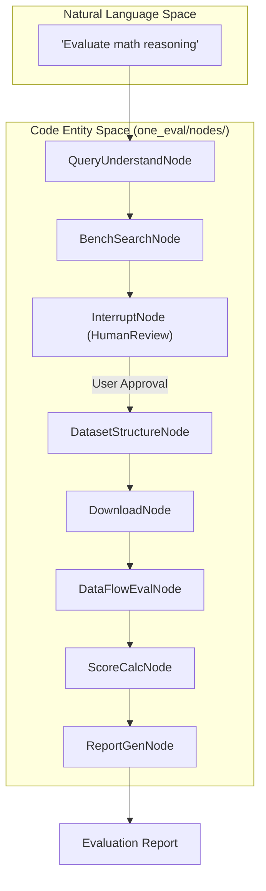
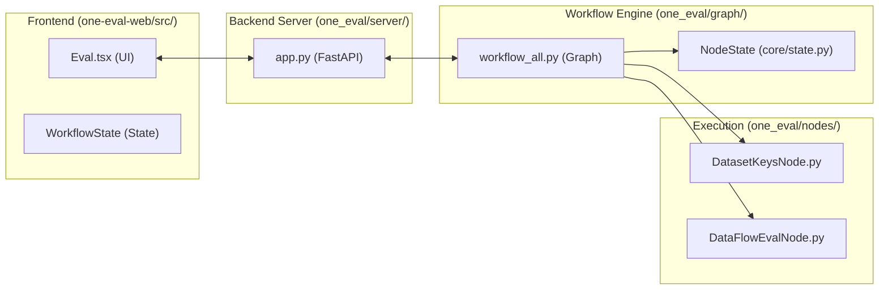

<!-- source: DeepWiki mcp.deepwiki.com · repo OpenDCAI/One-Eval · page 1 One-Eval Overview · fetched 2026-11-02 -->

# One-Eval Overview

Relevant source files

The following files were used as context for generating this wiki page:

- [README.md](README.md)
- [README_zh.md](README_zh.md)
- [one-eval-web/.gitignore](one-eval-web/.gitignore)
- [one_eval/graph/workflow_all.py](one_eval/graph/workflow_all.py)
- [one_eval/nodes/dataset_keys_node.py](one_eval/nodes/dataset_keys_node.py)
- [static/logo/318QRcode.jpg](static/logo/318QRcode.jpg)
- [static/logo/eval_framework.png](static/logo/eval_framework.png)
- [static/logo/gallery.png](static/logo/gallery.png)
- [static/logo/logo.png](static/logo/logo.png)

One-Eval is an automated, agent-based evaluation framework for Large Language Models (LLMs). It is designed to implement the **NL2Eval** concept: transforming natural language evaluation requirements into fully orchestrated evaluation workflows and comprehensive reports.

Built upon the [DataFlow](https://github.com/OpenDCAI/DataFlow) operator system and [LangGraph](https://github.com/langchain-ai/langgraph) state management, One-Eval provides a traceable, interruptible, and scalable pipeline for model assessment [README.md:20-21]().

## System Architecture

One-Eval follows a decoupled architecture consisting of a Python FastAPI backend and a React-based frontend web application [README.md:73-75]().

### Backend (Python)
The backend manages the evaluation lifecycle using a directed acyclic graph (DAG) defined in `one_eval/graph/workflow_all.py`. It leverages LangGraph to maintain state across different evaluation phases, allowing for process persistence and Human-in-the-Loop (HITL) interruptions [README.md:41-46]().

### Frontend (React + Vite)
The frontend provides an interactive "Eval Studio" where users can input natural language queries, review agent-suggested benchmarks, monitor real-time execution, and visualize multi-dimensional reports [README.md:83-91]().

### High-Level System Flow
The following diagram illustrates the transition from the **Natural Language Space** (User Intent) to the **Code Entity Space** (Internal Nodes and Tools).

**Diagram: NL2Eval Execution Flow**

Sources: [one_eval/graph/workflow_all.py:44-68](), [README.md:43-46]()

## Key Components

One-Eval's functionality is partitioned into several specialized subsystems:

| Component | Description | Primary Code Entities |
| :--- | :--- | :--- |
| **Graph Engine** | Orchestrates the evaluation phases and handles state persistence. | `GraphBuilder`, `NodeState`, `AsyncSqliteSaver` |
| **Agent Layer** | LLM-powered entities that perform task inference, metric recommendation, and report generation. | `BaseAgent`, `QueryUnderstandNode`, `BenchTaskInferNode` |
| **Bench Gallery** | A registry of meta-information for mainstream benchmarks (Reasoning, Knowledge, etc.). | `bench_gallery.json`, `BenchRegistry` |
| **Metric System** | A library of automated scoring functions for different task types. | `MetricRegistry`, `MetricRunner`, `ScoreCalcNode` |
| **DataFlow Integration** | The underlying execution engine for high-performance LLM inference. | `DataFlowEvalNode`, `DataFlowEvalTool` |

Sources: [one_eval/graph/workflow_all.py:14-26](), [README.md:107-117](), [one_eval/nodes/dataset_keys_node.py:13-23]()

## NL2Eval Pipeline Phases

The evaluation process is divided into seven distinct phases, as defined in the complete workflow [one_eval/graph/workflow_all.py:44-68]():

1.  **Discovery (NL2Bench):** Parses user intent and suggests benchmarks (e.g., MATH, GSM8K) [one_eval/graph/workflow_all.py:74-85]().
2.  **Preparation:** Inspects dataset structures and prepares local configurations [one_eval/graph/workflow_all.py:91-98]().
3.  **Download:** Fetches datasets from HuggingFace or local sources [one_eval/graph/workflow_all.py:94]().
4.  **Task Inference:** Automatically maps dataset columns (keys) to evaluation inputs/outputs [one_eval/nodes/dataset_keys_node.py:13-19]().
5.  **Evaluation:** Executes LLM inference via the DataFlow engine [one_eval/graph/workflow_all.py:111-112]().
6.  **Scoring:** Matches appropriate metrics and calculates scores [one_eval/graph/workflow_all.py:115-132]().
7.  **Reporting:** Generates multi-dimensional visualizations and LLM-summarized insights [one_eval/graph/workflow_all.py:134-135]().

For a deep dive into the pipeline mechanics, see **[NL2Eval Concept & Evaluation Pipeline](#1.2)**.

## Getting Started

To set up One-Eval, you must initialize both the backend server and the frontend application.

1.  **Backend Setup:** Install dependencies using `pip install -e .` and start the FastAPI server [README.md:58-81]().
2.  **Frontend Setup:** Navigate to `one-eval-web`, install npm packages, and run the development server [README.md:86-89]().
3.  **Configuration:** Use the Web UI settings to configure your `HF_TOKEN` and model API bases (e.g., OpenAI-compatible endpoints) [README.md:93-94]().

For detailed installation steps and environment variable requirements, see **[Getting Started & Installation](#1.1)**.

## Architecture & Code Mapping

The following diagram maps high-level system operations to specific code components and files.

**Diagram: System Component Mapping**

Sources: [one_eval/server/app.py](), [one_eval/graph/workflow_all.py:69-72](), [one_eval/nodes/dataset_keys_node.py:13]()

---

