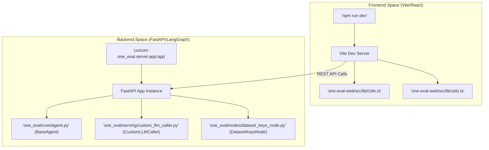
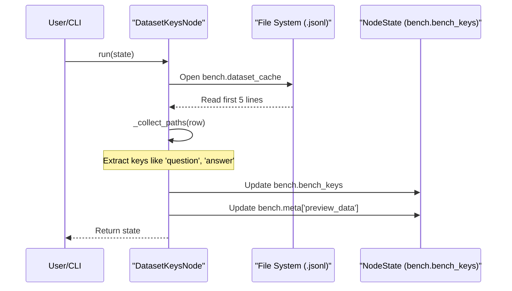

<!-- source: DeepWiki mcp.deepwiki.com · repo OpenDCAI/One-Eval · page 1.1 Getting Started & Installation · fetched 2026-11-02 -->

# Getting Started & Installation

<details>
<summary>Relevant source files</summary>

The following files were used as context for generating this wiki page:

- [.gitignore](.gitignore)
- [README.md](README.md)
- [README_zh.md](README_zh.md)
- [one-eval-web/.gitignore](one-eval-web/.gitignore)
- [one-eval-web/src/lib/i18n.ts](one-eval-web/src/lib/i18n.ts)
- [one-eval-web/src/lib/utils.ts](one-eval-web/src/lib/utils.ts)
- [one_eval/core/agent.py](one_eval/core/agent.py)
- [one_eval/nodes/dataset_keys_node.py](one_eval/nodes/dataset_keys_node.py)
- [one_eval/serving/custom_llm_caller.py](one_eval/serving/custom_llm_caller.py)
- [pyproject.toml](pyproject.toml)
- [requirements.txt](requirements.txt)
- [static/logo/318QRcode.jpg](static/logo/318QRcode.jpg)

</details>


This page provides a comprehensive technical guide for setting up the One-Eval environment. It covers Python dependency management, frontend build requirements, critical environment variables, and the execution of both backend and web components.

## System Prerequisites

One-Eval requires a dual-environment setup:
1.  **Backend**: Python 3.11+ environment for the FastAPI server and LangGraph workflow engine [README.md:5-5]().
2.  **Frontend**: Node.js environment for the Vite + React web interface [README.md:83-89]().

## Backend Installation

The backend can be installed using either `conda` or `uv`. The project uses a `pyproject.toml` file to manage metadata and `requirements.txt` for specific version pinning [pyproject.toml:5-32](), [requirements.txt:1-45]().

### Option A: Conda Setup
```bash
conda create -n one-eval python=3.11 -y
conda activate one-eval
pip install -e .
```
Sources: [README.md:58-63]()

### Option B: UV Setup
```bash
uv venv
uv pip install -e .
```
Sources: [README.md:66-71]()

### Core Dependencies
The system relies on several key library groups:
*   **Workflow**: `langgraph`, `langchain-core`, `langgraph-checkpoint-sqlite` [requirements.txt:4-7]().
*   **Data**: `huggingface-hub`, `datasets`, `pandas`, `open-dataflow` [requirements.txt:11-13, 41-41]().
*   **Serving**: `fastapi`, `uvicorn`, `httpx`, `openai` [requirements.txt:23-29]().

## Frontend Installation

The web interface is located in the `one-eval-web` directory. It uses `npm` for package management and `Vite` for the build pipeline [README.md:83-89]().

```bash
cd one-eval-web
npm install
npm run dev
```
Sources: [README.md:85-88]()

## Configuration & Environment Variables

One-Eval uses environment variables for model access, API routing, and authentication. These can be set in a `.env` file (ignored by git) [ .gitignore:137-137]().

### Critical Variables

| Variable | Description | Default / Example |
| :--- | :--- | :--- |
| `OE_API_BASE` | Base URL for the LLM API used by Agents | `http://...:3000/v1` [one_eval/core/agent.py:128-131]() |
| `OE_API_KEY` | Authentication key for the Agent LLM | `sk-xxxxx` [one_eval/core/agent.py:132-135]() |
| `OE_MODEL_NAME` | The specific model identifier for Agents | `gpt-4o` [one_eval/serving/custom_llm_caller.py:68-69]() |
| `HF_TOKEN` | HuggingFace token for private/gated datasets | Required for batch downloads [README.md:93-93]() |
| `OE_TIMEOUT_S` | Global timeout for LLM API calls | `60` [one_eval/serving/custom_llm_caller.py:65-67]() |

Sources: [one_eval/core/agent.py:126-136](), [one_eval/serving/custom_llm_caller.py:62-76](), [README.md:93-94]()

## Execution Flow

### Backend and Frontend Startup
The system follows a decoupled architecture where the frontend communicates with the FastAPI backend via REST.

#### One-Eval Service Architecture
The following diagram illustrates the relationship between the startup commands and the underlying code entities.


Sources: [README.md:73-89](), [one_eval/core/agent.py:17-113](), [one_eval/serving/custom_llm_caller.py:38-45](), [one_eval/nodes/dataset_keys_node.py:13-23]()

### Running the Services

1.  **Start Backend**:
    ```bash
    uvicorn one_eval.server.app:app --host 0.0.0.0 --port 8000
    ```
    Sources: [README.md:80-80]()

2.  **Start Frontend**:
    ```bash
    cd one-eval-web && npm run dev
    ```
    Sources: [README.md:88-88]()

3.  **Developer CLI Mode**:
    For direct execution without the UI, use the `workflow_all` module:
    ```bash
    python -m one_eval.graph.workflow_all "Evaluate reasoning tasks"
    ```
    Sources: [README.md:100-103]()

## Technical Implementation Details

### LLM Connectivity
The `CustomLLMCaller` class handles the bridge between LangGraph nodes and external LLM providers. It implements the `BaseLLMCaller` interface and uses `httpx.AsyncClient` for non-blocking network I/O [one_eval/serving/custom_llm_caller.py:38-76]().

*   **Raw API Mode**: Bypasses LangChain abstractions for higher performance when tools are not needed [one_eval/serving/custom_llm_caller.py:130-160]().
*   **Tool Mode**: Uses `ChatOpenAI.bind_tools` to support complex agentic behaviors within the graph [one_eval/serving/custom_llm_caller.py:178-193]().

### Data Preparation Logic
Upon initialization, the system often triggers the `DatasetKeysNode`. This node is responsible for scanning the `dataset_cache` (usually a JSONL file) to extract schema information [one_eval/nodes/dataset_keys_node.py:13-19]().

#### Data Initialization Sequence
This diagram shows how the system transitions from a raw file to a state ready for evaluation.


Sources: [one_eval/nodes/dataset_keys_node.py:37-88](), [one_eval/core/state.py:7-7]()

### Frontend Utilities
The web interface includes localized support via `useLang` in `i18n.ts`, which persists settings in `localStorage` [one-eval-web/src/lib/i18n.ts:8-13, 37-41](). UI components utilize the `cn` utility (combining `clsx` and `twMerge`) for dynamic Tailwind CSS class management [one-eval-web/src/lib/utils.ts:4-6]().

---

