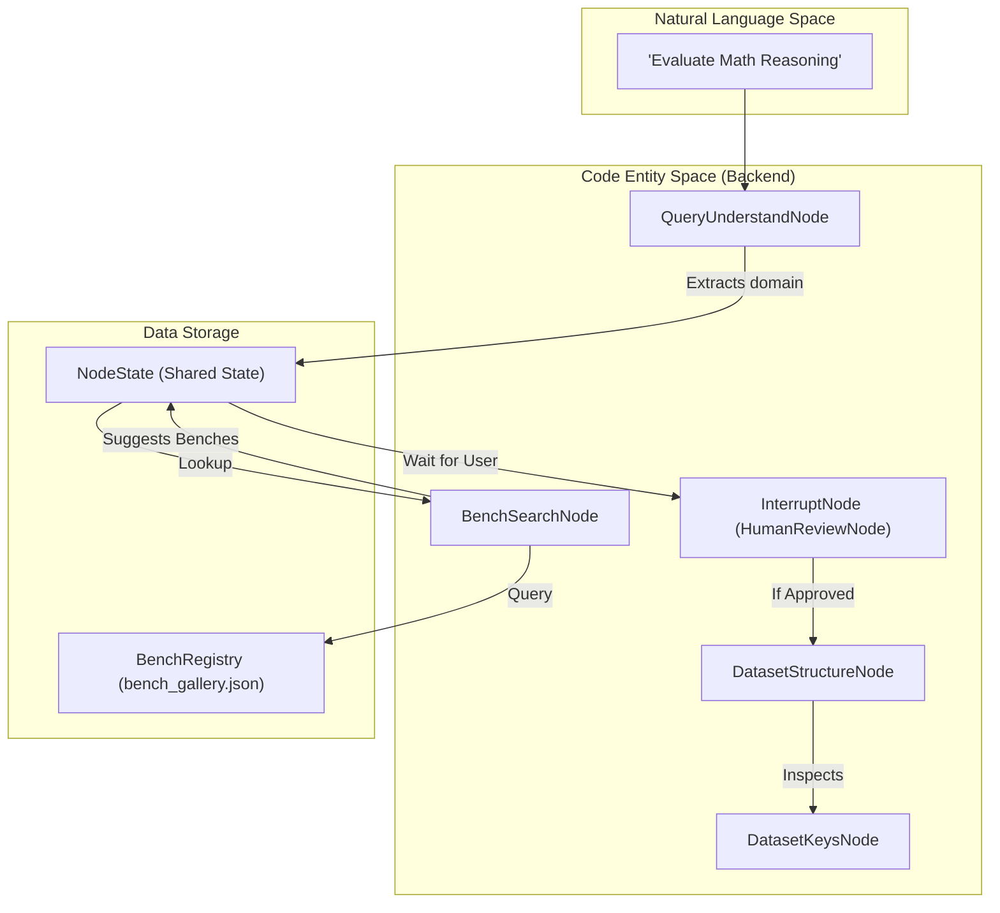

<!-- source: DeepWiki mcp.deepwiki.com · repo OpenDCAI/One-Eval · page 1.2 NL2Eval Concept & Evaluation Pipeline · fetched 2026-11-02 -->

# NL2Eval Concept & Evaluation Pipeline

<details>
<summary>Relevant source files</summary>

The following files were used as context for generating this wiki page:

- [README.md](README.md)
- [README_zh.md](README_zh.md)
- [one-eval-web/.gitignore](one-eval-web/.gitignore)
- [one_eval/core/graph.py](one_eval/core/graph.py)
- [one_eval/graph/workflow.py](one_eval/graph/workflow.py)
- [one_eval/graph/workflow_all.py](one_eval/graph/workflow_all.py)
- [one_eval/nodes/dataset_keys_node.py](one_eval/nodes/dataset_keys_node.py)
- [one_eval/nodes/interrupt_node.py](one_eval/nodes/interrupt_node.py)
- [static/logo/318QRcode.jpg](static/logo/318QRcode.jpg)

</details>


The core philosophy of One-Eval is **NL2Eval**: the transformation of a natural language requirement into a fully orchestrated evaluation workflow and a comprehensive report [README.md:20-21](). This paradigm replaces manual benchmarking scripts with an agentic, graph-based execution process that handles everything from discovery to scoring [README.md:36-44]().

## The NL2Eval Paradigm

One-Eval reconstructs the evaluation process into a **Graph / Node / State** architecture [README.md:41](). Instead of writing code, a user provides a query such as *"Evaluate the model's performance on math reasoning tasks"* [README.md:43](). The system then uses a **LangGraph** engine to traverse a series of specialized nodes, each responsible for a specific phase of the evaluation lifecycle [one_eval/graph/workflow_all.py:44-68]().

### Key Characteristics
*   **Traceable**: Every step of the agent's reasoning and tool usage is recorded in the `NodeState` [README.md:21]().
*   **Interruptible**: The pipeline includes "Human-in-the-Loop" (HITL) gates where the system pauses for user validation [README.md:45]().
*   **Scalable**: Built on the **DataFlow** operator system, allowing for the integration of custom metrics and private datasets [README.md:46-47]().

---

## Evaluation Pipeline Phases

The complete evaluation pipeline is implemented in `one_eval/graph/workflow_all.py` and consists of seven distinct phases [one_eval/graph/workflow_all.py:44-68]().

### 1. Discovery Phase (NL2Bench)
The system parses the user's intent and identifies relevant benchmarks.
*   **QueryUnderstandNode**: Uses LLM agents to extract task domains and requirements from the natural language query [one_eval/graph/workflow_all.py:75]().
*   **BenchSearchNode**: Searches the `BenchRegistry` and external sources (like HuggingFace) for matching benchmarks [one_eval/graph/workflow_all.py:76]().
*   **HumanReviewNode**: An `InterruptNode` that pauses execution, allowing the user to approve, reject, or modify the suggested benchmarks [one_eval/graph/workflow_all.py:77-85]().

### 2. Preparation Phase (Download & Prep)
Once benchmarks are selected, the system prepares the data.
*   **DatasetStructureNode**: Inspects the dataset schema (subsets, splits) [one_eval/graph/workflow_all.py:92]().
*   **BenchConfigRecommendNode**: Recommends the best configuration for the specific evaluation task [one_eval/graph/workflow_all.py:93]().
*   **DownloadNode**: Fetches the data and converts it into a unified JSONL format [one_eval/graph/workflow_all.py:94]().

### 3. Task Inference Phase
The system analyzes the downloaded data to ensure the evaluation logic matches the data format.
*   **DatasetKeysNode**: Reads the first few lines of the JSONL file to extract available keys (e.g., `question`, `answer`, `choices`) [one_eval/nodes/dataset_keys_node.py:13-19]().
*   **BenchTaskInferNode**: Infers the specific task type (e.g., multiple choice, math verification) based on the dataset structure [one_eval/graph/workflow_all.py:102]().

### 4. Evaluation Phase (Execution)
The core inference loop where the model-under-test generates responses.
*   **PreEvalReviewNode**: A final check-gate before starting expensive LLM inference [one_eval/graph/workflow_all.py:108]().
*   **DataFlowEvalNode**: Executes the evaluation loop. It routes between generating answers and potentially calling an LLM-as-Judge for open-ended tasks [one_eval/graph/workflow_all.py:111-112]().

### 5. Scoring Phase
*   **MetricRecommendNode**: Suggests appropriate metrics (e.g., Exact Match, Pass@k, ROUGE) based on the task type [one_eval/graph/workflow_all.py:115]().
*   **MetricReviewNode**: An `InterruptNode` for the user to verify the scoring plan [one_eval/graph/workflow_all.py:119-127]().
*   **ScoreCalcNode**: Runs the `MetricRunner` to calculate final scores and generate artifact files [one_eval/graph/workflow_all.py:131]().

### 6. Reporting Phase
*   **ReportGenNode**: Aggregates scores into multi-dimensional visualizations (radar charts, bar charts) and uses an LLM to generate a summary report [one_eval/graph/workflow_all.py:134]().

**Sources:** [one_eval/graph/workflow_all.py:44-135](), [one_eval/nodes/dataset_keys_node.py:13-88](), [README.md:41-47]()

---

## Pipeline Data Flow & Architecture

The following diagrams illustrate how natural language concepts map to specific code entities and how the state flows through the system.

### Diagram 1: NL Space to Code Entity Mapping (Phase 1-3)
This diagram bridges the user's natural language request to the internal classes and nodes that process it.


**Sources:** [one_eval/graph/workflow_all.py:74-105](), [one_eval/core/state.py:9-10](), [one_eval/nodes/dataset_keys_node.py:37-38]()

### Diagram 2: Execution & Scoring Pipeline (Phase 4-7)
This diagram shows the transition from data preparation to the final report generation.

```mermaid
graph LR
    subgraph "Evaluation Loop"
        DF_Eval["DataFlowEvalNode"]
        DF_Tool["DataFlowEvalTool"]
    end

    subgraph "Scoring Engine"
        MR_Node["MetricRecommendNode"]
        SC_Node["ScoreCalcNode"]
        M_Runner["MetricRunner"]
    end

    subgraph "Reporting"
        RG_Node["ReportGenNode"]
        FinalReport["report.json / RadarChart"]
    end

    DF_Eval --> DF_Tool
    DF_Tool -- "Generates Responses" --> MR_Node
    MR_Node -- "Selects Metrics" --> SC_Node
    SC_Node -- "Invokes" --> M_Runner
    M_Runner -- "Calculates Scores" --> RG_Node
    RG_Node --> FinalReport
```


**Sources:** [one_eval/graph/workflow_all.py:107-135](), [one_eval/nodes/interrupt_node.py:17-35]()

---

## Workflow Implementation with LangGraph

The pipeline is orchestrated using the `GraphBuilder` class, which wraps the **LangGraph** `StateGraph` [one_eval/core/graph.py:58-59]().

### State Management
The `NodeState` object is the "single source of truth" that flows through every node. It contains:
*   `user_query`: The original input [one_eval/graph/workflow.py:63]().
*   `benches`: A list of `BenchInfo` objects being evaluated [one_eval/graph/workflow_all.py:37]().
*   `llm_history`: A log of agent interactions [one_eval/nodes/interrupt_node.py:78]().

### Interrupt & Resume Logic
Human-in-the-loop is handled by the `InterruptNode`. When a validator (e.g., `benches_manual_review`) fails, the node calls the LangGraph `interrupt()` function [one_eval/nodes/interrupt_node.py:68-74](). This persists the state to a SQLite database using `AsyncSqliteSaver`, allowing the backend to stop and wait for a frontend signal to resume [one_eval/graph/workflow.py:54-67]().

### Conditional Routing
The pipeline uses conditional edges to manage loops, such as iterating through multiple benchmarks during the evaluation phase:
```python
def _route_after_eval(state: NodeState) -> str:
    benches = getattr(state, "benches", None) or []
    cursor = int(getattr(state, "eval_cursor", 0) or 0)
    if cursor < len(benches):
        return "DataFlowEvalNode"
    return "MetricRecommendNode"
```
[one_eval/graph/workflow_all.py:36-41]()

**Sources:** [one_eval/core/graph.py:1-185](), [one_eval/graph/workflow_all.py:36-175](), [one_eval/nodes/interrupt_node.py:37-161]()

---

