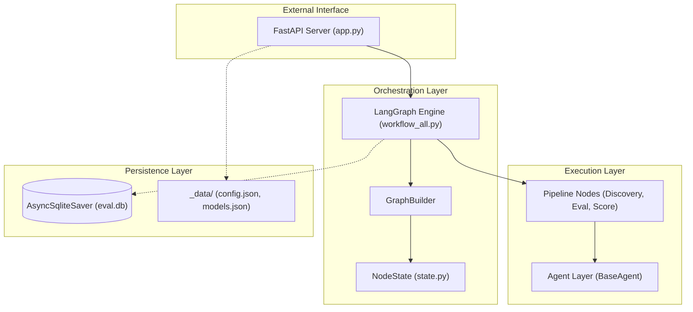
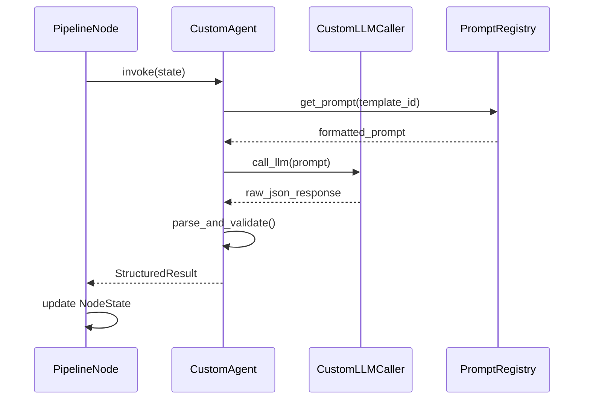

<!-- source: DeepWiki mcp.deepwiki.com · repo OpenDCAI/One-Eval · page 2 Backend Architecture · fetched 2026-11-02 -->

# Backend Architecture

Relevant source files

The following files were used as context for generating this wiki page:

- [one_eval/__init__.py](one_eval/__init__.py)
- [one_eval/core/__init__.py](one_eval/core/__init__.py)
- [one_eval/core/state.py](one_eval/core/state.py)
- [one_eval/server/app.py](one_eval/server/app.py)
- [one_eval/toolkits/__init__.py](one_eval/toolkits/__init__.py)

The One-Eval backend is a Python-based system designed to transform natural language evaluation requests into structured execution pipelines. It leverages a stateful workflow engine to manage the complex, multi-stage process of benchmark discovery, dataset preparation, LLM inference, and metric calculation.

The architecture is built on four primary pillars:
1.  **FastAPI Server**: Provides the RESTful interface for the frontend and manages the lifecycle of evaluation threads.
2.  **LangGraph Workflow Engine**: Orchestrates the evaluation pipeline as a directed graph with support for persistence and Human-in-the-Loop (HITL) interrupts.
3.  **Core State Model**: A unified `NodeState` that serves as the "single source of truth" flowing through the graph.
4.  **Agent & Node Abstractions**: Modular components that perform specific tasks, ranging from LLM-based reasoning to heavy-duty data processing.

### System Overview Diagram

The following diagram illustrates the relationship between the external API, the internal orchestration engine, and the persistent storage layer.

**One-Eval Backend Component Map**

**Sources:** [one_eval/server/app.py:15-41](), [one_eval/core/state.py:79-123]()

---

### FastAPI Server & REST API
The entry point for all operations is the FastAPI server defined in `one_eval/server/app.py`. It handles configuration management (LLM providers, HuggingFace tokens), model registration, and workflow control. The server maintains a mapping of `thread_id` to graph states, allowing the frontend to poll for progress or resume interrupted tasks.

Key responsibilities include:
*   **Environment Setup**: Loading `env.sh` and managing local JSON storage in the `_data/` directory.
*   **Thread Lifecycle**: Creating and resuming LangGraph threads.
*   **Static Asset Serving**: Providing access to generated reports and evaluation artifacts.

For details, see [FastAPI Server & REST API](#2.1).

**Sources:** [one_eval/server/app.py:24-42](), [one_eval/server/app.py:138-190]()

---

### Core State & Data Models
The system relies on a central data structure, `NodeState`, to maintain context across asynchronous node executions. This state is defined using Python `dataclasses` and is designed to be serializable for checkpointing in SQLite.

| Class | Purpose | Key Fields |
| :--- | :--- | :--- |
| `NodeState` | Global container for graph execution. | `user_query`, `benches`, `target_model`, `waiting_for_human` |
| `BenchInfo` | Metadata for a specific benchmark. | `bench_name`, `dataset_cache`, `eval_status` |
| `ModelConfig` | Configuration for the LLM under test. | `model_name_or_path`, `is_api`, `api_url`, `temperature` |

For details, see [Core State & Data Models](#2.2).

**Sources:** [one_eval/core/state.py:37-50](), [one_eval/core/state.py:52-76](), [one_eval/core/state.py:79-123]()

---

### Graph Engine & Workflow Orchestration
One-Eval uses **LangGraph** to define the evaluation pipeline as a state machine. This allows for complex logic, such as looping through multiple benchmarks or pausing for human approval (HITL).

The workflow is defined by:
*   **Nodes**: Python functions or classes that transform the `NodeState`.
*   **Edges**: Logic that determines the next node based on the current state (e.g., routing to `HumanReviewNode` if a benchmark is ambiguous).
*   **Checkpointer**: An `AsyncSqliteSaver` that persists the state to `eval.db`, enabling the server to recover from restarts or long-running evaluation pauses.

For details, see [Graph Engine & Workflow Orchestration](#2.3).

**Sources:** [one_eval/server/app.py:40-41](), [one_eval/core/state.py:134-145]()

---

### Agent Layer & LLM Calling
The "Intelligence" of the backend resides in the Agent Layer. Nodes often delegate reasoning tasks to Agents, which use structured prompting to interact with LLMs.

**Code Entity Interaction Diagram**

The `BaseAgent` provides a unified interface for system prompts and response parsing, while `CustomLLMCaller` abstracts the differences between various API providers (OpenAI, DashScope) and local vLLM deployments.

For details, see [Agent Layer & LLM Calling](#2.4).

**Sources:** [one_eval/core/state.py:27-28](), [one_eval/server/app.py:162-189]()

---

