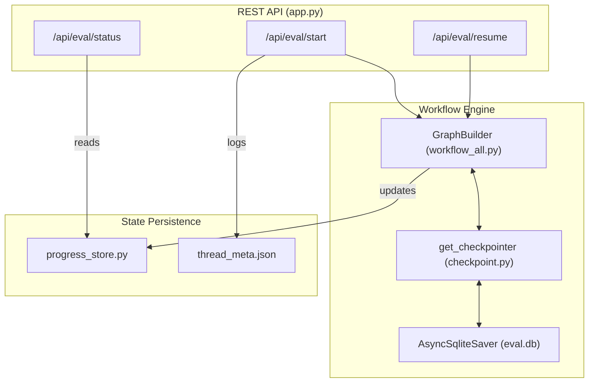
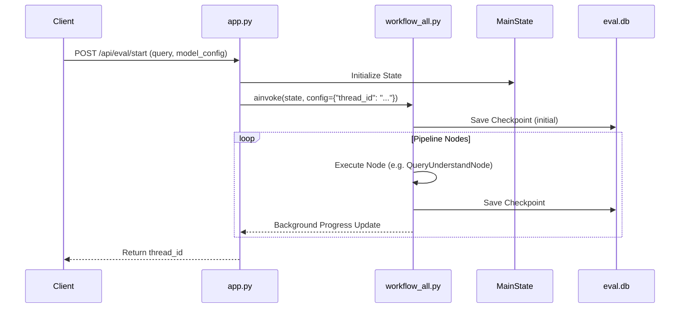

<!-- source: DeepWiki mcp.deepwiki.com · repo OpenDCAI/One-Eval · page 2.1 FastAPI Server & REST API · fetched 2026-11-02 -->

# FastAPI Server & REST API

Relevant source files

The following files were used as context for generating this wiki page:

- [one_eval/runtime/progress_store.py](one_eval/runtime/progress_store.py)
- [one_eval/server/app.py](one_eval/server/app.py)
- [one_eval/utils/checkpoint.py](one_eval/utils/checkpoint.py)
- [one_eval/utils/validators.py](one_eval/utils/validators.py)

The One-Eval backend is powered by a FastAPI server that acts as the orchestration hub for the evaluation lifecycle. It manages the persistence of model configurations, handles benchmark registry queries, and interfaces with the LangGraph workflow engine to manage long-running evaluation threads.

## Server Initialization & Configuration

The server initializes its environment by loading settings from three primary sources: environment variables, an `env.sh` script, and local JSON configuration files. It establishes a data directory (`_data`) for persisting application state across restarts [one_eval/server/app.py:26-31]().

### Data Persistence Structure
The server maintains several local files within the `_data` directory:
*   `config.json`: Global settings for HuggingFace (HF) endpoints, agent providers, and judge models [one_eval/server/app.py:29]().
*   `models.json`: A registry of LLM configurations (API bases, keys, and local paths) [one_eval/server/app.py:30]().
*   `thread_meta.json`: Metadata tracking the creation and update timestamps for evaluation threads [one_eval/server/app.py:31]().
*   `eval.db`: A SQLite database used by `AsyncSqliteSaver` to persist LangGraph checkpoints [one_eval/server/app.py:40]().

### Configuration Management Logic
The function `load_server_config` performs a tiered lookup for critical settings like `HF_ENDPOINT` and `OE_API_KEY`. It prioritizes `config.json` values, falling back to `os.environ` or hardcoded defaults [one_eval/server/app.py:138-189]().

Sources: [one_eval/server/app.py:24-136](), [one_eval/server/app.py:138-210]()

---

## REST API Reference

The server exposes endpoints categorized by their functional domain. All long-running evaluation tasks are executed as background tasks to prevent blocking the HTTP response.

### Workflow Control & Threads
These endpoints manage the state of the evaluation pipeline.

| Endpoint | Method | Description |
| :--- | :--- | :--- |
| `/api/threads` | `GET` | Lists all existing evaluation threads with metadata [one_eval/server/app.py:465](). |
| `/api/eval/start` | `POST` | Initializes a new `thread_id` and starts the `workflow_all` graph [one_eval/server/app.py:532](). |
| `/api/eval/status` | `GET` | Retrieves the current state of a thread, including the last node and HITL flags [one_eval/server/app.py:648](). |
| `/api/eval/resume` | `POST` | Resumes an interrupted thread (e.g., after human review) [one_eval/server/app.py:588](). |
| `/api/eval/progress`| `GET` | Fetches real-time execution progress (e.g., percentage complete) [one_eval/server/app.py:641](). |

### Model & Benchmark Registry
| Endpoint | Method | Description |
| :--- | :--- | :--- |
| `/api/models` | `GET/POST` | Manages the model configuration list in `models.json` [one_eval/server/app.py:423-441](). |
| `/api/bench/gallery`| `GET` | Returns the list of benchmarks from the local `bench_gallery.json` [one_eval/server/app.py:394](). |
| `/api/bench/search` | `POST` | Searches for benchmarks using the `BenchRegistry` [one_eval/server/app.py:402](). |

Sources: [one_eval/server/app.py:394-463](), [one_eval/server/app.py:465-645]()

---

## Thread Lifecycle & Checkpointing

One-Eval uses a checkpoint-resume mechanism to handle Human-In-The-Loop (HITL) interrupts and system crashes. 

### Thread State Transition
The server uses `AsyncSqliteSaver` to persist the `MainState` at every node transition in the LangGraph. If a node (like `HumanReviewNode`) requires user input, the graph execution pauses. The user submits updates via `/api/eval/resume`, which triggers a new execution run using the saved `thread_id`.

**Server Component Interaction Map**

Sources: [one_eval/server/app.py:532-586](), [one_eval/utils/checkpoint.py:18-28](), [one_eval/runtime/progress_store.py:10-23]()

---

## Data Flow: From Request to Node

When a request hits `/api/eval/start`, the server transforms the `EvalStartRequest` into a `MainState` object. This state is then passed into the `ainvoke` method of the compiled LangGraph.

**Data Flow Architecture**

### Interrupt Handling
Interrupts are defined in `one_eval/utils/validators.py`. When a validator like `benches_manual_review` returns a payload, the graph enters an `interrupted` state [one_eval/utils/validators.py:4-19](). The server detects this via `_thread_interrupt_cache` and signals the frontend that manual intervention is required [one_eval/server/app.py:43-45]().

Sources: [one_eval/server/app.py:532-586](), [one_eval/utils/validators.py:4-46](), [one_eval/server/app.py:648-692]()

---

## Model Registry & Path Normalization

The server provides a specialized utility, `_normalize_model_path_for_host`, to handle cross-platform pathing issues (e.g., running the server in WSL while the models reside on a Windows host drive). It automatically converts between `/mnt/c/...` and `C:\...` formats based on the operating system [one_eval/server/app.py:120-136]().

The model registry (`/api/models`) stores configurations including:
*   `model_name`: Unique identifier.
*   `model_path`: Local filesystem path or HF repo ID.
*   `api_base` / `api_key`: Connection details for OpenAI-compatible providers.
*   `engine_type`: Specifies if the model should run via `vllm`, `fschat`, or `api` [one_eval/server/app.py:423-441]().

Sources: [one_eval/server/app.py:120-136](), [one_eval/server/app.py:423-463]()

---

