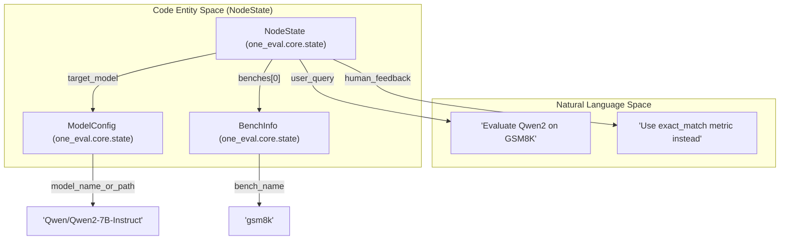
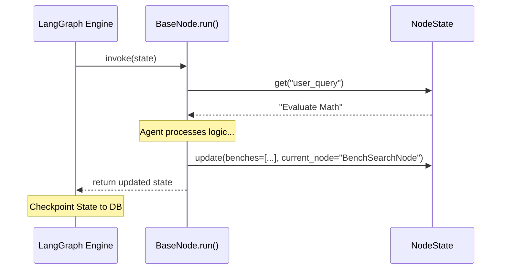

<!-- source: DeepWiki mcp.deepwiki.com · repo OpenDCAI/One-Eval · page 2.2 Core State & Data Models · fetched 2026-11-02 -->

# Core State & Data Models

Relevant source files

The following files were used as context for generating this wiki page:

- [one_eval/core/node.py](one_eval/core/node.py)
- [one_eval/core/state.py](one_eval/core/state.py)

This page provides a technical deep dive into the shared data structures that form the backbone of the One-Eval evaluation pipeline. In One-Eval, state is managed through a hierarchical set of dataclasses that flow through the LangGraph workflow, ensuring consistency across different execution nodes and allowing for seamless checkpointing and Human-In-The-Loop (HITL) interactions.

## State Hierarchy & Purpose

One-Eval utilizes a layered state model to separate generic request data from graph-specific execution context. The primary container used by the workflow engine is the `NodeState`, which inherits from `MainState`.

### MainState & MainRequest
The base layer handles low-level message passing and temporary storage.

*   **`MainRequest`**: Captures the initial user intent, such as the preferred language for interaction (defaulting to "zh") and the specific evaluation target.
*   **`MainState`**: Provides the foundation for LangGraph integration. It includes a `messages` list annotated with `add_messages` to support conversational history and an `agent_results` dictionary to store raw outputs from various LLM agents.

Sources: [one_eval/core/state.py:11-35]()

### NodeState: The Global Context
`NodeState` is the comprehensive state container that flows through every node in the graph. It tracks the evaluation lifecycle from the initial query to the final report generation.

| Field | Type | Description |
| :--- | :--- | :--- |
| `state_id` | `str` | A unique UUID for the execution thread. |
| `current_node` | `str` | The name of the node currently being executed. |
| `user_query` | `str` | The natural language input from the user (e.g., "Evaluate math performance"). |
| `target_model` | `ModelConfig` | Configuration for the LLM being evaluated. |
| `benches` | `List[BenchInfo]` | A list of benchmarks identified for this run. |
| `eval_cursor` | `int` | Index pointer used to iterate through benchmarks during the execution phase. |
| `waiting_for_human` | `bool` | A flag that triggers a graph interrupt for manual review. |

Sources: [one_eval/core/state.py:79-123]()

## Data Models

### BenchInfo
The `BenchInfo` class represents a single benchmark instance within the pipeline. It tracks metadata, configuration, and the status of the data lifecycle (download and evaluation).

*   **`bench_name`**: The identifier for the benchmark (e.g., "GSM8K").
*   **`bench_dataflow_eval_type`**: Determines the logic used during evaluation (e.g., `key1_text_score`).
*   **`bench_keys`**: A list of specific fields (question, answer, etc.) mapped from the dataset.
*   **`dataset_cache`**: Local file path to the downloaded JSONL dataset.
*   **`download_status` / `eval_status`**: Enums tracking progress ("pending", "success", "failed").

Sources: [one_eval/core/state.py:37-50]()

### ModelConfig
The `ModelConfig` class encapsulates all parameters required to invoke an LLM, whether it is a local instance or a remote API.

*   **API Settings**: Includes `api_url`, `api_key`, and `api_provider` (defaulting to "openai_compatible").
*   **Resource Management**: `api_max_workers` controls concurrency, while `api_connect_timeout` and `api_read_timeout` manage network resilience.
*   **Generation Parameters**: Standard parameters like `temperature`, `top_p`, and `max_tokens`.
*   **Local Serving**: Fields like `tensor_parallel_size` and `gpu_memory_utilization` are reserved for local vLLM-based execution.

Sources: [one_eval/core/state.py:52-77]()

## State Lifecycle & Persistence

The `NodeState` class implements methods to ensure that the evaluation can be safely paused, persisted to a database, and resumed without data loss.

### Update and Checkpoint Logic
The state is updated incrementally by nodes. To prevent accidental attribute creation, the `update` method validates field existence before assignment.

*   **`update(**fields)`**: Updates multiple attributes and refreshes the `last_updated` timestamp. [one_eval/core/state.py:124-133]()
*   **`checkpoint()`**: Creates a `copy.deepcopy` of the state dictionary. This is critical for the `AsyncSqliteSaver` used in LangGraph to store snapshots of the workflow at every edge. [one_eval/core/state.py:134-138]()
*   **`resume(snapshot)`**: Restores the state from a saved dictionary, typically used when the server restarts or a user resumes a thread from the UI. [one_eval/core/state.py:139-145]()

## Data Flow Diagram

The following diagram illustrates how natural language inputs are transformed into structured code entities and stored within the `NodeState`.

### Natural Language to Code Entity Mapping
"This diagram shows the transition from User Input to the internal NodeState structure."

Sources: [one_eval/core/state.py:52-123]()

## Execution Flow & HITL Flags

One-Eval uses specific flags within `NodeState` to manage the flow of control between the automated agents and the human user.

### Interrupt Mechanism
When a node (such as `HumanReviewNode` or `PreEvalReviewNode`) requires user intervention, it sets `waiting_for_human = True`. The LangGraph engine detects this state or a specific `interrupt` signal and halts execution.

### Data Flow through Nodes
Every node in the graph follows a standard interface defined by `BaseNode`.

Sources: [one_eval/core/node.py:7-23](), [one_eval/core/state.py:124-133]()

### Key Fields for Phase Transitions
*   **Discovery to Preparation**: The `benches` list is populated.
*   **Preparation to Execution**: `dataset_cache` paths are filled, and `bench_keys` (input/output mappings) are defined in `key_plan`.
*   **Execution to Scoring**: `eval_results` are populated with raw model outputs.
*   **Scoring to Reporting**: `metric_plan` is executed, and final `reports` are generated.

Sources: [one_eval/core/state.py:102-110]()

---

