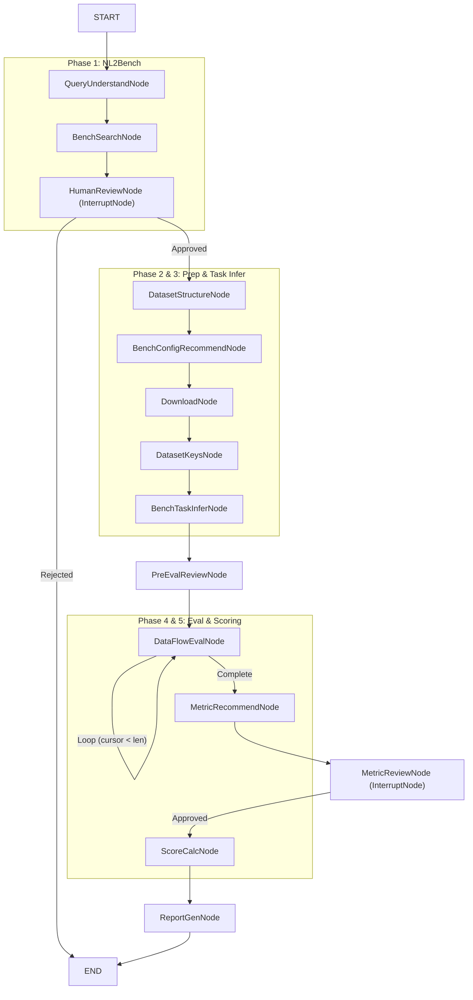
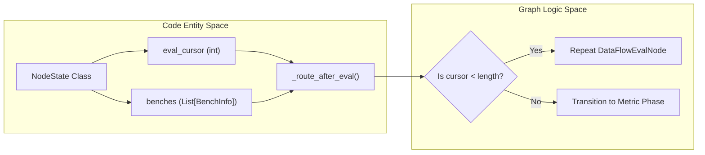

<!-- source: DeepWiki mcp.deepwiki.com · repo OpenDCAI/One-Eval · page 2.3 Graph Engine & Workflow Orchestration · fetched 2026-11-02 -->

# Graph Engine & Workflow Orchestration

<details>
<summary>Relevant source files</summary>

The following files were used as context for generating this wiki page:

- [one_eval/agents/__init__.py](one_eval/agents/__init__.py)
- [one_eval/core/graph.py](one_eval/core/graph.py)
- [one_eval/graph/__init__.py](one_eval/graph/__init__.py)
- [one_eval/graph/workflow.py](one_eval/graph/workflow.py)
- [one_eval/graph/workflow_all.py](one_eval/graph/workflow_all.py)
- [one_eval/graph/workflow_bench_verify.py](one_eval/graph/workflow_bench_verify.py)
- [one_eval/graph/workflow_eval.py](one_eval/graph/workflow_eval.py)
- [one_eval/graph/workflow_metric_recommend.py](one_eval/graph/workflow_metric_recommend.py)
- [one_eval/graph/workflow_nl2bench.py](one_eval/graph/workflow_nl2bench.py)
- [one_eval/graph/workflow_task_infer.py](one_eval/graph/workflow_task_infer.py)
- [one_eval/nodes/bench_config_recommend_node.py](one_eval/nodes/bench_config_recommend_node.py)
- [one_eval/nodes/bench_task_infer_node.py](one_eval/nodes/bench_task_infer_node.py)
- [one_eval/nodes/dataset_structure_node.py](one_eval/nodes/dataset_structure_node.py)
- [one_eval/nodes/interrupt_node.py](one_eval/nodes/interrupt_node.py)
- [one_eval/utils/deal_json.py](one_eval/utils/deal_json.py)
- [tests/test_download_single.py](tests/test_download_single.py)

</details>


The One-Eval backend is powered by a directed acyclic graph (DAG) orchestration engine built on top of LangGraph. This engine manages the transition between evaluation phases, handles persistent state via SQLite-based checkpointing, and facilitates Human-in-the-loop (HITL) interactions through specialized interrupt nodes.

## GraphBuilder & Node Registration

The `GraphBuilder` class in `one_eval/core/graph.py` acts as a wrapper around LangGraph's `StateGraph`. It provides a simplified interface for registering nodes, edges, and tools while ensuring that the `NodeState` is correctly propagated through the system.

### Key Implementation Details
- **State Management**: It initializes the graph with `NodeState` as the central data model [one_eval/core/graph.py:59-62]().
- **Node Wrapping**: The `_wrap_node_with_tools` method automatically injects a `RunnableConfig` and registers custom tools for specific roles before executing the node function [one_eval/core/graph.py:135-176]().
- **Tool Integration**: It utilizes a `tool_registry` to bind functions to specific graph roles, allowing agents to access capabilities like HuggingFace searching or dataset probing [one_eval/core/graph.py:68-115]().

### Graph Construction Logic
| Method | Description |
| :--- | :--- |
| `add_node(name, func)` | Registers a processing unit (e.g., `QueryUnderstandNode`) [one_eval/core/graph.py:76-78](). |
| `add_edge(src, dst)` | Defines a static transition between two nodes [one_eval/core/graph.py:84-86](). |
| `add_conditional_edge(src, func)` | Routes flow based on the return value of a logic function [one_eval/core/graph.py:92-94](). |
| `build(checkpointer)` | Compiles the graph into a runnable object with optional persistence [one_eval/core/graph.py:178-185](). |

**Sources:** [one_eval/core/graph.py:10-185](), [one_eval/graph/workflow_all.py:69-72]()

---

## Workflow Topology (`workflow_all.py`)

The complete One-Eval pipeline is defined in `one_eval/graph/workflow_all.py`. It orchestrates seven distinct phases, moving from natural language query understanding to final report generation.

### Complete Workflow Diagram
This diagram maps the logical phases to the specific code entities defined in the `build_complete_workflow` function.


**Sources:** [one_eval/graph/workflow_all.py:44-68](), [one_eval/graph/workflow_all.py:137-175]()

---

## Interrupt & Resume Mechanics

One-Eval uses a specialized `InterruptNode` to implement Human-in-the-loop (HITL) gates. This allows the system to pause execution, wait for user feedback via the UI, and then either continue or "rewind" to previous nodes.

### Implementation: `InterruptNode`
The node utilizes the LangGraph `interrupt` function to yield control back to the caller [one_eval/nodes/interrupt_node.py:68-74]().

1.  **Validation**: It runs a list of `validators` (e.g., `benches_manual_review`) against the current `NodeState` [one_eval/nodes/interrupt_node.py:42-54]().
2.  **Suspension**: If a validator fails/triggers, the node calls `interrupt()`, which serializes the current state and stops execution [one_eval/nodes/interrupt_node.py:68-74]().
3.  **Agent Decision**: Upon resumption (via `Command(resume=...)`), the `HumanInLoopAgent` processes the user input and decides whether to `goto_node` (rewind) or `continue` [one_eval/nodes/interrupt_node.py:102-149]().

### Persistence: `AsyncSqliteSaver`
The `get_checkpointer` utility provides an `AsyncSqliteSaver` that connects to `checkpoints/eval.db` [one_eval/graph/workflow_all.py:182-185](). This ensures that even if the server restarts, an evaluation run can be resumed using its `thread_id` [one_eval/graph/workflow_all.py:187-200]().

**Sources:** [one_eval/nodes/interrupt_node.py:17-161](), [one_eval/graph/workflow_all.py:178-200](), [one_eval/utils/checkpoint.py:1-20]()

---

## Evaluation Loop Routing Logic

The evaluation phase involves iterating over multiple benchmarks. This is handled by a conditional edge and a cursor-based routing function.

### `_route_after_eval` Function
This function determines if the graph should stay in the `DataFlowEvalNode` or proceed to scoring [one_eval/graph/workflow_all.py:36-41]().

```python
def _route_after_eval(state: NodeState) -> str:
    benches = getattr(state, "benches", None) or []
    cursor = int(getattr(state, "eval_cursor", 0) or 0)
    if cursor < len(benches):
        return "DataFlowEvalNode" # Continue evaluation loop
    return "MetricRecommendNode" # Proceed to next phase
```

### Routing Entity Mapping
The following diagram illustrates how the `NodeState` properties drive the transition logic in `workflow_all.py`.



**Sources:** [one_eval/graph/workflow_all.py:36-41](), [one_eval/graph/workflow_all.py:162]()

---

