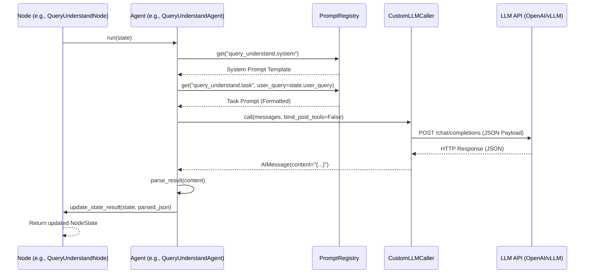
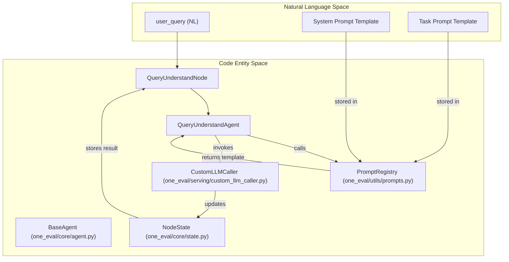

<!-- source: DeepWiki mcp.deepwiki.com · repo OpenDCAI/One-Eval · page 2.4 Agent Layer & LLM Calling · fetched 2026-11-02 -->

# Agent Layer & LLM Calling

Relevant source files

The following files were used as context for generating this wiki page:

- [one_eval/agents/human_in_loop_agent.py](one_eval/agents/human_in_loop_agent.py)
- [one_eval/agents/query_understand_agent.py](one_eval/agents/query_understand_agent.py)
- [one_eval/core/agent.py](one_eval/core/agent.py)
- [one_eval/nodes/bench_search_node.py](one_eval/nodes/bench_search_node.py)
- [one_eval/nodes/pre_eval_review_node.py](one_eval/nodes/pre_eval_review_node.py)
- [one_eval/nodes/query_understand_node.py](one_eval/nodes/query_understand_node.py)
- [one_eval/serving/custom_llm_caller.py](one_eval/serving/custom_llm_caller.py)
- [one_eval/utils/bench_registry.py](one_eval/utils/bench_registry.py)
- [one_eval/utils/bench_table/bench_config.json](one_eval/utils/bench_table/bench_config.json)
- [one_eval/utils/node_docs.py](one_eval/utils/node_docs.py)
- [one_eval/utils/prompts.py](one_eval/utils/prompts.py)
- [requirements.txt](requirements.txt)
- [tests/test_hf.py](tests/test_hf.py)

The Agent Layer serves as the cognitive engine of One-Eval, responsible for translating natural language intent into structured evaluation configurations. It abstracts the complexities of prompt engineering, LLM provider differences, and tool execution, providing a unified interface for the LangGraph workflow nodes to perform reasoning tasks.

## Core Abstractions

One-Eval uses a hierarchical agent structure built on top of LangChain and custom HTTP callers to ensure reliability and performance.

### BaseAgent
`BaseAgent` is an abstract base class that defines the execution pattern for all agents in the system [one_eval/core/agent.py:17-111](). It provides:
- **Unified Interface**: Standardizes `role_name`, `system_prompt_template_name`, and `task_prompt_template_name` requirements [one_eval/core/agent.py:73-89]().
- **Robust Parsing**: Implements `parse_result` to extract and validate JSON content from LLM responses, including markdown block stripping [one_eval/core/agent.py:91-106]().
- **Configuration**: Manages model parameters like `temperature`, `max_tokens`, and `parser_type` [one_eval/core/agent.py:29-65]().

### CustomAgent
`CustomAgent` extends `BaseAgent` to provide concrete implementations for most One-Eval nodes [one_eval/core/agent.py:113-194](). It integrates with `CustomLLMCaller` and `PromptRegistry` to handle the standard "Get Prompt -> Call LLM -> Update State" cycle.

### CustomLLMCaller
The `CustomLLMCaller` is the primary interface for LLM interaction [one_eval/serving/custom_llm_caller.py:38-201](). Unlike standard LangChain callers, it is optimized for the One-Eval backend:
- **Raw API Mode**: Directly uses `httpx.AsyncClient` to call OpenAI-compatible endpoints for maximum performance when tools are not required [one_eval/serving/custom_llm_caller.py:130-160]().
- **Tool-Binding Mode**: Dynamically switches to `ChatOpenAI.bind_tools` when complex agentic behavior (like `HFSearchTool` usage) is needed [one_eval/serving/custom_llm_caller.py:178-193]().
- **Message Conversion**: Automatically maps LangChain message objects (`SystemMessage`, `HumanMessage`, `AIMessage`, `ToolMessage`) to standard OpenAI API payloads [one_eval/serving/custom_llm_caller.py:82-129]().

### EmbeddingCaller
A specialized utility for RAG-based benchmark discovery, used to vectorize text for similarity searches against the benchmark gallery [one_eval/serving/custom_llm_caller.py:202-226]().

**Sources:** [one_eval/core/agent.py:17-194](), [one_eval/serving/custom_llm_caller.py:38-226]()

---

## Agent Invocation Data Flow

The following diagram illustrates how a `BaseNode` within the LangGraph workflow utilizes an Agent to transform the `NodeState`.

**Agent Execution & State Update Flow**

**Sources:** [one_eval/core/agent.py:172-185](), [one_eval/agents/query_understand_agent.py:29-54](), [one_eval/serving/custom_llm_caller.py:130-160]()

---

## Prompt Management

One-Eval uses a centralized `PromptRegistry` to manage all system and task instructions. This ensures consistency across the pipeline and allows for easy tuning of agent behavior without modifying core logic.

### PromptRegistry
The registry stores `PromptTemplate` objects, which support Python f-string style formatting [one_eval/utils/prompts.py:11-37]().

| Registry Key | Agent / Node | Purpose |
|:---|:---|:---|
| `query_understand.system` | `QueryUnderstandAgent` | Defines the role for parsing user intent into structured JSON [one_eval/utils/prompts.py:45-61](). |
| `bench_search.hf_query` | `BenchNameSuggestAgent` | Instructs the agent to recommend benchmarks based on domain and user query [one_eval/utils/prompts.py:103-146](). |
| `hitl.system` | `HumanInLoopAgent` | Manages logic for human-in-the-loop interruptions and node jumping [one_eval/utils/prompts.py:151-197](). |
| `metric_recommend.system`| `MetricRecommendAgent` | Logic for matching benchmark types to valid metric names [one_eval/utils/prompts.py:242-269](). |

**Sources:** [one_eval/utils/prompts.py:1-269]()

---

## Technical Implementation Details

### JSON Parsing & Validation
Agents are designed to be "JSON-first." The `BaseAgent.parse_result` method includes logic to handle common LLM failure modes, such as including markdown code blocks or explanatory text around the JSON object [one_eval/core/agent.py:91-106]().

### Tool Binding vs. Raw API
The `CustomLLMCaller` decides the invocation path based on the `bind_post_tools` flag [one_eval/serving/custom_llm_caller.py:165-175](). 
- **Internal Agents** (e.g., `QueryUnderstandAgent`) typically set this to `False` to reduce latency and token usage [one_eval/agents/query_understand_agent.py:48]().
- **Discovery Agents** (e.g., those searching HuggingFace) set this to `True` to allow the LLM to emit `tool_calls` which are then executed by the `ToolManager` [one_eval/serving/custom_llm_caller.py:180-193]().

### Code-to-NL Mapping
The following diagram bridges the "Natural Language Space" (Prompts/User Input) to the "Code Entity Space" (Classes/Methods).

**NL2Eval Logic Mapping**

**Sources:** [one_eval/core/agent.py:113-164](), [one_eval/nodes/query_understand_node.py:11-37](), [one_eval/agents/query_understand_agent.py:11-55](), [one_eval/utils/prompts.py:20-37]()

---

