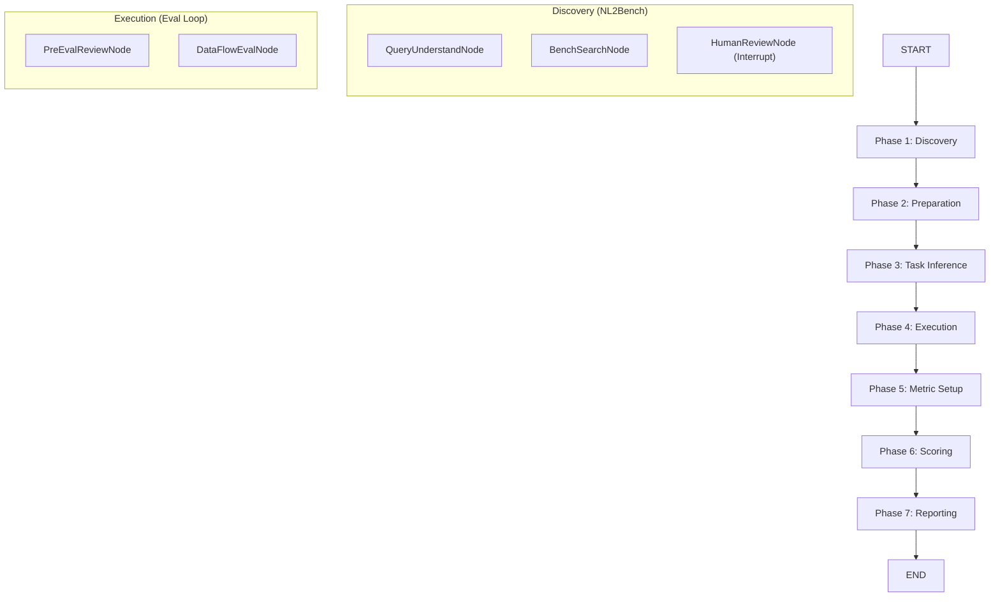
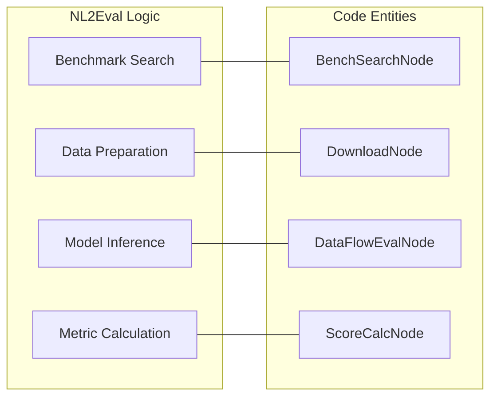

<!-- source: DeepWiki mcp.deepwiki.com · repo OpenDCAI/One-Eval · page 3 Evaluation Pipeline Nodes · fetched 2026-11-02 -->

# Evaluation Pipeline Nodes

Relevant source files

The following files were used as context for generating this wiki page:

- [one_eval/core/graph.py](one_eval/core/graph.py)
- [one_eval/graph/workflow.py](one_eval/graph/workflow.py)
- [one_eval/graph/workflow_all.py](one_eval/graph/workflow_all.py)
- [one_eval/nodes/interrupt_node.py](one_eval/nodes/interrupt_node.py)

The One-Eval pipeline is a structured sequence of execution nodes orchestrated by LangGraph. Each node represents a discrete phase of the evaluation lifecycle, transforming a natural language query into a comprehensive performance report. The workflow is designed to handle complex logic, such as benchmark discovery, dataset conversion, large-scale model inference, and multi-dimensional scoring.

## Pipeline Architecture Overview

The pipeline is defined in `one_eval/graph/workflow_all.py` [one_eval/graph/workflow_all.py:44-175](). It utilizes a `GraphBuilder` [one_eval/core/graph.py:57-185]() to register nodes and define the directed edges that govern the flow of the `NodeState` object.

### High-Level Workflow Diagram
The following diagram illustrates the progression through the seven primary phases of the evaluation pipeline.

**Sources:** [one_eval/graph/workflow_all.py:44-68](), [one_eval/graph/workflow_all.py:74-135]()

---

## Phase 1: Discovery (NL2Bench)
The Discovery phase translates the user's natural language intent into a concrete list of benchmarks. It uses a combination of semantic understanding and retrieval tools to search the local gallery and HuggingFace.

*   **QueryUnderstandNode**: Analyzes the user query to extract domains, tasks, and evaluation requirements [one_eval/graph/workflow_all.py:75]().
*   **BenchSearchNode**: Performs the actual search across available benchmark registries [one_eval/graph/workflow_all.py:76]().
*   **HumanReviewNode**: An `InterruptNode` that pauses execution for user confirmation of the selected benchmarks before proceeding to download [one_eval/graph/workflow_all.py:77-85]().

For details, see [Discovery Phase: Query Understanding & Benchmark Search](#3.1).

---

## Phase 2: Preparation & Download
Once benchmarks are selected, the system must prepare the local environment. This involves inspecting dataset structures (splits/subsets) and fetching the raw data.

*   **DatasetStructureNode**: Probes HuggingFace or local paths to identify available subsets and splits [one_eval/graph/workflow_all.py:92]().
*   **BenchConfigRecommendNode**: Suggests the best configuration (e.g., which split to use for validation) [one_eval/graph/workflow_all.py:93]().
*   **DownloadNode**: Executes the data fetching and converts diverse formats into a unified JSONL structure [one_eval/graph/workflow_all.py:94]().

For details, see [Preparation Phase: Dataset Download & Configuration](#3.2).

---

## Phase 3: Task Inference
This phase bridges the gap between raw data and model-ready prompts by identifying the schema of the downloaded datasets.

*   **DatasetKeysNode**: Identifies the primary keys (input, reference, options) within the JSONL files [one_eval/graph/workflow_all.py:101]().
*   **BenchTaskInferNode**: Determines the task type (e.g., Multiple Choice, Math, Code Generation) based on the dataset content [one_eval/graph/workflow_all.py:102]().

---

## Phase 4: Execution (Evaluation)
The Execution phase is the most resource-intensive part of the pipeline, where the target model processes the benchmark items.

*   **PreEvalReviewNode**: A final gate to review the model configuration and prompt templates [one_eval/graph/workflow_all.py:108-109]().
*   **DataFlowEvalNode**: Manages the inference loop. It handles model serving (via vLLM or API), batching, and saves raw model outputs to "Step 2" files [one_eval/graph/workflow_all.py:111-112]().

For details, see [Execution Phase: DataFlow Evaluation](#3.3).

---

## Phase 5 & 6: Scoring & Metric Calculation
After inference, the system calculates quantitative scores using a extensible metrics engine.

*   **MetricRecommendNode**: Recommends appropriate metrics (e.g., BLEU, Pass@k, Exact Match) based on the task type [one_eval/graph/workflow_all.py:115-116]().
*   **MetricReviewNode**: An `InterruptNode` allowing users to modify the scoring plan [one_eval/graph/workflow_all.py:119-128]().
*   **ScoreCalcNode**: Runs the `MetricRunner` to compare model outputs against references and generate "Step 3" score files [one_eval/graph/workflow_all.py:131-132]().

For details, see [Scoring & Reporting Phase](#3.4).

---

## Phase 7: Reporting
The final phase aggregates all results into a human-readable format.

*   **ReportGenNode**: Compiles scores, error classifications, and capability dimensions into a structured report [one_eval/graph/workflow_all.py:134-135](). It generates radar charts and LLM-powered summaries of the model's strengths and weaknesses.

---

## Node Implementation & Interaction
All nodes inherit from `BaseNode` and are integrated into the graph using `builder.add_node` [one_eval/core/graph.py:76-78](). The `InterruptNode` is a specialized class used for Human-In-The-Loop (HITL) gates, utilizing the `interrupt` and `Command` features of LangGraph [one_eval/nodes/interrupt_node.py:17-37]().

### Code-to-System Mapping
This diagram maps the logical pipeline phases to the specific Python classes that implement them.

**Sources:** [one_eval/graph/workflow_all.py:14-26](), [one_eval/nodes/interrupt_node.py:17-18]()

---

