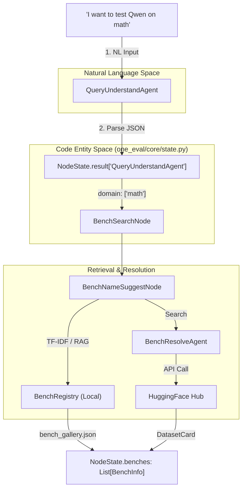
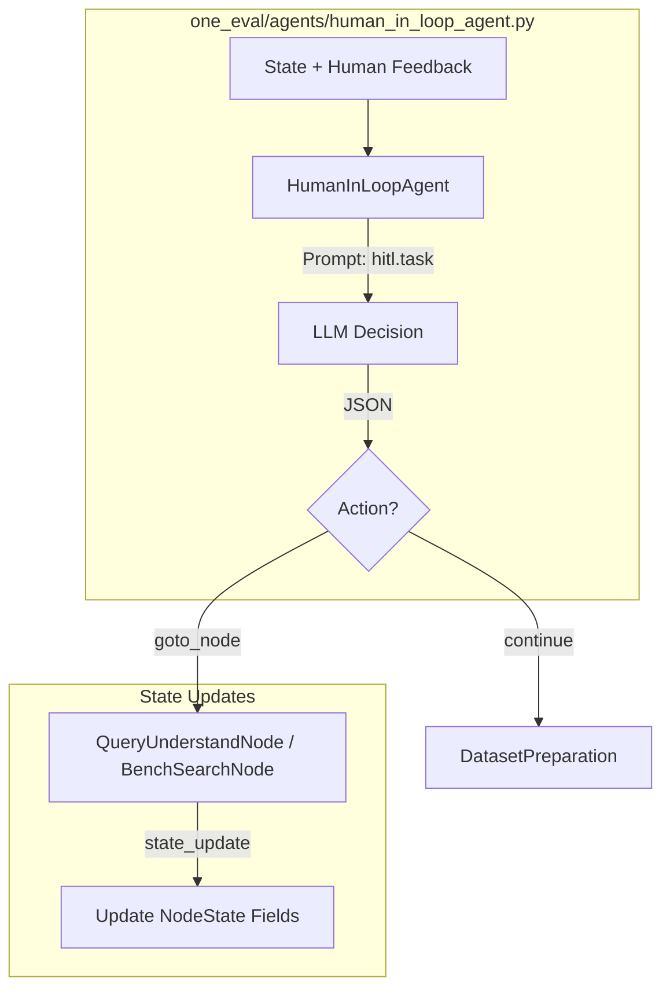

<!-- source: DeepWiki mcp.deepwiki.com · repo OpenDCAI/One-Eval · page 3.1 Discovery Phase: Query Understanding & Benchmark Search · fetched 2026-11-02 -->

# Discovery Phase: Query Understanding & Benchmark Search

Relevant source files

The following files were used as context for generating this wiki page:

- [one_eval/agents/bench_resolve_agent.py](one_eval/agents/bench_resolve_agent.py)
- [one_eval/agents/human_in_loop_agent.py](one_eval/agents/human_in_loop_agent.py)
- [one_eval/agents/query_understand_agent.py](one_eval/agents/query_understand_agent.py)
- [one_eval/nodes/bench_name_suggest_node.py](one_eval/nodes/bench_name_suggest_node.py)
- [one_eval/nodes/bench_search_node.py](one_eval/nodes/bench_search_node.py)
- [one_eval/nodes/pre_eval_review_node.py](one_eval/nodes/pre_eval_review_node.py)
- [one_eval/nodes/query_understand_node.py](one_eval/nodes/query_understand_node.py)
- [one_eval/toolkits/hf_search_tool.py](one_eval/toolkits/hf_search_tool.py)
- [one_eval/utils/bench_registry.py](one_eval/utils/bench_registry.py)
- [one_eval/utils/bench_table/bench-key.xlsx](one_eval/utils/bench_table/bench-key.xlsx)
- [one_eval/utils/bench_table/bench_config.json](one_eval/utils/bench_table/bench_config.json)
- [one_eval/utils/bench_table/bench_gallery.json](one_eval/utils/bench_table/bench_gallery.json)
- [one_eval/utils/node_docs.py](one_eval/utils/node_docs.py)
- [one_eval/utils/prompts.py](one_eval/utils/prompts.py)
- [tests/test_bench_registry.py](tests/test_bench_registry.py)
- [tests/test_hf.py](tests/test_hf.py)
- [tests/test_single_tool.py](tests/test_single_tool.py)

The Discovery Phase is the initial stage of the One-Eval evaluation pipeline. Its purpose is to transform a user's natural language request into a structured evaluation plan by identifying specific domains, target models, and a list of validated benchmarks from both local registries and HuggingFace.

## Overview of the Discovery Flow

The phase is orchestrated by two primary nodes: `QueryUnderstandNode` and `BenchSearchNode`. These nodes transition the system from "Natural Language Space" (user intent) to "Code Entity Space" (structured configurations and dataset references).

### Discovery Phase Data Flow
The following diagram illustrates how user input is transformed into structured `BenchInfo` objects.

**Title: Discovery Phase Entity Mapping**

**Sources:** [one_eval/nodes/query_understand_node.py:11-36](), [one_eval/nodes/bench_search_node.py:12-40](), [one_eval/core/state.py:1-50]()

---

## Query Understanding

The `QueryUnderstandNode` serves as the entry point. It utilizes the `QueryUnderstandAgent` to perform semantic parsing of the `state.user_query`.

### QueryUnderstandAgent
The agent uses a two-part prompt (`query_understand.system` and `query_understand.task`) to extract specific fields:
*   **is_eval_task**: Boolean indicating if the query is an evaluation request.
*   **domain**: List of identified domains (e.g., `["math", "code"]`).
*   **specific_benches**: Benchmarks explicitly named by the user.
*   **model_path**: The model identifier or local path to be tested.

**Sources:** [one_eval/agents/query_understand_agent.py:11-55](), [one_eval/utils/prompts.py:44-81]()

---

## Benchmark Search & Retrieval

The `BenchSearchNode` encapsulates the logic for finding the actual datasets. It executes two sub-components sequentially: `BenchNameSuggestNode` and `BenchResolveAgent`.

### 1. BenchNameSuggestNode (Retrieval Modes)
This node identifies candidate benchmark names without calling an LLM, ensuring high performance and cost-efficiency. It operates in two modes via the `BenchmarkRetriever` class:

| Mode | Implementation | Data Source |
| :--- | :--- | :--- |
| **TF-IDF** | Custom `_tokenize` and `_compute_tf` logic using `math.log` for IDF. | `BenchmarkTable_Filter.xlsx` |
| **RAG** | `EmbeddingCaller` using OpenAI-compatible embeddings (e.g., `text-embedding-3-small`). | `benchmarks_embeddings.npy` (Cache) |

**Key Function:** `BenchmarkRetriever.search(query, top_k)` returns a list of candidate names based on the similarity between the user query and the `Name`, `Type`, and `Description` columns in the filtered benchmark table.

**Sources:** [one_eval/nodes/bench_name_suggest_node.py:30-194](), [one_eval/nodes/bench_search_node.py:28-30]()

### 2. BenchResolveAgent (Resolution)
Once names are suggested, the `BenchResolveAgent` resolves them into concrete `BenchInfo` objects.

*   **Local Resolution**: It queries the `BenchRegistry`, which loads `bench_gallery.json`. It matches names against `bench_name` or `aliases` [one_eval/utils/bench_registry.py:83-107]().
*   **HuggingFace Resolution**: If a benchmark is not found locally, it uses `huggingface_hub.DatasetCard` to fetch metadata directly from HF. It prioritizes exact `repo_id` matches before falling back to search [one_eval/agents/bench_resolve_agent.py:71-139]().

**Sources:** [one_eval/agents/bench_resolve_agent.py:15-191](), [one_eval/utils/bench_registry.py:10-78]()

---

## Human-in-the-Loop: HumanReviewNode

To ensure the pipeline doesn't proceed with incorrect benchmarks, the system includes an interrupt gate.

### Interrupt Logic
The `HumanReviewNode` (often referred to as the HITL gate) triggers an `interrupt` in LangGraph. This pauses execution and waits for a frontend response.

**Title: HITL Decision Flow**

### HumanInLoopAgent
The agent processes the `human_input` and `check_result` (warnings) to decide the next step. It can:
1.  **Continue**: Proceed to the next phase.
2.  **Goto Node**: Roll back the graph to a previous node (e.g., `QueryUnderstandNode`) to re-parse requirements if the user provides corrections.
3.  **State Update**: Inject new values into the `NodeState` (e.g., manually adding a benchmark name).

**Sources:** [one_eval/agents/human_in_loop_agent.py:14-150](), [one_eval/utils/prompts.py:151-235](), [one_eval/nodes/pre_eval_review_node.py:11-40]()

---

