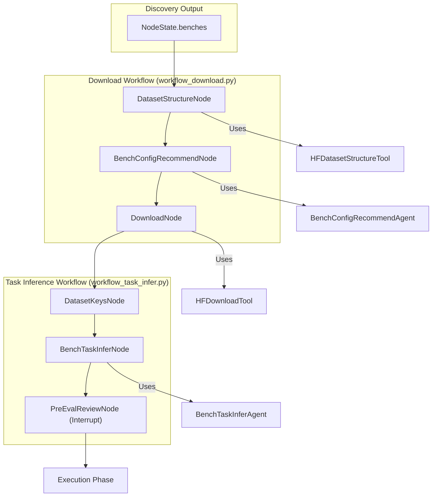
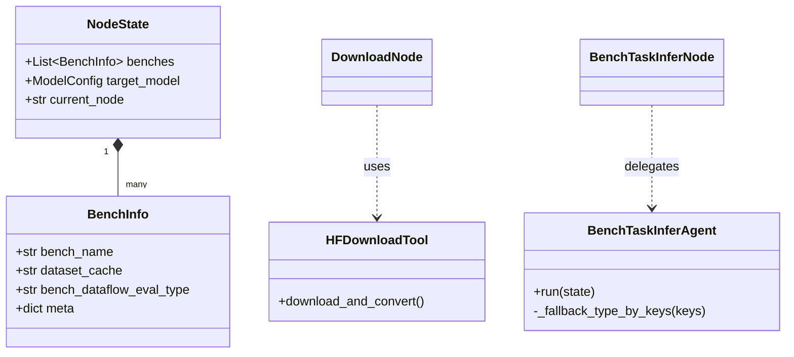

<!-- source: DeepWiki mcp.deepwiki.com · repo OpenDCAI/One-Eval · page 3.2 Preparation Phase: Dataset Download & Configuration · fetched 2026-11-02 -->

# Preparation Phase: Dataset Download & Configuration

Relevant source files

The following files were used as context for generating this wiki page:

- [README.md](README.md)
- [README_zh.md](README_zh.md)
- [one-eval-web/.gitignore](one-eval-web/.gitignore)
- [one_eval/agents/bench_config_recommend_agent.py](one_eval/agents/bench_config_recommend_agent.py)
- [one_eval/agents/bench_task_infer_agent.py](one_eval/agents/bench_task_infer_agent.py)
- [one_eval/graph/workflow_download.py](one_eval/graph/workflow_download.py)
- [one_eval/graph/workflow_eval.py](one_eval/graph/workflow_eval.py)
- [one_eval/graph/workflow_task_infer.py](one_eval/graph/workflow_task_infer.py)
- [one_eval/nodes/bench_config_recommend_node.py](one_eval/nodes/bench_config_recommend_node.py)
- [one_eval/nodes/bench_task_infer_node.py](one_eval/nodes/bench_task_infer_node.py)
- [one_eval/nodes/dataset_keys_node.py](one_eval/nodes/dataset_keys_node.py)
- [one_eval/nodes/dataset_structure_node.py](one_eval/nodes/dataset_structure_node.py)
- [one_eval/nodes/download_node.py](one_eval/nodes/download_node.py)
- [one_eval/toolkits/hf_dataset_structure_tool.py](one_eval/toolkits/hf_dataset_structure_tool.py)
- [one_eval/toolkits/hf_download_tool.py](one_eval/toolkits/hf_download_tool.py)
- [static/logo/318QRcode.jpg](static/logo/318QRcode.jpg)

The **Preparation Phase** is the second major stage in the One-Eval pipeline. It transforms the benchmark names identified in the Discovery Phase into local, ready-to-evaluate JSONL files. This phase handles the complexity of HuggingFace dataset structures (subsets and splits), automated configuration recommendation, file downloading, and schema inference.

## Phase Overview

The preparation phase is orchestrated across two primary sub-workflows: `workflow_download.py` and `workflow_task_infer.py`. It bridges the gap between a high-level benchmark name and the technical requirements needed for the execution engine.

### Data Flow & Node Topology

The following diagram illustrates the transition from the "Natural Language/Metadata Space" to the "Code/FileSystem Space".

**Preparation Phase Data Flow**

**Sources:** [one_eval/graph/workflow_download.py:25-49](), [one_eval/graph/workflow_task_infer.py:23-45]()

---

## 1. Dataset Discovery & Structure Analysis

Before downloading, the system must understand the internal structure of the HuggingFace repository.

### DatasetStructureNode
This node uses the `HFDatasetStructureTool` to fetch the available subsets (configs) and splits for each benchmark. It populates `bench.meta["structure"]` with a JSON representation of the repository's layout.
*   **Implementation:** [one_eval/nodes/dataset_structure_node.py]()
*   **Key Tool:** `HFDatasetStructureTool` (inspects subsets and splits via HuggingFace API).

### BenchConfigRecommendNode
Since many datasets (e.g., MMLU) contain hundreds of subsets, the `BenchConfigRecommendAgent` analyzes the user's original query and the available subsets to pick the most relevant configuration.
*   **Implementation:** [one_eval/nodes/bench_config_recommend_node.py]()
*   **Agent Logic:** Uses `BenchConfigRecommendAgent` to select a `config` and `split` (e.g., `config="elementary_mathematics"`, `split="test"`). [one_eval/agents/bench_config_recommend_agent.py:15-180]()

**Sources:** [one_eval/nodes/dataset_structure_node.py:1-20](), [one_eval/agents/bench_config_recommend_agent.py:83-179]()

---

## 2. The Download Engine

The downloading process ensures that datasets are converted into a standardized format for the `DataFlow` execution engine.

### DownloadNode
The `DownloadNode` manages the lifecycle of the physical file acquisition. It includes an auto-correction logic for splits: if a recommended split (like "test") is missing, it falls back to "validation" or "dev" automatically.
*   **Split Selection:** `_pick_best_split` prioritizes `test` -> `validation` -> `dev` -> `train`. [one_eval/nodes/download_node.py:27-41]()
*   **Caching:** Files are saved to `cache/` using a naming convention: `{repo}__{config}__{split}.jsonl`. [one_eval/nodes/download_node.py:125-127]()

### HFDownloadTool
This tool wraps the `datasets` library to fetch data and perform "cleaning" during conversion to JSONL.
*   **Data Cleaning:** It iterates through dataset items and ensures every field is JSON-serializable. Non-serializable objects (like PIL Images) are cast to strings to prevent pipeline crashes. [one_eval/toolkits/hf_download_tool.py:84-103]()
*   **Function:** `download_and_convert(repo_id, config_name, split, output_path)`. [one_eval/toolkits/hf_download_tool.py:45-117]()

**Sources:** [one_eval/nodes/download_node.py:14-175](), [one_eval/toolkits/hf_download_tool.py:13-117]()

---

## 3. Schema Inference & Task Mapping

Once the JSONL file exists locally, the system must determine how to map the JSON keys to evaluation inputs (e.g., which key is the "question", which is the "ground truth").

### DatasetKeysNode
This node reads the first few lines of the downloaded JSONL file to extract all available keys, including nested paths (e.g., `metadata.difficulty`).
*   **Implementation:** [one_eval/nodes/dataset_keys_node.py:13-88]()
*   **Output:** Populates `bench.bench_keys` and `bench.meta["preview_data"]`.

### BenchTaskInferNode & Agent
The `BenchTaskInferAgent` uses an LLM to map the extracted keys to a standard `eval_type` (defined in the Bench Gallery).
*   **Supported Types:** Includes `key3_q_choices_a` (Multiple Choice), `key2_qa` (Question/Answer), etc. [one_eval/agents/bench_task_infer_agent.py:14-21]()
*   **Fallback Logic:** If the LLM fails, `_fallback_type_by_keys` uses regex-like pattern matching on key names (e.g., keys containing "prompt" or "query" are mapped to `input_question_key`). [one_eval/agents/bench_task_infer_agent.py:50-73]()

**Schema Inference Mapping**
| Target Field | Potential JSON Keys (Aliases) |
| :--- | :--- |
| `input_question_key` | question, query, prompt, instruction |
| `input_choices_key` | choices, options, candidates |
| `input_target_key` | target, reference, ground_truth, gold |

**Sources:** [one_eval/nodes/dataset_keys_node.py:57-83](), [one_eval/agents/bench_task_infer_agent.py:24-150]()

---

## 4. Human-in-the-Loop: PreEvalReviewNode

The preparation phase concludes with a mandatory interrupt gate: the `PreEvalReviewNode`. 

**Interrupt Mechanism**
1.  The graph state is saved to the `AsyncSqliteSaver` database.
2.  The workflow enters a `suspended` state.
3.  The Frontend displays the "Review Benchmarks" UI, showing the recommended configs, detected keys, and the inferred task mapping.
4.  The user can manually override the `eval_type` or `key_mapping` before signaling the backend to resume.

**Preparation Phase Implementation Detail**

**Sources:** [one_eval/core/state.py](), [one_eval/nodes/download_node.py:55](), [one_eval/nodes/bench_task_infer_node.py:11-28]()

---

