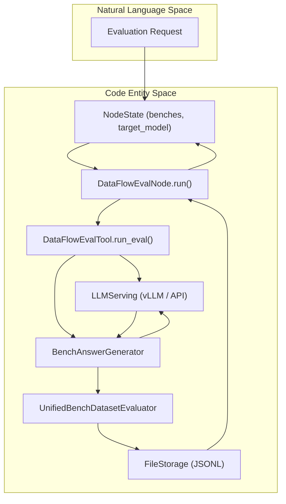
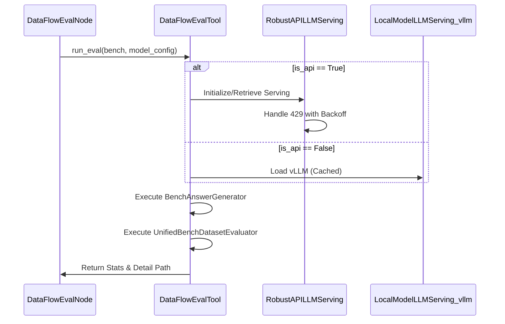

<!-- source: DeepWiki mcp.deepwiki.com · repo OpenDCAI/One-Eval · page 3.3 Execution Phase: DataFlow Evaluation · fetched 2026-11-02 -->

# Execution Phase: DataFlow Evaluation

Relevant source files

The following files were used as context for generating this wiki page:

- [one_eval/nodes/dataflow_eval_node.py](one_eval/nodes/dataflow_eval_node.py)
- [one_eval/toolkits/dataflow_eval_tool.py](one_eval/toolkits/dataflow_eval_tool.py)
- [one_eval/toolkits/tool_manager.py](one_eval/toolkits/tool_manager.py)
- [tests/test_demo.py](tests/test_demo.py)

The Execution Phase is the core engine of One-Eval, responsible for generating model responses and performing preliminary evaluations. It leverages the **DataFlow** library to manage the lifecycle of Large Language Model (LLM) serving, inference, and dataset evaluation. This phase is primarily orchestrated by the `DataFlowEvalNode` and its underlying `DataFlowEvalTool`.

## DataFlow Evaluation Architecture

The evaluation process bridges the gap between raw datasets and structured model outputs. It supports both local inference (via vLLM) and remote API calls, ensuring high throughput and robust error handling.

### Natural Language to Code Entity Space Mapping

| Natural Language Concept | Code Entity | File Path |
| :--- | :--- | :--- |
| **Evaluation Node** | `DataFlowEvalNode` | [one_eval/nodes/dataflow_eval_node.py:25-33]() |
| **Execution Engine** | `DataFlowEvalTool` | [one_eval/toolkits/dataflow_eval_tool.py:85-90]() |
| **Model Serving** | `LLMServingABC` | [one_eval/toolkits/dataflow_eval_tool.py:18-18]() |
| **Rate Limit Handler** | `RobustAPILLMServing` | [one_eval/toolkits/dataflow_eval_tool.py:27-32]() |
| **Answer Generator** | `BenchAnswerGenerator` | [one_eval/toolkits/dataflow_eval_tool.py:14-14]() |
| **Dataset Evaluator** | `UnifiedBenchDatasetEvaluator` | [one_eval/toolkits/dataflow_eval_tool.py:14-14]() |

### System Data Flow Diagram

The following diagram illustrates the flow from `NodeState` through the `DataFlowEvalTool` to the generation of results.

"Execution Data Flow"

Sources: [one_eval/nodes/dataflow_eval_node.py:42-160](), [one_eval/toolkits/dataflow_eval_tool.py:186-220]()

---

## DataFlowEvalNode: The Workflow Orchestrator

`DataFlowEvalNode` is a LangGraph node that iterates through the benchmarks defined in the `NodeState`.

### Key Responsibilities
1.  **Configuration Preparation**: Extracts `ModelConfig` from the state, defaulting to local inference if not specified [one_eval/nodes/dataflow_eval_node.py:56-72]().
2.  **State Validation**: Ensures the benchmark has a valid `dataset_cache` and `eval_type` (e.g., `key3_q_choices_a`) [one_eval/nodes/dataflow_eval_node.py:88-133]().
3.  **Progress Tracking**: Implements a `_on_progress` callback that updates both the `NodeState` and the global `progress_store` for real-time UI feedback [one_eval/nodes/dataflow_eval_node.py:148-154]().
4.  **Error Handling**: If a benchmark fails validation, it triggers a `Command(goto="PreEvalReviewNode")` to interrupt the workflow for human intervention [one_eval/nodes/dataflow_eval_node.py:94-102]().

### Supported Evaluation Types
The node validates benchmarks against `VALID_EVAL_TYPES`, which include:
*   `key1_text_score`: Text-based scoring.
*   `key2_qa`: Standard Question-Answering.
*   `key3_q_choices_a`: Multiple-choice questions.
*   `key3_q_a_rejected`: Preference-based evaluation (RLHF style).

Sources: [one_eval/nodes/dataflow_eval_node.py:15-22](), [one_eval/nodes/dataflow_eval_node.py:119-133]()

---

## DataFlowEvalTool: The Execution Engine

The `DataFlowEvalTool` wraps the DataFlow library to perform the heavy lifting of inference and evaluation.

### LLM Serving Lifecycle
The tool manages two primary serving modes:
1.  **vLLM (Local)**: Uses `LocalModelLLMServing_vllm`. It includes a class-level cache `_cached_llm_serving` to prevent redundant reloading of heavy models into GPU memory across different benchmarks [one_eval/toolkits/dataflow_eval_tool.py:92-94]().
2.  **API (Remote)**: Uses `RobustAPILLMServing` for OpenAI-compatible or DeepSeek endpoints [one_eval/toolkits/dataflow_eval_tool.py:117-134]().

### RobustAPILLMServing: Rate-Limit Handling
To handle the instability of remote APIs, `RobustAPILLMServing` extends the base request class with:
*   **429 Interception**: Mocks the session's post method to specifically catch "Too Many Requests" errors [one_eval/toolkits/dataflow_eval_tool.py:37-47]().
*   **Exponential Backoff**: Implements a retry loop with jitter. For 429 errors, it uses a longer sleep time: `(2 ** i) * 1.5 + random.uniform(0, 2)` [one_eval/toolkits/dataflow_eval_tool.py:71-75]().

### Evaluation Pipeline Flow
The `run_eval` method executes the following sequence:
1.  **Serving Initialization**: Starts vLLM or initializes the API client [one_eval/toolkits/dataflow_eval_tool.py:186-200]().
2.  **Answer Generation**: Invokes `BenchAnswerGenerator` to produce model outputs based on the dataset and prompt templates [one_eval/toolkits/dataflow_eval_tool.py:214-220]().
3.  **Unified Evaluation**: Calls `UnifiedBenchDatasetEvaluator` to perform rule-based or LLM-as-Judge evaluation [one_eval/toolkits/dataflow_eval_tool.py:230-240]().

"Serving Lifecycle"

Sources: [one_eval/toolkits/dataflow_eval_tool.py:27-82](), [one_eval/toolkits/dataflow_eval_tool.py:186-240]()

---

## LLM-as-Judge Integration

For complex benchmarks where exact matching is insufficient, One-Eval supports using a reference model as a judge.

*   **Judge Configuration**: The `reference_model` from `NodeState` is passed to the tool [one_eval/nodes/dataflow_eval_node.py:158]().
*   **Serving**: A separate `judge_serving` instance is created if the judge model differs from the target model [one_eval/toolkits/dataflow_eval_tool.py:202-212]().
*   **DataFlow Integration**: The `UnifiedBenchDatasetEvaluator` uses this serving instance to score open-ended responses based on predefined criteria.

Sources: [one_eval/toolkits/dataflow_eval_tool.py:114-114](), [one_eval/toolkits/dataflow_eval_tool.py:230-240]()

---

## Progress Tracking and State Persistence

One-Eval ensures that long-running evaluation tasks are transparent and resumable.

### Real-time Updates
During the execution of `run_eval`, a `progress_callback` is triggered for every batch of processed data. This updates:
*   **NodeState**: `bench.meta["eval_progress"]` stores the current stage, percentage, and counts [one_eval/nodes/dataflow_eval_node.py:148-154]().
*   **Progress Store**: `set_progress(thread_id, p)` allows the FastAPI server to stream progress to the frontend [one_eval/nodes/dataflow_eval_node.py:153-154]().

### Artifacts
Upon completion, the tool returns a `detail_path` pointing to a JSONL file containing every prompt, model response, and evaluation result [one_eval/nodes/dataflow_eval_node.py:173](). This file is stored in the `cache/eval_results` directory by default [one_eval/nodes/dataflow_eval_node.py:39-40]().

Sources: [one_eval/nodes/dataflow_eval_node.py:162-174](), [one_eval/runtime/progress_store.py:12-12]()

---

