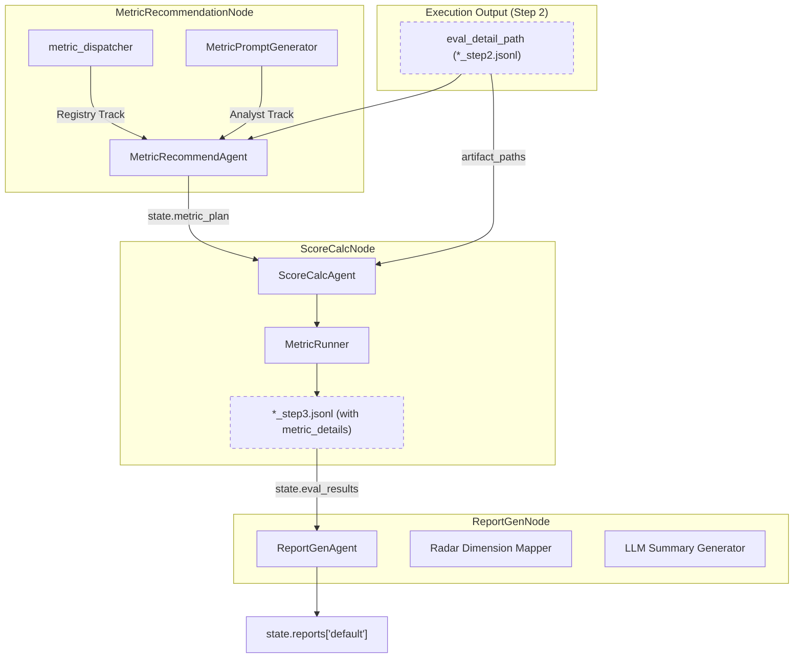
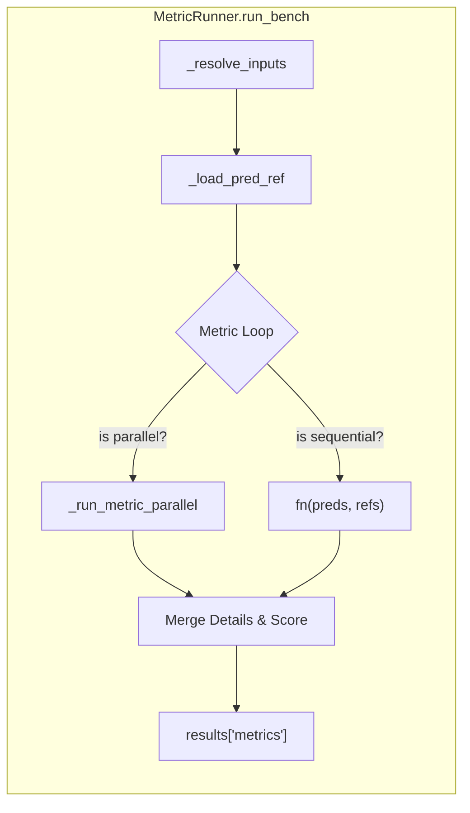

<!-- source: DeepWiki mcp.deepwiki.com · repo OpenDCAI/One-Eval · page 3.4 Scoring & Reporting Phase · fetched 2026-11-02 -->

# Scoring & Reporting Phase

Relevant source files

The following files were used as context for generating this wiki page:

- [one_eval/agents/metric_recommend_agent.py](one_eval/agents/metric_recommend_agent.py)
- [one_eval/agents/report_gen_agent.py](one_eval/agents/report_gen_agent.py)
- [one_eval/agents/score_calc_agent.py](one_eval/agents/score_calc_agent.py)
- [one_eval/metrics/prompt_generator.py](one_eval/metrics/prompt_generator.py)
- [one_eval/metrics/runner.py](one_eval/metrics/runner.py)
- [one_eval/nodes/report_gen_node.py](one_eval/nodes/report_gen_node.py)
- [one_eval/nodes/score_calc_node.py](one_eval/nodes/score_calc_node.py)

The **Scoring & Reporting Phase** is the final segment of the One-Eval pipeline. It transitions from raw model outputs (Step 2) to structured metric calculations (Step 3) and finally to a comprehensive analytical report. This phase involves automated metric recommendation, parallelized score calculation, and LLM-powered result summarization.

## Phase Overview

This phase is composed of four primary logical units within the LangGraph workflow:
1.  **Metric Recommendation**: Determining which metrics are appropriate for the evaluated benchmarks.
2.  **Human Review (Optional)**: A HITL (Human-in-the-Loop) interrupt for manual metric adjustment.
3.  **Score Calculation**: Executing the metrics against the model predictions.
4.  **Report Generation**: Aggregating results into visual dimensions and natural language summaries.

### Scoring & Reporting Data Flow

The following diagram illustrates the transition from raw execution results to the final report artifacts.

**Diagram: Scoring and Reporting Data Flow**

Sources: [one_eval/agents/metric_recommend_agent.py:15-21](), [one_eval/agents/score_calc_agent.py:137-156](), [one_eval/agents/report_gen_agent.py:97-143]()

---

## 1. Metric Recommendation

The `MetricRecommendNode` utilizes the `MetricRecommendAgent` to decide which metrics to run for each benchmark in `state.benches`.

### Dual-Track Strategy
The agent employs a "Dual-Track" strategy to ensure both reliability for known benchmarks and flexibility for new ones:
*   **Registry Track**: Checks `metric_dispatcher` (via `one_eval/core/metric_registry.py`) for pre-defined metrics associated with the benchmark name [one_eval/agents/metric_recommend_agent.py:35-39]().
*   **Analyst Track**: If the benchmark is unknown, the agent calls an LLM. It uses `MetricPromptGenerator` to construct a prompt containing the "Metric Library" (all registered metrics and their descriptions) and "Decision Rules" based on the dataset's evaluation type (e.g., `key3_q_choices_a`) [one_eval/metrics/prompt_generator.py:11-58](), [one_eval/agents/metric_recommend_agent.py:159-210]().

### Normalization and Validation
The agent ensures every metric has a `priority` ("primary", "secondary", or "diagnostic"). If the LLM fails to provide a primary metric, the agent assigns the first one as primary to ensure an overall score can be calculated [one_eval/agents/metric_recommend_agent.py:41-71](), [one_eval/agents/metric_recommend_agent.py:114-119]().

Sources: [one_eval/agents/metric_recommend_agent.py:15-21](), [one_eval/metrics/prompt_generator.py:6-9]()

---

## 2. Score Calculation

The `ScoreCalcNode` executes the `ScoreCalcAgent`, which orchestrates the `MetricRunner` to process model predictions.

### MetricRunner Execution
The `MetricRunner` is responsible for:
1.  **Input Resolution**: Locating the `records_path` (the `_step2.jsonl` file) from the benchmark metadata [one_eval/metrics/runner.py:139-160]().
2.  **Parallel Execution**: For independent, sample-wise metrics (like `exact_match`), it uses a `ProcessPoolExecutor` to chunk the data across CPU cores [one_eval/metrics/runner.py:22-48]().
3.  **Corpus-Level Handling**: Metrics like `BLEU` or `chrf` are marked as `NON_PARALLEL_METRICS` and run sequentially to maintain corpus-level statistical integrity [one_eval/metrics/runner.py:16-17]().

### Step 3 File Generation
After calculation, the `ScoreCalcAgent` performs a "Step 3" write-back:
*   It loads the Step 2 records.
*   It attaches the individual score for each sample into a `metric_details` field within each JSON object [one_eval/agents/score_calc_agent.py:87-105]().
*   It saves the enriched data to a new file, typically named `[original]_step3.jsonl` [one_eval/agents/score_calc_agent.py:71-85](), [one_eval/agents/score_calc_agent.py:115-127]().

**Diagram: MetricRunner Logic**

Sources: [one_eval/metrics/runner.py:84-137](), [one_eval/agents/score_calc_agent.py:115-127]()

---

## 3. Report Generation

The `ReportGenNode` uses the `ReportGenAgent` to transform the flat dictionary of scores into a structured report for the frontend.

### Radar Dimensions and Mapping
To support the Radar Chart in the UI, the agent maps benchmarks to specific capability dimensions (Knowledge, Reasoning, Math, Coding, etc.).
*   **Metadata Mapping**: It first checks `bench.meta["radar_dimensions"]` [one_eval/agents/report_gen_agent.py:195-197]().
*   **Keyword Fallback**: If missing, it uses `BENCH_KEYWORD_RULES` to match the `bench_name` against known patterns (e.g., "gsm8k" maps to "mathematics" and "reasoning") [one_eval/agents/report_gen_agent.py:41-81]().

### Diagnostic Analysis
The agent performs statistical analysis on the results:
*   **Error Distribution**: It aggregates error types (e.g., format errors, extraction failures) [one_eval/agents/report_gen_agent.py:118]().
*   **Length Histogram**: It calculates the distribution of model output lengths to detect verbosity or brevity biases [one_eval/agents/report_gen_agent.py:135]().

### LLM Summary Generation
Finally, the agent constructs a `summary_payload` containing the overall score, top 20 benchmarks, and error distribution. This is sent to an LLM to generate a natural language summary of the model's performance strengths and weaknesses [one_eval/agents/report_gen_agent.py:115-122]().

### Report Schema
The final `state.reports["default"]` object follows this structure:

| Key | Description |
| :--- | :--- |
| `overall` | Contains `score` (weighted average) and `bench_summaries`. |
| `macro` | Data formatted for Radar charts based on capability dimensions. |
| `diagnostic` | `error_distribution` and `length_histogram`. |
| `cases` | A list of specific sample rows (question, output, GT, score) for the UI Case Table. |
| `llm_summary` | The natural language analysis generated by the agent. |

Sources: [one_eval/agents/report_gen_agent.py:124-143](), [one_eval/agents/report_gen_agent.py:166-202]()

---

## 4. Node Definitions

### ScoreCalcNode
A wrapper for `ScoreCalcAgent`. It initializes the agent with the global `tool_manager` and triggers the scoring loop [one_eval/nodes/score_calc_node.py:12-29]().

### ReportGenNode
A wrapper for `ReportGenAgent`. It updates the `state.reports` dictionary, which is then persisted by the LangGraph saver for the frontend to poll [one_eval/nodes/report_gen_node.py:11-28]().

Sources: [one_eval/nodes/score_calc_node.py:1-29](), [one_eval/nodes/report_gen_node.py:1-28]()

---

