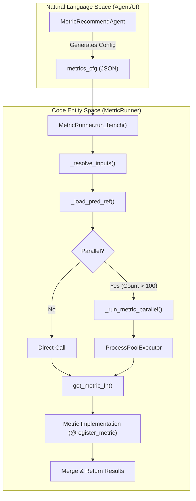
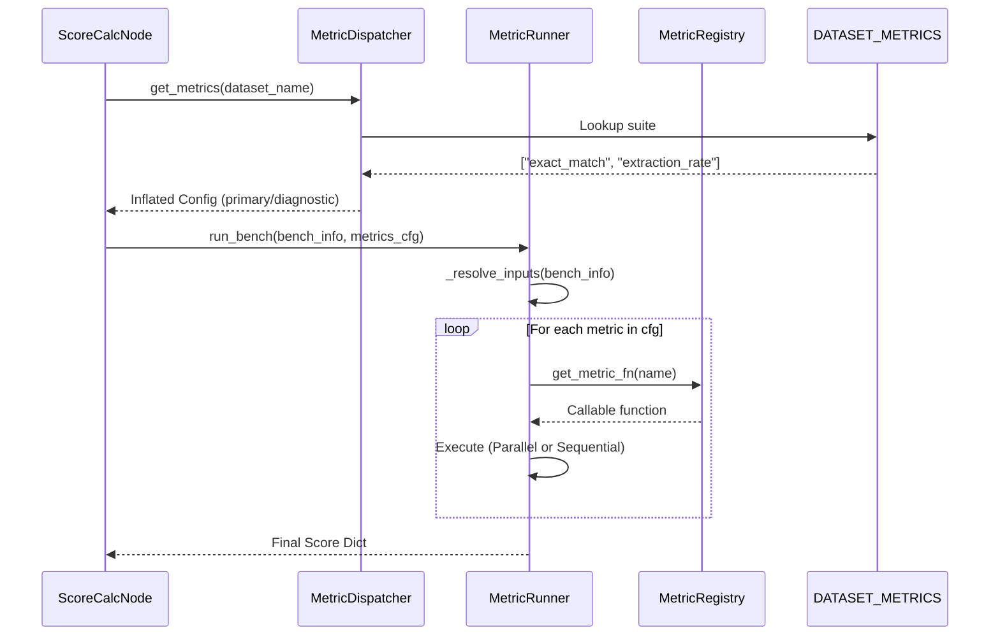

<!-- source: DeepWiki mcp.deepwiki.com · repo OpenDCAI/One-Eval · page 4.1 Metric Registry, Dispatcher & Runner · fetched 2026-11-02 -->

# Metric Registry, Dispatcher & Runner

Relevant source files

The following files were used as context for generating this wiki page:

- [one_eval/core/metric_registry.py](one_eval/core/metric_registry.py)
- [one_eval/metrics/__init__.py](one_eval/metrics/__init__.py)
- [one_eval/metrics/common/__init__.py](one_eval/metrics/common/__init__.py)
- [one_eval/metrics/config.py](one_eval/metrics/config.py)
- [one_eval/metrics/dispatcher.py](one_eval/metrics/dispatcher.py)
- [one_eval/metrics/prompt_generator.py](one_eval/metrics/prompt_generator.py)
- [one_eval/metrics/runner.py](one_eval/metrics/runner.py)

The metrics subsystem in One-Eval provides a decoupled architecture for defining, discovering, and executing evaluation metrics. It consists of a centralized registry for metric discovery, a dispatcher for rule-based recommendation, and a high-performance runner capable of parallel execution.

### Metric Registry

The `MetricRegistry` is the foundation of the metrics system, utilizing a decorator-based registration pattern to decouple metric implementations from the core engine.

#### Key Entities
- **`MetricMeta`**: A dataclass storing metadata for each metric, including its name, implementation function, description, usage context, categories, and aliases [one_eval/core/metric_registry.py:9-16]().
- **`MetricCategory`**: Defines standard evaluation types such as `key1_text_score` (Text Scoring), `key2_qa` (Single QA), and `key3_q_choices_a` (Single Choice) [one_eval/core/metric_registry.py:18-25]().
- **`@register_metric`**: A decorator used to register functions into the global `_REGISTRY_CACHE`. It supports automatic name inference from function names (e.g., `compute_exact_match` becomes `exact_match`) [one_eval/core/metric_registry.py:35-79]().

#### Implementation Logic
The registry uses `pkgutil` to automatically scan and load all modules under `one_eval.metrics.common` [one_eval/core/metric_registry.py:81-99](). This ensures that any metric decorated with `@register_metric` is available for lookup by name or alias via `get_metric_fn` [one_eval/core/metric_registry.py:101-114]().

**Sources:** [one_eval/core/metric_registry.py:1-120]()

---

### Metric Dispatcher

The `MetricDispatcher` serves as the intelligence layer, determining which metrics are appropriate for a given dataset based on hardcoded mappings and heuristic rules.

#### Dispatch Logic
1. **Direct Lookup**: It uses `DATASET_METRICS` (defined in `one_eval/metrics/config.py`) to map dataset names to pre-defined metric suites like `_SUITE_NUMERICAL` or `_SUITE_CODE` [one_eval/metrics/config.py:6-85]().
2. **Fuzzy Matching**: The dispatcher normalizes dataset names and performs substring matching to find the best fit in the configuration map [one_eval/metrics/dispatcher.py:39-42, 87-93]().
3. **Priority Inference**: When "inflating" a list of metric names into a configuration, the first metric is assigned `primary` priority. Others are marked as `diagnostic` (if they appear in a specific hardcoded list like `extraction_rate`) or `secondary` [one_eval/metrics/dispatcher.py:44-68]().

#### Metric Prompt Generation
The `MetricPromptGenerator` class bridges the code space to the LLM Agent space. It generates markdown documentation describing "Decision Logic" and the "Metric Library" which is injected into the LLM's system prompt during the `MetricRecommendNode` phase [one_eval/metrics/prompt_generator.py:6-140]().

**Sources:** [one_eval/metrics/dispatcher.py:1-101](), [one_eval/metrics/config.py:1-85](), [one_eval/metrics/prompt_generator.py:1-140]()

---

### Metric Runner

The `MetricRunner` is responsible for the actual execution of metrics. It handles data loading, ID alignment, and parallel processing.

#### Parallel Execution Flow
Metrics are executed in parallel using a `ProcessPoolExecutor` if the dataset exceeds 100 samples and the metric is not in the `NON_PARALLEL_METRICS` list (e.g., BLEU and ROUGE, which require corpus-level statistics) [one_eval/metrics/runner.py:15-16, 108-114]().

| Feature | Implementation Detail |
| :--- | :--- |
| **Worker Count** | Defaults to `cpu_count() - 1` [one_eval/metrics/runner.py:20](). |
| **Chunking** | Inputs are divided into chunks; order is preserved via `executor.submit` map-style collection [one_eval/metrics/runner.py:31-41](). |
| **Merging** | Results from chunks are aggregated. Scores are averaged based on sample counts [one_eval/metrics/runner.py:50-82](). |

#### Artifact Resolution
The runner resolves input data through `_resolve_inputs`. It prioritizes `artifact_paths` (results from `DataFlowEvalNode`) over the local `dataset_cache` [one_eval/metrics/runner.py:139-173](). It specifically looks for `records.jsonl` or split files (e.g., `predict.jsonl` and `gt.jsonl`) [one_eval/metrics/runner.py:144-165]().

**Metric Execution Pipeline Diagram**

**Sources:** [one_eval/metrics/runner.py:18-173]()

---

### System Integration & Data Flow

The following diagram illustrates how the `MetricRegistry`, `Dispatcher`, and `Runner` interact during the scoring phase of the evaluation pipeline.

**Metric System Interaction Diagram**

**Sources:** [one_eval/metrics/dispatcher.py:70-98](), [one_eval/metrics/runner.py:84-137](), [one_eval/core/metric_registry.py:101-114]()

---

