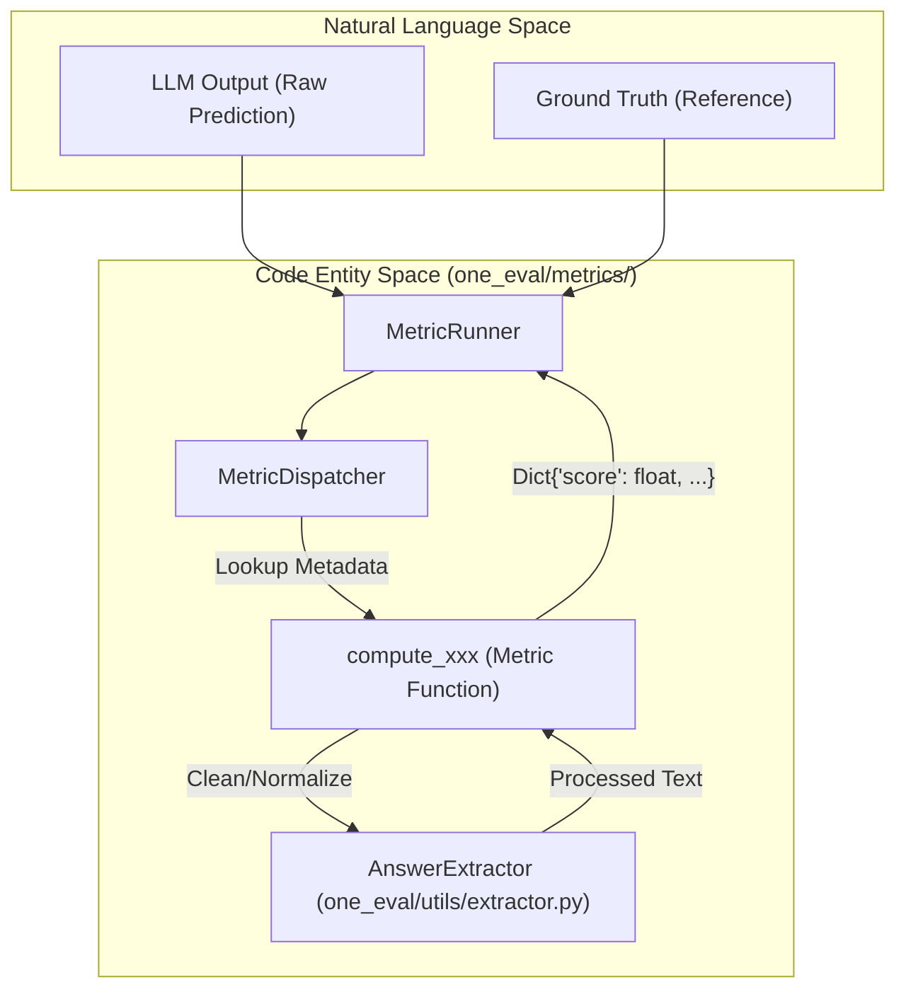
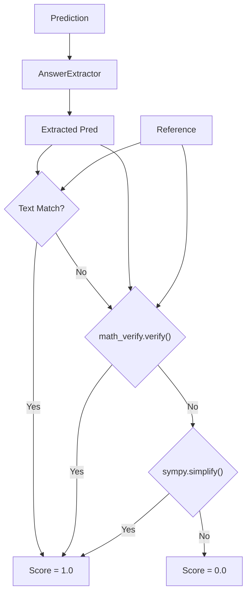

<!-- source: DeepWiki mcp.deepwiki.com · repo OpenDCAI/One-Eval · page 4.2 Built-in Metric Implementations · fetched 2026-11-02 -->

# Built-in Metric Implementations

<details>
<summary>Relevant source files</summary>

The following files were used as context for generating this wiki page:

- [HOW_TO_REGISTER_METRIC.md](HOW_TO_REGISTER_METRIC.md)
- [one-eval-web/src/components/ui/simple-markdown.tsx](one-eval-web/src/components/ui/simple-markdown.tsx)
- [one_eval/metrics/common/analysis.py](one_eval/metrics/common/analysis.py)
- [one_eval/metrics/common/classification.py](one_eval/metrics/common/classification.py)
- [one_eval/metrics/common/code.py](one_eval/metrics/common/code.py)
- [one_eval/metrics/common/general.py](one_eval/metrics/common/general.py)
- [one_eval/metrics/common/math_verify.py](one_eval/metrics/common/math_verify.py)
- [one_eval/metrics/common/symbolic.py](one_eval/metrics/common/symbolic.py)
- [one_eval/metrics/common/text_gen.py](one_eval/metrics/common/text_gen.py)

</details>


This page documents the standard metric implementations provided in `one_eval/metrics/common/`. These metrics cover classification, text generation, mathematical verification, code analysis, and general diagnostic utilities. All metrics follow a unified interface and are registered via the `MetricRegistry` to be discoverable by the LLM-based recommendation agents.

## Overview of Metric Categories

The One-Eval metrics system is organized into functional categories defined in `MetricCategory`. Each metric implementation is a Python function decorated with `@register_metric`, which defines its metadata (name, description, usage, and applicable categories).

### Metric Data Flow
The following diagram illustrates how data flows from model predictions to a final metric score.

**Metric Execution Data Flow**

Sources: [one_eval/core/metric_registry.py:6-12](), [one_eval/metrics/common/general.py:13-20](), [HOW_TO_REGISTER_METRIC.md:16-58]()

---

## 1. Classification & Choice Metrics

These metrics evaluate the model's ability to select discrete labels or categories.

| Metric Name | Function | Description |
| :--- | :--- | :--- |
| `exact_match` | `compute_exact_match` | Checks if the normalized prediction exactly matches the reference. |
| `choice_accuracy` | `compute_choice_accuracy` | Specifically for A/B/C/D choices; uses `extract_choice` to isolate the option. |
| `gini_index` | `compute_gini_index` | Measures ability balance across categories; requires category metadata in `refs`. |
| `mcc` | `compute_mcc` | Matthews Correlation Coefficient for binary/multi-class classification (e.g., GLUE). |
| `auc_roc` | `compute_auc_roc` | Calculates Area Under the ROC Curve; supports probability inputs. |

### Implementation Detail: Gini Index
The `compute_gini_index` calculates the Gini coefficient of accuracy across different subsets (subjects/domains) to determine if a model is "balanced" or "biased" towards specific topics [one_eval/metrics/common/classification.py:14-108]().

Sources: [one_eval/metrics/common/classification.py:8-179](), [one_eval/metrics/common/general.py:127-188]()

---

## 2. Text Generation Metrics

Used for open-ended generation, translation, and summarization. Most generation metrics leverage the `sacrebleu` or `rouge-score` libraries.

| Metric Name | Library Dependency | Key Features |
| :--- | :--- | :--- |
| `bleu` | `sacrebleu` | Corpus-level BLEU score; handles multi-reference transposition. |
| `rouge_l` | `rouge_score` | ROUGE-L F1 score; takes the maximum score across multiple references. |
| `chrf` | `sacrebleu` | Character n-gram F-score; useful for morphologically rich languages. |
| `ter` | `sacrebleu` | Translation Edit Rate; measures the number of edits needed to match a reference. |
| `token_f1` | Custom | Word-level F1 score after punctuation removal and normalization. |

### Implementation Detail: Multi-Reference Handling
For metrics like BLEU, `one_eval` transposes the reference list from `List[Sample_Refs]` to `List[Ref_Streams]` as required by `sacrebleu.corpus_bleu` [one_eval/metrics/common/text_gen.py:23-58]().

Sources: [one_eval/metrics/common/text_gen.py:7-203]()

---

## 3. Math & Symbolic Verification

Math metrics handle the complexity of LaTeX formatting, numerical equivalence, and symbolic simplification.

### Hybrid Math Strategy
The `math_verify` metric uses a multi-stage approach to ensure high recall:
1.  **Text Containment**: Uses `AnswerExtractor.text_contains_match` to see if the gold answer appears in the prediction [one_eval/metrics/common/math_verify.py:60-61]().
2.  **Symbolic Equivalence**: Uses the `math_verify` library (or `sympy` fallback) to parse expressions and check if `simplify(pred - ref) == 0` [one_eval/metrics/common/math_verify.py:63-73](), [one_eval/metrics/common/symbolic.py:37-41]().

**Math Verification Logic**

Sources: [one_eval/metrics/common/math_verify.py:34-86](), [one_eval/metrics/common/symbolic.py:9-54]()

---

## 4. Code Evaluation

One-Eval distinguishes between sandboxed execution and static analysis.

*   **`pass_at_k`**: Currently a placeholder requiring a sandboxed environment [one_eval/metrics/common/code.py:10-18]().
*   **`soft_code_execution`**: Performs static analysis using the Python `ast` module. It checks for `SyntaxError` and awards points for valid syntax and the presence of function/class definitions [one_eval/metrics/common/code.py:42-110]().
*   **`code_similarity`**: A proxy metric using BLEU to compare code strings [one_eval/metrics/common/code.py:26-32]().

Sources: [one_eval/metrics/common/code.py:1-110]()

---

## 5. Diagnostic & Analysis Utilities

These utilities do not just provide a score but offer insights into model behavior or evaluation health.

### Extraction Rate (`extraction_rate`)
Calculates the percentage of samples where the system successfully extracted a valid answer format (e.g., a number from a CoT response or a choice letter). It is highly recommended as a "diagnostic" metric to identify parsing failures [one_eval/metrics/common/general.py:192-231]().

### Case Study Analyst (`case_study_analyst`)
A unique LLM-based diagnostic tool that:
1.  **Samples** instances (e.g., 5 negative examples) [one_eval/metrics/common/analysis.py:42-105]().
2.  **Constructs a Prompt** containing the sampled predictions and references [one_eval/metrics/common/analysis.py:108-157]().
3.  **Calls an LLM** (via `CustomLLMCaller`) to provide a natural language summary of why the model is failing [one_eval/metrics/common/analysis.py:160-184]().

Sources: [one_eval/metrics/common/analysis.py:19-184](), [one_eval/metrics/common/general.py:192-231]()

---

## 6. Registering a Custom Metric

To add a new metric, create a function in `one_eval/metrics/common/` and use the `@register_metric` decorator.

### Step-by-Step Registration
1.  **Define the function**: Must accept `preds: List[Any]` and `refs: List[Any]`.
2.  **Return Format**: Must return a dictionary containing at least the `"score"` key.
3.  **Decorate**: Provide metadata for the LLM recommendation agent.

```python
from one_eval.core.metric_registry import register_metric, MetricCategory

@register_metric(
    name="my_custom_metric",
    desc="Brief description for LLM",
    usage="When to use this metric",
    categories=[MetricCategory.QA_SINGLE]
)
def compute_my_metric(preds, refs, **kwargs):
    # Implementation logic
    return {"score": 0.85, "details": [...]}
```

Sources: [HOW_TO_REGISTER_METRIC.md:61-98](), [one_eval/core/metric_registry.py:19-25]()

---

