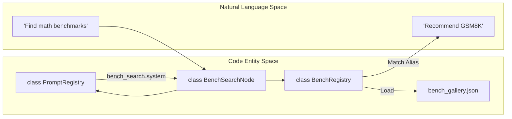

<!-- source: DeepWiki mcp.deepwiki.com · repo OpenDCAI/One-Eval · page 5 Benchmark Registry & Gallery · fetched 2026-11-02 -->

# Benchmark Registry & Gallery

<details>
<summary>Relevant source files</summary>

The following files were used as context for generating this wiki page:

- [one_eval/nodes/bench_search_node.py](one_eval/nodes/bench_search_node.py)
- [one_eval/nodes/pre_eval_review_node.py](one_eval/nodes/pre_eval_review_node.py)
- [one_eval/utils/bench_registry.py](one_eval/utils/bench_registry.py)
- [one_eval/utils/bench_table/bench_config.json](one_eval/utils/bench_table/bench_config.json)
- [one_eval/utils/bench_table/bench_gallery.json](one_eval/utils/bench_table/bench_gallery.json)
- [one_eval/utils/prompts.py](one_eval/utils/prompts.py)
- [tests/test_hf.py](tests/test_hf.py)

</details>


The **Benchmark Registry & Gallery** system in One-Eval serves as the central management layer for all evaluation datasets. It bridges the gap between high-level user queries (e.g., "I want to test math skills") and technical execution details (e.g., specific HuggingFace subsets, key mappings, and evaluation types). The system handles both a curated local gallery and dynamic integration with the HuggingFace ecosystem.

## Overview of Benchmark Management

One-Eval categorizes benchmarks into two primary tiers:
1.  **Local Gallery**: A curated set of high-quality, pre-configured benchmarks with rich metadata.
2.  **External (HuggingFace)**: Any dataset available on HuggingFace that can be dynamically discovered, downloaded, and converted into a standard format.

The `BenchRegistry` class [one_eval/utils/bench_registry.py:10-16]() acts as the primary interface for the system, facilitating search, alias matching, and domain-based filtering.

### Benchmark Resolution Pipeline
The resolution of a benchmark follows a structured flow within the `BenchSearchNode` [one_eval/nodes/bench_search_node.py:12-40]():

```mermaid
graph TD
    "UserQuery" --> "BenchNameSuggestNode"
    "BenchNameSuggestNode" -- "TF-IDF / RAG" --> "NameList"
    "NameList" --> "BenchResolveAgent"
    subgraph "Registry Resolution"
        "BenchResolveAgent" -- "Lookup" --> "BenchRegistry"
        "BenchRegistry" -- "Check" --> "bench_gallery.json"
    end
    "BenchResolveAgent" -- "Not Found Locally" --> "HFSearchTool"
    "HFSearchTool" -- "API Call" --> "HuggingFace Hub"
    "BenchResolveAgent" --> "FinalBenchList"
    
    style "BenchRegistry" stroke-dasharray: 5 5
    style "HuggingFace Hub" stroke-dasharray: 5 5
```
**Sources:** [one_eval/nodes/bench_search_node.py:12-40](), [one_eval/utils/bench_registry.py:112-192]()

---

## Local Bench Gallery & BenchRegistry

The local gallery is defined by `bench_gallery.json`, which contains exhaustive metadata for "first-class" benchmarks. This metadata allows the system to automate configuration that would otherwise require manual intervention.

### Core Components
*   **`BenchRegistry`**: The engine that loads the gallery and provides search APIs. It supports case-insensitive matching and alias resolution [one_eval/utils/bench_registry.py:83-107]().
*   **`bench_gallery.json`**: The primary data store [one_eval/utils/bench_table/bench_gallery.json:1-83]().
*   **`eval_type` Taxonomy**: Defines the evaluation logic (e.g., `key2_qa` for question-answering, `key3_q_choices_a` for multiple choice) [one_eval/utils/bench_table/bench_gallery.json:7]().

### Metadata Structure
A typical entry in the registry includes:
*   **Aliases**: Alternative names (e.g., "gsm8k" vs "Grade School Math") [one_eval/utils/bench_table/bench_gallery.json:20-23]().
*   **Key Mapping**: Maps raw dataset columns to standard internal keys like `input_question_key` and `input_target_key` [one_eval/utils/bench_table/bench_gallery.json:71-75]().
*   **Radar Dimensions**: Categorizes the benchmark for reporting (e.g., "reasoning", "instruction") [one_eval/utils/bench_table/bench_gallery.json:78-81]().

For details on the schema and filtering logic, see [Local Bench Gallery & BenchRegistry](#5.1).

**Sources:** [one_eval/utils/bench_registry.py:10-50](), [one_eval/utils/bench_table/bench_gallery.json:1-83]()

---

## HuggingFace Integration

When a benchmark is not found in the local registry, One-Eval leverages its HuggingFace integration tools to fetch and analyze external datasets.

### Integration Tools
*   **`HFSearchTool`**: Queries the HuggingFace Hub to find datasets matching a specific name or description.
*   **`HFDatasetStructureTool`**: Inspects a repository to identify available subsets (configs) and splits (e.g., `test`, `validation`) [one_eval/utils/bench_table/bench_gallery.json:38-65]().
*   **`HFDownloadTool`**: Handles the physical download and conversion of the dataset into the internal JSONL format used by the evaluation engine.

### Automated Configuration
The system uses LLM-based agents to recommend the best `download_config` (which subset and split to use) based on the dataset structure [one_eval/utils/bench_table/bench_gallery.json:66-70]().

For details on the download and auto-correction logic, see [HuggingFace Integration](#5.2).

**Sources:** [one_eval/utils/bench_table/bench_gallery.json:29-70](), [tests/test_hf.py:1-14]()

---

## Registry Data Flow

The following diagram illustrates how the `BenchRegistry` interacts with file entities and the broader system state.

| Entity | Role | File Path |
| :--- | :--- | :--- |
| **Primary Registry** | Curated benchmark list | `one_eval/utils/bench_table/bench_gallery.json` |
| **Legacy Config** | Backward compatibility | `one_eval/utils/bench_table/bench_config.json` |
| **Search Engine** | Name & Alias matching | `one_eval/utils/bench_registry.py` |
| **Prompt Registry** | Agent instruction templates | `one_eval/utils/prompts.py` |

### System Entity Mapping


**Sources:** [one_eval/utils/bench_registry.py:10-50](), [one_eval/utils/prompts.py:20-37](), [one_eval/nodes/bench_search_node.py:12-40]()

---

