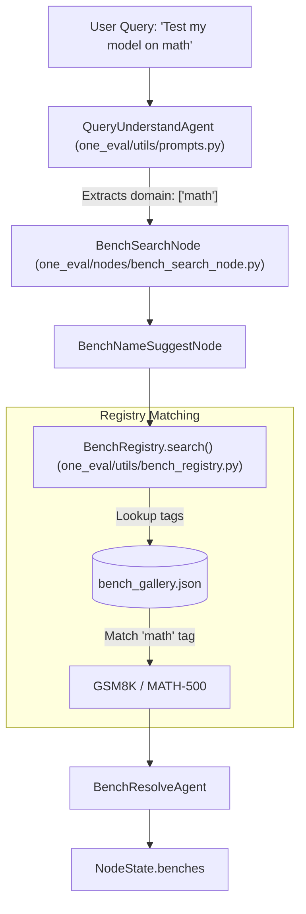
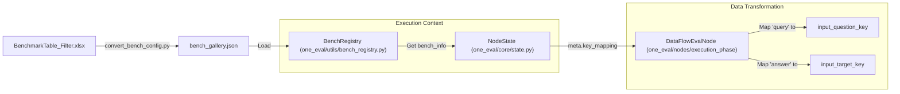

<!-- source: DeepWiki mcp.deepwiki.com · repo OpenDCAI/One-Eval · page 5.1 Local Bench Gallery & BenchRegistry · fetched 2026-11-02 -->

# Local Bench Gallery & BenchRegistry

Relevant source files

The following files were used as context for generating this wiki page:

- [one_eval/nodes/bench_search_node.py](one_eval/nodes/bench_search_node.py)
- [one_eval/nodes/pre_eval_review_node.py](one_eval/nodes/pre_eval_review_node.py)
- [one_eval/utils/bench_registry.py](one_eval/utils/bench_registry.py)
- [one_eval/utils/bench_table/BenchmarkTable_Filter.xlsx](one_eval/utils/bench_table/BenchmarkTable_Filter.xlsx)
- [one_eval/utils/bench_table/BenchmarkTable_Filter_with_keys.xlsx](one_eval/utils/bench_table/BenchmarkTable_Filter_with_keys.xlsx)
- [one_eval/utils/bench_table/bench_config.json](one_eval/utils/bench_table/bench_config.json)
- [one_eval/utils/bench_table/bench_gallery.json](one_eval/utils/bench_table/bench_gallery.json)
- [one_eval/utils/convert_bench_config.py](one_eval/utils/convert_bench_config.py)
- [one_eval/utils/prompts.py](one_eval/utils/prompts.py)
- [tests/test_hf.py](tests/test_hf.py)

The **Benchmark Registry** and **Local Gallery** form the core knowledge base of One-Eval. This system manages how benchmarks are identified, searched, and configured. It bridges the gap between a user's natural language request (e.g., "I want to test math skills") and the technical metadata required to execute an evaluation (e.g., HuggingFace repo IDs, key mappings, and task types).

## BenchRegistry Class

The `BenchRegistry` class is the central authority for managing local benchmark metadata. It is responsible for loading the gallery, performing fuzzy name matching, and filtering benchmarks by domain.

### Key Responsibilities
1.  **Initialization**: Loads `bench_gallery.json` (primary) and maintains compatibility with the legacy `bench_config.json` [one_eval/utils/bench_registry.py:18-78]().
2.  **Alias Matching**: Implements `_match_bench_by_name_or_alias` to support case-insensitive searches and alias lookups [one_eval/utils/bench_registry.py:83-107]().
3.  **Domain Filtering**: Uses `meta.tags` to suggest benchmarks based on the task domain (e.g., "math", "code") [one_eval/utils/bench_registry.py:156-192]().

### Search Logic Flow
The `search` method follows a two-step process:
1.  **Direct Match**: Resolves names provided in `specific_benches` via the alias map [one_eval/utils/bench_registry.py:143-153]().
2.  **Recommendation**: If a `domain` is provided, it performs a set intersection between the requested domain and the `tags` found in the benchmark metadata [one_eval/utils/bench_registry.py:182-192]().

**Sources:** [one_eval/utils/bench_registry.py:10-208]()

---

## Data Schema & Gallery Files

One-Eval uses a multi-layered configuration approach to balance ease of maintenance (Excel) with machine readability (JSON).

### 1. bench_gallery.json
This is the main runtime database. Each entry contains comprehensive metadata for a benchmark.

| Field | Description |
| :--- | :--- |
| `bench_name` | Unique identifier (e.g., `crmarena`) |
| `bench_dataflow_eval_type` | The taxonomy key for evaluation logic (e.g., `key2_qa`) |
| `meta.aliases` | List of alternative names used for search matching |
| `meta.key_mapping` | Maps dataset columns to internal keys (`input_question_key`, etc.) |
| `meta.structure` | Detailed HuggingFace repository structure (subsets, splits) |

**Sources:** [one_eval/utils/bench_table/bench_gallery.json:1-187]()

### 2. BenchmarkTable_Filter.xlsx
The source of truth for benchmark categorization. This Excel file is maintained by domain experts and converted to JSON via `convert_bench_config.py`. It defines the initial `aliases`, `task_type`, and `hf_repo` [one_eval/utils/convert_bench_config.py:31-108]().

### 3. bench_config.json
A simplified, legacy configuration file primarily used for quick lookups of math-related benchmarks like `gsm8k` and `hendrycks_math` [one_eval/utils/bench_table/bench_config.json:1-240]().

---

## Eval Type Taxonomy

The `bench_dataflow_eval_type` field determines how the `DataFlowEvalNode` processes data and how the `MetricDispatcher` selects metrics.

| Eval Type | Meaning | Key Mapping Convention |
| :--- | :--- | :--- |
| `key1_text_score` | Text generation with direct scoring. | Target is usually a numeric or string score. |
| `key2_qa` | Standard Question-Answering. | `input_question_key` -> `input_target_key`. |
| `key3_q_choices_a` | Multiple choice QA. | Includes `choices` or `options` in the question. |

**Sources:** [one_eval/utils/bench_table/bench_gallery.json:7, 88, 192](), [one_eval/utils/bench_table/bench_config.json:13, 72, 103]()

---

## System Architecture Diagrams

### From Query to Registry Entity
This diagram illustrates how a user's natural language input is transformed into a concrete entity within the `BenchRegistry`.

**Sources:** [one_eval/utils/prompts.py:45-81](), [one_eval/nodes/bench_search_node.py:12-40](), [one_eval/utils/bench_registry.py:112-192]()

### Configuration & Key Mapping Flow
This diagram shows how the static configuration files interact with the evaluation execution engine.

**Sources:** [one_eval/utils/convert_bench_config.py:31-108](), [one_eval/utils/bench_registry.py:18-78](), [one_eval/utils/bench_table/bench_gallery.json:71-75]()

---

## Key Mapping Conventions

The `key_mapping` object in `bench_gallery.json` is critical for the `DataFlowEvalNode`. It allows One-Eval to handle datasets with arbitrary column names by aliasing them to internal standards:

*   **`input_question_key`**: The column containing the prompt or question (e.g., `query` in CRMArena [one_eval/utils/bench_table/bench_gallery.json:72]()).
*   **`input_target_key`**: The column containing the ground truth answer (e.g., `answer` [one_eval/utils/bench_table/bench_gallery.json:73]()).
*   **`input_context_key`**: Optional column for metadata or personas [one_eval/utils/bench_table/bench_gallery.json:74]().

**Sources:** [one_eval/utils/bench_table/bench_gallery.json:71-76, 175-180]()

---

