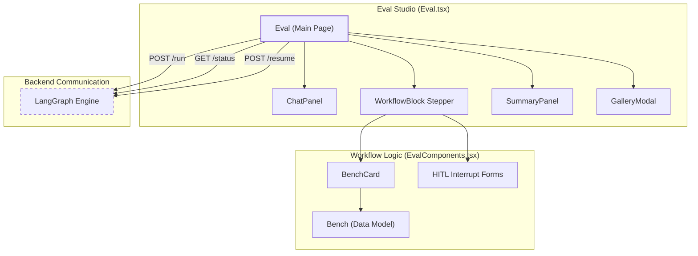
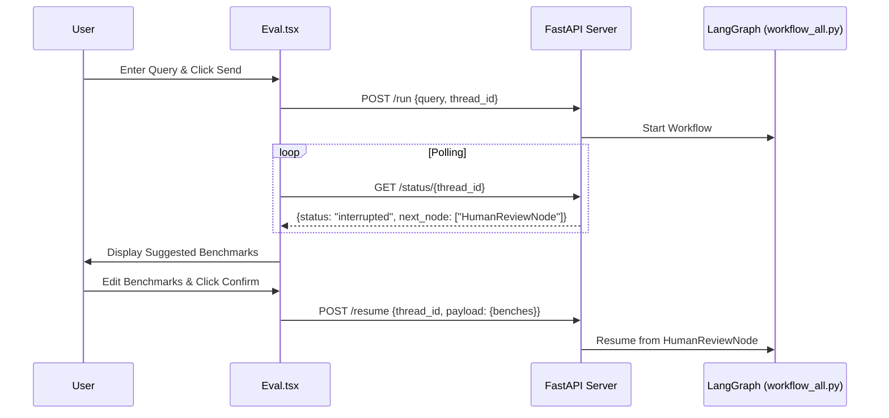

<!-- source: DeepWiki mcp.deepwiki.com · repo OpenDCAI/One-Eval · page 6.1 Eval Studio (Eval.tsx & EvalComponents.tsx) · fetched 2026-11-02 -->

# Eval Studio (Eval.tsx & EvalComponents.tsx)

Relevant source files

The following files were used as context for generating this wiki page:

- [one-eval-web/src/pages/Eval.tsx](one-eval-web/src/pages/Eval.tsx)
- [one-eval-web/src/pages/EvalComponents.tsx](one-eval-web/src/pages/EvalComponents.tsx)

The Eval Studio is the primary workspace for users to interact with the One-Eval evaluation pipeline. It serves as the frontend orchestrator for the LangGraph-powered backend, providing interfaces for natural language query submission, benchmark configuration, real-time execution monitoring, and human-in-the-loop (HITL) decision-making.

## Workspace Architecture

The workspace is divided into a dual-panel layout: a **ChatPanel** for interaction and history, and a **Workflow Canvas** that visualizes the pipeline's progress through `WorkflowBlock` components.

### Data Flow and State Management

The frontend maintains a central `WorkflowState` that mirrors the backend's `MainState`. It uses a polling mechanism to synchronize state when the graph is active.

1.  **State Synchronization**: The `fetchStatus` function polls the `/status/{thread_id}` endpoint [one-eval-web/src/pages/Eval.tsx:288-348]().
2.  **WorkflowState**: Defined in `EvalComponents.tsx`, this interface captures the current benchmarks, target models, metric plans, and generated reports [one-eval-web/src/pages/EvalComponents.tsx:27-35]().
3.  **Interrupt Handling**: When the backend reaches a breakpoint (e.g., `HumanReviewNode`), the status returns an `interrupted` state. The UI then renders specific input forms to collect user approval or modifications [one-eval-web/src/pages/Eval.tsx:304-315]().

### Component Relationship Diagram

This diagram illustrates how the React components in `Eval.tsx` and `EvalComponents.tsx` map to the logical entities of the evaluation workspace.

**Sources:** [one-eval-web/src/pages/Eval.tsx:54-147](), [one-eval-web/src/pages/EvalComponents.tsx:17-35]()

---

## Interaction Modes

One-Eval supports two primary interaction modes, toggled via the `workMode` state [one-eval-web/src/pages/Eval.tsx:57-60]().

| Mode | Description | Key UI Elements |
| :--- | :--- | :--- |
| **Agent Mode** | NL2Eval flow. Users describe goals in natural language. The system suggests benchmarks and configurations. | `ChatPanel`, `HumanReviewNode` interrupt UI. |
| **Manual Mode** | Direct configuration. Users select benchmarks from the gallery and manually specify model parameters. | `GalleryModal`, `manualBenches` state, `ManualModelConfig`. |

**Sources:** [one-eval-web/src/pages/Eval.tsx:57-60](), [one-eval-web/src/pages/Eval.tsx:431-480]()

---

## HITL Interrupt Handling

The pipeline pauses at specific nodes to ensure accuracy. The frontend detects these via the `next_node` array in the status response [one-eval-web/src/pages/Eval.tsx:19-21]().

### 1. Discovery Review (`HumanReviewNode`)
Occurs after the system suggests benchmarks based on the user query.
*   **UI Display**: Shows a list of suggested `BenchCard` components.
*   **User Action**: Users can add/remove benchmarks or modify `eval_type`.
*   **Resume**: Sends the updated `benches` list back via `/resume` [one-eval-web/src/pages/Eval.tsx:367-400]().

### 2. Configuration Review (`PreEvalReviewNode`)
Occurs after datasets are downloaded and task inference is complete.
*   **UI Display**: Shows detailed benchmark metadata, including inferred `dataset_cache` paths and `eval_type` [one-eval-web/src/pages/EvalComponents.tsx:323-380]().
*   **User Action**: Verification of dataset mapping and target model selection.

### 3. Metric Review (`MetricReviewNode`)
Occurs before the scoring phase.
*   **UI Display**: A grid of benchmarks and their assigned metrics.
*   **User Action**: Users can click "Add Metric" to open a searchable registry and customize parameters (e.g., `priority`, `args`) [one-eval-web/src/pages/Eval.tsx:117-142]().

**Sources:** [one-eval-web/src/pages/Eval.tsx:1100-1150](), [one-eval-web/src/pages/EvalComponents.tsx:323-380]()

---

## Key UI Components

### WorkflowBlock & BenchCard
`WorkflowBlock` represents a phase in the pipeline (Discovery, Preparation, Execution, etc.). Inside these blocks, `BenchCard` displays individual benchmark status.

*   **BenchCard Features**: Displays `download_status` (idle/loading/success) and `eval_status` [one-eval-web/src/pages/EvalComponents.tsx:323-360]().
*   **Progress Tracking**: During the Execution phase, it renders a progress bar using `eval_progress` data (percent, generated/total) [one-eval-web/src/pages/Eval.tsx:23-29]().

### ChatPanel
The `ChatPanel` manages the conversation history and the primary input for Agent mode.
*   **Implementation**: Uses a `messages` array [one-eval-web/src/pages/Eval.tsx:145-147]().
*   **Auto-Scroll**: Employs a `useRef` and `useEffect` hook to keep the latest messages in view [one-eval-web/src/pages/EvalComponents.tsx:216-222]().

### SummaryPanel & ReportView
Once the `ReportGenNode` completes, the `SummaryPanel` displays the final results.
*   **ReportView**: Renders visual charts (Radar, Bar, Donut) based on the `reports` field in `WorkflowState` [one-eval-web/src/pages/EvalComponents.tsx:14]().
*   **Markdown Summary**: Displays the LLM-generated evaluation summary using `SimpleMarkdown` [one-eval-web/src/pages/Eval.tsx:11]().

---

## State Transition Logic

The following diagram maps the frontend interaction to backend node transitions and state updates.

**Sources:** [one-eval-web/src/pages/Eval.tsx:288-348](), [one-eval-web/src/pages/Eval.tsx:367-400]()

## Utility Modals

### EvalTypeReferenceModal
A technical reference for users to understand the mapping between `eval_type` (e.g., `key3_q_choices_a`) and the required data keys (e.g., `question`, `choices`, `label`).
*   **Data Source**: `EVAL_TYPE_REFERENCE_ROWS` [one-eval-web/src/pages/EvalComponents.tsx:45-88]().
*   **Purpose**: Helps users manually correct `eval_type` during the Discovery or Preparation review phases [one-eval-web/src/pages/EvalComponents.tsx:90-116]().

### GalleryModal
Used in Manual Mode to browse the `BenchRegistry`.
*   **Functionality**: Allows filtering by category and keyword. Selecting a benchmark adds it to the `manualBenches` state [one-eval-web/src/pages/Eval.tsx:108]().

**Sources:** [one-eval-web/src/pages/EvalComponents.tsx:45-116](), [one-eval-web/src/pages/Eval.tsx:108]()

---

