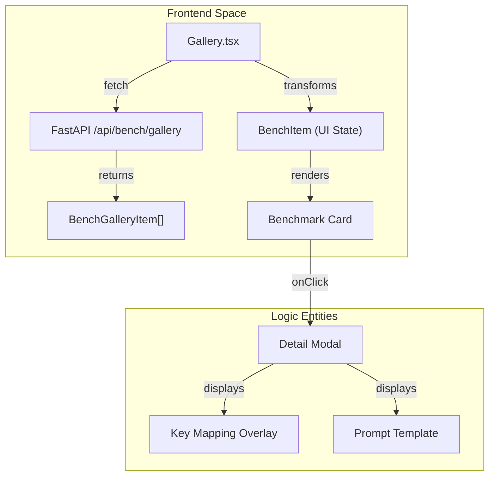
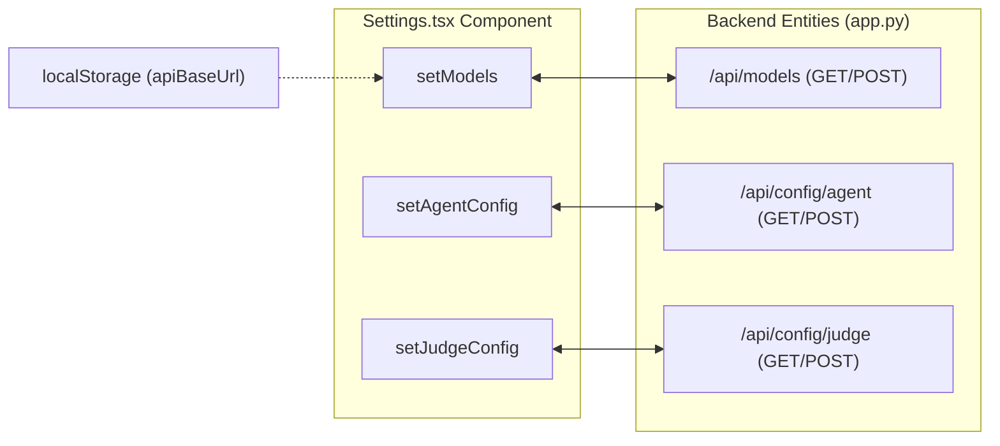

<!-- source: DeepWiki mcp.deepwiki.com · repo OpenDCAI/One-Eval · page 6.2 Settings, Gallery & Home Pages · fetched 2026-11-02 -->

# Settings, Gallery & Home Pages

Relevant source files

The following files were used as context for generating this wiki page:

- [one-eval-web/src/pages/Gallery.tsx](one-eval-web/src/pages/Gallery.tsx)
- [one-eval-web/src/pages/Home.tsx](one-eval-web/src/pages/Home.tsx)
- [one-eval-web/src/pages/Settings.tsx](one-eval-web/src/pages/Settings.tsx)

This page details the auxiliary user interface components of the One-Eval web application. These pages manage the system's configuration, provide a browser for the benchmark library, and offer a landing experience for users.

## Home Page

The `Home` page serves as the landing interface. It features a particle-based background and provides quick access to the evaluation studio and external project repositories.

### Key Features
*   **Dynamic Background**: Utilizes `react-tsparticles` and `tsparticles-slim` to render an interactive node-and-link background [one-eval-web/src/pages/Home.tsx:5-19]().
*   **GitHub Integration**: Fetches real-time star counts for the `OpenDCAI/One-Eval` and `OpenDCAI/DataFlow` repositories using the GitHub API [one-eval-web/src/pages/Home.tsx:22-46]().
*   **Language Toggle**: Provides a global switch between English and Chinese via the `useLang` hook [one-eval-web/src/pages/Home.tsx:170-177]().

**Sources:** [one-eval-web/src/pages/Home.tsx:1-196]()

---

## Benchmark Gallery

The Gallery page allows users to browse and search the `bench_gallery.json` registry. It categorizes benchmarks and displays detailed metadata including field mappings and HuggingFace source information.

### Data Model and Categorization
Benchmarks are categorized into specific domains such as "Math", "Reasoning", and "Coding" [one-eval-web/src/pages/Gallery.tsx:34](). Each item in the gallery follows the `BenchGalleryItem` structure, which includes:
*   **Metadata (`BenchGalleryMeta`)**: Aliases, descriptions (EN/ZH), and category [one-eval-web/src/pages/Gallery.tsx:76-89]().
*   **Field Mapping (`KeyMapping`)**: Defines how the dataset's internal keys (e.g., `input_question_key`) map to the evaluator's expected inputs [one-eval-web/src/pages/Gallery.tsx:69-73]().
*   **Structure**: Information about subsets and splits available on HuggingFace [one-eval-web/src/pages/Gallery.tsx:46-59]().

### Component Architecture: BenchGalleryItem
The `BenchGalleryItem` component renders an individual benchmark card. When clicked, it opens a detailed overlay showing the `key_mapping` logic and prompt templates.

**Gallery Data Flow**

*Sources: [one-eval-web/src/pages/Gallery.tsx:34-116](), [one-eval-web/src/pages/Gallery.tsx:167-185]()*

---

## Settings Page

The `Settings` page is the central hub for configuring the evaluation environment. It manages model registries, HuggingFace mirror settings, and agent server parameters.

### Model Registry & Validation
One-Eval supports both local paths (for vLLM/Local serving) and API-based models (OpenAI compatible).
*   **ModelConfig**: Defines the structure for model entries, including `api_url`, `api_key`, and worker constraints [one-eval-web/src/pages/Settings.tsx:14-25]().
*   **Two-Stage Validation**:
    1.  **Path/API Connectivity**: Checks if the endpoint or local path is reachable.
    2.  **Model Response**: A "Test" button triggers a dummy request to ensure the model can actually generate text [one-eval-web/src/pages/Settings.tsx:120-122]().

### Configuration Categories
| Section | Key Entities | Purpose |
| :--- | :--- | :--- |
| **Model Registry** | `ModelConfig` | Manages list of models available for evaluation. |
| **HF Config** | `hfEndpoint`, `hfToken` | Configures HuggingFace mirror (e.g., `hf-mirror.com`) and authentication. |
| **Agent Server** | `agentBaseUrl`, `agentModel` | Configures the LLM used for "Agent Mode" (Task Inference, Scoring, etc.). |
| **Judge Model** | `JudgeModelConfig` | Specifically configures the model used for LLM-as-a-Judge metrics. |

### Settings Persistence Flow
The settings page interacts with the backend via REST API but also maintains local state for immediate UI feedback.

*Sources: [one-eval-web/src/pages/Settings.tsx:103-138](), [one-eval-web/src/pages/Settings.tsx:172-180](), [one-eval-web/src/pages/Settings.tsx:217-250]()*

### Agent Server Configuration
The "Agent Server" is critical for the NL2Eval pipeline. Users can select from presets (OpenAI, OpenRouter) or define a custom endpoint [one-eval-web/src/pages/Settings.tsx:140-149](). The `handleTestAgent` function validates that the agent model is responsive before the user starts an evaluation run [one-eval-web/src/pages/Settings.tsx:313-335]().

**Sources:**
*   **Home Page**: [one-eval-web/src/pages/Home.tsx]()
*   **Gallery & Metadata**: [one-eval-web/src/pages/Gallery.tsx]()
*   **Settings & Model Registry**: [one-eval-web/src/pages/Settings.tsx]()

---

