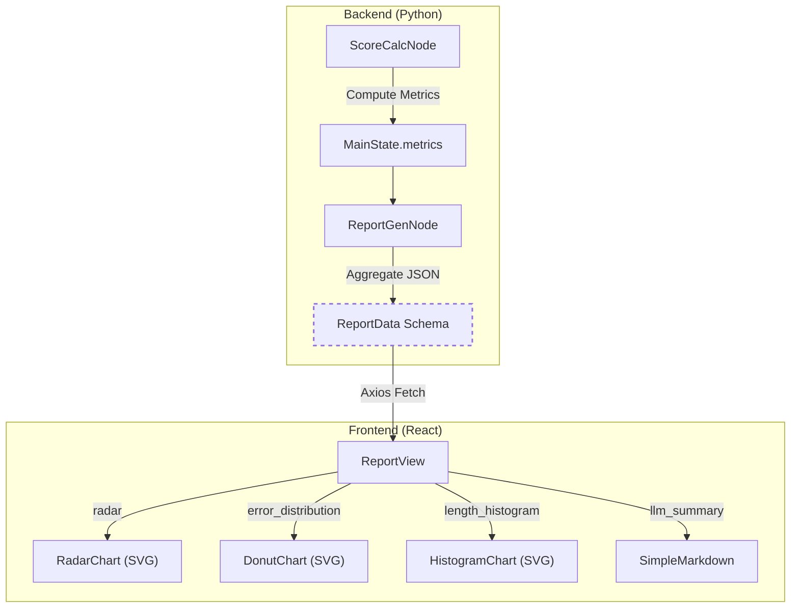
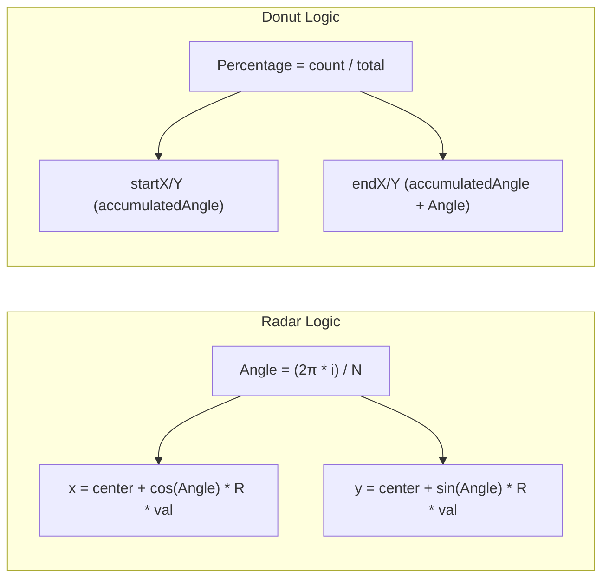

<!-- source: DeepWiki mcp.deepwiki.com · repo OpenDCAI/One-Eval · page 6.3 Report Visualization (ReportComponents.tsx) · fetched 2026-11-02 -->

# Report Visualization (ReportComponents.tsx)

Relevant source files

The following files were used as context for generating this wiki page:

- [one-eval-web/package-lock.json](one-eval-web/package-lock.json)
- [one-eval-web/package.json](one-eval-web/package.json)
- [one-eval-web/scripts/ensure-rollup-native.cjs](one-eval-web/scripts/ensure-rollup-native.cjs)
- [one-eval-web/src/components/ui/simple-markdown.tsx](one-eval-web/src/components/ui/simple-markdown.tsx)
- [one-eval-web/src/pages/ReportComponents.tsx](one-eval-web/src/pages/ReportComponents.tsx)
- [one_eval/metrics/common/classification.py](one_eval/metrics/common/classification.py)

The `ReportView` component and its associated sub-components in `ReportComponents.tsx` provide the final visual synthesis of an evaluation run. This module transforms raw JSON data generated by the `ReportGenNode` into an interactive, multi-dimensional dashboard. It utilizes SVG-based custom charts and a lightweight Markdown parser to present model capabilities, error distributions, and qualitative summaries.

### Report Data Schema

The visualization layer expects a structured `ReportData` object, typically produced at the end of the evaluation pipeline.

| Field | Type | Description |
|:---|:---|:---|
| `version` | `string` | Schema version of the report [one-eval-web/src/pages/ReportComponents.tsx:26](). |
| `model` | `string` | The identifier of the model being evaluated [one-eval-web/src/pages/ReportComponents.tsx:28](). |
| `overall` | `object` | Contains the aggregate score and benchmark-specific summaries [one-eval-web/src/pages/ReportComponents.tsx:29-32](). |
| `macro` | `object` | Data for the Radar chart (capability dimensions) and score tables [one-eval-web/src/pages/ReportComponents.tsx:33-37](). |
| `diagnostic` | `object` | Error distribution (Donut) and output length (Histogram) data [one-eval-web/src/pages/ReportComponents.tsx:38-41](). |
| `llm_summary` | `string` | A natural language analysis of the model's performance [one-eval-web/src/pages/ReportComponents.tsx:46](). |

**Sources:**
- [one-eval-web/src/pages/ReportComponents.tsx:25-47]()

---

### Visualization Architecture & Data Flow

The reporting system bridges the gap between the Python backend's metric calculations and the React frontend's visual representation.

#### Natural Language to Code Entity Mapping

| System Concept | Code Entity (Frontend) | Code Entity (Backend) |
|:---|:---|:---|
| Capability Radar | `RadarChart` [one-eval-web/src/pages/ReportComponents.tsx:52]() | `ReportGenNode` |
| Error Breakdown | `DonutChart` [one-eval-web/src/pages/ReportComponents.tsx:141]() | `ScoreCalcNode` |
| Length Distribution | `HistogramChart` [one-eval-web/src/pages/ReportComponents.tsx:238]() | `MetricRunner` |
| LLM Analysis | `SimpleMarkdown` [one-eval-web/src/components/ui/simple-markdown.tsx:85]() | `ReportGenAgent` |

#### Data Flow Diagram: From Scores to Visuals

This diagram illustrates how data flows from the backend state into specific React components.

**Sources:**
- [one-eval-web/src/pages/ReportComponents.tsx:7-47]()
- [one-eval-web/src/components/ui/simple-markdown.tsx:1-187]()

---

### Key Components

#### 1. RadarChart (Capability Dimensions)
The `RadarChart` component renders a multi-axis SVG polygon representing model strengths across different dimensions (e.g., Coding, Math, Reasoning). It calculates vertex coordinates using basic trigonometry based on the number of labels provided in the `RadarData` [one-eval-web/src/pages/ReportComponents.tsx:60-65]().

*   **Implementation:** Uses `framer-motion` for entry animations [one-eval-web/src/pages/ReportComponents.tsx:108-111]().
*   **Logic:** Normalizes scores to a radius and draws background "level" polygons (0.2, 0.4, etc.) for reference [one-eval-web/src/pages/ReportComponents.tsx:67-89]().

#### 2. DonutChart (Error Distribution)
Visualizes the proportion of different failure modes (e.g., Format Error, Extraction Failure, Refusal).

*   **Logic:** Calculates SVG path arcs using `largeArcFlag` to determine if a segment exceeds 180 degrees [one-eval-web/src/pages/ReportComponents.tsx:164-187]().
*   **Color Mapping:** Maps error types to specific semantic colors (Emerald for Correct, Red for Incorrect, Slate for Refusal) [one-eval-web/src/pages/ReportComponents.tsx:149-155]().

#### 3. HistogramChart (Length Distribution)
Displays the distribution of model output lengths, distinguishing between correct and incorrect responses. This is critical for detecting "verbosity bias" or length-based performance correlations.

*   **Implementation:** Iterates through `bins` to draw stacked rectangles representing `correct` and `incorrect` counts [one-eval-web/src/pages/ReportComponents.tsx:275-300]().

#### 4. SimpleMarkdown
A custom, lightweight Markdown parser designed to render LLM-generated summaries without the overhead of heavy external libraries.

*   **Parser:** Uses a recursive inline parser (`parseInline`) for bold, italic, and code blocks [one-eval-web/src/components/ui/simple-markdown.tsx:6-83]().
*   **Block Support:** Handles headers (`#`), blockquotes (`>`), unordered lists (`-`), and ordered lists (`1.`) [one-eval-web/src/components/ui/simple-markdown.tsx:123-160]().

**Sources:**
- [one-eval-web/src/pages/ReportComponents.tsx:52-138]() (Radar)
- [one-eval-web/src/pages/ReportComponents.tsx:141-235]() (Donut)
- [one-eval-web/src/pages/ReportComponents.tsx:238-320]() (Histogram)
- [one-eval-web/src/components/ui/simple-markdown.tsx:1-187]() (Markdown)

---

### Technical Implementation Details

#### SVG Coordinate Calculation
The charts avoid heavy visualization libraries like D3.js in favor of direct SVG manipulation for performance and style consistency.

**Sources:**
- [one-eval-web/src/pages/ReportComponents.tsx:60-65]()
- [one-eval-web/src/pages/ReportComponents.tsx:168-173]()

#### Styling and Animation
The components use `tailwind-merge` (`cn`) for dynamic styling and `framer-motion` for transitions.
*   **Radar Transition:** Animates the polygon from `scale: 0` to `scale: 1` [one-eval-web/src/pages/ReportComponents.tsx:109-110]().
*   **Donut Stagger:** Segments animate with a staggered delay based on their index [one-eval-web/src/pages/ReportComponents.tsx:196]().

**Sources:**
- [one-eval-web/src/pages/ReportComponents.tsx:1-2]()
- [one-eval-web/package.json:15-17]()

---

