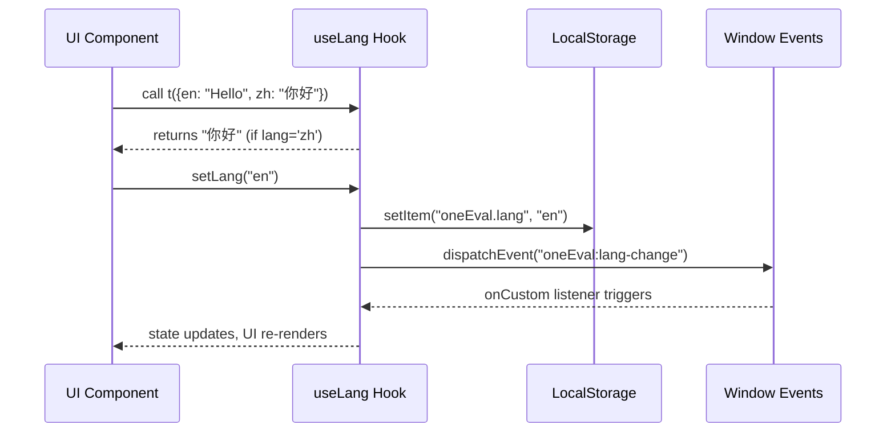

<!-- source: DeepWiki mcp.deepwiki.com · repo OpenDCAI/One-Eval · page 6.4 Frontend Build System & Utilities · fetched 2026-11-02 -->

# Frontend Build System & Utilities

<details>
<summary>Relevant source files</summary>

The following files were used as context for generating this wiki page:

- [.gitignore](.gitignore)
- [one-eval-web/package-lock.json](one-eval-web/package-lock.json)
- [one-eval-web/package.json](one-eval-web/package.json)
- [one-eval-web/scripts/ensure-rollup-native.cjs](one-eval-web/scripts/ensure-rollup-native.cjs)
- [one-eval-web/src/lib/i18n.ts](one-eval-web/src/lib/i18n.ts)
- [one-eval-web/src/lib/utils.ts](one-eval-web/src/lib/utils.ts)
- [one-eval-web/src/pages/ReportComponents.tsx](one-eval-web/src/pages/ReportComponents.tsx)
- [one-eval-web/tailwind.config.js](one-eval-web/tailwind.config.js)
- [one-eval-web/tsconfig.app.json](one-eval-web/tsconfig.app.json)
- [one-eval-web/vite.config.ts](one-eval-web/vite.config.ts)

</details>


This page details the build pipeline and utility layer of the `one-eval-web` application. It covers the Vite-based compilation process, cross-platform compatibility scripts, the internationalization (i18n) framework, and styling utilities.

## Build Pipeline & Scripts

The frontend utilizes **Vite** as its build tool and dev server, paired with **TypeScript** for type safety and **Tailwind CSS** for styling.

### Cross-Platform Native Dependency Handling
A specific challenge in the build pipeline is ensuring that the `rollup` native binaries are correctly installed across different operating systems (Linux vs. Windows). The `ensure-rollup-native.cjs` script automates this by detecting the host platform and forcing the installation of the required optional dependency if it is missing.

- **Linux**: Installs `@rollup/rollup-linux-x64-gnu` [one-eval-web/scripts/ensure-rollup-native.cjs:4-4]().
- **Windows**: Installs `@rollup/rollup-win32-x64-msvc` [one-eval-web/scripts/ensure-rollup-native.cjs:5-5]().

This script is executed as a pre-requisite for both the `dev` and `build` commands [one-eval-web/package.json:7-8]().

### Build Command Workflow
The build process follows a three-step sequence:
1. **Native Check**: Runs `scripts/ensure-rollup-native.cjs`.
2. **Type Check**: Executes `tsc -b` to validate TypeScript project references.
3. **Bundling**: Runs `vite build` to generate the production assets [one-eval-web/package.json:8-8]().

### Build System Component Mapping
The following diagram bridges the build-time scripts to the resulting configuration entities.

**Build System Entity Map**
```mermaid
graph TD
    subgraph "Build Scripts (package.json)"
        "dev_cmd"["npm run dev"]
        "build_cmd"["npm run build"]
    end

    subgraph "Execution Logic"
        "ensure_script"["ensure-rollup-native.cjs"]
        "vite_engine"["Vite + @vitejs/plugin-react"]
        "tsc_engine"["TypeScript (tsc)"]
    end

    subgraph "Config Entities"
        "vite_config"["vite.config.ts"]
        "ts_config"["tsconfig.app.json"]
        "tailwind_config"["tailwind.config.js"]
    end

    "dev_cmd" --> "ensure_script"
    "dev_cmd" --> "vite_engine"
    "build_cmd" --> "ensure_script"
    "build_cmd" --> "tsc_engine"
    "build_cmd" --> "vite_engine"
    
    "vite_engine" -.-> "vite_config"
    "tsc_engine" -.-> "ts_config"
    "vite_engine" -.-> "tailwind_config"
```
**Sources:** [one-eval-web/package.json:6-11](), [one-eval-web/scripts/ensure-rollup-native.cjs:1-18](), [one-eval-web/vite.config.ts:5-12]().

## Internationalization (i18n)

The system supports English (`en`) and Chinese (`zh`) through a custom React hook-based architecture [one-eval-web/src/lib/i18n.ts:3-3]().

### The `useLang` Hook
The `useLang` hook provides the current language state, a setter function, and a translation utility `t`.

- **Persistence**: Language preference is stored in `localStorage` under the key `oneEval.lang` [one-eval-web/src/lib/i18n.ts:5-5]().
- **Detection**: The `detectLang` function first checks `localStorage`, then falls back to `navigator.language` [one-eval-web/src/lib/i18n.ts:8-13]().
- **Synchronization**: The hook listens for both standard `storage` events (for cross-tab sync) and a custom `oneEval:lang-change` event (for same-tab sync) [one-eval-web/src/lib/i18n.ts:18-35]().

### Translation Utility `t()`
The `t` function is a memoized closure that accepts a dictionary of type `Record<Lang, string>` and returns the string corresponding to the active language, defaulting to English if the specific key is missing [one-eval-web/src/lib/i18n.ts:43-46]().

**i18n Data Flow**

**Sources:** [one-eval-web/src/lib/i18n.ts:1-50]().

## Styling & Tailwind Utilities

### Tailwind Configuration
The project uses a highly customized Tailwind configuration to support a themeable UI. Key design tokens (colors, border-radii) are mapped to CSS variables (e.g., `hsl(var(--primary))`), allowing for dynamic theme switching if implemented in CSS [one-eval-web/tailwind.config.js:9-48]().

### The `cn()` Utility
To manage complex conditional class names, the project provides a `cn` helper function in `src/lib/utils.ts`.

```typescript
export function cn(...inputs: ClassValue[]) {
  return twMerge(clsx(inputs))
}
```
- **`clsx`**: Handles conditional logic (e.g., `isActive && "bg-blue-500"`).
- **`twMerge`**: Resolves Tailwind class conflicts (e.g., ensuring `px-4` overrides `p-2`) [one-eval-web/src/lib/utils.ts:4-6]().

## TypeScript Configuration

The project is split into two TypeScript configurations to distinguish between the application code and the build tools:

| Config File | Purpose | Key Settings |
|:---|:---|:---|
| `tsconfig.app.json` | Main React application | `target: ES2020`, `jsx: react-jsx`, `@/*` path alias [one-eval-web/tsconfig.app.json:3-27]() |
| `tsconfig.node.json` | Vite config and scripts | Environment for Node.js execution |

The application config includes a path alias `@/*` mapping to `./src/*`, which is mirrored in `vite.config.ts` to allow clean imports [one-eval-web/tsconfig.app.json:25-27](), [one-eval-web/vite.config.ts:8-11]().

**Sources:** [one-eval-web/tsconfig.app.json:1-31](), [one-eval-web/vite.config.ts:1-13](), [one-eval-web/tailwind.config.js:1-52]().

---

