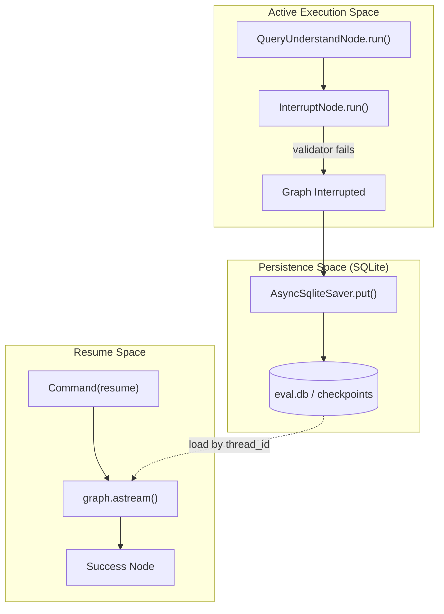

<!-- source: DeepWiki mcp.deepwiki.com · repo OpenDCAI/One-Eval · page 7 Testing · fetched 2026-11-02 -->

# Testing

<details>
<summary>Relevant source files</summary>

The following files were used as context for generating this wiki page:

- [one_eval/logger.py](one_eval/logger.py)
- [one_eval/nodes/metric_recommend_node.py](one_eval/nodes/metric_recommend_node.py)
- [one_eval/toolkits/hf_search_tool.py](one_eval/toolkits/hf_search_tool.py)
- [one_eval/utils/bench_table/bench-key.xlsx](one_eval/utils/bench_table/bench-key.xlsx)
- [tests/test_api_model_config.py](tests/test_api_model_config.py)
- [tests/test_bench_registry.py](tests/test_bench_registry.py)
- [tests/test_ckpt.py](tests/test_ckpt.py)
- [tests/test_example.py](tests/test_example.py)
- [tests/test_interrupt.py](tests/test_interrupt.py)
- [tests/test_metric_recommend.py](tests/test_metric_recommend.py)
- [tests/test_single_tool.py](tests/test_single_tool.py)
- [tests/test_workflow_metric_recommend.py](tests/test_workflow_metric_recommend.py)

</details>


One-Eval includes a comprehensive test suite located in the `tests/` directory. The suite is designed to validate the entire lifecycle of an evaluation, from initial natural language query understanding to the final scoring and reporting. Tests are categorized into high-level integration/workflow tests and granular unit tests for specific tools and registries.

## Test Infrastructure Overview

The testing framework leverages `pytest` and `asyncio` to handle the asynchronous nature of the LangGraph workflow. It focuses on ensuring that state transitions in `NodeState` [one_eval/core/state.py:5-5]() are preserved across interrupts and that the system correctly interfaces with external providers like HuggingFace and various LLM APIs.

### Key Testing Dimensions

| Dimension | Description | Primary Files |
|:---|:---|:---|
| **Workflow** | Full graph execution, node transitions, and entry point logic. | `test_example.py`, `test_interrupt.py` |
| **Persistence** | Checkpointing state to SQLite and resuming from specific thread IDs. | `test_ckpt.py` |
| **Logic/Agents** | Validating LLM-based recommendations for metrics and benchmarks. | `test_metric_recommend.py`, `test_bench_registry.py` |
| **Integrations** | API configuration preservation and HuggingFace tool reliability. | `test_api_model_config.py`, `test_single_tool.py` |

**Sources:** [tests/test_interrupt.py:1-110](), [tests/test_ckpt.py:10-60](), [tests/test_api_model_config.py:1-40]()

---

## Workflow & Integration Tests

These tests validate the orchestration layer of One-Eval. They simulate real-world usage where a user query triggers a sequence of nodes, potentially pausing for human intervention.

### Interrupt and Resume Patterns
The system uses `InterruptNode` [tests/test_interrupt.py:89-94]() to implement Human-in-the-Loop (HITL) checkpoints. Tests verify that the graph correctly pauses when a `validator` (e.g., a budget check) returns a warning, and resumes only after a `Command(resume=...)` is received [tests/test_interrupt.py:146-152]().

### Checkpointing and State Persistence
Persistence is tested using `AsyncSqliteSaver` [tests/test_ckpt.py:30-38](). The test suite ensures that if a workflow is interrupted or the process exits, providing the same `thread_id` allows the `GraphBuilder` to reconstruct the `NodeState` from the database [tests/test_ckpt.py:43-47]().

For detailed implementation of these patterns, see **[Workflow & Integration Tests](#7.1)**.

### System Flow: Interrupt and Persistence
The following diagram illustrates how the test suite validates the transition from an active node to a checkpointed state during an interrupt.


**Sources:** [tests/test_interrupt.py:82-110](), [tests/test_ckpt.py:30-58]()

---

## Unit Tests: Metrics, HF Tools & Registry

Unit tests focus on the deterministic and heuristic components of the system, ensuring that data transformations and lookups are accurate.

### Metric Recommendation Logic
Tests for the `MetricRecommendNode` [one_eval/nodes/metric_recommend_node.py:11-18]() verify the "3-layer funnel":
1.  **Registry Match:** Exact matches for known datasets like `gsm8k` [tests/test_metric_recommend.py:28-44]().
2.  **Decentralized Registration:** Dynamic updates via the `@register_metric` decorator [tests/test_metric_recommend.py:56-70]().
3.  **LLM Fallback:** Agent logic when the dataset is unknown [tests/test_metric_recommend.py:91-108]().

### Model and Tool Configuration
One-Eval supports complex API configurations. Tests in `test_api_model_config.py` ensure that `api_extra_body` fields (like DeepSeek's `thinking` or `reasoning_effort`) are preserved during the conversion from `ModelConfig` to the internal serving kwargs used by `DataFlowEvalTool` [tests/test_api_model_config.py:6-38]().

For more details on tool and metric testing, see **[Unit Tests: Metrics, HF Tools & Registry](#7.2)**.

### Logic Mapping: Benchmarks to Metrics
This diagram maps how the `BenchRegistry` and `MetricDispatcher` are exercised by the test suite to ensure correct evaluation parameters.

```mermaid
graph LR
    subgraph "Registry Entities"
        BR["BenchRegistry"]
        MD["MetricDispatcher"]
        MC["ModelConfig"]
    end

    subgraph "Test Cases"
        T1["test_bench_registry.py"]
        T2["test_metric_recommend.py"]
        T3["test_api_model_config.py"]
    end

    T1 -->| "search(domain='math')" | BR
    T2 -->| "get_metrics('gsm8k')" | MD
    T3 -->| "_build_api_serving_kwargs()" | MC
```
**Sources:** [tests/test_bench_registry.py:18-38](), [tests/test_metric_recommend.py:46-54](), [tests/test_api_model_config.py:25-37]()

---

## Running Tests

Tests can be executed using standard Python test runners. Ensure your environment variables (like `OE_API_BASE`) are set if running tests that involve LLM calls.

1.  **Run all tests:**
    ```bash
    pytest tests/
    ```
2.  **Run specific workflow test:**
    ```bash
    python tests/test_interrupt.py
    ```
3.  **Run persistence test:**
    ```bash
    python tests/test_ckpt.py
    ```

**Sources:** [tests/test_interrupt.py:158-159](), [tests/test_ckpt.py:62-64]()

---

