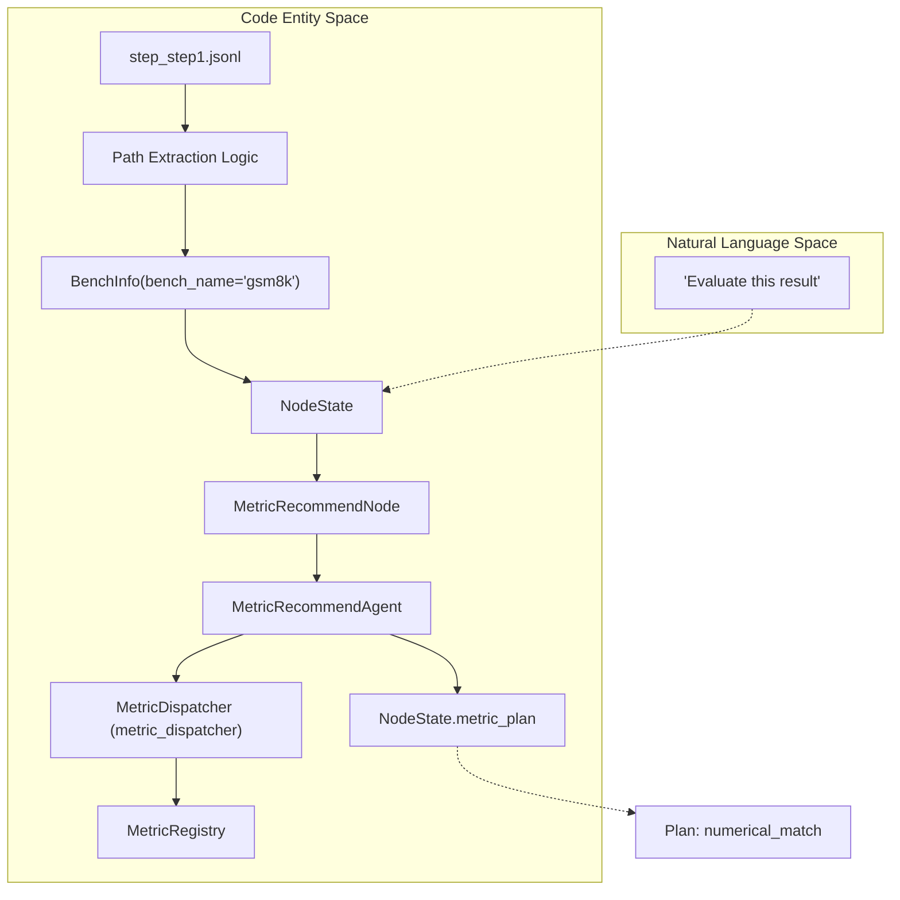
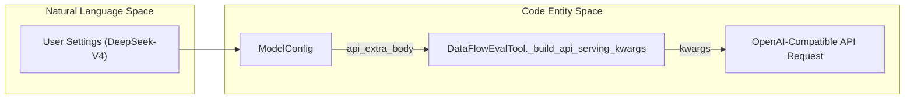

<!-- source: DeepWiki mcp.deepwiki.com · repo OpenDCAI/One-Eval · page 7.2 Unit Tests: Metrics, HF Tools & Registry · fetched 2026-11-02 -->

# Unit Tests: Metrics, HF Tools & Registry

Relevant source files

The following files were used as context for generating this wiki page:

- [one_eval/graph/workflow_nl2bench.py](one_eval/graph/workflow_nl2bench.py)
- [one_eval/nodes/metric_recommend_node.py](one_eval/nodes/metric_recommend_node.py)
- [one_eval/utils/deal_json.py](one_eval/utils/deal_json.py)
- [tests/test_api_model_config.py](tests/test_api_model_config.py)
- [tests/test_download_single.py](tests/test_download_single.py)
- [tests/test_hf_dataset_structure.py](tests/test_hf_dataset_structure.py)
- [tests/test_metric_recommend.py](tests/test_metric_recommend.py)
- [tests/test_workflow_metric_recommend.py](tests/test_workflow_metric_recommend.py)

This page details the unit testing suite for One-Eval's core subsystems, including metric recommendation logic, HuggingFace (HF) integration tools, benchmark registry management, and model configuration validation. These tests ensure the reliability of the "Preparation" and "Scoring" phases of the NL2Eval pipeline.

## 1. Metric Recommendation Tests

The metric recommendation system uses a three-layer funnel: Registry Lookup, Metadata Analysis, and LLM-based Fallback. The tests verify that the `MetricRecommendNode` and its underlying `MetricRecommendAgent` correctly navigate these layers.

### Implementation & Scenarios
The test suite in `tests/test_metric_recommend.py` covers the following logic:
*   **Registry Match**: Validates that known datasets (e.g., `gsm8k`, `mmlu`) correctly trigger the `MetricDispatcher` to return pre-configured metric templates [tests/test_metric_recommend.py:28-54]().
*   **Decentralized Registration**: Tests the `@register_metric` decorator to ensure that dynamically added metrics are correctly picked up by the `MetricRegistry` and available for dispatch [tests/test_metric_recommend.py:56-90]().
*   **User Override**: Confirms that if a user provides specific metrics in the `BenchInfo.meta["metrics"]` field, the agent prioritizes these over default suggestions [tests/test_metric_recommend.py:110-145]().
*   **Format Normalization**: Ensures that short-form metric definitions (e.g., `{"name": "pass@k", "k": 5}`) are expanded into the standard internal format [tests/test_metric_recommend.py:146-169]().

### Real-World Simulation
`tests/test_workflow_metric_recommend.py` simulates a production flow where a `.jsonl` result file is processed. It extracts the benchmark name from the file path and verifies that the `MetricRecommendNode` suggests appropriate metrics, such as `numerical_match` for GSM8K [tests/test_workflow_metric_recommend.py:16-117]().

**Metric Recommendation Data Flow**

Sources: `[tests/test_metric_recommend.py:28-170]()`, `[tests/test_workflow_metric_recommend.py:59-105]()`, `[one_eval/nodes/metric_recommend_node.py:20-56]()`

---

## 2. HuggingFace Tools & Download Tests

These tests validate the tools used to interact with the HuggingFace ecosystem for dataset discovery and retrieval.

### Dataset Structure Probing
`tests/test_hf_dataset_structure.py` utilizes the `HFDatasetStructureTool` to inspect remote repositories. It verifies the `probe` function's ability to retrieve subset names, split names, and feature schemas (e.g., column names like `question` or `answer`) without downloading the entire dataset [tests/test_hf_dataset_structure.py:1-8]().

### Download Reliability
The `tests/test_download_single.py` script mimics the behavior of the `DownloadNode`. It tests the `snapshot_download` utility against specific repositories like `openai/gsm8k` and `HuggingFaceH4/MATH-500` [tests/test_download_single.py:15-40](). Key features tested include:
*   **Path Sanitization**: The `safe_dirname` function converts HF repo IDs (containing slashes) into filesystem-safe directory names [tests/test_download_single.py:11-12]().
*   **Pattern Filtering**: Ensuring that heavy files like `.h5` or `.ckpt` are ignored during dataset downloads to save bandwidth [tests/test_download_single.py:33-33]().

Sources: `[tests/test_hf_dataset_structure.py:3-4]()`, `[tests/test_download_single.py:11-40]()`

---

## 3. API Model Configuration Tests

The `tests/test_api_model_config.py` suite ensures that model parameters are correctly mapped from the `ModelConfig` dataclass to the execution environment, particularly for OpenAI-compatible APIs.

### Configuration Mapping
*   **API Preservation**: Tests that provider-specific fields (like DeepSeek's `thinking` or `reasoning_effort`) passed in `api_extra_body` are correctly extracted and preserved by `DataFlowEvalTool._build_api_serving_kwargs` [tests/test_api_model_config.py:6-38]().
*   **Field Isolation**: Verifies that local model configurations (e.g., `tensor_parallel_size`) do not leak into API-based configurations and vice-versa [tests/test_api_model_config.py:40-54]().

### Data Preprocessing
The `DataFlowEvalTool` includes logic to normalize various benchmark formats into a unified internal representation.
*   **Choice Normalization**: Tests the `_preprocess_dataframe` method to ensure that dictionary-style options (e.g., `{"A": "Alpha", "B": "Beta"}`) are converted into normalized lists [tests/test_api_model_config.py:56-84]().
*   **Label Mapping**: Validates that `_normalize_label_to_index` correctly maps string answers or IDs to their corresponding zero-based indices [tests/test_api_model_config.py:85-91]().

**Model Config to API Call Mapping**

Sources: `[tests/test_api_model_config.py:6-91]()`, `[one_eval/core/state.py:1-1]()`

---

## 4. State Persistence & Serialization

Tests and utility functions in `one_eval/utils/deal_json.py` and `one_eval/graph/workflow_nl2bench.py` handle the serialization of the `NodeState`.

*   **JSON Safety**: The `_json_safe` function recursively converts dataclasses (like `BenchInfo` and `NodeState`) into standard Python dictionaries for JSON serialization [one_eval/utils/deal_json.py:6-17]().
*   **State Restoration**: The `_restore_state_from_snap` function handles the reverse process, reconstructing `BenchInfo` objects from dictionaries while filtering out deprecated or unknown fields to ensure backward compatibility [one_eval/utils/deal_json.py:25-42]().
*   **Checkpoint Verification**: The `run_demo` function in `workflow_nl2bench.py` demonstrates how to check for existing checkpoints in the SQLite database (`eval.db`) before deciding whether to start a new run or resume an existing one [one_eval/graph/workflow_nl2bench.py:116-130]().

Sources: `[one_eval/utils/deal_json.py:6-42]()`, `[one_eval/graph/workflow_nl2bench.py:100-152]()`

---

