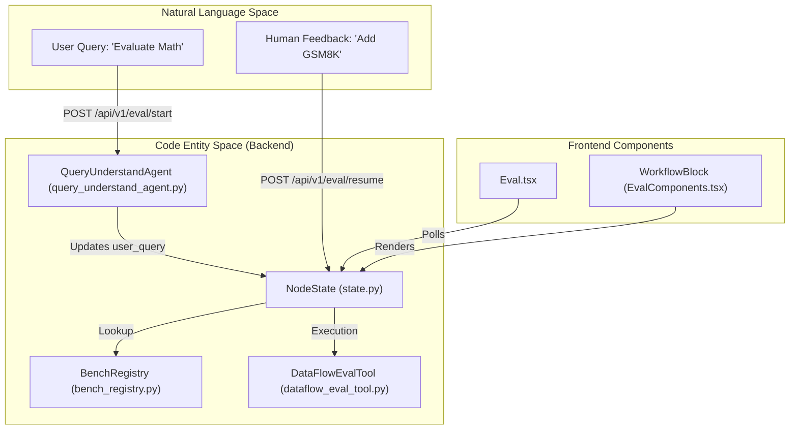
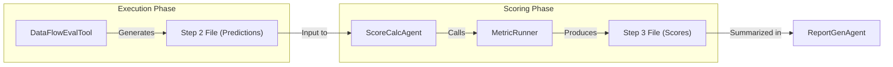

<!-- source: DeepWiki mcp.deepwiki.com · repo OpenDCAI/One-Eval · page 8 Glossary · fetched 2026-11-02 -->

# Glossary

Relevant source files

The following files were used as context for generating this wiki page:

- [HOW_TO_REGISTER_METRIC.md](HOW_TO_REGISTER_METRIC.md)
- [README.md](README.md)
- [README_zh.md](README_zh.md)
- [one-eval-web/.gitignore](one-eval-web/.gitignore)
- [one-eval-web/src/pages/Eval.tsx](one-eval-web/src/pages/Eval.tsx)
- [one_eval/agents/bench_resolve_agent.py](one_eval/agents/bench_resolve_agent.py)
- [one_eval/agents/report_gen_agent.py](one_eval/agents/report_gen_agent.py)
- [one_eval/agents/score_calc_agent.py](one_eval/agents/score_calc_agent.py)
- [one_eval/core/state.py](one_eval/core/state.py)
- [one_eval/nodes/bench_name_suggest_node.py](one_eval/nodes/bench_name_suggest_node.py)
- [one_eval/nodes/bench_search_node.py](one_eval/nodes/bench_search_node.py)
- [one_eval/nodes/dataset_keys_node.py](one_eval/nodes/dataset_keys_node.py)
- [one_eval/nodes/pre_eval_review_node.py](one_eval/nodes/pre_eval_review_node.py)
- [one_eval/toolkits/dataflow_eval_tool.py](one_eval/toolkits/dataflow_eval_tool.py)
- [one_eval/utils/bench_registry.py](one_eval/utils/bench_registry.py)
- [one_eval/utils/bench_table/bench_config.json](one_eval/utils/bench_table/bench_config.json)
- [one_eval/utils/prompts.py](one_eval/utils/prompts.py)
- [static/logo/318QRcode.jpg](static/logo/318QRcode.jpg)
- [tests/test_hf.py](tests/test_hf.py)

This page defines codebase-specific terms, abbreviations, and domain concepts used in One-Eval. It provides technical implementation details and maps natural language concepts to their corresponding code entities.

## 1. Core Architecture Concepts

One-Eval is built on the **NL2Eval** (Natural Language to Evaluation) paradigm, where a natural language query is transformed into a structured evaluation workflow.

| Term | Definition | Code Entity |
| :--- | :--- | :--- |
| **NL2Eval** | The core concept of converting natural language goals into executable evaluation pipelines. | [one_eval/graph/workflow_all.py:101-105]() |
| **Graph** | A directed acyclic graph (DAG) or cyclic graph managed by LangGraph that orchestrates evaluation phases. | [one_eval/graph/workflow_all.py:91-105]() |
| **Node** | A single functional unit within the graph (e.g., `QueryUnderstandNode`, `DownloadNode`). | [one_eval/core/node.py:20-21]() |
| **State** | The global data container (`NodeState`) that flows through the graph, persisting intermediate results. | [one_eval/core/state.py:79-123]() |
| **HITL** | **Human-in-the-Loop**. Interrupt points in the graph where execution pauses for manual approval or correction. | [one_eval/core/state.py:115-118]() |

### Implementation Mapping: NL Space to Code Space

The following diagram illustrates how natural language concepts map to specific Python classes and state structures.

**System Concept to Code Entity Mapping**

Sources: [one_eval/core/state.py:79-123](), [one_eval/server/app.py:74-80](), [one-eval-web/src/pages/Eval.tsx:54-116]()

---

## 2. Evaluation Pipeline Entities

### Bench Gallery & Registry
The **Bench Gallery** is a curated collection of benchmark metadata.
*   **BenchRegistry**: The class responsible for loading `bench_gallery.json` and matching user queries to benchmarks using aliases or domain tags [one_eval/utils/bench_registry.py:10-46]().
*   **BenchInfo**: A dataclass representing a specific benchmark instance in the current evaluation run, including its download and evaluation status [one_eval/core/state.py:37-49]().
*   **BenchmarkRetriever**: Implements TF-IDF and RAG-based search over the `BenchmarkTable_Filter.xlsx` to suggest benchmarks [one_eval/nodes/bench_name_suggest_node.py:30-80]().

### Agents & Nodes
*   **CustomAgent**: The base class for LLM-driven logic. It uses `PromptRegistry` to fetch templates [one_eval/core/agent.py:9-12]().
*   **QueryUnderstandAgent**: Parses the user query into structured fields like `domain`, `specific_benches`, and `model_path` [one_eval/utils/prompts.py:45-81]().
*   **BenchResolveAgent**: Resolves benchmark names to either local gallery entries or HuggingFace repositories [one_eval/agents/bench_resolve_agent.py:15-50]().
*   **ScoreCalcAgent**: Orchestrates the execution of metrics via `MetricRunner` and generates "Step 3" files containing detailed scores [one_eval/agents/score_calc_agent.py:17-152]().

---

## 3. Execution & Metrics

### DataFlow Integration
One-Eval leverages the **DataFlow** library for heavy-lifting execution.
*   **DataFlowEvalTool**: A wrapper that manages `BenchAnswerGenerator` and `UnifiedBenchDatasetEvaluator` [one_eval/toolkits/dataflow_eval_tool.py:85-110]().
*   **RobustAPILLMServing**: A specialized class within One-Eval that adds exponential backoff and jitter to DataFlow's API calls to handle `HTTP 429` (Rate Limit) errors [one_eval/toolkits/dataflow_eval_tool.py:27-57]().

### Metric System
*   **MetricRegistry**: A decorator-based system for registering Python functions as evaluation metrics.
*   **MetricRunner**: The engine that aligns model predictions with ground truth labels and executes the assigned metrics in parallel [one_eval/agents/score_calc_agent.py:152-160]().
*   **MetricPlan**: A dictionary in `NodeState` mapping each benchmark to a list of metrics (primary, secondary, or diagnostic) [one_eval/core/state.py:108]().

**Data Flow: From Prediction to Score**

Sources: [one_eval/toolkits/dataflow_eval_tool.py:85-110](), [one_eval/agents/score_calc_agent.py:115-127](), [one_eval/agents/report_gen_agent.py:97-124]()

---

## 4. State & Persistence

*   **NodeState**: Inherits from `MainState`. It tracks the `eval_cursor` (current benchmark being processed), `benches` list, and `eval_results` [one_eval/core/state.py:79-113]().
*   **Checkpointing**: LangGraph uses `AsyncSqliteSaver` (in `app.py`) to persist the `NodeState` to a SQLite database, allowing runs to be resumed after an interrupt or crash [one_eval/core/state.py:134-138]().
*   **Thread ID**: A unique identifier for a specific evaluation session, used by the frontend to poll status and send human feedback [one-eval-web/src/pages/Eval.tsx:62]().

## 5. Frontend Vocabulary

*   **Work Mode**:
    *   `Agent Mode`: The system automatically progresses through the graph.
    *   `Manual Mode`: Users manually configure models and benchmarks before starting [one-eval-web/src/pages/Eval.tsx:57-60]().
*   **WorkflowBlock**: A UI component that visualizes the status (idle, running, completed, interrupted) of each graph node [one-eval-web/src/pages/EvalComponents.tsx:10]().
*   **ReportData**: The structured JSON object returned by `ReportGenAgent` containing radar charts, error distributions, and LLM-generated summaries [one_eval/agents/report_gen_agent.py:124-143]().

Sources: [one_eval/core/state.py:1-145](), [one_eval/agents/report_gen_agent.py:17-81](), [one_eval/utils/prompts.py:11-236](), [one_eval/nodes/bench_name_suggest_node.py:30-207]()